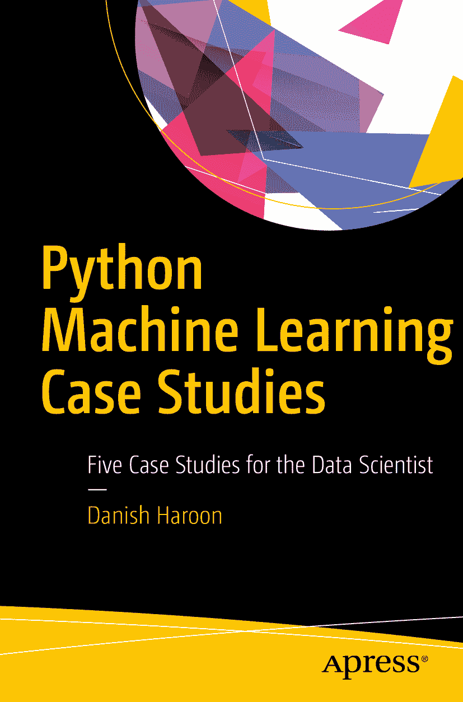

丹麦·哈龙 Python 机器学习案例研究面向数据科学家的五个案例研究

本书作者引用的任何源代码或其他补充材料，读者均可通过本书在 GitHub 上的产品页面获取，网址为 [`www.apress.com/978-1-4842-2822-7`](http://www.apress.com/978-1-4842-2822-7)。如需更详细信息，请访问 [`http://www.apress.com/source-code`](http://www.apress.com/source-code)。ISBN 978-1-4842-2822-7 电子书 ISBN 978-1-4842-2823-4 [`doi.org/10.1007/978-1-4842-2823-4`](https://doi.org/10.1007/978-1-4842-2823-4) 美国国会图书馆控制编号：2017957234 © 丹麦·哈龙 2017 本作品受版权保护。出版商保留所有权利，涉及全部或部分材料，特别是翻译、重印、重用插图、朗诵、广播、微缩胶片复制或任何其他物理方式、以及信息存储与检索的传输、电子改编、计算机软件，或目前已知或未来开发的任何类似或不同方法的权利。本书中可能出现商标名称、标识和图像。我们不以每次出现商标名称、标识或图像时都使用商标符号，而是仅以编辑方式使用这些名称、标识和图像，以利于商标所有者，且无意侵犯商标权。本出版物中对商品名称、商标、服务标记及类似术语的使用，即使未明确标识，也不应被视为对其是否受专有权利保护的看法表达。尽管本书中的建议和信息在出版时被认为是真实准确的，但作者、编辑和出版商均不对可能出现的任何错误或遗漏承担法律责任。出版商对本书所含内容不作任何明示或暗示的保证。本书采用无酸纸印刷。通过 Springer Science+Business Media New York 向全球图书贸易发行，地址：233 Spring Street, 6th Floor, New York, NY 10013。电话：1-800-SPRINGER，传真：(201) 348-4505，电子邮件：orders-ny@springer-sbm.com，或访问 www.springeronline.com。Apress Media, LLC 是加利福尼亚州有限责任公司，其唯一成员（所有者）是 Springer Science + Business Media Finance Inc (SSBM Finance Inc)。SSBM Finance Inc 是一家特拉华州公司。引言

本书采用机器学习方法和 Python，旨在自动生成丰富的见解并解决业务问题。本书采用基于案例研究的实践方法，深入剖析机器学习概念能够提供最佳解决方案的真实世界应用。这些更智能的机器将使您的业务流程以最少的时间和资源实现高效率。

《Python 机器学习案例研究》将引导您逐步改进业务流程，并帮助您发现构成企业战略的关键点。您将了解到能够为您的产品和服务提供支持的机器学习技术。本书还强调了每种机器学习概念的优缺点，以帮助您决定哪种最适合您的需求。

通过逐步的编码方法，您将能够理解机器学习过程中模型选择背后的基本原理。本书配备了实际示例和代码片段，以确保您理解用于解决现实世界问题的数据科学方法。

《Python 机器学习案例研究》为技术背景和非技术背景的人士提供了将机器学习技术应用于现实世界问题的助力。每一章都从一个具有明确业务问题的案例研究开始。随后，各章通过融入故事情节和代码片段来决定最优解决方案。各章中穿插了练习，以便对所学概念进行实践操作。每章末尾都会重点介绍可以应用所学概念的现实世界应用。以下是五章内容的简要概述：

第 1 章涵盖统计学和概率论的概念。

第 2 章讨论回归技术以及微调模型的方法。

第 3 章向读者介绍时间序列模型，并详细讲解平稳性属性。

第 4 章使用聚类作为辅助手段，为营销目的对数据进行细分。

第 5 章讨论分类模型以及用于衡量这些模型优劣的评估指标。

致谢

我要感谢我的父母和亲爱的妻子，感谢他们在这段启迪人心的旅程中给予的持续支持。

目录 第 1 章：统计与概率 1 案例研究：共享单车计划——确定品牌形象 1 执行探索性数据分析 4 特征探索 4 变量类型 6 单变量分析 9 多变量分析 14 时间序列成分 18 度量中心 20 均值 20 中位数 22 众数 22 方差 22 标准差 23 常数存在时中心统计量的变化 23 正态分布 25 相关性 34 皮尔逊 R 相关系数 34 肯德尔秩相关系数 34 斯皮尔曼秩相关系数 35 假设检验：比较两组数据 37 t 统计量 37 t 分布与样本量 38 中心极限定理 40 案例研究发现 41 统计与概率的应用 42 精算科学 42 生物统计学 42 天体统计学 42 商业分析 42 计量经济学 43 机器学习 43 统计信号处理 43 选举 43 第 2 章：回归 45 案例研究：消除混凝土抗压强度中的不一致性 45 回归的概念 48 插值与外推 48 线性回归 49 y 对 x 的最小二乘回归线 50 多元回归 51 逐步回归 52 多项式回归 53 回归的假设 54 案例数量 55 缺失数据 55 多重共线性与奇异性 55 特征探索 56 相关性 58 过拟合与欠拟合 64 回归评估指标 67 解释方差得分 68 平均绝对误差 68 均方误差 68 R² 69 残差 69 残差图 70 残差平方和 70 回归类型 70 线性回归 71 网格搜索 75 岭回归 75 套索回归 79 弹性网络 81 梯度提升回归 82 支持向量机 86 回归的应用 89 预测销售额 89 预测债券价值 90 通货膨胀率 90 保险公司 91 呼叫中心 91 农业 91 预测薪资 91 房地产行业 92 第 3 章：时间序列 95 案例研究：预测雅虎每日调整收盘价 95 特征探索 97 时间序列建模 98 评估时间序列对象的平稳性 98 平稳时间序列的性质 99 判断时间序列是否平稳的检验 99 使时间序列对象平稳的方法 102 判断时间序列是否具有自相关性的检验 113 自相关函数 113 偏自相关函数 114 测量自相关性 114 时间序列建模 115 验证预测序列的检验 116 确定建模参数 116 自回归积分滑动平均模型 119 自回归滑动平均模型 119 自回归 120 滑动平均 121 组合模型 122 回缩预测 123 时间序列分析的应用 127 销售预测 127 天气预报 127 失业率估算 127 疾病爆发 128 股市预测 128 第 4 章：聚类 129 案例研究：确定营销短尾关键词 129 特征探索 131 监督学习与无监督学习 133 监督学习 133 无监督学习 133 聚类 134 建模的数据转换 135 评估聚类模型的指标 137 聚类模型 137 k 均值聚类 137 应用 k 均值聚类确定最佳聚类数 143 主成分分析 144 高斯混合模型 151 贝叶斯高斯混合模型 156 聚类的应用 159 疾病识别 159 搜索引擎中的文档聚类 159 基于人口统计的客户细分 159 第 5 章：分类 161 案例研究：俄亥俄诊所——满足供需 161 特征探索 164 执行数据整理 168 执行探索性数据分析 172 特征生成 178 分类 180 模型评估技术 181 通过拆分数据集确保交叉验证 184 决策树分类 185 核近似 186 SGD 分类器 187 集成方法 189 随机森林分类 190 梯度提升 193 分类的应用 195 图像分类 196 音乐分类 196 电子邮件垃圾邮件过滤 196 保险 196 附录 A：图表类型及其使用时机 197 饼图 197 条形图 198 直方图 198 茎叶图 199 箱线图 199 索引 201 内容概览 关于作者 xi   关于技术审校者 xiii   致谢 xv   引言 xvii   第 1 章：统计与概率 1   第 2 章：回归 45   第 3 章：时间序列 95   第 4 章：聚类 129   第 5 章：分类 161   附录 A：图表类型及其使用时机 197   索引 201   关于作者与关于技术审校者 关于作者 关于技术审校者

