# 1. 统计学与概率论

本章旨在向你灌输传统统计学与概率论的基本概念。当然，你们中的许多人可能想知道这与机器学习有什么关系。实际上，为了将最佳拟合模型应用于你的数据，最重要的前提是你首先要理解数据本身。这将使你能够发现数据中的分布，衡量数据的质量，并运行一些基本测试，以了解因变量和自变量之间是否存在某种关系。让我们开始吧。

**注意**

本书采用 Python 2.7.11 作为代码示例的事实标准。此外，你需要在本地安装它以便完成练习。

那么，为什么我更喜欢 Python 2.7.11 而不是 Python 3x 呢？以下是一些原因：

*   第三方库对 Python 2x 的支持相对优于对 Python 3x 的支持。这意味着 Python 2x 中有相当数量的库在 Python 3x 中缺乏支持。

*   一些当前的 Linux 发行版和 macOS 默认提供 Python 2x。目的是让读者无论使用何种操作系统版本，都能在其系统上应用代码示例，因此这是继续前进的选择。

*   上述事实是企业倾向于使用 Python 2x 或决定不将其代码库从 Python 2x 迁移到 Python 3x 的原因。

## 案例研究：共享单车计划——确定品牌形象

南希和埃里克被分配了一项艰巨的任务：为一个新的共享单车计划确定品牌形象。他们必须在今年的年度董事会上展示他们的成果，以便制定一个强有力的营销计划来吸引潜在客户。

该共享单车计划为城市居民提供了一种便捷、廉价且环保的交通替代方式。该服务在西雅图设有 50 个站点，共 500 辆自行车。每个站点都配备有锁车系统（所有自行车停放在此）、自助服务终端（客户可以获取会员钥匙或支付行程费用）以及头盔租赁服务。人们可以选择购买会员钥匙或短期通行证。会员钥匙赋予年度会员资格，钥匙可以从自助服务终端获取。会员的优势包括快速取车以及不限次数的 45 分钟免费骑行。短期通行证则允许在 24 小时或 3 天内使用自行车。骑行者可以在全市 50 个站点中的任何一个取车和还车。

杰森于 2014 年 5 月启动了这项服务，此后一直专注于增加自行车数量和停靠站点，以便为客户提供更多便利和可达性。尽管进行了扩张，客户留存率仍然是一个问题。正如杰森回忆的那样：“我们计划投入一年的投资来铺设必要的基础设施，以便客户开始使用。我们制定了一项策略，确保留存率保持在高位，使这种模式能够自我维持。然而，结果却事与愿违（即，客户基础的增长未能跟上基础设施扩张的速度）。”

一家私营服务公司会有三种选择来遏制这个问题：争取赞助商、提高服务费用或扩大客户群。涨价对杰森来说不是一个选项，因为这是一项公共资助的倡议，旨在为所有人提供负担得起的交通。至于增加客户群，他们必须决定一种能够以低成本实现广泛覆盖的营销渠道。

南希，一位在企业部门工作了十年的营销人员，以及埃里克，一位数据分析师，被专门聘用，以找到解决这个问题的方法。他们的优势在于，他们获得了交易历史数据集，因此无需经历进行市场研究以收集数据的麻烦。

南希意识到，在最低预算下吸引回头客，首先需要了解客户（即，客户画像）。正如她所说：“了解你的品牌形象至关重要，因为它能帮助你接触到更有可能以更高概率转化的目标受众。此外，这也有助于吸引针对类似客户画像的赞助商。这种双管齐下的方法可以使我们的利润为正。”

当南希和埃里克思考手头的问题时，他们提出了如下问题：哪个属性与行程时长和行程次数的相关性最强？哪个年龄段的人最适应我们的服务？

以下是提供给南希和埃里克的行程数据集的数据字典：

表 1-1.
共享单车数据集中行程数据的数据字典

| 特征名称 | 描述 |
| --- | --- |
| `trip_id` | 分配给每次行程的唯一 ID |
| `Starttime` | 行程开始的日期和时间（太平洋标准时间） |
| `Stoptime` | 行程结束的日期和时间（太平洋标准时间） |
| `Bikeid` | 分配给每辆自行车的 ID |
| `Tripduration` | 行程时间（秒） |
| `from_station_name` | 行程出发站点的名称 |
| `to_station_name` | 行程到达站点的名称 |
| `from_station_id` | 行程出发站点的 ID |
| `to_station_id` | 行程到达站点的 ID |
| `Usertype` | 值可以是以下之一：短期通行证持有者或会员 |
| `Gender` | 骑行者的性别 |
| `Birthyear` | 骑行者的出生年份 |

本章的练习要求埃里克安装清单 1-1 中所示的包。他倾向于提前导入所有包，以避免在本地机器上实现代码片段时出现瓶颈。

然而，为了让埃里克在他的代码中导入这些包，他首先需要安装它们。他按如下方式操作：

1.  打开终端/Shell
2.  使用终端/Shell 导航到他的代码目录
3.  安装 `pip`：
```
    python get-pip.py
```
4.  分别安装每个包，例如：
```
    pip install pandas
```

清单 1-1. 导入本章所需的包
```
%matplotlib inline
import random
import datetime
import pandas as pd
import matplotlib.pyplot as plt
import statistics
import numpy as np
import scipy
from scipy import stats
import seaborn
```

## 执行探索性数据分析

埃里克回忆起他曾用以下话语解释探索性数据分析：

> 我所说的探索性数据分析（EDA）是什么意思？嗯，我的意思是通过可视化方式查看数据。为什么我们需要通过可视化方式查看数据？好吧，考虑到你的数据集中有 100 万个观测值，仅仅通过查看数据来理解它并不容易，因此最好将其可视化地绘制出来。但你不觉得这是在浪费时间吗？不，一点也不，因为理解数据能让我们理解特征的重要性及其局限性。

### 特征探索

Eric 首先将数据加载到内存中（参见清单 1-2）。

清单 1-2. 将数据读入内存
```
data = pd.read_csv('examples/trip.csv')
```

Nancy 好奇数据有多大以及数据长什么样。因此，Eric 编写了清单 1-3 中的代码，打印数据集的一些初步观察结果，以便了解其内容。

清单 1-3. 打印数据集大小并打印前几行
```
print len(data)
data.head()
```

**输出**

表 1-2. 数据集前七列观察结果打印

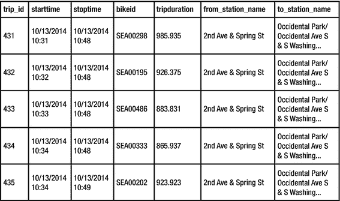

查看表 1-2 和表 1-3 后，Nancy 注意到 `tripduration` 以秒为单位表示。此外，`bikeid`、`from_station_id` 和 `to_station_id` 的唯一标识符是字符串形式，而 `trip_id` 的唯一标识符则是整数形式。

表 1-3. 数据集后五列观察结果打印

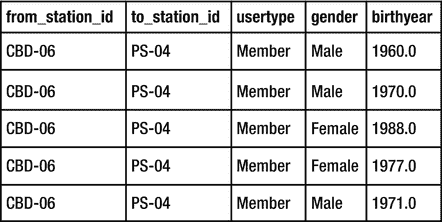

### 变量类型

Nancy 决定更进一步，为数据集中的每个特征分配数据类型。

表 1-4. Nancy 将变量分类为数据类型的方法

| 特征名称 | 变量类型 |
| --- | --- |
| `trip_id` `bikeid` `tripduration` `from_station_id` `to_station_id` `birthyear` | 数字 |
| `Starttime` `Stoptime` | 日期 |
| `from_station_name` `to_station_name` `Usertype` `Gender` | 文本 |

查看表 1-4 中的特征分类后，Eric 注意到 Nancy 正确识别了数据类型，因此对他来说，解释变量类型的含义似乎是一件容易的事。Eric 回忆起他曾解释过以下内容：

> 在日常与数据交互中，我们通常将数字表示为整数，文本表示为字符串，真/假表示为布尔值等。这些就是我们所说的数据类型。但机器学习中的术语更为细致，它将我们之前了解的数据类型细分为变量类型。理解这些变量类型对于在进行探索性数据分析或决定将哪种合适的机器学习算法应用于我们的数据时选择图表类型至关重要。

#### 连续/定量变量

连续变量在给定范围内可以有无限多个值。与离散变量不同，它们是不可数的。在探索连续变量的类型之前，让我们先理解什么是真正的零点。

##### 真正的零点

如果某个测量尺度具有真正的零点，那么值为 0 意味着你什么都没有。以表示购买的纸杯蛋糕数量的比率变量为例。值为 0 表示你连一个纸杯蛋糕都没买。真正的零点是区分定距变量和比率变量的关键因素。

现在让我们探索不同类型的连续变量。

##### 定距变量

# 变量类型与单变量分析

## 变量类型

定距变量存在于本质上是连续的且具有数值的数据中。以每天测量的某个社区的温度为例。间隔之间的差异保持不变，例如 `70` 摄氏度和 `50` 摄氏度之间的差异与 `80` 摄氏度和 `100` 摄氏度之间的差异相同。我们可以计算定距变量的平均值和中位数，但它们没有真正的零点。

### 比率变量

定距变量的属性与比率变量非常相似，区别在于比率变量中，`0` 表示该测量值不存在。以某个社区汽车行驶的距离为例。摄氏温度是一个定距变量，因此值为 `0` 摄氏度并不意味着没有温度。然而，请注意，值为 `0` 公里表示汽车没有行驶距离，因此被视为比率变量。此外，顾名思义，测量的比率也可以使用，例如行驶 `50` 公里的距离是汽车行驶 `25` 公里距离的两倍。

## 离散变量

离散变量在给定范围内具有有限的值集。与连续变量不同，它们是可数的。让我们看一些本质上是分类的离散变量的例子。

### 定序变量

定序变量的值按从低到高或从高到低的顺序排列。这些定序变量内部的层级之间可以有不等的间距。例如，以下层级：

1.  小学
2.  中学
3.  学院
4.  大学

小学和中学之间的年数差异肯定不等于中学和学院之间的差异。如果这些差异是恒定的，那么这个变量也有资格成为定距变量。

### 定类变量

定类变量是没有内在顺序的分类变量；然而，层级之间存在恒定的差异。定类变量的例子可以是性别、一年中的月份、制造商发布的汽车等。以一年中的月份为例，每个月都是一个不同的层级。

### 二分变量

二分变量是只有两个类别或层级的定类变量。例子包括：
*   年龄：`24` 岁以下，`24` 岁以上
*   性别：男，女

## 潜在变量

潜在变量不属于解释变量（即自变量）或响应变量（即因变量），但可能影响对这些变量之间关系的解释。例如，如果我们想根据申请人的性别预测他/她是否能被大学录取。在这种情况下，一个可能的潜在变量可以是申请人寻求录取的院系名称。

## 人口统计变量

人口统计学（源自希腊语，意为“描述人民”）是对人口的研究。该学科考察人口的规模和构成，以及人口从一个地方到另一个地方的流动。人口统计学家还分析人口增长及其控制的影响。人口统计变量是研究人员收集的变量，用于描述用于推断统计的样本的性质和分布。在应用统计学和研究中，这些变量包括年龄、性别、种族、社会经济指标和群体成员身份等。

## 因变量与自变量

自变量也被称为解释变量，因为它用于解释或预测因变量（也称为响应变量或结果变量）。

结合数据集来看，哪些是因变量和自变量？假设共享单车系统的管理层找到你，要求你构建一个系统来提前预测行程时长，以确保单车供应充足。在这种情况下，你的因变量是什么？显然是行程时长。那么自变量又是什么？这些变量将包含我们认为影响因变量的特征（例如，用户类型、性别以及具体时间和日期）。

埃里克让南希根据他刚刚解释的变量类型对特征进行分类。

**表 1-5. 南希将变量分类为变量类型的方法**

| 特征名称 | 变量类型 |
| --- | --- |
| `trip_id` `bikeid` `tripduration` `from_station_id` `to_station_id` `birthyear` | 连续型 |
| `Starttime` `Stoptime` | 日期时间型 |
| `from_station_name to_station_name` | 字符串型 |
| `Usertype gender` | 名义型 |

南希现在对机器学习中的变量类型有了清晰的认识，也知道了哪些特征属于哪种变量类型（见表 1-5）。然而，尽管查看了每个特征的初始观测值（见表 1-2），她仍然无法推断出每个表格所包含信息的深度和广度。她向埃里克提到了这一点，而作为数据分析专家的埃里克给出了答案：对数据集中的特征进行单变量分析。

## 单变量分析

单变量一词源于“uni”，意为单一。这是对单个变量进行的分析，因此不涉及解释变量之间的任何关系。

埃里克决定对数据集进行单变量分析，以便更好地单独理解各个特征（见代码清单 1-4）。

```python
data = data.sort_values(by='starttime')
data.reset_index()
print 'Date range of dataset: %s - %s'%(data.ix[1, 'starttime'], data.ix[len(data)-1, 'stoptime'])
```

**代码清单 1-4. 确定数据集的时间范围**

输出：

```
Date range of dataset: 10/13/2014 10:32 - 9/1/2016 0:20
```

埃里克知道南希理解代码会有困难，因此他决定解释那些他认为本质上较为复杂的部分。关于代码清单 1-4 中的代码，埃里克解释道：

> 我们首先按 `starttime` 对数据框进行排序。请注意，数据框是 Python 中的一种数据结构，我们在代码清单 1-2 中最初将数据加载到了其中。数据框有助于以表格形式组织数据，并通过哈希值实现快速搜索。此外，数据框还提供了便捷的函数，使数据分析工作更加轻松。排序操作改变了数据框内记录的位置，而位置的变化打乱了原本按升序排列的索引顺序。因此，考虑到这一点，我们决定重置索引，以便排序后的数据框现在拥有升序的索引。最后，我们打印了从 `starttime` 的第一个值开始到 `stoptime` 的最后一个值结束的日期范围。

埃里克的分析得出了两个见解。一是数据范围从 `2014` 年 `10` 月到 `2016` 年 `9` 月（即三年的数据）。此外，共享单车服务似乎通常在标准的朝九晚五工作时间之外也在运营。

南希认为短期通行证持有者会比长期会员使用更多的行程。她相信大多数人会按日使用该服务，而不是购买长期会员。埃里克持不同看法；他认为新用户会是短期通行证持有者，但一旦他们尝试了服务并感到满意，最终会购买会员以享受提供的优惠和福利。他还认为，人们往往更重视自己付费的服务，并确保每一分钱都花得物有所值。因此，埃里克决定绘制一个按用户类型划分的行程频率条形图来验证他的观点（见代码清单 1-5）。但在绘制之前，他简要记录了一些常用图表及其最适合的场景（副本见附录 A）。这张图表让南希理解了他为何在当前情况下选择条形图。

```python
groupby_user = data.groupby('usertype').size()
groupby_user.plot.bar(title = 'Distribution of user types')
```

**代码清单 1-5. 绘制用户类型分布图**

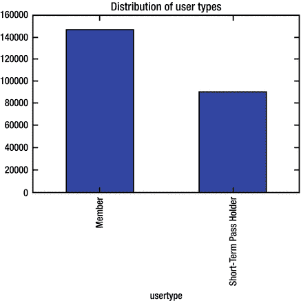

**图 1-1. 表示用户类型分布的条形图**

南希不理解代码清单 1-5 中的代码片段。她对 `groupby` 和 `size` 方法的功能感到困惑。她记得曾问过埃里克以下问题：“我能理解 `groupby` 按给定字段（即当前情况下的 `usertype`）对数据进行分组。但 `size` 是什么意思？它是否等同于 `count`，即统计每个分组的用户类型中的行程数量？”

埃里克对南希的推断感到惊讶，并认为她的理解是正确的。然而，条形图呈现的见解（见图 1-1）支持了埃里克的观点，因为会员比非会员使用了更多的行程。

南希最近读到一篇文章，讨论了骑自行车人群中的性别差异。文章提到英国的一个共享单车计划中，使用该服务的用户有 `77%`是男性。她不确定美国使用该服务的人群是否也存在类似现象。于是埃里克编写了清单 1-6 中的代码片段，以解答当前的问题。

```python
groupby_gender = data.groupby('gender').size()
groupby_gender.plot.bar(title = 'Distribution of genders')
```

**清单 1-6. 绘制性别分布图**

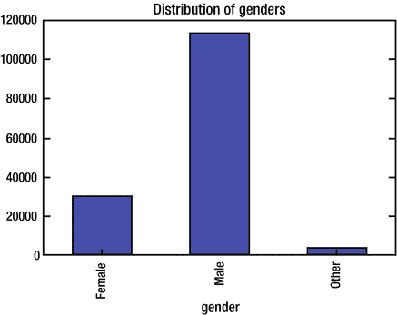

**图 1-2. 表示性别分布的柱状图**

图 1-2 显示，性别差异在各州也同样存在。男性似乎主导了该计划中的出行次数。

作为营销专家的南希对目前的分析结果感到满意。然而，她还想进一步了解公司的营销信息将针对的目标客户群体。因此，埃里克决定通过编写清单 1-7 中的代码来呈现出生年份的分布情况。他认为这有助于南希了解哪些年龄段的人最可能骑自行车，或者更倾向于使用该服务。

```python
data = data.sort_values(by='birthyear')
groupby_birthyear = data.groupby('birthyear').size()
groupby_birthyear.plot.bar(title = 'Distribution of birth years', figsize = (15,4))
```

**清单 1-7. 绘制出生年份分布图**

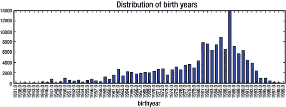

**图 1-3. 表示出生年份分布的柱状图**

图 1-3 提供了一个非常有趣的说明。订阅该计划的大多数人属于 Y 世代（即出生于 20 世纪 80 年代初至 90 年代末，也被称为千禧一代）。南希最近阅读了 Elite Daily 和 CrowdTwist 发布的报告，其中指出千禧一代是对自己喜爱品牌最忠诚的一代。原因之一是他们愿意分享对产品/服务的想法和意见。这些意见构成了庞大的经验库——足以让千禧一代做出深思熟虑的决定，并且他们会长期忠于这个决定。因此，南希确信大多数千禧一代会是会员，而非短期通行证持有者。埃里克决定绘制一个柱状图来验证南希的推论是否成立。

```python
data_mil = data[(data['birthyear'] >= 1977) & (data['birthyear']<=1994)]
groupby_mil = data_mil.groupby('usertype').size()
groupby_mil.plot.bar(title = 'Distribution of user types')
清单 1-8.
绘制千禧一代会员类型的频率分布图
```

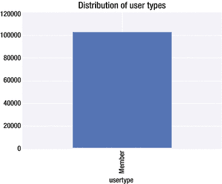

图 1-4.

千禧一代会员类型的柱状图

看到图 1-4 后，埃里克惊讶地发现南希的推论似乎是正确的，南希则记下笔记，确保品牌在营销计划中吸引千禧一代的参与。

埃里克知道，当分析中涉及多个特征时，可能会涌现出更多见解。因此，在深入挖掘更多洞察之前，他决定先让南希一窥多变量分析。

### 多变量分析

多变量分析是指纳入多个解释变量来理解响应变量的行为。考虑到现实世界中的实体通常是相互关联的，这似乎是最可行且最现实的方法。因此，响应变量的变异性可能受到相互关联的解释变量变异性的影响。

南希认为，在完成的出行次数方面，男性会超过女性。图 1-2 显示男性完成的出行次数远多于其他性别类型，这让她更加坚信这一观点。埃里克认为验证这一观点的最佳方法是使用堆叠柱状图（即，针对出生年份的柱状图，但每个柱形有两种颜色，分别代表一种性别）（见图 1-5）。

```python
groupby_birthyear_gender = data.groupby(['birthyear', 'gender'])['birthyear'].count().unstack('gender').fillna(0)
groupby_birthyear_gender[['Male','Female','Other']].plot.bar(title = 'Distribution of birth years by Gender', stacked=True, figsize = (15,4))
清单 1-9.
按性别类型绘制出生年份分布图
```

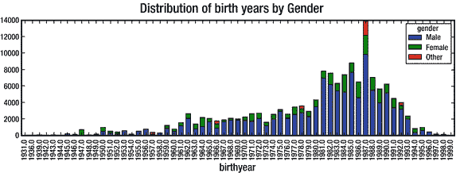

图 1-5.

按性别类型表示出生年份分布的柱状图

清单 1-9 中的代码片段揭示了一些之前未强调的新方面。

> 我们首先通过取消堆叠（即拆分）的方式，将性别列转换为三列：男性、女性和其他。这意味着对于每个出生年份，我们都有了三种性别类型的出行次数。最后，使用这个转换后的数据框创建了一个堆叠柱状图。

看起来男性在分布中占主导地位。这也很合理，不是吗？嗯，确实如此；正如之前所见，大多数出行是由男性完成的，因此这导致了分布偏向男性。然而，出生于 1947 年的订阅者全是女性。此外，出生于 1964 年和 1994 年的订阅者也以女性为主。因此，南希的假设和推理确实成立。

清单 1-4 中的分析显示，所有千禧一代都是会员。南希好奇其他年龄段的用户类型分布是怎样的。其他年龄段的大多数人是否都是短期通行证持有者？因此，埃里克再次在应用中引入了堆叠柱状图（见图 1-6）。

```python
groupby_birthyear_user = data.groupby(['birthyear', 'usertype'])['birthyear'].count().unstack('usertype').fillna(0)
groupby_birthyear_user['Member'].plot.bar(title = 'Distribution of birth years by Usertype', stacked=True, figsize = (15,4))
清单 1-10.
按用户类型绘制出生年份分布图
```

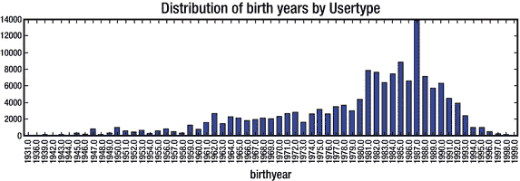

图 1-6.

按用户类型表示出生年份分布的柱状图

哇！南希惊讶地发现只显示了一种用户类型的分布，而不是两种（即会员和短期通行证持有者）？这是否意味着出生年份信息只存在于一种用户类型中？埃里克决定进一步深入挖掘并验证这一点（见清单 1-11）。

```python
data[data['usertype']=='Short-Term Pass Holder']['birthyear'].isnull().values.all()
清单 1-11.
验证短期通行证持有者是否没有出生年份数据
```

输出

```
True
```

在清单 1-11 的代码中，埃里克首先对数据框进行了切片，只考虑短期通行证持有者。接着他继续检查该切片中出生年份的所有值是否缺失（即为空）。由于情况确实如此，南希最初推断的假设成立——即只有会员才有出生年份数据。这让她回想起之前关于千禧一代品牌忠诚度的推论。因此，清单 1-11 的输出推翻了南希在图 1-4 分析后得出的结论。这让南希感到沮丧，因为千禧一代的忠诚度无法从现有数据中得到验证。埃里克认为，会员在申请会员资格时必须提供出生年份等详细信息，而短期通行证持有者则无需提供。埃里克决定通过检查短期通行证持有者是否有性别数据来验证他的推论，为此他编写了清单 1-12 中的代码。

```python
data[data['usertype']=='Short-Term Pass Holder']['gender'].isnull().values.all()
清单 1-12.
验证短期通行证持有者是否没有性别数据
```

输出

```
True
```

因此埃里克得出结论，对于用户类型“短期通行证持有者”，我们没有人口统计变量。

南希很想知道出行频率如何随日期和时间变化（即时间序列分析）。埃里克知道数据中提供了行程开始时间，但为了绘制时间序列图，他必须将日期从字符串格式转换为日期时间格式（见清单 1-13）。他还决定做更多工作：即将日期时间拆分为日期组件（即年、月、日和小时）。

```python
List_ = list(data['starttime'])
List_ = [datetime.datetime.strptime(x, "%m/%d/%Y %H:%M") for x in List_]
data['starttime_mod'] = pd.Series(List_,index=data.index)
data['starttime_date'] = pd.Series([x.date() for x in List_],index=data.index)
data['starttime_year'] = pd.Series([x.year for x in List_],index=data.index)
data['starttime_month'] = pd.Series([x.month for x in List_],index=data.index)
data['starttime_day'] = pd.Series([x.day for x in List_],index=data.index)
data['starttime_hour'] = pd.Series([x.hour for x in List_],index=data.index)
清单 1-13.
将字符串转换为日期时间，并衍生新特征
```

埃里克像向南希解释那样，确保解释了清单 1-13 中的代码片段：

> 首先，我们将数据框的开始时间列转换为列表。接着，我们将字符串日期转换为 Python 的 datetime 对象。然后，我们将该列表转换为 Series 对象，并将日期从 datetime 对象转换为 pandas 的 date 对象。年、月、日和小时这些时间组件是从包含 datetime 对象的列表中衍生出来的。

现在是对数据集中所有日期的出行频率进行时间序列分析的时候了（见清单 1-14）。

```python
data.groupby('starttime_date')['tripduration'].mean().plot.bar(title = 'Distribution of Trip duration by date', figsize = (15,4))
清单 1-14.
绘制每日行程时长分布图
```

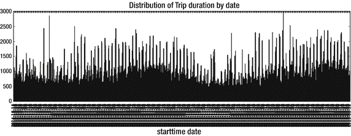

图 1-7.

表示每日行程时长分布的条形图

哇！行程时长似乎随时间呈现出明确的模式。

### 时间序列组件

# 时间序列分析中的模式类型

埃里克决定向南希简要介绍时间序列分析中存在的模式类型。他相信这能帮助南希理解图 1-7 中的明确模式。

## 季节性模式

季节性模式（见图 1-8）指的是在固定的已知周期后出现的季节性效应。这个周期可以是月中的周、年中的周、年中的月、年中的季度等。这就是为什么季节性时间序列也被称为周期性时间序列。

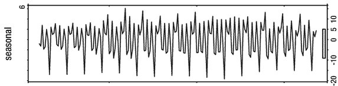

图 1-8. 季节性模式示意图

## 循环模式

循环模式（见图 1-9）与季节性模式不同，其模式在非周期性的时间周期中重复。

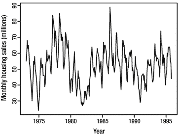

图 1-9. 循环模式示意图

## 趋势

趋势（见图 1-10）是连续变量的长期增加或减少。这种模式随时间可能并非完全线性，但应用平滑处理后，它可以概括为上升或下降方向。

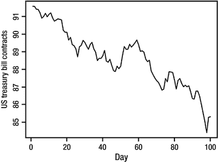

图 1-10. 趋势示意图

埃里克决定测试南希对时间序列概念的理解，于是他让她谈谈对图 1-7 中时间序列图的看法。“你觉得这个时间序列图怎么样？模式是季节性的还是循环的？是季节性的，对吧？”

南希的回答再次让埃里克感到惊讶。她说道：

> 是的，因为模式在固定的时间间隔内重复——即季节性。事实上，我们可以将这个分布拆分成三个分布。一个模式是随时间重复的季节性。第二个是平坦的密度分布。最后，第三个模式是该密度函数上的线条（即峰值）。在进行时间序列预测时，我们可以利用这两个分布对未来时间进行估计，并将它们相加，从而在计算出的置信区间内进行预测。

根据她的推论，南希在统计学选修课上的成绩似乎没有白费。南希还想知道更多问题的答案。因此，她决定用接下来的练习题来挑战读者。

**练习题**

1.  确定按年份划分的出行次数分布。你看到了特定的模式吗？
2.  确定按月份划分的出行次数分布。你看到了特定的模式吗？
3.  确定按天划分的出行次数分布。你看到了特定的模式吗？
4.  确定按天划分的出行次数分布。你看到了特定的模式吗？
5.  绘制每日出行次数的频率分布图。

# 度量中心

埃里克认为，均值、中位数和众数等度量有助于对相关特征进行概括性观察。考虑到这一点，他决定向南希讲解度量中心的概念。

## 均值

通俗地说，均值指的是数字的平均值。均值受异常值影响很大，因为异常值引入的偏斜会将均值拉向极端值。

*   符号：
    *   μ -> 参数 -> 总体均值
    *    -> 统计量 -> 样本均值
*   均值的规则：
    *   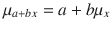
    *   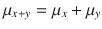

在我们的编码示例中，我们将使用 `statistics.mean(data)`。这将返回数据（一个实数序列或迭代器）的样本算术平均值。

均值主要有两种变体。

### 算术平均数

算术平均数比几何平均数更简单，因为它是对数值进行平均（即，将所有数值相加，然后除以这些数值的个数）。以十名学生在一次数学考试中的成绩为例：

*   78, 65, 89, 93, 87, 56, 45, 73, 51, 81

计算算术平均数的公式如下：

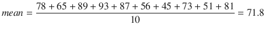

因此，学生在数学考试中成绩的算术平均数为 71.8。当观测值（即数学成绩）相互独立时，算术平均数最为适用。在此例中，这意味着一名学生的考试成绩不会影响另一名学生在同一考试中的成绩。

### 几何平均数

正如我们之前所见，算术平均数适用于相互独立的观测值。然而，这并不适用于几何平均数，因为它用于计算相互依赖的观测值的平均数。例如，假设你将储蓄投资于股票五年。每年的收益将再投资于下一年的股票。假设我们在五年中每年的回报率如下：

*   60%, 80%, 50%, -30%, 10%

这些回报率相互依赖吗？是的，没错！为什么？因为下一年的投资是基于前一年获得的资本进行的，因此第一年的亏损意味着下一年可投资的资本减少，反之亦然。所以，是的，我们将计算几何平均数。但如何计算呢？我们将按如下步骤进行：

*   `[(0.6 + 1) * (0.8 + 1) * (0.5 + 1) * (-0.3 + 1) * (0.1 + 1)]^(1/5) - 1 = 0.2713`

因此，具有这些回报率的投资在第五年末将产生 27.13% 的回报率。观察上述计算，你可以看到我们首先将百分比转换为小数。接着，我们给每个小数加 1，以消除负项带来的影响。然后，我们将所有项相乘，并对结果应用幂运算。所应用的幂是 1 除以观测值的个数（本例中为 5）。最后，我们将结果减去 1。进行减法是为了消除最初对每个项加 1 所带来的影响。如果我们没有对每个项（即每年的回报率）加 1，那么就不需要进行减 1 的操作。

## 中位数

中位数是与平均数、众数并列的一种中心位置度量，它受数据中异常值的影响较小。当数据中观测值的个数为奇数时，中间的数据点即为中位数。

在本章中，我们将使用 `statistics.median(data)` 来计算中位数。如果数值个数为奇数，该函数返回数值数据的中位数（中间值）；如果数值个数为偶数，则使用“中间两个数的平均值”方法返回中间两个值的平均数。如果数据为空，则会引发 `StatisticsError`。

## 众数

众数适用于离散或名义性质的数据。众数返回数据集中出现频率最高的观测值。众数不受数据中异常值的影响。

## 方差

方差表示数据点围绕平均数的离散程度。方差大意味着数据高度分散，方差小则表示数据紧密聚集。

1.  符号：
    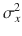
2.  公式：
    1.  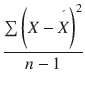
    2.  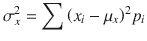
3.  为什么方差计算中分母是 n-1？样本方差的平均值往往小于总体方差；因此，自由度被用作转换因子。
4.  方差规则：
    1.  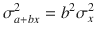
    2.  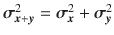（如果 X 和 Y 是独立变量）
        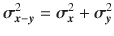
    3.  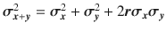（如果 X 和 Y 具有相关性 r）

$$ {\boldsymbol{\sigma}}_{\boldsymbol{x}+\boldsymbol{y}}²={\boldsymbol{\sigma}}_{\boldsymbol{x}}²+{\boldsymbol{\sigma}}_{\boldsymbol{y}}²+2\boldsymbol{r}{\boldsymbol{\sigma}}_{\boldsymbol{x}}{\boldsymbol{\sigma}}_{\boldsymbol{y}} $$](img/A432778_1_En_1_Chapter_Equh.gif)

在编程练习中，我们将使用 `statistics.variance(data, xbar=None)` 来计算方差。该函数将返回至少包含两个实数值的数列的样本方差。

### 标准差

标准差与方差一样，也衡量数据围绕平均数的离散程度。唯一的区别在于，标准差是方差的平方根。这使得它具有与数据相同的单位，从而便于从洞察中推断解释。标准差受异常值和偏态分布的影响很大。

- 符号：`σ`
- 公式：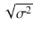

我们测量标准差而非方差，是因为：

- 它是正态分布中离散程度的自然度量
- 与原始观测值具有相同的单位

### 常数对中心统计量的影响

让我们评估当数据通过引入常数进行变换时，中心统计量会如何变化。我们将评估均值、中位数、四分位距、标准差和方差的结果。首先，我们来看当每个数据点加上或减去一个常数 `a` 时，这些统计量分别会表现出何种行为。

**加法：加上常数 `a`**

- 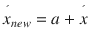
- 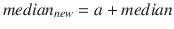
- 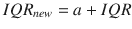
- 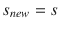
- 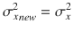

给每个观测值加上一个常数会影响均值、中位数和四分位距。然而，标准差和方差保持不变。请注意，当数据中的观测值减去一个常数时，也会出现相同的行为。接下来，我们看看当给数据中的每个观测值乘以一个常数（即 `b`）时，是否会出现相同的行为。

**乘法：乘以常数 `b`**

- 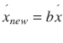
- 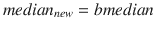
- 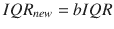
- 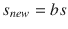
- 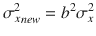

哇！给数据中的每个观测值乘以一个常数，改变了所有五个中心统计量。请注意，当数据中的所有观测值除以一个常数项时，也会产生相同的效果。

在了解了中心度量值的描述后，南希对详细理解行程时长产生了兴趣。因此，埃里克提出了计算平均行程时长和中位行程时长的想法。此外，南希想要确定大多数行程的起始站点，以便为现有客户开展促销活动。因此，埃里克决定确定 `from_station_name` 字段的众数。

> **注意**
> 使用统计包计算中心度量值需要将输入的数据结构转换为列表类型。

```python
trip_duration = list(data['tripduration'])
station_from = list(data['from_station_name'])
print 'Mean of trip duration: %f'%statistics.mean(trip_duration)
print 'Median of trip duration: %f'%statistics.median(trip_duration)
print 'Mode of station originating from: %s'%statistics.mode(station_from)
```

*Listing 1-15.* 使用统计包确定中心度量值

**输出**

```
Mean of trip duration: 1202.612210
Median of trip duration: 633.235000
Mode of station originating from: Pier 69 / Alaskan Way & Clay St
```

清单 1-15 的输出显示，大多数行程起始于 Pier 69/Alaskan Way & Clay St 站。因此，这是针对现有客户开展促销活动的理想地点。此外，输出结果显示均值大于中位数。南希好奇为什么平均值（即均值）大于中心值（即中位数）。根据她所读到的内容，她意识到这可能是由于中位数之后存在一些极值，或者是因为大多数值位于中位数之后。埃里克决定绘制行程时长的分布图（见清单 1-16），以确定哪种假设成立。

```python
data['tripduration'].plot.hist(bins=100, title='Frequency distribution of Trip duration')
plt.show()
```

*Listing 1-16.* 绘制行程时长直方图

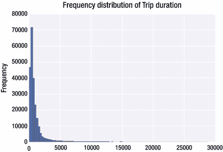

*图 1-11.* 行程时长频率分布

图 1-11 中的分布只有一个峰值（即众数）。该分布不对称，并且大多数值位于众数的右侧。这些右侧的极值在数量上可以忽略不计，但它们的极端性质倾向于将均值向自身方向拉拽。这就是均值大于中位数的原因。

图 1-11 中的分布被称为正态分布。

### 正态分布

正态分布，或者说高斯分布，是一种呈钟形的连续概率分布。该分布的一个重要特征是均值位于分布的中心，其周围有散布（即标准差）。正态分布中的大多数观测值位于均值附近，并随着远离均值而逐渐减少。大约 68% 的观测值位于距离均值 1 个标准差的范围内；95% 的观测值位于距离均值 2 个标准差的范围内；而 99.7% 的观测值位于距离均值 3 个标准差的范围内。均值为 0、标准差为 1 的正态分布被称为标准正态分布。图 1-12 展示了正态分布及其置信区间。

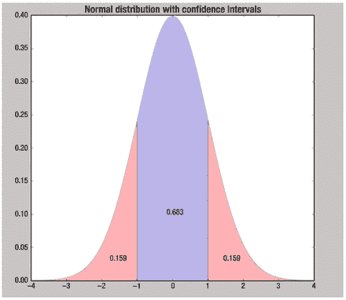

*图 1-12.* 正态分布与置信水平

以下是最常见的置信水平：

| 置信水平 | 公式 |
|---|---|
| 68% | 均值 ± 1 个标准差 |
| 95% | 均值 ± 2 个标准差 |
| 99.7% | 均值 ± 3 个标准差 |

#### 偏度

偏度是衡量不对称性的指标。前面展示的正态分布是对称的，因此没有偏度元素。存在两种类型的偏度（即正偏度和负偏度）。

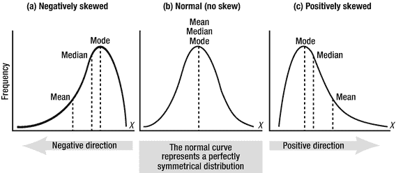

*图 1-13.* 偏态与对称的正态分布

从图 1-13 可以看出，对于以下每种变体，中心度量值之间存在关系：

- 对称分布：均值 = 中位数 = 众数
- 正偏态：均值 < 中位数 < 众数
- 负偏态：均值 > 中位数 > 众数

通过图 1-12 你会发现，图 1-13(c) 中的分布在其右侧有一个长尾。这可能是由于存在异常值所致。

#### 异常值

异常值是指与大多数观测值显著不同的数值。这些值可能自然产生，也可能因设备故障或录入错误而出现。

为了理解什么是异常值，我们需要查看图 1-14。

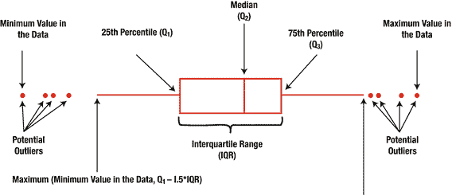

*图 1-14.* 使用箱线图说明异常值

从图 1-14 中可以看出，位于须线之外的观测值被称为异常值。

```markdown
## 异常值识别与处理

不在此区间 `[Q1 - 1.5 (IQR), Q3 + 1.5 (IQR)]` 内的数值被视为异常值（其中 `IQR = Q3 - Q1`）。了解 `Q1` 和 `Q3` 的值是进行此计算的基础。

数据集中存在异常值是好事吗？通常不是！那么，我们应该如何处理数据集中的异常值呢？以下是几种最常用的方法：

*   **删除异常值**：只有当异常值与有效值的比例非常低，且数据值不属于时间序列尺度时，才可采用此方法。如果异常值比例较高，删除这些值会损害数据的丰富性，应用模型也无法捕捉到数据内在的真实本质。然而，如果数据具有时间序列性质，删除异常值并不可行，原因在于时间序列模型要有效训练，数据必须在时间上保持连续。在这种情况下删除异常值会在连续分布中引入断裂。

*   **用均值替换异常值**：另一种方法是取图 1-14 所示区间内数值的均值，计算该均值，并用其替换异常值。这能成功地将异常值转换为与有效观测值一致；然而，这会移除数据集中原本存在的异常点，而这些异常点的发现可能带来有趣的见解。

*   **转换异常值**：应对异常值的另一种方法是将它们限制在可接受数据的上下边界内。上边界可通过将 `Q3` 和 `IQR` 的值代入公式 `Q3 + 1.5IQR` 计算得出，下边界则可通过将 `Q1` 和 `IQR` 的值代入公式 `Q1 – 1.5IQR` 计算得出。

*   **变量变换**：变换用于将原有的分布转换为正态分布。异常值会给数据带来非正态性，因此对变量进行变换可以减少异常值的影响。变换方法包括但不限于自然对数、将数据转换为比率变量等。

南希很好奇我们的数据集中是否存在异常值——更准确地说，是在 `tripduration` 特征中。为此，埃里克决定首先通过编写代码清单 1-18 中的代码来创建一个箱线图（见图 1-15），以直观地查看异常值，然后通过应用代码清单 1-19 中的区间计算方法进行验证。

## 代码清单 1-18：绘制箱线图

```python
box = data.boxplot(column=['tripduration'])
plt.show()
```

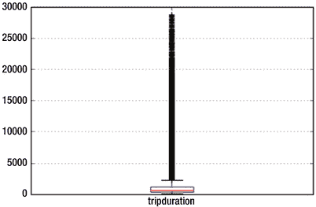
图 1-15. 行程时长的箱线图

南希惊讶地发现，从图 1-15 的箱线图中，行程时长存在大量异常值。她问埃里克能否确定行程时长值中异常值的比例。她想知道异常值在数据集中是占很小一部分还是大部分。为此，埃里克编写了代码清单 1-19 中的代码。

## 代码清单 1-19：确定异常值比例

```python
q75, q25 = np.percentile(trip_duration, [75 ,25])
iqr = q75 - q25
print 'Proportion of values as outlier: %f percent'%(
(len(data) - len([x for x in trip_duration if q75+(1.5*iqr) >=x>= q25-(1.5*iqr)]))*100/float(len(data)))
```

**输出**
```
Proportion of values as outlier: 9.548218 percent
```

埃里克向南希解释了代码清单 1-19 中的代码，内容如下：
> 如图 1-14 所示，`Q3` 指的是第 75 百分位数，`Q1` 指的是第 25 百分位数。因此我们使用 `numpy.percentile()` 方法来确定 `Q1` 和 `Q3` 的值。接着，我们通过两者相减来计算 `IQR`。然后，我们应用代码清单 1-18 中指定的区间来确定值的子集。最后，我们使用公式得出异常值的数量。

## 代码清单 1-20：异常值数量计算公式

```
异常值的数量 = 所有值的长度 - 所有非异常值的长度
```

在我们的代码中，`len(data)` 确定所有值的长度，而所有非异常值的长度由 `len([x for x in trip_duration if q75+(1.5*iqr) >=x>= q25-(1.5*iqr)]))` 确定。

因此，随后应用了代码清单 1-20 中的公式来计算被视为异常值的比例。

## 代码清单 1-21：异常值比例计算公式

```
异常值比例 = (异常值的数量 / 所有值的长度) * 100
```

南希看到数据集中只有 9.5% 的值是异常值，松了一口气。考虑到数据集的时间序列性质，她知道删除这些异常值并非可行选项。因此，她明白唯一可以依赖的方法是对这些异常值应用变换，以消除其极端性质。不过，她有兴趣观察行程时长非异常值的均值。然后，她想将其与之前在代码清单 1-15 中计算的所有值的均值进行比较。

## 代码清单 1-22：计算非异常值均值

```python
mean_trip_duration = np.mean([x for x in trip_duration if q75+(1.5*iqr) >=x>= q25-(1.5*iqr)])
upper_whisker = q75+(1.5*iqr)
print 'Mean of trip duration: %f'%mean_trip_duration
```

**输出**
```
Mean of trip duration: 711.726573
```

代码清单 1-22 中计算的非异常值行程时长均值（约 712）远低于代码清单 1-15 中在存在异常值情况下计算的均值（约 1,203）。这很好地说明了均值受数据集中异常值影响很大的概念。

南希好奇为什么埃里克初始化了变量 `upper_whisker`，因为它在代码清单 1-22 的代码中并未使用。埃里克对此有一个说明：“`upper_whisker` 是右侧（即正方向）须线的最大值，即所有有效值所达到的边界，任何大于该值的数值都被视为异常值。你很快就会明白我们为什么在这里初始化它。”

埃里克有兴趣了解一旦异常值被转换为有效值集后的结果统计。因此，他决定从将异常值简单转换为代码清单 1-22 中计算的有效值均值开始。

## 代码清单 1-23：均值转换

```python
def transform_tripduration(x):
    if x > upper_whisker:
        return mean_trip_duration
    return x

data['tripduration_mean'] = data['tripduration'].apply(lambda x: transform_tripduration(x))
data['tripduration_mean'].plot.hist(bins=100, title='Frequency distribution of mean transformed Trip duration')
plt.show()
```

埃里克记得曾带南希浏览过清单 1-23 中的代码。
> 我们初始化了一个名为 `transform_tripduration` 的函数。该函数会检查行程时长值是否大于上须边界值，如果是，则将其替换为平均值。接着，我们将 `tripduration_mean` 作为新列添加到数据框中。我们通过应用 `transform_tripduration` 函数，对已有的 `tripduration` 列进行了自定义修改来实现这一点。

南希认为图 1-16 中的转换后分布是正偏态正态分布。将图 1-16 与图 1-10 进行比较可以发现，转换后偏度已大幅降低。此外，大多数观测值的 `tripduration` 为 712，这主要是因为所有大于上须边界的值并未被转换为清单 1-22 中计算的非异常值平均值。南希现在有兴趣了解这种转换后分布的中心度量情况。因此，埃里克给出了清单 1-24 中的代码。

## 代码清单 1-24：确定无异常值情况下的中心度量

```python
print '行程时长的平均值: %f'%data['tripduration_mean'].mean()
print '行程时长的标准差: %f'%data['tripduration_mean'].std()
print '行程时长的中位数: %f'%data['tripduration_mean'].median()
```
**输出**
```
行程时长的平均值: 711.726573
行程时长的标准差: 435.517297
行程时长的中位数: 633.235000
```

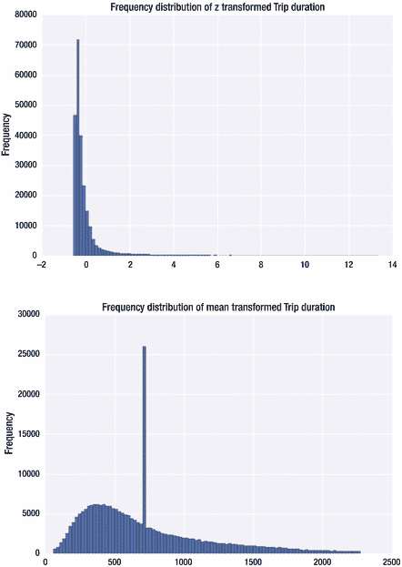
图 1-16. 平均转换后行程时长的频率分布

由于对异常值进行了均值转换，南希原本预期平均值会与清单 1-22 中的相同。在图 1-16 中，她知道 711.7 处的峰值是众数，这意味着转换后平均值与众数相同。最让她惊讶的是中位数正在接近平均值，这表明我们在图 1-16 中看到的正偏态并不那么强烈。

基于图 1-1 中的发现，南希知道男性在出行次数上多于女性。因此，她有兴趣了解男性的行程时长，并为他们也重复进行异常值处理。于是，她为你准备了以下练习题，以期获得更深入的见解。

**练习题**
```

1.  找出男性性别类型的行程时长的平均值、中位数和众数。

2.  根据之前得到的数值，你认为分布是对称的还是偏态的？如果是偏态，是正偏态还是负偏态？

3.  绘制男性性别类型出行行程时长的频率分布图。这是否验证了你在上一题中的推断？

4.  绘制男性出行行程时长的箱线图。你认为存在异常值吗？

5.  应用清单 1-6 中的公式，确定存在异常值的观测值百分比。

6.  采用我们之前讨论过的异常值处理方法之一，对异常值进行处理。

南希和埃里克进行的多变量分析得出了一些有价值的见解。然而，南希好奇是否存在一些统计检验可以确定两个变量之间关系的强度。她想利用这些信息来确定对行程时长影响最大的特征。埃里克脑海中浮现出相关性的概念，他决定在继续分析之前先分享自己的知识基础。

## 相关性

相关性指的是两个定量特征之间关系的强度和方向。相关性值为 1 表示正方向上的强相关，而相关性值为 -1 表示负方向上的强相关。值为 0 表示定量特征之间没有相关性。请注意，相关性并不意味着因果关系；也就是说，一个实体的变化并不强制导致另一个实体的变化。

属性与自身的相关性意味着相关性值为 1。许多机器学习算法由于存在多重共线性而无法提供最佳性能。多重共线性指的是所选特征之间存在相关性，因此通常建议在将数据集中的特征纳入分析之前，检查所有特征之间的两两相关性。

以下是最常见的相关性类型：

### 皮尔逊 R 相关系数

皮尔逊 R 相关系数是三种方法中最常见的，通常适用于计算两个线性相关且似乎呈正态分布的定量变量之间的关系。例如，以股票市场中两只密切相关的证券为例，考察它们之间的关系程度。

### 肯德尔秩相关系数

与适用于正态分布数据的皮尔逊相关系数相比，肯德尔秩相关系数是一种非参数检验，用于确定两个定量特征之间关系的强度和方向。非参数技术针对的是正态分布以外的分布。相反，参数技术则针对正态分布。

### 斯皮尔曼等级相关系数

斯皮尔曼等级相关系数是一种与肯德尔等级相关系数类似的非参数检验，其区别在于斯皮尔曼等级相关系数不对数据分布做任何假设。斯皮尔曼等级相关系数最适用于有序数据。

南希想了解年龄的变化是否会导致行程时长的线性变化。为此，埃里克决定采用皮尔逊相关系数，并绘制这两个变量之间的散点图，以便直观地观察它们的关系。

```
data = data.dropna()
seaborn.pairplot(data, vars=['age', 'tripduration'], kind='reg')
plt.show()
清单 1-25.
行程时长与年龄的散点图矩阵
```

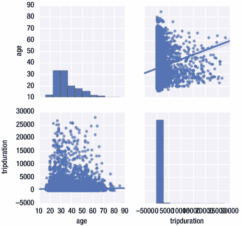

图 1-17.

行程时长与年龄的散点图矩阵

在查看图 1-17 时，南希并未发现行程时长与年龄之间存在任何明确的模式。如图 1-18 所示，存在微弱的正相关关系。

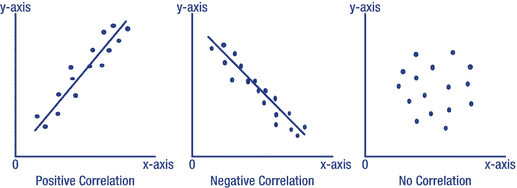

图 1-18.

相关方向

南希知道完全正相关意味着相关系数为 1；因此她想了解年龄与`tripduration`之间的相关系数是否为正且接近 1。埃里克编写了清单 1-26 中的代码来实现这一目标。

```
pd.set_option('display.width', 100)
pd.set_option('precision', 3)
data['age'] = data['starttime_year'] - data['birthyear']
correlations = data[['tripduration','age']].corr(method='pearson')
print(correlations)
清单 1-26.
行程时长与年龄之间的相关系数
```

输出

```
tripduration    age
tripduration    1.000           0.058
age             0.058           1.000
```

计算出的相关系数大于 0，根据南希的推断，这表示正相关，但由于远小于 1，意味着相关性很弱。

南希意识到，简单的分析意味着只考虑一个特征并对其进行分析。另一种更复杂的方法是将该特征拆分为其类别（例如，将性别拆分为男性和女性），然后分别对这两部分进行分析。她不确定哪种方法才是正确的，于是向埃里克请教。埃里克想到了引入 t 统计量的概念，并为南希做了一个小演示。

## 假设检验：比较两组

在介绍比较两组的方法之前，理解零假设和备择假设非常重要。

零假设是我们在假设检验中试图寻找证据反驳的假设。零假设通常是研究者基于先前知识或经验提出的初始主张。备择假设的总体参数值与零假设不同。备择假设是你希望最终成立的结果。通过执行统计检验来决定在假设检验中哪一个成立。如果实验结果支持零假设，我们就说实验未能拒绝零假设。你可能会想：“这不就是接受零假设吗？”嗯，并非如此！“无罪”并不等同于一个人就是无辜的。

### t 统计量

t 指的是以标准误差为单位表示的差异。它有两种最常见的变体：

单样本 t 检验

这是为了寻找总体均值与假设值之间存在显著差异的证据。

双样本 t 检验

这是当你试图寻找两个总体均值之间存在显著差异的证据时使用的方法。请注意，来自两个分布的样本应相互独立。

t 值和 p 值在内部是关联的。t 值的绝对值越大，p 值越小，因为分布集中在均值附近，因此拒绝零假设的概率就越高。

t 值可以是负数也可以是正数。无论方向如何，t 值的绝对值越大，就越有力地反驳了“不存在显著差异”（即零假设）的观点。反之，如果 t 值趋近于 0，则意味着总体均值之间，或总体均值与假设值之间不存在显著差异。

与相关性等统计现象不同，t 值是通过从整个总体中抽取一个样本计算得出的。由于抽样是随机的，每次计算出的 t 值都会呈现随机抽样误差（即与之前计算的 t 值存在一定差异）。

t 分布有助于识别因从整个总体中随机抽样而产生的变化幅度。

### t 分布与样本量

自由度指的是你在多个选项中拥有选择权的情况。通常自由度等于样本量减 1。自由度决定了高斯分布的离散程度。自由度越大，落在尾部的概率密度就越小，分布会紧密集中在均值周围。小样本量更容易出现异常情况，因此即使原假设成立，也可能导致结果远离原假设。因此，在计算 t 值时，最好使用较大的样本量。

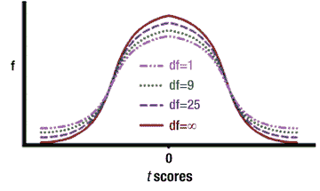

图 1-19.

t 分布随样本量变化的情况

现在我们来计算所有性别和用户类型类别的双尾 t 检验（参见代码清单 1-27）。这样做的目的是了解不同类别在方差上是否具有相似性。如果具有相似性，它们将被视为一个组；否则，在分析模式中将分别处理。

```
for cat in ['gender','usertype']:
    print 'Category: %s\n'%cat
    groupby_category = data.groupby(['starttime_date', cat])['starttime_date'].count().unstack(cat)
    groupby_category = groupby_category.dropna()
    category_names = list(groupby_category.columns)
    for comb in [(category_names[i],category_names[j]) for i in range(len(category_names)) for j in range(i+1, len(category_names))]:
        print '%s %s'%(comb[0], comb[1])
        t_statistics = stats.ttest_ind(list(groupby_category[comb[0]]), list(groupby_category[comb[1]]))
        print 'Statistic: %f, P value: %f'%(t_statistics.statistic, t_statistics.pvalue)
        print '\n'
代码清单 1-27.
计算性别和用户类型类别的双尾 t 检验
```

输出结果

```
Category: gender
Female Male
Statistic: -38.572176, P value: 0.000000
Female Other
Statistic: 48.248666, P value: 0.000000
Male Other
Statistic: 53.180282, P value: 0.000000
Category: usertype
Member Short-Term Pass Holder
Statistic: 14.393456, P value: 0.000000
```

南希对这段代码和输出结果都感到困惑，于是埃里克解释道：

> 首先，我们遍历了性别和年龄这两个特征。对于每个特征，我们先将该列拆分为多个类别列。例如，性别被拆分为男性、女性和其他。接着，我们构建了类别对，并对它们运行 t 检验。例如，男性-女性、男性-其他等。结果显示所有类别之间似乎具有同质性。我这么说是什么意思呢？在所有比较中，输出结果中的 `p` 值都大致为 `0`。如果我们采用 `95%` 的置信区间，那么对应的 `p` 值为 `0.05`。上述所有统计量都没有超过我们设定的 `p` 值基准。这让我们得出结论：在进入建模阶段时，我们需要将所有类别分开处理，因为它们具有不同的方差。

南希现在对受众有了一定程度的了解，但她还想了解更多，为此她计划生成一个问题并进行抽样。于是她问埃里克能否在这方面给她讲解一两个概念。埃里克知道中心极限定理在抽样和分析中具有关键价值，于是他举了一个例子来说明。

## 中心极限定理

以任意一个由随机样本组成的分布为例，该分布具有明确的均值和标准差。现在，我们从该分布中随机抽取一些样本，并计算其均值和标准差。随着样本量（即 `n`）的增加，均值和标准差会趋近于高斯正态分布的均值和标准差。换句话说，随着从任意分布中抽取的样本量增加，该分布会收敛到具有给定均值和标准差的正态分布。那么，样本量需要多大，该定理才能发挥作用呢？

*   样本量越大，抽样分布就越接近正态分布。

*   任意分布越接近正态分布，满足该定理所需的样本量就越少。统计学家通常建议在这种情况下样本量取 `30` 到 `40`。

埃里克决定利用手头的数据来帮助解释中心极限定理（参见`代码清单 1-28`）。

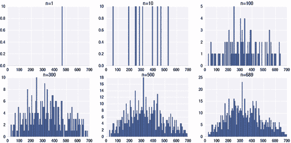

图 1-20.

不同样本量下的每日票务分布

```
daily_tickets = list(data.groupby('starttime_date').size())
sample_tickets = []
checkpoints = [1, 10, 100, 300, 500, 1000]
plot_count = 1
random.shuffle(daily_tickets)
plt.figure(figsize=(15,7))
binrange=np.array(np.linspace(0,700,101))
for i in xrange(1000):
if daily_tickets:
sample_tickets.append(daily_tickets.pop())
if i+1 in checkpoints or not daily_tickets:
plt.subplot(2,3,plot_count)
plt.hist(sample_tickets, binrange)
plt.title('n=%d' % (i+1),fontsize=15)
plot_count+=1
if not daily_tickets:
break
plt.show()
```

代码清单 1-28.

在行程数据集上验证中心极限定理的脚本

埃里克对`代码清单 1-28`中的代码解释如下：

> 随机打乱是为了改变每日票务数量的顺序。完成后，固定不同的样本量，以观察分布随样本量变化的情况。请注意图 1-20，随着样本量的增加，分布似乎逐渐转变为正态分布。这验证了中心极限定理。

## 案例研究结论

埃里克和南希的推论帮助他们更好地理解了受众，并获得了有价值的见解。这些见解基于 2014 年至 2016 年收集的数据，其中人口统计信息仅适用于会员，而不适用于短期通行证持有者。因此，为了获取短期通行证持有者的信息，南希知道她需要进行一项市场调研，而中心极限定理将在其中派上用场。行程时长呈现出一种随时间重复的明确季节性模式。对该时间序列进行预测，可以帮助南希预测公司需要加大营销力度的时机，以及预测出行高峰时段，从而确保运营效率。至于促销活动，南希现在知道，启动活动的最佳站点是`Pier 69/Alaskan Way & Clay St`。异常值只占数据集的一小部分；然而，它们的时间序列特性意味着这些异常值无法被移除，因此需要应用变换。关于进一步的分析，南希现在意识到，由于特征不具有同质性，分析必须在单个类别层面进行。

南希不确定他们使用的技术是否已经过时，或者是否也能应用于现实世界。因此，埃里克整理了一份来自行业朋友的应用清单，展示了他们如何将统计学和概率论应用于实际。

## 统计学与概率论的应用

统计学与概率论在多个研究领域都有广泛的应用。

### 精算科学

精算师运用数学、概率论、统计学、金融学、经济学、计算机科学和建模等概念来评估和定价风险。他们的应用案例存在于保险、咨询公司和政府等领域。

### 生物统计学

统计学在生物学的各个分支中都有应用。这包括生物实验的设计以及从实验中做出推断。深入探究生物统计学，会发现一些例子，其中受试对象（患者、细胞等）对某些刺激（例如药物）表现出不同的反应。生物统计学家使用推断统计学来解读这些异常现象的意义。

### 天体统计学

天体统计学是统计分析、天体物理学和数据挖掘的融合体。通过对宇宙进行自动扫描收集到的数据，用于做出推论。

### 商业分析

商业分析运用运营理论和统计理论来构建预测模型。它还结合了优化技术，为客户和企业高管获取有效的洞察。

这些洞察使公司能够自动化和优化其业务流程。商业智能与商业分析的不同之处在于，商业智能帮助我们回答“发生了什么”，而商业分析则帮助我们理解这种异常的原因（即，它最初为何发生，以及再次发生的可能性）。这些分析被应用于各种业务领域，例如企业优化、欺诈分析、定价分析、供应链分析等。

### 计量经济学

运用统计方法来估计经济关系构成了计量经济学。一些例子包括：衡量离婚法对离婚率和结婚率的影响、移民政策对本地工人工资变化的影响，或者预测通货膨胀率、利率或国内生产总值等宏观经济变量。

### 机器学习

几种机器学习算法都基于统计理论或其高级版本。一个常见的例子是贝叶斯理论。

### 统计信号处理

利用过去的语音语料库来确定所说词语的最高概率。此外，统计信号处理还应用于以下领域：

*   博弈论

*   估计与滤波

*   信号处理

*   线性系统

### 选举

竞选经理利用民意调查的结果来推断其政党在即将到来的选举中获胜的可能性。