# 2. 回归

回归和时间序列分析使得对定量目标变量进行预测成为可能。本章旨在强调回归及其变体的核心概念。重点在于引导读者在解决实际问题时经历模型选择的过程。此外，本章还介绍了用于评估这些回归技术结果的统计检验。

注意

本书采用 Python 2.7.11 作为编码示例的事实标准。此外，你需要安装该版本才能完成练习。

在本章中，我们将使用混凝土抗压强度数据集进行编码示例和练习。该数据可以从 UCI 的网站链接下载：

[`http://archive.ics.uci.edu/ml/datasets/Concrete+Compressive+Strength`](http://archive.ics.uci.edu/ml/datasets/Concrete+Compressive+Strength)

## 案例研究：消除混凝土抗压强度中的不一致性

安德鲁与史密斯进行了一个小时的会议，讨论他不断收到现有客户投诉的问题。史密斯是一家建筑骨料公司的销售代表，在完成销售目标方面遇到了困难。史密斯认为，他遇到困难的原因是现有客户对质量不一致有投诉——再加上市场上的负面口碑，使得他很难与潜在客户达成交易。

工厂主管安德鲁是史密斯的朋友。起初，史密斯试图为这个问题找到解决方案，但当事情超出他的控制时，他决定与安德鲁开会。

在大多数公司，生产部门和销售部门之间通常存在摩擦。他们通常会为各自的年度预算和实现年度目标的计划而争执。史密斯知道这一点，但他确信与安德鲁的情况会有所不同，因为他们已经是多年的朋友了。然而，会议开始后，当史密斯向安德鲁陈述问题时，令他沮丧的是，安德鲁并不准备承认生产中存在的任何不一致。正如史密斯回忆安德鲁所说：“这些投诉对我来说毫无意义。你问为什么！首先，我们在上个季度对生产工厂进行了升级，而且你很清楚，我们使用的原材料在用于生产之前都经过了彻底的测试。”

这次会议对史密斯没有任何帮助，他暂时搁置了这个问题。一天，在公司的一次企业活动中的社交环节，史密斯听到生产部门的一些高管在谈论工厂最近的升级。他记得听到其中一位高管说：“虽然我们最近的升级中没有改进混凝土抗压强度测试，但由于我们对所用原材料进行了严格的测试，我们的产品质量仍然很优越。”

当史密斯听到这些时，他做了一些研究，并惊讶地发现，自从升级以来，投诉的数量有增无减。然而，他还发现，由于分配给采购部门的资金短缺，测试设备的采购被搁置了。史密斯清楚地知道，他等不到明年让问题自行解决，他必须想办法解决问题。

他听说最近的升级意味着机器有记录数据。史密斯决定与克莱尔（分析部门经理）安排一次会议，看看她是否能帮助找出混凝土抗压强度不一致背后的原因。会议对史密斯来说进展顺利，因为克莱尔向他保证公司内部的分析能力。正如克莱尔回忆的那样：“那时我们刚刚启动分析部门，但我确信我们有能力构建一个能够解释这种异常的模型。”

史密斯松了一口气，现在他需要制定一个策略来推进他的发现——要么带着他的发现去找管理层，要么将他的发现分享给生产部门，让他们将其整合到内部流程中。然而，史密斯很好奇手头的数据是否足够强大，能够推断出一些高质量的发现。此外，他也有兴趣了解哪些因素对混凝土抗压强度影响最大。

史密斯想知道克莱尔将处理数据集中的哪些特征。因此，克莱尔提供了表 2-1 中的数据字典。

表 2-1.

混凝土抗压强度数据集的数据字典


| 特征名称 | 描述 |
| --- | --- |
| 水泥（每立方米混合物中的千克数） | 每立方米混合物中使用的水泥量（单位：千克） |
| 高炉矿渣（每立方米混合物中的千克数） | 每立方米混合物中使用的高炉矿渣量（单位：千克） |
| 粉煤灰（每立方米混合物中的千克数） | 每立方米混合物中使用的粉煤灰量（单位：千克） |
| 水（每立方米混合物中的千克数） | 每立方米混合物中使用的水量（单位：千克） |
| 高效减水剂（每立方米混合物中的千克数） | 每立方米混合物中使用的高效减水剂量（单位：千克） |
| 粗骨料（每立方米混合物中的千克数） | 每立方米混合物中使用的粗骨料量（单位：千克） |
| 细骨料（每立方米混合物中的千克数） | 每立方米混合物中使用的细骨料量（单位：千克） |
| 龄期（天） | 混凝土的龄期（单位：天） |
| 混凝土抗压强度 | 以兆帕（MPa）为单位的混凝土抗压强度。这是压力或应力的单位，也是确定混凝土抗压强度的常用单位。 |

在继续之前，克莱尔考虑初始化以下包。她这样做是为了避免在本地机器上实现代码片段时出现瓶颈（列表 2-1）。

```
%matplotlib inline
import time
import random
import datetime
import pandas as pd
import matplotlib.pyplot as plt
import statistics
import numpy as np
from scipy import stats
from sklearn.grid_search import GridSearchCV
from sklearn.linear_model import RANSACRegressor, LinearRegression, TheilSenRegressor
from sklearn.metrics import explained_variance_score, mean_absolute_error, mean_squared_error, median_absolute_error, r2_score
from sklearn.svm import SVR
from sklearn.linear_model import Ridge,Lasso,ElasticNet,BayesianRidge
from sklearn.ensemble import GradientBoostingRegressor
from sklearn.cross_validation import train_test_split
from sklearn.pipeline import Pipeline
from sklearn.preprocessing import PolynomialFeatures
from sklearn.cross_validation import cross_val_score
import seaborn
from IPython.display import Image
列表 2-1.
导入本章所需的包
```

史密斯很好奇克莱尔会使用哪些技术来解决这个问题。克莱尔认为这个问题是回归分析的理想应用，因为响应变量（混凝土抗压强度）是一个定量指标，并且她关注的是找出影响混凝土抗压强度的因素。这些影响因素，按其成分比例缩放并加总后，可以得出混凝土的抗压强度。因此，这将使得无需为手头问题专门采购任何设备就能计算混凝土抗压强度。为了帮助史密斯理解什么是回归分析，她整理了一些关于该主题的信息。

## 回归分析的概念

回归分析描述了一个解释变量（即自变量）与一个响应变量（即因变量）之间的关系。解释变量也被称为预测变量，其数量可以多于一个。回归分析被用于预测和预报领域。回归分析用于确定，当其中一个解释变量变化而其他自变量保持不变时，响应变量的变化。这样做是为了理解每个解释变量所展现的关系。请注意，无论用于预测离散响应变量的分类方法如何，回归分析都用于预测本质上是连续的响应变量。回归分析的一个基本变体是线性回归。

### 内插与外推

外推是指使用回归分析来预测响应变量的值，这些值超出了最初用于训练模型的解释变量值的范围。这些数据不用于训练模型，在图 2-1 中用虚线表示。

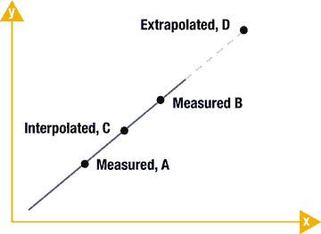

图 2-1.

内插和外推的可视化表示

回归模型将在手头的数据上拟合/训练（即，用实线表示的内插部分），然后训练好的模型将用于对虚线表示的部分进行外推。因此，内插是在已知数据上进行的，而外推是在未知数据上进行的。

### 线性回归

线性回归是回归分析的一种形式，其中使用一个解释变量来预测响应变量的结果。它在数学上可以定义如下：

*   符号：y
*   公式：y = b [0] + b [1] x + e
*   说明：
    *   y：响应变量
    *   x：解释变量
    *   b [0]：斜率
    *   b [1]：截距
    *   e：回归残差

图 2-2 直观地展示了这个方程。

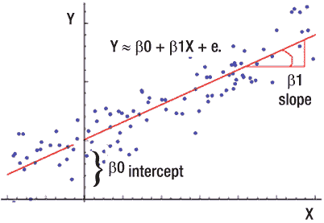

图 2-2.

线性回归最佳拟合线及回归系数说明

请注意，在图 2-2 中，截距是最佳拟合线与 y 轴相交的点。回归残差是响应变量的实际值与预测值之间的差值。

### y 对 x 的最小二乘回归线

最小二乘回归线使得数据点到该线的垂直距离的平方和尽可能小。它在数学上可以定义如下：

*   符号：
*   公式：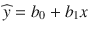
*   进一步推导：
    *   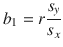

    *   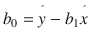

*   最小二乘回归线总是通过点 (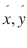)

图 2-3 中的图示使用了线性回归（即一个解释变量）来描述最小二乘回归线所采用的方法。y 表示响应变量，而 x 表示解释变量。图中显示了数据点到直线的垂直距离，并且最佳拟合回归线被视为穿过这些数据点的中心。因此，这确保了每个数据点的残差平方被最小化。

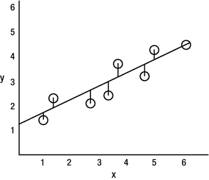

图 2-3.

残差


### 多元回归

多元回归是一种使用多个解释变量来预测响应变量结果的回归类型。多元回归的数学定义如下：

*   符号：y
*   公式：y = b [0] + b [1] x [1] + b [2] x [2] + b [3] x [3] +….. b [t] x [t] + e
*   图示说明：
    *   y：响应变量
    *   x [1] , x [2] , x [3,] ……, x [t]：解释变量
    *   b [0]：斜率
    *   b [1] , b [2] , b [3] , ……., b [t]：截距
    *   e：回归残差

上述公式也可称为回归方程。本质上，我们试图为所有系数找到最优值，以便在给定所有 x 的情况下，得到 y 的最佳可能值。在单变量情况下，它是一条直线（即线性回归），如图 2-3 所示；但在多变量情况下，它变成一个平面，如图 2-4 所示。

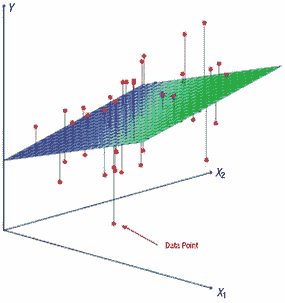

图 2-4.

使用两个解释变量和一个响应变量的多元回归说明

将系数（即斜率和截距）的最优值代入上述公式，我们将得到一个方程。该方程中的未知数是 x 值，即本例中的解释变量值。对于任何给定的 x 值，该方程都会返回一个预测值。

### 逐步回归

这种回归是多元回归的一种定制版本。逐步回归并非使用所有解释变量来预测结果，而是从给定的变量池中自动选择能够产生最佳拟合线的自变量。这可以通过以下任一方式完成：

*   一次尝试一个解释变量，并用其拟合回归模型。如果发现该解释变量在统计上显著，则将其纳入模型。
*   对所有解释变量运行多元回归，并使用统计上最显著的那个变量来确定最佳拟合回归线。

图 2-5 最好地描述了逐步回归所采用的方法。

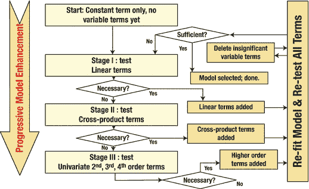

图 2-5.

逐步回归流程图 来源：.slideshare.net/bzinchenko/quant-trader-algorithms

然而，根据一些统计学家的观点，这种方法存在以下问题：

*   选择一个解释变量而舍弃其他变量，会导致对所选变量产生偏差，并使我们无法观察到那些最初被舍弃的解释变量本可以捕捉到的变异部分。
*   在从众多解释变量中进行选择的情况下，完成整个分析过程将需要大量的计算能力，从而耗费时间。

### 多项式回归

有时，在绘制解释变量和响应变量之间的散点图时，我们会看到一种非线性趋势。这种趋势会被线性回归所忽略，因此需要一种非线性处理方法，此时多项式回归就派上了用场。多项式回归使用多项式的次数来生成非线性回归线。多项式回归的数学定义如下：

*   符号：y
*   公式：y = b [0] + b [1] x + b [2] x ² + b [3] x ³ + b [h] x ^h + e
*   图示说明：
    *   y：响应变量
    *   x [1] , x [2] , x [3,] ……, x [h]：解释变量
    *   b [0]：斜率
    *   b [1] , b [2] , b [3] , ……., b [h]：截距
    *   e：回归残差
    *   h：多项式的次数

观察图 2-6，您会注意到，增加多项式的次数会使曲线更加非线性，并在回归线内引入额外的弯曲。

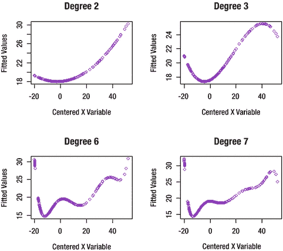

图 2-6.

不同次数（即 h）下的多项式回归曲线

## 回归的假设

为了防止史密斯将回归视为连续数据预测的魔法棒，克莱尔提出了一组假设，这些假设必须成立，回归才能适用于给定的数据集。

### 案例数量

案例数与自变量（IVs）的比例理想情况下应为 20:1。这意味着每个解释变量应有 20 个样本。然而，在极端情况下，每个解释变量至少允许有 5 个样本（即，对于 5 个解释变量，数据集中应有 25 个样本）。

### 缺失数据

在回归中，缺失数据可能导致模型不适合样本数据。您可能会遇到以下两种情况之一：

*   有时，某些观测值在数据的所有字段中都存在缺失值。删除这些观测值是明智之举，因为如果缺失值不重要，忽略它们不会干扰模型捕捉到的整体行为。
*   如果只有某个特定列在大多数观测值中存在缺失值，则无需处理，因为回归会忽略该变量没有值的那些案例。

#### 异常值

异常值可能会在回归模型的结果中引入偏差，使最佳拟合线向它们自身靠拢。因此，异常值的处理在回归中至关重要，可以通过从第 1 章中强调的方法中选择合适的方法来完成。

### 多重共线性与完全共线性

多重共线性和完全共线性是两个会削弱回归建模能力、导致结果怪异且不准确的概念。如果解释变量高度相关，那么回归就容易受到偏差的影响。多重共线性指的是相关系数为 0.9 或更高，而完全共线性指的是完全相关（即相关系数为 1）。

对此的补救措施是移除相关系数超过 0.7 的解释变量。但这又带来了以下问题。考虑图 2-7 中的例子，其中体重和血压（BP）具有 0.95 的高度相关性。

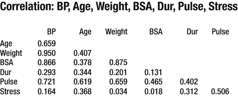

图 2-7.

多重共线性示意图

现在，哪一个（体重还是血压）是问题变量，应该被移除？这时，容差能否作为补救措施？容差的数学定义如下：

*   公式：容差 = 1 - r ²
*   图示说明：
    *   r ²：该变量与回归方程中所有其他自变量的多元相关系数的平方

容差指的是解释变量的方差中未被方程中其他解释变量所解释的比例。这个值越大越好。消除多重共线性和完全共线性将确保响应变量是根据解释变量独立捕捉到的变异来预测的，而不是根据它们之间存在的相关性。

在阅读完可用回归技术的描述后，史密斯很好奇哪种方法最适合手头的问题。然而，克莱尔知道，要找出正确的方法，需要在继续之前对数据有一定的了解。因此，她决定进行特征探索。她所说的特征是指数据集中的变量。她主要想看看数据是什么样的，以及是否存在以下情况：

*   解释变量与响应变量之间是否存在相关性
*   多重共线性和完全共线性


## 特征探索

克莱尔首先将数据加载到内存中（参见代码清单 2-2）。

```
data = pd.read_csv('examples/concrete_data.csv')
代码清单 2-2.
将数据读取到内存中
```

史密斯好奇数据量有多大以及数据长什么样。于是克莱尔编写了代码清单 2-3 中的代码，打印数据集的一些初始观察结果，以便了解其内容。

```
print len(data)
data.head()
代码清单 2-3.
打印数据集的大小及前几行数据
```

输出

表 2-2.

数据集观察结果打印

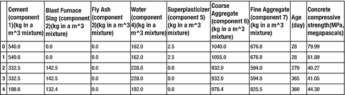

```

```

在查看表 2-2 中的前几行观察结果时，史密斯注意到除了年龄之外，所有特征都是浮点数，年龄是唯一的整数变量。他还注意到，高炉矿渣、粉煤灰和减水剂并非混凝土制造时的必备成分。此外，他发现数据集中的混凝土数据可能有一年之久（例如，第 3 行的年龄为 365，约等于一年）。

克莱尔确信，为了进行后续分析（即相关性分析、回归分析），特征名称应尽可能简洁。因此，她编写了代码清单 2-4 中的代码片段，使名称既简短又易于人类阅读。重命名时，她遵循了表 2-3 中定义的名称映射。

表 2-3.

变量名称映射

| 旧特征名称 | 新特征名称 |
| --- | --- |
| Cement(component 1)(kg in a m3 mixture) | cement_component |
| Blast Furnace Slag(component 2)(kg in a m3 mixture) | furnace_slag |
| Fly Ash(component 3)(kg in a m3 mixture) | flay_ash |
| Water(component 4)(kg in a m3 mixture) | water_component |
| Superplasticizer(component 5)(kg in a m3 mixture) | superplasticizer |
| Coarse Aggregate(component 6)(kg in a m3 mixture) | coarse_aggregate |
| Fine Aggregate(component 7)(kg in a m3 mixture) | fine_aggregate |
| Age (days) | age |
| Concrete compressive strength(MPa, megapascals) | concrete_strength |

```
data.columns = ['cement_component', 'furnace_slag', 'flay_ash', 'water_component', 'superplasticizer', \
'coarse_aggregate', 'fine_aggregate', 'age', 'concrete_strength']
代码清单 2-4.
重命名列名
```

在了解了数据的样子之后，克莱尔需要看看探索性变量与响应变量之间的相关性如何，以及数据中是否存在多重共线性或奇异点。

### 相关性

克莱尔首先决定查看是否有任何探索性变量与响应变量（即混凝土强度）相关。这个问题对她来说至关重要，因为她相信两个定量实体之间的高相关性可以产生更优的最佳拟合线性回归线。因此，她有兴趣确定这些定量变量之间关系的强度和方向。为此，她编写了代码清单 2-5 中的代码。然而，在继续之前，她解释了为什么相关性和回归并不完全相同：

> 相关性可以在任意两个定量变量之间计算。然而，回归总是在一个响应变量和一个或多个探索性变量之间进行。相关性仅限于两个定量变量，而回归可以涉及两个以上的定量变量，即一个响应变量和多个探索性变量，也称为多元回归。

克莱尔还指出，直观查看相关性的一种简单方法是使用响应变量与探索性变量之间的散点图，一次一个变量（图 2-8）。

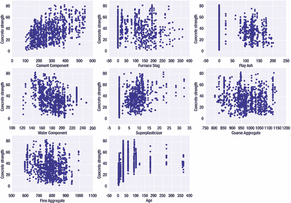

图 2-8.

响应变量与探索性变量之间的散点图

```
plt.figure(figsize=(15,10.5))
plot_count = 1
for feature in list(data.columns)[:-1]:
plt.subplot(3,3,plot_count)
plt.scatter(data[feature], data['concrete_strength'])
plt.xlabel(feature.replace('_',' ').title())
plt.ylabel('Concrete strength')
plot_count+=1
plt.show()
代码清单 2-5.
绘制响应变量与探索性变量之间的散点图
```

克莱尔对代码清单 2-5 中的代码进行了描述，以便让史密斯轻松理解所使用的方法。她回忆道：

> 我们通过使用子图在同一张图中生成了多个图。我们首先通过 `plt.figure(figsize=(15,10.5))` 定义了图形大小。这将图形固定为宽度 15、高度 10.5。响应变量（即混凝土强度）在所有图中保持不变，而探索性变量则一次考虑一个（即逐个绘图）。因此，我们使用了 `for feature in list(data.columns)[:-1]`，它遍历除最后一个变量（即响应变量）之外的所有变量。然后我们按如下方式定义了子图索引：`plt.subplot(3,3,plot_count)`。前三个数字定义了行数，后三个数字定义了列数。这意味着该图形最多可以容纳 9 个图。`plot_count` 定义了特定图在图形中的位置索引。在此场景中，可能的取值范围是 1 到 9。

史密斯决定尝试通过观察图 2-8 来解释相关性。于是他得出了以下三点见解：

*   除了混凝土强度与年龄之间的散点图外，大多数图中异常值的存在可以忽略不计。
*   在一些散点图中，我们看到大量数值落在 0 上。这在混凝土 `strength` 变量与探索性变量（主要是年龄、矿渣、粉煤灰和减水剂）之间的图中可以看到。
*   似乎存在一些情况，两个定量变量之间有时呈正相关，有时呈负相关，有时则没有相关性。


克莱尔决定通过列出每个实例的配对（即无相关、正相关和负相关）来扩展这些发现。她通过评估图 2-6 中的图表，并对照图 2-9 中的基准相关性来完成这一工作。如果存在趋势，则要么是负相关，要么是正相关。没有明确的趋势则表明不存在相关性。

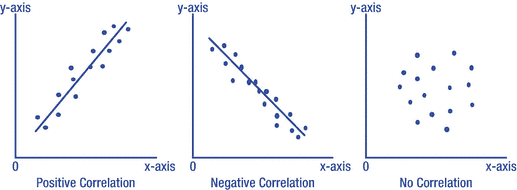

图 2-9.

正相关、负相关和无相关的图示

*   正相关存在于
    *   水泥成分与混凝土强度之间
    *   减水剂与混凝土强度之间
*   负相关存在于
    *   粉煤灰与混凝土强度之间
    *   水成分与混凝土强度之间
    *   粗骨料与混凝土强度之间
    *   细骨料与混凝土强度之间
*   无相关存在于
    *   矿渣与混凝土强度之间
    *   龄期与混凝土强度之间

通过可视化表示识别出的这些配对让史密斯很容易理解什么是相关性。然而，他想验证这些发现在统计上是否也有意义。因此，克莱尔编写了代码片段，并在清单 2-6 中计算了皮尔逊相关性。

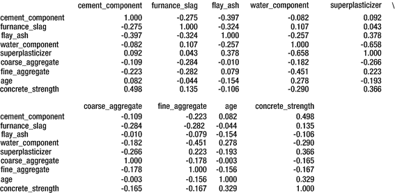

图 2-10.

响应变量与解释变量之间的相关性

```
pd.set_option('display.width', 100)
pd.set_option('precision', 3)
correlations = data.corr(method='pearson')
print(correlations)
清单 2-6.
计算成对皮尔逊相关性
```

克莱尔回忆起用以下话语解释这些发现：

> 图 2-10 中的输出显示了一个网格，其中计算了数据集中所有特征之间的皮尔逊相关性，而不仅限于我们之前在 2-8 中看到的解释变量与响应变量之间的相关性。强正相关的值为 1，强负相关的值为 -1，0 表示无相关。通过查看图 2-8 中的散点图，我们曾假设龄期与混凝土强度之间不存在相关性；然而，图 2-10 中的统计结果却给出了相反的结论；也就是说，这两个量之间存在轻微的正相关。视觉推断容易受到人为误差的影响，因此我们将采用后者（即这两个量之间存在轻微的正相关）。

史密斯了解了每个解释变量如何与响应变量相关后，好奇地想探究数据集中是否存在单一共线性或多重共线性。这正是克莱尔清单上的下一项任务，因此她编写了清单 2-7 中的代码。

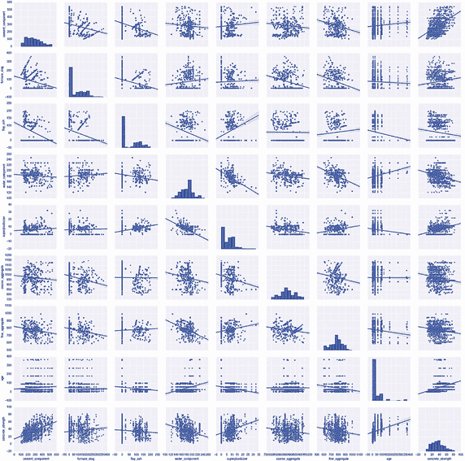

图 2-11.

数据集中所有特征的配对图

```
data_ = data[(data.T != 0).any()]
seaborn.pairplot(data_, vars=data.columns, kind='reg')
plt.show()
清单 2-7.
计算所有特征之间的配对图
```

克莱尔决定先向史密斯解释清单 2-7 中代码的含义。她指出了图 2-8 中显而易见的一个方面（即数据集中某些特征的值大部分为 0）。她认为，数据集中存在大量 0 值会导致相关系数和回归线无法真实反映数据集的本质。她首先解释说，`data_= data[(data.T != 0).any()]` 意味着删除列中值为 0 的记录。完成此操作后，她使用 seaborn 的配对图来绘制数据集中所有特征之间的相关性。

在解释图 2-11 的输出时，克莱尔让史密斯重点关注第 1 列和第 2 行。克莱尔回忆起自己曾解释过：“在许多情况下，特征对之间不存在相关性。例外情况有两种——即水泥成分与矿渣，以及水泥成分与粉煤灰——在这两种情况下，我们可以看到强负相关。”

史密斯对自己目前获得的见解感到兴奋。他看到了从观测值中移除零值后图表的样子。他好奇地想确定从数据集中移除零值后相关系数会是什么样子。此外，他知道这些特征之间存在斯皮尔曼相关性，因此他好奇地想看看在给定情况下它会呈现什么样的相关系数。最后，在查看图 2-8 时，史密斯似乎觉得所有特征都是连续的，除了龄期，在他看来，龄期看起来像一个离散变量，因为龄期内的观测值落在七个离散值之一中。史密斯有兴趣将数据按龄期分段，并计算每个分段的相关系数，以查看响应变量与任何解释变量之间是否存在强相关性。你能帮助史密斯回答这些问题吗？在以下练习中尝试一下。

练习

1.  从数据特征中移除零值，然后重新计算皮尔逊相关性。相关系数是否有任何改善？
2.  确定数据集中特征的斯皮尔曼相关性。这是否给相关性分数带来了任何边际差异？
3.  从散点图来看，龄期似乎更像一个离散特征。逐个提取每个龄期的数据，并计算其余特征的皮尔逊相关性。是否有某个特定龄期在响应变量与解释变量之间产生了良好的相关性？

现在，克莱尔和史密斯已经了解了那些对混凝土强度有显著影响的解释变量，并且知道了多重共线性可能存在于何处，是时候将回归付诸实践了。他们需要回归来得出一个方程，该方程能够使他们无需采购特殊设备来测量混凝土强度。然而，在继续使用回归模型之前，克莱尔觉得她需要让史密斯了解过拟合和欠拟合这两个重要概念。


## 过拟合与欠拟合

过拟合是指模型在某个数据集上过度拟合的现象。这种泛化能力因此导致模型无法对未见数据做出高度准确的预测。图 2-12 中的非线性曲线展示了过拟合。

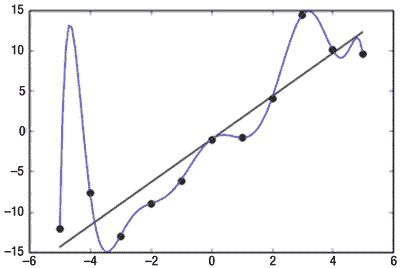

图 2-12.

过拟合示意图

以下方法可用于抑制过拟合：

*   简化模型；即尽可能调整最少的参数，因为模型越复杂，就越容易对当前数据过拟合。
*   执行交叉验证。例如，随机选择 x% 的数据值用于训练，剩余的 y% 用于测试。在训练数据上拟合模型，用它预测测试数据上的值，并计算测试误差。重复此过程 n 次。每次训练/测试的划分都是随机进行的。计算所有测试误差的平均值，以找出当前模型的真实测试误差。

欠拟合是指模型对当前数据的训练精度不高的现象。

欠拟合的处理与偏差和方差有关。如果训练误差和测试误差都很高，则模型具有高偏差，如图 2-13 所示。

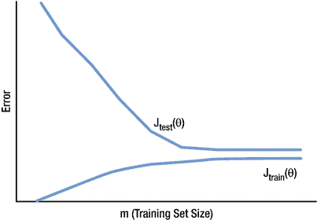

图 2-13.

高偏差示意图

此外，如果测试误差和训练误差之间存在较大差距，则模型具有高方差，如图 2-14 所示。

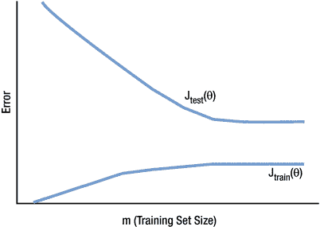

图 2-14.

高方差示意图

如果模型属于高偏差类型的欠拟合，那么补救措施可以是增加模型复杂度；如果模型属于高方差类型的欠拟合，那么补救措施可以是引入更多数据，或者降低模型复杂度。

克莱尔决定将数据随机划分为训练/测试集，以验证模型的准确性，并在出现过拟合时执行交叉验证（列表 2-8）。

```
def split_train_test(data, feature, train_index=0.7):
train, test = train_test_split(data, test_size = 1-train_index)
if type(feature) == list:
x_train = train[feature].as_matrix()
y_train = train['concrete_strength'].as_matrix()
x_test = test[feature].as_matrix()
y_test = test['concrete_strength'].as_matrix()
else:
x_train = [[x] for x in list(train[feature])]
y_train = [[x] for x in list(train['concrete_strength'])]
x_test = [[x] for x in list(test[feature])]
y_test = [[x] for x in list(test['concrete_strength'])]
return x_train, y_train, x_test, y_test
列表 2-8.
将数据拆分为训练集和测试集
```

克莱尔向史密斯解释了列表 2-8 中的代码：“在上面的代码中，我们执行了 0.7-0.3 的划分。这意味着数据中 70% 的观测值构成训练数据集，用于拟合数据；而 30% 的观测值构成测试数据集，用于评估模型。”

克莱尔指出，欠拟合和过拟合可以在模型首次应用时从其输出中检测出来。为了确定消除欠拟合和过拟合的最佳方法，你必须经历多次建模迭代，直到找到一个同时避免这两种情况的模型。因此，这是一项持续的工作，并且每当将任何模型（回归、分类等）应用于数据时都应执行。

史密斯很好奇，是否存在一些技术可以在回归模型应用于数据集后评估其准确性。克莱尔的回答是肯定的，因此她编写了下一节内容来介绍这一点。

## 回归评估指标

`Sklearn.metrics` 是确定回归模型性能的绝佳工具。它通过实现多个实用函数、评分和损失函数来实现这一点。这些函数通常输出单个结果；然而，它们也已增强到可以生成多个输出，最值得注意的是平均绝对误差、R² 分数、均方误差和解释方差分数。

克莱尔整理了一份最常用的回归评估方法的简要列表。

### 解释方差分数

该分数定义了最佳拟合回归模型所解释的总体方差的比例。该指标的最佳分数是 1。解释方差分数的数学定义如下：

*   公式：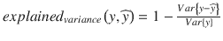
*   其中：
    *   yˆ：估计的目标输出
    *   y：对应的（正确的）目标输出
    *   Var：方差

### 平均绝对误差

平均绝对误差（MAE）是残差（即估计目标与实际目标结果之间的差异）的平均值。该度量的其他形式可能包括将相对频率作为权重因子。MAE 在测量数据的相同尺度（即单位）上工作。因此其局限性在于无法比较使用不同尺度/单位的序列。其数学定义如下：

*   公式：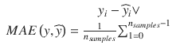
*   其中：
    *   yˆ [i]：估计的目标输出
    *   y [i]：对应的（正确的）目标输出
    *   n [samples]：样本数量

### 均方误差

均方误差（MSE）与 MAE 类似，区别在于它取的是残差的平方，而不是估计目标输出与对应实际目标输出之间的绝对差值。该值始终为正，且越接近 0 越好。对 MSE 取平方根将得到均方根偏差（RMSE），其单位与目标输出相同。MSE 的数学定义如下：

*   公式：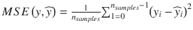
*   其中：
    *   yˆ [i]：第 i 个样本的估计目标输出
    *   y [i]：对应的（正确的）目标输出
    *   n [samples]：样本数量

### R²

R²，也称为决定系数，定义了回归模型可能预测出多少未来样本的度量。此外，它也表示了响应变量中可由解释变量预测的方差比例。其取值范围从 1 到负无穷，其中 1 是最优值。其数学表示如下：

*   公式：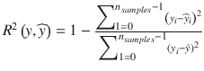
*   公式：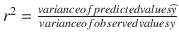
*   示例：
    *   R = -0.7
    *   R ² = 0.49（即一半的变异由线性关系解释）
*   其中：
    *   yˆ [i]：第 i 个样本的估计目标输出
    *   y [i]：对应的（正确的）目标输出
    *   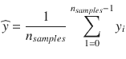

    *   n [samples]：样本数量

### 残差

*   公式：残差 = 观测值 y – 预测值 y 或 ( 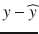 )
*   最小二乘残差的均值始终为 0


### 残差图

残差图是以解释变量 x（即自变量）为横轴、回归残差为纵轴的散点图。参见图 2-15。最小二乘回归线会被 x 方向上的极端点（且附近无其他点）拉向该点。虚线代表最小二乘回归线。

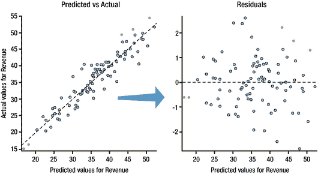

图 2-15.

残差图

### 残差平方和

残差平方和（RSS）指的是回归模型的最佳拟合线未能捕捉到的数据方差量。RSS 越小，模型越好。

为简单起见，我们将继续使用 R² 作为交叉验证的指标。此外，考虑到我们正在进行预测工作，这个指标似乎是一个更好的选择，因为它能帮助我们确定未来样本在准确度尺度上的位置。

现在，在了解了欠拟合、过拟合的概念以及回归评估技术后，克莱尔认为，是时候检验一下自己能否找到最适合当前数据的回归模型了。

## 回归的类型

克莱尔继续指出，SKLearn 是 Python 中最常用的机器学习库。SKLearn 提供了一系列用于回归建模的算法。她根据 SKLearn 网站上的内容整理出了图 2-13，作为根据数据集大小选择通常最佳回归算法的参考。

你可以从 [`http://scikit-learn.org/stable/tutorial/machine_learning_map/`](http://scikit-learn.org/stable/tutorial/machine_learning_map/) 下载图 2-16 所示的速查表。

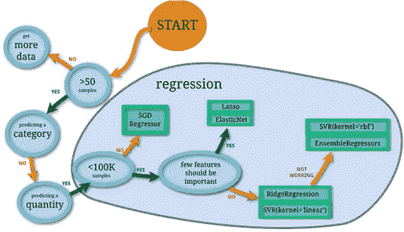

图 2-16.

回归-SKLearn 速查表

史密斯决定尝试一下，找出适合当前数据集大小的回归模型。他回忆道：“在我们的案例中，样本数量少于 10 万，因此潜在的模型有 Lasso、ElasticNet、SVR(kernel=‘rbf’)、集成回归器、岭回归和 SVR(kernel=‘linear’)。”

线性回归是最基础的回归模型，因此克莱尔决定从它开始建模。

### 线性回归

多亏了克莱尔，史密斯已经知道什么是线性回归（见图 2-2）。因此，克莱尔决定将其付诸应用，看看它的表现如何，于是她编写了清单 2-9 中的代码。

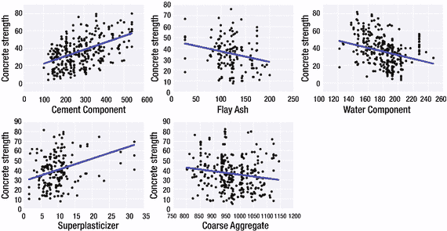

图 2-17.

单变量线性回归图

```
plt.figure(figsize=(15,7))
plot_count = 1
for feature in ['cement_component', 'flay_ash', 'water_component', 'superplasticizer', 'coarse_aggregate']:
data_tr = data[['concrete_strength', feature]]
data_tr=data_tr[(data_tr.T != 0).all()]
x_train, y_train, x_test, y_test = split_train_test(data_tr, feature)
# 创建线性回归对象
regr = LinearRegression()
# 使用训练集训练模型
regr.fit(x_train, y_train)
y_pred = regr.predict(x_test)
# 绘制输出
plt.subplot(2,3,plot_count)
plt.scatter(x_test, y_test,  color='black')
plt.plot(x_test, y_pred, color='blue',
linewidth=3)
plt.xlabel(feature.replace('_',' ').title())
plt.ylabel('Concrete strength')
print feature, r2_score(y_test, y_pred)
plot_count+=1
plt.show()
清单 2-9.
计算单变量线性回归
```

输出

```
cement_component     0.250526602238
flay_ash             0.0546142086558
water_component      0.112291736027
superplasticizer     0.0430808938239
coarse_aggregate     0.0206812124102
```

解释代码对于史密斯理解结果至关重要。因此，克莱尔对清单 2-9 中的代码做了如下解释：

> 查看上述代码时，你会注意到我们只使用了那些在观察图 2-8 时发现存在正相关或负相关的解释变量。其次，我们初始化了一个宽度为 15、高度为 7 的子图图形。第三，我们使用了训练/测试分割方法进行交叉验证。

史密斯决定尝试解释一下输出的含义。几乎所有解释变量的 R² 值都接近 0，这表明线性回归的最佳拟合线未能捕捉到这些变量内部的方差。然而，水泥成分是个例外，其最佳拟合线捕捉到了相对可观的方差。考虑到 R² 较低，这些模型都不能用于预测混凝土强度。

```
features = ['cement_component', 'flay_ash', 'water_component', 'superplasticizer', 'coarse_aggregate']
data_tr = data
data_tr=data_tr[(data_tr.T != 0).all()]
x_train, y_train, x_test, y_test = split_train_test(data_tr, features)
# 创建线性回归对象
regr = LinearRegression()
# 使用训练集训练模型
regr.fit(x_train, y_train)
y_pred = regr.predict(x_test)
plt.scatter(range(len(y_test)), y_test,  color='black')
plt.plot(y_pred, color='blue', linewidth=3)
print 'Features: %s'%str(features)
print 'R2 score: %f'%r2_score(y_test, y_pred)
print 'Intercept: %f'%regr.intercept_
print 'Coefficients: %s'%str(regr.coef_)
清单 2-10.
计算多元线性回归
```

输出

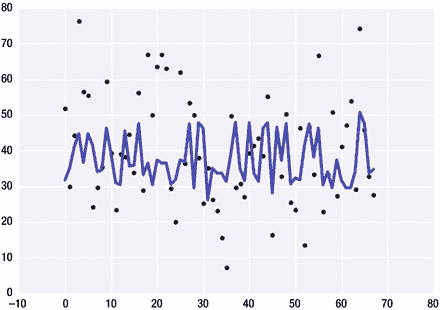

图 2-18.

多元线性回归图

```
Features:      ['cement_component', 'flay_ash', 'water_component', 'superplasticizer', 'coarse_aggregate']
R2 score:      0.097982
Intercept:     77.802791
Coefficients:  0.04531335  0.01168227 -0.13620573  0.24324622 -0.0329745
```

克莱尔很惊讶，因为史密斯说得完全正确。她很好奇，如果同时纳入所有解释变量进行多元回归，会发生什么。于是她编写了清单 [2-10 中的代码片段。史密斯在一定程度上能够理解代码；然而，他看到图 2-18 中非线性的回归最佳拟合线时感到惊讶。

他的理解是，多元线性回归应该产生一条线性线，而不是非线性的最佳拟合线。对此，克莱尔回应如下：

> 分析中的特征数量与图中的维度数量成正比。在我们的案例中，有五个解释变量和一个响应变量，总共六个变量。在六维空间中绘制点是很困难的，因此图 2-18 使用二维来表示。如果我们在六维空间中观察，最佳拟合线本应是线性表示的。

克莱尔指出，由于这个多元回归的 R² 极低，不能使用这个模型来预测响应变量（即混凝土强度）。请注意，R² 极低；因此我们肯定不会继续使用它来回答当前的问题。然而，输出也给出了系数。第一个是 alpha 系数，随后的是 beta 系数。史密斯和克莱尔都知道数据中存在多重共线性。因此，在寻找适用于多重共线性数据的回归技术时，他们遇到了岭回归，并决定尝试一下。不过，克莱尔认为最好先向史密斯解释一下网格搜索。在继续之前，让我们先探索其他回归模型，以找到最适合我们数据的模型。


### 网格搜索

网格搜索采用“拟合”与“评分”的方法，为给定模型确定最佳参数。待调优的模型及其参数和有限可能取值会被传入 `GridSearchCV`。输出结果指明了能使模型达到最佳调优效果的参数值。

在解释了网格搜索之后，克莱尔整理了一份关于岭回归的知识库。

### 岭回归

岭回归在线性最小二乘损失函数的基础上，加入了 L2 范数的正则化项。这种回归方法内置支持接受多个解释变量来预测响应变量。L2 是一种向量范数，用于衡量向量的大小。L2 范数是最常被教授和使用的。假设我们有一个向量 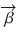，它包含两个分量 β[0] 和 β[1]。其 L2 范数定义如下：

*   公式：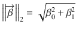

这是从原点到这些向量分量（即 β[0] 和 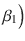）的笛卡尔距离。岭回归在以下条件下表现良好：

*   当我们有多个解释变量时
*   解释变量之间存在多重共线性

多重共线性会导致有偏估计量，因为经过多次迭代计算后，贝塔系数会异常增大。这引出了一个问题：哪次迭代的最佳系数才是真实的？由于估计量现在存在偏差，对多次迭代的系数取平均值无法得到总体系数。然而，这些系数内部的方差不会太高，因此有助于更好地理解这些系数。为了避免贝塔值过大，我们需要对贝塔的最大值施加约束。因此，我们可以用数学方式将岭回归定义如下：

*   公式： 满足条件 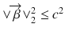 或

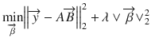

在岭回归中，由于我们选择的是 L2 范数，贝塔值的约束形状是一个圆形，如图 2-19 所示。之前我们对数据应用了简单线性回归和多元线性回归。然而，岭回归、套索回归和弹性网络回归更适用于多元回归，因此它们将成为我们分析的首选。

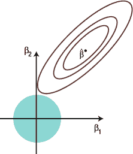

图 2-19.

岭回归的表示

现在史密斯理解了岭回归，他很想知道它如何利用现有的解释变量来预测混凝土强度。正如我们之前读到的，岭回归支持接受多个解释变量作为输入；因此，克莱尔决定运行一个多元岭回归，如代码清单 2-11 所示。图 2-20 显示了结果。

```
alphas = np.arange(0.1,5,0.1)
model = Ridge()
cv = GridSearchCV(estimator=model, param_grid=dict(alpha=alphas))
y_pred = cv.fit(x_train, y_train).predict(x_test)
plt.scatter(range(len(y_test)), y_test,  color='black')
plt.plot(y_pred, color='blue', linewidth=3)
print 'Features: %s'%str(features)
print 'R2 score: %f'%r2_score(y_test, y_pred)
print 'Intercept: %f'%regr.intercept_
print 'Coefficients: %s'%str(regr.coef_)
代码清单 2-11.
计算多元岭回归
```

输出

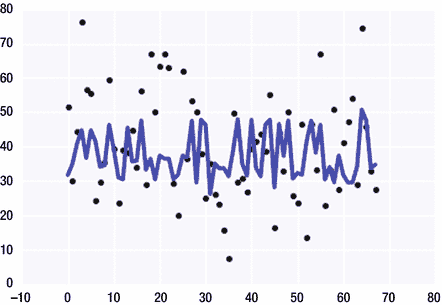

图 2-20.

多元岭回归图

```
Features:      ['cement_component', 'flay_ash', 'water_component', 'superplasticizer', 'coarse_aggregate']
R2 score:      0.097982
Intercept:     77.802791
Coefficients:  [0.04531335  0.01168227 -0.13620573  0.24324622 -0.03297459]
```

史密斯理解代码清单 2-11 中的代码并没有太大困难，因为它与代码清单 2-10 中的代码相似。他唯一不理解的是网格搜索是如何被应用到实际中的。于是克莱尔开始解释与 `GridSearchCV` 相关的这段代码。她首先指向 `alphas = np.arange(0.1,5,0.1)`，这行代码用于生成一个值在 0.1 到 5 之间、步长为 0.1 的数组。这个数组连同岭回归模型一起被输入到 `GridSearchCV` 中。因此，`GridSearchCV` 会逐一尝试 alpha 的值，以确定最能微调模型的那个值。

理解了代码清单 2-11 中的代码后，史密斯提出了一个问题：应用岭回归后，R² 是否表现更好？对此，克莱尔说了以下内容：

> 完全没有，因为它完全相同，系数也是如此。其原因可能是，在存在多个特征和多重共线性的情况下，线性回归倾向于偏向 L2 范数，而 L2 范数正是岭回归所使用的正则化项，因此两者具有相似性。此外，还要注意我们在方法中使用了网格搜索来优化 alpha。那么 alpha 到底是什么？alpha 是一个正则化参数，用于在岭回归中加权 L2 范数项。alpha 值为 0 会将岭回归模型转换为普通最小二乘回归模型。因此，alpha 值越高，平滑度约束越强，系数的幅度就越小。alpha 值的影响如图 2-21 所示。
> 
> 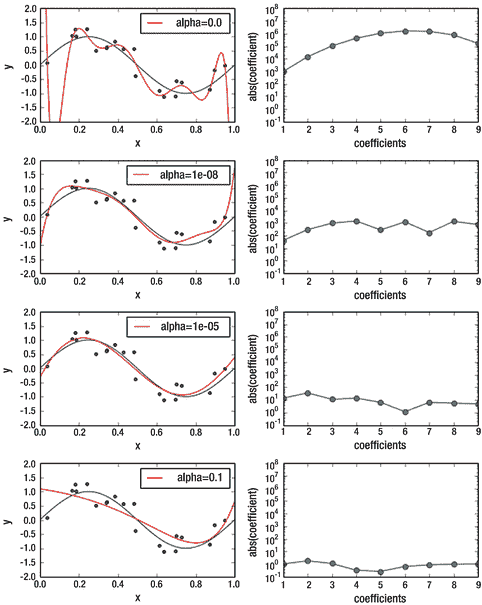
> 
> 图 2-21.
> 
> alpha 值对回归拟合线平滑度的影响

即使在调整参数后，岭回归也没有比多元线性回归带来任何改进。克莱尔认为，将正则化项从 L2 范数改为 L1 范数可能会给 R² 分数带来一些改进。因此，她决定尝试套索回归，并在接下来的章节中对其进行了描述。


### 套索回归

与岭回归相反，套索回归使用 L1 范数。套索回归的 L1 范数定义如下：

*   公式：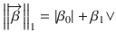

从数学角度，我们将套索回归定义如下：

*   公式：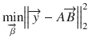 满足条件 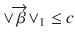 或
*   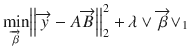

由于我们之前选择的岭回归是 L2 范数，因此 beta 值的约束形状是一个圆形。然而，在采用 L1 范数的套索回归中，beta 的约束形状是一个菱形（见图 2-22）。

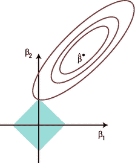

图 2-22.

套索回归的表示

考虑到这个菱形位于第一象限 x 轴上的边缘，我们可以看到其坐标为 (c,0)。上方的等高线在 (0,c) 处与菱形相切，这意味着我们得到了 β [1] 的值，而没有得到 β [2] 的值。因此，将以下内容代入方程将导致与 β [1] 相关的解释变量变为 0。因此，在整个过程中，套索回归最终只会保留少数几个解释变量，而相比之下，岭回归的形状是圆形，会包含数据集中的所有解释变量。

史密斯预计这里的 R² 会有所改善，因为他认为只精选少数几个解释变量而忽略其余变量可以使模型更强大。因此，克莱尔测试了该模型，如代码清单 2-12 所示。

```
model = Lasso()
cv = GridSearchCV(estimator=model, param_grid=dict(alpha=alphas))
y_pred = cv.fit(x_train, y_train).predict(x_test)
plt.scatter(range(len(y_test)), y_test,  color='black')
plt.plot(y_pred, color='blue', linewidth=3)
print 'Features: %s'%str(features)
print 'R2 score: %f'%r2_score(y_test, y_pred)
print 'Intercept: %f'%regr.intercept_
print 'Coefficients: %s'%str(regr.coef_)
代码清单 2-12.
计算多元套索回归
```

输出

```
Features:      ['cement_component', 'flay_ash', 'water_component', 'superplasticizer', 'coarse_aggregate']
R2 score:      0.103610
Intercept:     77.802791
Coefficients:  [0.04531335 0.01168227 -0.13620573 0.24324622 -0.03297459]
```

史密斯注意到套索回归的表现优于多元岭回归和线性回归（图 2-23）。

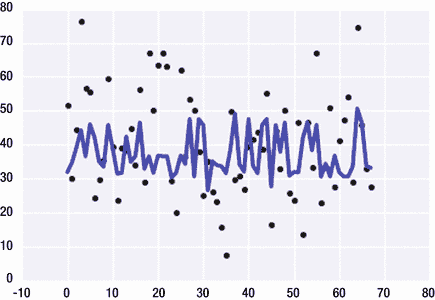

图 2-23.

多元套索回归图

然而，根据克莱尔的说法，0.1 的 R² 非常低，不足以用来推断响应变量。此外，她指出，与岭回归一样，这里再次使用了网格搜索来优化 alpha 项。

由于到目前为止没有取得重大成功，克莱尔决定引入回归模型中的最佳方案。弹性网络融合了这两种方法（即岭回归和套索回归）的优点。

### 弹性网络

弹性网络克服了套索回归中发现的局限性（即惩罚函数）。套索倾向于只选择部分解释变量，并且对于多重共线性的解释变量组，它只会从该组中选择一个。为了避免这种情况，明智的做法是在惩罚项中添加一个二次部分（即岭回归中存在的 
cv = GridSearchCV(estimator=model, param_grid=dict(alpha=alphas))
y_pred = cv.fit(x_train, y_train).predict(x_test)
plt.scatter(range(len(y_test)), y_test,  color='black')
plt.plot(y_pred, color='blue', linewidth=3)
print 'Features: %s'%str(features)
print 'R2 score: %f'%r2_score(y_test, y_pred)
print 'Intercept: %f'%regr.intercept_
print 'Coefficients: %s'%str(regr.coef_)
代码清单 2-13.
计算多元弹性网络回归
```

输出

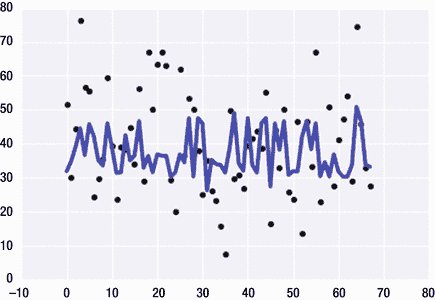

图 2-24.

多元弹性网络回归图

```
Features:      ['cement_component', 'flay_ash', 'water_component', 'superplasticizer', 'coarse_aggregate']
R2 score:      0.099785
Intercept:     77.802791
Coefficients:  [0.04531335  0.01168227 -0.13620573  0.24324622 -0.03297459]
```

克莱尔对这个模型的结果感到失望（图 2-24）。她回忆道：

> 这里的交叉验证结果似乎比套索回归要低。正如我们之前读到的，套索似乎会考虑一部分解释变量；因此，弹性网络试图将两者结合起来的努力反而抵消了套索单独使用时的优势。这就是我们在当前数据上观察到的行为，但请注意，这并非对所有问题集都普遍适用。

史密斯很好奇是否存在某种技术可以迭代地提高回归模型的准确性。克莱尔知道答案（即梯度提升回归）。


### 梯度提升回归

由分类或回归树模型组成的集成方法会汇聚成一个梯度提升模型（见图 2-25）。提升法是一种非线性的灵活回归技术，通过给错误预测分配更高的权重来帮助提高树的准确性。引入更高权重的目的是让模型能够更关注这些被错误预测的样本，并自我调整以提高准确性。梯度提升方法解决了提升树固有的问题（即速度慢和人类可解释性差）。该算法通过指定线程数量来支持并行处理。

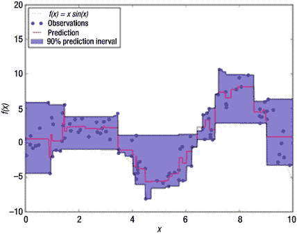

图 2-25.

梯度提升回归示意图

克莱尔决定在相关数据集上分别运行单梯度提升回归和多梯度提升回归。她首先编写了清单 2-14 中单梯度提升回归的代码。

```
plt.figure(figsize=(15,7))
plot_count = 1
for feature in ['cement_component', 'flay_ash', 'water_component', 'superplasticizer', 'coarse_aggregate']:
data_tr = data[['concrete_strength', feature]]
data_tr=data_tr[(data_tr.T != 0).all()]
x_train, y_train, x_test, y_test = split_train_test(data_tr, feature)
# Create linear regression object
regr = GradientBoostingRegressor()
# Train the model using the training sets
regr.fit(x_train, y_train)
y_pred = regr.predict(x_test)
# Plot outputs
plt.subplot(2,3,plot_count)
plt.scatter(x_test, y_test,  color='black')
plt.plot(x_test, y_pred, color='blue',
linewidth=3)
plt.xlabel(feature.replace('_',' ').title())
plt.ylabel('Concrete strength')
print feature, r2_score(y_test, y_pred)
plot_count+=1
plt.show()
清单 2-14.
计算单梯度提升回归
```

输出

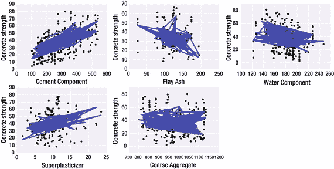

图 2-26.

单梯度提升回归图

```
cement_component    0.339838267592
flay_ash            0.0804872388797
water_component     0.311858270879
superplasticizer    0.123130891086
coarse_aggregate    0.230383758064
```

史密斯看到结果后非常兴奋，因为经过大量努力，他们成功显著提高了回归模型的 R² 系数（图 2-26）。

在查看水泥成分、水成分和粗骨料的 R² 系数值时，史密斯发现这些值相对于他们从线性回归中得到的结果有所改善。他知道可以通过引入网格搜索来调整参数值，从而进一步改进结果。克莱尔对结果仍不满意；因此她继续运行了清单 2-15 中的多梯度提升回归。

```
model = GradientBoostingRegressor()
y_pred = model.fit(x_train, y_train).predict(x_test)
plt.scatter(range(len(y_test)), y_test,  color='black')
plt.plot(y_pred, color='blue',
linewidth=3)
print 'Features: %s'%str(features)
print 'R2 score: %f'%r2_score(y_test, y_pred)
print 'Intercept: %f'%regr.intercept_
print 'Coefficients: %s'%str(regr.coef_)
清单 2-15.
计算多梯度提升回归
```

输出

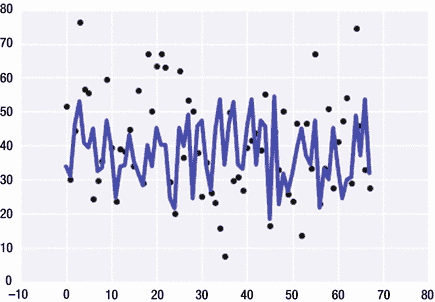

图 2-27.

多梯度提升回归图

```
Features:      ['cement_component', 'flay_ash', 'water_component', 'superplasticizer', 'coarse_aggregate']
R2 score:      0.005876
Intercept:     77.802791
Coefficients:  [0.04531335  0.01168227 -0.13620573  0.24324622 -0.03297459]
```

史密斯看到 R² 值从糟糕变得更糟。单梯度提升回归似乎比多梯度提升回归表现更好（图 2-27）。

克莱尔曾经读到过，为了更好地分类或推断数据，一种方法是将数据绘制在高维空间中。支持向量机在引入核函数时往往会这样做。


### 支持向量机

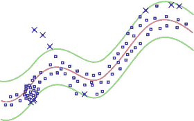

图 2-28.

支持向量机回归示意图

支持向量机构建超平面，用于分类和回归（见图 2-28）。其目标是使两个类别之间的间隔最大化。这通过最大化超平面与两侧数据点之间的距离来实现。在此过程中，数据集在该空间中往往不是线性可分的，因此我们建议将其映射到高维空间（例如，通过引入核函数）。

克莱尔决定在数据集上运行单变量和多变量支持向量机回归。她还计划对支持向量回归器应用线性核函数，以获得更好的结果。

```
plt.figure(figsize=(15,7))
plot_count = 1
for feature in ['cement_component', 'flay_ash', 'water_component', 'superplasticizer', 'coarse_aggregate']:
data_tr = data[['concrete_strength', feature]]
data_tr=data_tr[(data_tr.T != 0).all()]
x_train, y_train, x_test, y_test = split_train_test(data_tr, feature)
# 创建线性回归对象
regr = SVR(kernel='linear')
# 使用训练集训练模型
regr.fit(x_train, y_train)
y_pred = regr.predict(x_test)
# 绘制输出
plt.subplot(2,3,plot_count)
plt.scatter(x_test, y_test,  color='black')
plt.plot(x_test, y_pred, color='blue', linewidth=3)
plt.xlabel(feature.replace('_',' ').title())
plt.ylabel('Concrete strength')
print feature, r2_score(y_test, y_pred)
plot_count+=1
plt.show()
代码清单 2-16.
使用线性核函数计算单变量支持向量机回归
```

输出

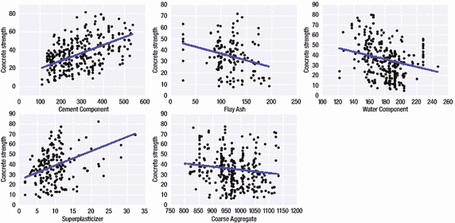

图 2-29.

单变量支持向量机回归图

```
cement_component    0.186215229943
flay_ash            0.0566844466086
water_component     0.0824723749594
superplasticizer    0.0412024702221
coarse_aggregate    0.0293294512993
```

史密斯注意到，与图 2-23 中梯度提升回归器的最佳拟合线相反，图 2-26 中的最佳拟合线看起来更清晰、更线性，并且相对过拟合程度较低。然而，R² 值受到了影响，与他们在单变量梯度提升回归器中观察到的结果相比有所下降（见图 2-29）。

克莱尔编写了代码清单 2-17 中的代码，以查看多变量支持向量机是否能给 R² 系数带来任何改进。图 2-30 显示了结果。

```
model = SVR(kernel='linear')
y_pred = model.fit(x_train, y_train).predict(x_test)
plt.scatter(range(len(y_test)), y_test,  color='black')
plt.plot(y_pred, color='blue', linewidth=3)
print 'Features: %s'%str(features)
print 'R2 score: %f'%r2_score(y_test, y_pred)
代码清单 2-17.
使用线性核函数计算多变量支持向量机回归
```

输出


图 2-30.

多变量支持向量机回归图

```
Features:  ['cement_component', 'flay_ash', 'water_component', 'superplasticizer', 'coarse_aggregate']
R2 score:  0.010077
```

在史密斯的评价标准中，支持向量回归器在他们之前探索过的模型中表现最差。克莱尔认为可以通过参数调优来改善性能。此外，还可以尝试使用其他类型的核函数来提高预测效率。

史密斯和克莱尔今天的工作到此为止。请通过完成以下练习，帮助他们调整模型并尝试不同的核函数。

练习

1.  使用 'rbf' 核函数运行支持向量机回归。同时尝试运行 'polynomial' 和 'sigmoid' 核函数以优化预测精度。
2.  梯度提升回归器具有学习率、`min_samples_split`、`min_samples_leaf` 等可调参数。对这些参数进行网格搜索以提高回归器的效率。
3.  支持向量回归器具有 c 和 gamma 等可调参数。对这些参数进行网格搜索以提高回归器的效率。
4.  梯度提升回归器会返回每个拟合模型的特征重要性。探索模型赋予更高重要性的特征，并仅考虑将这些特征组合或单独使用来重新进行建模。
5.  在之前的练习中，我们根据年龄划分数据并计算相关性。选择相关性最大的年龄划分，然后重复示例和练习，看看我们是否能对该组数据拟合出精度更高的模型。

## 回归的应用

回归在多个研究领域都有广泛的应用。

### 预测销售额

回归可用于预测商品或服务的销售额，例如需求分析（图 2-31）。


图 2-31.

零售额和个人收入预测

历史销售数据可用于推断未来的结果。诸如营销成本、商品推销、价格和库存单位（SKU）数量等特征可以作为解释变量输入模型。

### 预测债券价值

不同时期的通货膨胀率可用于预测债券价值。在估算包含债券的投资组合的预期收益时，这可能会成为关键因素。

### 通货膨胀率

在经济学中，我们有通货膨胀率和货币供给理论的概念。如果研究人员认为通货膨胀率是经济体中货币供应量的函数，那么他能做什么？他可以将通货膨胀率作为响应变量，将货币供应量作为解释变量（见图 2-32）。


图 2-32.

通货膨胀率预测

### 保险公司

这些公司使用回归来预测可能申请健康保险或人寿保险理赔的人数，或者预测其承保车辆可能发生事故的人数。

### 呼叫中心

呼叫中心经理可能希望了解投诉数量的增加与呼叫等待时间之间的函数关系。

### 农业

回归可用于预测特定区域的预期水果产量。可能的解释变量包括降雨量、日照时长、影响作物的病害数量、受火灾或病害影响的作物数量、土壤质量指数、土地肥力指数等。

### 薪资预测

大学可以使用预测模型来预测学生的薪资。可能的解释变量包括成绩、参加的竞赛数量、班级排名、完成的实习次数、发表的研究论文数量、完成的项目数量、参加的体育赛事数量等。


### 房地产行业

房地产价格可以通过房产的平方英尺面积、房间数量、停车位可用性、开放空间平方英尺、距离主干道的英里数等因素来预测（见图 2-33）。


图 2-33.

根据面积（英尺）预测房产价值

总结本章，克莱尔和史密斯最初达成共识，使用回归方法来预测混凝土强度。他们计划通过回归方程来实现这一目标，以避免采购测试设备来测量强度所产生的成本。他们首先通过理解混凝土强度与解释变量之间存在的相关性来展开分析。那些呈现正相关或负相关的变量被用于回归建模。此外，相关性还帮助发现了三个解释变量之间存在的多重共线性问题。

他们研究了回归模型评估指标，并选择了 R² 来评估回归模型。他们了解了什么是网格搜索，以及如何应用它来确定最佳参数值，从而对模型进行最优调优。他们将数据拆分为测试集和训练集，以实现交叉验证。在应用的众多回归技术中，单一梯度提升回归器展现出了最佳的 R² 值。因此，在分析结束时，史密斯和克莱尔得到了以下三个模型，它们可以单独用于预测混凝土强度。

首先，克莱尔定义了梯度提升回归模型的使用场景，该模型以水泥成分为输入来预测混凝土强度。她从清单 2-14 的输出中回忆到，该回归模型的置信度约为 34%。

```
feature = 'cement_component'
cc_new_data = [213.5]
data_tr = data[['concrete_strength', feature]]
data_tr=data_tr[(data_tr.T != 0).all()]
x_train, y_train, x_test, y_test = split_train_test(data_tr, feature)
regr = GradientBoostingRegressor()
# Train the model using the training sets
regr.fit(x_train, y_train)
cs_pred = regr.predict(cc_new_data)
print 'Predicted value of concrete strength: %f'%cs_pred
清单 2-18.
根据水泥成分预测混凝土强度
```

输出

```
Predicted value of concrete strength: 34.008896
```

作为示例，一个水泥成分的输入值被传递给了变量 `cc_new_data`。克莱尔指出，为了预测混凝土强度，可以在同一个变量中传入一个新的值。

接着，克莱尔重复了该练习，不同之处在于这次以水成分为输入。她从清单 2-14 的输出中回忆到，该回归模型的置信度约为 31%。

```
feature = 'water_component'
wc_new_data = [200]
data_tr = data[['concrete_strength', feature]]
data_tr=data_tr[(data_tr.T != 0).all()]
x_train, y_train, x_test, y_test = split_train_test(data_tr, feature)
regr = GradientBoostingRegressor()
# Train the model using the training sets
regr.fit(x_train, y_train)
cs_pred = regr.predict(wc_new_data)
print 'Predicted value of concrete strength: %f'%cs_pred
清单 2-19.
根据水成分预测混凝土强度
```

输出

```
Predicted value of concrete strength: 35.533469
```

作为示例，一个水成分的输入值被传递给了变量 `wc_new_data`。

最后，克莱尔再次重复了该练习，这次的不同之处在于以粗骨料为输入。她从清单 2-14 的输出中回忆到，该回归模型的置信度约为 23%。

```
feature = 'coarse_aggregate'
ca_new_data = [1000]
data_tr = data[['concrete_strength', feature]]
data_tr=data_tr[(data_tr.T != 0).all()]
x_train, y_train, x_test, y_test = split_train_test(data_tr, feature)
regr = GradientBoostingRegressor()
# Train the model using the training sets
regr.fit(x_train, y_train)
cs_pred = regr.predict(ca_new_data)
print 'Predicted value of concrete strength: %f'%cs_pred
清单 2-20.
根据粗骨料预测混凝土强度
```

输出

```
Predicted value of concrete strength: 32.680344
```

作为示例，一个水成分的输入值被传递给了变量 `ca_new_data`。史密斯对克莱尔采取的方法深信不疑，他相信如果在研发上投入更多时间，他就能向管理层提出这个替代方案，从而让他们无需再采购任何设备。

