# 3. 时间序列

本章的目标是让你入门时间序列预测。时间序列预测与回归的不同之处在于，时间充当解释变量，并且应在相等的时间间隔内保持连续。本章将涵盖平稳性的概念、其重要性，以及检查时间序列对象中是否存在平稳性的方法。将应用几种时间序列模型，并使用最有效的评估技术来检查它们的预测结果。

注意

本书采用 Python 2.7.11 作为编码示例的事实标准。此外，你需要安装该版本以完成练习。


## 案例研究：预测雅虎每日调整收盘价

大卫第二天与客户珍妮丝安排了会议。他们将讨论珍妮丝投资收益下滑的原因。珍妮丝是一位百万富翁商人的女儿，在听闻市场有望随经济形势好转而增长的传言后，她找到了大卫。她有意采取长期高风险投资策略，以享受潜在的高额投资回报。然而本季度，尽管资本市场前景良好，她的收益却出现了下滑。

大卫查看了珍妮丝的投资组合，开始逐一分析每只股票在上季度的表现。他发现投资组合收益与预期收益不匹配的原因，在于雅虎股票预测存在巨大残差。如果该股票数量在整个投资组合中占比很小，这种预测误差的影响本可忽略不计，但当前情况并非如此。

大卫回想起在哈佛商学院学习公司金融和商业分析课程时的内容，决定尝试运用这些概念来寻找解决方案。他应该使用回归分析还是时间序列分析？哪些技术可以应用于雅虎股票的预测？

大卫从 Python 提供的 Matplotlib 金融数据包中提取了雅虎股票数据（代码片段见清单 3-2）。

大卫进行了一些研究，以了解数据中每个特征包含的信息。他为雅虎股票价格数据集整理了一份数据字典（见表 3-1）。

表 3-1.

雅虎股票价格数据集数据字典

| 特征名称 | 描述 |
| --- | --- |
| Date | 交易日日期 |
| Year | 交易日年份 |
| Month | 交易日月份 |
| Day | 交易日月份中的日期 |
| D | 日期的浮点数表示 |
| Open | 交易日开盘价 |
| Close | 交易日收盘价 |
| High | 交易日最高价 |
| Low | 交易日最低价 |
| Volume | 交易日成交量 |
| adjusted_close | 交易日收盘价。同时考虑了当日开盘前发生的分红派息和公司行为。 |

在继续之前，大卫考虑初始化以下软件包。他这样做是为了避免在本地机器上执行代码片段时出现瓶颈。

```
%matplotlib inline
import pandas as pd
import numpy as np
from datetime import datetime
import statsmodels.api as sm
import matplotlib.pyplot as plt
from IPython.display import Image
from matplotlib.pylab import rcParams
from statsmodels.tsa.stattools import adfuller
from statsmodels.tsa.stattools import acf, pacf
from sklearn.linear_model import LinearRegression
from statsmodels.tsa.arima_model import ARMA, ARIMA
from sklearn.metrics import explained_variance_score
from matplotlib.finance import fetch_historical_yahoo, parse_yahoo_historical_ochl
rcParams['figure.figsize'] = 15, 5
清单 3-1.
导入本章所需软件包
```

大卫深知，在开始任何分析之前，理解数据是基础。他计划将数据集加载到内存中，并查看调整收盘价的时间序列图，以判断时间序列对象中是否存在某种模式。

## 特征探索

大卫首先将数据加载到内存中。

```
fh = fetch_historical_yahoo('^GSPC', (2016, 1, 1), (2016, 12, 31))
yahoo_data = parse_yahoo_historical_ochl(fh, asobject=True, adjusted=False)
清单 3-2.
将数据读入内存
```

在解释代码时，他首先说明使用 `fetch_historical_yahoo` 类来获取 2016 年所有交易日的雅虎指数对象。接着，他将该对象传递给 `parse_yahoo_historical_ochl` 方法，以获取表 3-1 中描述的特征数据。

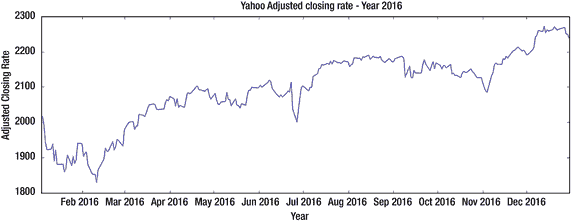

图 3-1.

2016 年雅虎股票调整收盘价时间序列图

```
dates = [x[0] for x in list(yahoo_data)]
values = [x[-1] for x in list(yahoo_data)]
data = pd.DataFrame({'Close_Adj':values}, index=dates)
date_thresh = datetime.strptime('2016-10-01',"%Y-%m-%d").date()
data_train = data[:date_thresh]
data_test = data[date_thresh:]
plt.plot(data_train.index, data['Close_Adj'])
plt.xlabel('Year')
plt.ylabel('Adjusted Closing Rate')
plt.title('Yahoo Adjusted closing rate - Year 2016')
清单 3-3.
绘制 2016 年雅虎股票调整收盘价时间序列图
```

通过清单 3-3，大卫在图 3-1 中绘制了 2016 年雅虎股票收盘价。他将原始数据序列拆分为测试数据（即 `data_test`）和训练数据（即 `data_train`）。因此，从那时起，大卫决定使用 `data_train` 作为构建时间序列模型的数据。

观察图 3-1 中的分布，大卫注意到存在明显的上升趋势。此外，他还发现存在季节性（即向下波动），每 4.5 个月重复一次。

由于珍妮丝的投资组合中大部分是雅虎股票，大卫知道必须采取措施来减少预测误差。为了验证模型，他决定拆分数据集。他计划使用 2016 年前九个月的数据作为训练数据集，后三个月用于交叉验证模型的预测。他灵机一动，想到可以使用预测技术为雅虎股票时间序列生成一条泛化曲线。然后根据该曲线的形状，决定采用哪种回归模型来实现对未来时间点的预测。使用预测技术的根本目的是捕捉时间序列对象中存在的季节性和趋势成分。

因此，大卫开始专注于第一个目标——即构建一个能够最佳捕捉雅虎股票时间序列成分的时间序列预测模型。他回想起在公司金融课程中，他们曾使用时间序列方法进行股票预测。他做了一些研究，以了解什么是时间序列建模，以及何时应该优先使用它。

### 时间序列建模

以固定时间间隔收集的数据点构成时间序列。时间序列分析通常旨在根据问题的基本假设，预测随时间变化的长期趋势。

那天是星期五，大卫期待着与朋友和家人共度周末。他也对与朋友玛丽亚的会面感到兴奋，玛丽亚是他学生时代的同班同学，研究方向偏向统计学。

星期六，大卫和玛丽亚在一家著名的快餐店共进午餐。大卫没有浪费时间，直接提出了问题以及他打算如何解决。他知道，在分析初期进行充分的尽职调查，才能得出富有成效的研究成果。因此，他很想听听玛丽亚关于时间序列分析中必不可少的统计概念和技术的建议，以便在继续之前加以应用。玛丽亚建议他检查时间序列数据是否平稳，因为大多数时间序列模型都是设计用于处理平稳数据并给出结果的。


## 评估时间序列对象的平稳性

大卫把他的计划拆解成了几个部分。他首先计划了解一个时间序列对象需要具备哪些属性才能是平稳的。然后，他必须检查手头的数据是否平稳；如果不是，他需要寻找使其平稳的技术。大卫首先列出了使时间序列对象平稳的属性。

### 平稳时间序列的属性

大多数时间序列模型都基于数据是平稳的这一假设。此外，与平稳时间序列相关的对立理论比非平稳时间序列理论更容易实现。如果一个时间序列对象具有以下属性，则它是平稳的：

*   不存在趋势
*   均值随时间保持恒定
*   方差随时间保持恒定
*   不存在自相关。自相关是指当前时间序列与其滞后版本之间的相关性。

一旦大卫知道了时间序列对象平稳所需的四个属性，他就开始寻找技术来检验时间序列数据是否平稳。

### 判断时间序列是否平稳的检验方法

他的搜索为他提供了两种验证方法：探索性数据分析和迪基-富勒检验。探索性数据分析方法可以帮助检测雅虎股票数据集中的平稳性属性。

#### 探索性数据分析

这更像是一种通过可视化来判断分布是否平稳的方法。它涉及使用滚动均值和滚动方差来回答根本问题。如果这些滚动指标随时间保持恒定，那么该分布将符合平稳时间序列对象的条件。那么，滚动均值是如何计算的呢？首先，我们定义需要计算滚动均值的子集长度（例如，5）。然后，我们通过对序列中的数字以 5 个为一组进行平均，来生成我们自己的时间序列。例如，考虑一个具有以下值的时间序列：

*   10, 50, 34, -5, 15, 19, 1, -30, 16, 37

那么随后的滚动均值将如下所示：

*   NA, NA, NA, NA, NA, 20.8, 22.6, 12.8, 0, 4.2, 8.6

滚动方差的计算同理，只不过在每个实例中计算的是方差而不是均值。

然后，这些滚动均值将被绘制在时间序列图上。然而，通过观察上面的滚动均值，我们可以推断出这些值似乎变化很大，并且完全不是恒定的。因此，上面示例中显示的时间序列不是平稳的。

尽管第一种方法看起来直接且易于实现，但大卫仍在寻找一种统计技术，使他能够验证时间序列对象是否平稳。他的搜索也让他找到了迪基-富勒检验。

#### 迪基-富勒检验

这更像是一种检查时间序列对象是否平稳的统计方法。该检验在其原假设中假设时间序列对象是非平稳的。一旦应用于给定的时间序列对象，迪基-富勒检验会返回不同置信区间下的检验统计量和临界值。如果检验统计量的值低于临界值，则原假设不成立，我们选择备择假设（即时间序列对象是平稳的）。

一旦他知道了使时间序列对象平稳的属性，并在查看了识别它的技术之后，大卫决定检查手头的数据是否平稳。因此，他编写了清单 3-4 中的代码片段。

```
def evaluate_stationarity(timeseries, t=30):
#Determing rolling statistics
rolmean = timeseries.rolling(window=t).mean()
rolstd = timeseries.rolling(window=t).std()
#Plot rolling statistics:
orig = plt.plot(timeseries, color='blue',label='Original')
mean = plt.plot(rolmean, color='red', label='Rolling Mean')
std = plt.plot(rolstd, color='black', label = 'Rolling Std')
plt.legend(loc='best')
plt.title('Rolling Mean & Standard Deviation')
plt.show(block=False)
#Perform Dickey-Fuller test:
print 'Results of Dickey-Fuller Test:'
dftest = adfuller(timeseries, autolag='AIC')
dfoutput = pd.Series(dftest[0:4], index=['Test Statistic','p-value','#Lags Used','Number of Observations Used'])
for key,value in dftest[4].items():
dfoutput['Critical Value (%s)'%key] = value
print dfoutput
Listing 3-4.
Method to Evaluate If a Time Series Object Is Stationary
```

对于编程经验不多的大卫来说，编写清单 3-4 中的代码片段并非易事。他知道这个时间序列验证功能会被反复重用。因此，他将代码写在一个函数中，以便在需要时随时使用该功能。他决定记录下他所写的所有代码，以便日后在理解困难时可以查阅。他回忆道：

> 默认情况下，我将窗口大小 't' 初始化为 30，也就是一个月。然后我计算了时间序列对象的滚动均值和滚动标准差。接着，我将时间序列、滚动均值和滚动标准差绘制在一起，将探索性数据分析方法付诸实践。我知道这能让我判断时间序列对象是否平稳。之后，我决定也尝试用于检测的统计检验，并将迪基-富勒检验付诸应用。我确保打印出迪基-富勒检验的输出，并根据置信区间确定临界区间。

现在大卫已经定义了清单 3-4 中的方法，他决定调用它，并将时间序列对象作为参数传递，同时将窗口大小 't' 设置为 15（即两周）。他调用了 `evaluate_stationary` 方法，如清单 3-5 所示。

```
evaluate_stationarity(data_train['Close_Adj'], 15)
Listing 3-5.
Using the Method to Test If Time Series Object Is Stationary
```

输出

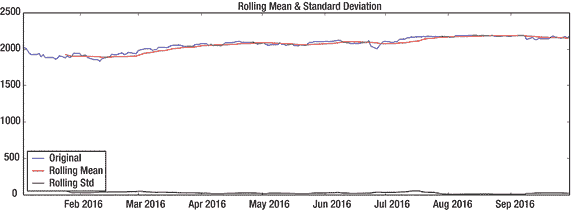

图 3-2.

时间序列对象的滚动均值和标准差图

```
Results of Dickey-Fuller Test:
Test Statistic                 -1.114302
p-value                        0.709335
#Lags Used                     0.000000
Number of Observations Used    188.000000
Critical Value (5%)            -2.877040
Critical Value (1%)            -3.465620
Critical Value (10%)           -2.575032
dtype: float64
```

在查看图 3-2 中的探索性数据分析时，大卫注意到，尽管滚动标准差的变化很小，但滚动均值显然相对变化很大。因此，他推断该时间序列对象是非平稳的。然后他查看了迪基-富勒检验的输出，看它是否也显示了相同的结果。他注意到检验统计量大于临界值；因此，他无法拒绝原假设，这意味着数据本质上是非平稳的。

时间序列对象是非平稳的，这意味着预测的道路不再平坦。在应用预测之前，他必须首先使时间序列对象平稳。因此，他做了一些研究，并提出了几种使时间序列对象平稳的方法。


### 使时间序列对象平稳的方法

尽管存在多种实现方法，但没有一种能保证使时间序列对象完全平稳。这些方法所做的是对时间序列对象进行变换，使其看起来更接近平稳对象。它们通过从时间序列对象中移除趋势和季节性来实现这一点。以下是能使时间序列对象更接近平稳对象的一些方法：

*   应用变换
*   估计趋势并将其从原始序列中移除
*   差分
*   分解

大卫决定逐一应用所有这些方法，以确定哪一种能使时间序列对象尽可能平稳。他首先研究了应用变换如何帮助实现这一短期目标。

#### 应用变换

对数、立方根和平方根等变换会对较大的值进行惩罚，从而使序列变得平稳。大卫决定应用每一种变换，找出能使该时间序列对象几乎平稳的方法。他从对数变换开始。

##### 对数变换

大卫编写了清单 3-6 中的代码片段，以查看对数变换是否能生成一个本质平稳的时间序列。

```
data_log = np.log(data_train['Close_Adj'])
evaluate_stationarity(data_log, 15)
清单 3-6.
对时间序列对象应用对数变换
```

输出

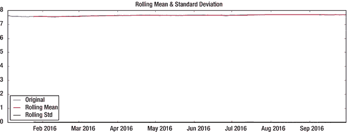

图 3-3.

对数变换后的时间序列及其滚动均值和标准差

```
Results of Dickey-Fuller Test:
Test Statistic                  -1.136109
p-value                         0.700460
#Lags Used                      0.000000
Number of Observations Used     188.000000
Critical Value (5%)             -2.877040
Critical Value (1%)             -3.465620
Critical Value (10%)            -2.575032
dtype: float64
```

查看图 3-3，大卫注意到变换确实有效，因为它成功使滚动均值和滚动标准差保持恒定。然而，他惊讶地发现迪基-富勒检验的结果却相反（即变换后的序列仍然是非平稳的）。他是在注意到检验统计量大于临界值后得出这一结论的，这意味着原假设成立，对数变换后的对象本质上是非平稳的。他很好奇为什么两种方法会产生相互矛盾的结果。他能想到的唯一解释是，滚动均值虽然看起来恒定，但一旦放大图 3-3 可能会发现其存在变化。因此，他添加了一些代码行，如清单 3-7 所示。

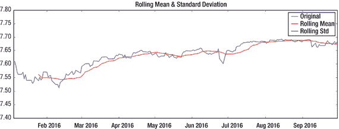

图 3-4.

对数变换分布中滚动均值的放大图

```
data_log = np.log(data_train['Close_Adj'])
#Determing rolling statistics
rolmean = data_log.rolling(window=15).mean()
rolstd = data_log.rolling(window=15).std()
#Plot rolling statistics:
orig = plt.plot(data_log, color='blue',label='Original')
mean = plt.plot(rolmean, color='red', label='Rolling Mean')
std = plt.plot(rolstd, color='black', label = 'Rolling Std')
plt.legend(loc='best')
plt.ylim([7.4,7.8])
plt.title('Rolling Mean & Standard Deviation')
plt.show(block=False)
清单 3-7.
对数变换分布中滚动均值的放大图
```

图 3-4 中的放大图显示，滚动均值随时间变化，并非恒定不变。根据大卫的说法，这一推理表明迪基-富勒检验的结果显示变换后的序列是非平稳的。对数变换未能使对象本质平稳，因此大卫转向平方根变换作为下一个备选方案。

##### 平方根变换

大卫通过编写清单 3-8 中的脚本，对雅虎股票数据应用了平方根变换。

```
data_sqrt = np.sqrt(data_train['Close_Adj'])
evaluate_stationarity(data_sqrt, 15)
清单 3-8.
对时间序列对象应用平方根变换
```

输出

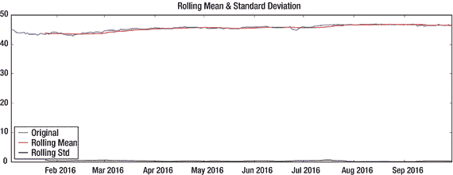

图 3-5.

平方根变换后的时间序列及其滚动均值和标准差

```
Results of Dickey-Fuller Test:
Test Statistic                   -1.124704
p-value                          0.705121
#Lags Used                       0.000000
Number of Observations Used     188.000000
Critical Value (5%)             -2.877040
Critical Value (1%)             -3.465620
Critical Value (10%)            -2.575032
dtype: float64
```

大卫从图 3-5 中得出以下结论：

> 如上图所示，滚动均值和标准差看似恒定，但与我们在对数变换序列图中看到的相比，恒定程度并不高。这就是在此次迪基-富勒检验结果中，检验统计量大于临界值的原因，这意味着原假设成立，对数变换后的对象本质上是非平稳的。

对数变换和平方变换未能使手头的时间序列对象更接近平稳性质。对数变换确实有助于缩小时间序列对象的尺度并使其更平坦。因此，大卫决定将其他方法应用于对数变换后的序列，以使其平稳。他开始寻找统计学界推荐的其他变换方法，就在这时他了解到了立方变换。然而，他该下班回家了，因此他请求你在业余时间应用立方变换，并将结果分享给他。

练习

1.  确定我们时间序列的立方变换。它是否改善了检验统计量的值？

新的一天开始了，大卫继续执行他的短期任务——将时间序列对象的性质转变为平稳的。在变换方法失败后，他正在寻找其他能够帮助他实现短期目标的技术。他重新开始，审视了图 3-1 中时间序列对象的初始图。就在这时，一个想法浮现在脑海中：如果他从数据中移除上升趋势使其平稳，会怎么样呢？

#### 估计趋势并将其从原始序列中移除

他知道这个方法分为两步：首先需要估计趋势，然后将其从雅虎股票时间序列对象中移除。他开始寻找估计趋势的技术，幸运地找到了两种方法：移动平均平滑和指数加权移动平均。他从移动平均平滑开始。


#### 移动平均平滑

移动平均平滑与滚动均值类似，这两种方法都是通过计算固定窗口内观测值的平均值来估计给定时间点的观测值。

David 决定应用移动平均平滑来估计对数变换后时间序列的趋势。他通过编写清单 3-9 中的代码，对过去两周（即最后 15 个值）应用滚动均值。

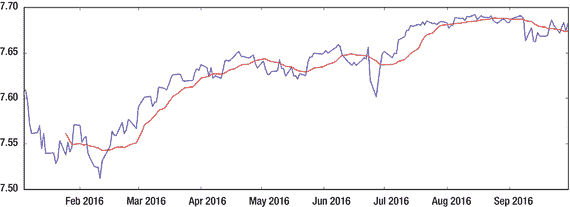

图 3-6.

移动平均平滑后的时间序列

```
moving_avg = pd.rolling_mean(data_log,15)
plt.plot(data_log)
plt.plot(moving_avg, color='red')
清单 3-9.
对时间序列对象应用移动平均平滑
```

David 根据图 3-6 得出以下推论：“红线表示滚动均值，即通过移动平均平滑估计出的趋势。现在的目标是从对数变换后的时间序列中减去这个估计趋势。”请注意，由于 David 取的是最后 15 个值的平均值，因此前 14 个值的滚动均值未定义。这可以从清单 3-10 的输出中观察到。

```
data_log_moving_avg_diff = data_log - moving_avg
data_log_moving_avg_diff.head(15)
清单 3-10.
打印去除趋势后的时间序列对象
```

输出

```
2016-01-04      NaN
2016-01-05      NaN
2016-01-06      NaN
2016-01-07      NaN
2016-01-08      NaN
2016-01-11      NaN
2016-01-12      NaN
2016-01-13      NaN
2016-01-14      NaN
2016-01-15      NaN
2016-01-19      NaN
2016-01-20      NaN
2016-01-21      NaN
2016-01-22      NaN
2016-01-25      -0.023439
Name: Close_Adj, dtype: float64
```

David 知道趋势的前 14 个观测值包含 `NaN`。因此，他决定从趋势中移除 `NaN`，然后从原始时间序列对象中减去这个趋势。他预期结果会是平稳的，并计划使用清单 3-4 中定义的函数（见清单 3-11）对其进行检验。

```
data_log_moving_avg_diff.dropna(inplace=True)
evaluate_stationarity(data_log_moving_avg_diff)
清单 3-11.
评估去除趋势后的时间序列的平稳性
```

输出

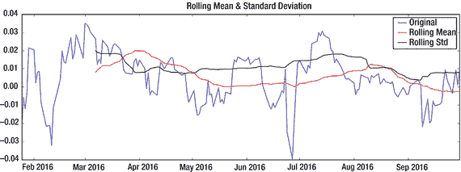

图 3-7.

移除移动平均后的时间序列，以及滚动均值和标准差

```
Results of Dickey-Fuller Test:
Test Statistic                  -4.375719
p-value                         0.000328
#Lags Used                      0.000000
Number of Observations Used     174.000000
Critical Value (5%)             -2.878298
Critical Value (1%)             -3.468502
Critical Value (10%)            -2.575704
dtype: float64
```

David 在查看图 3-7 时，对某些具体结果感到兴奋。探索性分析方法证明，去除趋势后的数据是平稳的，因为其滚动均值和标准差近乎恒定。迪基-富勒检验也证实了这一点，因为检验统计量小于所有临界值。这意味着原假设被拒绝，去除趋势后的时间序列对象在 99% 的置信水平下是平稳的。

David 达到了他的目标：他将对数变换后的时间序列对象的性质改变为平稳。然而，他想探索其他技术是否能使其更接近平稳性质。因此，他决定尝试使用指数加权移动平均来估计趋势。

#### 指数加权移动平均

指数加权移动平均与滚动均值方法类似，区别在于最近的观测值被赋予最高权重，而较早的观测值被赋予最低权重。换句话说，权重分配从最近的观测值到最早的观测值呈指数递减。

随后，David 将对数变换后的时间序列对象应用指数加权移动平均，以观察是否能在使时间序列对象更接近平稳方面取得显著改进。

```
expwighted_avg = pd.ewma(data_log, halflife=15)
data_log_ewma_diff = data_log - expwighted_avg
evaluate_stationarity(data_log_ewma_diff)
清单 3-12.
对时间序列对象应用指数加权移动平均平滑
```

输出

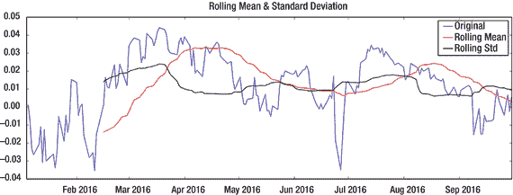

图 3-8.

指数加权移动平均平滑后的时间序列

```
Results of Dickey-Fuller Test:
Test Statistic                  -3.273472
p-value                         0.016107
#Lags Used                      0.000000
Number of Observations Used     188.000000
Critical Value (5%)             -2.877040
Critical Value (1%)             -3.465620
Critical Value (10%)            -2.575032
dtype: float64
```

在查看图 3-8 时，David 注意到滚动均值比图 3-7 中的波动更大。因此，他对于使用探索性数据分析方法得出结论持中立态度。然而，迪基-富勒检验的检验统计量勉强超过了 5% 的临界值。因此，检验统计量小于临界值意味着拒绝原假设。这使 David 得出结论：对数变换后的去除趋势时间序列对象已成功变为平稳性质。

到目前为止，David 取得的唯一显著成功来自从对数变换后的时间序列中减去移动平均平滑估计的趋势。然而，在查看其探索性数据分析图时，他并不完全确信时间序列内部的平稳性质。根据他在图 3-1 中的推论，时间序列对象同时包含趋势和季节性。他心想，如果减少趋势效果如此之好，那么从逻辑上讲，同时减少趋势和季节性应该效果更好。他开始寻找同时减少趋势和季节性的技术。没过多久，他就发现差分法可以完成这项工作。


#### 差分法

差分法是将时间序列与其滞后版本（即前一时刻的观测值）相减。差分法通过消除时间序列水平上的变化，来稳定其均值。David 确信，根据定义，差分法在使时间序列对象平稳方面会更有效。

他期待得到一个更接近平稳的时间序列对象。因此，他编写了清单 3-13 中的脚本，以实现他的期望。

```
data_log_diff = data_log - data_log.shift()
data_log_diff.dropna(inplace=True)
evaluate_stationarity(data_log_diff)
清单 3-13.
对时间序列对象的对数版本应用一阶差分
```

输出

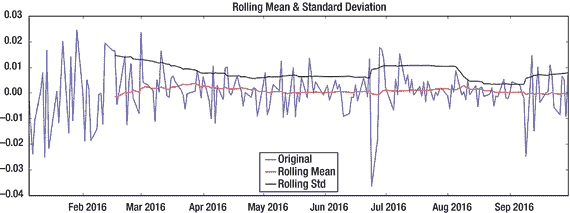

图 3-9.

应用差分后的时间序列的统计量

```
Results of Dickey-Fuller Test:
Test Statistic                  -1.038969e+01
p-value                         2.036243e-18
#Lags Used                      1.000000e+00
Number of Observations Used     1.860000e+02
Critical Value (5%)             -2.877208e+00
Critical Value (1%)             -3.466005e+00
Critical Value (10%)            -2.575122e+00
dtype: float64
```

David 在图 3-9 中看到了显著的改进，因为滚动均值和滚动标准差几乎保持恒定。迪基-富勒检验也反映了同样的情况，检验统计量远小于 1% 的临界值。去除了季节性和趋势的时间序列现在似乎已基本平稳。David 应用了一阶差分；也就是说，在差分时引入了滞后为 1 的项。他很好奇，二阶或三阶差分是否能改善时间序列对象的平稳性。他邀请你通过尝试练习来共同探索这个问题。

练习

1.  对我们的对数变换序列应用二阶和三阶差分。这能使对数变换后的序列平稳吗？

David 好奇的头脑让他思考，他是否能够像之前在趋势估计和去除中那样，成功地从对数变换后的时间序列对象中去除季节性和趋势。之前，他应用了两种技术来估计趋势，并将其从时间序列对象中移除，使其变得平稳。他开始寻找是否存在某种方法，可以将时间序列对象分解为趋势和季节性成分。然后，他计划从时间序列对象中移除这两个成分，使其更接近平稳序列的特征。他的搜索将他引向了分解的概念。

#### 分解法

分解法是另一种从时间序列中消除趋势和季节性以使其平稳的方法。它通过将时间序列分解为三个成分来实现：趋势、季节性和残差。在这种情况下，我们关注的成分是残差（即不含趋势和季节性的时间序列）。

David 很好奇，想看看所讨论的对数变换时间序列的三个成分是什么样的。因此，他不再浪费时间，直接编写了清单 3-14 中的代码。

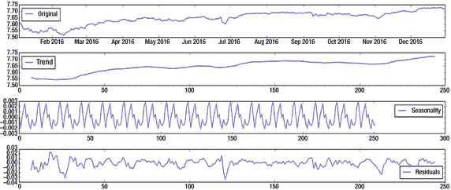

图 3-10.

分解后的对数变换时间序列

```
from statsmodels.tsa.seasonal import seasonal_decompose
decomposition = seasonal_decompose(list(data_log), freq=15)
trend = decomposition.trend
seasonal = decomposition.seasonal
residual = decomposition.resid
plt.subplot(411)
plt.plot(data_log, label='Original')
plt.legend(loc='best')
plt.subplot(412)
plt.plot(trend, label='Trend')
plt.legend(loc='best')
plt.subplot(413)
plt.plot(seasonal,label='Seasonality')
plt.legend(loc='best')
plt.subplot(414)
plt.plot(residual, label='Residuals')
plt.legend(loc='best')
plt.tight_layout()
清单 3-14.
分解对数变换后的时间序列
```

David 曾读到趋势本质上是线性的，而图 3-10 中的趋势成分也真实地反映了这一点。然而，当 David 将这个趋势成分与图 3-6 和图 3-8 中的趋势估计值进行比较时，他注意到，尽管这些估计值描绘了趋势，但其中也包含了季节性。图 3-10 中的季节性成分也符合季节性的定义——即一种在固定时间间隔后重复自身的模式。最后，David 推断残差成分随时间变化相当恒定，如图 3-10 所示。现在，他的目标是评估残差，看它们是否平稳。

```
data_log_decompose = pd.Series(residual)
data_log_decompose.dropna(inplace=True)
evaluate_stationarity(data_log_decompose)
清单 3-15.
评估残差的平稳性
```

输出

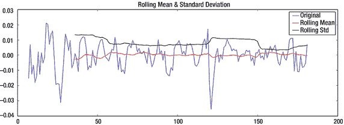

图 3-11.

残差的平稳性相关统计量

```
Results of Dickey-Fuller Test:
Test Statistic                  -7.557158e+00
p-value                         3.077807e-11
#Lags Used                      4.000000e+00
Number of Observations Used     1.700000e+02
Critical Value (5%)             -2.878696e+00
Critical Value (1%)            -3.469413e+00
Critical Value (10%)           -2.575917e+00
dtype: float64
```

对滚动均值和滚动标准差的探索性数据分析表明，这两个指标随时间变化几乎保持平稳。David 继续查看迪基-富勒检验是否得出了相同的结论。检验统计量低于所有三个临界值。因此，他以 99% 的置信度得出结论，残差图是平稳的。然而，与我们在一阶差分技术（即清单 3-13 的输出）中看到的结果相比，这里的检验统计量并没有远小于临界值。

David 稍微松了一口气，因为对于平稳对象的四个条件，他通过一阶差分技术已经成功满足了前三个。他能够去除趋势并使滚动统计量随时间保持恒定。现在，他需要检查第四个条件——即时间序列对象中是否存在自相关。如果所讨论的时间序列对象的自相关随时间变化，他将需要找出一种技术来使自相关保持恒定。

## 判断时间序列是否存在自相关的检验

自相关是当前时间序列与其滞后版本之间的相关性。在阅读关于自相关的文献时，David 了解到自相关存在两种变体。

### 自相关函数

自相关函数（ACF）确定时间序列与其滞后版本之间的相关性。例如，对于包含十个观测值且滞后为 5 的数据，将计算以下序列之间的相关性：

*   t4, t5, t6, t7, t8, t9
*   t0, t1, t2, t3, t4, t5

### 偏自相关函数

偏自相关函数（PACF）也衡量时间序列与其滞后版本之间的相关性，但它会消除先前比较中已经解释过的变化。例如，在我们的例子中，对于滞后为 5 的情况，它会移除 t0 和 t3 之间已经捕获的变化。

既然 David 知道了什么是自相关，他的下一步就是确定可用于在应用了差分的对数变换时间序列中测量自相关的方法。


### 测量自相关

大卫取得了一些成功，因为他找到了一种统计方法，用于测量对数转换后时间序列中的自相关性（即德宾-沃森统计量）。

#### 德宾-沃森统计量

与自相关相关图不同，德宾-沃森统计量更像是一种确定数据中是否存在自相关的统计方法。它通过计算统计回归分析中残差的自相关性来实现这一点。该统计量返回一个介于 0 和 4 之间的数值，其中 0 表示强正自相关，4 表示强负自相关，而 2 则表示完全不存在自相关。

在研究自相关时，大卫回想起他曾读到过，差分法可用于消除 ACF 和 PACF。由于已经对对数转换后的时间序列对象应用了差分法，大卫预期不会出现 ACF 和 PACF。他首先计划使用清单 3-16 中的德宾-沃森统计方法来检查自相关的存在性。

```
sm.stats.durbin_watson(data_log_diff)
清单 3-16.
计算对数转换差分后时间序列的德宾-沃森统计量
```

输出

```
2.1859293629518555
```

看到结果接近 2，大卫非常兴奋，这表明在对数转换差分后的时间序列中不存在自相关。然而，他很好奇，在没有自相关的情况下，ACF 和 PACF 会是什么样子。因此，他编写了清单 3-17 中的代码片段。

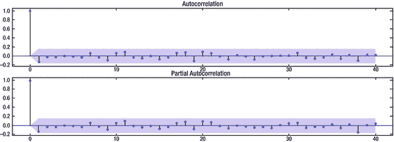

图 3-12.

在对数转换差分后的时间序列上绘制 ACF 和 PACF 的相关图

```
ax1 = plt.subplot(211)
fig = sm.graphics.tsa.plot_acf(data_log_diff.squeeze(), lags=40, ax=ax1)
ax2 = plt.subplot(212)
fig = sm.graphics.tsa.plot_pacf(data_log_diff, lags=40, ax=ax2)
清单 3-17.
在对数转换差分后的时间序列上绘制 ACF 和 PACF 的相关图
```

大卫注意到，ACF 和 PACF 的相关图都在滞后 1 处出现一个尖峰，而在后续的时间滞后中则没有相关性。使时间序列平稳后的下一步最让大卫兴奋（即，对雅虎股票数据集应用预测，以获得残差最小的预测值）。

## 对时间序列建模

在应用不同的时间序列模型之前，大卫认为最好先理解许多模型所使用的基本概念。经过研究，他整理了对自回归项数 (AR)、移动平均项数 (MA) 和差分次数 (D) 含义的解释。他认为这些术语很重要，因为它们构成了时间序列模型的预测方程。

*   **自回归 (AR) 项数或 p**：AR 项是响应变量的滞后值。例如，取 p = 5。那么，为了预测 t5 时刻的响应变量，t0 到 t4 之间的时间序列将被视为解释变量。
*   **移动平均 (MA) 项数或 q**：MA 项是响应变量中滞后的预测误差。例如，取 q = 5。那么，为了预测 t5 时刻的响应变量，将考虑 t0 到 t4 之间的时间序列。因此，这表示该时刻移动平均值与实际值之间的差异。
*   **差分次数 (d)**：这指的是我们希望对时间序列对象应用的差分阶数。

给定时间序列模型的参数书写如下：p, d, q。一旦理解了时间序列技术的通用参数，大卫决定整理一份用于衡量预测时间序列准确性的统计检验列表。

### 验证预测序列的检验

经过适当的研究，大卫了解到一些最著名的用于衡量预测时间序列准确性的检验方法。

#### 平均预测误差

这是每个时间点残差的平均值。平均预测误差的取值范围可以从负无穷大到正无穷大。

#### 平均绝对误差

平均绝对误差与平均预测误差相同，只是残差被转换为绝对值；也就是说，正残差保持不变，而负残差则转换为正数。其取值范围介于 0 和正无穷大之间。

#### 残差平方和

残差平方和 (RSS) 通常用于回归分析，以了解回归模型未能解释的方差比例。其计算方法是：计算每个时间点的残差，取其平方，然后求和。对残差进行平方可确保结果为正数。RSS 的最小值为 0，表示时间序列模型已最大程度地估计了方差。

#### 均方根误差

均方根误差 (RMSE)，也称为均方根偏差 (RMSD)，是 RSS 的进阶版本，它对 RSS 的输出结果应用了平方根。

大卫现在对 p、q 和 d 这些术语的含义有了相当清晰的认识。然而，他不确定在将时间序列模型中的这些参数传入时，每个参数应该取什么值。他的搜索发现了一些规则，这些规则根据 ACF 和 PACF 中的模式来决定 p、q 和 d 的值。


### 确定建模参数

David 计划查看经过对数变换和差分处理的时间序列的 ACF 和 PACF 图，以确定其最符合的规则。

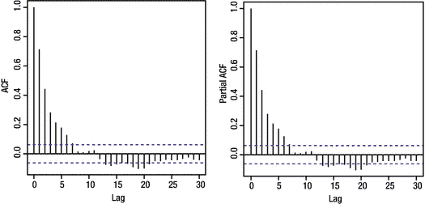

图 3-17.

p = 1 且 q = 1 时的 ACF 和 PACF 图

*   规则 1：当 ACF 呈指数衰减，且 PACF 在滞后 1 处有一个尖峰，之后无相关性时，p = 1（见图 3-13）。

    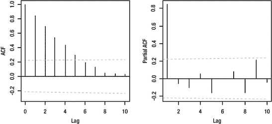

    图 3-13.

    p = 1 时的 ACF 和 PACF 图
*   规则 2：当 ACF 呈现一组指数衰减或正弦波状模式，且 PACF 在滞后 1 和 2 处有尖峰，之后无相关性时，p = 2（见图 3-14）。

    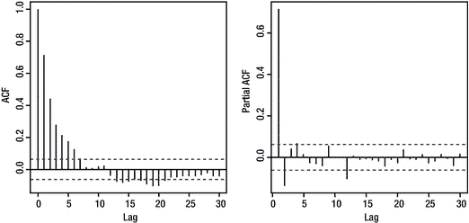

    图 3-14.

    p = 2 时的 ACF 和 PACF 图
*   规则 3：当 ACF 在滞后 1 处有一个尖峰，之后无相关性，且 PACF 呈指数衰减时，q = 1（见图 3-15）。

    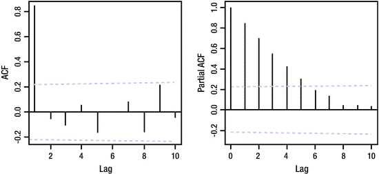

    图 3-15.

    q = 1 时的 ACF 和 PACF 图
*   规则 4：当 ACF 在滞后 1 和 2 处有尖峰，之后无相关性，且 PACF 呈现一组指数衰减或正弦波状模式时，q = 2（见图 3-16）。

    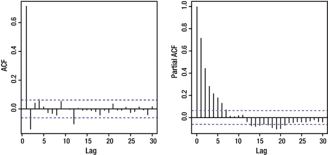

    图 3-16.

    q = 2 时的 ACF 和 PACF 图
*   规则 5：当 ACF 和 PACF 均从滞后 1 开始呈指数衰减时，p = 1, q = 1（见图 3-17）。

查看图 3-12 后，David 不确定哪条规则符合相关图中明显的 ACF 和 PACF 模式。ACF 和 PACF 都在滞后 1 处有一个尖峰，而在后续滞后中无相关性。他没有发现任何规则涵盖这种行为，因此他决定将模型参数 p、d 和 q 的值留待后续通过准确性来确定。在了解了时间序列的评估方法以及选择参数值的规则后，David 知道是时候将时间序列模型应用于经过差分处理的对数变换时间序列了。他对时间序列模型的探索使他认识到 ARIMA 模型在各种时间序列应用中展现出的有效性。因此，他开始着手理解 ARIMA。

## 自回归积分滑动平均模型

ARIMA 代表自回归积分滑动平均模型。ARIMA 预测围绕一个线性方程展开，该方程的行为取决于 p、d 和 q 的值。换句话说，ARIMA 模型从噪声中过滤出信号，并预测未来时间点的值。一个 ARIMA 模型被定义为 ARIMA(p, d, q)。

本节讨论 ARIMA 模型的一些变体。

### 自回归滑动平均模型

ARMA（自回归滑动平均）模型与 ARIMA 模型类似，区别在于我们使用 p 和 q 来确定线性方程。此外，现在的预测是在均值调整序列上进行的；也就是说，通过从时间序列中减去样本均值，将其转换为零均值变体。

这一过程可由以下方程定义：

y [t] = Y [t] – Ý, t = 1, …N

其中，

*   Y[t]：原始时间序列
*   Ý：均值调整后的时间序列

ARMA 模型被定义为 ARMA(p, q)

### 自回归模型

ARMA 模型根据其过去值的线性函数来预测时间序列。在 AR（自回归）模型中定义时间滞后，以预测时间序列的未来值。一个 AR 模型可由以下方程定义：

y [t] = β [0] + β [1] y [t−1] + ϵ [t]

其中，

*   β [`0`] , β [`1`]：Beta 系数
*   `y` [`t-1`]：时间序列的滞后版本
*   ϵ [`t`]：残差，假设其服从正态分布且在时间上是随机的

一个 AR 模型被定义为 AR(p, d)

David 决定将 AR 模型应用于经过差分处理的对数变换时间序列。他知道，由于该技术不包含 'q' 项，其值将为 0（即 q = 0）。他决定在代码清单 3-18 中，使用 p = 2 和 d = 1 的任意参数来应用 AR 模型。

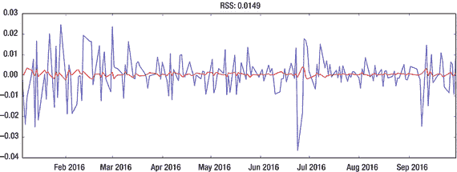

图 3-18.

在对数变换差分处理时间序列上绘制 MA 模型平滑图

```
model = ARIMA(data_log, order=(2, 1, 0), dates=data_log.index.to_datetime())
results_AR_210 = model.fit(disp=-1)
plt.plot(data_log_diff)
plt.plot(results_AR_210.fittedvalues, color='red')
plt.title('RSS: %.4f'% sum((results_AR_210.fittedvalues-data_log_diff)**2))
代码清单 3-18.
将 AR 模型应用于对数变换差分处理时间序列
```

David 确保在图 3-18 中绘制了原始的差分处理和对数变换时间序列，以及使用 AR 技术预测的时间序列。他很高兴看到该预测序列的 RSS 趋近于 0，这意味着模型在捕捉输入序列的方差方面相当准确。能以如此微小的 RSS 预测雅虎股票，对他来说是一个巨大的安慰。随后，他开始寻找其他技术，并发现了滑动平均技术。

### 滑动平均模型

MA 代表滑动平均模型。MA 最适合处理单变量时间序列对象的情况。MA 通过基于当前和过去的时间序列值（这些值是随机的）进行训练来预测未来值。MA 模型被定义为 MA(d, q)。

MA 模型不包含 p 项；因此 David 将其初始化为 p = 0。David 决定将 MA 模型应用于对数变换差分处理时间序列，参数为 q = 1 和 d = 1。

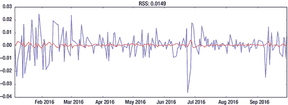

图 3-19.

在对数变换差分处理时间序列上绘制 MA 模型平滑图

```
model = ARIMA(data_log, order=(0, 1, 1), dates=data_log.index.to_datetime())
results_MA_011 = model.fit(disp=-1)
plt.plot(data_log_diff)
plt.plot(results_MA_011.fittedvalues, color='red')
plt.title('RSS: %.4f'% sum((results_MA_011.fittedvalues-data_log_diff)**2))
代码清单 3-19.
将 MA 模型应用于对数变换差分处理时间序列
```

David 注意到，在将 MA 应用于差分处理的对数变换时间序列后，RSS 得分没有显著改善。他决定合并 AR 和 MA 模型，希望能得到一个更稳健的模型来预测雅虎股票。


### 组合模型

组合模型是指自回归（AR）与移动平均（MA）的结合。该模型将包含全部三个参数——p、d 和 q，并初步定义为 ARIMA——ARIMA(p, d, q)。组合模型意味着所有参数都将被纳入考量。David 预期残差平方和（RSS）会降低，因此他毫不迟疑地应用了组合模型，如代码清单 3-20 所示，参数值设定为 p = 1、d = 1、q = 1。

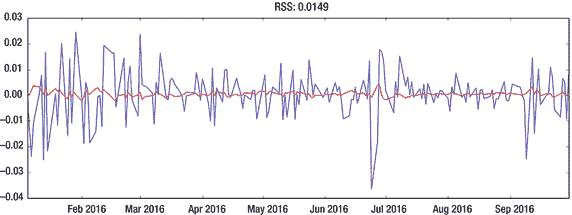

图 3-20.
在对数变换差分处理后的时间序列上绘制组合模型平滑结果

```
model = ARIMA(data_log, order=(1, 1, 1), dates=data_log.index.to_datetime())
results_ARIMA_111 = model.fit(disp=-1)
plt.plot(data_log_diff)
plt.plot(results_ARIMA_111.fittedvalues, color='red')
plt.title('RSS: %.4f'% sum((results_ARIMA_111.fittedvalues-data_log_diff)**2))
代码清单 3-20.
将对数变换差分处理后的时间序列应用组合模型
```

该预测序列的 RSS 同样趋近于零，因此模型在捕捉输入序列的方差方面相当准确。然而，David 困惑地发现，所有这些方法的 RSS 得分都相同。他随机选择了一个，决定继续使用组合模型。

到目前为止，这是一段漫长的旅程。David 应用了对数变换，使用差分法使时间序列平稳，最后将组合模型应用于这个经过对数变换和差分处理的时间序列。现在的时间序列与他最初看到的大不相同，因为他已经应用了对数变换和差分。由于预测是在修改后的时间序列上进行的，因此现在需要将其反向缩放，以观察它对雅虎股票初始时间序列的预测效果如何。


## 缩减预测范围

在将预测值缩减回原始单位之前，David 认为先打印出预测时间序列的初始观测值是明智之举。

```
predictions_ARIMA_diff = pd.Series(results_ARIMA_111.fittedvalues, copy=True)
print predictions_ARIMA_diff.head()
代码清单 3-21.
打印预测序列的前几个观测值
```

输出

```
2016-01-05    0.000401
2016-01-06    0.000237
2016-01-07    0.001781
2016-01-08    0.003630
2016-01-11    0.003035
dtype: float64
```

代码清单 3-21 的输出为 David 提供了一个有趣的发现。最初在代码清单 3-2 中加载的数据，其日期从 2016-01-04 开始，而代码清单 3-2 输出中的日期却从 2016-01-05 开始。经过深思熟虑，他找到了答案。“参数 d”——即差分次数——在使用组合模型进行预测时取值为 1。这导致了一个滞后为 1 的情况，因此第一个元素在其滞后版本中没有可供减去的值。在研究时间序列模型时，David 还了解到这些模型的输出给出的是每个时间间隔的绝对变化量，而非累积和。如果数据是离散的，那么使用绝对变化量会是一个合理的策略。然而，在这种情况下，预测序列将是一个连续分布，因此需要的是累积和。于是，David 决定在代码清单 3-22 中将所有时间间隔的绝对变化量转换为累积和。

```
predictions_ARIMA_diff_cumsum = predictions_ARIMA_diff.cumsum()
print predictions_ARIMA_diff_cumsum.head()
代码清单 3-22.
打印预测序列的累积和
```

输出

```
2016-01-05    0.000401
2016-01-06    0.000638
2016-01-07    0.002418
2016-01-08    0.006049
2016-01-11    0.009084
dtype: float64
```

David 知道，从 RSS 分数来看，该模型在最小化残差方面表现良好。然而，他也关心模型的质量，因此开始寻找衡量模型质量的方法。他的搜索在找到用于测试时间序列模型质量的**赤池信息量准则（AIC）**后告一段落。根据解释，AIC 分数越低，时间序列模型的质量越好。因此，他在代码清单 3-23 中对预测的时间序列进行了测试。

```
print results_ARIMA_111.aic
代码清单 3-23.
打印预测序列的 AIC、BIC 和 HQIC 分数
```

输出

```
(-1234.0564146247877)
```

代码清单 3-23 输出的分数极低，从而证明了模型的质量。现在，David 的行动计划是通过逆转差分和对数变换来缩减预测序列。他计划通过以下步骤来实现：

*   从预测序列中移除差分。
*   通过应用指数来逆转对数变换。
*   通过计算平均预测误差、平均绝对误差和均方根绝对误差来评估预测序列。
*   绘制原始序列和预测序列。

David 首先专注于从预测序列中移除差分。他计划通过向预测序列的所有观测值添加一个基值来实现这一点。他假设对数变换时间序列的第一个值为基值，并在代码清单 3-24 中继续实施。

```
predictions_ARIMA_log = pd.Series(data_log.ix[0], index=data_log.index)
predictions_ARIMA_log = predictions_ARIMA_log.add(predictions_ARIMA_diff_cumsum,fill_value=0)
predictions_ARIMA_log.head()
代码清单 3-24.
打印移除差分后的预测时间序列
```

输出

```
2016-01-04    7.607213
2016-01-05    7.607614
2016-01-06    7.607850
2016-01-07    7.609631
2016-01-08    7.613261
dtype: float64
```

下一步是从预测时间序列中移除对数变换。回忆起大学微积分 1 课程中学到的知识，他知道指数函数是底数为 10 的对数函数的逆运算。在代码清单 3-25 中，他计划执行此操作，并借助评估指标对预测序列进行评分。

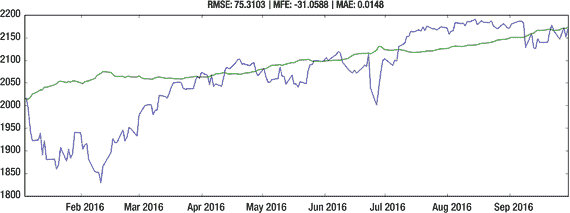

图 3-21.

绘制预测序列与原始时间序列的对比图

```
def mean_forecast_err(y, yhat):
return y.sub(yhat).mean()
def mean_absolute_err(y, yhat):
return np.mean((np.abs(y.sub(yhat).mean()) / yhat)) # 或百分比误差 = * 100
def rmse(y, yhat):
return np.sqrt(sum((yhat-y)**2)/len(y))
predictions_ARIMA = np.exp(predictions_ARIMA_log)
plt.plot(data_train['Close_Adj'])
plt.plot(predictions_ARIMA)
plt.title('RMSE: %.4f | MFE: %.4f | MAE: %.4f'% (
rmse(data_train['Close_Adj'], predictions_ARIMA), mean_forecast_
err(data_train['Close_Adj'], predictions_ARIMA), mean_absolute_
err(data_train['Close_Adj'], predictions_ARIMA)))
代码清单 3-25.
评估预测序列与原始序列的对比
```

在代码清单 3-24 中，David 首先为每个评估指标初始化了一个单独的方法。然后，他从预测序列中移除了对数。最后，他通过将预测序列与真实序列进行统计和图形上的比较来验证预测序列。RMSE、MFE 和 MAE 的检验统计量表明，该模型已成功正确预测，这对 David 来说是个好消息。预测图由绿色线条表示，原始时间序列由蓝色线条表示。David 惊讶地发现，在图 3-21 中，预测的时间序列类似于一条线性回归线。

因此，David 决定对图 3-21 中近乎线性的预测序列应用回归。他计划从线性预测序列中训练回归线，预测 2016 年 10 月至 12 月的数据，然后使用该时间段的真实值进行交叉验证。他通过编写代码清单 3-26 中的代码来实现这一点。

```
regr = LinearRegression()
x_train = [[x] for x in range(len(data_train))]
y_train = [[y] for y in list(data_train['Close_Adj'])]
x_test = [[z] for z in range(x+1, x + 1+len(data_test))]
regr.fit(x_train, y_train)
y_pred = regr.predict(x_test)
explained_variance_score(data_test['Close_Adj'], y_pred)
plt.scatter(range(len(data_test)), data_test['Close_Adj'],  color='black')
plt.plot(range(len(data_test)), y_pred, color='blue',
linewidth=3)
plt.ylabel('混凝土强度')
代码清单 3-26.
使用线性回归模型预测和评估未来时间序列
```

输出

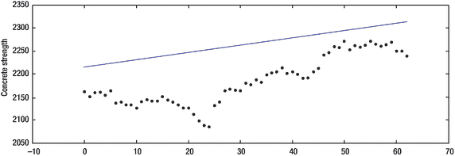

图 3-22.

绘制预测序列以及 2016 年 10 月至 12 月的预测回归线

```
0.63472586609437109
```

David 很高兴地看到图 3-22 中的回归线相当准确地捕捉到了数据集中的趋势。他对预测的时间序列进行了模型训练，并针对雅虎股票的原始时间序列进行了评估。他还确保计算了解释方差分数，以了解最佳拟合线正确捕捉了时间序列的多少方差。该值为 0.63，表明线性回归线捕捉了时间序列中 63% 的方差。

鉴于他在短时间内取得的成果，David 乐观地认为，如果有更多时间，他可以取得更多成就。然而，他希望你能加入进来，帮助他尝试不同的时间序列预测策略。他的理由是，他想要进一步提高预测序列的准确性，因为它是输入到回归线中的输入数据。因此，他留下了以下练习供你解决。

练习

1.  重复上述步骤，但使用分解代替差分。这能提高预测准确性吗？
2.  更改 ARMA 和 ARIMA 模型的 p、d 和 q 参数值，重复练习。然后计算检验统计量，看看这些参数的给定组合是否能产生更好的预测准确性。


## 时间序列分析的应用

### 销售预测

企业组织非常关注下一期的预期销售额。销售预测有助于他们做出合理决策，以实现当前目标。销售额通常具有很强的季节性因素。例如，假设我们按日预测食品杂货的销售额（以美元计）。我们会发现一种每月重复的季节性模式：每月第一周销售额会攀升。此外，人们习惯（即消费与支出）的变化，可能会给该序列带来正向或负向的趋势。

### 天气预报

这是时间序列分析最实际的应用。天气预报除了温度之外，还涉及许多其他要素。降雨量、湿度和风速等也都在预测范围之内。

### 失业率估算

时间序列分析也用于估算经济中的失业人数。失业率受到外商直接投资变化、国家安全状况、熟练劳动力比例变化等多种因素的强烈影响。这些估算至关重要，因为它们会影响政府在社会保障和救济项目上的支出。此外，它们还能帮助政府估算直接税和间接税的变化幅度，因为就业机会的创造会提高消费水平。

### 疾病爆发

非政府组织和社会组织关注全球范围内疾病的爆发预测。这对他们来说很重要，以便在特定疾病或流行病的高风险地区启动宣传计划和预防策略。

### 股市预测

股票在交易时段内短期波动剧烈，这使得投资者难以预测能够获得最大收益的时间点。然而，当投资者投资于一个股票组合，并担心未来应获得的回报，或为了获得有利回报而调整股票时，问题就变得更加关键。这正是时间序列分析大显身手的地方。

大卫没有忘记总结为得出最终结果所采用的方法。他回忆起自己首先定义了问题陈述（即，以最小残差预测雅虎股票）。起初，他必须理解什么是时间序列，然后他针对时间序列对象验证了平稳性检验。为了使得序列对象平稳，他进行了变换和差分处理。接着，他应用了时间序列模型，并选择了具有最低残差平方和的模型。然后，这个预测出的时间序列被反向缩放，并作为线性回归线的输入。回归线使得未来值的推断成为可能，并通过交叉验证来确定最佳拟合线所解释的方差。

大卫现在计划采用这个模型来预测詹妮斯的预期回报，并避免因预测不准确而导致的重大挫折。

