# 4. 聚类

本章的目标是借助监督学习和无监督学习算法来解决现实世界的问题。首先，我们将从聚类的概念入手，确定如何组织数据，决定组件的数量，最后看看聚类输出是否具有直观意义。

注意

本书采用 Python 2.7.11 作为编码示例的事实标准。此外，你需要安装它来完成练习。

在本章中，我们将使用“已接收论文”数据集来进行聚类编码示例。该数据转储可以从以下网址下载：

[`https://archive.ics.uci.edu/ml/datasets/AAAI+2014+Accepted+Papers`](https://archive.ics.uci.edu/ml/datasets/AAAI+2014+Accepted+Papers)

## 案例研究：确定营销短尾关键词

罗斯是一家人工智能会议的市场总监，他需要向董事会报告关于 2015 年会议营销的短尾关键词建议。他还需要将迄今为止提交的研究论文按论文类型分组，并进行可视化展示。

该会议由一个非营利性科学学会运营，旨在确保人工智能领域的进步。它通过提高公众对该领域的理解，以及为研究人员提供在年度会议上展示其研究成果的平台来实现这一目标。

为了找到解决当前问题的方法，罗斯首先浏览了网站。然而，研究论文的内容量太大，他无法进行分析。

于是，他敲开了泰德的门，想看看是否有现成的数据可以开始分析。与数据仓库部门主管泰德的会面给了罗斯一线希望。正如泰德回忆的那样：

> 罗斯带着这个请求来找我，但问题是我们当时正在进行集成 SAP 进出流程的重大改革。不过幸运的是，我们在存储中还有一些数据转储。我问罗斯他想要哪一年的会议数据，然后砰的一下，我们就有了那一年的数据转储。

罗斯将数据转储加载到 Microsoft Excel 中，并开始查看各项特征。他认为一种策略可能是按关键词或分组对论文进行归类。然后，他可以在社交媒体上投放单独的广告，并使用搜索引擎优化来定位其中的相应关键词。然而，关键词和分组特征中的不同取值太多，因此会导致产生许多搜索引擎优化关键词的聚类。他的策略是提出最多十个不同的搜索引擎优化关键词组，并让它们运行几天以获取收益。他听说过一些关于聚类的知识，即把数据聚类成固定数量的簇，因此他决定将聚类作为他的起点。

既然有了前进的方向，他心中产生了一些疑问。从提供的数据来看，多少个簇是最优的？鉴于数据量很小，是否有任何机器学习算法最适合它？他应该如何直观地呈现数据，并最终呈现发现结果？

罗斯相信，理解泰德提供的数据特征，在后续过程中会证明是有益的。他觉得理解这些特征有助于他决定解决当前问题的最佳方法。因此，他整理了表 4-1 中的数据字典。

表 4-1. 已接收论文数据集的数据字典

| 特征名称 | 描述 |
| --- | --- |
| 标题 | 论文的标题 |
| 作者 | 论文的作者 |
| 分组 | 作者选择的高级关键词 |
| 关键词 | 作者生成的关键词 |
| 主题 | 作者选择的低级关键词 |
| 摘要 | 论文摘要 |

在查看表 4-1 时，罗斯推断所有特征都是字符串格式。此外，他注意到论文手稿不属于数据集的一部分，而是提供了摘要。

罗斯最近完成了密歇根大学在 Coursera 上提供的 Python 专项课程。因此，他对自己完成这项工作的 Python 技能充满信心。在开始分析之前，他决定将所有相关的包加载到内存中，如代码清单 4-1 所示。

```
%matplotlib inline
import operator
import itertools
import numpy as np
import pandas as pd
from ggplot import *
import seaborn as sns
import matplotlib as mpl
from sklearn import mixture
import matplotlib.pyplot as plt
from matplotlib.pylab import rcParams
from sklearn.decomposition import PCA
from wordcloud import WordCloud, STOPWORDS
from scipy.spatial.distance import cdist, pdist
from sklearn.cluster import KMeans, SpectralClustering
from sklearn.metrics import euclidean_distances, silhouette_score
rcParams['figure.figsize'] = 15, 5
```

代码清单 4-1. 导入本章所需的包

尽管罗斯知道这些特征及其描述，但他仍对其中包含的内容感到好奇。

## 特征探索

在继续之前，他需要制定策略。经过深思熟虑，他终于想出了一个可能奏效的计划：首先将研究论文拆分成多个片段，以便通过针对性的短尾和长尾关键词逐一聚焦分析。随后，他查看了表 4-1 中的特征，筛选出与他的方法相符的部分。他认为“作者”字段无关紧要，而“摘要”字段又过于详细。因此，他将搜索范围缩小到仅四个特征（标题、分组、关键词和主题）。他通过编写代码清单 4-2 中的代码片段来筛选特征。

```
data_train = pd.read_csv('examples/[UCI] AAAI-14 Accepted Papers - Papers.csv')
data_train = data_train[['title', 'groups', 'keywords', 'topics']]
```

代码清单 4-2. 将数据读入内存，并筛选特征子集

罗斯现在想知道数据集有多大（即有多少篇研究论文可用）。此外，他还想快速浏览一下数据集。为此，他编写了代码清单 4-3 中的脚本。

```
print len(data_train)
data_train.head()
```

代码清单 4-3. 打印数据集的大小，并打印数据集的前几行

输出

表 4-2. 数据集观测结果打印

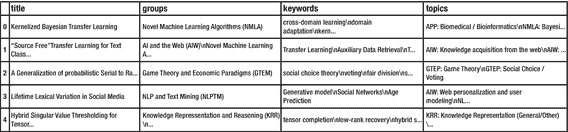

从代码清单 4-3 的输出中，罗斯注意到该数据集包含约 400 篇研究论文的数据。此外，他验证了自己的推断：数据集中的所有特征均为字符串数据格式。他还注意到，一篇研究论文可能属于多个分组和关键词。

罗斯在地铁上回家的路上，等待下一班列车时，偶遇了大学同学马特，他们曾一起合作过社区工作。大学毕业后，马特在数据分析领域发展。罗斯便向他提出了自己正在尝试解决的问题。马特认真听完后，建议罗斯在进入模型选择之前，先决定是使用监督学习还是无监督学习。由于马特必须离开，这次谈话很简短，却给罗斯留下了关于这个概念的诸多疑问。直到第二天早上，罗斯回到办公室，才着手研究监督学习和无监督学习方法。

## 监督学习 vs. 无监督学习

机器学习算法通常分为监督学习和无监督学习。

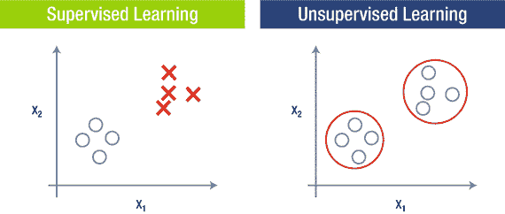

图 4-1. 监督学习 vs. 无监督学习

罗斯对这两种方法都给出了解释。

### 监督学习

顾名思义，监督学习算法需要监督来训练模型。这种监督通常在分类情况下是必要的，因为我们有带标签的数据来训练模型，以便模型预测未见数据的标签。在这里，监督是通过每个观测值附带的标签来实现的（即监督学习过程）。示例包括针对离散预测变量的分类和针对连续预测变量的回归。

### 无监督学习

无监督学习算法在训练模型时不需要数据的监督。聚类就是一个典型例子，它在无需任何监督的情况下发现标签。这些发现的标签随后成为对任何新的未见数据进行分类的基础。无监督学习的另一个例子是关联规则，它涉及互补和替代的概念。互补是指一种现象：如果购物者购买了 X，那么他极有可能也会购买 Y。替代则是指购物者会购买 X 或 Y 其中一种的行为。

其他示例包括异常检测、矩方法（例如均值和协方差）、独立成分分析和主成分分析（`PCA`）。

罗斯必须决定这两种方法中哪一种适合他当前的问题和可用数据。从表 4-2 的数据中，他注意到数据集没有提供任何标签数据。这意味着他必须使用无监督学习从头开始预测标签。

罗斯假设聚类作为一种无监督学习方法，可以帮助他找到正确的细分市场以实现营销目标。然而，他不太确定聚类是否是正确的方法。因此，他整理了以下关于该主题的资料。

## 聚类

聚类分析是指对观测值进行分组，使得每个聚类内的对象具有相似的属性，而所有聚类的属性彼此独立。聚类算法通常通过最大化聚类间的距离并最小化聚类内对象间的距离来进行优化。聚类分析并非一次迭代就能完成，而是需要经过多次迭代，直到模型收敛。模型收敛意味着所有对象的聚类归属趋于稳定，并且不会随着每次新迭代而改变。一些聚类算法不要求指定聚类/成分的数量，而是会得出在统计上更有意义的聚类数量。然而，大部分聚类算法会预先要求用户指定输出中所需的聚类/成分数量。重要的是要理解，聚类与分类一样，用于对数据进行分段；然而，这些分组在训练数据集中并未预先定义（即它们是未标记的数据）。

不同的算法采用不同的技术来计算聚类。其中一些技术如下：

# 划分法：将数据分组到给定数量的聚类中，同时优化目标（例如距离）。

# 层次法：将数据分组到聚类的层次结构中。这些层次结构是自上而下或自下而上形成的。

# 基于网格法：将数据划分为超矩形单元格，丢弃低密度单元格，并合并高密度单元格以形成聚类。

一个好的聚类算法满足以下要求：

*   聚类内相似性和聚类间相异性
*   能够处理具有以下特征的训练数据集：
    *   高维度
    *   受噪声和异常值影响

罗斯现在对监督和无监督模型有了一些了解；然而，他不确定聚类是否可以应用于文本性质的数据。此外，他知道输入的特征越多，在聚类发现过程中发现影响特征的可能性就越大。因此，他必须找到一种方法将文本数据转换为数值形式，并利用现有的四个特征生成更多特征。

## 用于建模的数据转换

罗斯花了数小时寻找这个谜题的解决方案。他感到失望，因为他原本期望这种方法能奏效并产生结果。为了简化问题，他将搜索范围缩小到一个特征（即分组），并开始思考如何将其重新编码为数值形式。夜深了，但罗斯无法入睡，这时一个想法闪过他的脑海。为什么不把“分组”特征转换成布尔值呢？这样，属于某个分组的研究论文旁边就标记为 1，否则为 0。他能想到的数据表示形式是一个矩阵，其中列代表不同的分组，行代表研究论文。

他知道一篇研究论文可能属于一个分组。在数据集中，给定研究论文的分组由分隔符（即 `\n`）分隔。因此，他首先决定通过拆分中间的分隔符来分离分组，这样如果一篇研究论文属于三个分组，它将在数据集中由三个不同的观测值（即行）表示。

```python
s = data_train['groups'].str.split('\n').apply(pd.Series, 1).stack()
s.index = s.index.droplevel(-1)
s.name = 'groups'
del data_train['groups']
data_train = data_train.join(s).reset_index()
# 代码清单 4-4. 按分组函数逐行拉伸数据框
```

除了分离分组，罗斯还决定添加一个新特征“标志”，并为所有行赋值为 1。按照他的想法，值为 1 表示该行的研究论文属于“分组”列中的那个分组。

表 4-3. 数据框转换后数据集的观测值打印

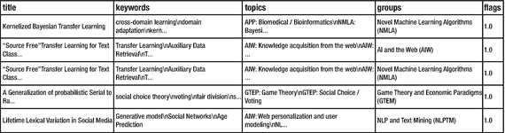

```python
data_train['flags'] = pd.Series(np.ones(len(data_train)), index=data_train.index)
data_train.head()
# 代码清单 4-5. 为分组隶属关系添加新变量
```

在将研究论文按其所属分组展开，并为其关联一个隶属标志后，罗斯知道是时候将这个数据结构转换为矩阵了。为此，他定义了代码清单 4-6 中的函数。

```python
def matrix_from_df(data_train):
    matrix = data_train.pivot_table(index = ['title'], columns=['groups'], values='flags')
    matrix = matrix.fillna(0).reset_index()
    x_cols = matrix.columns[1:]
    return matrix, x_cols
# 代码清单 4-6. 添加用于创建矩阵的函数
```

多年来，罗斯已经熟练掌握了 Microsoft Excel 中的数据透视表。因此，他决定在代码清单 4-6 中使用相同的方法进行数据框到矩阵的转换。于是，他在代码清单 4-6 中初始化了一个方法，将训练数据转换为一个数据透视表，以标题为索引，每个分组由单独的列表示，值来自“标志”特征。然后，他将索引中不属于某个分组领域的研究论文对应的位置设为 0。他决定通过使用代码清单 4-6 中定义的方法来生成矩阵。

表 4-4. 矩阵的初始观测值

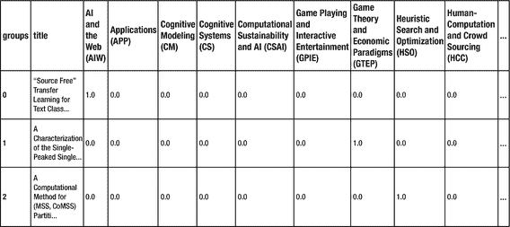

```python
matrix, x_cols = matrix_from_df(data_train)
matrix.head()
# 代码清单 4-7. 从 matrix_from_df 方法中获取矩阵和 x 列
```

罗斯看到输出结果符合预期，感到非常兴奋。为了检验自己的理解，他从表 4-4 中随机挑选了一篇研究论文。他选择了“一种用于 (MSS.CoMSS) 的计算方法”。通过查看表 4-4 中的矩阵，罗斯推断这篇论文属于 HSO 分组，并且不属于其他任何分组。

既然他知道了什么是聚类，并且已经将数据转换为适合应用的形式，那么是时候应用聚类建模了。然而，首先他必须确定评估指标，以便评估聚类模型的优劣。与可用于评估回归和分类模型的技术相反，可用于统计评估聚类模型优劣的技术并不多。原因在于，在回归和分类中，已经有标记数据可用于训练模型。但聚类的情况并非如此。

### 评估聚类模型的指标

经过一番研究，罗斯了解到没有单一的方法可以评估聚类模型的输出。他遇到了两种使其有效的方法。第一种更偏向技术性。它认为，如果每个聚类内的方差得到最大程度的解释，聚类内的对象具有相似的属性，并且聚类之间彼此远离，那么聚类模型就足够好。第二种方法则认为，如果聚类定义在直觉上有意义，那么模型就是强大的。

罗斯现在对聚类以及评估其优劣的方法有了清晰的理解。因此，他开始寻找在相关应用中效果最好的聚类模型。经过深入研究，他提出了几种聚类模型。

## 聚类模型

罗斯决定从事实上的聚类算法（即 k-means 聚类）开始。对罗斯来说，在将其应用于手头的数据集之前，理解聚类收敛的方法至关重要。因此，他整理了对 k-means 聚类算法的解释。

### k-Means 聚类

k-means 聚类将数据空间划分为 Voronoi 单元表示。这种转换将数据观测值划分为 `k` 个聚类，其中每个观测值属于具有最近均值的聚类。k-means 聚类的执行步骤如下：

1.  随机选择 `k` 个质心。
2.  将每个观测值与最近的质心绑定。
3.  通过计算每个聚类内观测值的均值，重新计算每个聚类的新质心。
4.  重复步骤 2。

你可能会注意到步骤 1 和步骤 3 相似，区别在于步骤 1 中质心是随机选择的，而步骤 3 中是通过计算每个聚类内观测值的均值得到的。然后步骤 2 和步骤 4 是相同步骤的重复。步骤 3 和步骤 4 会迭代，直到聚类收敛——即数据集中所有观测值的聚类隶属关系保持不变。这最大化了聚类之间的距离，并最小化了每个聚类内观测值之间的距离。k-means 聚类在最小化全局目标函数时并不总能找到最优配置。该聚类算法对聚类中心的初始选择高度敏感。

罗斯现在完全理解了 k-means 聚类算法中收敛是如何执行的。然而，他对于 `k` 的值（即他应该预先指定的聚类数量）对于手头的数据来说多少才是最优的毫无头绪。他记得曾在 LinkedIn 上看到过一篇关于 k-means 聚类的文章。于是他搜索了发布那篇文章的人，并给他发消息寻求帮助。他的联系人波拉克建议罗斯使用以下方法：

*   肘部法
*   方差解释
*   BIC 分数

他开始研究肘部法的工作原理，然后应用它来找到对模型最优的聚类数量。

#### 肘部法则

罗斯提出的肘部法则，是指将解释的方差百分比表示为聚类数量的函数。它用于确定新增加的聚类能贡献多少边际方差。值得关注的一点是，第一个聚类会解释最大方差，而随着每个新聚类的加入，边际增益会逐渐下降。肘部就是这样一个点：当新增一个聚类时，边际方差会出现显著下降，该点对应的聚类数量即为最优值。罗斯决定将肘部法则应用于经过矩阵变换的数据集。

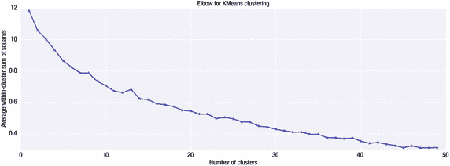

图 4-2. 肘部法则曲线，表示为聚类数量的函数

```python
matrix, x_cols = matrix_from_df(data_train)
X = matrix[x_cols]
K = range(1,50)
KM = [KMeans(n_clusters=k).fit(X) for k in K]
centroids = [k.cluster_centers_ for k in KM]
D_k = [cdist(X, cent, 'euclidean') for cent in centroids]
dist = [np.min(D,axis=1) for D in D_k]
avgWithinSS = [sum(d)/X.shape[0] for d in dist]
fig = plt.figure()
ax = fig.add_subplot(111)
ax.plot(K, avgWithinSS, 'b*-')
plt.grid(True)
plt.xlabel('Number of clusters')
plt.ylabel('Average within-cluster sum of squares')
plt.title('Elbow for KMeans clustering')
# 代码清单 4-8. 在数据矩阵上应用肘部法则与方差解释
```

在代码清单 4-8 中，罗斯回忆说，他训练了 49 个 `k-means` 聚类模型，每个模型的 `k` 值从 1 到 50 各不相同。然后，他获取了这些聚类模型的聚类中心，并逐个模型地确定了每篇研究论文的聚类归属。最后，对于每个模型，他计算了所有研究论文的平方和，再除以研究论文的总数，得到平均簇内平方和。接着，他将这 49 个聚类模型的簇内平方和绘制在图 4-2 中，以形成肘部法则。
在查看图 4-2 时，罗斯推断肘部出现在 `k = 9` 处。然而，除非有不止一种方法都收敛到相同的聚类数量，否则他并不完全信服。因此，他转而研究方差解释。
### 方差解释
方差解释的百分比，或者说 F 检验，是组间方差与总方差的比率。同样地，这里肘部将决定 `k-means` 聚类模型的最优聚类数量。罗斯通过编写代码清单 4-9 中的代码片段，将方差解释付诸实践。
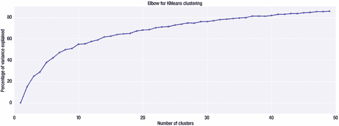
图 4-3. 解释方差曲线，表示为聚类数量的函数
```
matrix, x_cols = matrix_from_df(data_train)
X = matrix[x_cols]
K = range(1,50)
KM = [KMeans(n_clusters=k).fit(X) for k in K]
centroids = [k.cluster_centers_ for k in KM]
D_k = [cdist(X, cent, 'euclidean') for cent in centroids]
dist = [np.min(D,axis=1) for D in D_k]
wcss = [sum(d**2) for d in dist]
tss = sum(pdist(X)**2)/X.shape[0]
bss = tss-wcss
kIdx = 10-1
fig = plt.figure()
ax = fig.add_subplot(111)
ax.plot(K, bss/tss*100, 'b*-')
plt.grid(True)
plt.xlabel('Number of clusters')
plt.ylabel('Percentage of variance explained')
plt.title('Elbow for KMeans clustering')
```
代码清单 4-9. 将肘部法则与方差解释应用于数据矩阵
罗斯回忆说，他对代码清单 4-9 的解释如下：
> 在逐个聚类地获取每篇研究论文的聚类归属后，利用这些距离计算簇内平方和。接着，计算每篇研究论文内部各列之间的距离，以计算总平方和。最后，从总平方和中减去簇内平方和，得到组间平方和。将组间平方和与总平方和的比值绘制在图 4-3 中。
对罗斯来说，图 4-3 看起来像一个指数累积分布函数。方差解释曲线似乎很平滑，并且随着聚类数量的增加而持续上升。这使得罗斯难以确定肘部的位置。经过仔细考虑，罗斯注意到梯度从 `k = 9` 开始变得平缓，这与他在肘部法则中观察到的结果相似。
然而，他并没有就此止步，而是继续寻找有助于确定最优 `k` 值的方法。不久，他接触到了贝叶斯信息准则（`BIC`）评分。
### 贝叶斯信息准则评分
`BIC` 是另一种从有限模型集合中选择最佳模型的技术。`BIC` 评分最低的模型被认为是胜出者。在训练模型时，通过添加额外参数，有很高的概率可以增加获得准确聚类的可能性；但是，他知道这样做会导致模型过拟合。`BIC` 通过对模型中的参数数量添加惩罚项来克服这个问题。`BIC` 的假设前提是样本量应远大于模型中的参数数量。因此，`BIC` 不适用于处理高维数据的复杂模型。
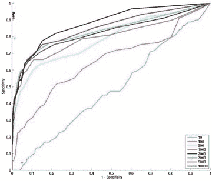
图 4-4. 样本 `BIC` 评分图
关于 `BIC` 评分的知识让罗斯放弃了这一选项，因为 `BIC` 评分适用于低维数据，而矩阵变换意味着现在数据具有（组数 + 1）个维度，使其成为了高维数据。
他很好奇是否存在一种方法，能够确定最优聚类数量，并且这种方法与 `k-means` 聚类的工作原理相契合。换句话说，罗斯想找到一种方法，能够确定使得簇间距离最大、簇内距离最小的最优聚类数量。他的探索促使他查阅研究论文，并在其中发现了轮廓系数法。
### 轮廓系数
轮廓系数用于衡量簇内观测值的紧密程度（即簇内距离 (a)），以及各簇之间的区分度（即平均最近簇距离 (b)）。轮廓系数的计算公式如下：
*   (b-a) / max (a, b)
最佳值为 1，最差值为 -1。系数值为 0 表示簇之间存在重叠。对 `Ross` 来说，关键在于选择能够产生最大轮廓系数的簇数量。他毫不迟疑地将轮廓系数法应用于 `k-means` 模型，簇大小范围设定为 2 到 30。
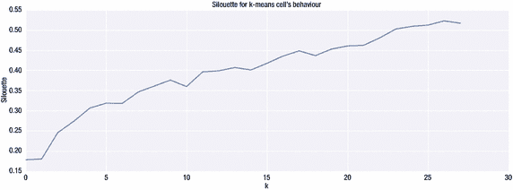
图 4-5. 轮廓系数随簇数量变化的函数图
```
s = []
for n_clusters in range(2,30):
    kmeans = KMeans(n_clusters=n_clusters)
    kmeans.fit(X)
    labels = kmeans.labels_
    centroids = kmeans.cluster_centers_
    s.append(silhouette_score(X, labels, metric='euclidean'))
plt.plot(s)
plt.ylabel("Silouette")
plt.xlabel("k")
plt.title("Silouette for K-means cell's behaviour")
sns.despine()
```
Listing 4-10. 根据数据矩阵绘制轮廓系数图
`Ross` 看到图 4-5 中的曲线时感到困惑，因为轮廓系数似乎随着簇数量的增加而持续上升。根据理论，最佳簇数量应是轮廓系数最高点，但他无法实际选择 27 作为正确的簇数量，原因如下：
*   对于一个总共只有 398 个观测值的数据矩阵来说，27 个簇实在太多了。
*   在有限的时间内，他实际上无法将 27 个不同的细分市场推向市场。
因此，他决定采用从肘部法（即图 4-3）和方差解释（即图 4-4）中确定的九个簇继续推进。
### 应用 k-Means 聚类寻找最佳簇数量
`Ross` 在清单 4-11 中应用了簇大小为 9 的 `k-means` 聚类。
```
matrix, x_cols = matrix_from_df(data_train)
X = matrix[x_cols]
cluster = KMeans(n_clusters = 9, random_state = 2)
matrix['cluster'] = cluster.fit_predict(X)
matrix.cluster.value_counts()
```
Listing 4-11. 训练簇大小为 9 的 `k-means` 模型
输出
```
0    81
1    78
2    32
3    38
4    27
5    44
6    36
7    30
8    30
Name: cluster, dtype: int64
```
在清单 4-11 中，`Ross` 决定打印出落在九个簇中每个簇内的研究论文数量。他注意到，除了两个各有 80 个观测值的簇之外，其余七个簇平均各有 30 个观测值。
`Ross` 很想知道这些簇在视觉上会是什么样子。他意识到数据集中的维度是不同组别数量的函数。`Ross` 知道 `Python` 中没有任何包足以绘制如此高维的图形。即使他成功绘制出来，他也清楚该图形会过于复杂，难以提取任何直观信息。因此，他开始寻找一种能够以某种方式降低维度数量的方法。没过多久，他就接触到了主成分分析（`PCA`）。
### 主成分分析
`PCA` 通过正交变换，将一组高度相关的观测值转换为一组线性不相关的变量，称为主成分。这种变换的目的是使第一个主成分具有最大的方差。
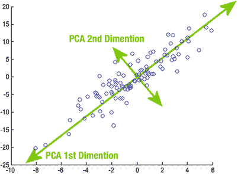
图 4-6. `PCA` 示意图
后续的主成分方差依次减小，同时需满足与先前主成分正交的约束条件，如图 4-6 所示。`PCA` 对数据的相对缩放比例高度敏感。`PCA` 可以被视为一种降维技术，它将高维数据缩减为固定数量的主成分。
阅读完描述后，`Ross` 确信通过降维他正走在正确的道路上。因此，他不再浪费时间，立即编写了清单 4-11 中的代码，将组维度降至两个维度（即 `x` 和 `y`）。他决定将其转换为二维，以便于在二维坐标轴上绘制簇。
表 4-5. 使用 `PCA` 创建的簇及两个新成分的打印结果
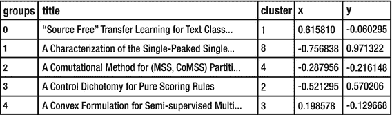

# PCA降维与聚类可视化

## PCA转换与数据准备

在完成特征转换后，Ross需要将结果绘制为散点图。他首先使用PCA将多维特征转换为两个主成分。

```
pca = PCA(n_components=2)
matrix['x'] = pca.fit_transform(matrix[x_cols])[:,0]
matrix['y'] = pca.fit_transform(matrix[x_cols])[:,1]
matrix = matrix.reset_index()
customer_clusters = matrix[['title', 'cluster', 'x', 'y']]
customer_clusters.head()
```
**代码清单 4-12.** 使用 PCA 将组相关特征转换为两个主成分

完成转换后，Ross编写了绘制散点图的代码。

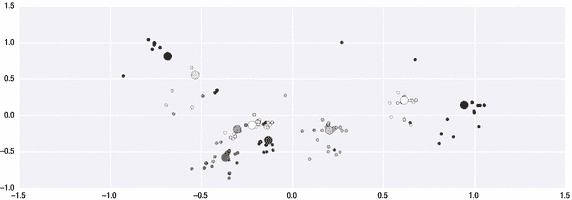
**图 4-7.** 二维空间中的簇

## 在二维空间中绘制簇

```
cluster_centers = pca.transform(cluster.cluster_centers_)
cluster_centers = pd.DataFrame(cluster_centers, columns=['x', 'y'])
cluster_centers['cluster'] = range(0, len(cluster_centers))
plt.scatter(customer_clusters['x'], customer_clusters['y'], s = 20, c=customer_clusters['cluster'])
plt.scatter(cluster_centers['x'], cluster_centers['y'], s = 150, c=cluster_centers['cluster'])
```
**代码清单 4-13.** 在二维空间中绘制簇

在编写代码时，Ross确保为每个簇的观测值分配了不同的颜色标签，以便在图4-7中直观地看到它们的簇成员关系。此外，他还确保也表示了簇中心。图4-7中的簇成员关系在他看来是清晰且不重叠的。

然而，回想起他最初设定的目标是找到与每个细分市场相关的关键词，他必须将降维后的数据合并回原始数据（即矩阵变换前的数据）。

**表 4-6.** 合并后数据框的观测值打印结果
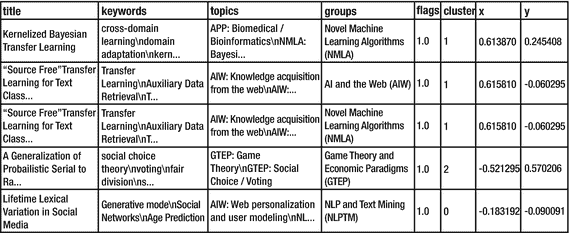

## 将矩阵合并回原始数据框

```
customer_clusters.columns.name = None
df = data_train.merge(customer_clusters, on='title')
df.head()
```
**代码清单 4-14.** 将矩阵合并回原始数据框

罗斯确保打印了这个合并数据对象的前几条观测结果。他成功地将两个数据表示合并在一起，因为现在数据包含了原始数据集中的标题、关键词、主题和性别特征，以及降维数据集中的标志、聚类、x和y特征。

## 生成词云

他现在必须使用这个合并后的数据集为每个分段生成关键词。他决定通过使用词云来实现这一点。词云会显示与给定聚类相关的所有单词，单词的字体大小代表它们在关键特征中出现的频率。他计划将关键特征设为任意值，这个关键特征将用于为词云提供单词。

### 创建生成词云的函数

他首先编写了一个生成词云的方法。

```
def wordcloud_object(word_string):
    FONT_ROOT = './fonts/'
    wordcloud = WordCloud(font_path=FONT_ROOT + 'arial.ttf',
                          stopwords=STOPWORDS,
                          background_color='black',
                          width=1200,
                          height=1000).generate(' '.join(word_string))
    return wordcloud
```
**代码清单 4-15.** 创建生成词云的函数

罗斯指出，代码清单4-15中代码的一个前提条件是，在与脚本相同的仓库中创建一个名为`Fonts`的文件夹，并将`arial.ttf`字体文件放入其中。

### 为每个聚类绘制词云

罗斯继续编写了为九个聚类中的每一个生成词云的代码。

```
def plot_wordcloud(df, clusters, pivot):
    fig = plt.figure(figsize=(15,29.5))
    for cluster in range(clusters):
        List_ = []
        for x in df[df['cluster']==cluster][pivot]:
            try:
                List_.extend(x.split('\n'))
            except:
                pass
        if List_:
            ax = fig.add_subplot(5,2,cluster+1)
            wordcloud = wordcloud_object(List_)
            plt.title('Cluster: %d'%(cluster+1))
            ax.imshow(wordcloud)
            ax.axis('off')
```
**代码清单 4-16.** 创建为每个聚类绘制词云的函数

在继续之前，罗斯指出`plot_wordcloud`方法中的一个参数是`pivot`参数。`pivot`是用于提取词袋以生成词云的特征。

### 生成关键词的词云

罗斯编写了调用代码清单4-16中初始化的方法，并将“关键词”作为关键特征传入的代码。

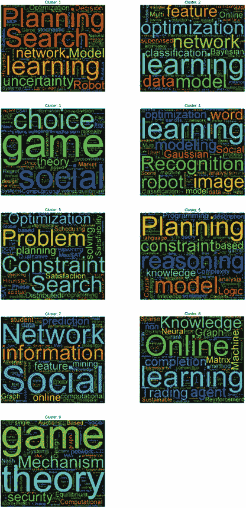
**图 4-8.** 由关键词生成的每个聚类的词云

```
plot_wordcloud(df, cluster.n_clusters, 'keywords')
```
**代码清单 4-17.** 生成名为“关键词”的特征的词云

## 聚类关键词分析与审计

查看图4-8后，罗斯决定尝试一下他的推理能力，并将九个聚类定义如下：

- 聚类 1：关于搜索和机器人技术的论文
- 聚类 2：深入探讨模型学习与优化的论文
- 聚类 3：数据分析在游戏和社交媒体分析中的应用主题
- 聚类 4：图像识别、机器人技术和社交媒体分析的主题
- 聚类 5：线性规划和搜索的主题
- 聚类 6：基于推理模型的论文
- 聚类 7：数据科学在社会图谱和其他在线媒介中应用的论文
- 聚类 8：知识图谱相关的主题
- 聚类 9：专注于博弈论和数据安全的论文

罗斯指出，词云中的单词是单字词（即单个单词）。他对目前的结果感到满意，但在他看来，有些聚类存在重叠的术语；例如，聚类1和聚类5都有“搜索”这个重叠术语。罗斯认为消除重叠以使聚类关键词和特征尽可能独特非常重要。

因此，他计划深入细节，看看这两个聚类是否涉及SEO的相同或不同主题。他首先定义了一个方法，该方法将术语（例如“搜索”）作为参数，并返回包含该术语的每个聚类的关键词。

### 定义审计方法

```
def perform_cluster_group_audit(clusters, term):
    for cluster in clusters:
        df_cluster = df[df['cluster'] == cluster]
        print 'Cluster number: %d'%(cluster + 1)
        keywords = list(df_cluster['keywords'])
        keywords = [keyword.split('\n') for keyword in keywords]
        keywords = [item for sublist in keywords for item in sublist]
        keywords = [keyword.lower() for keyword in keywords if term in keyword.lower()]
        keywords_freq = {x:keywords.count(x) for x in keywords}
        print sorted(keywords_freq.items(), key=operator.itemgetter(1), reverse=True)
        print '\n'
```
**代码清单 4-18.** 定义方法以查找给定聚类和单字词的完整关键词

罗斯指出了代码清单4-18的倒数第二行，该行用于按频率降序对关键词进行排序。

### 查看特定聚类的关键词

现在是时候使用代码清单4-18中定义的方法了。他首先查看了在“搜索”方面区分聚类1和聚类5的主题。

```
perform_cluster_group_audit([0,4], 'search')
```
**代码清单 4-19.** 使用函数查找聚类 0 和 4 中关于搜索的关键词

输出

# 聚类分析与可视化

## 聚类1和聚类5的分析

代码清单 4-19 的输出如下所示，显示了聚类 1 和聚类 5 的关键词列表：

```
聚类编号: 1
[('启发式搜索', 7), ('贪婪最佳优先搜索', 4), ('蒙特卡洛树搜索', 2), ('有界次优搜索', 1), ('实时搜索', 1), ('最佳优先搜索', 1), ('增量搜索', 1), ('并行搜索', 1), ('相似性搜索', 1), ('次优启发式搜索', 1), ('智能体中心搜索', 1), ('近似最近邻搜索', 1), ('层次搜索', 1)]
聚类编号: 5
[('搜索', 3), ('启发式搜索', 3), ('局部搜索', 2), ('随机局部搜索', 2), ('与/或搜索', 2)]
```

罗斯明确指出，聚类 1 和聚类 5 被引用为 0 和 4，因为列表索引从 0 开始。输出显示，两个分段都捕获了关于启发式搜索的主题。他注意到聚类 5 有关于局部搜索的主题，而聚类 1 有关于其他搜索算法的主题。

## 聚类3、4和7的分析

查看图 4-8 后，罗斯注意到聚类 3、4 和 7 在社交媒体领域共享主题。因此，他决定使用之前在代码清单 4-20 中定义的函数来调查差异点。

```
perform_cluster_group_audit([2,3,6], 'social')
```

**代码清单 4-20.**
使用函数查找聚类 2、3 和 6 中关于社交的关键词

### 输出

```
聚类编号: 3
[('计算社会选择', 11), ('社会选择理论', 2), ('社会决策方案', 2), ('随机社会选择', 1)]
聚类编号: 4
[('社交媒体', 5), ('社交垃圾信息发送者', 2), ('社交图像分类', 2)]
聚类编号: 7
[('社交网络', 6), ('社交网络', 3), ('社交传染性', 3), ('社交网络分析', 2), ('基于位置的社交网络', 2), ('社交影响', 2), ('社交动态', 1), ('社交解释', 1)]
```

清单 4-20 的输出让罗斯清楚地看到三个聚类之间的差异。聚类 3 侧重于社会选择理论。而聚类 4 则专注于社会图像分类和垃圾信息识别。最后，聚类 2 汇集了与社会图谱及互联影响相关的研究论文。

## 练习题

罗斯好奇地想看看，如果关键特征不是“关键词”，词云会是什么样子。他时间有限且任务繁重，因此邀请你加入，帮助他回答练习题中的问题。

1.  以“组别”为关键特征绘制词云。
2.  以“主题”为关键特征绘制词云。

## 高斯混合模型

罗斯曾在某处读到，k-means 中的聚类通常呈球形。他好奇是否存在能够生成不同形状的非均匀聚类的方法。没过多久，他就发现高斯混合模型是满足他好奇心的潜在候选方案。

高斯混合模型利用概率论来估计数据可被划分的聚类数量。它基于一个假设：所有数据点都是由有限个参数未知的高斯分布混合生成的。高斯混合模型可视为 k-means 的增强版，其中考虑了数据的协方差以及高斯模型的中心。

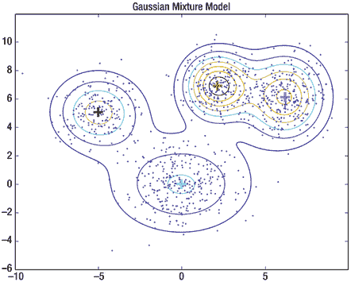

高斯混合模型有以下几种变体，用于约束不同聚类估计的协方差：
*   球形
*   对角
*   绑定
*   全协方差

罗斯决定应用高斯混合模型来找出数据段及其特征。为此，他在清单 4-21 中编写了一个函数，用于生成高斯混合模型产生的聚类散点图。

```python
def plot_results(X, Y_, means, covariances, index, title):
    color_iter = itertools.cycle(['b', 'g', 'red', 'm', 'y', 'navy', 'c', 'cornflowerblue', 'gold',
                                  'darkorange'])
    splot = plt.subplot(2, 1, 1 + index)
    for i, (mean, covar, color) in enumerate(zip(
            means, covariances, color_iter)):
        v, w = np.linalg.eigh(covar)
        v = 2. * np.sqrt(2.) * np.sqrt(v)
        u = w[0] / np.linalg.norm(w[0])
        if not np.any(Y_ == i):
            continue
        plt.scatter(X[Y_ == i, 0], X[Y_ == i, 1], .8, color=color)
        angle = np.arctan(u[1] / u[0])
        angle = 180. * angle / np.pi  # convert to degrees
        ell = mpl.patches.Ellipse(mean, v[0], v[1], 180. + angle, color=color)
        ell.set_clip_box(splot.bbox)
        ell.set_alpha(0.5)
        splot.add_artist(ell)
    plt.xlim(0.0, 0.1)
    plt.ylim(-0.2, 1.2)
    plt.xticks(())
    plt.yticks(())
    plt.title(title)
```

**清单 4-21.**
定义绘制聚类的函数

在清单 4-21 中，罗斯确保每个聚类用不同颜色表示，以便在视觉上区分它们。他现在期待应用高斯混合模型；然而，他不太确定组件的数量应该是多少。他查阅文献后发现，`BIC` 分数常用于高斯混合模型来确定聚类数量。现在他的计划是，对所有可能的协方差类型和组件数量（即从 2 到 9）的组合运行高斯混合模型。协方差类型包括球形、绑定和全协方差。对于每种组合，将计算 `BIC` 分数，并选择 `BIC` 分数最高的组合。罗斯通过编写清单 4-22 中的代码实现了这一点。


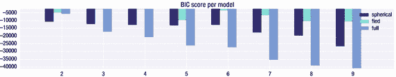

## 确定最佳聚类参数

```python
matrix, x_cols = matrix_from_df(data_train)
X  = matrix[x_cols].as_matrix()
model_stats = []
n_components_range = range(2, 10)
cv_types = ['spherical', 'tied', 'full']
for cv_type in cv_types:
for n_components in n_components_range:
gmm = mixture.GaussianMixture(n_components=n_components,
covariance_type=cv_type, random_state=0)
gmm.fit(X)
model_stats.append({'name':'%s_%d'%(cv_type, n_components), 'model':gmm, 'bic':gmm.bic(X)})
bic = np.array([m_type['bic'] for m_type in model_stats])
best_gmm = model_stats[bic.argmax()]
clf = best_gmm['model']
color_iter = itertools.cycle(['navy', 'turquoise', 'cornflowerblue'])
bars = []
# Plot the BIC scores
spl = plt.subplot(2, 1, 1)
for i, (cv_type, color) in enumerate(zip(cv_types, color_iter)):
xpos = np.array(n_components_range) + .2 * (i - 2)
bars.append(plt.bar(xpos, bic[i * len(n_components_range):
(i + 1) * len(n_components_range)],
width=.2, color=color))
plt.xticks(n_components_range)
plt.ylim([bic.min() * 1.01 - .01 * bic.max(), bic.max()])
plt.title('BIC score per model')
spl.set_xlabel('Number of components')
spl.legend([b[0] for b in bars], cv_types)
labels = clf.predict(X)
plot_results(X, labels, gmm.means_, gmm.covariances_, 1,
'Gaussian Mixture-%s'%gmm.converged_)
plt.xticks(())
plt.yticks(())
plt.title('Selected GMM: %s model, %s components'%(best_gmm['name'].split('_')[0], best_gmm['name'].split('_')[1]))
plt.subplots_adjust(hspace=.35, bottom=.02)
plt.show()
清单 4-22.
确定模型的最佳协方差类型和组件数量并绘制图形
```

罗斯指出，图 4-10 中的数值为负值。因此，协方差类型和组件数量在 0 处的组合将被视为胜出。在本例中，协方差类型为“绑定”、组件数量为 3 的高斯混合模型胜出。罗斯好奇所有聚类的大小是否均匀。为此，他编写了清单 4-23 中的代码。

```python
matrix['cluster'] = labels
matrix.cluster.value_counts()
清单 4-23.
显示每个聚类中对象的频数
```

输出

```
0     232
1     108
2     56
Name: cluster, dtype: int64
```

罗斯好奇用这种方法生成的词云会是什么样子，以及它们是否具有直观意义。但在做这件事之前，他必须将矩阵合并到原始数据集中。他借助清单 4-24 中的代码完成了合并。

```python
customer_clusters.columns.name = None
df = data_train.merge(customer_clusters, on='title')
清单 4-24.
将矩阵合并到初始数据框中
```

他不再等待，直接将清单 4-25 中的合并数据集输入到清单 4-15 中定义的函数中，以生成词云图。

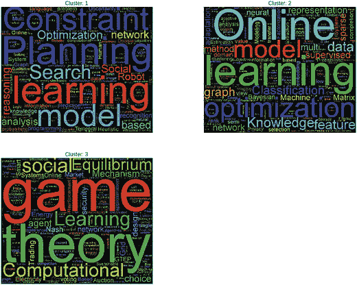

图 4-12.

基于关键词生成的每个聚类的词云

```python
plot_wordcloud(df, gmm.n_components, 'keywords')
清单 4-25.
生成名为“关键词”的特征的词云
```

罗斯决定测试自己的推理能力，并定义了每个聚类中包含的研究论文：

*   聚类 1：深入讨论模型学习与线性规划的论文
*   聚类 2：深入讨论模型优化与知识图谱的论文
*   聚类 3：关于博弈论与社交媒体分析的主题

罗斯看到结果后非常兴奋，因为这些聚类在特征上似乎具有独特性。然而，他正在寻找一种能够自动确定最佳组件数量的算法。经过一番努力，他最终确定了贝叶斯高斯混合模型。

### 贝叶斯高斯混合模型

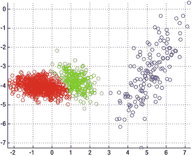

图 4-13.

贝叶斯高斯混合模型示意图

贝叶斯高斯混合模型是高斯混合模型的一种变体，该模型能够自行选择最优的聚类数量。当`weight_concentration_prior`设置得足够小，且`n_components`设置得比模型认为必要的值更大时，它就会表现出这种特性。变分贝叶斯混合模型会将某些混合权重值设置为接近零，从而让模型自动选择有效的成分。

罗斯决定将贝叶斯高斯混合模型应用于数据矩阵。他将成分数量限制为五个。他很想看看贝叶斯高斯混合模型会认为多少个成分是最优的。


图 4-14.

通过贝叶斯高斯混合模型形成的聚类

```python
matrix, x_cols = matrix_from_df(data_train)
X  = matrix[x_cols].as_matrix()
dpgmm = mixture.BayesianGaussianMixture(n_components=3,
covariance_type='full', random_state=1).fit(X)
labels = dpgmm.predict(X)
plot_results(X, labels, dpgmm.means_, dpgmm.covariances_, 1,
'Bayesian Gaussian Mixture with a Dirichlet process prior-%s'%dpgmm.converged_)
plt.show()
代码清单 4-26.
训练模型并绘制聚类图
```

图 4-14 中的三种颜色向罗斯表明，三个成分足以让模型收敛。他很想了解每个聚类中研究论文的分布频率；因此，他编写了代码清单 4-27 中的代码片段。

```python
matrix['cluster'] = labels
matrix.cluster.value_counts()
代码清单 4-27.
显示每个聚类中对象的频率
```

输出

```
0     229
1     117
2     50
Name: cluster, dtype: int64
```

罗斯注意到，第一个聚类包含了超过 50% 的观测值，而后续两个聚类中的观测值数量则依次减少。

当前矩阵仅包含标题和聚类作为特征。因此，他决定将它们合并到初始数据框中，以便获取与这些研究论文标题相对应的其他特征。

```python
customer_clusters.columns.name = None
df = data_train.merge(customer_clusters, on='title')
代码清单 4-28.
将矩阵合并到初始数据框
```

是时候让罗斯探索这三个聚类各自的特征了。因此，他应用了代码清单 4-16 中定义的函数。

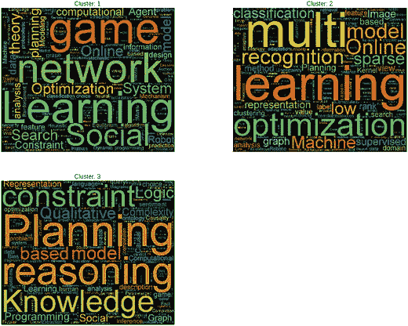

图 4-15.

根据关键词为每个聚类生成的词云

```python
plot_wordcloud(df, dpgmm.n_components, 'keywords')
代码清单 4-29.
生成名为“关键词”的特征的词云
```

罗斯借助词云，用以下词语定义了这三个聚类：

*   聚类 1：深入探讨博弈论和社交媒体分析的论文
*   聚类 2：深入探讨模型优化和模型学习的论文

* 聚类 3：关于线性规划、知识图谱和基于推理模型的主题

罗斯很满意，因为经过这次练习，他得到了具有不同特征的有限聚类。他计划放弃 k-means 的输出，转而使用贝叶斯高斯混合模型定义的细分。他的理由是：首先，这些聚类在直觉上更有意义；其次，该模型足够智能，能够自行找到最优的聚类数量。

尽管罗斯已经解决了手头的问题，但他仍对聚类在现实世界中的应用感兴趣。

## 聚类的应用

聚类在多个研究领域都有广泛的应用。

### 疾病识别

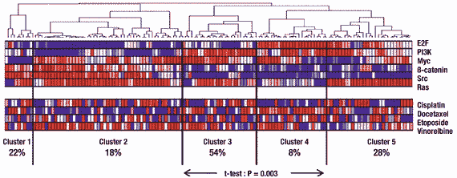

图 4-16. 疾病识别时获得的聚类及其置信区间

聚类最近引起了医学领域人士的关注。这主要是因为无监督非线性聚类算法在预测癌症疾病方面相对更有效。

### 搜索引擎中的文档聚类

搜索引擎将用户的输入查询作为参数，从信息检索系统中对文档进行聚类。因此，搜索结果会按这些聚类文档的排序顺序呈现。

### 基于人口统计的客户细分

聚类也应用于营销领域——更具体地说，是品牌领域。营销研究主管使用聚类来发现客户细分以及他们品牌和竞争对手品牌的感知图。通过这种方式，他们可以了解自己品牌的定位以及所服务的客户细分市场。这有助于品牌确定要瞄准的客户画像，包括现有客户和潜在客户，以及他们的人口统计特征。

罗斯决定回顾自己是如何从监督算法和无监督算法的区别开始这段旅程的，以此作为总结。然后，他将数据转换为矩阵以增加手头数据的维度。他研究了确定最优聚类数量的不同方法。他学会了如何制作词云，以便对形成的聚类产生直观的理解。为了实现最终目标，他使用了多种技术来寻找将研究论文划分为具有不同特征的细分市场的正确方法。他的计划是在即将到来的今年会议上，通过相关的关键词来营销这些细分市场。他从贝叶斯高斯混合模型中选择了三个成分，为明年即将到来的会议助力。