# 5. 分类

本章旨在解决依赖于有限数量结果的现实世界问题。这些结果本质上可以是布尔型的，只有两个选择（即真/假或是/否）。它们也可以是名义型的（乘客将登上的船名、一组学生将获得的最高教育程度等）。在本章中，我们将讨论监督学习，即使用标记数据来训练模型。在这些数据上训练模型将能够对未见过的数据集进行标签预测（即未来预测）。在本章中，我们将讨论特征提取和选择，并以评估分类准确率的方法作为结束。

注意：本书采用 Python 2.7.11 作为编码示例的事实标准。此外，你需要安装它才能完成练习。

在本章中，我们将使用可从以下网址下载的医疗预约失约数据集：[`www.kaggle.com/joniarroba/noshowappointments`](http://www.kaggle.com/joniarroba/noshowappointments)。

## 案例研究：俄亥俄诊所——应对供需问题

儿科外科医生兼俄亥俄诊所主管朱迪医生遇到了大麻烦，该诊所连续第三年出现亏损。朱迪医生最近刚晋升到这个职位，但她清楚地知道，诊所一直在效率方面尽职尽责。最让她惊讶的是，尽管拥有最优秀的医生，预约也从不缺乏，医院却仍在亏损。为了对财务状况放心，她聘请了一家第三方公司来审计财务部门。然而，该公司并未发现任何与当前困境相关的证据。

俄亥俄诊所是俄亥俄州的一家非营利性医疗中心。该诊所的独特使命是将研究与教育同临床及住院护理相结合。该医疗中心拥有庞大的员工队伍，共计 5 万人，正是这些员工的共同努力，使得该医疗中心迄今已能处理约 700 万人次的就诊。

此前，遇到类似情况，医院依赖的是捐赠者的资金注入。然而，随着管理层最近的人事变动，医院已开始努力实现自负盈亏。正如朱迪医生回忆的那样：

> 管理层的这项新举措对我来说是一个巨大的挑战，因为那恰好是我接手这个职位的时候。我没有时间安顿下来，所以这对我来说是一个生死攸关的局面。如果财务没有问题，预约量激增，没有大量招聘或加薪，那么造成这种困境的唯一原因可能就是患者在预约后根本没有出现。

董事会会议很快就要召开，她必须在会议前收集见解，为这种异常现象找出原因。朱迪医生知道，无论是猜测还是谣言，都无法让她找出尽管预约量很大却仍在亏损的原因。为了进一步调查她的怀疑，她获取了预约数据转储，并决定利用这些数据来验证证据。她知道具体的数据不会受偏见影响，因此能清晰地呈现当前的情况。首先，她必须交叉检查数据集中的特征是否与手头的问题相关。于是，她调出了表 5-1 中的数据字典。

表 5-1. 医疗预约未出席数据集的数据字典

| 特征名称 | 描述 |
| --- | --- |
| Age | 患者年龄 |
| Gender | 患者性别 |
| AppointmentRegistration | 向患者发出预约的日期 |
| ApointmentData | 为患者安排的预约日期 |
| DayOfTheWeek | 预约安排的星期几 |
| Status | 预约安排的星期几（即响应变量） |
| Diabetes | 患者是否患有糖尿病 |
| Alcoolism | 患者是否受酒精中毒影响 |
| HiperTension | 患者是否患有高血压 |
| Handicap | 患者是否残疾 |
| Smokes | 患者是否吸烟 |
| Tuberculosis | 患者是否患有肺结核 |
| Scholarship | 患者是否获得社会福利组织的奖学金。贫困家庭可能通过获得经济援助而受益。 |
| Sms_Reminder | 是否已向患者发送了预约短信提醒 |
| AwaitingTime | 等待时间 = 预约登记日期 – 预约日期 |

朱迪医生在网上搜索了在此分析过程中可能需要的所有相关软件包。清单 5-1 展示了她的搜索结果。

```python
%matplotlib inline
import numpy as np
import pandas as pd
from time import time
import matplotlib.pyplot as plt
from IPython.display import Image
from matplotlib.pylab import rcParams
from sklearn import metrics
from sklearn.cross_validation import train_test_split
from sklearn.decomposition import PCA
from sklearn import kernel_approximation
from sklearn.linear_model import SGDClassifier
from sklearn.tree import DecisionTreeClassifier
from sklearn.kernel_approximation import (RBFSampler,Nystroem)
from sklearn.ensemble import GradientBoostingClassifier, RandomForestClassifier
rcParams['figure.figsize'] = 15, 5
```

清单 5-1. 导入本章所需的软件包

朱迪医生希望利用数据转储中的信息实现以下目标：

1.  找出即使预约率上升，亏损仍然出现的原因。

2.  如果患者在预约时间未报到，提出一种方法，根据患者的特征判断其是否会出席。她认为，了解哪些患者可能不会出席，将使医院能够采取如下应对措施：
    *   提供持续的预约提醒和确认
    *   使医生和医院员工的人数与当前需求保持一致。

朱迪医生决定从理解数据转储中的特征并列出其可能的值开始。

## 特征探索

朱迪博士相信数据转储的价值，并使用清单 5-2 中的代码片段将其加载到计算机内存中。她还确保打印出数据转储中的首批初始观测结果。

表 5-2. 数据集观测结果打印

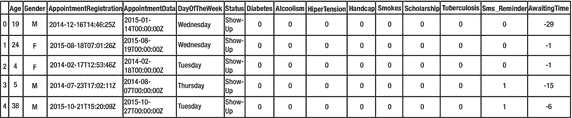

```python
data = pd.read_csv('examples/No-show-Issue-Comma-300k.csv')
data.head()
```

清单 5-2. 将数据读入内存并打印前几行观测结果

朱迪博士决定使用表 5-2 作为辅助工具，将特征归类为最常见的数据类型。

*   整数：年龄、等待时间
*   字符串：性别、星期几、状态
*   日期时间：预约登记、预约日期
*   布尔值：高血压、残疾、吸烟、奖学金、结核病、短信提醒

她预计数据转储中的记录数量将达到数千条，因为她注意到每个月初的预约日程通常都是满的。她决定在清单 5-3 中验证这一点。

```python
print len(data)
```

清单 5-3. 查找数据集中观测结果的数量

输出：

```python

```

清单 5-3 的输出远远超出了朱迪博士的预期，这让她确信从数据中获得的洞察将具有很高的置信度。接下来，她计划观察每个特征中不同值的数量。她相信这有助于她剔除那些没有变异性的特征（即所有观测值都相同），并决定这些特征可以用哪些类型的图表来表示。为此，她编写了清单 5-4 中的代码。

```python
for column in list(data.columns):
    print "{0:25} {1}".format(column, data[column].nunique())
```

清单 5-4. 打印每个特征集中不同值的频率

输出：

```python
Age                             109
Gender                          2
AppointmentRegistration         295425
ApointmentData                  534
DayOfTheWeek                    7
Status                          2
Diabetes                        2
Alcoolism                       2
HiperTension                    2
Handicap                        5
Smokes                          2
Scholarship                     2
Tuberculosis                    2
Sms_Reminder                    3
AwaitingTime                    213
```

朱迪博士解释说，打印语句中的 `{0:25}` 表示将打印第一个索引中的特征（即列），并为其分配 25 个字符空间。清单 5-4 的输出表明数据集中有许多变量具有离散值，例如性别、状态、星期几等。这帮助她选择了表示每个特征的图表类型。她决定将等待时间和年龄绘制成直方图，因为这些是数值型且本质上是连续的。至于本质上是离散的特征，她计划用条形图来表示。她通过初始化清单 5-5 中的函数来执行该图表，随后在图 5-1 中调用该函数来绘制图形。

```python
def features_plots(discrete_vars):
    plt.figure(figsize=(15,24.5))
    for i, cv in enumerate(['Age', 'AwaitingTime']):
        plt.subplot(7, 2, i+1)
        plt.hist(data[cv], bins=len(data[cv].unique()))
        plt.title(cv)
        plt.ylabel('Frequency')
    for i, dv in enumerate(discrete_vars):
        plt.subplot(7, 2, i+3)
        data[dv].value_counts().plot(kind='bar', title=dv)
        plt.ylabel('Frequency')
```

清单 5-5. 初始化函数以绘制数据集中的所有特征

朱迪博士指出，清单 5-5 中的方法将本质上是离散的特征名称作为输入，因为这些特征将用条形图表示。她没有浪费时间，立即调用该函数来绘制清单 5-6 中的特征表示图。

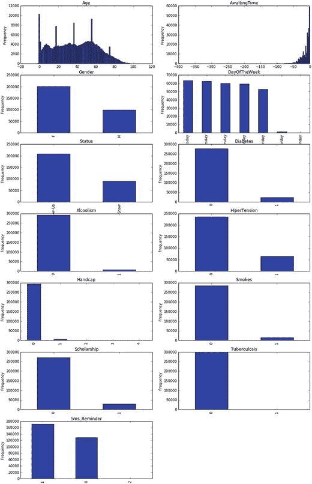

图 5-1. 特征表示图

```python
discrete_vars = ['Gender', 'DayOfTheWeek', 'Status', 'Diabetes',
                 'Alcoolism', 'HiperTension', 'Handcap', 'Smokes',
                 'Scholarship', 'Tuberculosis', 'Sms_Reminder']
features_plots(discrete_vars)
```

清单 5-6. 调用清单 5-5 中的 `features_plots` 方法绘制特征表示图

在查看图 5-1 时，朱迪博士注意到没有任何特征存在缺失值。她对数据集中的一些特征做出了以下推断：

*   年龄：年龄的范围在 -2 到 113 之间。0 到 113 的年龄是有意义的，但令她惊讶的是年龄怎么会是负数。在她看来，数据集中存在一些噪声。
*   残疾：该特征并非布尔值，其值范围在 0 到 4 之间。
*   短信提醒：该特征并非布尔实体，其值范围在 0 到 2 之间。在她看来，短信提醒表示发送给每位患者的提醒频率。
*   等待时间：朱迪博士看到等待时间为负数感到困惑。根据定义，该特征表示从预约发出到预约日期之间的天数。她认为正数才更有意义。

这些推断的结果意味着朱迪博士在将数据输入分析流程之前，需要先对数据进行一些清理（即执行数据整理）。

## 执行数据整理

她曾在某处读到，数据整理是将原始数据映射为适合分析的有组织格式的过程。图 5-1 的发现显示，“年龄”列中存在负值，这在她看来毫无直观意义，因此她将这些数据称为噪声。于是她计划先统计负年龄值的频率，以此开始处理。如果这些观测值的频率很高，她不会删除它们，因为删除会导致无法检测到预测所需的变量。相反，如果它们的频率可以忽略不计，她计划将其删除，因为删除它们不会对分析产生重大影响。她首先在代码清单 5-7 中统计了负年龄值的频率。

```python
data[data['Age'] < 0]['Age'].value_counts().sum()
```

代码清单 5-7. 统计负年龄观测值的频率

代码清单 5-7 的输出表明，与数据集中的总观测值数量相比，负年龄观测值可以忽略不计。因此，朱迪博士决定从“年龄”特征中移除这些负观测值。

```python
data = data[data['Age'] >= 0]
```

代码清单 5-8. 移除具有负年龄值的观测值

在查看图 5-1 的推论时，朱迪博士还注意到名为“残疾”的特征是一个整数变量，而非布尔变量。她回想起该特征集的数据定义在数据源中缺失，因此存在多种解读。她能想到的唯一合理解释是，该值范围在 0 到 4 之间，这可能是一个李克特量表问题，或者是一个表示患者残疾次数的数字实体。由于对这个特征的解释存在歧义，她决定从数据集中删除该特征。

```python
del data['Handcap']
```

代码清单 5-9. 从数据集中移除名为“残疾”的变量

在查看图 5-1 的推论时，朱迪博士还回想起“等待时间”中的值似乎为负，因此将其转换为正值是合理的。

```python
data['AwaitingTime'] = data['AwaitingTime'].apply(lambda x: abs(x))
```

代码清单 5-10. 将“等待时间”中的值变为正数

基于图 5-1 中推论的变量处理已经完成。然而，朱迪博士回想起她读过的大多数机器学习算法在整数或浮点数输入下表现最佳，而非字符串格式。她知道数据集中的分类变量不符合这一条件，因此将字符串分类特征重新编码为整数对她来说至关重要。朱迪博士首先通过绑定从字符串到整数的映射，对“星期几”进行重新编码。

```python
dow_mapping = {'Monday' : 0, 'Tuesday' : 1, 'Wednesday' : 2, 'Thursday' : 3, 'Friday' : 4, 'Saturday' : 5, 'Sunday' : 6}
data['DayOfTheWeek'] = data['DayOfTheWeek'].map(dow_mapping)
```

代码清单 5-11. 将字符串分类特征“星期几”重新编码为整数

朱迪博士对她的重新编码方法解释如下：

> 存在自动重新编码分类变量的方法。这些方法按字母顺序执行重新编码，例如，如果一个特征的类别是“男”和“女”，那么它会将“女”分配为 0，“男”分配为 1。“星期几”是一个有序量；因此我决定手动进行映射。然而，“性别”和“状态”特征并非如此，因为它们本质上是名义变量。因此，我将使用预定义方法来自动进行重新编码。

朱迪博士在代码清单 5-12 中对“性别”和“状态”进行了重新编码。

```python
for field in ['Gender', 'Status']:
    data[field] = pd.Categorical.from_array(data[field]).codes
```

代码清单 5-12. 将字符串分类特征重新编码为整数

在对原始数据集执行数据整理后，朱迪博士好奇这些特征的表示形式发生了怎样的变化。因此，她查看了图 5-2 以了解转换后的特征表示。

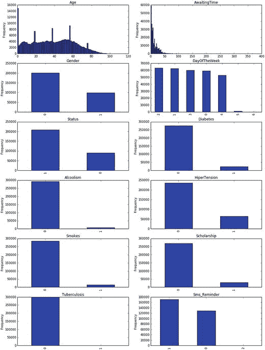

图 5-2. 数据整理后的特征表示图

```python
discrete_vars = ['Gender', 'DayOfTheWeek', 'Status', 'Diabetes',
                 'Alcoolism', 'HiperTension', 'Smokes',
                 'Scholarship', 'Tuberculosis', 'Sms_Reminder']
features_plots(discrete_vars)
```

代码清单 5-13. 数据整理后的特征表示

朱迪博士确保在代码清单 5-13 的离散特征列表中移除了“残疾”。她指出，重新编码分配的代码范围是：

*   0 到（特征内唯一观测值数量 - 1）

在查看图 5-2 时，朱迪博士注意到“等待时间”似乎呈指数衰减。根据她的观察，大多数患者的年龄为 0（即年龄以月为单位的婴儿）。她还指出了在 19 岁、38 岁和 57 岁处的峰值。除此之外，另一个令人惊讶的事实是，三分之一的患者是男性，并且相同比例的患者未在预约日期和时间出现。这一信息让她对诊所为何在预约数量增加的情况下仍出现亏损有了线索。她还注意到，大多数患者至少收到了一条短信提醒；然而，三分之二的情况下没有发送任何提醒。她认为，缺少预约提醒可能是患者爽约的原因。

在理解了数据集中的特征，并通过执行数据整理消除了歧义之后，朱迪博士有兴趣识别数据集中不同特征之间的关系。她希望进行这种多变量分析，以便直观地了解哪些类型的患者会在预约日期和时间爽约。

## 执行探索性数据分析

朱迪博士认为，与其直接开始探索性数据分析（EDA），不如先通过可视化方式观察数据，看看是否存在她可以用来调整模型的模式。她认为，随着年龄增长，人们看医生的需求也会增加。其背后的理念是，随着年龄增长，疾病会呈指数级增加。因此，她编写了清单 5-14 中的代码，以查看这些数量之间的关系在现实中是否成反比。

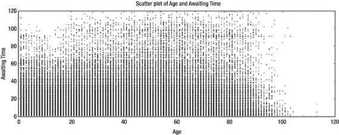

图 5-3. 年龄与等待时间的散点图

```
plt.scatter(data['Age'], data['AwaitingTime'], s=0.5)
plt.title('Scatter plot of Age and Awaiting Time')
plt.xlabel('Age')
plt.ylabel('Awaiting Time')
plt.xlim(0, 120)
plt.ylim(0, 120)
```

清单 5-14.
年龄与等待时间的散点图

朱迪博士对结果并不满意，因为图 5-3 显示的是一个高度分散的图，开始时没有相关性迹象，在 90 岁之后才出现一点负相关。可视化表示表明，先前建立的假设不成立。然而，她决定也使用清单 5-15 中的统计相关性技术来验证这一点。

```
pd.set_option('display.width', 100)
pd.set_option('precision', 3)
correlations = data[['Age', 'AwaitingTime']].corr(method='pearson')
print(correlations)
```

清单 5-15.
计算年龄与等待时间之间的皮尔逊相关系数

输出

```
Age             AwaitingTime
Age            1.00e+00        -4.18e-03
AwaitingTime   -4.18e-03       1.00e+00
```

年龄与等待时间之间的相关性趋近于 0，这与她先前建立的假设相悖。她现在感兴趣的是，增加短信提醒次数是否会提高患者赴约的可能性。为此，她编写了清单 5-16 中的代码，以绘制图 5-4 中的堆叠条形图。

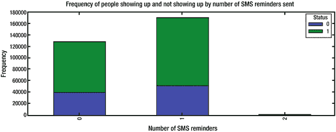

图 5-4.
状态与短信提醒次数的堆叠条形图

```
data_dow_status = data.groupby(['Sms_Reminder', 'Status'])['Sms_Reminder'].count().unstack('Status').fillna(0)
data_dow_status[[0, 1]].plot(kind='bar', stacked=True)
plt.title('Frequency of people showing up and not showing up by number of SMS reminders sent')
plt.xlabel('Number of SMS reminders')
plt.ylabel('Frequency')
```

清单 5-16.
基于短信提醒次数对状态的影响

查看图 5-4，朱迪博士注意到，与未发送提醒时相比，发送一次提醒后赴约患者数量的变化率约为 30%（即 (0.17 m – 0.13 m) / 0.13m），而发送一次提醒后未赴约患者数量的变化率约为 25%（即 (0.05 m – 0.04 m) / 0.04m）。因此她得出结论，短信提醒确实能略微提高患者在预约日赴约的可能性。

朱迪博士的观点是，大多数患者会在周中赴约，而许多患者会在周初或周末改变计划，不赴约。她认为这是因为周初和周末通常是企业最忙碌的时候，而工作压力在周中会有所缓解。她决定在清单 5-17 中验证她的观点。

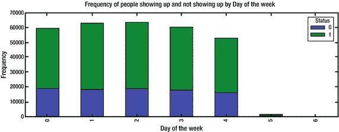

图 5-5.
状态与星期几的堆叠条形图

```
data_dow_status = data.groupby(['DayOfTheWeek', 'Status'])['DayOfTheWeek'].count().unstack('Status').fillna(0)
data_dow_status[[0, 1]].plot(kind='bar', stacked=True)
plt.title('Frequency of people showing up and not showing up by Day of the week')
plt.xlabel('Day of the week')
plt.ylabel('Frequency')
```

清单 5-17.
基于短信提醒次数对预约星期几的影响

朱迪博士指出，在图 5-5 中，0 代表星期一，6 代表星期日，其余日期按顺序排列。星期六几乎没有患者赴约，诊所星期日关门。在其余五天中，未赴约率的变化基本保持不变，而赴约率的分布似乎呈钟形曲线，大多数患者在星期三赴约。

朱迪博士认为，年龄较小的人更可能忙于工作。因此，他们可能时间紧张，在预约时间赴约的可能性很低。她最初想通过计算中心度量（即均值或中位数）来验证她的假设。然而，她不确定应该使用哪种中心度量（即均值、中位数或众数）。

她回想起图 5-2 中，年龄变量有大量观测值为 0。她知道这可能会在计算均值时成为一个劣势，因为它会将均值拉向较低的一侧。因此，她认为更好的度量是中位数，它不受异常值的影响。于是，她计划绘制按状态分组的年龄箱线图。

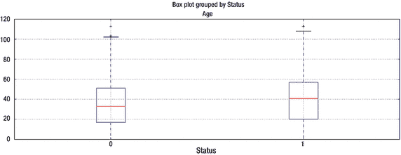

图 5-6.
按状态分组的年龄箱线图

```
data.boxplot(column=['Age'], return_type='axes', by='Status')
plt.show()
```

清单 5-18.
绘制按状态分组的患者年龄箱线图

她看到图 5-6 的结果时非常兴奋，因为她的假设成立：赴约患者的中位年龄（40 岁）相对高于未赴约患者的中位年龄（32 岁）。她还指出，赴约患者的上限（即第三四分位数）为 58 岁，相对高于未赴约患者的上限（52 岁）。

朱迪博士决定分别分析男性和女性的年龄与状态之间的关系。为此，她编写了清单 5-19 中的代码片段来绘制折线图。

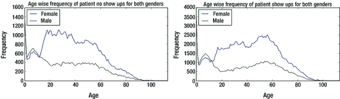

图 5-7.
按性别和状态分组的年龄折线图

```
plt.figure(figsize=(15,3.5))
for i, status in enumerate(['no show ups', 'show ups']):
data_show = data[data['Status']==i]
plt.subplot(1, 2, i+1)
for gender in [0, 1]:
data_gender = data_show[data_show['Gender']==gender]
freq_age = data_gender['Age'].value_counts().sort_index()
freq_age.plot()
plt.title('Age wise frequency of patient %s for both genders'%status)
plt.xlabel('Age')
plt.ylabel('Frequency')
plt.legend(['Female', 'Male'], loc='upper left')
```

清单 5-19.
绘制按性别和患者状态分组的年龄折线图

男性的年龄模式在两种状态下似乎相似，而女性的年龄模式则因状态而异。年龄在 42 至 62 岁之间的女性更有可能在预约日期和时间赴约。

朱迪博士认为，等待时间（即距预约的天数）较长的患者可能更愿意去看其他医生，而不是等待这么久。她认为，未在预约日期赴约的另一个原因可能是，如果疾病是季节性的，那么在采取一些预防措施或家庭疗法后，疾病可能会痊愈。因此，当预约日期到来时，患者决定不去看医生。她决定从手头的数据中看看这是否属实。

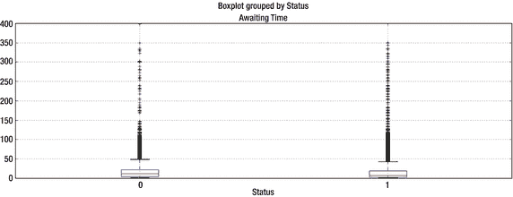

图 5-8.
按状态分组的等待时间箱线图

```
data.boxplot(column=['AwaitingTime'], return_type='axes', by='Status')
plt.show()
```

代码清单 5-20.
绘制按状态分组的等待时间箱线图

在查看图 5-8 后，朱迪博士推断，等待时间处于第三四分位数的患者相对更有可能爽约，这支持了她先前提出的零假设——随着等待时间的增加，患者爽约的可能性也会增加。她还指出，两种状态实例的中位数都接近于零。

# 探索性数据分析与特征生成

探索性数据分析为朱迪博士提供了许多见解，她对此感到非常兴奋。总结来看，她观察到短信提醒提高了患者准时赴约的可能性。她还注意到，年轻患者更常不在预约时间出现，而年长患者则更为自律，能够准时赴约。此外，她还发现等待时间长的患者决定不在预约日期和时间出现。朱迪博士现在清楚地认识到，爽约是造成损失的原因，并且她已深入了解导致人们表现出这种行为的原因。现在，她计划继续前进，构建一个分类模型来预测患者未来是否会准时出现。这很重要，因为如果她知道某一天、某一周或某一个月内会出现的患者总数，她就可以相应地调整资源以节省成本。然而，在开始分类之前，她想知道是否可以通过特征生成的方式，从现有特征中提取更多特征。她相信这将有助于她捕捉数据集中的变异性并明确模式。

## 特征生成

在机器学习中，数据集中的观测值和特征集数量越多，模型就越有可能捕捉到其中的变异性，从而理解其真实本质。朱迪博士知道增加观测值数量是不可行的；不过，她可以增加数据集中的特征集。朱迪博士对于如何从现有特征中提取更多特征毫无头绪。经过深思熟虑，她决定将包含日期的特征分解为更细粒度的日期组成部分。她编写了代码清单 5-21 中的代码片段，将其逻辑应用于名为 `AppointmentRegistration` 和 `AppointmentDate` 的特征。

```python
for col in ['AppointmentRegistration', 'ApointmentData']:
for index, component in enumerate(['year', 'month', 'day']):
data['%s_%s'%(col, component)] = data[col].apply(lambda x: int(x.split('T')[0].split('-')[index]))
```
代码清单 5-21. 将日期特征分解为日期组成部分

朱迪博士解释说，代码清单 5-21 中的代码片段将 `AppointmentRegistration` 和 `AppointmentData` 特征分解为各自的年、月、日组成部分。然而，它没有将它们分解为时间组成部分，因为 `AppointmentData` 的字符串对象中不包含时间组成部分，而 `AppointmentRegistration` 特征则包含。因此，她编写了代码清单 5-22 中的代码，将 `AppointmentRegistration` 特征也分解为其时间组成部分。

```python
for index, component in enumerate(['hour', 'min', 'sec']):
data['%s_%s'%('AppointmentRegistration', component)] = data['AppointmentRegistration'].apply(
lambda x: int(x.split('T')[1][:-1].split(':')[index]))
```
代码清单 5-22. 将 `AppointmentRegistration` 分解为时间组成部分

接下来，她编写了代码清单 5-23 中的代码，以见证特征生成的步骤。

表 5-3. 数据集观测值打印

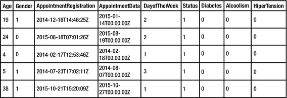
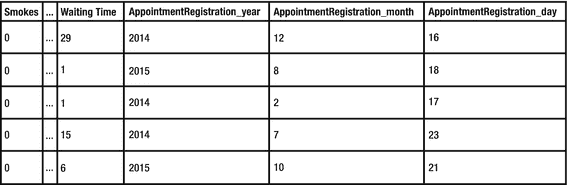
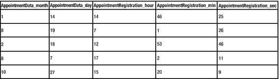

```python
data.head()
```
代码清单 5-23. 打印特征提取数据集的前几条观测值

查看表 5-3 后，朱迪博士看到特征生成成为现实，感到非常兴奋。证据就是那些代表 `AppointmentData` 和 `AppointmentRegistration` 的年、月、日、时、分、秒组成部分的列。朱迪博士很清楚，她增加特征集的方法并非唯一标准技术，因为存在其他几种实现相同目标的技术。她有一些关于提取更多特征的想法；然而，为了节省时间，她选择了最简单的方法。但如果有人能帮助她从日期特征中提取其他日期组成部分，或者帮助她将特征转换为布尔类型，她愿意合作。因此，她列出了以下练习。

**练习**

1.  从日期特征中提取更多特征（月中的第几周、年中的第几周、半天、周末、工作日等）。
2.  像第 4 章那样，在数据集中包含特征的布尔转换。这将增加特征集，在训练模型时可能有益。

她希望这个庞大的特征池现在能使分类模型更好地理解底层数据的动态。她知道什么是分类，但好奇心驱使她撰写了以下关于该主题的材料。

## 分类

分类帮助我们判断一个新观测值将属于给定的哪个类别。分类属于监督学习，只有将带有标签的成员数据作为输入提供后，模型才能进行训练。这些成员变量通常是分类变量，可以是名义变量，也可以是布尔变量。

例如，考虑一个人在一家顶级银行申请抵押贷款。银行将审核他的申请，并想知道此人未来是否会违约。如果不会，银行将批准他的抵押贷款申请。这是分类的一个典型应用，银行使用过去的数据来训练模型。然后，模型将考虑此人的年龄、性别、薪资指数、生活方式指数和信用评分，以预测他未来是否会违约。这里我们试图预测的成员变量是“违约”，并且它是分类变量。

以下方法可用于评估分类模型：

*   `准确性`：分类器和预测器的准确度
*   `速度`：模型训练和预测所需的时间
*   `鲁棒性`：处理缺失值和噪声的能力
*   `可扩展性`：在磁盘相关数据库中的效率
*   `可解释性`：模型做出的预测具有直观意义

### 模型评估技术

Python 允许借助多种评分、损失和效用函数来衡量分类性能。这些指标需要置信度值的概率估计、正类、二元决策值或 `sample_weight` 参数内的值（即每个样本对总体得分的加权贡献）。这些指标可以通过多种方式进行划分。

#### 混淆矩阵

混淆矩阵统计了真负例、假正例、假负例和真正例的数量。

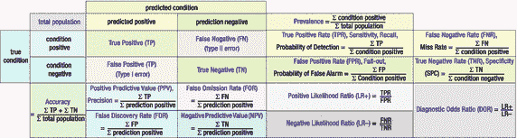
图 5-9. 混淆矩阵及其对应公式

*   `真负例`：模型正确地将 0 预测为 0 的实例频次。
*   `假负例`：模型将 1 错误预测为 0 的实例频次。
*   `真正例`：模型正确地将 1 预测为 1 的实例频次。
*   `假正例`：模型将 0 错误预测为 1 的实例频次。

在研究过程中，朱迪博士发现了一个混淆矩阵的简化版本，该版本以可视化形式展示模型评估结果。

#### 二分类：接收者操作特征

理解 ROC（接收者操作特征）曲线背后机制的一个好方法是通过混淆矩阵。ROC 曲线以图形方式绘制了当判别阈值变化时二分类器的性能。请牢记以下术语：

*   `真正例率 (TPR)`：即灵敏度、召回率或检测概率
*   `假正例率 (FPR)`：即 1 - 特异度、真负例率或误报概率

例如，考虑同一个数据集，模型将在该数据集上训练以预测未来高度可能违约的人群。我们将数据按 70/30 比例拆分，这意味着模型将使用 70% 的观测值进行训练，并使用 30% 的观测值进行测试。在使用模型对 30% 的观测值进行预测后，我们得到了表 5-4 中的图表。

表 5-4. 实际数据与预测数据的违约频次

|   | 将会违约 | 不会违约 |
| :--- | :--- | :--- |
| 实际值 | 30 | 70 |
| 正确预测值 | 19 | 36 |

此例中，`TPR` 为 `19/30 ≈ 63%`。而 `FPR` 为 `36/70 ≈ 51%`。

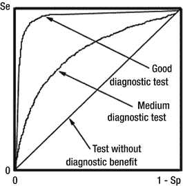
图 5-10. ROC 曲线及其相互间的相对比较

ROC 曲线绘制了正例中真正例的比例（即 `TPR`）与负例中假正例的比例（即 `FPR`）之间的关系。或者换句话说，我们可以说 ROC 曲线是作为误报率函数的灵敏度。它绘制了一个累积分布函数，有助于选择可能最优的模型。

曲线上的准确率由曲线下面积 (`AUC`) 表示。其值范围在 0.0 到 1.0 之间。

朱迪博士决定定义一个方法，该方法将接收实际数据并预测模型的优良性。为此，她编写了清单 5-24 中的代码片段。

# 准备数据与基线模型

为了对模型进行交叉验证，Judy 博士知道她必须将数据拆分为训练数据和测试数据。

## 通过拆分数据集确保交叉验证

Judy 博士计划使用训练数据集训练模型，然后使用该模型预测测试数据集中的值。她这样做是为了确定模型的优良性。她为训练/测试拆分编写了清单 5-25 中的代码。

```python
features_of_choice = [u'Age', u'Gender', 'DayOfTheWeek', 'Diabetes', 'Alcoolism', 'HiperTension',
                      'Smokes', 'Scholarship', 'Tuberculosis', 'Sms_Reminder',
                      'AwaitingTime', 'AppointmentRegistration_year', 'AppointmentRegistration_month',
                      'AppointmentRegistration_day', 'ApointmentData_year', 'ApointmentData_month',
                      'ApointmentData_day', 'AppointmentRegistration_hour', 'AppointmentRegistration_min',
                      'AppointmentRegistration_sec']
x = np.array(data[features_of_choice])
y = np.array(data['Status'])
x_train, x_test, y_train, y_test = train_test_split(x, y, test_size=0.3, random_state=1)
```

Judy 博士在清单 5-25 中解释了她的逻辑。她编写代码进行 70-30 拆分，其中 70% 的观测值归入训练集，30% 的观测值归入测试数据集。

在应用分类模型之前，她认为最好先回顾一下最初进行分类的原因。借助探索性分析，她已经找出了反复出现损失的原因。然后，她决定更进一步，为这个问题寻找补救措施。她决定使用分类作为一种辅助手段，来预测患者是否会在其预约日期出现。这将使管理层能够执行以下任一操作：

*   缩减人力资源（即员工和医生）以降低成本

*   确定患者未出现的原因，并找到该问题的解决方案

在审视分类问题时，Judy 博士唯一能想到的可视化表示就是树。就像 `Status` 的情况一样，树将有一个父节点和两个子节点（即出现和未出现）。在搜索分类模型时，她发现了一种可视化表示：决策树分类。

## 决策树分类

决策树以分层方式形成一棵树，每个节点都有一个决策边界，用于向下推进。当无法再进行任何分裂时，树便停止分支。内部节点代表输入变量，并连接到每个子节点。子节点对输入变量的值进行分割。它们通过在每一层对数据进行划分来实现这一点，节点分支到子节点。这种行为被称为递归划分。决策树易于解释且时间效率高，因此可以很好地处理大型数据集。决策树还可以处理数值型和分类型数据，即数值型数据用于回归，分类型数据用于分类。然而，决策树的准确性不如其他机器学习分类算法产生的效果好。

此外，决策树对训练数据集的泛化程度很高，因此极易过拟合。决策树旨在对数据进行划分，使得每个划分后的实例具有相似/同质的值。ID3 算法用于计算样本的同质性，如果样本完全同质，则其熵为 0，值为 1，反之亦然。决策树是一种参数化监督学习方法，所谓参数化，是指它可以应用于任何数据，无论其底层分布如何。

Judy 博士编写了清单 5-26 中的代码，在训练数据集上训练决策树分类模型。她使用了清单 5-25 中的测试-训练分割变量（即 `y_test`、`y_train`、`x_test`、`x_train`）。

```python
clf = DecisionTreeClassifier()
clf.fit(x_train, y_train)
```

输出：

```
DecisionTreeClassifier(class_weight=None, criterion='gini', max_depth=None,
                       max_features=None, max_leaf_nodes=None, min_samples_leaf=1,
                       min_samples_split=2, min_weight_fraction_leaf=0.0,
                       presort=False, random_state=None, splitter='best')
```

Judy 博士指出，由于没有向 `DecisionTreeClassifier` 传递任何配置参数，它采用了配置参数的默认值。下一步是将训练好的模型应用于测试数据集，以找到 `Status` 的预测标签。然后，她旨在将预测标签与 `Status` 的原始标签进行比较，以计算模型的准确性。

```python
y_pred = clf.predict(x_test)
model_performance('Decision tree classifier', x_train, y_train, y_test, y_pred)
```

输出：

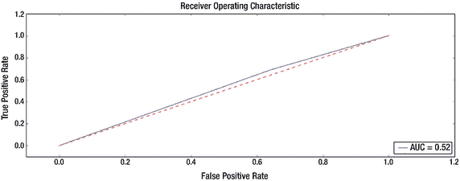

图 5-11. 决策树模型的 ROC 曲线

```
Model name: Decision tree classifier
Test accuracy (Accuracy Score):           0.589040
Test accuracy (ROC AUC Score):            0.523605
Train accuracy:                           0.999952
Area Under the Precision-Recall Curve:    0.112530
```

Judy 博士解释说，模型是在 `x_train` 和 `y_train` 上训练的。然后使用训练好的模型（即 `clf`）来预测测试数据集的标签（即 `y_pred`）。她在清单 5-27 中的输出完美地展示了过拟合现象，因为训练准确率接近 1。测试数据准确率表现不佳，值为 0.5，与 1（即完美分数）相差甚远。Judy 博士对这个结果感到失望，但她并没有失去希望，因为她还有很多分类技术可以尝试。

Judy 博士很好奇是否存在能够使分类模型实现非线性学习的技术。对这种技术的探索让她接触到了核近似（kernel approximation）的概念。

## 核近似

核近似对输入进行非线性变换，使其适用于线性分类和其他算法。这比核技巧更好，因为它可以显著降低处理非常大数据集时的学习成本。将核映射近似与 SGD 分类器相结合，可以在大型数据集上实现非线性学习。

### SGD 分类器

在 SGD 分类器中，损失的梯度一次更新一个样本，并且模型根据学习率进行更新。为了使模型在默认学习率下获得最佳结果，数据应具有零均值和单位方差。

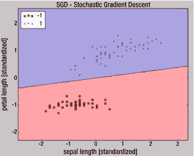
图 5-12. 鸢尾花数据集上的 SGD 分类结果

该算法最适合处理以稀疏浮点值数组形式表示数据集中特征的数据。损失参数控制模型拟合的类型，默认情况下是线性支持向量机（SVM）。

Judy 博士不再等待，编写了清单 5-28 中的代码片段，在训练数据集上训练核近似以及 SGD 分类器模型。

```
rbf_feature = kernel_approximation.RBFSampler(gamma=1, random_state=1)
X_train = rbf_feature.fit_transform(x_train)
clf = SGDClassifier()
clf.fit(X_train, y_train)
```

清单 5-28. 通过应用核近似与 SGD 分类器训练模型

输出

```
SGDClassifier(alpha=0.0001, average=False, class_weight=None, epsilon=0.1,
eta0=0.0, fit_intercept=True, l1_ratio=0.15,
learning_rate='optimal', loss='hinge', n_iter=5, n_jobs=1,
penalty='l2', power_t=0.5, random_state=None, shuffle=True,
verbose=0, warm_start=False)
```

Judy 博士在清单 5-28 中拟合了两次模型。这样做的原因是，她首先通过 RBF 采样器对数据进行拟合和变换，从而对数据进行采样。据 Judy 博士所说，RBF 采样器在应用线性算法之前，近似了 RBF 核的特征映射。她还指出，`fit_transform` 中的 `fit` 执行了蒙特卡洛采样，而 `transform` 项执行了数据的映射。

然后，她编写了清单 5-29 中的代码，将训练好的模型应用于测试数据集，然后使用它来查找预测标签以及模型的准确性。

```
X_test = rbf_feature.fit_transform(x_test)
Y_pred = clf.predict(X_test)
model_performance('Kernel approximation', X_train, y_train, y_test, Y_pred)
```

清单 5-29. 计算核近似与 SGD 分类器的准确性

输出

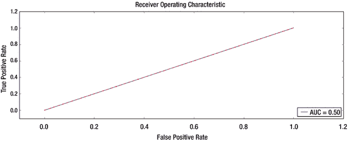
图 5-13. 核近似与 SGD 分类器的 ROC 曲线

```
Model name: Kernel approximation
Test accuracy (Accuracy Score):           0.695619
Test accuracy (ROC AUC Score):            0.500000
Train accuracy:                           0.698398
Area Under the Precision-Recall Curve:    0.152191
```

训练准确率相对于决策树分类有所下降，这意味着模型没有高度泛化到训练数据集上，这确实是一个好迹象。同时，在查看图 5-13 时，Judy 博士注意到测试数据准确率有了显著提升，从 0.59 跃升至 0.7。尽管在上述方面有所改进，但 ROC 的 AUC 值却下降了，这让她非常惊讶。在网上搜索了几个小时后，她仍然毫无头绪。因此，她决定去见她的朋友 Zoe，并征求她的意见。Zoe 听完问题后，给出了如下解释：

> 嗯，准确率往往只衡量算法检测真正例的性能。它的不足之处在于没有考虑假正例和假负例。这些假例导致 AUC 下降，尽管准确率更高了。

在佐伊的帮助下，朱迪博士得以清晰地看透混乱。然而，她对自己目前探索的模型精度仍不满意。她想知道是否存在某种技术，能够结合多个模型的力量，构建一个具有顶尖预测精度的模型。经过一番深入研究，朱迪博士发现“集成”正是她所寻求的表示方法。她还了解到，集成技术分为两种类型（即提升法和装袋法），她认为在使用这些技术训练模型之前，理解它们至关重要。

## 集成方法

集成方法结合了多个机器学习算法的预测结果，从而获得比单个模型更准确的预测。集成方法通常分为两种变体（装袋法和提升法）。

### 装袋法

装袋法，也称为自助法，其优化目标是最大限度地减少方差。它通过组合生成与原始数据大小相同的多重集，为训练数据集生成额外的数据来实现这一点。当模型过拟合且倾向于产生高方差时，应用装袋法是理想的选择。这可以通过进行多次重采样（每次都会过拟合），然后将它们的结果平均在一起来解决。这反过来会抵消部分方差。

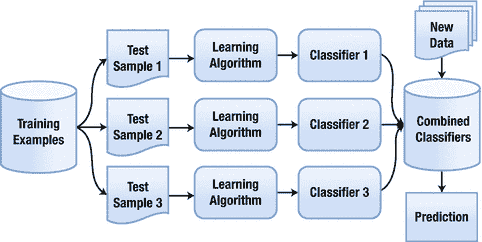
图 5-14. 装袋算法的基本工作流程

决策树对其训练所依据的特定数据非常敏感。如果训练数据发生变化，生成的决策树可能会有很大不同，并产生不同的预测。决策树作为一种高方差的机器学习算法，可以通过自助法过程来应用装袋法。

考虑一个包含 50 个特征和 3000 个观测值的数据集。装袋法可能会创建 500 棵树，每棵树包含 500 个随机观测值和 20 个特征。最后，它将平均这 500 个树模型的所有预测，以得到最终预测。

### 提升法

提升法定义了一个目标函数，用于衡量给定一组参数时模型的性能。目标函数包含两部分：正则化和训练损失，两者相加。训练损失衡量我们的模型在训练数据上的预测能力。最常用的训练损失函数包括均方误差和逻辑回归。正则化项控制模型的复杂度，有助于避免过拟合。提升树使用树集成，因为它们将多个树的预测结果相加。

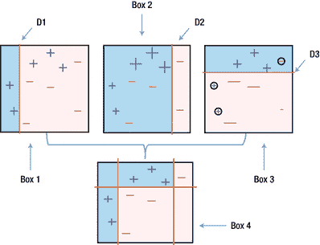
图 5-15. 提升算法的基本工作流程

朱迪博士决定通过应用最受欢迎的装袋技术（即随机森林分类）来将装袋法付诸实践。

### 随机森林分类

随机森林分类是装袋法的一种，也是目前最强大的机器学习算法之一。在决策树分类中，不同的子树可能具有许多结构相似性，这可能导致预测输出彼此高度相关。随机森林分类器通过限制每个分裂点处的特征来减少子树之间的这种相关性。因此，随机森林不是从所有可用变量中选择一个变量，而是从有限的随机特征样本中搜索能够最小化误差的变量。对于分类问题，每个分裂点处的变量数量可以定义如下：

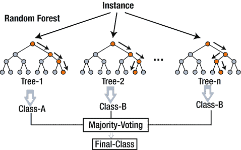
图 5-16. 随机森林分类器示意图

*   符号：`m`
*   公式：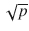
*   其中，
    1.  `m` 是每个分裂点处的最优变量数量
    2.  `p` 是数据集中变量的总数

随机森林分类器速度快，并且可以处理不平衡或包含缺失值的数据。她编写了清单 5-30 中的代码，将此集成技术应用于实际应用。

```
clf = RandomForestClassifier()
clf.fit(x_train, y_train)
```

清单 5-30. 在训练数据集上训练随机森林分类器

输出

```
RandomForestClassifier(bootstrap=True, class_weight=None, criterion='gini',
max_depth=None, max_features='auto', max_leaf_nodes=None,
min_impurity_split=1e-07, min_samples_leaf=1,
min_samples_split=2, min_weight_fraction_leaf=0.0,
n_estimators=10, n_jobs=1, oob_score=False, random_state=None,
verbose=0, warm_start=False)
```

朱迪博士使用默认参数配置应用了随机森林分类器。然后，她编写了清单 5-31 中的代码片段，以评估随机森林分类器模型的优劣。

```
y_pred = clf.predict(x_test)
model_performance('Random Forest', x_train, y_train, y_test, y_pred)
```

清单 5-31. 计算随机森林分类器模型的准确率

输出

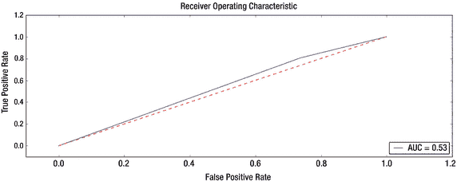
图 5-17. 随机森林分类器的 ROC 曲线

# 梯度提升

```
Model name: Random Forest
Test accuracy (Accuracy Score):           0.640874
Test accuracy (ROC AUC Score):            0.534295
Train accuracy:                           0.990071
Area Under the Precision-Recall Curve:    0.132014
```

训练准确率与决策树分类器相似。看起来两种树分类器技术都使模型过拟合了。然而，与决策树分类器相反，随机森林分类器的测试准确率显著提高。但是，测试水平的准确率仍然远不及使用核近似的 SGD 分类器所获得的准确率（即 0.7 对比 0.64）。

在应用了随机森林分类器之后，朱迪博士很想知道提升集成是否能产生一个强大的模型。为此，她计划对从清单 5-24 获得的训练-测试分割应用梯度提升。

在提升方法中，样本的选择是通过对难以分类的观测值赋予越来越高的权重来实现的。梯度提升分类以集成弱预测模型（通常是决策树）的形式生成预测模型。它通过针对任意可微损失函数进行优化来泛化模型。在每个阶段，回归树都拟合二项式或多项式偏差损失函数的负梯度。

简单来说，梯度提升分类器执行以下操作：

1.  梯度提升逐个构建集成树。

2.  所有单个树的预测结果被求和。

3.  目标函数与当前集成预测之间的差异（即残差）被重构。

4.  集成中的下一棵树应补充现有树，并最小化集成的残差。

Judy 博士乐观地认为，梯度提升分类器能产生最佳结果，因为它们对难以分类的样本赋予更高的权重，这将使集成模型投入更多精力来分类这些高权重样本。为此，她编写了清单 5-32 中的代码片段来训练模型，然后为测试数据集预测标签。

```python
clf = GradientBoostingClassifier(random_state=10, learning_rate=0.1, n_estimators=200, max_depth=5, max_features=10)
clf.fit(x_train, y_train)
y_pred = clf.predict(x_test)
```

清单 5-32.
通过应用梯度提升分类器训练模型并预测状态标签

这一次，Judy 博士在初始化模型时传入了一些参数。她决定采用 0.1 的学习率，这个值既不太小也不太大。除此之外，她将最大迭代次数设为 200，树的最大深度设为 5，并限制模型最多从十个特征中学习。Judy 博士编写了清单 5-33 中的代码片段来评估模型的优良性。为此，她将训练集、测试集和预测值作为参数传递给之前在清单 5-24 中定义的 `model_performance` 函数。

```python
model_performance('Gradient Boosting', x_train, y_train, y_test, y_pred)
```

清单 5-33.
计算梯度提升分类器的准确率

输出

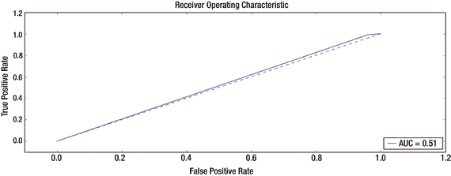

图 5-18.
梯度提升分类器的 ROC 曲线

```
模型名称: Gradient Boosting
测试准确率 (Accuracy Score):           0.700408
测试准确率 (ROC AUC Score):            0.514929
训练准确率:                           0.707403
精确率-召回率曲线下面积:    0.153744
```

Judy 博士认为该模型在避免过拟合方面做得不错。与之前应用的模型相比，准确率有所提高，ROC 得分也超过了使用 SGD 分类器的核近似方法。然而，ROC 得分仍然低于决策树分类器模型的结果。

在研究过程中，Judy 博士发现梯度提升分类模型在训练时也会输出模型赋予每个特征集的重要性得分。她很好奇在训练模型时哪些特征的表现优于其他特征。为此，她编写了清单 5-34 中的代码来查看特征的重要性得分。

```python
for feature, score in zip(features_of_choice, list(clf.feature_importances_)):
    print '%s\t%f'%(feature, score)
```

清单 5-34.
打印梯度提升分类器分配的特征权重

输出

```
年龄                                     0.143221
性别                                  0.009629
星期几                            0.053643
糖尿病                                0.005889
酗酒                               0.010774
高血压                            0.006360
吸烟                                  0.011096
奖学金                             0.010460
结核病                            0.003295
短信提醒                            0.019245
等待时间                            0.128393
预约登记 _ 年            0.023332
预约登记 _ 月           0.045764
预约登记 _ 日             0.077271
预约日期 _ 年                    0.019696
预约日期 _ 月                   0.066774
预约日期 _ 日                     0.119192
预约登记 _ 小时            0.066528
预约登记 _ 分钟             0.091829
预约登记 _ 秒             0.087611
```

名为年龄、等待时间和预约日期 _ 日的特征被梯度提升分类器赋予了最高的权重。Judy 博士兴奋地发现，该模型与她之前在探索性数据分析中关于年龄和等待时间的推论一致。名为性别、高血压、糖尿病和结核病的特征被梯度提升分类模型赋予了最低的权重。

Judy 博士进行了一次富有成效的数据分析和分类冲刺。然而，由于会议在半小时后就要开始，她无法继续深入，只能展示到目前为止所获得的发现。除非你们中有人能尝试其他分类方法，否则她无法再增加更多发现。她心中有一些备选方案，并认真地将它们添加到了练习中。

练习

1.  重复梯度提升分类，但这次只考虑模型认为重要的特征。AUC 和 ROC 有改善吗？

2.  对梯度提升应用网格搜索（参考第 4 章），以微调学习率、`max_depth` 等参数。

3.  使用 PCA（参考第 4 章）转换数据，然后应用我们讨论过的所有模型，看看是否能获得改进。

4.  最近，一种新型的提升方法 Xgboost 在数据科学家中很受欢迎。将其应用于我们的数据集，使用网格搜索进行优化，看看它的性能是否相对优于梯度提升。

Judy 博士很好奇分类是否还有其他实际应用。为此，她查阅了互联网，并整理了一些迄今为止最引人注目的分类应用。

## 分类的应用

多个研究领域都有大量的分类应用。

### 图像分类

深度学习在预测图像中表示的对象方面有广泛应用。这有助于搜索引擎和 Instagram 等应用中的推荐引擎进行图像聚类。

### 音乐分类

像 Pandora 这样的音乐应用会对音乐执行分类算法，以推荐符合你偏好的音乐。其美妙之处在于，你无需明确告诉 Pandora 你的偏好，因为它会自行学习。

### 电子邮件垃圾邮件过滤

Gmail、Outlook、Ymail 等电子邮件服务已部署算法，用于将垃圾邮件与合法邮件进行分类。然后根据判定结果决定将哪些邮件丢入垃圾邮件文件夹。

### 保险

保险公司会收到大量关于损失的保险索赔。因此，保险公司不得不投入大量时间和人力资源进行调查并做出最终裁决。在许多情况下，最终裁决是正确的，但在某些情况下却是错误的。因此，近年来，人们致力于在保险公司部署分类模型，以区分欺诈索赔申请和合法索赔申请。

朱迪博士通过回顾最初设定的目标来总结她的分析，这些目标是确定重复发生损失的原因以及未来检测损失发生的方法。她首先对数据进行了单变量和多变量分析，以确定需要处理的数据区域。探索性分析还使她发现，损失显然是由于大约 33%的患者未在预约日期和时间就诊造成的。在进行数据整理后，她认为最好从现有特征中生成更多特征，以便模型更容易捕捉数据的真实本质。

然后，她回顾了多种分类模型评估技术，并将数据分为训练集和测试集，以便对模型进行评估。朱迪博士从决策树分类器开始，该分类器显示出过拟合和高测试误差。然而，在尝试了多种分类技术后，她决定采用梯度提升分类模型，该模型产生了相对更好的准确性。通过梯度提升模型，她现在能够实时预测已预约的患者是否会在预约当天就诊。她知道自己已经实现了一个重要的里程碑，并期待着董事会会议。

# 附录 A：图表类型及其使用场景

### 饼图

`饼图示意图`

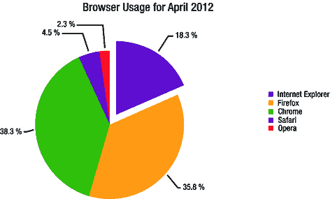

饼图最适合用于比较整体中的各个部分。它适用于分析分类变量。

### 条形图

`条形图示意图`

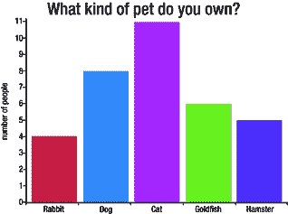

条形图用于比较不同组别之间的事物，或追踪随时间的变化（即变化较大时）。条形图适用于分类变量和区间变量。

### 直方图

`直方图示意图`

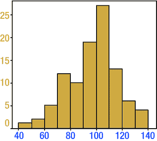

直方图适用于连续变量。它用于绘制带或不带分组的频率分布。改变组距会改变底层分布。

### 茎叶图

`茎叶图示意图`

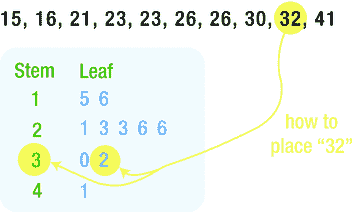

茎叶图适用于离散区间变量，但不适用于频率较高的数据。换句话说，茎叶图可以看作是直方图的转置。与直方图相反，我们可以从茎叶图中重建原始数据。

### 箱线图

`箱线图示意图`

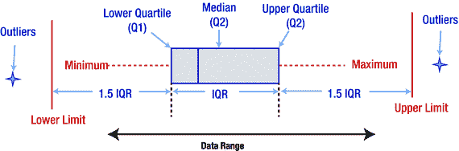

箱线图是直方图的一种变换形式，有助于理解数据分布的中位数、方差和偏度。中心的线代表中位数，两端的线称为须。须的边缘代表第一和第三四分位数，两者之间的差值称为四分位距。落在此范围之外的点被视为异常值。

```
索引 A 自相关 ACF Durbin Watson 参见 Durbin Watson 统计量 PACF 自相关函数 (ACF) 自回归积分滑动平均模型 (ARIMA) ARMA 组合模型 线性函数 移动平均 自回归滑动平均模型 (ARMA) B 贝叶斯高斯混合模型 C 集中趋势度量 中心统计量 均值 算术 几何 中位数 众数 正态分布 异常值 参见异常值 偏度 标准差 方差 中心极限定理 分类模型 混淆矩阵 交叉验证 数据集 决策树 电子邮件垃圾邮件过滤 特征表示 特征 图像分类 保险 音乐 ROC 聚类 贝叶斯高斯混合 参见贝叶斯高斯混合模型 BIC 分数 数据集 数据变换 基于人口统计的客户细分 肘部法 高斯混合 参见高斯混合模型 K 均值 PCA 参见主成分分析 (PCA) 需求 搜索引擎 轮廓系数 监督式 vs. 非监督式学习 技术 方差 混凝土抗压强度 连续/定量变量 相关性 数据集 Kendall 秩 负 成对 Pearson Pearson R 正 响应变量与解释变量 Spearman 秩 D 数据变换 数据框 变换矩阵 数据整理 人口统计变量 因变量与自变量 Dickey-Fuller 检验 离散变量 Durbin Watson 统计量 E ElasticNet 肘部法 探索性数据分析 (EDA) 连续/定量 参见连续/定量变量 相关性 数据集 离散变量 多变量 参见多变量分析 状态 时间序列成分 单变量 参见单变量分析 变量 人口统计 因变量与自变量 离散 潜在 F 预测 线性回归模型 销售额 时间序列 天气 G 高斯混合模型 协方差函数 关键词 K 均值 对象 梯度提升回归 多重 非线性 灵活回归技术 单一 网格搜索 H, I, J 假设检验 零假设 t 分布与样本量 t 统计量 K 核近似 装袋 提升 集成方法 SGD 分类器 L Lasso 回归 定义 多重 线性回归 多重 单一 潜在变量 M 平均绝对误差 (MAE) 均方误差 (MSE) 多重共线性与奇异性 多变量分析 N 正态分布 O 异常值 集中趋势度量 值区间 行程时长值 过拟合 参见欠拟合 P, Q 偏自相关函数 (PACF) 主成分分析 (PCA) 数据框 关键词 正交变换 二维空间 R 随机森林 分类 准确性 提升 定义 接收者操作特征 (ROC) 假阳性率 (FPR) 真阳性率 (TPR) 回归 农业 呼叫中心 案例与自变量 (IVs) 混凝土抗压强度 相关系数 参见相关性 数据集 外推法 保险公司 插值法 最小二乘法 线性 指标 解释方差分数 MAE MSE 残差 残差图 RSS R² 缺失数据 多重共线性与奇异性 多重 名称映射 多项式 预测债券价值 预测薪资 预测销售额 通货膨胀率 房地产行业 逐步回归 残差平方和 (RSS) 岭回归 alpha 值 线性最小二乘法 多重共线性 多重 表示 S 偏度 Sklearn.metrics 统计学与概率论 精算科学 天体统计学 生物统计学 商业分析 集中趋势度量 参见集中趋势度量 相关性 参见相关性 循环共享方案 计量经济学 EDA 参见探索性数据分析 (EDA) 选举 机器学习 统计信号处理 支持向量机 超平面 多重 单一 T 时间序列成分 周期模式 季节模式 趋势 时间序列对象 数据集 分解 Dickey-Fuller 检验 差分 疾病爆发 探索性数据分析 指数平滑 预测 参见预测 记忆 移动平均 平滑性质 销售预测 股票市场预测 检验 变换 对数 平方根 趋势与去除 失业率估计 天气预报 U, V, W, X, Y, Z 欠拟合 交叉验证 高偏差 高方差 非线性线 单变量分析 数据集 分布 用户类型
```