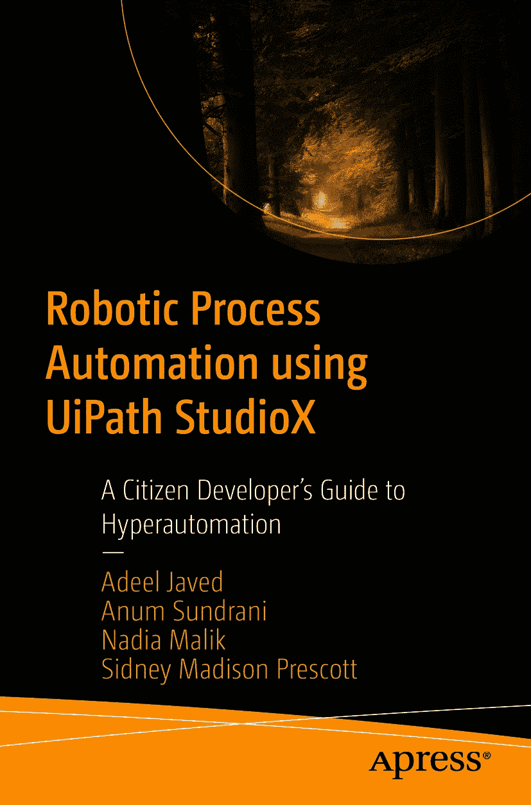

ISBN 978-1-4842-6793-6e-ISBN 978-1-4842-6794-3 [`doi.org/10.1007/978-1-4842-6794-3`](https://doi.org/10.1007/978-1-4842-6794-3) © Adeel Javed, Anum Sundrani, Nadia Malik, Sidney Madison Prescott 2021 本作品受版权保护。出版商保留所有权利，无论是涉及材料的全部或部分，特别是翻译、重印、重用插图、朗诵、广播、以缩微胶卷或任何其他物理方式复制，以及传输或信息存储与检索、电子改编、计算机软件，或采用目前已知或未来开发的类似或不同方法。在本出版物中使用通用描述性名称、注册商标、商标、服务标志等，即使未作明确声明，也不意味着这些名称不受相关保护性法律和法规的约束，因此可自由用于一般用途。出版商、作者和编辑假定本书中的建议和信息在出版之日是真实准确的。出版商、作者或编辑均不对本文所含材料或可能存在的任何错误或遗漏提供明示或暗示的担保。出版商对已出版地图和机构归属中的管辖权主张保持中立。本书通过 Springer Science+Business Media New York 在全球图书贸易中发行，地址：233 Spring Street, 6th Floor, New York, NY 10013。电话：1-800-SPRINGER，传真：(201) 348-4505，电子邮件：orders-ny@springer-sbm.com，或访问 www.springeronline.com。Apress Media, LLC 是加利福尼亚州的有限责任公司，其唯一成员（所有者）是 Springer Science + Business Media Finance Inc (SSBM Finance Inc)。SSBM Finance Inc 是特拉华州的一家公司。

*献给我的女儿 Alaia，我生命中的光。*

*——Adeel*

*献给我的父亲 Ahmed 和我的家人，感谢他们宝贵的支持和激励。*

*——Anum*

*献给我的父亲，感谢他始终如一的关爱和指导。*

*——Nadia*

*献给我的兄弟姐妹们，我永远庆幸能成为你们的大姐。也献给那个戴着大眼镜的小女孩，继续梦想并实现它。*

*——Sidney*

# 致谢

感谢 UiPath 团队的 Andrew Hall、Brandon Nott、Corneliu Niculite、Cosmin Voicu、Ovidiu Ponoran、Robert Love、Teodora Baciu 和 Tom Merkle 提供的宝贵反馈。

感谢 Rayudu Addagarla 同意担任本书的技术审阅者，并执行所有练习以确保准确性。

感谢我们的 Apress 编辑 Natalie Pao 和 Jessica Vakili 在整个出版过程中给予的指导。

## 关于作者

## 关于技术审阅者