# 2. UiPath StudioX

UiPath 的 StudioX 工具提供了一种无代码的自动化方法，为公民开发者提供了配置和运行其自动化所需的工具。

## 学习目标

在本章结束时，您将学习如何：

*   下载并安装 UiPath StudioX
*   访问并使用 UiPath StudioX 中的通用界面组件

## 系统要求

本节提供 UiPath StudioX 的硬件和软件要求。

注意

本书使用 **UiPath Studio Community v2020.10.2**。在安装时，您可能会发现版本略有不同，但这不会影响练习。

社区版是免费的，并且没有试用期限制。对于刚开始使用 UiPath 的人或希望评估其企业级用途的组织来说，这是一个很好的起点。

### 硬件要求

表 2-1 列出了最低和推荐的硬件要求。

表 2-1

硬件要求

|   | 最低配置 | 推荐配置 |
| --- | --- | --- |
| CPU | 2 x 1.8GHz 32 位 (x86) | 4 x 2.4GHz 64 位 (x64) |
| 内存 | 4 GB | 8 GB |

### 软件要求

表 2-2 列出了当前版本 UiPath StudioX 支持的软件版本。

表 2-2

软件要求

|   | 支持的版本 |
| --- | --- |
| 操作系统 | Windows (7, 7 N, 7 SP1, 8.1, 8.1 N, 10, 10 N) |
|   | Windows Server (2012 R2, 2016, 2019) |
| .NET Framework | 版本 4.6.1 或更高 |
| 网页浏览器 | Internet Explorer v8.0 或更高 |
|   | Google Chrome 版本 64 或更高 |
|   | Mozilla Firefox 版本 52.0 或更高 |
|   | Windows 10 版本 1803 或更高上的 Microsoft Edge |

注意

UiPath 不支持低于 1024 x 768 的分辨率。

## 安装与设置

本节将为您提供下载和安装 UiPath StudioX 的分步说明。

### 注册

在下载并安装 UiPath StudioX 之前，您需要先在 UiPath 注册。

注意

如果您的公司已购买 UiPath 许可证，则应向 IT 部门申请。

1.  打开 UiPath 网站（[`www.uipath.com`](https://www.uipath.com)），然后点击 `Try UiPath Free` 按钮，如图 2-1 所示。

    

    图 2-1

    UiPath 试用选项

2.  如果您是首次访问 UiPath 网站，则需要使用提供的选项之一进行 `Sign Up`。注册完成后，点击 `Log In` 链接输入您的凭据。

### 下载

接下来，我们将下载 UiPath StudioX 安装程序：

图 2-3

UiPath StudioX 安装包

1.  登录 UiPath Automation Cloud 门户（[`https://cloud.uipath.com/`](https://cloud.uipath.com/)）后，您会在 `Home` 选项卡下的右侧看到 `Download Studio/StudioX` 按钮，如图 2-2 所示。该位置可能会随 UiPath Automation Cloud 门户的更新而改变。

    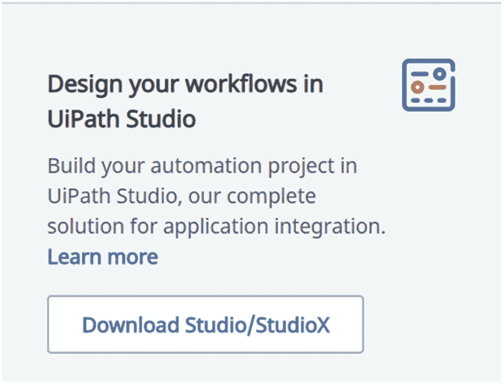

    图 2-2

    UiPath StudioX 下载链接

2.  点击 `Download Studio/StudioX` 按钮；这将把安装程序下载到您的计算机上。图 2-3 显示了下载后安装程序的名称。

### 安装

UiPath StudioX 下载完成后，您可以开始安装过程：

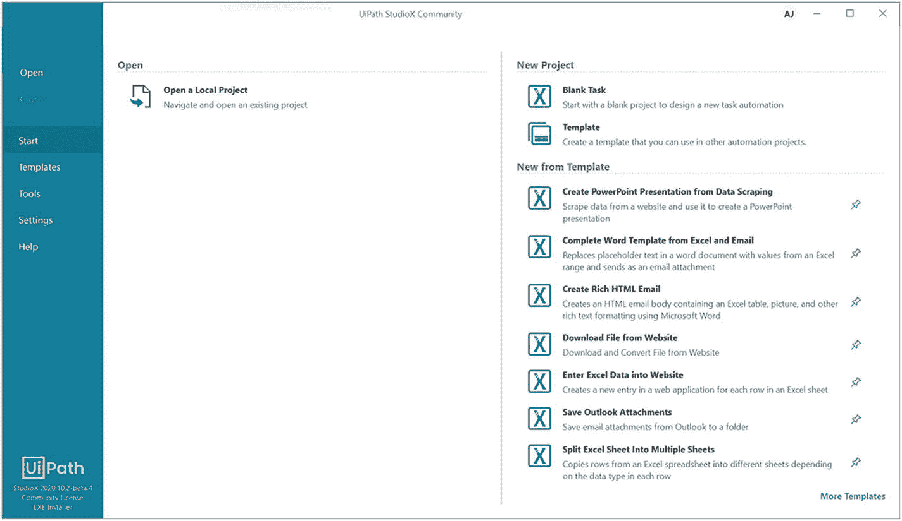

图 2-8

UiPath StudioX 主屏幕

1.  要开始安装，请双击上一节中下载的安装程序，即 `UiPathStudioSetup.exe`。这将启动 UiPath StudioX 安装窗口，如图 2-4 所示。

    

    图 2-4

    启动 UiPath StudioX 安装过程。

2.  下一个屏幕允许您选择许可证选项。本书使用社区版；因此，您可以选择 `Community License` 选项，如图 2-5 所示。这将激活 UiPath StudioX。

    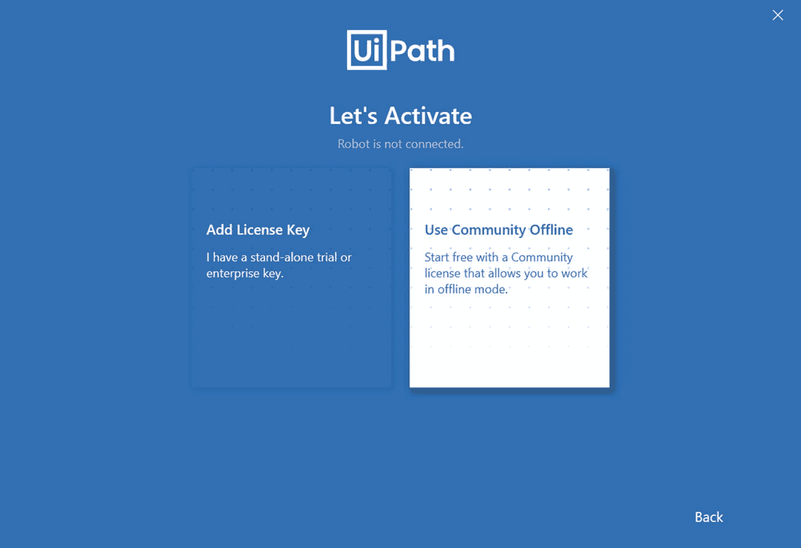

    图 2-5

    使用社区许可证激活 UiPath StudioX

3.  UiPath 为其 Studio 提供了三种配置文件。UiPath Studio 适用于希望构建中到复杂自动化的 RPA 开发者。UiPath StudioX 专注于希望为简单业务任务创建自动化的平民开发者和业务用户。由于本书的主要受众是平民开发者和业务用户群体，请选择 `UiPath StudioX` 配置文件，如图 2-6 所示。

    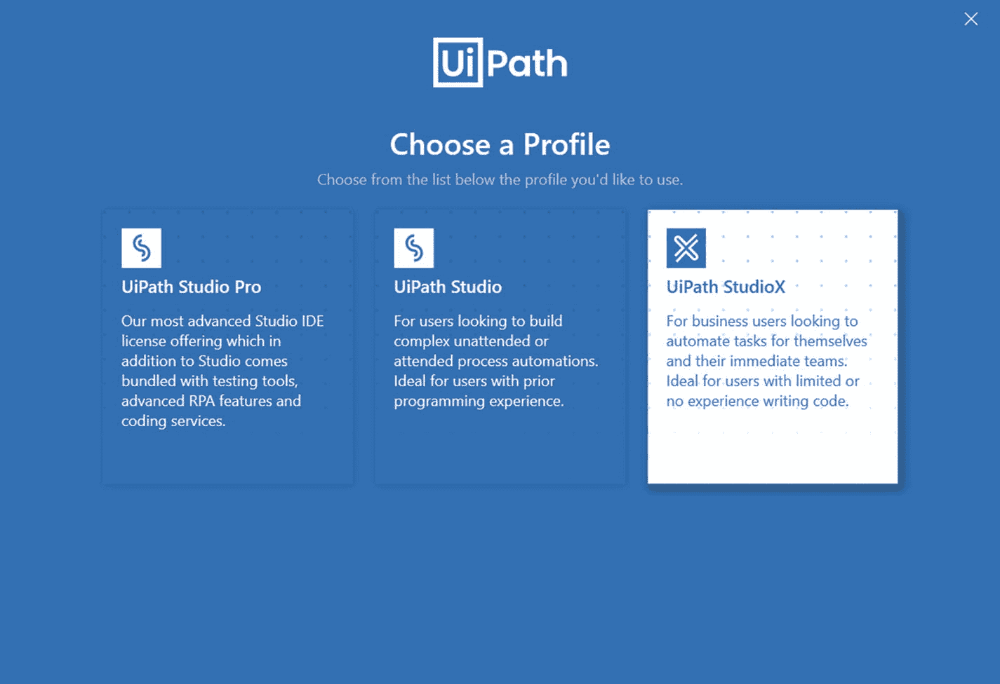

    图 2-6

    为平民开发者和业务用户选择 UiPath StudioX 配置文件

4.  UiPath 会定期推出更新，因此 `Update Channel` 屏幕上有两个选项。对于本书，如图 2-7 所示，我们假设您使用的是 `Stable` 版本，因为与 `Preview` 版本相比，该版本引入更改的频率较低。

    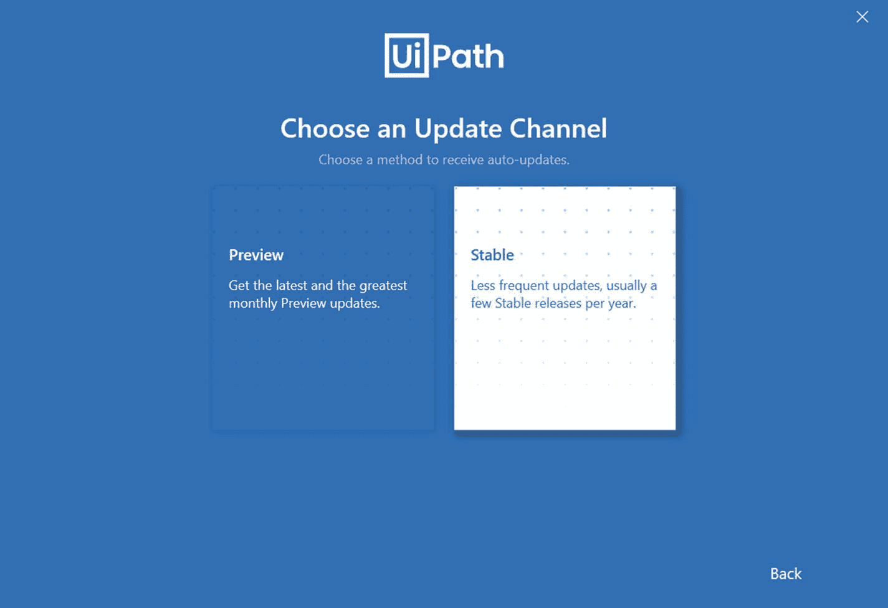

    图 2-7

    选择更新频率较低的稳定版本

5.  至此，您已完成 UiPath StudioX 的配置。这结束了“安装与设置”部分，您将看到 `Home` 屏幕，如图 2-8 所示。

### 界面概览

UiPath StudioX 界面包含不同的面板，每个面板都提供特定功能。本节将简要介绍 UiPath StudioX 界面。

### 主页

`Home` 屏幕，如图 2-8 所示，允许您打开和启动项目、创建或使用现有模板、更新界面设置、安装扩展以及浏览文档。

#### 开始

“开始”选项卡，如图 2-8 所示，允许您打开现有自动化项目或创建新项目。

**打开现有项目**：您可以使用 `Open a Local Project` 选项打开现有项目。这将是一个 .xaml 文件。

**新建项目**：要创建新项目，您有两个选项。您可以通过点击 `Blank Task` 选项从头开始创建新的自动化，也可以使用预定义模板。UiPath 为最常自动化的任务创建了模板；这些模板可以帮助您快速启动自动化。

**新建模板**：您还可以创建自定义模板，这些模板可以成为您自动化项目的基础。自定义模板也有助于治理。您可以构建包含组织所有最佳实践的模板，以便每个人都有一个相同的起点。

#### 模板

**Templates** 选项卡，如图 2-9 所示，列出了所有预定义模板以及您创建的所有自定义模板。

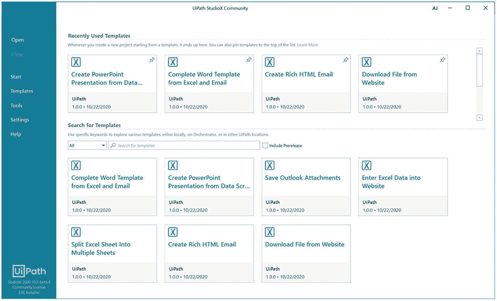

图 2-9

从“模板”选项卡中选择自定义和预定义模板

#### 工具

**Tools** 选项卡，如图 2-10 所示，提供了安装扩展的选项，例如 Chrome、Firefox、Edge、Excel 等。您也可以使用此选项卡启动项目依赖项批量更新工具。

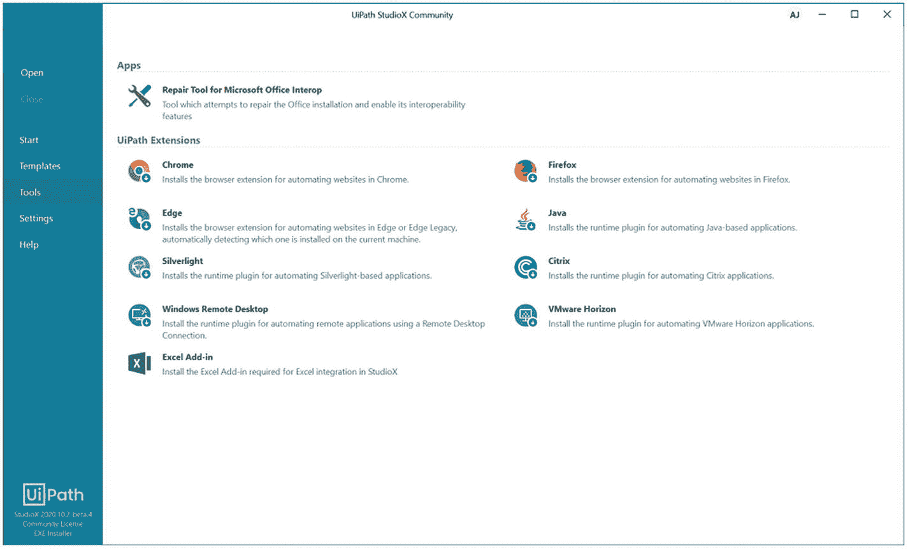

图 2-10

“工具”选项卡中可用的扩展

#### 设置

**Settings** 选项卡，如图 2-11 所示，提供了更改界面语言、主题、设计首选项、默认位置以及管理您的许可证和个人资料的选项。

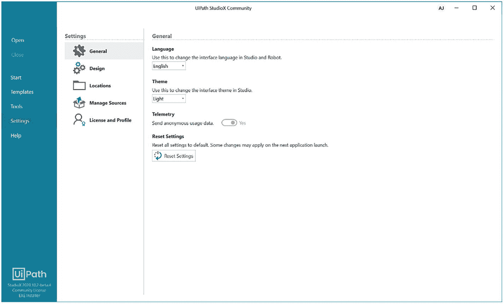

图 2-11

“设置”选项卡

注意

要在 Studio 的不同版本之间切换配置文件，请点击 `License and Profile` 选项，然后选择 `View or Change Profile` 选项。此操作将提示您可用的配置文件。如果您选择新的配置文件，则需要重新启动 Studio 才能使这些更改生效。

#### 帮助

如图 2-12 所示，**Help** 选项卡为您提供指向产品文档、社区论坛、学院、发行说明和其他在线资源的链接。此外，您还可以从此选项卡访问您的产品版本和许可证信息、设备 ID 和更新通道（在稳定版和预览版之间切换）。

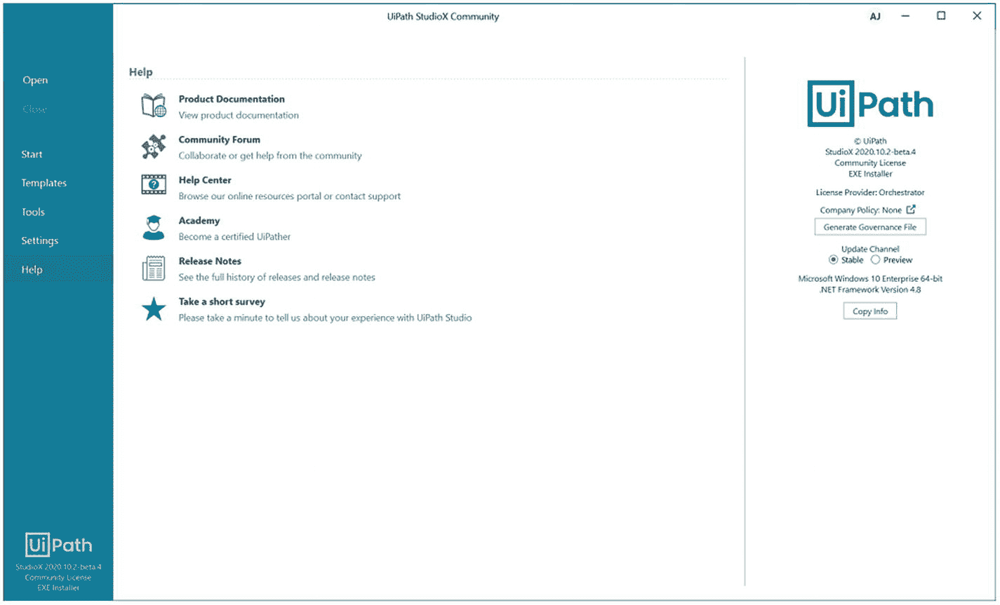

图 2-12

“帮助”选项卡

### 设计视图

**Design** 视图是您设计、运行和发布自动化的地方。此视图还允许您访问项目的 Notebook 以及管理数据包。

#### 功能区

顶部的功能区，如图 2-13 所示，仅在您打开项目时可用。

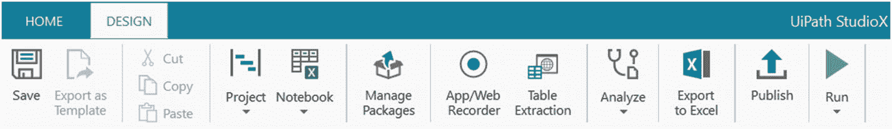

图 2-13

设计选项卡

以下各节简要概述了每个菜单项。

##### 保存

“保存”菜单允许您保存自打开项目以来所做的所有更新。您的项目在每次运行时都会自动保存。

##### 导出为模板

“导出为模板”菜单允许您将当前项目保存为模板。

##### 剪切、复制和粘贴

这些选项允许您在项目中剪切、复制或粘贴一个或多个活动。

##### 项目

**项目**菜单项，如图 2-14 所示，包含两个子菜单项。

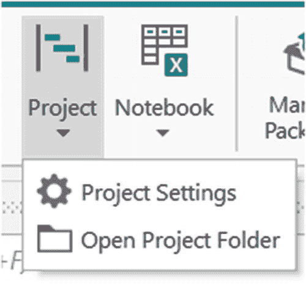

图 2-14

项目子菜单项

**项目设置**：此子菜单项允许您查看和更新项目设置。图 2-15 显示了所有可用的项目设置。

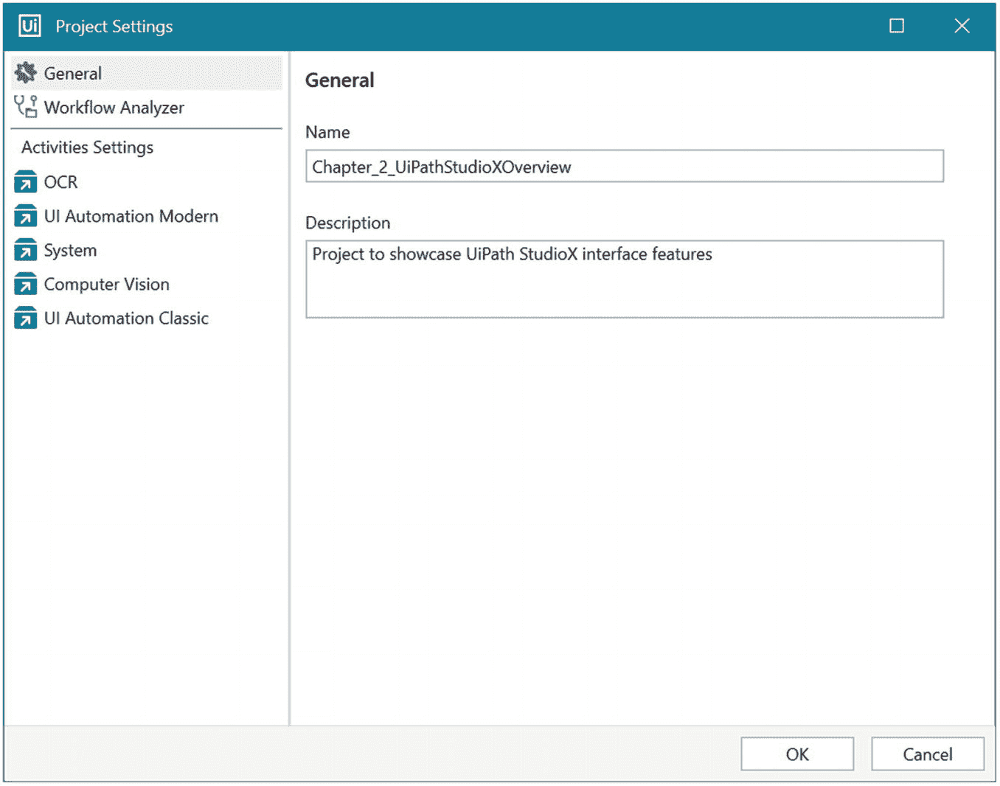

图 2-15

项目设置

**打开项目文件夹**：顾名思义，此子菜单项会在您的系统上打开 StudioX 存储所有项目文件的文件夹。

##### 笔记本

**笔记本**菜单项，如图 2-16 所示，包含两个子菜单项。

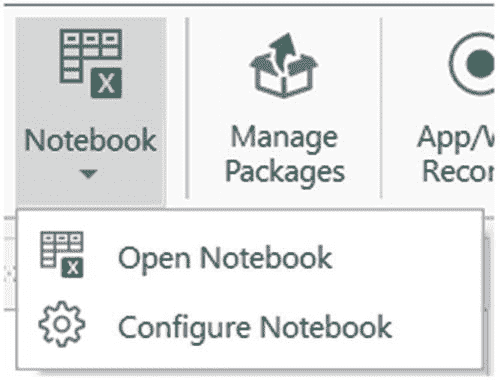

图 2-16

笔记本子菜单项

**打开笔记本**：此子菜单项打开当前配置为笔记本的 Excel 电子表格。我们将在第 3 章中进一步了解笔记本的用法。

**配置笔记本**：此子菜单项打开一个新屏幕，允许您更新图 2-17 中显示的笔记本配置。

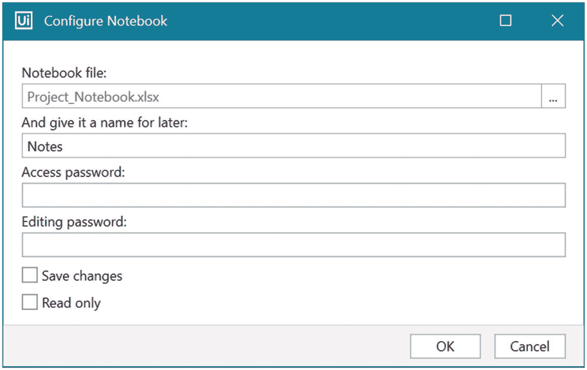

图 2-17

笔记本配置

提示

启用“保存更改”以在执行期间保存对笔记本的任何更改。

##### 管理包

**管理包**菜单，如图 2-18 所示，允许您更新现有包、更新包源、查看项目依赖项以及安装新的活动包。

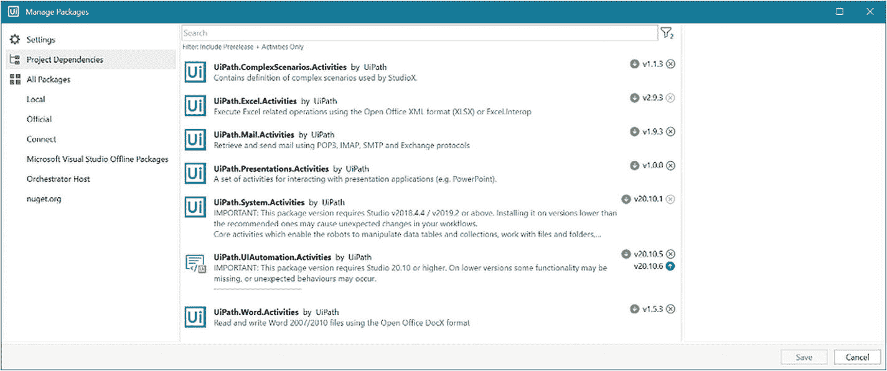

图 2-18

管理包屏幕

##### 应用程序/Web 记录器

**应用程序/Web 记录器**的概念是，您无需从头开始或从模板创建自动化，而是让 UiPath 记录您执行的操作。因此，记录的操作会自动填充自动化项目的活动。尽管生成的活动仍需要一定程度的手动更新，但记录器为您的自动化提供了一个良好的起点。第 4 章中提供了一个展示应用程序/Web 记录器功能的示例。

##### 表格提取

“表格提取”菜单项允许您从表格中提取数据并存储以供以后使用。您可以使用此功能从桌面和 Web 应用程序中提取表格数据。您将在第 4 章中了解更多关于表格提取的信息。图 2-19 显示了表格提取的配置。

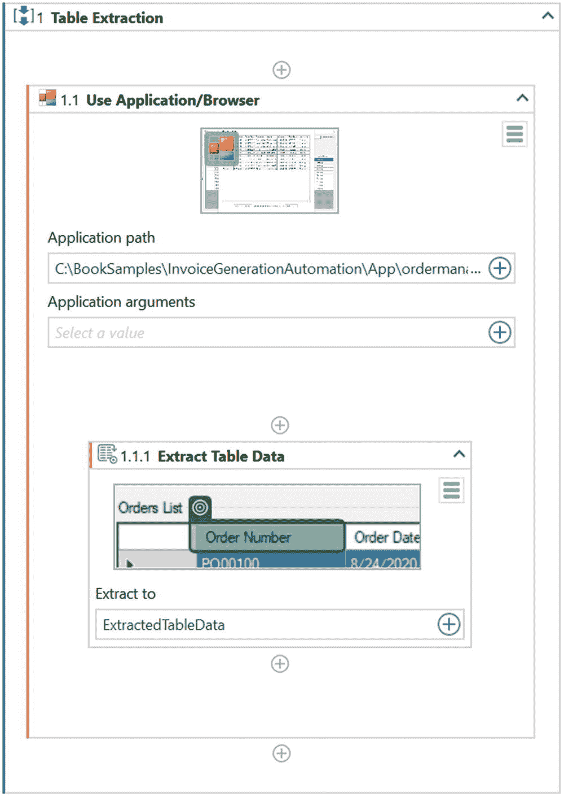

图 2-19

表格提取的配置

##### 分析

**分析**菜单项，如图 2-20 所示，允许您检查项目是否遵循自动化最佳实践和定义的约束。此菜单项包含三个子菜单项。

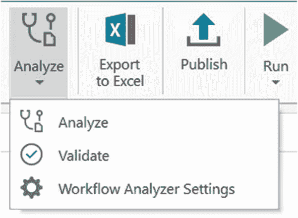

图 2-20

分析子菜单项

**工作流分析器设置**：此子菜单项，如图 2-20 所示，允许您定义自动化项目必须遵守的规则。您可以勾选/取消勾选要分析的规则。对于每条规则，您可以定义 StudioX 应采取的操作类型。例如，您可以定义如果自动化使用了禁止的 URL，则应显示错误。您可以使用这些设置来强制实施组织内的某些最佳实践，如图 2-21 所示。

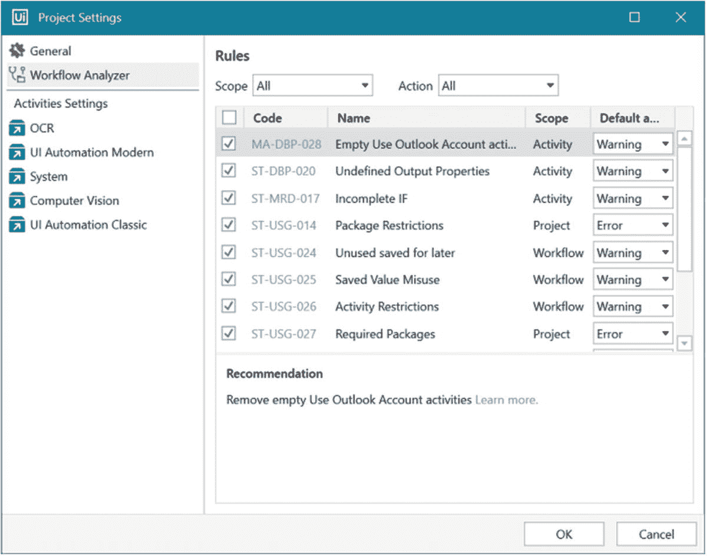

图 2-21

工作流分析器设置

通过策略，您可以强制要求在发布前或每次运行进程前运行分析器。图 2-22 显示了如何从“设置”选项卡强制实施分析器选项。

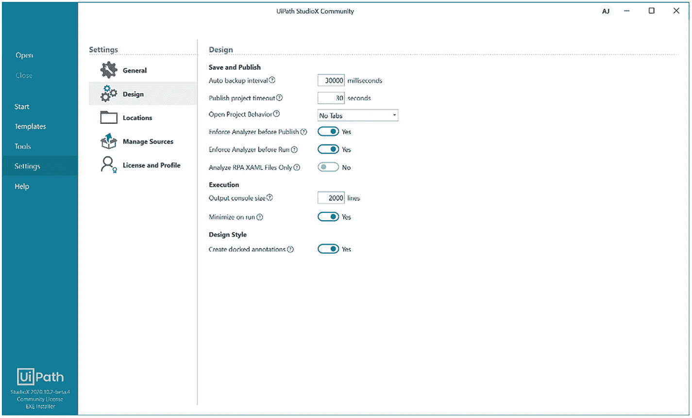

图 2-22

在“设置”选项卡中强制实施分析器选项

**分析**：此子菜单项检查项目的验证和最佳实践问题。它使用在 `Workflow Analyzer Settings` 中定义的规则。发现的任何问题都会在 `Error List` 面板中报告，如图 2-23 所示。

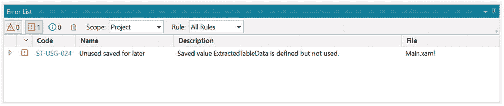

图 2-23

验证和分析器错误

**验证**：此子菜单项检查项目的验证错误。发现的任何问题都会在 `Error List` 面板中报告，如图 2-23 所示。

##### 导出到 Excel

“导出到 Excel”菜单允许您以 Excel 格式导出自动化定义。图 2-24 显示了一个示例导出。

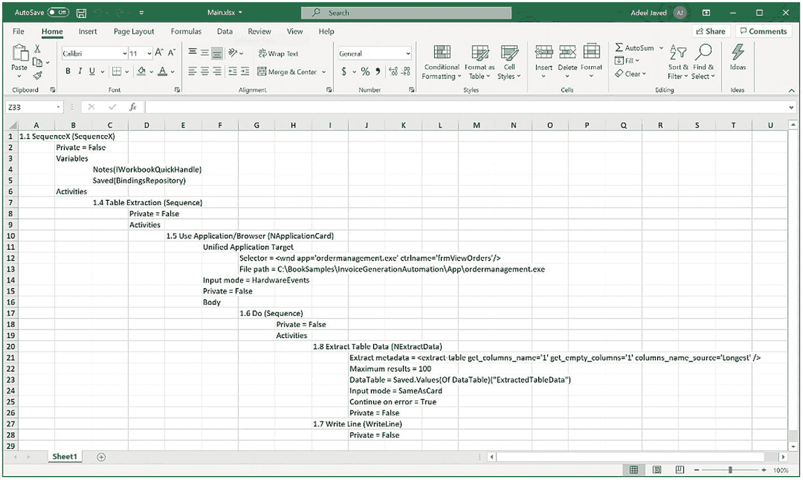

图 2-24

自动化的 Excel 导出

##### 发布

“发布”菜单允许您创建新版本并将自动化发布到 Orchestrator（包括您的个人工作区）或自定义文件夹。图 2-25 显示了发布过程对话框。

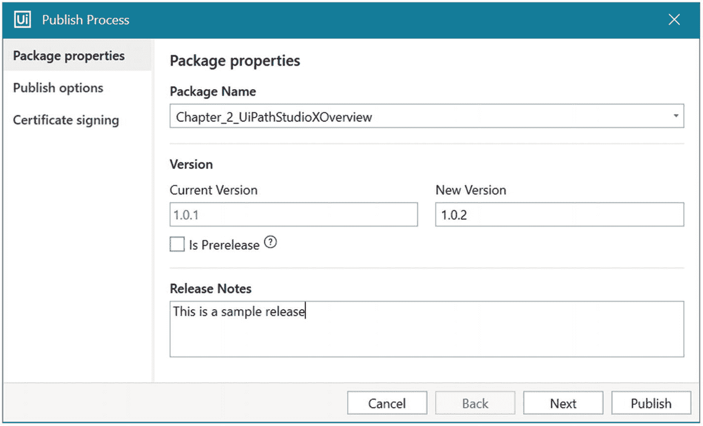

图 2-25

发布进程 – 包属性

##### 运行

“运行”菜单允许您从 StudioX 执行自动化。这将从自动化的开头开始执行。

### 项目工作区

当您打开现有项目或启动新项目时，将显示项目工作区。项目工作区，如图 2-26 所示，为您提供了开发自动化所需的所有工具。

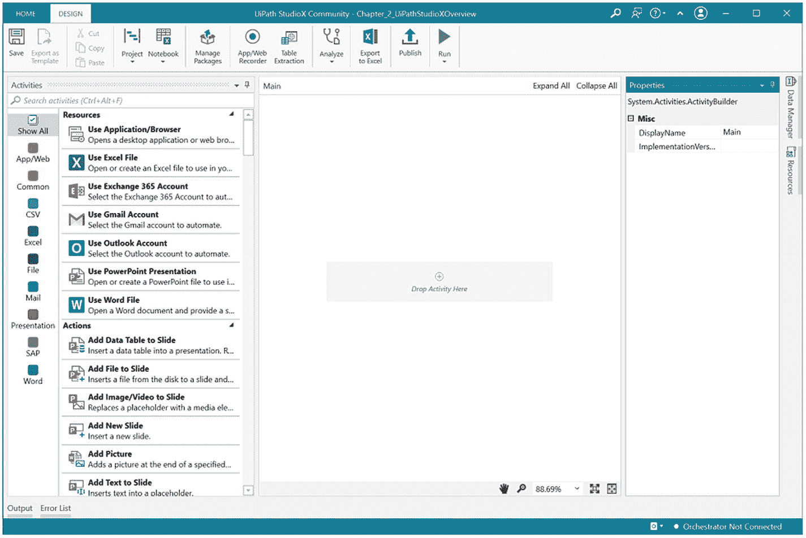

图 2-26

UiPath StudioX 中的项目工作区

#### 活动面板

理解活动的一个好方法是将它们想象成乐高积木。你可以用不同的方式组装单个积木，来搭建最终的乐高模型。同样地，在 UiPath StudioX 中，活动可以被视为独立的构建块，它们协同工作以组装成定义好的自动化流程。

UiPath StudioX 提供了大约 100 种活动，支持与各种类型的应用程序进行交互，例如桌面应用、Web 应用、Outlook、Word、Excel、CSV 等。

在 UiPath StudioX 中，活动位于图 2-27 所示的活动面板中。你可以从此面板将活动拖放到设计器面板（将在下一节讨论）。你也可以使用搜索栏快速查找活动。我们将在第 3 章到第 9 章中学习更多关于配置每个活动的知识。

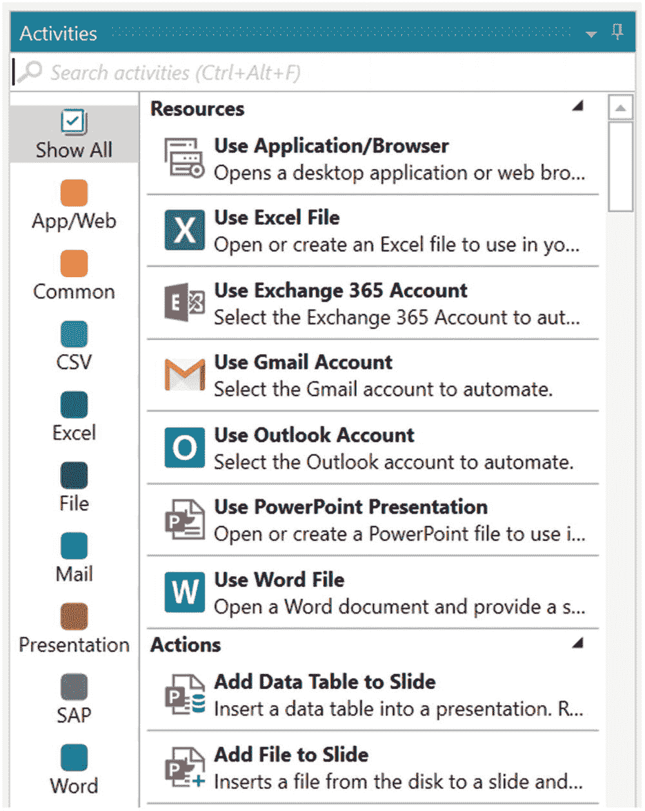

图 2-27

活动面板

#### 设计器面板

如图 2-28 所示，设计器面板是你通过组织和配置活动来定义自动化流程的地方。

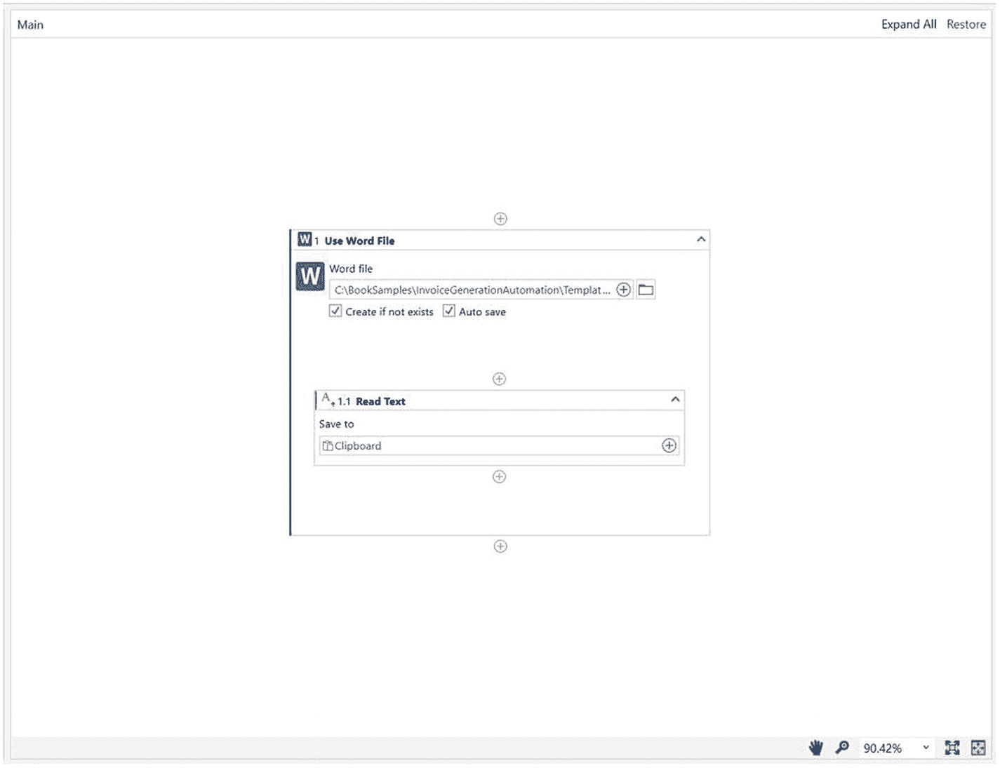

图 2-28

设计器面板

设计器面板是你定义自动化活动工作流顺序的地方，也是你编辑和配置每个活动的地方。此外，设计器面板将作为你自动化的可视化表示。

##### 上下文菜单

你可以通过在设计器面板中右键单击来访问上下文菜单。根据你执行右键单击的位置，菜单项会被启用或禁用。图 2-29 显示了上下文菜单。

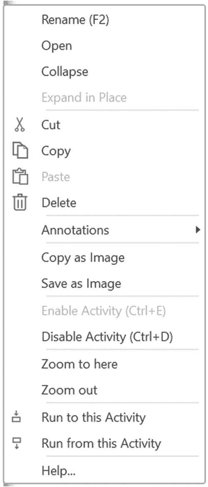

图 2-29

设计器面板中的上下文菜单

表 2-3 提供了每个菜单项的简要说明。

表 2-3

上下文菜单项说明

| 菜单项 | 说明 |
| --- | --- |
| 重命名 (F2) | 允许你重命名选中的活动。 |
| 打开 | 允许你在其自己的设计器面板中打开该活动，即深入查看该活动。 |
| 折叠 | 允许你折叠当前选中的活动。 |
| 就地展开 | 允许你在同一个设计器面板中展开该活动。 |
| 剪切 | 允许你剪切选中的活动（以及任何嵌套的活动）。 |
| 复制 | 允许你复制选中的活动（以及任何嵌套的活动）。 |
| 粘贴 | 允许你粘贴之前剪切或复制的活动（以及任何嵌套的活动）。 |
| 删除 | 允许你删除选中的活动（以及任何嵌套的活动）。 |
| 批注 | 允许你为选中的活动添加批注；如果有多人共同工作或审查自动化，这将非常有用。 |
| 复制为图像 | 允许你将选中的活动作为图像复制到内存中。 |
| 另存为图像 | 允许你将选中的活动作为图像保存到文件系统。 |
| 启用活动 | 允许你启用选中的活动。 |
| 禁用活动 | 允许你禁用选中的活动，使其不运行，相当于将其注释掉。 |
| 缩放至此 | 允许你深入查看选中的活动；这将在其自己的设计器面板中打开该活动。 |
| 缩小 | 允许你缩小选中的活动，即关闭单独的设计器面板，并在父设计器面板中显示该活动。 |
| 运行到此活动 | 允许你运行自动化直到此活动，即运行此活动及其之前的所有活动。 |
| 从此活动运行 | 允许你从此活动开始运行自动化，即运行此活动及其之后的所有活动。 |
| 帮助… | 允许你在浏览器中打开文档。 |

#### 属性面板

如图 2-30 所示，属性面板允许你查看和更改在设计器面板中当前选中的活动的属性。

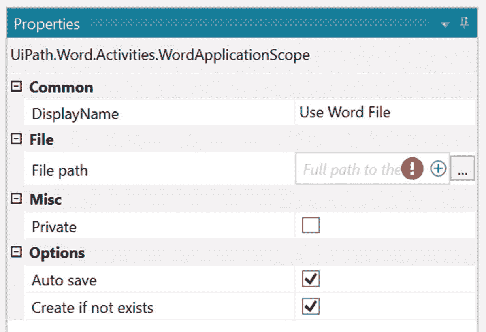

图 2-30

属性面板

#### 数据管理器面板

如图 2-31 所示，数据管理器面板允许你访问项目笔记本、资源和所有已保存的值。你也可以从此面板重命名已保存的值。我们将在第 3 章中学习更多关于已保存值的知识。

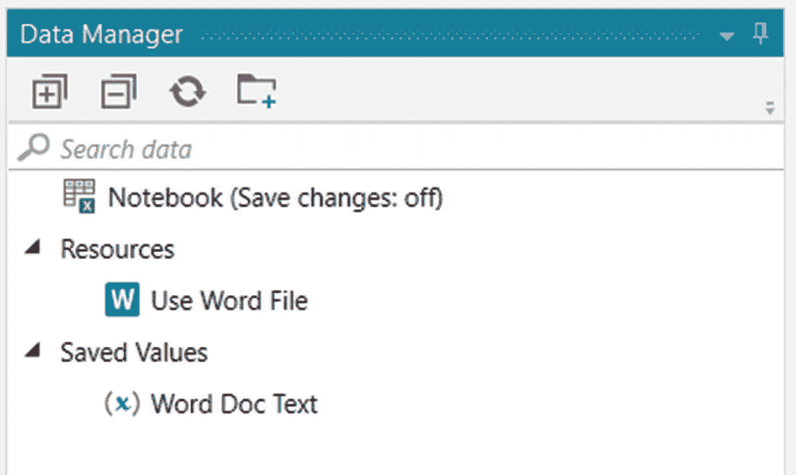

图 2-31

数据管理器面板

#### 输出面板

如图 2-32 所示，输出面板显示所有日志消息、`Write Line` 活动的输出以及自动化生成的所有错误。你可以选择希望在输出面板中查看的消息的日志级别（例如，错误、信息）。默认情况下，StudioX 会为某些活动记录审计日志。

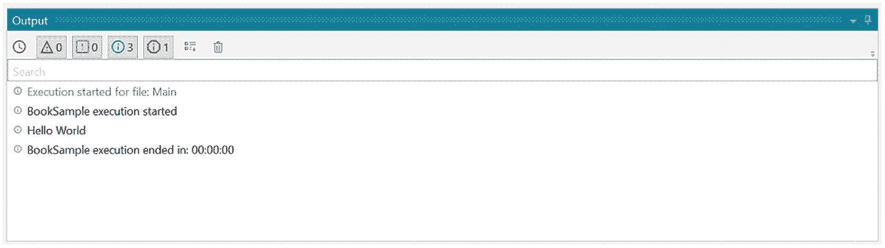

图 2-32

输出面板

