# 3. 通用概念

本章将向你介绍在 UiPath StudioX 中构建自动化时常用的概念、属性和活动。

## 学习目标

在本章结束时，你将学习如何：

*   使用项目笔记本中的公式和创建自定义公式

*   将数据传递给活动

*   存储活动返回的数据以供后续使用

*   在自动化中配置常用活动

## 笔记本

笔记本是一个很棒的概念，它使得 UiPath StudioX 真正实现了无代码化。

大多数业务用户和公民开发者都熟悉 Excel。默认情况下，每个 UiPath StudioX 自动化都可以访问一个称为笔记本的 Excel 文件。你可以在项目中使用默认笔记本，或配置一个自定义的 Excel 文件作为你的项目笔记本。

### 默认笔记本

默认笔记本包含一些用于处理日期、文本、数字和文件值的预建公式。图 3-1 显示了笔记本的文本工作表，其中包含一些用于处理文本值的预建公式。

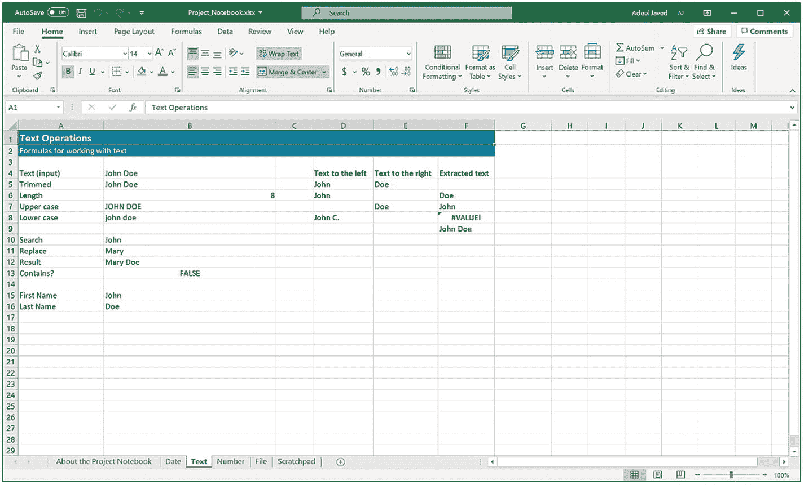

图 3-1

项目笔记本的文本工作表

对于额外的自定义字段和公式，你可以使用草稿工作表，或者向笔记本添加更多工作表并定义你的公式。

要将数据传递给你在笔记本中的自定义公式，你可以使用 `Use Excel` 和 `Write Cell` 活动将数据写入特定单元格（参见第 7 章）。

任何需要输入数据的活动都可以引用笔记本以检索数据输入。

图 3-2 展示了一个示例，演示了如何将数据传递给笔记本中的自定义公式，然后从笔记本读取结果。在此例中，我们将一个名字“John Doe”写入文本工作表的一个单元格。多个公式会使用此单元格。在我们的例子中，我们感兴趣的是将名字拆分为名和姓，然后在`输出`面板中打印出来，因此我们输出了包含“名”的单元格。

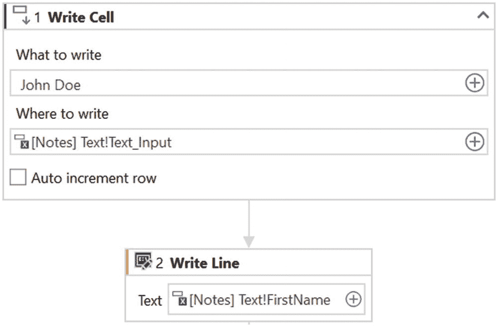

图 3-2

向项目笔记本传递数据以及从中读取数据

### 自定义笔记本

您可以选择配置一个自定义的 Excel 文件作为您的项目笔记本。

要配置自定义 Excel 文件作为项目笔记本，请单击功能区中“笔记本”菜单项中的`配置笔记本`选项，然后在“笔记本文件”字段中选择自定义的 Excel 文件，如图 3-3 所示。

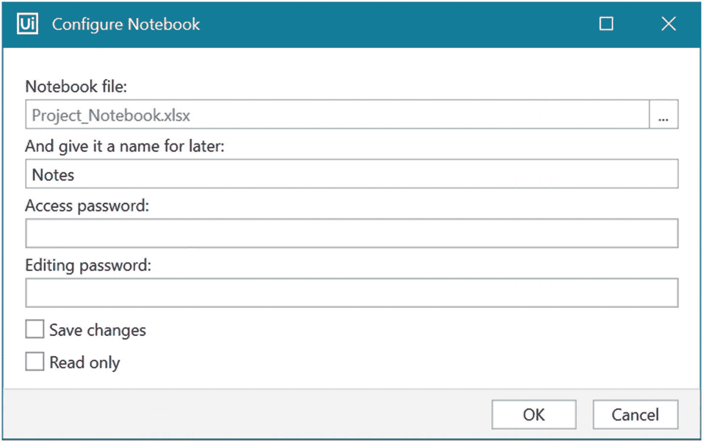

图 3-3

配置自定义 Excel 作为项目笔记本

## 活动输入

某些活动需要数据输入才能进行处理。例如，您可以为`写入行`活动提供文本作为输入。它将在输出面板中打印该值，或者您可以为`键入`活动提供文本作为输入，它将在表单字段中输入该值。每个需要输入数据的活动都为您提供了指定输入数据的选项。图 3-4 显示了数据输入选项的示例菜单。当您单击字段中的`加号`图标时，数据输入选项菜单将变为可用。

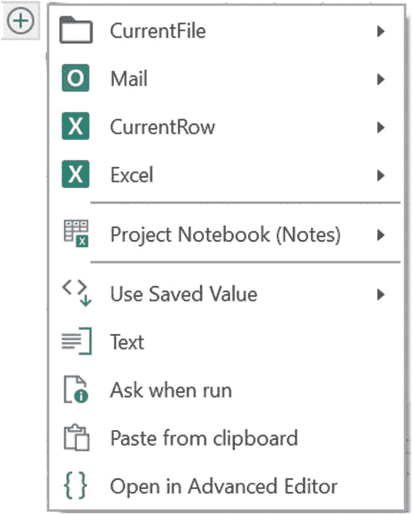

图 3-4

数据输入选项的示例菜单

**Excel**：允许您指定单元格地址、范围、表格、自定义输入，甚至来自笔记本或任何其他 Excel 的工作表作为活动的输入。您还可以选择单个 Excel 行中的值作为数据输入（详情请参见第 7 章）。

**邮件**：允许您指定来自电子邮件的数据作为活动的输入（详情请参见第 5 章）。

**文件**：允许您指定文件的属性作为活动的输入（详情请参见第 9 章），例如，文件的最后修改日期或文件的完整路径。

**使用保存的值**：允许您指定从前一个活动返回的数据作为另一个活动的输入。

**文本**：允许您指定静态或动态文本字符串作为活动的输入。此选项将打开`文本生成器`对话框。使用`文本生成器`，您可以将多个输入合并到一个文本字符串中。例如，图 3-5 显示了两个数据输入与一些静态文本组合以返回单个文本输入。

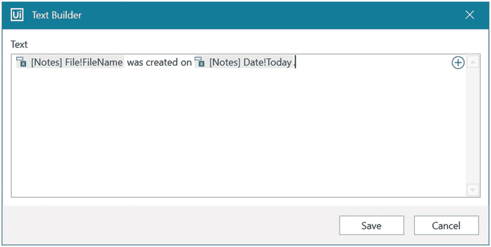

图 3-5

文本输入选项

**数字**：允许您指定一个数字计算，可用于将数字、基本计算或来自 Excel 的复杂公式输入到活动中。

**选择日期/时间**：允许您指定日期或时间作为活动的输入。图 3-6 显示了指定日期的选项，而图 3-7 显示了指定时间的选项。

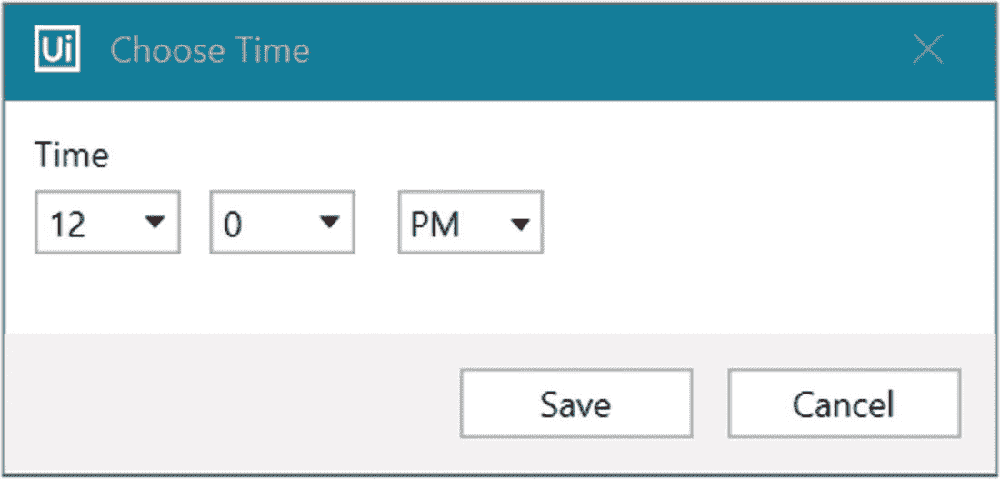

图 3-7

时间输入选项

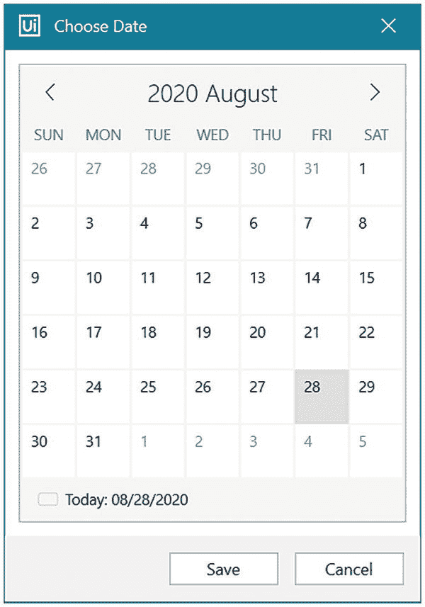

图 3-6

日期输入选项

**选择持续时间**：允许您指定持续时间作为活动的输入。图 3-8 显示了指定持续时间的选项。

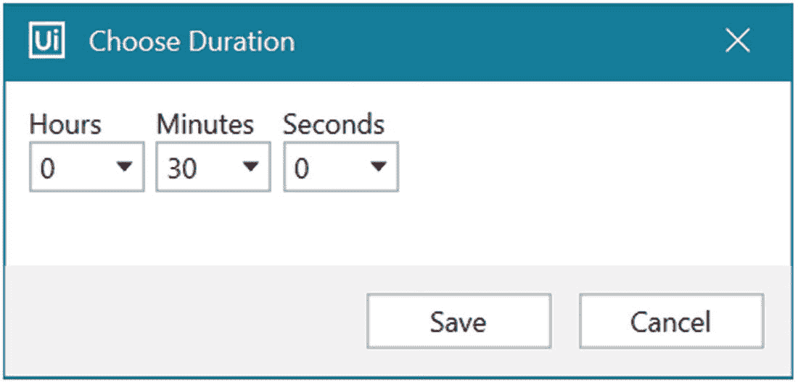

图 3-8

持续时间输入选项

**运行时询问**：允许您在运行时指定一个值作为活动的输入。此选项适用于有人值守的机器人。

**从剪贴板粘贴**：允许您将剪贴板数据粘贴为活动的输入。

**在高级编辑器中打开**：允许您输入 VB 表达式来指定输入值。

## 活动输出

某些活动在完成处理后，会返回数据。例如，`读取文本文件`活动将返回文本文件的内容，或者`获取文本`活动将返回表单字段的内容。每个返回数据的活动都允许您指定如何存储该数据。图 3-9 显示了数据输出选项的示例菜单。当您单击`加号`图标时，此数据输出选项菜单将变为可用。

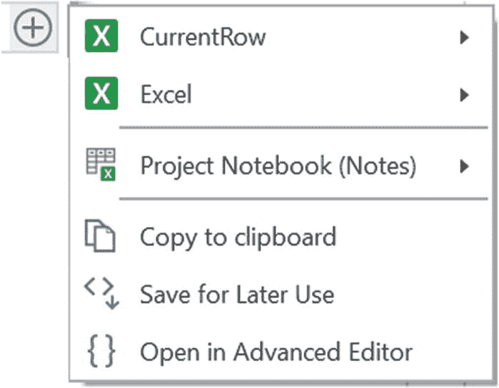

图 3-9

数据输出选项的示例菜单

**Excel**：允许您指定项目笔记本或来自父级`使用 Excel 文件`活动的 Excel 文件中的单元格地址、范围、表格或工作表，以存储活动返回的数据。也可以指定单个 Excel 行中的单元格（详情请参见第 7 章）。

**保存以备后用**：允许您指定一个变量来存储活动返回的数据。变量可从数据管理器面板访问。您可以命名或重命名变量以使其易于理解。图 3-10 显示了将数据存储在变量中的选项。

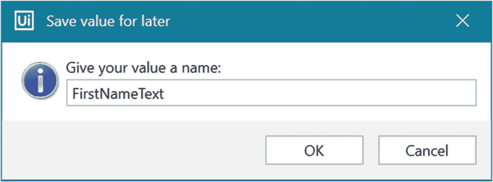

图 3-10

保存以备后用选项

**复制到剪贴板**：允许您将活动返回的数据复制到剪贴板。以后可以使用`从剪贴板粘贴`选项访问此数据。

## 通用属性

通用属性，如图 3-11 所示，可以从`属性`面板的`通用`部分访问。通用属性可能因活动而异。

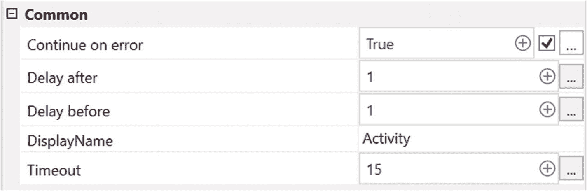

图 3-11

活动的通用属性

表 3-1 提供了每个属性的简要说明。

表 3-1

通用属性

| 属性 | 描述 |
| --- | --- |
| 出错时继续 | 此属性允许您指定（true 或 false）自动化是否应继续运行，即，即使所选活动在执行期间遇到错误，也继续执行下一个活动。 |
| 之后延迟 | 此属性允许您指定（以秒为单位）自动化是否应在完成所选活动之后、开始下一个活动之前等待。默认值为 0.3 秒。 |
| 之前延迟 | 此属性允许您指定（以秒为单位）自动化是否应在开始所选活动之前等待。默认值为 0.2 秒。 |
| 显示名称 | 此属性允许您更新设计器面板中选定活动的显示名称。 |
| 超时 | 此属性允许您指定（以秒为单位）自动化应等待所选活动完成多长时间，如果超时则停止等待。默认值为 30 秒。 |

## 通用活动

所有自动化类型中常用的活动可以在**通用**磁贴下找到，如图 3-12 所示。以下各节将提供有关如何配置和使用这些活动的说明。

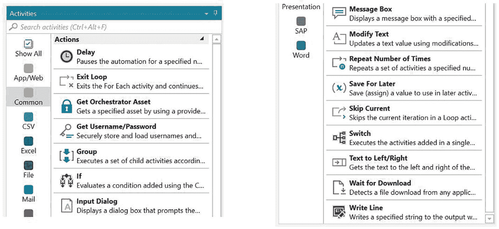

图 3-12

自动化通用活动

### 写入行

**写入行**活动允许您将指定的消息打印到“输出”面板。

提示

写入行活动在自动化的开发和测试阶段都很有用。添加此活动可以帮助您跟踪自动化的流程，并调试开发过程中可能出现的任何问题。开发完成自动化后，此活动可以帮助您创建自动化的审计日志，这在受监管的行业中至关重要。

#### 配置

本节提供如何配置**写入行**活动的说明，如图 3-13 所示。

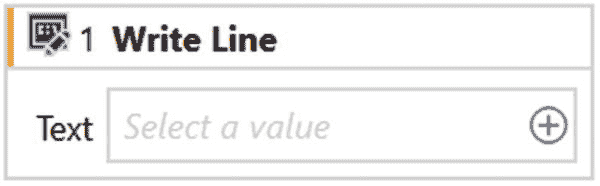

图 3-13

写入行的活动卡片

**文本**：这是活动卡片上的一个可选配置。您在此配置中指定的文本将被打印到`Output`面板中。

练习

**目标**：使用`Write Line`活动在“输出”面板中打印“Automation has started processing data for <current date="">.”消息。<current date="">应替换为自动化运行时的实际日期。</current></current>

**源代码**：Chapter_3-WriteLineExercise

**设置**：以下是分步实施说明：

1.  在`StudioX`中，将`Write Line`活动添加到一个空白流程中。

2.  接下来，点击`Plus`图标并选择`Text`选项。在`Text Builder`中，输入`Automation has started processing data for`。

3.  然后，在`Text Builder`中，点击`Plus`图标并选择`Project Notebook` ➤ `Date` ➤ `Today`。您的最终文本应类似于`Automation has started processing data for [Notes] Date!Today`。

完成练习后，**写入行**活动的最终配置应类似于图 3-14。运行此自动化后，自动化将在“输出”面板中打印消息，如图 3-15 所示。

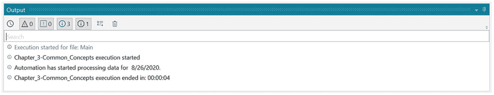

图 3-15

写入行活动练习的输出

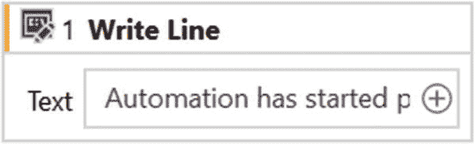

图 3-14

写入行活动练习的配置

### 消息框

**消息框**活动允许您暂停自动化，并在消息框中显示带有指定按钮的文本。

提示

消息框活动在自动化的开发阶段特别有用。添加此活动可以帮助您跟踪自动化的流程，并调试开发过程中可能出现的任何问题。

#### 配置

本节提供如何配置**消息框**活动的说明，如图 3-16 所示。

图 3-16

消息框的活动卡片

**文本**：这是活动卡片上的一个必需配置。您在此处指定的文本将显示在消息框中。

**按钮**：这是`Properties`面板上的一个可选配置。此配置允许您指定要在消息框上显示的按钮。图 3-17 显示了所有可用的按钮选项。默认情况下，选择设置为`Ok`按钮。

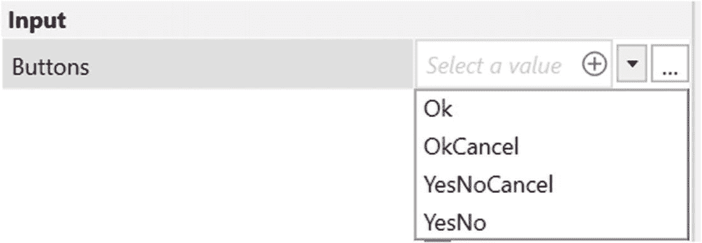

图 3-17

消息框活动的按钮选项

**标题**：这是`Properties`面板上的一个可选配置。此配置允许您为消息框指定一个标题/标签。默认标题是`Message Box`。

**选择的按钮**：这是`Properties`面板上的一个可选配置。此配置允许您保存所点击按钮的值（来自按钮配置）。您之后可以使用此值来决定自动化工作流的路径。

**置顶**：这是`Properties`面板上的一个可选配置。此配置允许您指定消息框是否应始终置于前台。

练习

**目标**：使用消息框活动显示一个消息框，要求用户确认此消息“Word 文件处理完成；是否要开始处理 Excel 文件？”。

**源代码**：Chapter_3-MessageBoxExercise

**设置**：以下是分步实施说明：

1.  在`StudioX`中，将`Message Box`活动添加到一个空白流程中。

2.  接下来，点击`Plus`图标，选择`Text`选项，然后输入`Word file processing is complete; Do you want to start Excel file processing?`。

3.  然后，在`Properties`面板中，为`Buttons`配置选择`YesNo`选项。

4.  接着，在`Properties`面板中，将`Caption`字段设置为`Confirmation`。

5.  然后，在`Properties`面板中，点击`ChosenButton`字段中的`Plus`图标，并选择`Save for Later Use`选项。将变量命名为`ChosenButton`。

6.  最后，在`Message Box`活动之后添加一个`Write Line`活动。点击`Plus`图标并选择`Use Saved Value` ➤ `ChosenButton`。

完成练习后，**消息框**活动的最终配置应类似于图 3-18。

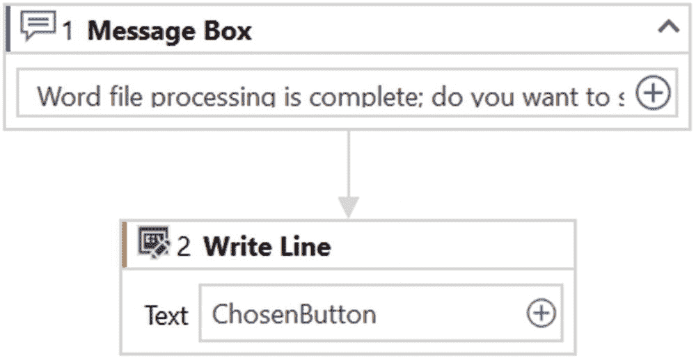

图 3-18

消息框活动练习的配置

运行自动化后，它将显示一个带有“是/否”确认按钮的消息框，如图 3-19 所示。无论您点击哪个按钮，自动化都会将其值打印在“输出”面板中，如图 3-20 所示。

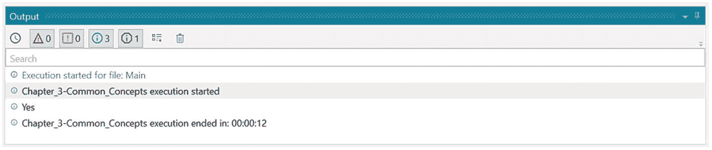

图 3-20

自动化的输出

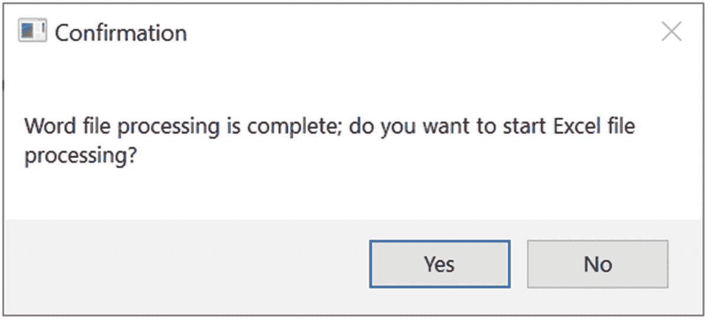

图 3-19

确认消息框

### 输入对话框

**输入对话框**活动允许您提示用户提供输入。此活动在需要用户输入的有监督自动化中特别有用。

#### 配置

本节提供如何配置**输入对话框**活动的说明，如图 3-21 所示。

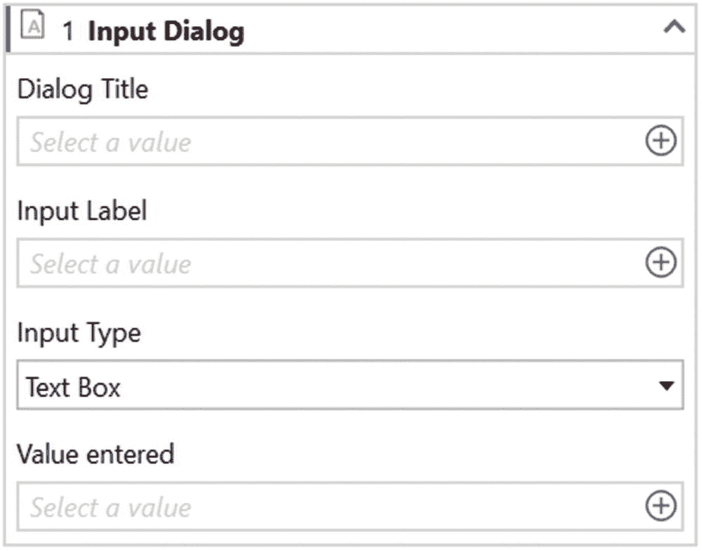

图 3-21

输入对话框的活动卡片

**对话框标题**：这是活动卡片上的可选配置。您在此处指定的文本将显示在输入对话框的标题中。

**输入标签**：这是活动卡片上的可选配置。您在此处指定的文本将显示为输入字段的标签。

**输入类型**：这是活动卡片上的必填配置。有两个选项：`文本`和`多项选择`。默认情况下，该值设置为`文本`，会提示用户通过自由格式文本字段提供输入。`多项选择`选项允许您指定一组选项，用户需要从中选择一个。

**输入选项（用 ; 分隔）**：这是活动卡片上的可选配置。此配置仅在`输入类型`字段中选择了`多项选择`选项时可用。此配置允许您指定一个供用户选择的选项列表。多个选项之间用 ; 分隔。

**输入的值**：这是活动卡片上的可选配置。此配置允许您将提供的输入值保存到一个变量中。之后您可以使用此值来决定自动化工作流的路径。

练习

**目标**：使用`输入对话框`活动提示用户为自动化选择下一步操作。

**源代码**：Chapter_3-InputDialogExercise

**设置**：以下是分步实施说明：

1.  在 `StudioX` 中，将一个`输入对话框`活动添加到一个空白流程中。

2.  在`对话框标题`字段中，点击`加号`图标，选择`文本`选项，然后输入 `Next Action`。

3.  在`输入标签`字段中，点击`加号`图标，选择`文本`选项，然后输入 `Please select how you want to proceed with the automation`。

4.  从`输入类型`字段中，选择`多项选择`。

5.  在`输入选项`字段中，点击`加号`图标，选择`文本`选项，然后输入 `Process now;Process later;Exit`。

6.  在`输入的值`字段中，点击`加号`图标，然后选择`保存以备后用`选项。将变量命名为 `InputDialogResult`。

7.  接下来，在`输入对话框`活动之后添加一个`写入行`活动。点击`加号`图标，悬停在`使用已保存的值`上，然后选择 `InputDialogResult`。

完成练习后，**输入对话框**活动的最终配置应类似于图 3-22。

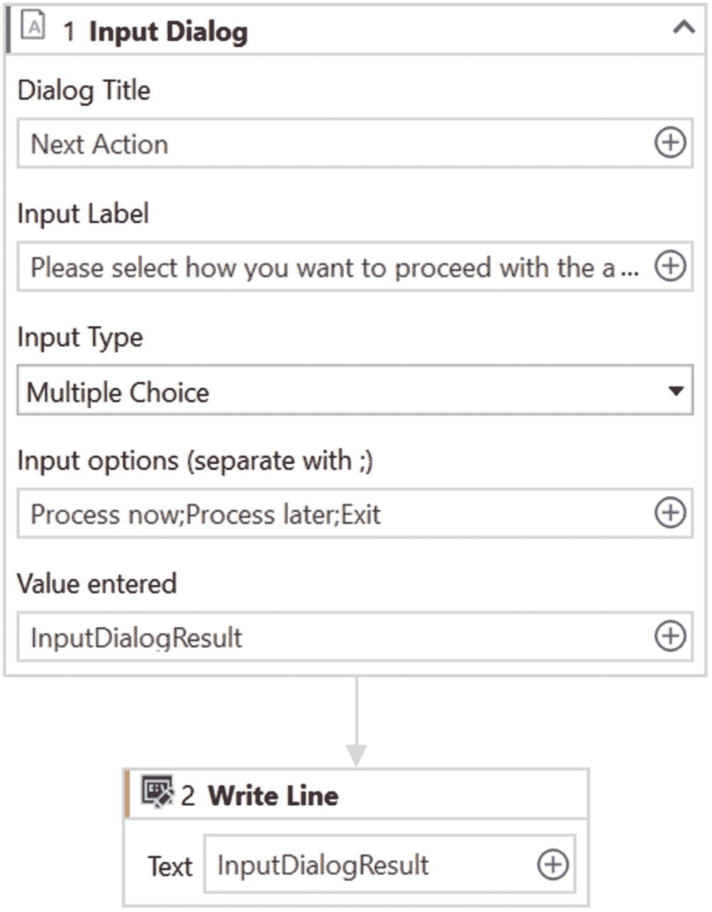

图 3-22

输入对话框活动练习的配置

运行自动化后，它将显示一个包含三个选项的输入对话框，如图 3-23 所示。无论您选择哪个选项，自动化都会在输出面板中打印其值。

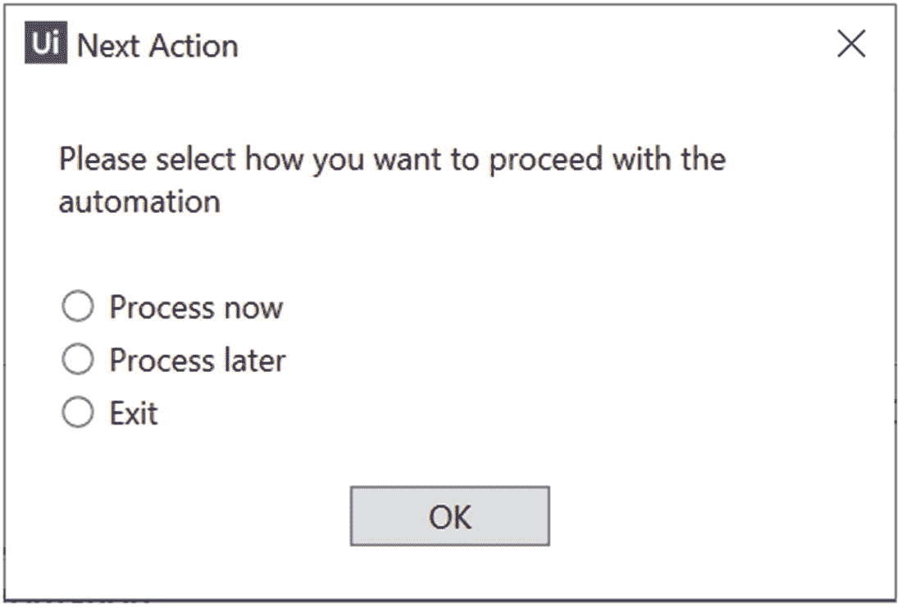

图 3-23

输入对话框

### 修改文本

**修改文本**活动允许您通过执行不同的操作来修改输入的文本值。

#### 配置

本节提供如何配置**修改文本**活动的说明，如图 3-24 所示。

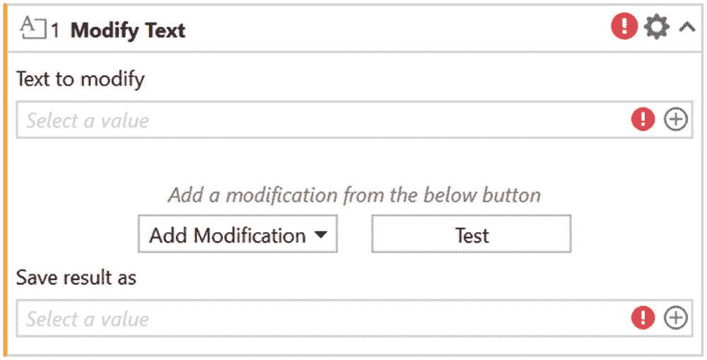

图 3-24

修改文本的活动卡片

**要修改的文本**：这是活动卡片上的必填配置。此配置允许您指定将由活动修改的原始文本。

**添加修改**：这是活动卡片上的可选配置。此配置允许您指定要对文本执行的一个或多个修改。图 3-25 显示了所有可用的修改。

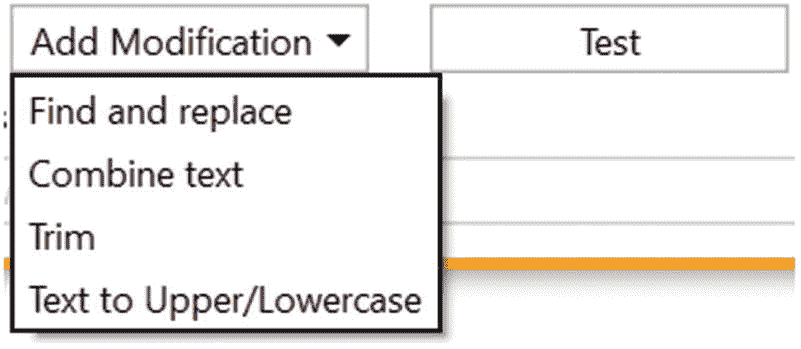

图 3-25

消息框活动的按钮选项

`查找并替换`修改允许您指定要在原始文本中搜索的文本以及要替换成的文本。您还可以指定是否应为精确匹配。

`合并文本`修改允许您在文本的开头或结尾添加新文本。

`修剪`修改允许您修剪文本左右两侧的空格。

`文本转大写/小写`修改允许您将文本的大小写更改为全部大写或全部小写。

您还可以在设计自动化时选择`测试`按钮来检查您的修改逻辑。

**将结果另存为**：这是活动卡片上的可选配置。此配置允许您保存修改后的文本值以供以后使用。

练习

**目标**：使用`修改文本`将输入值中的 `%` 替换为 `_`，修剪文本，将其转换为大写，然后打印结果。

**源代码**：Chapter_3-TextManipulationExercise

**设置**：以下是分步实施说明：

1.  在 `StudioX` 中，将`修改文本`活动添加到一个空白流程中。

2.  在`要修改的文本`字段中，点击`加号`图标，然后选择`运行时询问`选项。

3.  接下来，从`添加修改`下拉菜单中，选择`查找并替换`选项。这将添加一个子活动。

4.  在`查找并替换文本`子活动的`查找内容`字段中，点击`加号`图标，选择`文本`选项，然后输入 `%`。这指定了要查找的文本。

5.  在`查找并替换文本`子活动的`替换为`字段中，点击`加号`图标，选择`文本`选项，然后输入 `_`。这指定了如果找到，将 `%` 替换为什么。

6.  接下来，从`添加修改`下拉菜单中，选择`修剪`选项。这将添加一个子活动。保持配置不变。

7.  接下来，从`添加修改`下拉菜单中，选择`文本转大写/小写`选项。这将添加一个子活动。保持`大写`的默认配置不变。

8.  接下来，在`将结果另存为`字段中，点击`加号`图标，然后选择`保存以备后用`选项。将变量命名为 `OutputText`。

9.  接下来，在`修改文本`活动之后添加一个`写入行`活动。点击`加号`图标，然后选择`使用已保存的值` ➤ `OutputText`。

完成练习后，**修改文本**活动的最终配置应类似于图 3-26。

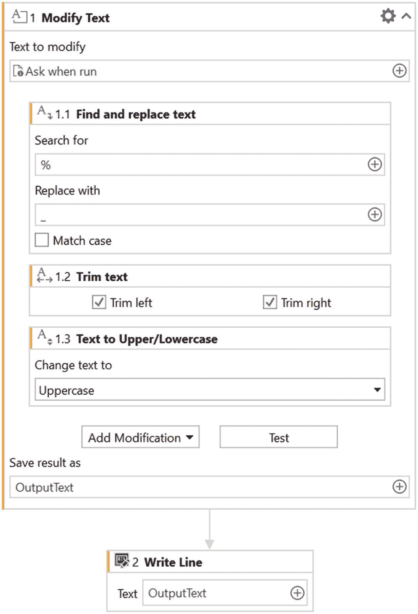

图 3-26

修改文本活动练习的配置

运行自动化后，它将显示一个输入对话框。输入 `New%Hires%2020.xlsx` 作为值，如图 3-27 所示，然后点击`确定`。执行完所有文本修改后，结果将显示在输出面板中，如图 3-28 所示。

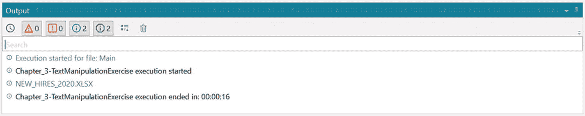

图 3-28

自动化的输出

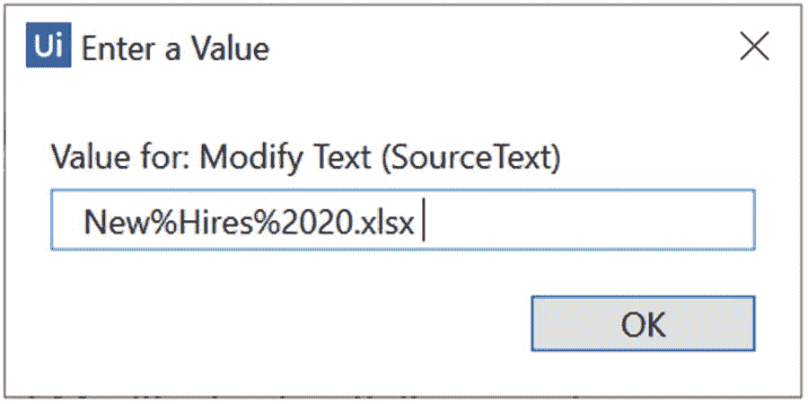

图 3-27

输入值

### 文本向左/向右

**文本向左/向右**活动允许您使用分隔符将一个文本值拆分为两个文本值。

#### 配置

本节提供如何配置**文本左/右分割**活动的说明，如图 3-29 所示。

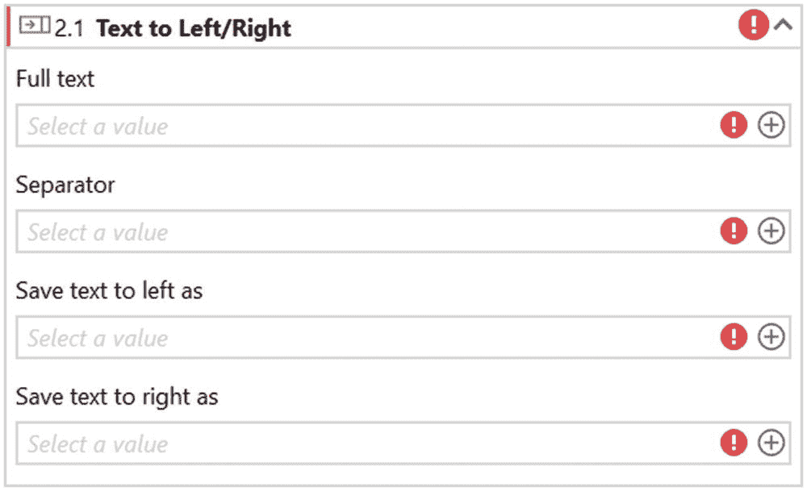

图 3-29

文本左/右分割活动卡片

**全文**：这是活动卡片上的一项必填配置。此配置允许您指定将被活动一分为二的文本。

**分隔符**：这是活动卡片上的一项必填配置。此配置允许您指定用作分隔符的文本。活动将使用分隔符的首次出现位置来分割原始文本。

**将左侧文本另存为**：这是活动卡片上的一项必填配置。此配置允许您保存分隔符左侧的文本以供后续使用。

**将右侧文本另存为**：这是活动卡片上的一项必填配置。此配置允许您保存分隔符右侧的文本以供后续使用。

练习

**目标**：使用`文本左/右分割`活动，以`%`作为分隔符分割输入的文本值，并打印出两个新的文本值。

**源代码**：Chapter_3-TextManipulationExercise

**设置**：以下是分步实施说明：

1.  在 `StudioX` 中，将 `文本左/右分割` 活动添加到一个空白流程中。

2.  在 `全文` 字段中，点击 `加号` 图标，然后选择 `运行时询问` 选项。

3.  在 `分隔符` 字段中，点击 `加号` 图标，选择 `文本` 选项，然后输入 `%`。

4.  在 `将左侧文本另存为` 字段中，点击 `加号` 图标，然后选择 `保存以供后续使用` 选项。将该值重命名为 `TextToLeft`。

5.  在 `将右侧文本另存为` 字段中，点击 `加号` 图标，然后选择 `保存以供后续使用` 选项。将该值重命名为 `TextToRight`。

6.  接下来，在 `文本左/右分割` 活动之后添加一个 `写入行` 活动。点击 `加号` 图标，然后选择 `使用已保存的值` ➤ `TextToLeft`。

7.  接下来，在 `写入行` 活动之后添加一个 `写入行` 活动。点击 `加号` 图标，然后选择 `使用已保存的值` ➤ `TextToRight`。

完成练习后，**文本左/右分割**活动的最终配置应类似于图 3-30。

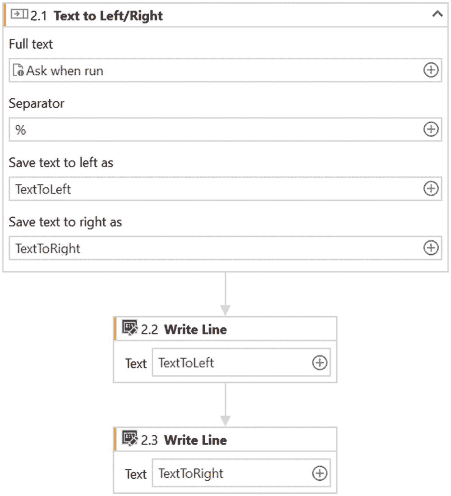

图 3-30

文本左/右分割活动练习的配置

运行自动化后，将显示一个输入对话框。输入 `New%Hires%2020` 作为值，如图 3-31 所示，然后点击 `确定`。活动执行完成后，输出将显示在输出面板中，如图 3-32 所示。如配置中所述，仅使用第一个分隔符进行分割；这就是为什么您仍然会在右侧文本值中看到第二个 % 符号。

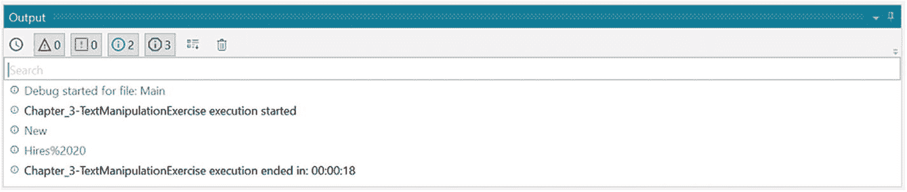

图 3-32

自动化的输出

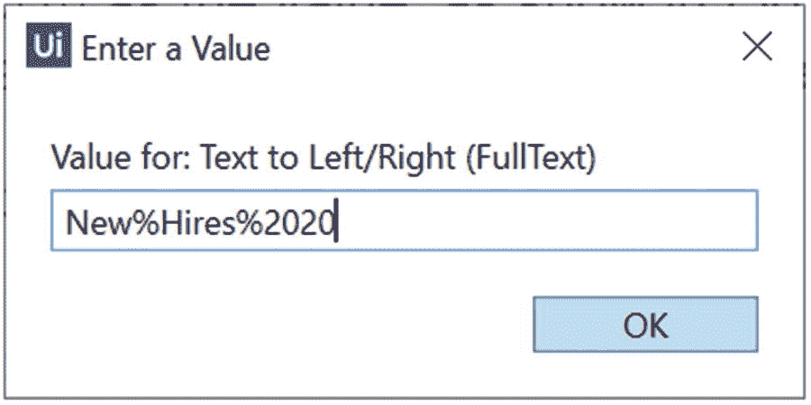

图 3-31

确认消息框

### 延迟

**延迟**活动允许您将自动化暂停指定的秒数。

提示

有时，诸如系统性能缓慢和网络延迟等问题是不可避免的。延迟活动有助于确保此类问题不会导致自动化失败。此活动将使您的自动化更加稳健，不易出错。

#### 配置

本节提供如何配置**延迟**活动的说明，如图 3-33 所示。

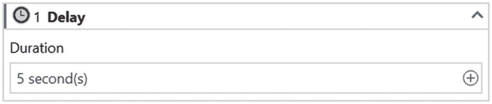

图 3-33

延迟活动卡片

**持续时间**：这是活动卡片上的一项必填配置。此配置（如图 3-34 所示）允许您指定自动化应暂停的秒数。默认值为 `5` 秒。

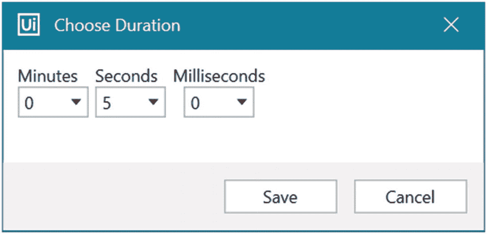

图 3-34

延迟活动的持续时间配置

### 如果

**如果**活动允许您检查一个条件，并根据结果选择自动化应遵循的路径。

自动化可以遵循 **Then** 路径或 **Else** 路径。当条件为真时，自动化将遵循 **Then** 路径。否则，自动化将遵循 **Else** 路径。

注意

If 活动也称为决策活动、条件活动或 if-then-else 活动。

#### 配置

本节提供如何配置**If**活动的说明，如图 3-35 所示。

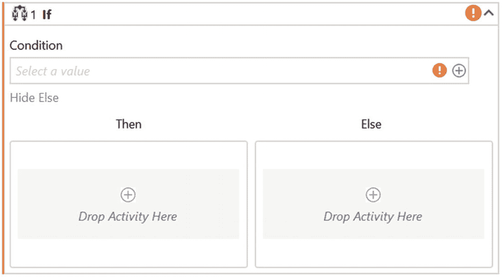

图 3-35

If 活动的活动卡片

**条件**：这是活动卡片上的一项必填配置。您可以使用图 3-36 所示的`Condition Builder`来构建自动化将评估的条件。

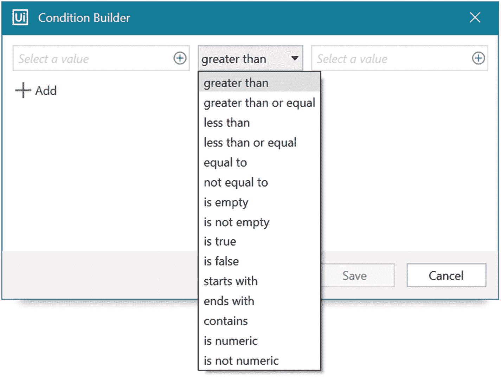

图 3-36

条件生成器

您可以点击`Add`按钮在`Condition Builder`中指定多个条件。在多个条件的情况下，使用左上角的下拉菜单（如图 3-37 所示），您还可以选择指定自动化应如何评估这些条件。

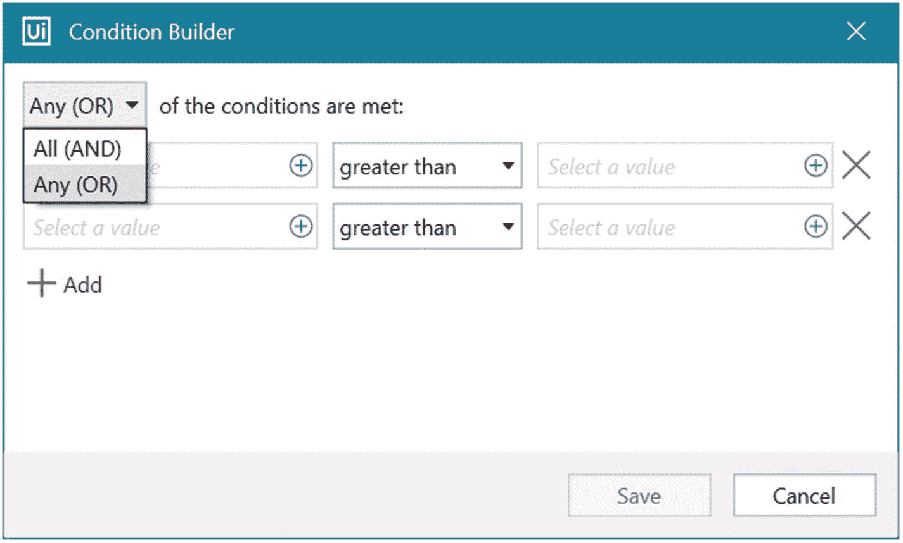

图 3-37

多个条件的配置

`AND`选项意味着所有条件都必须为真，整体条件才被视为真。

`OR`选项意味着只要任一条件为真，整体条件即被视为真。

练习

**目标**：使用`If`活动检查项目 Notebook 中的地址是街道地址还是大楼地址。

**源代码**：Chapter_3-IfConditionExercise

**设置**：以下是分步实施说明：

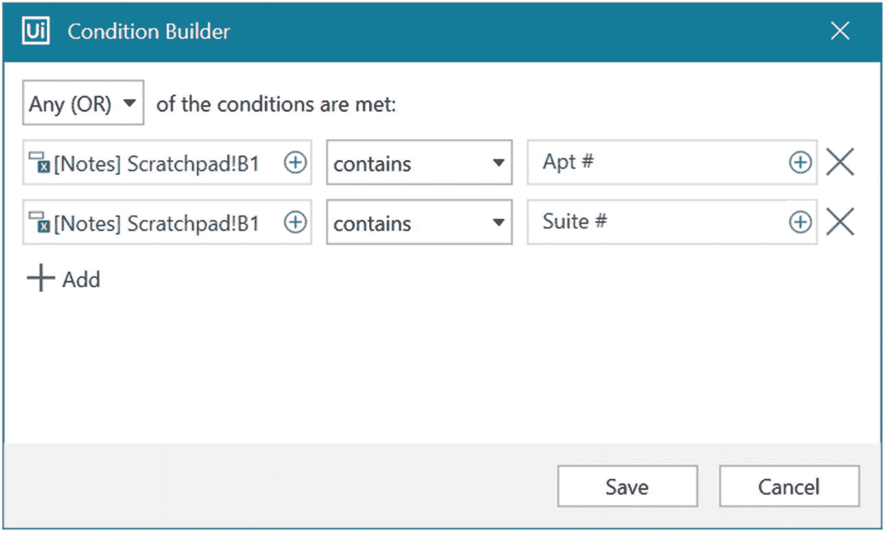

图 3-40

条件配置

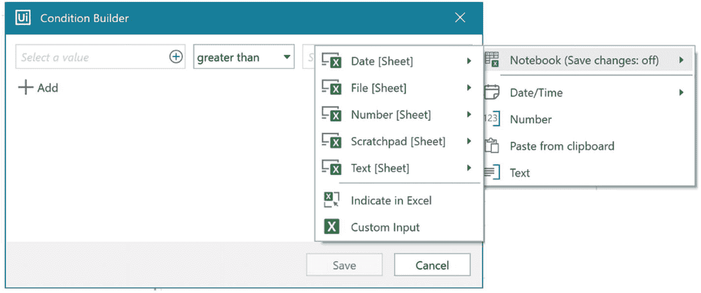

图 3-39

从 Notebook 中选择输入数据

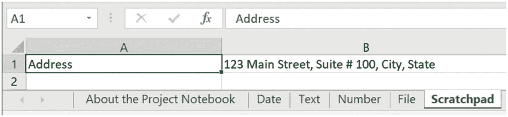

图 3-38

包含输入数据的 Notebook

1.  接下来，在`If`活动的`Then`主体中添加一个`Write Line`活动。

2.  点击`Plus`图标，选择`Text`选项，并输入`This is a building address`。

3.  接下来，在`If`活动的`Else`主体中添加一个`Write Line`活动。

4.  点击`Plus`图标，选择`Text`选项，并输入`This is a street address`。

1.  选择单元格`B1`，然后点击 Excel 功能区中的`Confirm`。

2.  从条件下拉菜单中选择`contains`。

3.  在条件右侧，点击`Text`选项，并输入`Apt #`。此条件将检查提供的地址是否包含 Apt #。

4.  点击`+ Add`添加另一个条件。

5.  在条件左侧，选择`Project Notebook` ➤ `Indicate in Excel`选项。选择单元格`B1`，然后点击 Excel 功能区中的`Confirm`。

6.  从条件下拉菜单中选择`contains`。

7.  在条件右侧，点击`Text`选项，并输入`Suite #`。此条件将检查提供的地址是否包含 Suite #。

8.  从左上角的下拉菜单中选择`Any (OR)`。此时，`Condition Builder`应如图 3-40 所示。点击`Save`。

1.  接下来，将一个`If`活动添加到`Designer`面板。

2.  点击`Plus`图标打开`Condition Builder`。

3.  在条件左侧，选择`Notebook` ➤ `Indicate in Excel`选项，如图 3-39 所示。

1.  在`StudioX`中，点击`Notebook` ➤ Open Notebook，并打开`Scratchpad`工作表。

2.  接下来，在单元格`A1`中输入`Address`；这只是一个标签。

3.  接下来，在单元格`B1`中输入一个测试地址：`123 Main Street, Suite # 100, City, State`。图 3-38 显示了`Notebook`。点击`Save`并关闭`Notebook`。

完成练习后，**If**活动的最终配置应类似于图 3-41。图 3-42 显示了运行输出。

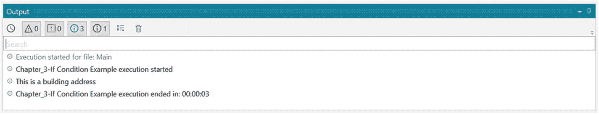

图 3-42

自动化运行的输出

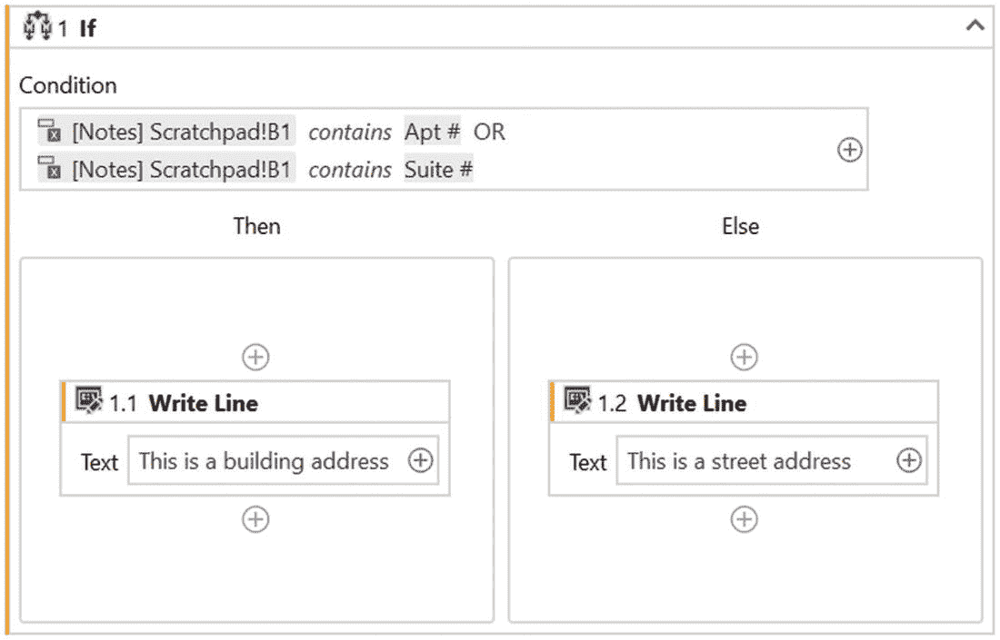

图 3-41

If 活动练习的配置

### Switch

**Switch**活动允许您定义多个分支，然后根据一个表达式执行单个分支。

If 活动和 Switch 活动都是条件活动，即根据表达式结果，它们会遵循其中一条已定义的路径。当只有两个选择时，可以使用 If 活动；而当有多个选择时，Switch 活动更为适用。

#### 配置

本节提供如何配置**Switch**活动的说明，如图 3-43 所示。

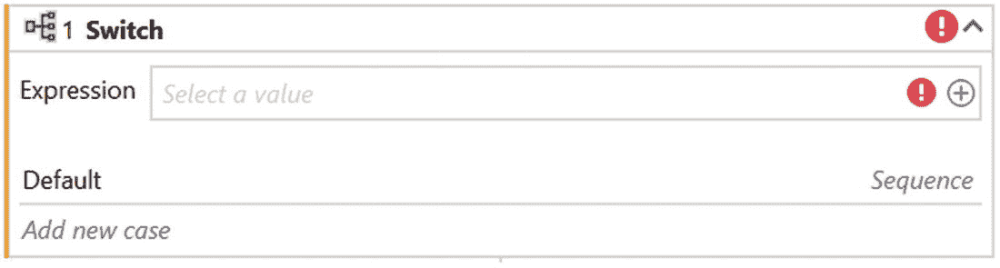

图 3-43

Switch 的活动卡片

**TypeArgument**：这是`Properties`面板上提供的一个可选配置。从图 3-44 所示的下拉菜单中，你需要选择表达式将返回的值的类型。

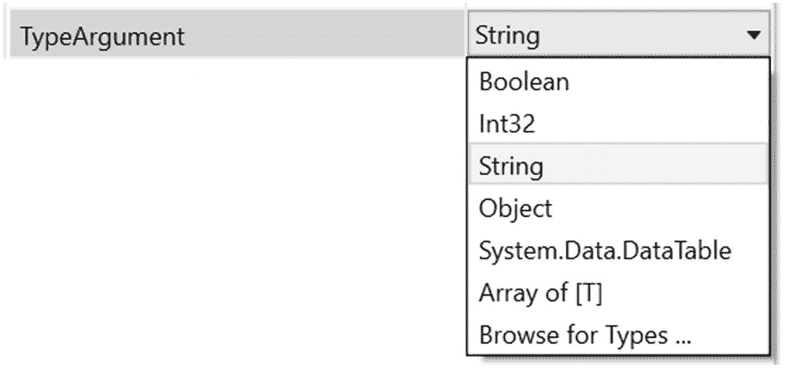

图 3-44

参数类型选项

如果你的表达式结果为 true 或 false，则选择`Boolean`。如果你的表达式结果为数字，例如 1、2、3 等，则选择`Int32`。如果你的表达式结果为文本，例如 January、February、March 等，则选择`String`。

**Expression**：这是活动卡片上提供的一个必需配置。此表达式将返回一个被定义为 case 的值。例如，它可以指向 Excel 中具有状态值的一列，然后根据该状态值，你想要执行特定的操作。

**Add new case**：这是活动卡片上提供的一个必需配置，即必须提供一个 Default case。此配置允许你向 Switch 活动添加一个新的 Case 值，如图 3-45 所示。

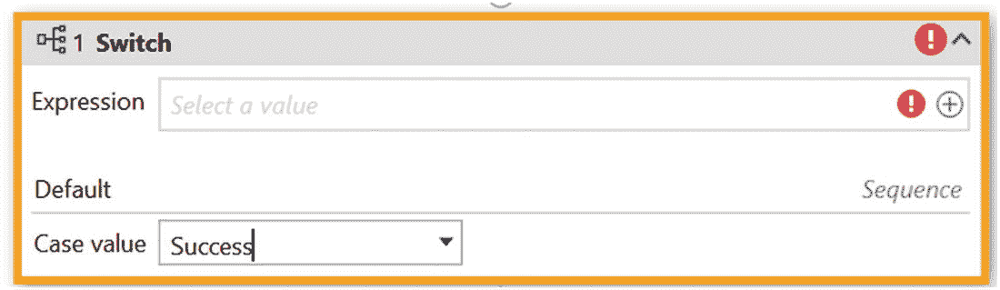

图 3-45

在 Switch 活动中添加新 case

添加新的`Case`值后，你可以向此`Case`值的主体中添加活动，如图 3-46 所示。在执行过程中，如果表达式返回的值与此 case 匹配，则将执行此 case 主体中的活动。

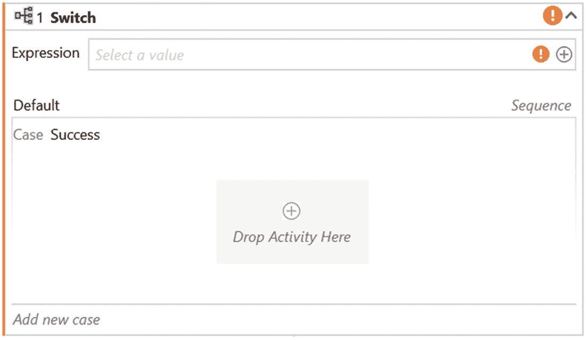

图 3-46

包含一个 case 的 Switch 活动

练习

**目标**：使用`Switch`活动根据数据的状态执行一组不同的活动。

**源代码**：Chapter_3_SwitchRepeatActivitiesExercise

**设置**：以下是分步实施说明：

1.  在`StudioX`中，将`Switch`活动添加到空白流程中。

2.  在`Switch`活动的`Properties`面板中，在`Misc`部分下，将`TypeArgument`更新为`String`。

3.  从`Expression`中选择`Ask when run`。

4.  接下来，单击`Add new case`链接，并将 case 的值输入为`In Progress`。

5.  向此新 case 的主体添加一个`Write Line`活动，并将`Text`设置为`Executing In Progress case`。

6.  接下来，单击`Add new case`链接，并将 case 的值输入为`Success`。

7.  向此新 case 的主体添加一个`Write Line`活动，并将`Text`设置为`Executing Success case`。

8.  接下来，单击`Add new case`链接，并将 case 的值输入为`Failure`。

9.  向此新 case 的主体添加一个`Write Line`活动，并将`Text`设置为`Executing Failure case`。

10. 接下来，向`Default` case 的主体添加一个`Write Line`活动，并将`Text`设置为`Executing Default case`。

完成练习后，**Switch**活动的最终配置应类似于图 3-47。执行图 3-48 所示的活动后，自动化将提示你选择或输入一个 case 值。根据你的选择，自动化会将值打印到输出面板，如图 3-49 所示。

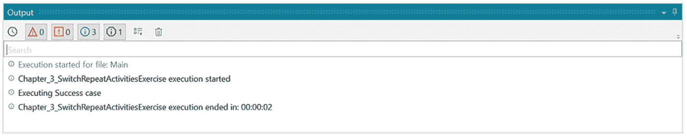

图 3-49

自动化运行的输出

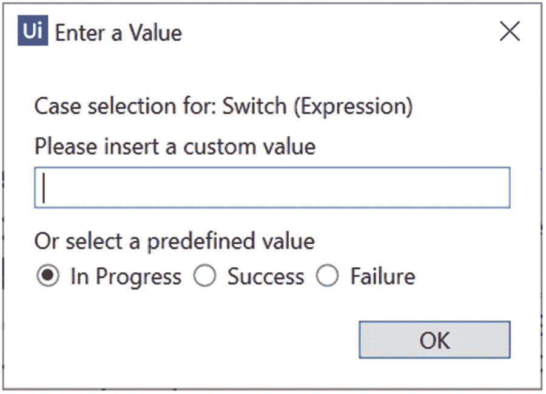

图 3-48

运行时的值提示

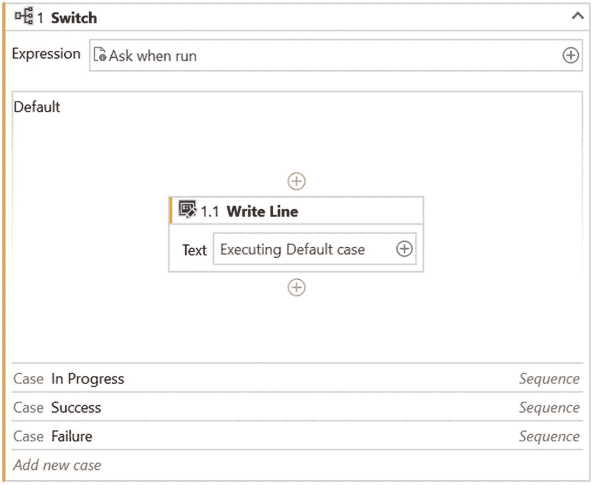

图 3-47

Switch 活动练习的配置

### 重复次数

**Repeat Number Of Times**活动允许你按指定次数重复一个或多个活动。

提示

通常，此活动将与 If、Skip Current 和 Exit Loop 活动结合使用。

#### 配置

本节提供如何配置**Repeat Number Of Times**活动的说明，如图 3-50 所示。

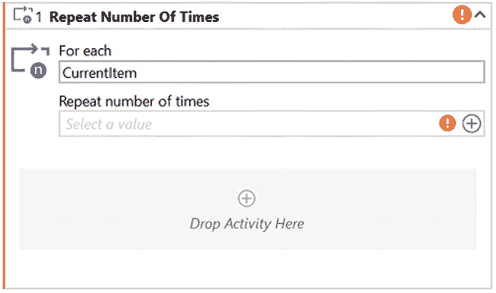

图 3-50

Repeat Number Of Times 的活动卡片

**Repeat number of times**：这是活动卡片上提供的一个必需配置。此配置允许你指定此活动应重复的次数。通常，此配置通过 Number 构建器选项指定。

**For each**：这是活动卡片上提供的一个必需配置。随着活动重复，索引将不断增加；例如，当活动重复第二次时，索引将为 2。此配置允许你命名索引，以便在活动主体中引用它。你可以使用此索引来决定是否需要跳过特定迭代，或者在达到`Repeat Number Of Times`值之前简单地停止迭代。默认情况下，文本设置为`CurrentItem`，并且可以更新以适合你的自动化；例如，你可以将`CurrentItem`重命名为 Vendor 或 Employee。

练习

**目标**：使用`Repeat Number Of Times`活动将上一练习中创建的 Switch 活动重复三次。此练习建立在上一`Switch`活动练习的基础上。

**源代码**：Chapter_3_SwitchRepeatActivitiesExercise

**设置**：以下是分步实施说明：

1.  在`StudioX`中，在`Designer`面板中的`Switch`活动之前添加`Repeat Number Of Times`活动。

2.  在`Repeat number of times`字段中，单击`Plus`图标，选择`Number`选项，然后输入`3`。

3.  将`Switch`活动（来自上一练习）移动到`Repeat Number Of Times`活动的主体中。

完成练习后，**Repeat Number Of Times**活动的最终配置应类似于图 3-51。

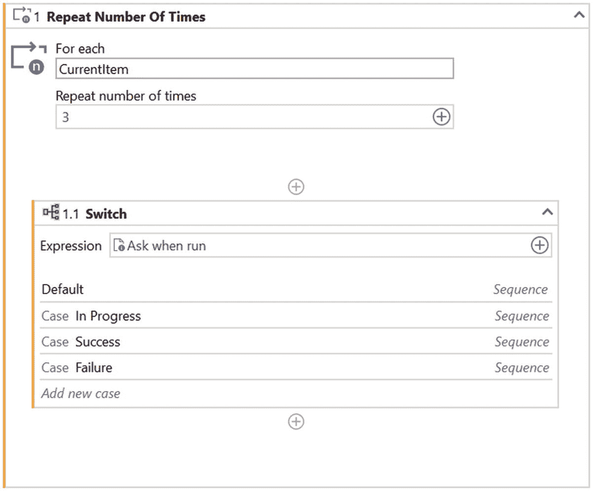

图 3-51

Repeat Number Of Times 活动练习的配置

执行图 3-51 所示的活动后，自动化将提示你三次选择或输入一个 case 值，如图 3-48 所示。根据你的选择，自动化会将值打印到输出面板，如图 3-52 所示。

图 3-52

自动化运行的输出

### 跳过当前

**Skip Current**活动允许你跳过重复活动中的当前迭代。

当您使用重复活动遍历项目列表时，此活动非常有用。基于某些条件，您可能只想处理某些项目而忽略其余项目；此时，您可以使用`Skip Current`活动来跳过当前迭代。

#### 配置

**跳过当前**活动，如图 3-53 所示，没有任何配置。此活动的唯一要求是它必须用在重复活动内部，例如**重复次数**活动或**对于每个**活动。

图 3-53

跳过当前的活动卡片

练习

**目标**：使用 `Skip Current` 活动，在状态为“进行中”时跳过当前迭代。此练习基于之前的 `Switch` 和 `Repeat Number Of Times` 活动练习。

**源代码**：Chapter_3_SwitchRepeatActivitiesExercise

**设置**：以下是分步实施说明：

1.  在 `StudioX` 中，将 `Skip Current` 活动添加到“进行中”案例主体中的 `Write Line` 活动之前。此 `Write Line` 活动将不会执行。

完成练习后，**跳过当前**活动的最终配置应类似于图 3-54。

图 3-54

跳过当前活动练习的配置

执行图 3-54 所示的活动后，自动化将提示您三次选择或输入案例值，如图 3-48 所示。根据您的选择，自动化会将值打印到输出面板，如图 3-55 所示。如果您依次选择 `Success`、`In Progress` 和 `Failure`，您将看到 `In Progress` 被跳过，因此未打印在输出面板中。

图 3-55

自动化运行的输出

### 退出循环

**退出循环**活动允许您终止重复活动。

当您使用重复活动遍历项目列表时，此活动非常有用。基于特定条件，如果您想终止重复活动，则可以使用 `Exit Loop` 活动。

#### 配置

**退出循环**活动，如图 3-56 所示，没有任何配置。此活动的唯一要求是它必须用在重复活动内部，例如**重复次数**活动或**对于每个**活动。

图 3-56

退出循环的活动卡片

练习

**目标**：使用 `Exit Loop` 活动，在自动化找到状态为“失败”的项目时立即终止循环。此练习基于之前的 `Switch`、`Repeat Number Of Times` 和 `Skip Current` 活动练习。

**源代码**：Chapter_3_SwitchRepeatActivitiesExercise

**设置**：以下是分步实施说明：

1.  在 `StudioX` 中，将 `Exit Loop` 活动添加到“失败”案例主体中的 `Write Line` 活动之前。此 `Write Line` 活动将不会执行。

完成练习后，**退出循环**活动的最终配置应类似于图 3-57。

图 3-57

退出循环活动练习的配置

执行图 3-57 所示的活动后，自动化将提示您三次选择或输入案例值，如图 3-48 所示。根据您的选择，自动化会将值打印到 `Output` 面板，如图 3-58 所示。如果您依次选择 `Success` 和 `Failure`，您会注意到自动化仅在 `Output` 面板中打印了一行，并且系统再也不会提示您进行第三次运行。

图 3-58

自动化运行的输出

### 获取用户名/密码

**获取用户名/密码**活动允许您从 Windows 凭据管理器中检索特定应用程序的凭据。

注意

要登录应用程序，请将“获取用户名/密码”活动与“键入”活动结合使用，以键入从此活动执行中保存的用户名和密码。

#### 配置

本节提供有关如何配置**获取用户名/密码**活动的说明，如图 3-59 所示。

图 3-59

获取用户名/密码的活动卡片

**已保存的凭据**：这是活动卡片上的一项必需配置。此配置允许您选择现有凭据，或者根据需要添加新凭据。

要添加凭据，请单击 `Key` 图标，它将打开 `UiPath 凭据管理器`，如图 3-60 所示。

图 3-60

UiPath 凭据管理器

接下来，单击 `+ 添加凭据`，然后输入凭据，如图 3-61 所示。

图 3-61

添加凭据对话框

在 `UiPath 凭据管理器` 中添加新凭据后，它们也会被添加到 `Windows 凭据管理器` 中，如图 3-62 所示。

图 3-62

Windows 凭据管理器

此外，您可以选择直接在 `Windows 凭据管理器` 中添加凭据，并在 UiPath StudioX 中访问它们；只需确保在名称前加上 `UiPath` 前缀即可。

**保存以备后用**：这是活动卡片上的一项必需配置。此配置允许您将凭据存储在一个值中，以便在自动化中稍后使用。您可以稍后从保存的值中访问 `Username` 和 `Password`，如图 3-63 中的库存管理示例所示。

图 3-63

访问用户名和密码示例

### 获取 Orchestrator 资产

**获取 Orchestrator 资产**活动允许您从 Orchestrator 检索凭据和其他资产，以便在自动化中使用。

提示

为了保持一致性并提高可重用性，应在 Orchestrator 中存储跨多个自动化共享的值。

#### 配置

本节提供如何配置**获取 Orchestrator 资产**活动的说明，如图 3-64 所示。

图 3-64

获取 Orchestrator 资产的活动卡片

**资产名称**：这是活动卡片上的一个必填配置。此配置允许您指定要从 Orchestrator 检索的资产。

**Orchestrator 文件夹路径**：这是 `Properties` 面板中的一个必填配置。此配置允许您指定资产在 Orchestrator 中的文件夹路径。

**保存以备后用**：这是活动卡片上的一个可选配置。此配置允许您保存从 Orchestrator 返回的资产，以便在自动化中后续使用。之后您可以从“使用已保存的值”菜单中引用该资产。

练习

**目标**：使用 `Get Orchestrator Asset` 活动从 Orchestrator 检索一个 `DocumentPath` 资产，如图 3-65 所示。

图 3-65

Orchestrator 中的 DocumentPath 资产

**源代码**：Chapter_3-GetOrchestratorAssetExercise

**设置**：以下是分步实施说明：

1.  在 `StudioX` 中，将 `Get Orchestrator Asset` 活动添加到一个空白流程中。

2.  在 `资产名称` 字段中，点击 `Plus` 图标，选择 `文本` 选项，然后输入 `DocumentPath`。

3.  在 `Properties` 面板的 `Orchestrator 文件夹路径` 字段中，点击 `Plus` 图标，选择 `文本` 选项，然后输入 `/`。这指定了我们在父文件夹中查找该资产。

4.  点击 `保存以备后用` 字段，点击 `Plus` 图标，然后选择 `保存以备后用`。输入 `OrchestratorAssetValue` 作为值名称。

5.  接下来，在 `Get Orchestrator Asset` 活动之后添加 `Write Line` 活动。

6.  在 `文本` 字段中，点击 `Plus` 图标，然后悬停在 `使用已保存的值` 上，选择 `OrchestratorAssetValue`。

完成练习后，**获取 Orchestrator 资产**活动的最终配置应类似于图 3-66。

图 3-66

获取 Orchestrator 资产活动练习的配置

执行图 3-66 中所示的活动后，自动化将从 Orchestrator 检索资产并将值打印到输出面板，如图 3-67 所示。

图 3-67

自动化运行的输出

### 保存以备后用

**保存以备后用**活动允许您保存任何值以供后续使用。

#### 配置

本节提供如何配置**保存以备后用**活动的说明，如图 3-68 所示。

图 3-68

获取用户名/密码的活动卡片

**保存到**：这是活动卡片上的一个必填配置。此配置允许您选择一个现有的值名称或创建一个新的值名称，如图 3-69 所示。此值名称将开始显示在 `Data Manager` 面板中。要在后续活动中使用此值，请点击 `Plus` 图标并从 `使用已保存的值` 菜单中选择它。

图 3-69

保存到选项菜单

**要保存的值**：这是活动卡片上的一个必填配置。此配置允许您指定要保存的值。图 3-70 显示了可用于指定值的不同选项。

图 3-70

指定要保存的值的选项

### 等待下载

**等待下载**活动允许您监控并等待文件下载完成，然后再继续执行。

#### 配置

本节提供如何配置**等待下载**活动的说明，如图 3-71 所示。

图 3-71

等待下载的活动卡片

任何将要与应用程序交互以开始文件下载的活动都必须添加到**等待下载**活动的主体中。

**监控的文件夹**：这是活动卡片上的一个必填配置。此配置允许您指定自动化将监控文件下载的文件夹。默认情况下，该值为 `User Folder\Downloads`，即自动化监控您的 Windows 配置文件或浏览器的默认 `Downloads` 文件夹。

**已下载的文件**：这是活动卡片上的一个可选配置。此配置允许您存储已下载文件的详细信息以供后续使用。例如，您可以使用文件路径将其复制到另一个文件夹进行处理。

**超时**：这是 `Properties` 面板中的一个可选配置。此配置允许您指定活动在继续之前等待文件下载完成的时长（以秒为单位）。默认情况下，超时值设置为 300。对于较大的文件，应增加此值。

本章中没有针对此活动的练习。我们将在第 4 章的 `Hover` 活动练习中使用 `Wait for Download` 活动。图 3-72 显示了此活动配置后的外观。

图 3-72

等待下载活动的配置

### `Group`

**Group** 活动允许您将一组活动进行逻辑分组。Group 主体内的所有活动都按相同顺序执行。这是将大型自动化项目进行逻辑拆分的绝佳方式。

#### 配置

**Group** 活动，如图 3-73 所示，没有任何配置。

图 3-73

Group 的活动卡片

