# 4. UI 自动化

与多个桌面和 Web 应用程序交互是我们日常工作中必不可少的一部分。我们使用这些应用程序来完成各种任务，例如在时间跟踪系统中记录工时表，在文档管理系统中存储、组织和检索文档，或在项目管理软件中跟踪项目。为了与这些不同的应用程序交互，我们使用它们的用户界面 (UI)。同样，UiPath StudioX UI 自动化通过与用户界面交互，复制用户操作（如勾选复选框、选择下拉菜单、输入数据和点击按钮）来自动化所需的任务。

## 学习目标

在本章结束时，您将学习如何

*   加载 Web 和桌面应用程序

*   在表单中输入数据

*   从表单和表格中提取数据

*   执行与用户界面交互的其他活动

*   使用应用程序/Web 录制器生成自动化

## 示例概述

本章所有练习使用的示例应用程序是**联系人管理**。该应用程序可通过浏览器从 [`https://therpabook.com/samples/contactsmanagement/`](https://therpabook.com/samples/contactsmanagement/) 位置访问。本节提供该示例应用程序的快速概述。

**联系人列表**：这是打开此 Web 应用程序时加载的默认页面。如图 4-1 所示，此页面包含以下部分：

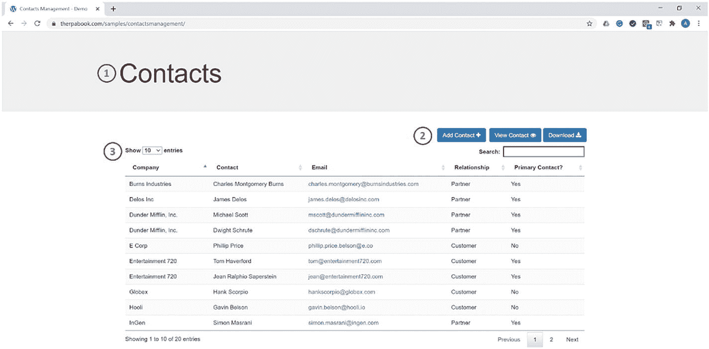

图 4-1

联系人管理 Web 应用程序主页

1.  页眉：显示应用程序标题
2.  按钮：用于打开添加联系人详情对话框、查看联系人详情对话框，以及下载到 Excel 和 CSV
3.  表格：包含跨多页的联系人列表

**添加联系人**：当您从主页单击“添加联系人”按钮时，会显示此对话框，如图 4-2 所示。此屏幕允许您输入新的联系人详情。该应用程序不可操作，因此不会持久保存任何新联系人。

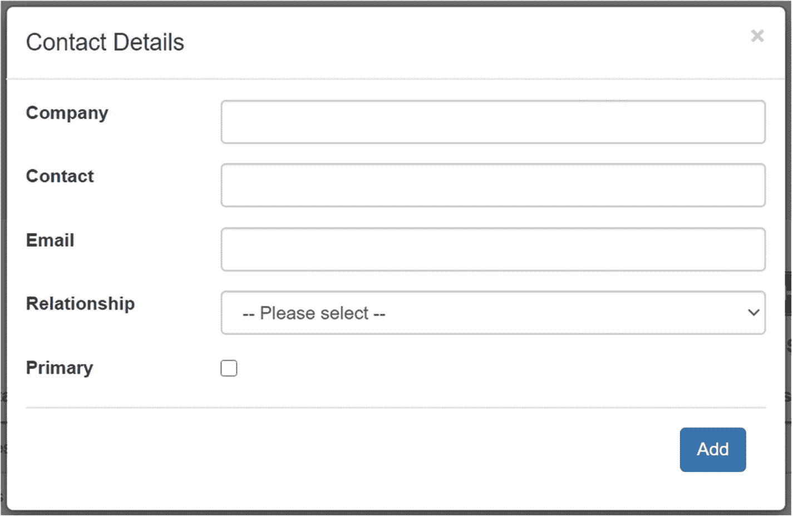

图 4-2

添加联系人对话框

**查看联系人**：当您从主页单击“查看联系人”按钮时，会显示此对话框，如图 4-3 所示。此屏幕允许您查看联系人详情。该应用程序不可操作，因此始终显示相同的联系人信息。

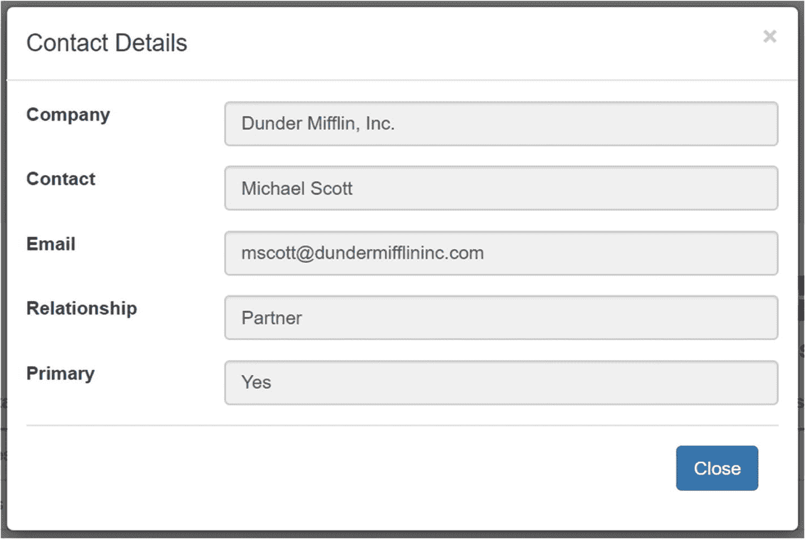

图 4-3

查看联系人对话框

**下载**：此按钮允许您以 Excel 和 CSV 格式下载联系人列表。

## 活动参考

UI 自动化活动可从图 4-4 所示的“应用程序/Web”类别中获取。以下各节提供了有关如何配置和使用每个活动的说明。

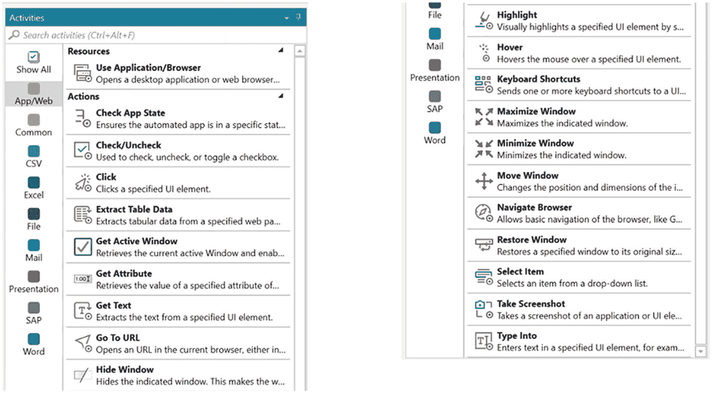

图 4-4

用于应用程序/Web 自动化的活动

### 使用应用程序/浏览器

**使用应用程序/浏览器**活动允许您打开、关闭 Web 或桌面应用程序并与之交互。

注意

**使用应用程序/浏览器**活动将包含您要对目标应用程序 UI 执行的所有操作。例如，如果您想单击屏幕上的按钮，则必须将“单击”活动添加到该活动的主体中。

#### 配置

本节提供有关如何配置

的说明，如图 4-5 所示。

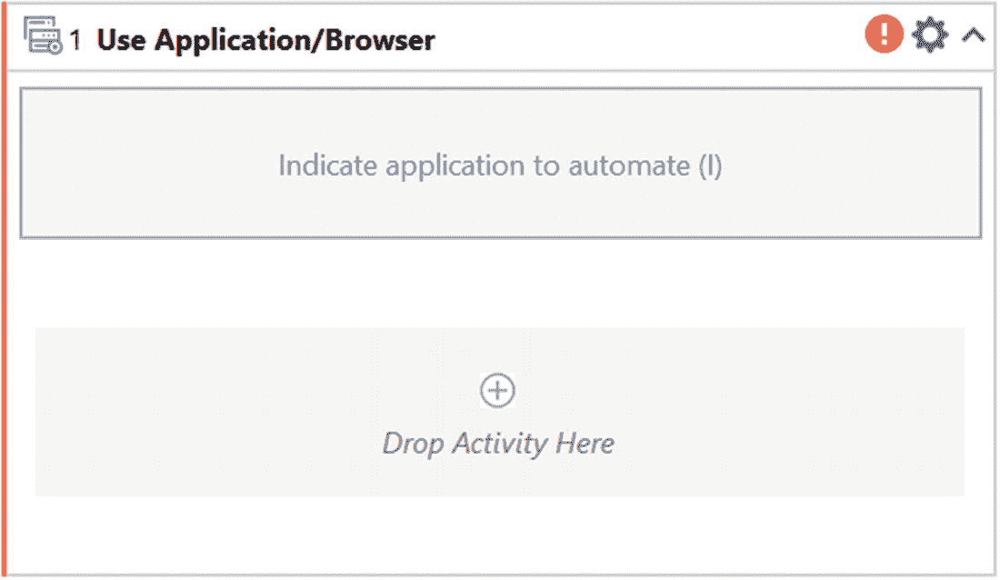

图 4-5

使用应用程序/浏览器的活动卡片

注意

在自动化 Web 应用程序之前，您需要从 `主页` ➤ `工具` ➤ `UiPath 扩展程序` 安装相关的 Web 浏览器扩展。

**指示要自动化的应用程序 (I)**：这是活动卡片上的一项必需配置。此配置允许您指示要自动化的目标应用程序。要配置此活动，请确保您的目标应用程序已打开。一旦您指示了目标应用程序，StudioX 将自动识别它是桌面应用程序还是 Web 应用程序。图 4-6 显示了 Web 应用程序的活动卡片，而图 4-7 显示了桌面应用程序的活动卡片。

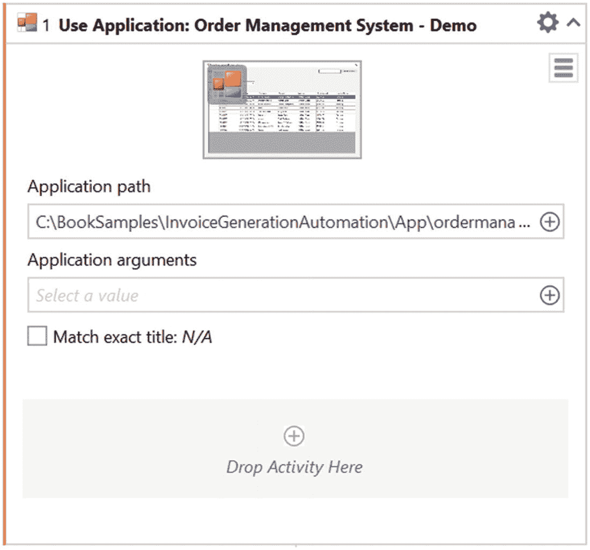

图 4-7

使用应用程序的活动卡片

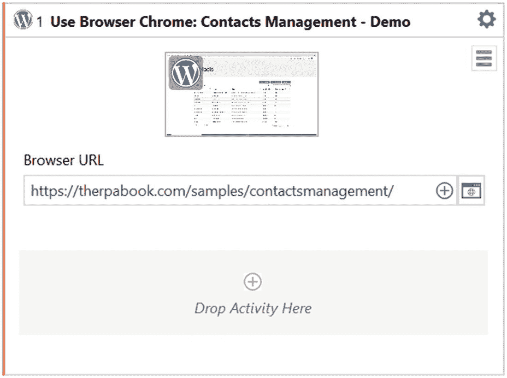

图 4-6

使用浏览器的活动卡片

**浏览器 URL**：这是活动卡片上的一项必需配置。此配置仅在目标是 Web 应用程序时可用。此配置允许您指定 Web 应用程序的 URL。默认情况下，此字段会填充在指示应用程序配置中识别出的浏览器 URL。

**应用程序路径**：这是活动卡片上的一项必需配置。此配置仅在目标是桌面应用程序时可用。此配置允许您指定本地系统上可执行文件的完整路径。默认情况下，此字段会填充在指示应用程序配置中识别出的应用程序路径。

**应用程序参数**：这是活动卡片上的一项可选配置。此配置仅在目标是桌面应用程序时可用。此配置允许您指定要执行的应用程序的参数。例如，启动记事本时，您可以指定在记事本打开时要加载哪个文件。

**匹配确切标题**：这是活动卡片上的一项可选配置。此配置仅在目标是桌面应用程序时可用。此配置允许您指定自动化是否应精确匹配应用程序标题。默认情况下，此选项未选中，即自动化不会使用精确标题匹配。

**打开**：这是 `属性` 面板上的一项可选配置。此配置允许您指定自动化在执行时是否应打开此应用程序。有三个选项：`从不`（从不打开应用程序，当应用程序可能已经打开时此选项很有用）、`始终`（始终打开应用程序）和 `如果未打开`（仅在应用程序尚未打开时才打开它）。

**关闭**：这是 `属性` 面板上的一项可选配置。此配置允许您指定自动化完成后是否应关闭目标应用程序。有三个选项：`从不`（从不关闭应用程序，当人员或其他程序可能已经打开了应用程序时此选项很有用）、`始终`（始终关闭应用程序）和 `如果由应用程序/浏览器打开`（仅在自动化打开了应用程序时才关闭它）。

### 转到 URL

**转到 URL** 活动允许您在浏览器中打开指定的 URL。

#### 配置

本节提供如何配置**转到 URL** 活动的说明，如图 4-8 所示。

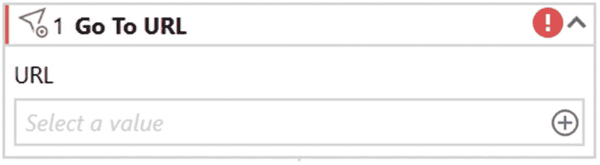

图 4-8

转到 URL 的活动卡片

**URL**：这是活动卡片上的一项必需配置。此配置允许您指定要在浏览器中打开的 URL。

练习

**目标**：使用 `Go To URL` 活动导航至 [`https://therpabook.com/samples/contactsmanagement/`](https://therpabook.com/samples/contactsmanagement/)。

**源代码**：Chapter_4_MiscellaneousActivitiesExercise

**设置**：以下是分步实施说明：

1.  打开您选择的浏览器，在地址栏中输入 `about:blank`。这将确保默认情况下不加载任何页面。

2.  在 `StudioX` 中，将 `使用应用程序/浏览器` 活动添加到一个空白流程中。

3.  接下来，在 `使用应用程序/浏览器` 活动卡片中点击 `指示应用程序`。您会注意到屏幕上出现蓝色阴影；这是为了引导鼠标指向浏览器以选择窗口。点击浏览器将自动填充活动卡片。

4.  接下来，选择 `使用应用程序/浏览器` 活动卡片，并从 `属性` 中将 `选项` ➤ `打开` 属性设置为 `始终`。这将确保自动化始终打开一个新的浏览器。

5.  接下来，在 `使用应用程序/浏览器` 活动的主体中添加一个 `转到 URL` 活动。

6.  然后，在 `转到 URL` 活动的 `URL` 字段中，点击 `加号` 图标，选择 `文本` 选项，并输入 [`https://therpabook.com/samples/contactsmanagement/`](https://therpabook.com/samples/contactsmanagement/)。点击 `保存`。

完成练习后，**转到 URL** 活动的最终配置应类似于图 4-9。图 4-10 显示了自动化运行完成后目标 Web 应用程序的状态。在此例中，浏览器已重定向到新的 URL。

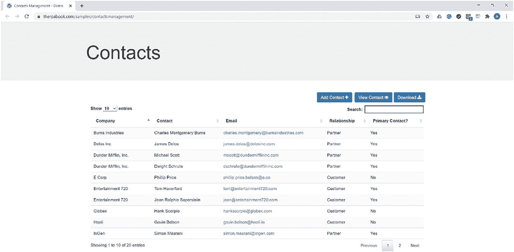

图 4-10

转到 URL 活动练习的结果

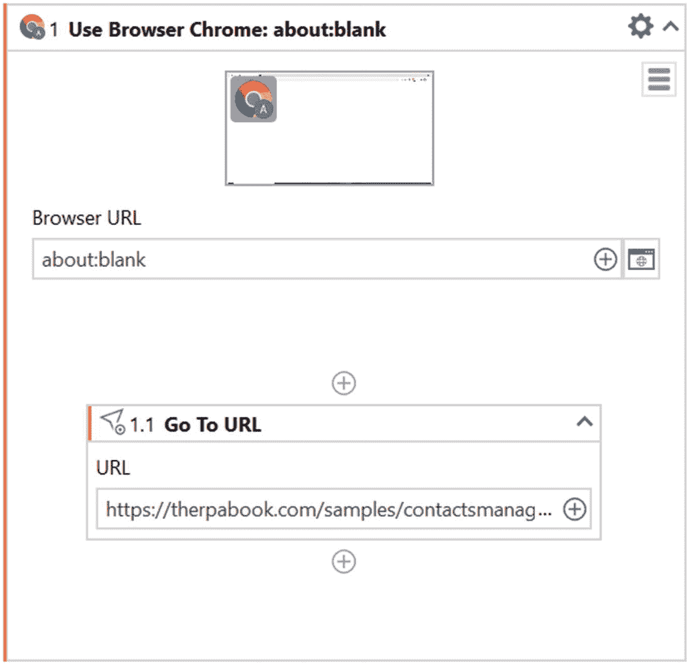

图 4-9

转到 URL 活动练习的最终配置

### 导航浏览器

**导航浏览器** 活动允许您执行基本的浏览器导航操作，例如后退、前进、主页、刷新和关闭标签页。

#### 配置

本节提供如何配置**导航浏览器**活动的说明，如图 4-11 所示。

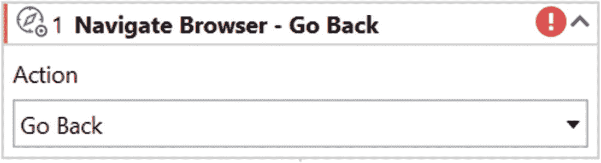

图 4-11

导航浏览器的活动卡片

**操作**：这是活动卡片上的一项必需配置。此配置允许您指定要在浏览器上执行的导航操作。表 4-1 提供了每个操作的简要说明。默认情况下，操作设置为 `后退`。

表 4-1

导航浏览器活动的操作

| 操作 | 说明 |
| --- | --- |
| 后退 | 在浏览器中打开上一页；此操作仅在浏览器之前打开过其他页面时有效。 |
| 前进 | 在浏览器中打开下一页；此操作仅在之前使用过后退操作时有效。 |
| 主页 | 打开浏览器的默认主页。 |
| 刷新 | 刷新页面。 |
| 关闭标签页 | 关闭当前活动的标签页。 |

练习

**目标**：使用 `导航浏览器` 活动刷新已打开的网页。此练习建立在 `转到 URL` 练习的基础上。图 4-10 显示了此练习之前目标 Web 应用程序的状态。

**源代码**：Chapter_4_MiscellaneousActivitiesExercise

**设置**：以下是分步实施说明：

1.  在 `StudioX` 中，将 `导航浏览器` 活动添加到 `使用应用程序/浏览器` 活动的主体中，位于 `转到 URL` 活动之后。

2.  接下来，从 `操作` 下拉菜单中选择 `刷新`。

完成练习后，**导航浏览器** 活动的最终配置应类似于图 4-12。

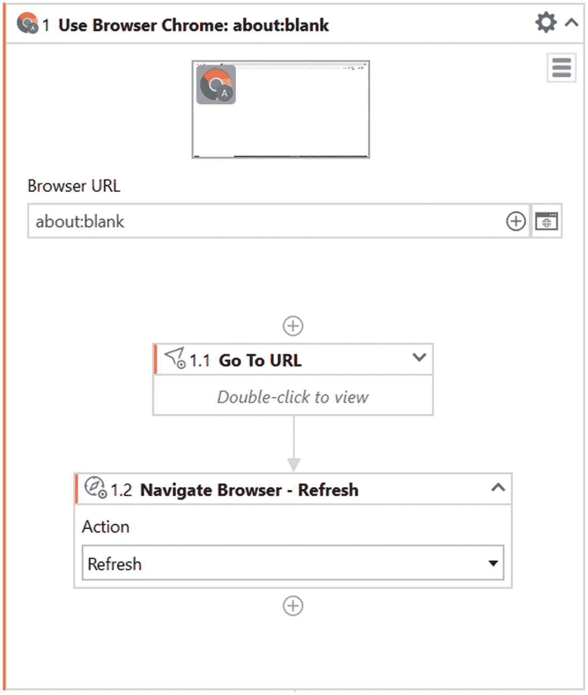

图 4-12

导航浏览器活动练习的最终配置

### 高亮

**高亮** 活动允许您在自动化运行时以视觉方式高亮显示指定区域。自动化会在指定元素周围创建一个框。

提示

对于希望在流程执行时以视觉方式强调特定 UI 元素的任务，高亮活动是支持此类需求的绝佳方式。

#### 配置

本节提供如何配置**高亮**活动的说明，如图 4-13 所示。

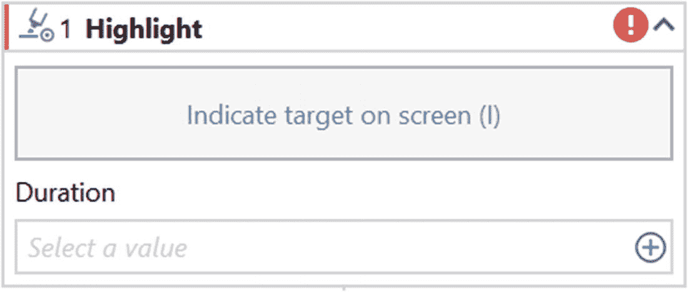

图 4-13

高亮活动的活动卡片

**指示屏幕上的目标 (I)**：这是活动卡片上的一项必需配置。此配置允许您指定要在 UI 上高亮的元素或区域。

**持续时间**：这是活动卡片上的一项可选配置。此配置允许您指定（以秒为单位）自动化应高亮指定元素的时长。

**颜色**：这是`属性`面板上的一项可选配置。此配置允许您指定高亮框的颜色，默认设置为金色。

练习

**目标**：使用`高亮`活动直观地高亮“联系人”表中的记录数。本练习建立在“转到 URL”和“导航浏览器”练习的基础上。图 4-10 显示了本练习之前目标 Web 应用程序的状态。

**源代码**：Chapter_4_MiscellaneousActivitiesExercise

**设置**：以下是分步实施说明：

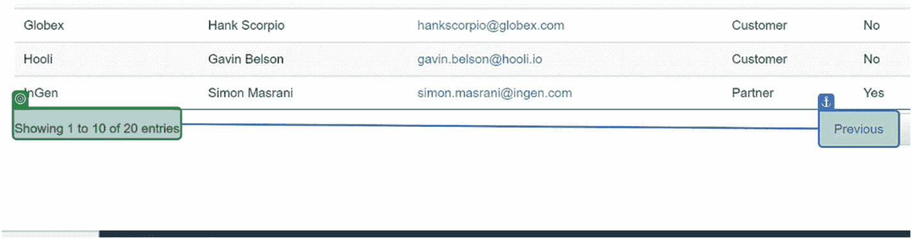

图 4-14

选择要高亮的元素

1.  接下来，在`高亮`活动的`持续时间`字段中，单击`加号`图标，选择`数字`选项，然后输入`5`秒。这将高亮指定的 UI 元素 5 秒钟。

1.  在 `StudioX` 中，将`高亮`活动添加到`使用应用程序/浏览器`活动主体中，位于`导航浏览器`活动之后。

2.  接下来，在`高亮`活动中，单击`指示屏幕上的目标 (I)`链接。当您将鼠标指向指定目标元素时，您会注意到一个绿色高亮；选择表格的左下角区域。然后，当您将鼠标指向指定锚点时，您会注意到一个蓝色高亮；指示`上一页`按钮。此时，您的选择应类似于图 4-14。单击`确认`按钮。

完成练习后，**高亮**活动的最终配置应类似于图 4-15。图 4-16 显示了自动化运行完成后目标 Web 应用程序的状态。在此示例中，条目总数区域被高亮。

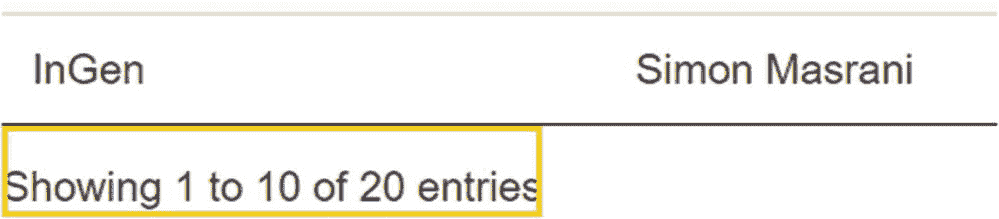

图 4-16

高亮活动练习的结果

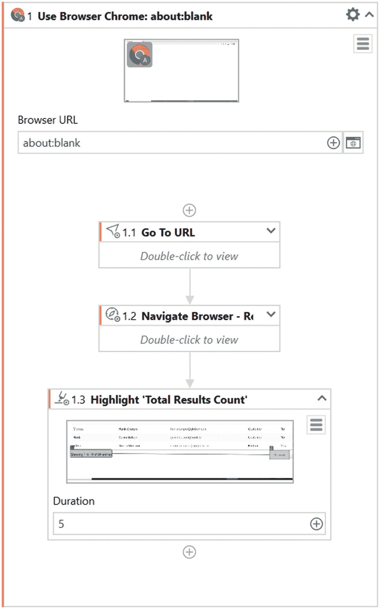

图 4-15

高亮活动练习的最终配置

### 截取屏幕截图

**截取屏幕截图**活动允许您捕获指定区域的屏幕截图。

提示

对于需要为审计目的提供证据以证明已执行特定操作的任务，`截取屏幕截图`活动是支持此类需求的绝佳方式。

#### 配置

本节提供如何配置**截取屏幕截图**活动的说明，如图 4-17 所示。

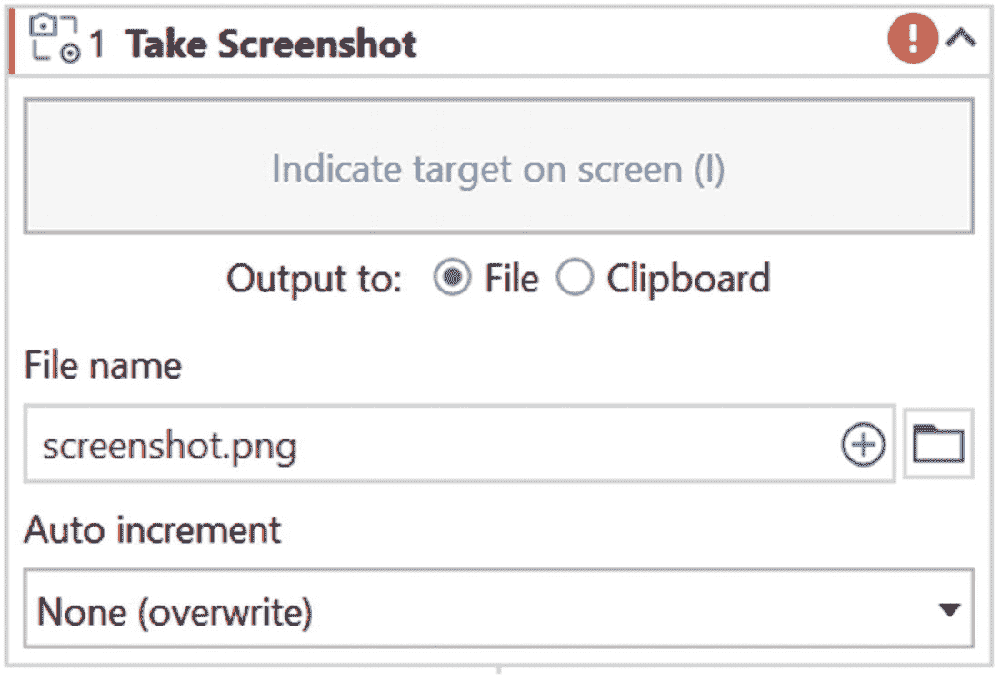

图 4-17

截取屏幕截图活动的活动卡片

**指示屏幕上的目标 (I)**：这是活动卡片上的一项必需配置。此配置允许您指定要在屏幕截图中捕获的 UI 元素。

**输出到**：这是活动卡片上的一项必需配置。此配置允许您指定屏幕截图是应物理保存为文件，还是仅保存在剪贴板内存中。

**文件名**：这是活动卡片上的一项必需配置。仅当您从`输出到`字段中选择`文件`时，此配置才可用。此配置允许您指定屏幕截图应存储的文件夹位置以及屏幕截图的名称。

**自动递增**：这是活动卡片上的一项可选配置。仅当您从`输出到`字段中选择`文件`时，此配置才可用。此配置会自动将索引或时间戳（如图 4-18 所示）附加到文件名，但仅当`保存到`位置已存在同名文件时才会生效。此字段有助于避免覆盖现有文件。

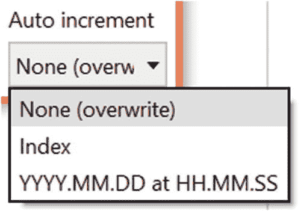

图 4-18

自动递增的可用选项

练习

**目标**：使用`截取屏幕截图`活动截取“联系人”表的屏幕截图。本练习建立在“转到 URL”、“导航浏览器”和“高亮”练习的基础上。图 4-10 显示了本练习之前目标 Web 应用程序的状态。

**源代码**：Chapter_4_MiscellaneousActivitiesExercise

**设置**：以下是分步实施说明：

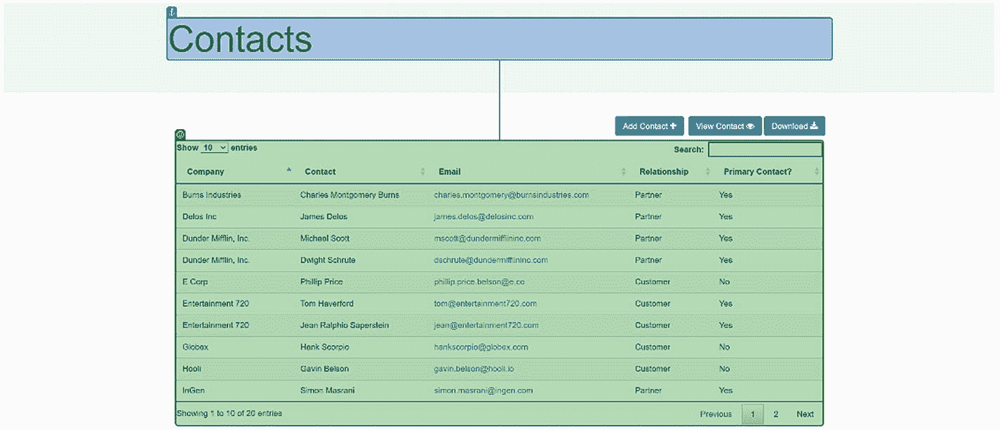

图 4-19

选择要在屏幕截图中捕获的元素

1.  接下来，在`截取屏幕截图`活动的`保存到文件夹`字段中，单击`浏览文件夹`图标，然后选择 `C:\BookSamples\Chapter_04` 文件夹。

2.  屏幕截图文件的名称将自动附加到文件夹路径。默认名称为 `screenshot.png`。

3.  从`自动递增`下拉菜单中，选择 `YYYY.MM.DD at HH.MM.SS` 选项。这将在屏幕截图文件名的末尾附加一个时间戳。

1.  在 `StudioX` 中，将`截取屏幕截图`活动添加到`使用应用程序/浏览器`活动主体中，位于`高亮`活动之后。

2.  接下来，在`截取屏幕截图`活动中，单击`指示屏幕上的目标 (I)`链接，并将鼠标指向联系人列表表格。指定目标元素后，您会注意到表格上出现一个红色高亮。这是为了提示您指定一个锚点；在此示例中，请使用页面标题。此时，您的选择应类似于图 4-19。单击`确认`按钮。

完成练习后，**截取屏幕截图**活动的最终配置应类似于图 4-20。图 4-21 显示了包含多个屏幕截图的文件夹。如果您多次运行自动化，它将不断向指定文件夹添加屏幕截图，并在名称后附加时间戳。

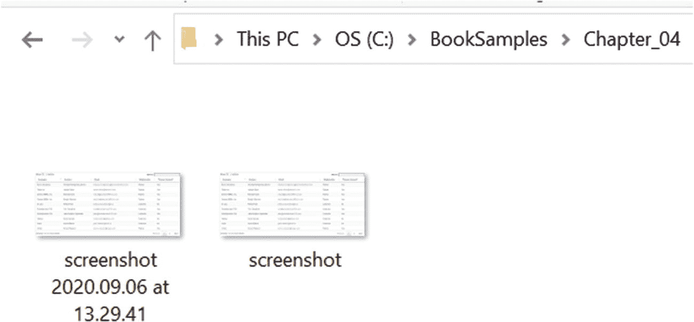

图 4-21

截取屏幕截图活动练习的结果

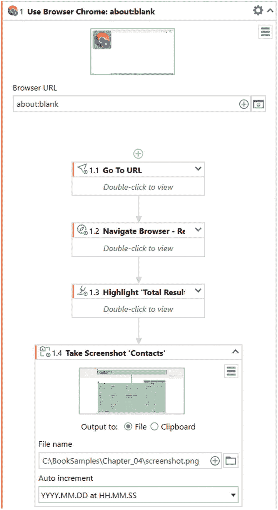

图 4-20

截取屏幕截图活动练习的最终配置

### 检查应用状态

当需要根据特定 UI 元素（例如应用程序上的加载图标）执行操作时，可以使用“检查应用状态”活动。作为人类，我们理解这意味着屏幕仍在加载，但自动化程序并不理解。**检查应用状态**活动是确保屏幕在自动化程序开始与之交互之前已完全加载的好方法。

提示

对于需要根据 UI 元素（例如消息框或错误弹出窗口）执行不同操作的任务，“检查应用状态”活动是支持此类需求的绝佳方式。

#### 配置

本节提供如何配置**检查应用状态**活动的说明，如图 4-22 所示。

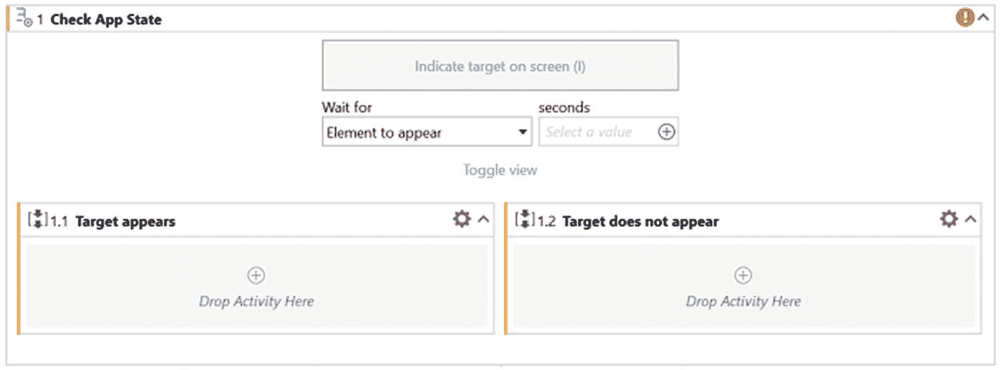

图 4-22

检查应用状态的活动卡片

**指示屏幕上的目标 (I)**：这是活动卡片上的一项必需配置。此配置允许您指定一个 UI 元素，自动化程序将等待该元素出现或消失，然后再继续。

**等待**：这是活动卡片上的一项必需配置。此配置允许您指定自动化程序在继续之前是否需要等待目标元素出现或消失。默认情况下，此选项设置为`元素出现`。

**秒数**：这是活动卡片上的一项可选配置。此配置允许您指定自动化程序在继续之前等待目标元素出现或消失的时间（以秒为单位）。默认情况下，此选项设置为`5`秒。

**目标出现/消失**：如果目标成功出现或消失，您想要运行的一组活动将添加到此块中。

**目标未出现/消失**：如果目标未出现或消失，您想要运行的一组活动将添加到此块中。

**结果**：这是`属性`面板上的一项可选配置。此配置允许您保存结果（`True` 或 `False`）以供后续使用。

练习

**目标**：使用 `Check App State` 活动等待旋转图标消失后再继续。

**源代码**：Chapter_4_CheckAppStateExercise

**设置**：以下是分步实施说明：

1.  接下来，在 `目标消失` 块中，添加一个 `消息框` 活动。

2.  接下来，在 `消息框` 活动中，点击 `加号` 图标，选择 `文本` 选项，然后输入 `目标已消失`。点击 `保存`。

3.  接下来，在 `目标未消失` 块中，添加一个 `消息框` 活动。

4.  接下来，在 `消息框` 活动中，点击 `加号` 图标，选择 `文本` 选项，然后输入 `目标未消失`。点击 `保存`。

1.  接下来，选择 `使用应用程序/浏览器` 活动卡片，并在 `属性` 中，将 `选项` ➤ `打开` 属性设置为 `始终`。这将确保自动化程序始终打开一个新的浏览器。

2.  接下来，在 `使用应用程序/浏览器` 活动的主体中添加一个 `检查应用状态` 活动。

3.  接下来，在 `检查应用状态` 活动中，点击 `指示屏幕上的目标 (I)` 链接，并将鼠标指向旋转图标。示例应用程序会显示旋转图标 10 秒钟，因此您需要在该时间范围内指示该元素。如果该时间范围太短，请在指示目标时使用暂停选项（从键盘按 F2）。此外，您可以在暂停即将结束时点击刷新（F5 或 Ctrl + R），以便有足够的时间指示旋转图标。

4.  接下来，从 `等待` 下拉菜单中，选择 `元素消失` 选项。

5.  在 `秒数` 字段中，点击 `加号` 图标，选择 `数字` 选项，然后输入 `15` 秒（这增加了 5 秒的缓冲时间）。

    **提示** 当 UI 元素出现或消失可能存在延迟时，为检查应用状态活动的秒数字段添加缓冲时间是支持延迟的好方法。

1.  打开您选择的浏览器，并在 URL 字段中输入 [`https://therpabook.com/samples/contactsmanagement/home_load.html`](https://therpabook.com/samples/contactsmanagement/home_load.html)。

2.  在 `StudioX` 中，将 `使用应用程序/浏览器` 活动添加到一个空白流程中。

3.  接下来，在 `使用应用程序/浏览器` 活动卡片中，点击 `指示应用程序`，并将鼠标指向浏览器。这将自动填充活动卡片。

    **注意** 因为使用应用程序/浏览器卡片正在捕获 URL，并且在加载过程中 URL 不会改变，所以您可以在页面加载中或加载完成后指示浏览器。

完成练习后，**检查应用状态**活动的最终配置应类似于图 4-23。运行自动化程序后，它将等待 15 秒，然后检查旋转图标是否已消失。根据目标应用程序的状态，将出现一个消息框并显示相应的消息。

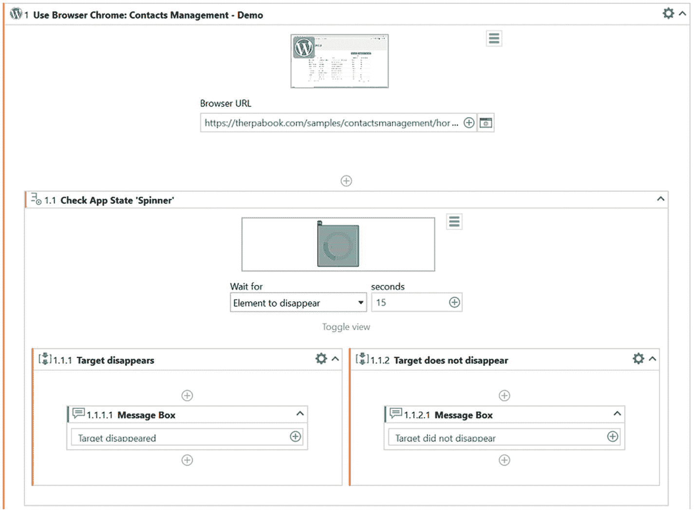

图 4-23

等待旋转图标消失的检查应用状态活动的最终配置

### 点击

**点击**活动允许您在指定的 UI 元素上执行鼠标点击操作。

#### 配置

本节提供如何配置**点击**活动的说明，如图 4-24 所示。

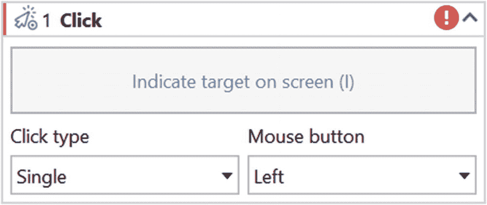

图 4-24

点击活动的活动卡片

**指示屏幕上的目标 (I)**：这是活动卡片上的一项必需配置。此配置允许您指定希望自动化程序点击的 UI 元素。

**点击类型**：这是活动卡片上的一项必需配置。此配置允许您指定要执行的鼠标点击类型。图 4-25 显示了所有可用选项。默认情况下，此项设置为`单击`。

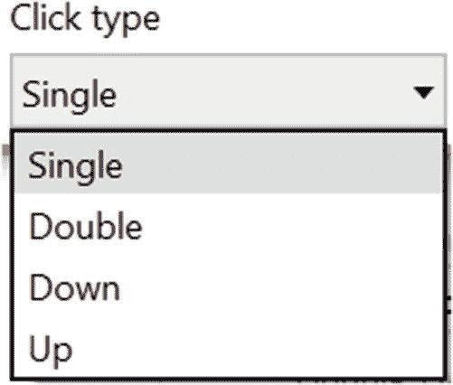

图 4-25

点击类型的可用选项

**鼠标按钮**：这是活动卡片上的一项必需配置。此配置允许您指定要点击的鼠标按钮。图 4-26 显示了所有可用选项。默认情况下，此项设置为`左键`点击。

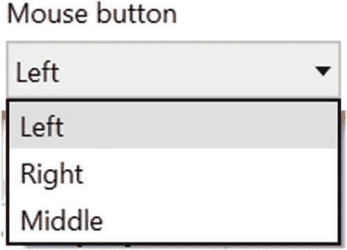

图 4-26

鼠标按钮点击的可用选项

**按键修饰符**：这是`属性`面板上的一项可选配置。此配置允许您将按键与鼠标点击操作结合使用。图 4-27 显示了所有可用选项。默认情况下，此项设置为`无`。

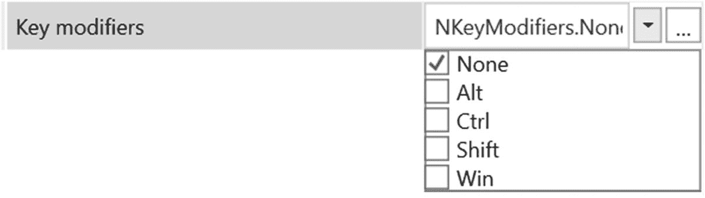

图 4-27

按键修饰符的可用选项

练习

**目标**：使用`点击`活动点击`添加联系人 +`按钮，以打开联系人详情对话框。

**源代码**：Chapter_4_FormDataEntryExercise

**设置**：以下是分步实施说明：

图 4-28

添加联系人按钮的目标和定位点

1.  打开您选择的浏览器，在地址栏中输入 [`https://therpabook.com/samples/contactsmanagement/`](https://therpabook.com/samples/contactsmanagement/)。

2.  在 `StudioX` 中，将`使用应用程序/浏览器`活动添加到一个空白流程中。

3.  接下来，在`使用应用程序/浏览器`活动卡片中点击`指示应用程序`，然后将鼠标指向浏览器。这将自动填充活动卡片。

4.  接下来，选择`使用应用程序/浏览器`活动卡片，并从`属性`中，将`选项` ➤ `打开`属性设置为`始终`。这将确保自动化程序始终打开一个新的浏览器。

5.  接下来，在`使用应用程序/浏览器`活动内部添加一个`点击`活动。

6.  接下来，在`点击`活动中，点击`指示屏幕上的目标 (I)`链接，当您将鼠标指向`添加联系人`按钮时，您会注意到一个绿色高亮。然后，当您将鼠标指向以指定定位点时，您会看到一个蓝色高亮；请指示`查看联系人`按钮。如果您无法检测到任何元素，请按 `F4` 更改检测机制。选择目标元素后，使用`查看联系人`按钮作为定位点。此时，您的选择应如图 4-28 所示。点击`确认`按钮。

完成练习后，**点击**活动的最终配置应类似于图 4-29。

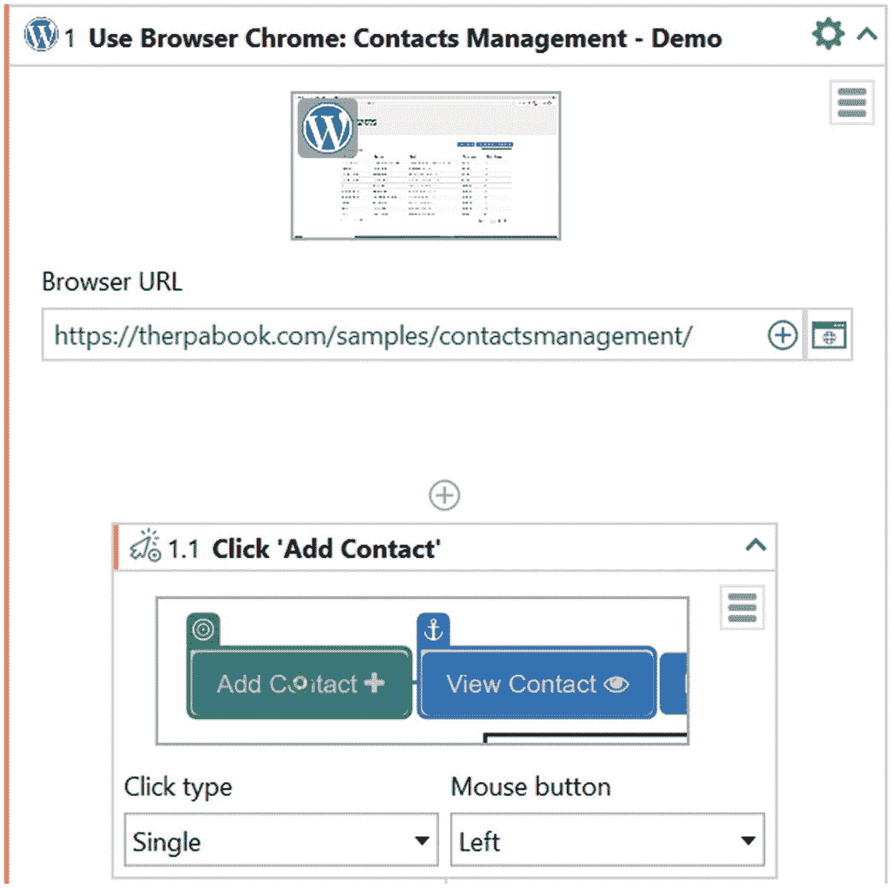

图 4-29

点击活动练习的最终配置

提示 当需要在最小化的应用程序内点击时，可以使用最大化窗口活动将应用程序最大化，以便机器人点击正确的 UI 元素。此外，在点击活动的属性窗格中将输入模式设置为模拟，可以使机器人在应用程序最小化时也能点击它。

图 4-30 显示了自动化程序运行完成后目标 Web 应用程序的状态。在此示例中，显示了一个空的联系人详情对话框。

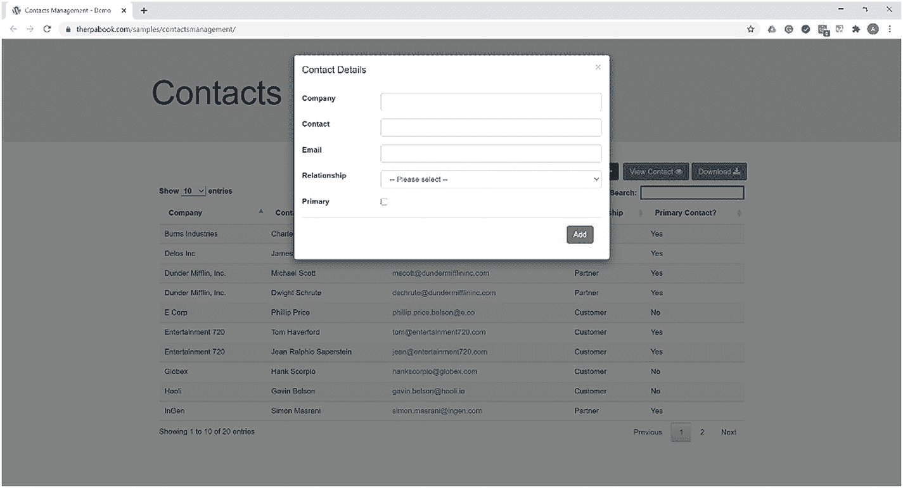

图 4-30

点击活动练习的结果

### 键入

**键入**活动允许您在 UI 上的指定元素中输入文本。

提示

当应用程序的下拉菜单不支持选择项活动（将在下文讨论）时，使用键入活动是支持选择特定下拉选项的一个好方法。

#### 配置

本节提供如何配置**键入**活动的说明，如图 4-31 所示。

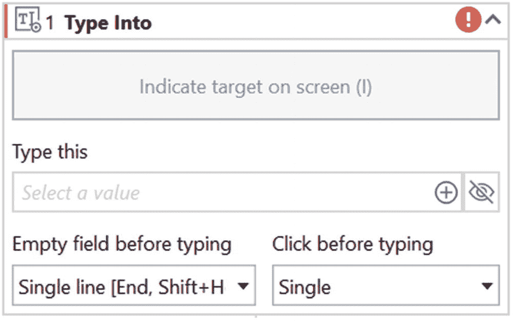

图 4-31

“键入”活动卡片

**指示屏幕上的目标 (I)**：这是活动卡片上的必填配置。此配置允许您指定要输入数据的 UI 元素。

**键入此文本**：这是活动卡片上的可选配置。此配置允许您指定应在目标元素中输入的文本。您还可以选择在文本中包含特殊键，或切换密码模式以安全地键入文本。此文本可以是静态或动态的。

**键入前清空字段**：这是活动卡片上的可选配置。此配置允许您指定是保留目标元素中的现有文本还是将其清除。如果希望保留现有文本不变，请设置为 `None`。如果要清除现有文本，则使用单行或多行选项。如果您处理的是单行文本字段，使用 `Single line` 将清除文本；如果您处理的是多行组件（如文本区域），则 `Multi line` 选项效果最佳。请注意，字段数据是通过键盘快捷键清除的。

**键入前单击**：这是活动卡片上的可选配置。此配置允许您指定自动化在开始键入之前是否应单击目标元素。您可以选择 `Single` 单击或 `Double` 双击。默认情况下，此选项设置为 `Single`。

提示

在文本字段需要单击一次或两次才能变为可编辑状态的情况下，“键入前单击”非常有用。

**按键间延迟**：这是 `Properties` 面板上的可选配置。此配置允许您指定每次击键之间的延迟。默认情况下，不设置延迟。此字段仅适用于硬件事件输入方法。

**结束时取消选择**：这是 `Properties` 面板上的可选配置。此配置允许您指定在活动结束时，自动化是否应从 UI 元素中移除焦点。此字段仅适用于模拟输入方法。

练习

**目标**：使用 `Type Into` 活动填写“联系人详细信息”对话框的文本字段。本练习基于之前的 `Click` 活动练习。图 4-30 显示了本练习之前目标 Web 应用程序的状态。

**源代码**：Chapter_4_FormDataEntryExercise

**设置**：以下是逐步实施说明：

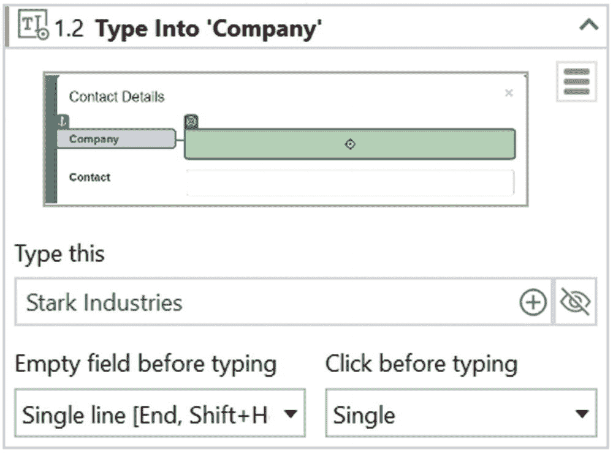

图 4-33

“键入”活动的配置

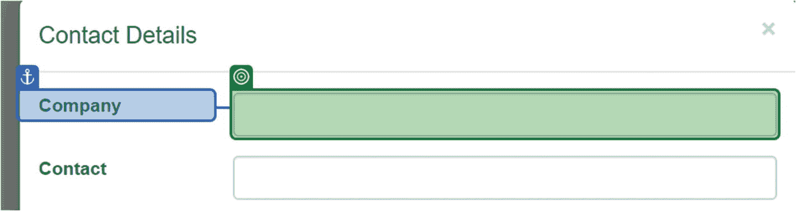

图 4-32

“公司”文本字段的目标和定位标记

1.  接下来，对 `Contact` 字段重复步骤 2–4。

2.  接下来，在 `Type this` 字段中，单击 `Plus` 图标，选择 `Text` 选项，然后输入 `Tony Stark`。

3.  接下来，对 `Email` 字段重复步骤 2–4。

4.  接下来，在 `Type this` 字段中，单击 `Plus` 图标，选择 `Text` 选项，然后输入 tstark@starkindustries.com。

1.  接下来，在 `Type this` 字段中，单击 `Plus` 图标，选择 `Text` 选项，然后输入 `Stark Industries`。此时，您的 `Type Into` 活动配置应类似于图 4-33。

1.  在 `StudioX` 中，将 `Type Into` 活动添加到 `Use Application/Browser` 活动中，紧跟在 `Click 'Add Contact'` 活动之后。

2.  接下来，在 `Type Into` 活动中，单击 `Indicate target on screen (I)` 链接，并将鼠标指向 `Company` 字段。字段标签会自动检测为定位标记。此时，您的选择应如图 4-32 所示。单击 `Confirm` 按钮。

完成练习后，**Type Into** 活动的最终配置应类似于图 4-34。图 4-35 显示了自动化运行完成后目标 Web 应用程序的状态。在此示例中，数据已输入到“联系人详细信息”对话框的“公司”、“联系人”和“电子邮件”字段中。

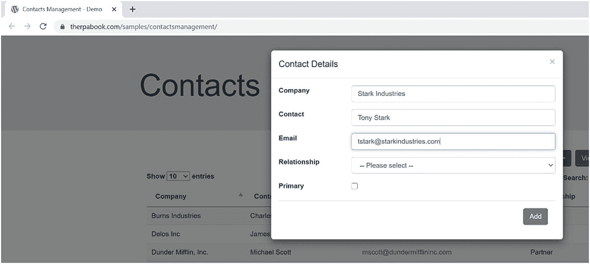

图 4-35

“键入”活动练习的结果

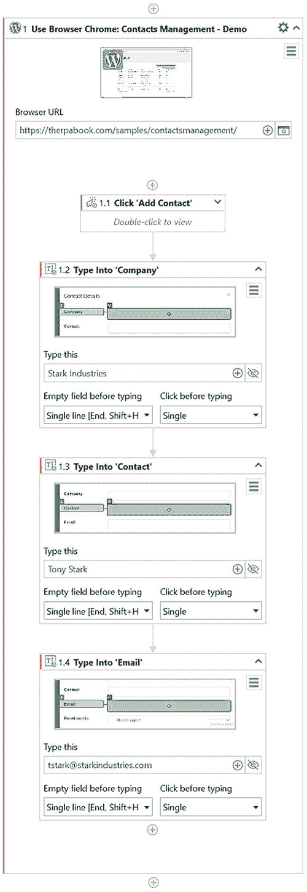

图 4-34

“键入”活动练习的最终配置

### 选择项目

**选择项目**活动允许您在指定的下拉列表中选择一个项目。

注意

如果应用程序下拉列表不是组合框或列表框，则“选择项目”活动可能不受支持。在这种情况下，建议使用“键入”活动。

#### 配置

本节提供如何配置**选择项**活动的说明，如图 4-36 所示。

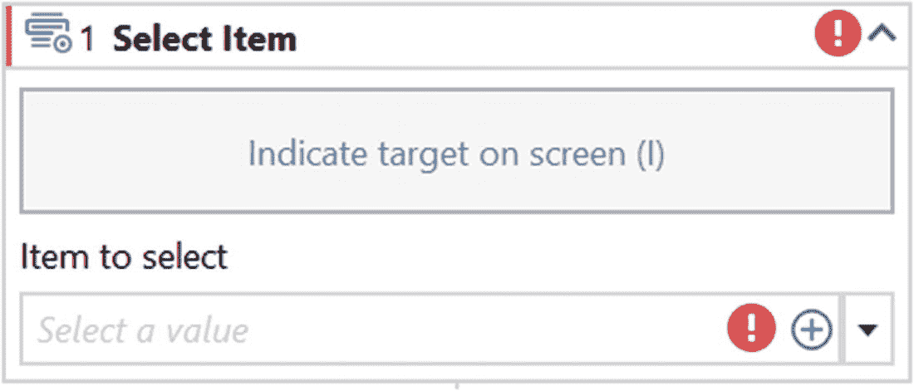

图 4-36

选择项活动卡片

**指示屏幕上的目标 (I)**：这是活动卡片上的一项必需配置。此配置允许您指定用户界面中要从中选择项的下拉菜单。

**要选择的项**：这是活动卡片上的一项可选配置。默认情况下，此列表为空。一旦您在用户界面上指定了下拉元素，此列表将填充下拉菜单中的所有可用选项。图 4-37 展示了此列表填充后的示例。

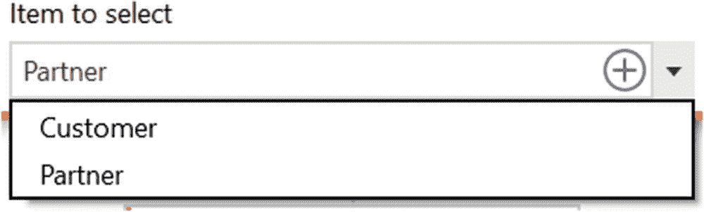

图 4-37

下拉菜单中的可用选项

练习

**目标**：使用 `Select Item` 活动从“联系人详细信息”对话框的“关系”下拉菜单中选择“合作伙伴”。本练习基于之前关于 `Click` 和 `Type Into` 活动的练习。图 4-35 显示了本练习开始前目标 Web 应用程序的状态。

**源代码**：Chapter_4_FormDataEntryExercise

**设置**：以下是分步实施说明：

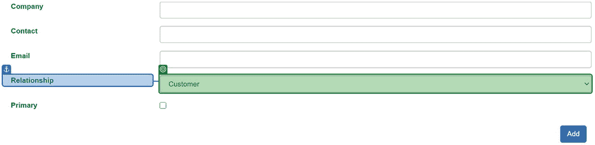

图 4-38

“关系”下拉菜单的目标和锚点

1.  此时，`Item to select` 字段将填充 `Relationship` 下拉菜单中的所有可用选项。从列表中选择 `Partner` 作为关系。

1.  在 `StudioX` 中，将 `Select Item` 活动添加到 `Use Application/Browser` 活动的主体中，位于三个 `Type Into` 活动之后。

2.  在 `Select Item` 活动中，单击 `Indicate target on screen (I)` 链接，并将鼠标指向 `Relationship` 下拉菜单。字段标签“Relationship”会被自动检测为锚点。此时，您的选择应类似于图 4-38。单击 `Confirm` 按钮。

完成练习后，**选择项**活动的最终配置应类似于图 4-39。图 4-40 显示了自动化运行完成后目标 Web 应用程序的状态。在此例中，已从“关系”字段中选择了一个项。

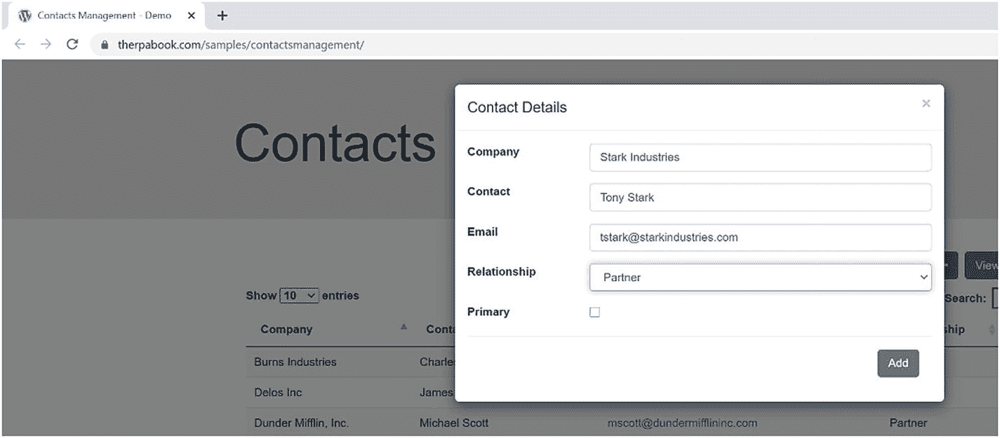

图 4-40

选择项活动练习的结果

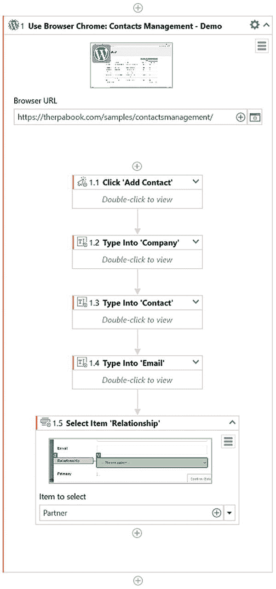

图 4-39

选择项活动练习的最终配置

### 勾选/取消勾选

**勾选/取消勾选**活动允许您与用户界面上的复选框进行交互。

提示

与使用“点击”活动与应用程序中的复选框交互相比，使用“勾选/取消勾选”活动提供了切换、勾选或取消勾选字段的选项。这样，如果应用程序中的复选框可能已被勾选或未勾选，则不会不必要地更改它。

#### 配置

本节提供如何配置**勾选/取消勾选**活动的说明，如图 4-41 所示。

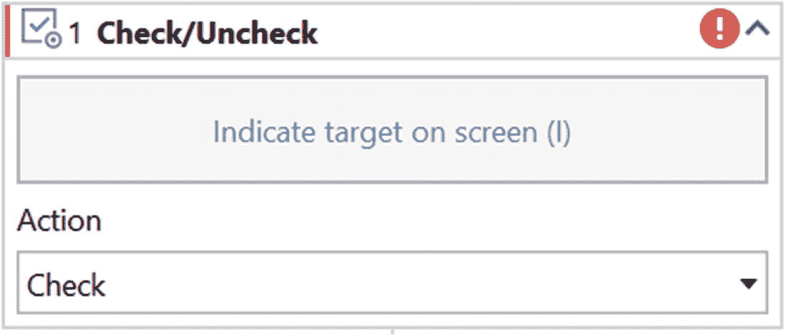

图 4-41

勾选/取消勾选活动卡片

**指示屏幕上的目标 (I)**：这是活动卡片上的一项必需配置。此配置允许您指定用户界面上要勾选或取消勾选的复选框。

**操作**：这是活动卡片上的一项必需配置。此配置允许您指定复选框的状态。图 4-42 显示了所有可用的操作。默认情况下，此项设置为 `Check`。

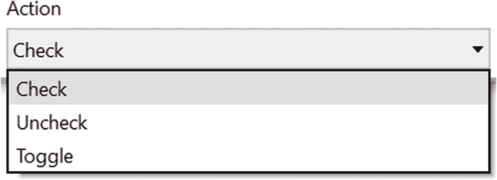

图 4-42

勾选/取消勾选活动的可用操作

练习

**目标**：使用 `Check/Uncheck` 活动，通过勾选“联系人详细信息”对话框中的“主要”选项，指定正在添加的联系人为主要联系人。本练习基于之前关于 `Click`、`Type Into` 和 `Select Item` 活动的练习。图 4-40 显示了本练习开始前目标 Web 应用程序的状态。

**源代码**：Chapter_4_FormDataEntryExercise

**设置**：以下是分步实施说明：

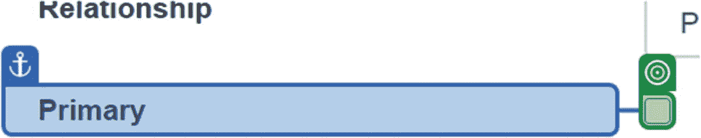

图 4-43

“主要”复选框的目标和锚点

1.  接下来，从 `Action` 下拉菜单中选择 `Check`。

1.  在 `StudioX` 中，将 `Check/Uncheck` 活动添加到 `Use Application/Browser` 活动的主体中，位于 `Select Item` 活动之后。

2.  接下来，在 `Check/Uncheck` 活动中，单击 `Indicate target on screen (I)` 链接，并将鼠标指向 `Primary` 复选框。选择字段标签 `Primary` 作为锚点。此时，您的选择应类似于图 4-43。单击 `Confirm` 按钮。

完成练习后，**勾选/取消勾选**活动的最终配置应类似于图 4-44。图 4-45 显示了自动化运行完成后目标 Web 应用程序的状态。在此例中，“主要”复选框已被勾选。

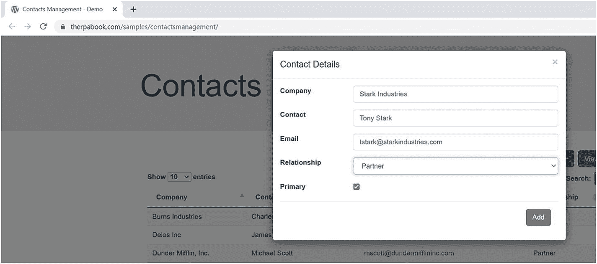

图 4-45

勾选/取消勾选活动练习的结果

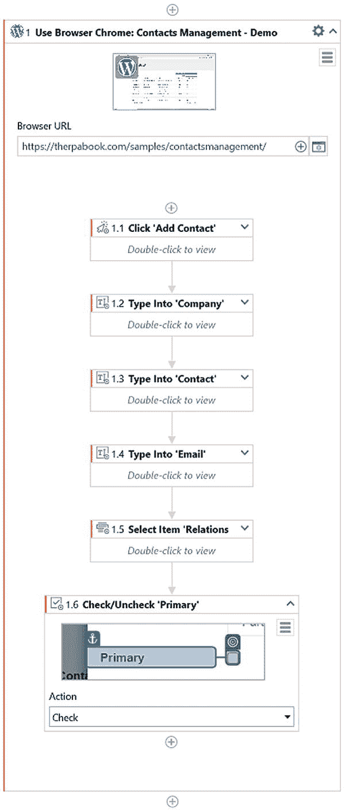

图 4-44

勾选/取消勾选活动练习的最终配置

### 获取文本

**获取文本**活动允许您从用户界面上的指定元素中提取文本。

#### 配置

本节提供如何配置**获取文本**活动的说明，如图 4-46 所示。

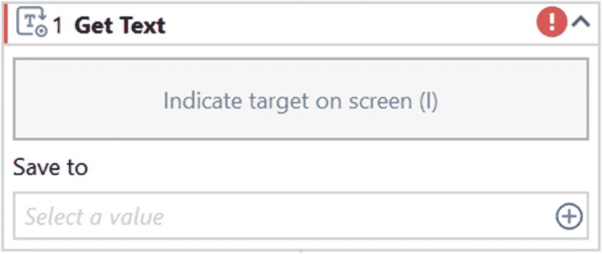

图 4-46

获取文本的活动卡片

**指示屏幕上的目标 (I)**：这是活动卡片上的一个必填配置。此配置允许您指定要从中检索文本的 UI 元素。

**保存到**：这是活动卡片上的一个必填配置。此配置允许您指定如何存储检索到的文本以供后续使用。

练习

**目标**：使用 `Get Text` 活动读取“查看联系人详细信息”对话框的所有字段。

**源代码**：Chapter_4_FormDataExtractionExercise

**设置**：以下是分步实施说明：

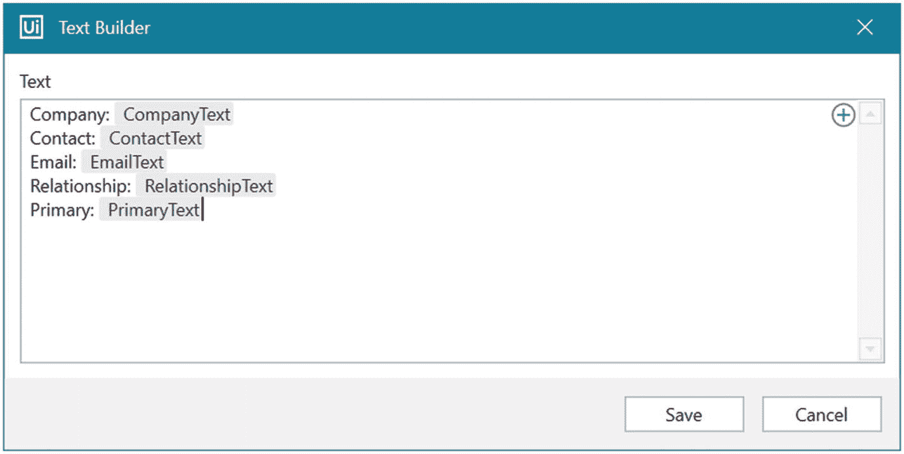

图 4-49

用于打印所有表单数据的“写入行”活动配置

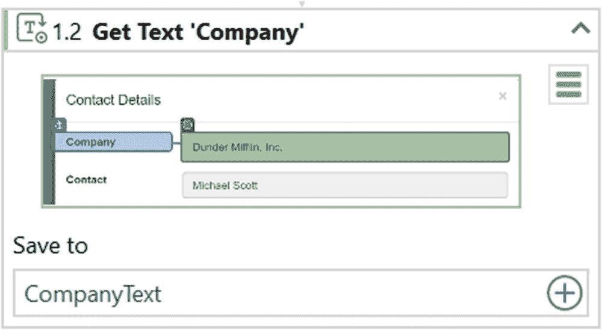

图 4-48

获取文本活动的配置

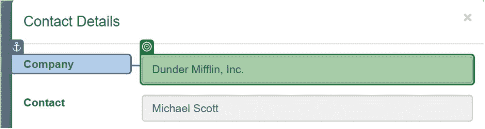

图 4-47

“公司”字段的目标和锚点

1.  接下来，对其余字段（即 `Contact`、`Email`、`Relationship` 和 `Primary`）重复步骤 7–9。将保存的值分别命名为 `ContactText`、`EmailText`、`RelationshipText` 和 `PrimaryText`。

2.  接下来，在末尾添加一个 `Write Line` 活动。单击 `Text` 字段中的 `Plus` 图标，选择 `Text` 选项，然后输入如图 4-49 所示的文本。要引用保存的值，请单击 `Text Builder` 中的 `Plus` 图标，将鼠标悬停在 `Use Saved Value` 上，然后分别选择 `CompanyText`、`ContactText`、`EmailText`、`RelationshipText` 和 `PrimaryText`。

1.  接下来，单击 `Save to` 字段中的 `Plus` 图标。选择 `Save for Later Use` 选项，并将保存的值命名为 `CompanyText`。单击 `Ok`。此时，您的 `Get Text` 活动配置应类似于图 4-48。

1.  打开您选择的浏览器，在地址栏中输入 [`https://therpabook.com/samples/contactsmanagement/`](https://therpabook.com/samples/contactsmanagement/)。

2.  在 `StudioX` 中，将 `Use Application/Browser` 活动添加到一个空白流程中。

3.  接下来，单击 `Use Application/Browser` 活动卡片中的 `Indicate application`，然后将鼠标指向浏览器。这将自动填充活动卡片。

4.  接下来，选择 `Use Application/Browser` 活动卡片，并在 `Properties` 中将 `Options` ➤ `Open` 属性设置为 `Always`。这将确保自动化始终打开一个新的浏览器。

5.  在 `Use Application/Browser` 活动中添加一个 `Click` 活动，并将其配置为单击 `View Contact` 按钮。

6.  接下来，确保 `View Contact` 对话框已打开。

7.  在 `Use Application/Browser` 活动中，紧接在 `Click` 活动之后添加 `Get Text` 活动。

8.  在 `Get Text` 活动中，单击 `Indicate target on screen (I)` 链接，然后将鼠标指向 `Company` 字段。字段标签会被自动检测为锚点。此时，您的选择应类似于图 4-47。单击 `Confirm` 按钮。

完成练习后，**获取文本**活动的最终配置应类似于图 4-50。图 4-51 显示了在输出面板中打印的来自“写入行”活动的数据。

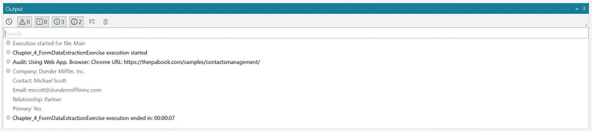

图 4-51

获取文本活动练习的输出

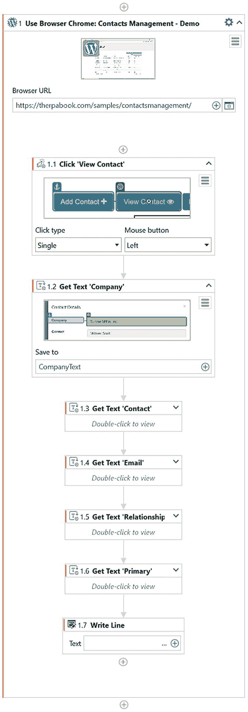

图 4-50

包含获取文本活动的自动化最终配置

### 获取属性

**获取属性**活动允许您检索 UI 上指定元素的属性值。

#### 配置

本节提供如何配置**获取属性**活动的说明，如图 4-52 所示。

图 4-52

获取属性的活动卡片

**指示屏幕上的目标 (I)**：这是活动卡片上的一个必填配置。此配置允许您指定要从中检索属性值的 UI 元素。

**属性**：这是活动卡片上的一个必填配置。此配置允许您指定要检索其值的属性。

**结果**：这是活动卡片上的一个可选配置。此配置允许您指定如何存储检索到的属性值以供后续使用。

练习

**目标**：使用 `Get Attribute` 活动从“查看联系人详细信息”对话框中读取“公司”字段的值。本练习建立在之前 `Get Text` 活动的练习基础之上。

**源代码**：Chapter_4_FormDataExtractionExercise

**设置**：以下是分步实施说明：

图 4-53

用于打印所有表单数据的“写入行”活动配置

1.  在 `StudioX` 中，将 `Get Attribute` 活动添加到 `Use Application/Browser` 活动中，紧接在 `Write Line` 活动之后。

2.  在 `Get Attribute` 活动中，单击 `Indicate on screen` 链接，然后将鼠标指向 `Company` 字段。

3.  接下来，单击 `Attribute` 字段中的 `Plus` 图标，选择 `Text` 选项，然后输入值。这是我们将要检索的属性。单击 `Save`。

4.  接下来，在 `Properties` 面板中，单击 `Result` 字段中的 `Plus` 图标。选择 `Save for Later Use` 选项，并将保存的值命名为 `AttributeValue`。单击 `Ok`。

5.  接下来，在末尾添加 `Write Line` 活动。单击 `Text` 字段中的 `Plus` 图标，选择 `Text` 选项，然后输入如图 4-53 所示的文本。

完成练习后，**获取属性**活动的最终配置应类似于图 4-54。图 4-55 显示了在输出面板中打印的来自“写入行”活动的数据。

图 4-55

获取属性活动练习的输出

图 4-54

包含获取属性活动的自动化最终配置

### 提取表格数据

**提取表格数据**活动允许您从 Web 和桌面应用程序中提取表格格式的数据。

注意

顶部功能区中的**表格提取**菜单项也遵循类似的配置步骤。它会在 `Use Application/Browser` 活动内部创建一个单独的容器。

#### 配置

本节提供如何配置**提取表格数据**活动的说明，如图 4-56 所示。

图 4-56

提取表格数据活动卡片

**指示屏幕上的目标 (I)**：这是活动卡片上的一个必需配置。此配置允许您指定要从中提取数据的表格。如果表格数据跨越多页，此配置还允许您指定自动化可用于在页面之间导航的元素。

**提取到**：这是活动卡片上的一个可选配置。此配置允许您指定如何存储提取的数据。

**追加结果**：这是`属性`面板上的一个可选配置。此配置允许您指定自动化是否应将任何新的提取结果追加到先前提取的数据末尾，还是覆盖它。

**编辑下一个链接**：仅当您在屏幕上指示目标后，此配置才会从活动菜单中变为可用。此配置如图 4-57 所示，允许您编辑已指定的用于导航到下一页数据的 UI 元素。

图 4-57

活动菜单中的选项

**测试提取**：仅当您在屏幕上指示目标后，此配置才会从活动菜单中变为可用。此配置如图 4-57 所示，允许您测试数据提取。一旦您从菜单选项中点击`测试提取`选项，将出现一个弹出窗口，其中包含从所指示的第一页提取的数据，如图 4-58 所示。

图 4-58

使用测试提取选项预览表格数据

**页面间延迟**：这是`属性`面板上的一个可选配置。当数据跨越多页，并且在打开下一页后，数据需要一些时间加载时，此配置非常有用。您可以指定在从下一页提取数据之前要等待的时间（以秒为单位）。

**最大结果数**：这是`属性`面板上的一个可选配置。此配置允许您指定要提取的最大结果数。默认情况下，此值为 `100`。

练习

**目标**：使用`提取表格数据`活动读取表格所有页面中的所有联系人。

**源代码**：Chapter_4_TableDataExtractionExercise

**设置**：以下是分步实施说明：

图 4-64

提取向导 – 选择数据导航 UI 元素

图 4-63

提取向导 – 确认数据是否跨越多页

图 4-62

提取向导 – 预览提取的数据

图 4-61

提取向导 – 提示确认是从单列还是整个表格提取数据

图 4-60

提取向导 – 列选择

图 4-59

提取向导 – 初始窗口

1.  接下来，在`提取到`字段中，选择`复制到剪贴板`选项。

2.  接下来，在末尾添加一个`写入行`活动。在`文本`字段中，点击`加号`图标，然后选择`从剪贴板粘贴`选项。

1.  此时，您将选择联系人列表屏幕上的`下一步`按钮，如图 4-64 所示。此按钮将允许自动化移动到数据的下一页。这样就完成了提取配置。

1.  接下来，`提取向导`将提示另一条消息，如图 4-63 所示，要求您确认数据是否跨越多页。在此示例中，数据确实跨页，因此点击`是`。

1.  接下来，`提取向导`将向您显示它能够提取的数据，如图 4-62 所示。如果数据看起来准确，即没有遗漏任何列，则点击`完成`。

1.  接下来，`提取向导`将提示您确认是要提取指定表格的所有列，还是仅提取您选择的列，如图 4-61 所示。点击`是`。

1.  此时，`提取向导`将提示您选择表格的一列。点击`公司`列，如图 4-60 所示。

1.  打开您选择的浏览器，在地址栏中输入 [`https://therpabook.com/samples/contactsmanagement/`](https://therpabook.com/samples/contactsmanagement/)。

2.  在 `StudioX` 中，将`使用应用程序/浏览器`活动添加到一个空白流程中。

3.  接下来，点击`使用应用程序/浏览器`活动卡片中的`指示应用程序`，然后将鼠标指向浏览器。这将自动填充活动卡片。

4.  接下来，选择`使用应用程序/浏览器`活动卡片，并在`属性`中，将`选项` ➤ `打开`属性设置为`始终`。这将确保自动化始终打开一个新的浏览器。

5.  接下来，将一个`提取表格数据`活动添加到`使用应用程序/浏览器`活动中。

6.  接下来，在`提取表格数据`活动中，点击`指示屏幕上的目标 (I)`链接。这将启动表格数据提取向导，如图 4-59 所示。

7.  接下来，在`提取向导`对话框中，点击`下一步`按钮。

完成练习后，**提取表格数据**活动的最终配置应类似于图 4-65。图 4-66 显示了通过使用写入行活动将数据打印到输出面板而从表格中提取的数据。

图 4-66

提取表格数据活动练习的输出

图 4-65

提取表格数据活动练习的最终配置

### 悬停

**悬停**活动允许您将鼠标悬停在 UI 上的指定元素上。

提示

悬停活动通常将与点击活动一起使用。例如，大多数现代 Web 应用程序使用悬停菜单，但您需要点击一个菜单项才能将其打开。

#### 配置

本节提供如何配置**悬停**活动的说明，如图 4-67 所示。

图 4-67

悬停活动卡片

**指示屏幕上的目标 (I)**：这是活动卡片中提供的必填配置。此配置允许您指定要悬停的 UI 元素。

**持续时间**：这是活动卡片中提供的可选配置。此配置允许您指定悬停在指定元素上的时长（以秒为单位）。

练习

**目标**：使用 `Hover` 活动打开 `Download` 菜单，并使用 `Click` 活动启动以 Excel 格式下载联系人数据。使用 `Wait for Download` 活动监控文件下载。

**源代码**：Chapter_4_MenuHoverExercise

**设置**：以下是分步实施说明：

图 4-69

悬停菜单选择

图 4-68

公司字段的目标和锚点

1.  接下来，在 `Use Application/Browser` 活动主体中，于 `Wait for Download` 活动之后添加一个 `Write Line` 活动。

2.  接下来，在 `Write Line` 活动的 `Text` 字段中，点击 `Plus` 图标，选择 `Text` 选项，然后输入 `File downloaded at path: DownloadedFile` ➤ `Full Name`。您需要使用保存的值 `DownloadedFile` 来显示下载文件的路径。

1.  接下来，在 `Duration` 字段中，点击 `Plus` 图标，选择 `Number` 选项，然后输入 `3` 秒。

2.  接下来，在 `Use Application/Browser` 活动主体中，紧接在 `Hover` 活动之后添加一个 `Wait for Download` 活动。

3.  接下来，在 `Downloaded file` 字段中，点击 `Plus` 图标，选择 `Save for Later Use`，并将保存的值命名为 `DownloadedFile`。

4.  保持 `Monitored folder` 字段不变。

5.  接下来，在 `Wait for Download` 活动主体中添加一个 `Click` 活动。

6.  接下来，在 `Click` 活动中，点击 `Indicate target on screen (I)` 链接，以指定 `Download` 菜单中的 `Excel` 选项。这并非易事，因为在元素选择模式下，悬停功能将不起作用，您将无法选择 `Excel` 下载选项。要使其生效，在点击指示后，您必须按 `F2` 暂停选择过程。在选择过程暂停时，将鼠标悬停在 `Download` 按钮上，并确保鼠标指向 `Excel` 选项。一旦选择过程恢复，您将能够选择 `Excel` 选项，并使用 `CSV` 选项作为锚点。此时，您的选择应如图 4-69 所示。点击 `Confirm` 按钮。

1.  打开您选择的浏览器，在地址栏中输入 [`https://therpabook.com/samples/contactsmanagement/`](https://therpabook.com/samples/contactsmanagement/)。

2.  在 `StudioX` 中，将 `Use Application/Browser` 活动添加到一个空白流程中。

3.  接下来，点击 `Use Application/Browser` 活动卡片中的 `Indicate application`，并将鼠标指向浏览器。这将自动填充活动卡片。

4.  接下来，选择 `Use Application/Browser` 活动卡片，并在 `Properties` 中将 `Options` ➤ `Open` 属性设置为 `Always`。这将确保自动化始终打开一个新的浏览器。

5.  接下来，在 `Use Application/Browser` 活动内部添加 `Hover` 活动。

6.  接下来，在 `Hover` 活动中，点击 `Indicate target on screen (I)` 链接以选择 `Download` 按钮。选择目标元素后，使用 `View Contact` 按钮作为锚点。此时，您的选择应类似于图 4-68。点击 `Confirm` 按钮。

完成练习后，所有活动的最终配置应类似于图 4-70。图 4-71 显示了输出面板中下载文件的完整路径。

图 4-71

悬停活动练习的输出

图 4-70

悬停活动练习的最终配置

### 键盘快捷键

**键盘快捷键**活动允许您向 UI 元素发送一个或多个键盘快捷键。

提示

键盘快捷键可用于自动化旧版应用程序，或无法点击 UI 元素的场景。此活动不应作为默认导航机制使用。

#### 配置

本节提供如何配置**键盘快捷键**活动的说明，如图 4-72 所示。

图 4-72

键盘快捷键的活动卡片

**指示屏幕上的目标 (I)**：这是活动菜单中提供的一项可选配置。您的自动化需要已经与某个 UI 元素交互，才能发送键盘快捷键。您可以使用 `Click` 之类的活动，或者通过此 `Indicate target on screen (I)` 链接指定一个 UI 元素。

**录制快捷键**：这是活动卡片上的一项必需配置。此配置允许您指定要发送的实际快捷键。图 4-73 显示了指定键盘快捷键的三种选项。

图 4-73

录制快捷键的可用选项

首先，您可以使用 `Record shortcut` 选项录制单个键盘快捷键。点击此选项后，录制立即开始，如图 4-74 所示。

图 4-74

进度指示器中的录制状态

您按下的下一个按键将被录制为您的快捷键。图 4-75 显示了录制的结果。

图 4-75

单个键盘快捷键录制的结果

其次，您可以使用 `Record multiple shortcuts` 录制一个或多个键盘快捷键。录制过程与上一个选项相同。在此选项中，录制不会在录制单个键盘快捷键后停止。图 4-76 显示了捕获多个快捷键后活动的状态。

图 4-76

多个键盘快捷键录制的结果

最后，如果您在录制快捷键时遇到困难，可以使用 `Add a shortcut manually` 选项向指定的 UI 元素发送一个或多个快捷键。图 4-77 显示了创建快捷键的所有可用选项，而图 4-78 显示了添加单个快捷键后活动的状态。

图 4-78

手动添加键盘快捷键的结果

图 4-77

手动添加快捷键的可用选项

**键入前单击**：这是 `Properties` 面板上提供的一项可选配置。此配置允许您在发送键盘快捷键之前对 UI 元素执行 `Single`（单击）或 `Double`（双击）操作。默认情况下，此选项设置为 `None`。

**快捷键之间的延迟**：这是 `Properties` 面板上提供的一项可选配置。此配置允许您指定多个键盘快捷键之间的延迟时间（以秒为单位）。默认情况下，此选项为空，即不设置延迟。

练习

**目标**：使用 `Keyboard Shortcuts` 活动在“联系人详细信息”对话框的文本字段之间导航并输入数据。

**源代码**：Chapter_4_FormDataEntryKeyShortcutsExercise

**设置**：以下是分步实施说明：

1.  打开您选择的浏览器，在地址栏中输入 [`https://therpabook.com/samples/contactsmanagement/`](https://therpabook.com/samples/contactsmanagement/)。

2.  在 `StudioX` 中，将 `Use Application/Browser` 活动添加到一个空白流程中。

3.  接下来，在 `Use Application/Browser` 活动卡片中点击 `Indicate application`，然后将鼠标指向浏览器。这将自动填充活动卡片。

4.  接下来，选择 `Use Application/Browser` 活动卡片，并在 `Properties` 中将 `Options` ➤ `Open` 属性设置为 `Always`。这将确保自动化始终打开一个新的浏览器。

5.  接下来，在 `Use Application/Browser` 活动内部添加一个 `Click` 活动，并将其配置为单击 `Add Contact` 按钮（参见 `Click` 活动练习）。

6.  在继续之前，请确保 `Add Contact` 对话框已打开。

7.  当对话框打开时，默认情况下没有任何元素处于活动状态，因此您无法确定自动化会将键盘快捷键发送到哪个元素。为了确保有一个已知的起点，在 `Use Application/Browser` 活动内部再添加一个 `Click` 活动。将其配置为单击对话框的标题，即 `Contact Details`。

8.  接下来，在 `Click` 活动之后立即添加一个 `Keyboard Shortcuts` 活动。这将使自动化移动到表单中的第一个字段。使用 `Record shortcut` 功能录制一个 `Tab`。

9.  接下来，添加一个 `Type Into` 活动。点击 `Plus` 图标，选择 `Text` 选项，然后输入 `Delos Inc`。点击 `Save`。

10.  接下来，添加另一个 `Keyboard Shortcuts` 活动。这将使自动化移动到表单中的下一个字段。使用 `Record shortcut` 功能录制一个 `Tab`。

11.  接下来，添加一个 `Type Into` 活动。点击 `Plus` 图标，选择 `Text` 选项，然后输入 `James Delos`。点击 `Save`。

完成练习后，**Keyboard Shortcuts** 活动的最终配置应类似于图 4-79。图 4-80 显示了自动化运行完成后目标 Web 应用程序的状态。在此示例中，已输入“公司”和“联系人”字段中的数据。

图 4-80

键盘快捷键活动练习的结果

图 4-79

键盘快捷键活动练习的最终配置

本章的下一组活动侧重于窗口操作。Get Active Window 活动可用于引用当前活动窗口，使您能够执行多个操作。例如，一旦您获得了活动窗口，您就可以选择在自动化中最大化、隐藏、还原或移动该窗口。

### 获取活动窗口

**Get Active Window** 活动允许您获取对运行自动化的机器上当前活动窗口的引用。当您需要获取活动窗口以便稍后在自动化中将其最小化或最大化时，可以使用此活动。

注意

此活动不需要嵌套在 Use Application/Browser 活动内部。

#### 配置

本节提供如何配置**获取活动窗口**活动的说明，如图 4-81 所示。

图 4-81

获取活动窗口的活动卡片

**ApplicationWindow**：这是 `Properties` 面板上提供的一个可选配置。此配置允许您保存对活动窗口的引用，以便后续使用。

练习

**目标**：使用 `Get Active Window` 活动获取联系人管理应用程序窗口的引用。

**源代码**：Chapter_4_WindowOperationsExercise

**设置**：以下是分步实施说明：

1.  打开您选择的浏览器，在地址栏中输入 [`https://therpabook.com/samples/contactsmanagement/`](https://therpabook.com/samples/contactsmanagement/)。

2.  在 `StudioX` 中，将 `Use Application/Browser` 活动添加到 `Designer` 面板。

3.  接下来，在 `Use Application/Browser` 活动卡片中点击 `Indicate application`，然后将鼠标指向浏览器。这将自动填充活动卡片。

4.  接着，选择 `Use Application/Browser` 活动卡片，并在 `Properties` 中将 `Options` ➤ `Open` 属性设置为 `Always`。这将确保自动化始终打开一个新的浏览器。

5.  然后，在 `Use Application/Browser` 活动之后添加 `Get Active Window` 活动。

6.  接下来，在 `Get Active Window` 活动的 `Properties` 面板中，点击 `ApplicationWindow` 字段中的 `Plus` 图标。点击 `Save for Later Use`，并将变量命名为 `ActiveWindow`。

完成练习后，**获取活动窗口**活动的最终配置应类似于图 4-82。

图 4-82

获取活动窗口练习的最终配置

### 最大化窗口

**最大化窗口**活动允许您最大化指定的窗口。

注意

此活动通常嵌套在 Use Application/Browser 活动或 Get Active Window 活动内部。

#### 配置

本节提供如何配置**最大化窗口**活动的说明，如图 4-83 所示。

图 4-83

最大化窗口的活动卡片

**Window**：这是 `Properties` 面板上提供的一个可选配置。此配置允许您指定要最大化的窗口。窗口的引用可以通过 `Get Active Window` 活动获取。

练习

**目标**：使用 `Maximize Window` 活动最大化联系人管理应用程序窗口。此练习基于上一个 `Get Active Window` 活动的练习。

**源代码**：Chapter_4_WindowOperationsExercise

**设置**：以下是分步实施说明：

1.  在 `StudioX` 中，将 `Maximize Window` 活动添加到 `Get Active Window` 活动内部。

2.  接下来，在 `Maximize Window` 活动的 `Properties` 面板中，点击 `Window` 字段中的 `Plus` 图标。悬停在 `Use Saved Value` 上，然后选择 `ActiveWindow`。

完成练习后，**最大化窗口**活动的最终配置应类似于图 4-84。

图 4-84

最大化窗口活动练习的最终配置

### 最小化窗口

**最小化窗口**活动允许您最小化指定的窗口。

注意

此活动不需要嵌套在 Use Application/Browser 活动或 Get Active Window 活动内部。

#### 配置

本节提供如何配置**最小化窗口**活动的说明，如图 4-85 所示。

图 4-85

最小化窗口的活动卡片

**Window**：这是 `Properties` 面板上提供的一个可选配置。此配置允许您指定要最小化的窗口。窗口的引用可以通过 `Get Active Window` 活动获取。

练习

**目标**：使用 `Minimize Window` 活动最小化联系人管理应用程序窗口。此练习基于上一个 `Maximize Window` 活动的练习。

**源代码**：Chapter_4_WindowOperationsExercise

**设置**：以下是分步实施说明：

1.  在 `StudioX` 中，将 `Delay` 活动添加到 `Get Active Window` 活动内部，位于 `Maximize Window` 活动之后。将 `Duration` 字段更新为 `3` 秒。我们添加一个短暂的延迟只是为了能够看到操作的发生；否则，这不是必需的。

2.  接下来，将 `Minimize Window` 活动添加到 `Get Active Window` 活动内部，位于 `Delay` 活动之后。

3.  在 `Minimize Window` 活动的 `Properties` 面板中，点击 `Window` 字段中的 `Plus` 图标。悬停在 `Use Saved Value` 上，然后选择 `ActiveWindow`。

完成练习后，**最小化窗口**活动的最终配置应类似于图 4-86。

图 4-86

最小化窗口活动练习的最终配置

### 隐藏窗口

**隐藏窗口**活动允许您隐藏指定的窗口。

注意

此活动不需要嵌套在 Use Application/Browser 活动或 Get Active Window 活动内部。

#### 配置

本节提供如何配置**隐藏窗口**活动的说明，如图 4-87 所示。

图 4-87

隐藏窗口的活动卡片

**Window**：这是 `Properties` 面板上提供的一个可选配置。此配置允许您指定要隐藏的窗口。窗口的引用可以通过 `Get Active Window` 活动获取。

练习

**目标**：使用 `Hide Window` 活动隐藏联系人管理应用程序窗口。此练习基于上一个 `Minimize Window` 活动的练习。

**源代码**：Chapter_4_WindowOperationsExercise

**设置**：以下是分步实施说明：

1.  在 `StudioX` 中，将 `Delay` 活动添加到 `Get Active Window` 活动内部，位于 `Minimize Window` 活动之后。将 `Duration` 字段更新为 `3` 秒。我们添加一个短暂的延迟只是为了能够看到操作的发生；否则，这不是必需的。

2.  接下来，将 `Hide Window` 活动添加到 `Get Active Window` 活动内部，位于 `Delay` 活动之后。

3.  在 `Hide Window` 活动的 `Properties` 面板中，点击 `Window` 字段中的 `Plus` 图标。悬停在 `Use Saved Value` 上，然后选择 `ActiveWindow`。

完成练习后，**隐藏窗口**活动的最终配置应类似于图 4-88。

图 4-88

隐藏窗口活动练习的最终配置

### 还原窗口

**还原窗口**活动允许您还原指定的窗口。

注意

此活动无需嵌套在“使用应用程序/浏览器”活动或“获取活动窗口”活动内部。

#### 配置

本节提供如何配置**还原窗口**活动的说明，如图 4-89 所示。

图 4-89

还原窗口的活动卡片

**窗口**：这是 `Properties` 面板上的一个可选配置。此配置允许您指定要还原的窗口。窗口的引用可以通过 `Get Active Window` 活动获取。

练习

**目标**：使用 `Restore Window` 活动还原“联系人管理”应用程序窗口。本练习基于之前的 `Hide Window` 活动练习。

**源代码**：Chapter_4_WindowOperationsExercise

**设置**：以下是分步实施说明：

1.  在 `StudioX` 中，将 `Delay` 活动添加到 `Get Active Window` 活动内部，位于 `Minimize Window` 活动之后。将 `Duration` 字段更新为 `3` 秒。我们添加一个短暂的延迟只是为了让我们能够看到操作的发生；否则，这不是必需的。

2.  接下来，将 `Restore Window` 活动添加到 `Get Active Window` 活动内部，位于 `Delay` 活动之后。

3.  在 `Minimize Window` 活动的 `Properties` 面板中，单击 `Window` 字段中的 `Plus` 图标。悬停在 `Use Saved Value` 上，然后选择 `ActiveWindow`。

完成练习后，**还原窗口**活动的最终配置应类似于图 4-90。

图 4-90

还原窗口活动练习的最终配置

### 移动窗口

**移动窗口**活动允许您更改指定窗口的大小，并将指定窗口移动到屏幕上的新位置。

注意

此活动无需嵌套在“使用应用程序/浏览器”活动或“获取活动窗口”活动内部。

#### 配置

本节提供如何配置**移动窗口**活动的说明，如图 4-91 所示。

图 4-91

移动窗口的活动卡片

**窗口**：这是 `Properties` 面板上的一个可选配置。此配置允许您指定要最小化的窗口。窗口的引用可以通过 `Get Active Window` 活动获取。

**高度**：这是 `Properties` 面板上的一个可选配置。此配置允许您指定窗口的新高度。

**宽度**：这是 `Properties` 面板上的一个可选配置。此配置允许您指定窗口的新宽度。

**X**：这是 `Properties` 面板上的一个可选配置。此配置允许您指定窗口的新 X 位置。

**Y**：这是 `Properties` 面板上的一个可选配置。此配置允许您指定窗口的新 Y 位置。

练习

**目标**：使用 `Move Window` 活动将“联系人管理”应用程序的屏幕尺寸缩小到 500 x 500，并将其移动到 X: 100 和 Y: 100 的位置。

**源代码**：Chapter_4_WindowOperationsExercise

**设置**：以下是分步实施说明：

1.  在 `StudioX` 中，将 `Delay` 活动添加到 `Get Active Window` 活动内部，位于 `Restore Window` 活动之后。将 `Duration` 字段更新为 `3` 秒。我们添加一个短暂的延迟只是为了让我们能够看到操作的发生；否则，这不是必需的。

2.  接下来，将 `Move Window` 活动添加到 `Get Active Window` 活动内部，位于 `Delay` 活动之后。

3.  在 `Move Window` 活动的 `Properties` 面板中，单击 `Window` 字段中的 `Plus` 图标。悬停在 `Use Saved Value` 上，然后选择 `ActiveWindow`。

4.  在 `Height` 字段中，单击 `Plus` 图标，选择 `Number` 选项，然后输入 `500`。

5.  在 `Width` 字段中，单击 `Plus` 图标，选择 `Number` 选项，然后输入 `500`。

6.  在 `X` 字段中，单击 `Plus` 图标，选择 `Number` 选项，然后输入 `100`。

7.  在 `Y` 字段中，单击 `Plus` 图标，选择 `Number` 选项，然后输入 `100`。

完成练习后，**移动窗口**活动的最终配置应类似于图 4-92。

图 4-92

移动窗口活动练习的最终配置

## 应用程序/网络录制器

在本节中，我们将使用**应用程序/网络录制器**功能生成简单的自动化。

练习

**目标**：使用 `App/Web Recorder` 功能生成用于添加新联系人的自动化。

**源代码**：Chapter_4_FormDataEntryRecorderExercise

**设置**：以下是分步实施说明：

图 4-93

应用程序/网络录制器菜单

1.  接下来，单击 `Start recording` 按钮，并将鼠标指向打开了“联系人管理”应用程序的浏览器。

2.  接下来，单击 `Add Contact` 按钮。

3.  接下来，选择 `Company` 字段，并使用提示输入 `E Corp`。

4.  接下来，选择 `Contact` 字段，并使用提示输入 `Phillip Price`。

5.  接下来，选择 `Email` 字段，并使用提示输入 phillip.price.belson@e.co。

6.  接下来，选择 `Relationship` 下拉菜单，并使用提示选择 `Customer`。

7.  接下来，勾选 `Primary` 复选框。

8.  接下来，单击 `Add` 按钮。

9.  我们已经完成了新联系人的数据输入，因此单击 `App/Web Recorder` 菜单上的 `Pause` 图标，然后单击 `Save` 图标。

1.  打开您选择的浏览器，在地址栏中输入 [`https://therpabook.com/samples/contactsmanagement/`](https://therpabook.com/samples/contactsmanagement/)。

2.  接下来，单击顶部功能区中的 `App/Web Recorder` 菜单。这将启动 `App/Web Recorder` 菜单，如图 4-93 所示。

完成练习后，由**应用程序/网络录制器**生成的自动化的最终配置应类似于图 4-94 和图 4-95。

图 4-95

生成的自动化的最终配置

图 4-94

由应用程序/网络录制器生成的自动化

