# 5. 邮件自动化

电子邮件对于我们日常的组织、沟通和日程安排至关重要。UiPath StudioX 邮件自动化使业务用户能够自动执行这些任务，从而专注于更具创造性的高价值任务。通常，邮箱是自动化的初始输入，在邮箱文件夹之间移动电子邮件可以指示流程的进度，或者邮箱文件夹可以作为供人工审核的异常文件夹。它对于让机器人通知用户可能有待处理的任务，或者通过根据给定的业务规则发送电子邮件来自动化通信也至关重要。

## 学习目标

学完本章后，你将学会如何：

*   定义用于自动化的 Desktop Outlook、Outlook 365 和 Gmail 账户范围
*   将电子邮件移动到其他文件夹
*   将电子邮件标记为已读或未读
*   转发电子邮件
*   保存附件和电子邮件
*   归档电子邮件
*   发送电子邮件和日历邀请
*   回复电子邮件
*   删除电子邮件

## 示例概述

在本章中，我们将使用一个简化版的初始招聘筛选流程来展示所有邮件自动化活动的用法。本章讨论的概念可应用于业务的各个领域，例如供应商管理、采购、销售以及人力资源部门内的其他流程。

本节将帮助你熟悉本章所有练习的先决条件。

### Desktop Outlook 设置

首先，在你将用于自动化的电子邮件账户的**收件箱**中，创建一个名为 **Initial Screen** 的新文件夹。图 5-1 展示了 Outlook 文件夹结构。

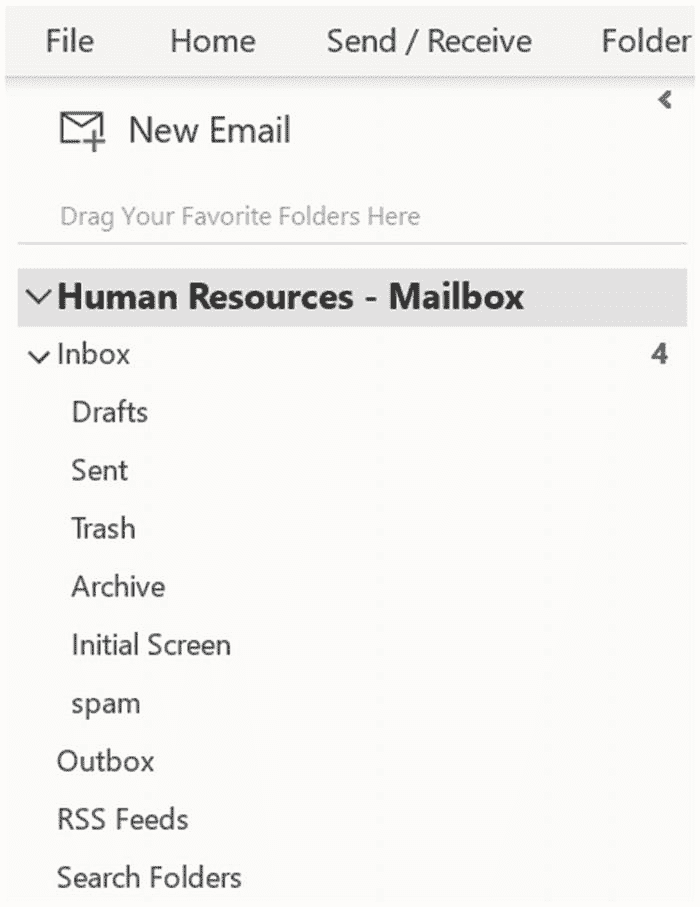

图 5-1

人力资源部门 Outlook 文件夹结构

### 文件系统结构

接下来，从本书网站下载源代码，并确保将整个 BookSamples 文件夹移动到你的 C:\ 驱动器。本章所有练习均假定文件夹路径为 **C:\BookSamples\Chapter_05**。图 5-2 展示了本示例所需的物理文件夹结构。此文件夹结构随源代码一起提供。

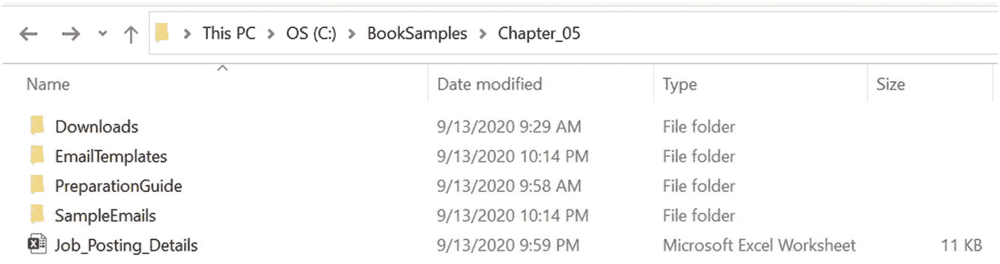

图 5-2

用于初始招聘筛选练习的文件夹结构

**Downloads**：此文件夹用于保存电子邮件文件和简历，以供审核和记录。

**EmailTemplates**：此文件夹包含一个 Word 文档，用于整合富 HTML 邮件正文。

**PreparationGuide**：此文件夹将作为面试候选人的准备材料发送。

**SampleEmails**：此文件夹包含本章中使用的示例电子邮件。你可以将它们拖放到你用于自动化的电子邮件收件箱中。

**Job_Posting_Details.xlsx**：这是一个 Excel 文件，如图 5-3 所示，其中包含与招聘职位相关的详细信息，这些信息将在 Outlook 电子邮件详情中被引用。

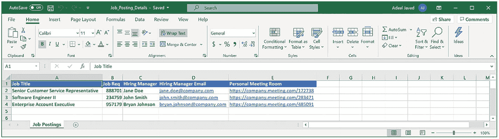

图 5-3

包含职位发布详情的 Job_Posting_Details Excel 文件

## 活动参考

如图 5-4 所示，所有邮件自动化活动都可以在“邮件”类别下找到。以下各节将提供有关如何配置和使用每个活动的说明。

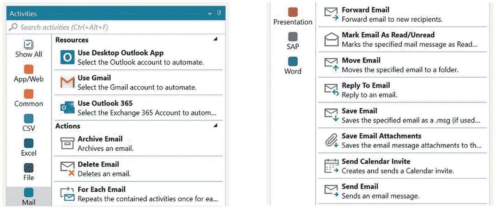

图 5-4

邮件自动化活动

### 使用 Desktop Outlook 应用

**使用 Desktop Outlook 应用**活动允许你选择已在 Outlook 桌面应用程序中配置的 Outlook 账户进行自动化。

此活动将包含你希望对 Outlook 账户执行的所有操作。例如，假设你想发送一封电子邮件。在这种情况下，**发送电子邮件**活动将嵌套在**使用 Desktop Outlook 应用**活动的主体中。

#### 配置

本节提供如何配置**使用 Desktop Outlook 应用**活动的说明，如图 5-5 所示。

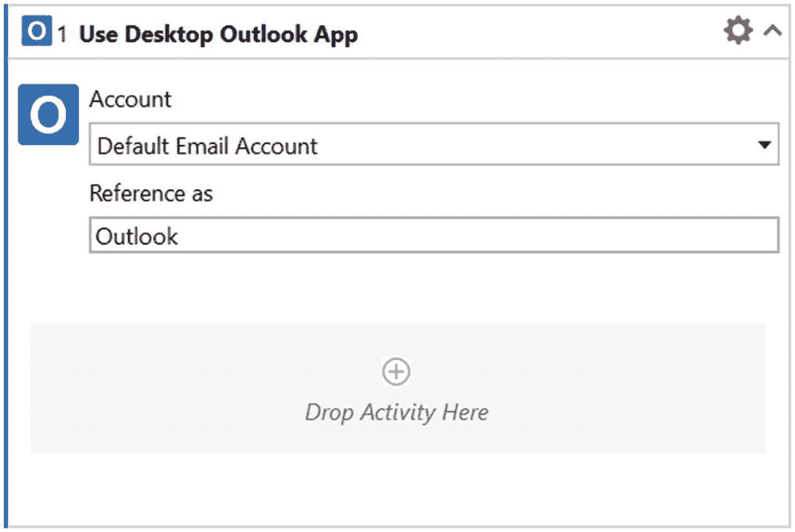

图 5-5

使用 Desktop Outlook 应用的活动卡片

注意

要配置此活动，请确保你的 Microsoft Outlook 桌面应用程序已配置并登录。

**账户**：这是活动卡片上的一项必需配置。此配置允许你指定计划自动化的 Outlook 账户电子邮件地址。默认情况下，会选择你的 `Default Email Account`。如果你有多个 Outlook 账户，则可以使用下拉菜单选择适当的账户。

提示

将账户保留为“默认电子邮件账户”选项可以轻松地与其他用户共享自动化。这样，自动化被设计为在运行该流程的工作站的 Outlook 账户上执行。

**引用为**：这是活动卡片上的一项必需配置。此配置允许你为你的 Outlook 账户提供一个名称。所有需要使用所选 Outlook 账户的活动都将通过此名称来引用它。

### 使用 Outlook 365

**使用 Outlook 365** 活动允许你选择要自动化的 Exchange 账户。

此活动将包含你希望对 Exchange 账户执行的所有操作。例如，假设你想发送一封电子邮件。在这种情况下，**发送电子邮件**活动将嵌套在**使用 Outlook 365** 活动的主体中。

#### 配置

本节提供如何配置**使用 Outlook 365** 活动的说明，如图 5-6 所示。

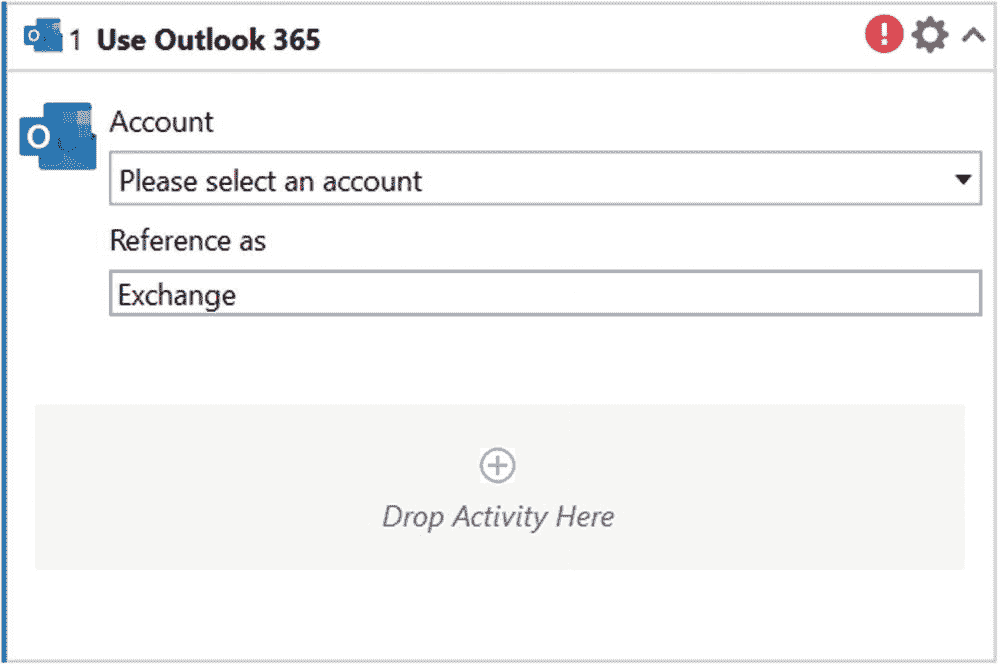

图 5-6

使用 Outlook 365 的活动卡片

**账户**：这是活动卡片上的一项必需配置。此配置允许你指定或添加计划自动化的 Outlook 365 账户电子邮件地址。图 5-7 显示了添加新 Exchange 账户的界面。此信息很可能由组织的 IT 部门提供。

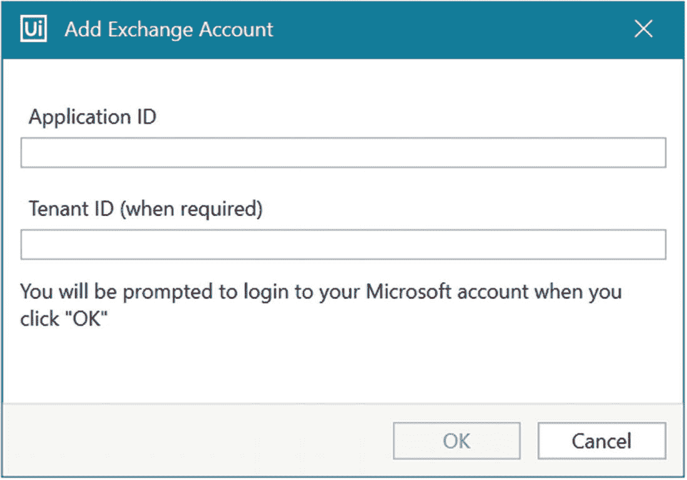

图 5-7

添加 Exchange 账户界面

**引用为**：这是活动卡片上的一项必需配置。此配置允许你为你的电子邮件账户提供一个名称。所有需要使用所选 Exchange 账户的活动都将通过此名称来引用它。

### 使用 Gmail

**使用 Gmail** 活动允许你与 Gmail 和 Google 日历集成，以自动化 Gmail 账户的电子邮件活动。

此活动将包含你希望对 Gmail 账户执行的所有操作。例如，假设你想发送一封电子邮件。在这种情况下，**发送电子邮件**活动将嵌套在**使用 Gmail** 活动的主体中。

#### 配置

本节提供如何配置**使用 Gmail** 活动的说明，如图 5-8 所示。

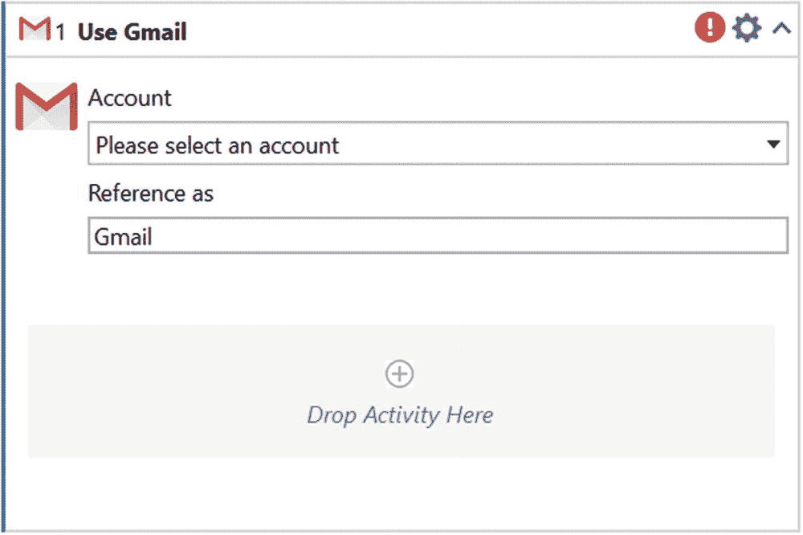

图 5-8

使用 Gmail 的活动卡片

**账户**：这是活动卡片上的一项必需配置。此配置允许你指定计划自动化的 Gmail 账户电子邮件地址。图 5-9 显示了添加新 Gmail 账户的界面。此信息很可能由组织的 IT 部门提供。

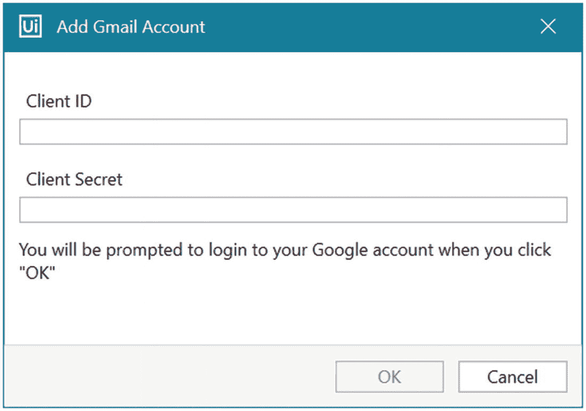

图 5-9

添加 Gmail 账户界面

**引用为**：这是活动卡片上的一项必需配置。此配置允许你为你的 Gmail 账户提供一个名称。所有需要使用所选 Gmail 账户的活动都将通过此名称来引用它。

### 遍历每封邮件

**遍历每封邮件**活动允许您对特定文件夹中的每封邮件重复执行一系列操作。您可以配置此活动，以筛选特定数量的邮件、未读邮件、仅含附件的邮件以及更多高级自定义筛选条件。

#### 配置

本节提供如何配置**遍历每封邮件**活动的说明，如图 5-10 所示。

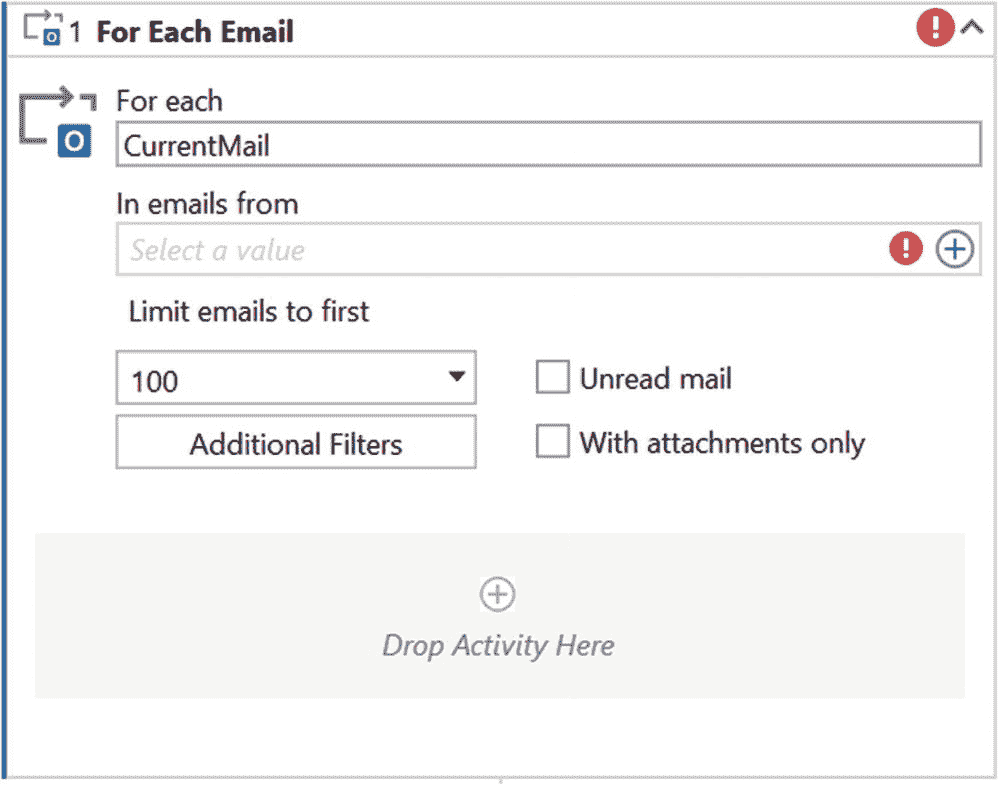

图 5-10

遍历每封邮件的活动卡片

**遍历对象**：这是活动卡片上的一个必填配置。此配置允许您指定一个名称，用于在活动卡片内引用每封邮件。默认情况下，该值设置为 `CurrentMail`。

**从以下位置的邮件中**：这是活动卡片上的一个必填配置。当放置在 `使用桌面版 Outlook 应用`、`使用 Outlook 365` 或 `使用 Gmail` 活动内部时，指定账户中的文件夹会自动填充为选项。您可以选择希望此活动从中读取邮件的邮件文件夹。

**限制邮件数量为前**：这是活动卡片上的一个必填配置。此配置允许您指定要从指定文件夹中读取的邮件数量。默认情况下，此值设置为 `100`。

**仅未读邮件**：这是活动卡片上的一个可选配置。勾选后，仅会遍历未读邮件。默认情况下，此选项未勾选。

**仅含附件的邮件**：这是活动卡片上的一个可选配置。勾选后，仅会遍历包含附件的邮件。默认情况下，此选项未勾选。

**其他筛选条件**：这是活动卡片上的一个可选配置。此配置允许您创建额外的邮件筛选条件。如图 5-11 所示，您可以构建条件语句，按特定属性筛选邮件。

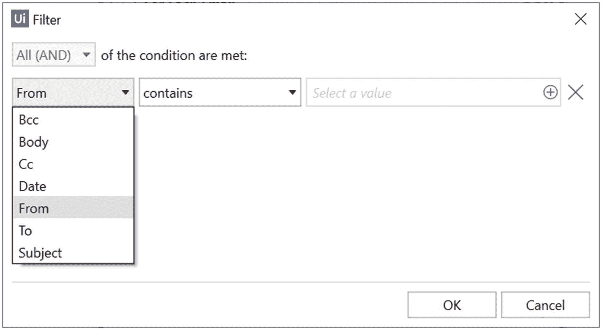

图 5-11

遍历每封邮件活动的其他筛选条件

练习

**目标**：利用 `使用桌面版 Outlook 应用` 和 `遍历每封邮件` 活动，读取人力资源邮箱收件箱中的所有未读邮件，并在输出面板中打印其主题。图 5-12 显示了收件箱的当前状态。

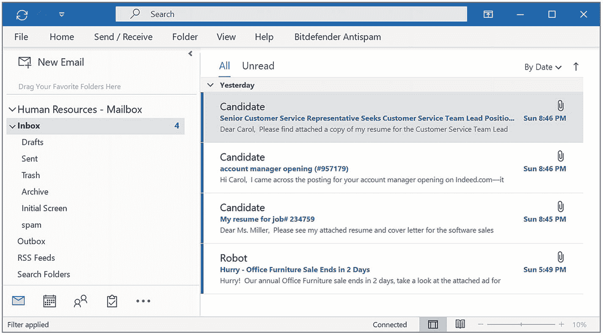

图 5-12

人力资源邮箱收件箱的初始状态

**源代码**：Chapter_5-MailAutomationExercise

**设置**：以下是分步实施说明：

1.  在 `StudioX` 中，点击 `笔记本` 菜单，然后选择 `配置笔记本`。
2.  在 `配置笔记本` 界面的 `笔记本文件` 字段中，选择 `C:\BookSamples\Chapter_05\Job_Posting_Details.xlsx` 文件。点击 `确定`。
3.  在设计器面板中，将 `使用桌面版 Outlook 应用` 活动添加到一个空白流程中。
4.  从 `账户` 下拉菜单中选择合适的电子邮件。对于本练习，我们将指定 `默认电子邮件账户`。
5.  接下来，在 `使用桌面版 Outlook 应用` 活动的主体内部添加 `遍历每封邮件` 活动。
6.  将 `遍历对象` 字段保留为默认值 `CurrentMail`。
7.  在 `从以下位置的邮件中` 字段，点击 `加号` 图标，然后悬停选择 `Outlook` ➤ `收件箱` 文件夹。
8.  从 `限制邮件数量为前` 下拉菜单中选择 `无限制`，以包含收件箱文件夹中的所有邮件。
9.  勾选 `仅未读邮件` 选项。
10. 接下来，在 `遍历每封邮件` 活动的主体中添加一个 `写入行` 活动。
11. 在 `文本` 字段中，点击 `加号` 图标，然后选择 `CurrentMail` ➤ `主题` 选项。

完成练习后，**遍历每封邮件**活动的最终配置应类似于图 5-13。图 5-14 显示了输出面板中接收到的邮件列表。

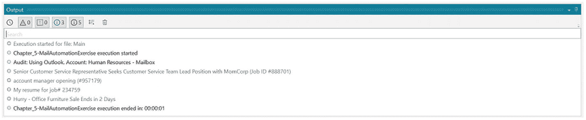

图 5-14

遍历每封邮件活动练习的输出

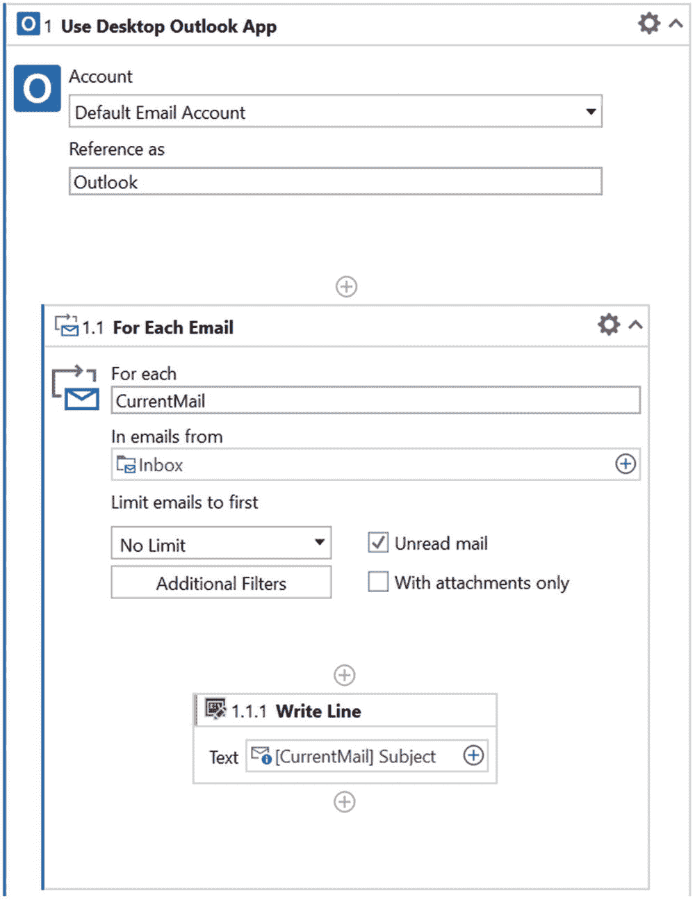

图 5-13

遍历每封邮件活动练习的最终配置

### 标记邮件为已读/未读

**标记邮件为已读/未读**活动允许您将指定的邮件标记为已读或未读。

#### 配置

本节提供如何配置**标记邮件为已读/未读**活动的说明，如图 5-15 所示。

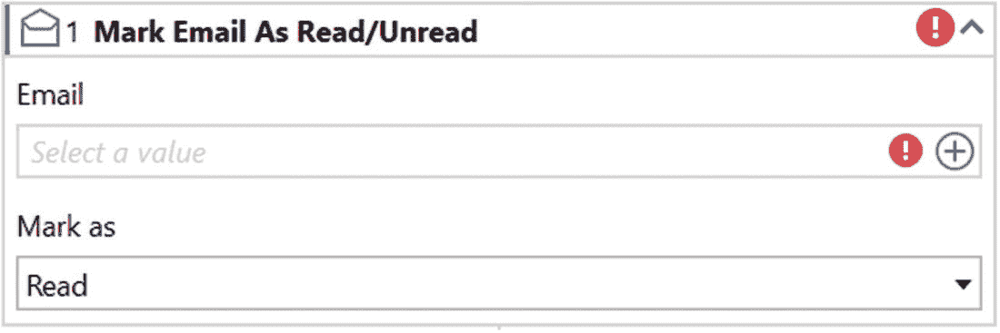

图 5-15

标记邮件为已读/未读的活动卡片

**邮件**：这是活动卡片上的一个必填配置。此配置指定需要更新状态的邮件。

对于桌面版 Outlook 应用，您还可以通过选择 `Outlook` ➤ `选定的邮件` 选项来指定当前选中的邮件。这将在执行时作用于选中的邮件。

如果在 `遍历每封邮件` 活动中使用，您可以指定循环中的 `CurrentMail` 消息。

**标记为**：这是活动卡片上的一个必填配置。此配置允许您将邮件状态设置为 `已读` 或 `未读`。默认情况下，该值为 `已读`。

练习

**目标**：基于我们之前的练习，使用 `标记邮件为已读/未读` 活动将收件箱中的所有邮件标记为已读。图 5-12 显示了收件箱的当前状态。

**源代码**：Chapter_5-MailAutomationExercise

**设置**：以下是分步实施说明：

1.  在 `StudioX` 中，在 `遍历每封邮件` 活动内的 `写入行` 活动之后添加一个 `标记邮件为已读/未读` 活动。无需额外配置。默认情况下，`CurrentMail` 已被选中，邮件状态设置为 `已读`。

完成练习后，**标记邮件为已读/未读**活动的最终配置应类似于图 5-16。自动化运行后，收件箱中的所有邮件都将被标记为已读，如图 5-17 所示。

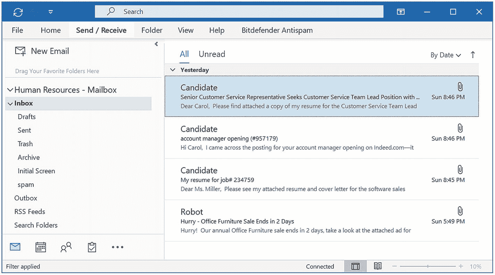

图 5-17

标记邮件为已读/未读练习后人力资源邮箱收件箱的状态

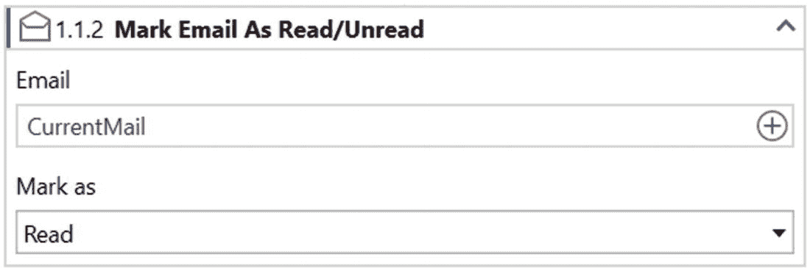

图 5-16

标记邮件为已读/未读练习的最终配置

### 转发邮件

**转发邮件**活动允许您将邮件转发给特定收件人。

#### 配置

本节提供如何配置**转发邮件**活动的说明，如图 5-18 所示。

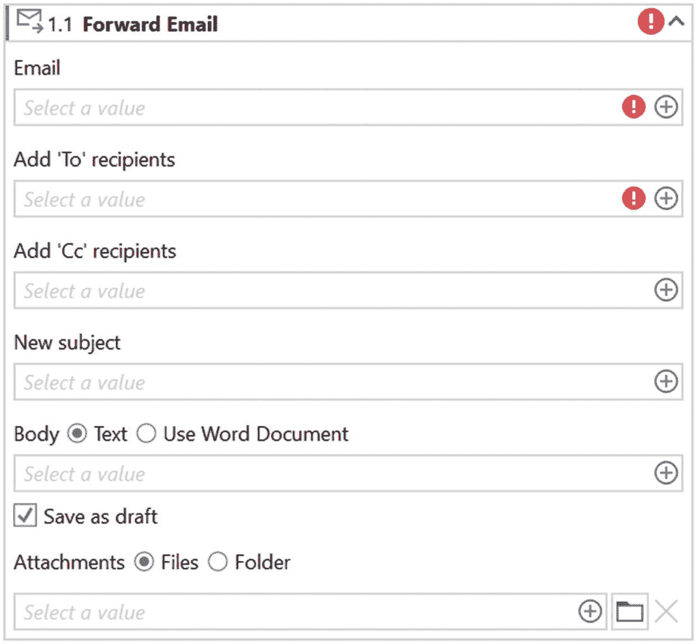

图 5-18

转发邮件的活动卡片

**邮件**：这是活动卡片上的一项必填配置。此配置允许您指定将要转发的邮件。

对于桌面版 Outlook 应用程序，您还可以通过选择 `Outlook` ➤ `Selected Email` 选项来指定当前选中的邮件。这将在执行时作用于选中的邮件。

如果在`对于每封邮件`活动中使用，您可以指定循环中的 `CurrentMail` 消息。

**添加‘收件人’**：这是活动卡片上的一项必填配置。此配置指定转发邮件的收件人。

**添加‘抄送’收件人**：这是活动卡片上的一项可选配置。此配置指定转发邮件的次要收件人。

**添加‘密送’收件人**：这是`属性`面板上的一项可选配置。此配置指定转发邮件的隐藏收件人。

**新主题**：这是活动卡片上的一项可选配置。如果指定，转发邮件的主题将被更改。否则，将使用原始主题。

**正文**：这是活动卡片上的一项可选配置。您可以选择`文本`选项来输入正文文本，或选择`使用 Word 文档`选项来指定用作邮件正文的 Word 文档的文件路径。

**另存为草稿**：这是活动卡片上的一项可选配置。此配置默认勾选，表示邮件将另存为草稿。建议在开发期间进行此设置。

**附件**：这是活动卡片上的一项可选配置。您可以输入或浏览要附加到转发邮件的文件或文件夹。

**最大正文文档大小**：这是`属性`面板上的一项可选配置。您可以指定用于正文文本的 Word 文档的最大大小。默认情况下，大小设置为 `2 MB`。

**代表发送**：这是`属性`面板上的一项可选配置。您可以指定一个电子邮件地址，该地址将显示在转发邮件的`发件人`字段中，作为“代表”发送。

练习

**目标**：基于之前的练习，使用`转发邮件`活动将邮件消息转发给招聘经理（如果该邮件与职位需求 `888701` 相关）。招聘经理信息将从 `Job_Posting_Details` 工作簿的单元格 `D2` 中读取。图 5-17 显示了收件箱的当前状态。

**源代码**：Chapter_5-MailAutomationExercise

**设置**：以下是分步实施说明：

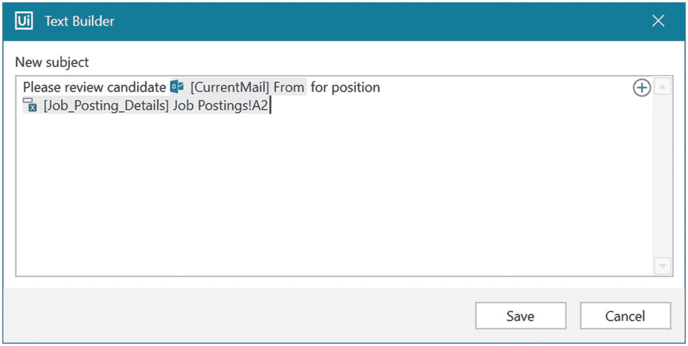

图 5-21

转发邮件新主题的配置

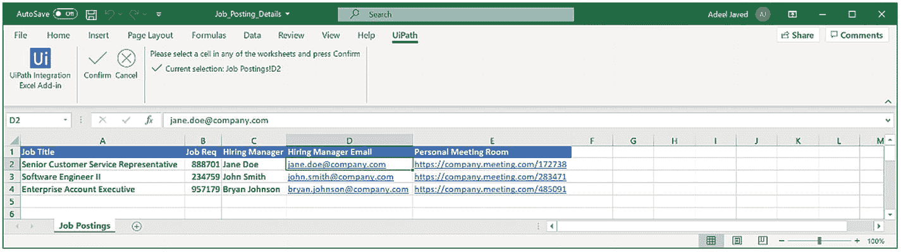

图 5-20

选择转发邮件的招聘经理

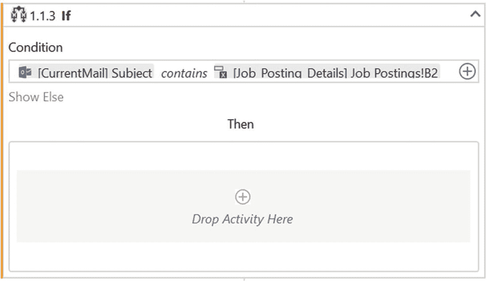

图 5-19

检查邮件主题是否包含特定职位需求 ID 的条件

1.  接下来，在`正文`字段中，点击`加号`图标，选择`文本`选项，然后输入 `Here are the forwarded details of the candidate`。点击`保存`。

2.  保持`另存为草稿`选项为勾选状态。

1.  选择`新主题`字段的`加号`图标，然后选择`文本`选项。在`文本生成器`中，输入 `Please review candidate`。

2.  在`文本生成器`中，点击`加号`图标，悬停在 `CurrentMail` 上并选择 `From`。

3.  在`文本生成器`中，输入 `for position`。

4.  在`文本生成器`中，再次点击`加号`图标，悬停在 `Notebook` 上以选择 `Indicate in Excel`。在 Excel 文件中选择单元格 `A2`，然后点击`确认`。这会将职位名称添加到转发邮件的新主题行中。此时，`文本生成器`应类似于图 5-21。点击`保存`。

1.  接下来，在`如果`活动的`则`块中添加`转发邮件`活动。

2.  保持`邮件`字段为默认值，即 `CurrentMail`。

3.  在`添加‘收件人’`字段中，点击`加号`图标，悬停在 `Notebook` 上以选择 `Indicate in Excel` 选项。

4.  在 Excel 文件中，选择单元格 `D2` 以指定相关招聘经理的电子邮件，然后点击`确认`，如图 5-20 所示。

1.  在 `StudioX` 中，在`对于每封邮件`活动中的`将邮件标记为已读/未读`活动之后添加一个`如果`活动。这将用于筛选主题包含职位需求 ID `888701` 的邮件。

2.  在`如果`活动的`条件`字段中，点击`加号`图标，打开`条件生成器`。

3.  在条件的左侧，点击`加号`图标，悬停在 `CurrentMail` 上并选择 `Subject`。

4.  在条件下拉菜单中，选择 `contains`。

5.  在条件的右侧，点击`加号`图标，悬停在 `Notebook` 上，并选择 `Indicate in Excel`。选择单元格 `B2` 并点击`确认`。图 5-19 显示了完整的条件。此条件用于检查当前邮件的主题是否包含 `Job_Posting_Details.xlsx` 工作表的 `Job Postings` 表中单元格 `B2` 中提到的职位需求 ID。

完成练习后，**转发邮件**活动的最终配置应类似于图 5-22。图 5-23 显示了此活动在“草稿”文件夹中创建的邮件。

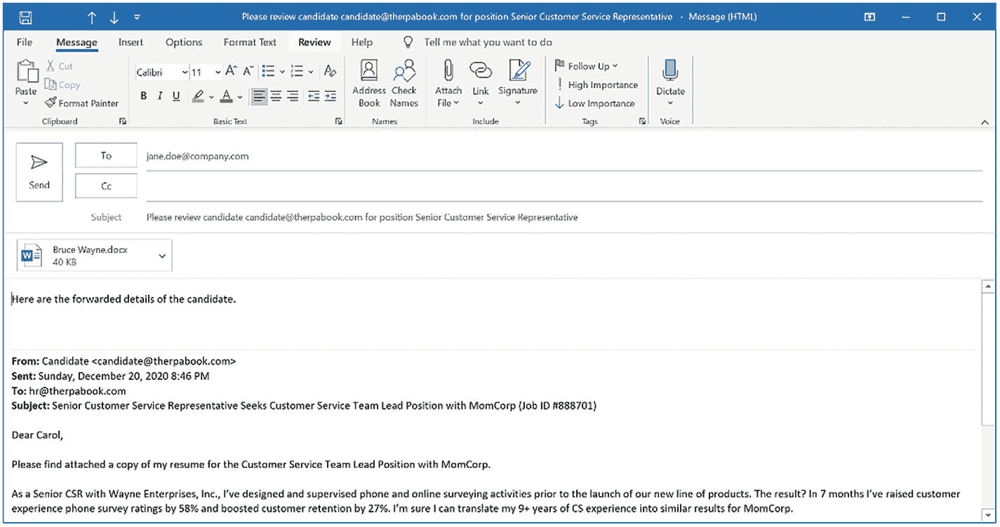

图 5-23

“草稿”文件夹中的转发邮件

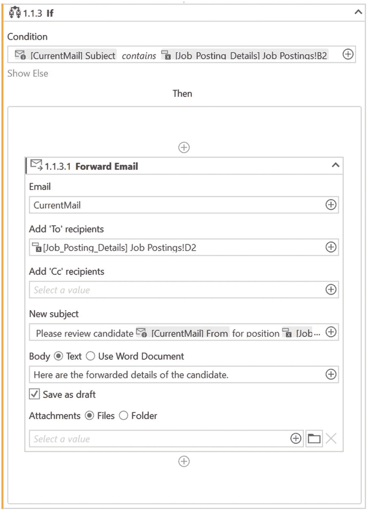

图 5-22

转发邮件活动练习的最终配置

### 保存邮件附件

**保存邮件附件**活动允许您将邮件附件保存到特定文件夹。

#### 配置

本节提供如何配置**保存电子邮件附件**活动的说明，如图 5-24 所示。

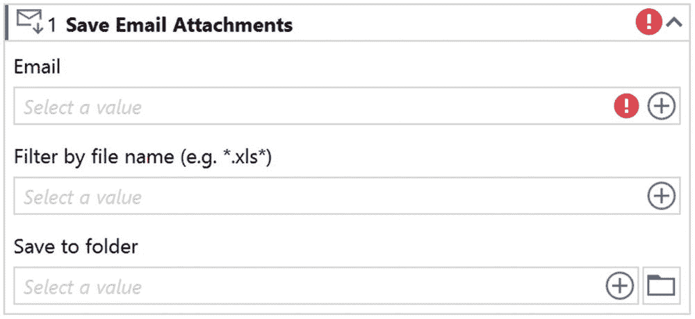

图 5-24

保存电子邮件附件活动卡片

**电子邮件**：这是活动卡片上的一项必填配置。此配置允许您指定需要保存其附件的电子邮件。

对于桌面版 Outlook 应用程序，您还可以通过选择 `Outlook` ➤ `选定电子邮件` 选项来指定当前选中的电子邮件。这将在执行时作用于选中的电子邮件。

如果在 `对于每封电子邮件` 活动中使用，您可以指定循环中的 `CurrentMail` 消息。

**按文件名筛选（例如 *.xls*）**：这是活动卡片上的一项可选配置。您可以提供特定的文件名、扩展名或包含通配符以匹配文件名模式。例如，如果您只想保存 PDF 附件，则在此字段中输入 *.pdf。

**保存到文件夹**：这是活动卡片上的一项可选配置。此配置允许您指定一个用于保存附件的文件夹。如果留空，将保存到项目文件夹。如果该文件夹不存在，则会创建一个。

提示

在常见的业务流程中，此文件夹通常是共享网络文件夹，但出于练习目的，使用本地文件夹。

**附件**：这是 `属性` 面板上的一项可选配置。此配置允许您保存对已下载附件的引用，以供后续使用。

练习

**目标**：基于之前的练习，使用 `保存电子邮件附件` 活动来保存与职位申请 `888701` 相关的电子邮件中包含的简历。附件将保存在 `C:\BookSamples\Chapter_05\Downloads\Resumes` 文件夹中。图 5-17 显示了收件箱的当前状态。

**源代码**：Chapter_5-MailAutomationExercise

**设置**：以下是分步实施说明：

1.  在 `StudioX` 中，将 `保存电子邮件附件` 活动添加到上一个练习中 `转发电子邮件` 活动之后的 `如果` 活动的 `Then` 块中。

2.  将 `电子邮件` 字段值保留为 `CurrentMail`。

3.  将 `按文件名筛选` 字段留空，因为我们希望保存所有文件名和扩展名。

4.  在 `保存到文件夹` 字段中，单击 `文件夹` 图标，然后选择 `C:\BookSamples\Chapter_05\Downloads\Resumes` 文件夹。

完成练习后，**保存电子邮件附件**活动的最终配置应类似于图 5-25。图 5-26 显示了运行此活动后包含已保存附件的目标文件夹。

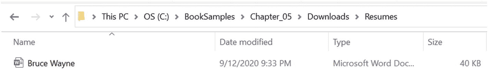

图 5-26

包含已保存附件的下载文件夹

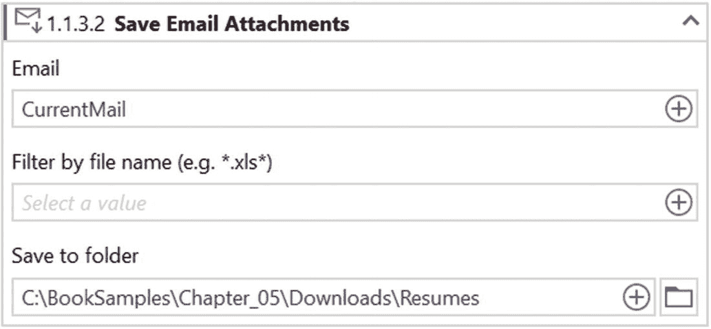

图 5-25

保存电子邮件附件活动练习的最终配置

### 保存电子邮件

**保存电子邮件**活动允许您将电子邮件消息保存为 .msg 或 .eml 文件到指定文件夹中。

#### 配置

本节提供如何配置**保存电子邮件**活动的说明，如图 5-27 所示。

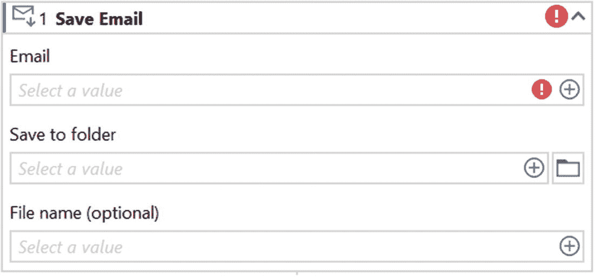

图 5-27

保存电子邮件活动卡片

**电子邮件**：这是活动卡片上的一项必填配置。此配置允许您指定将保存为 .msg 文件（对于 Outlook）或 .eml 文件（对于 Gmail）到指定文件夹中的电子邮件消息。

对于桌面版 Outlook 应用程序，您还可以通过选择 `Outlook` ➤ `选定电子邮件` 选项来指定当前选中的电子邮件。这将在执行时作用于选中的电子邮件。

如果在 `对于每封电子邮件` 活动中使用，您可以指定循环中的 `CurrentMail` 消息。

**保存到文件夹**：这是活动卡片上的一项可选配置。此配置允许您指定一个用于保存电子邮件消息的文件夹。如果留空，将保存到项目文件夹。如果该文件夹不存在，则会创建一个。

提示

在常见的业务流程中，此文件夹通常是共享网络文件夹，但出于练习目的，使用本地文件夹。

**文件名（可选）**：这是活动卡片上的一项可选配置。此配置允许您指定保存文件的名称。如果留空，则使用电子邮件的主题作为文件名。

练习

**目标**：基于之前的练习，如果电子邮件与职位申请 `888701` 相关，则使用 `保存电子邮件` 活动将电子邮件消息保存到 `C:\BookSamples\Chapter_05\Downloads\Emails` 文件夹中。将文件名设置为发件人，后跟电子邮件接收日期。图 5-17 显示了收件箱的当前状态。

**源代码**：Chapter_5-MailAutomationExercise

**设置**：以下是分步实施说明：

1.  在 `StudioX` 中，将 `保存电子邮件` 活动添加到上一个练习中 `保存电子邮件附件` 活动之后的 `如果` 活动的 `Then` 块中。

2.  将 `电子邮件` 字段值保留为 `CurrentMail`。

3.  在 `保存到文件夹` 字段中，选择 `文件夹` 图标，然后浏览以指定 `C:\BookSamples\Chapter_05\Downloads\Emails` 文件夹。

4.  在 `文件名` 字段中，单击 `加号` 图标并选择 `文本` 选项。在 `文本生成器` 中，单击 `加号` 图标，悬停在 `CurrentMail` 上，然后选择 `发件人`。

5.  接下来，在 `文本生成器` 中，再次单击 `加号` 图标，悬停在 `CurrentMail` 上，然后选择 `日期（作为文本）`。单击 `保存`。这将设置发件人和电子邮件接收日期作为保存的消息文件名。

完成练习后，**保存电子邮件**活动的最终配置应类似于图 5-28。图 5-29 显示了运行此活动后包含已保存附件的目标文件夹。

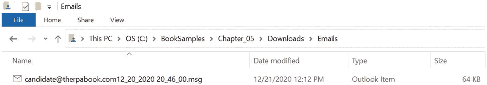

图 5-29

包含已保存电子邮件消息的下载文件夹

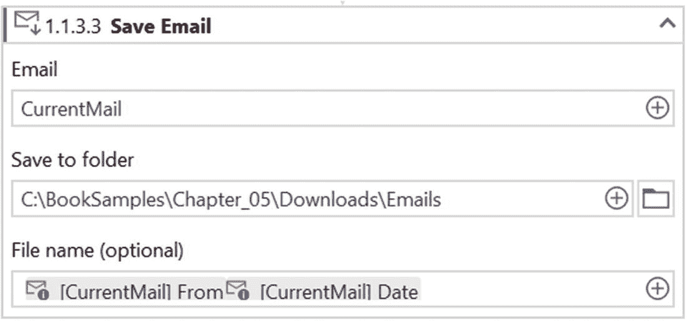

图 5-28

保存电子邮件练习的最终配置

### 发送电子邮件

**发送电子邮件**活动允许您发送电子邮件消息。

#### 配置

本节提供如何配置**发送电子邮件**活动的说明，如图 5-30 所示。

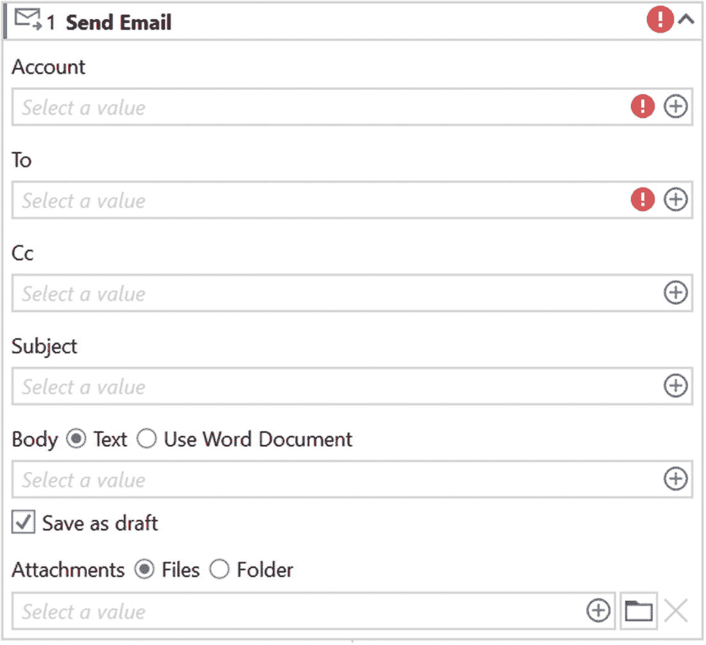

图 5-30

发送电子邮件的活动卡片

**账户**：这是活动卡片上的一项必填配置。此配置允许您指定用于发送电子邮件的账户邮箱地址。

**收件人**：这是活动卡片上的一项必填配置。此配置指定电子邮件的收件人。

**抄送**：这是活动卡片上的一项可选配置。此配置指定电子邮件的次要收件人。

**密送**：这是`属性`面板上的一项可选配置。此配置指定电子邮件的隐藏收件人。

**主题**：这是活动卡片上的一项可选配置。此配置指定电子邮件的主题。

**正文**：这是活动卡片上的一项可选配置。您可以选择`文本`选项来输入正文内容，或选择`使用 Word 文档`选项来指定用作电子邮件正文的 Word 文档的文件路径。

**最大正文文档大小**：这是`属性`面板上的一项可选配置。您可以指定正文中使用的 Word 文档的最大大小。默认情况下，大小设置为`2 MB`。

**另存为草稿**：这是活动卡片上的一项可选配置。此配置默认勾选，表示电子邮件将另存为草稿。建议在开发期间进行此设置。

**附件**：这是活动卡片上的一项可选配置。您可以输入或浏览要附加到电子邮件的文件或文件夹。

练习

**目标**：基于之前的练习，如果申请与职位需求`888701`相关，则使用`发送电子邮件`活动向面试者发送准备材料。图 5-17 显示了收件箱的当前状态。

**源代码**：Chapter_5-MailAutomationExercise

**设置**：以下是逐步实施说明：

1.  在 `StudioX` 中，将`发送电子邮件`活动添加到上一个练习中`保存电子邮件`活动之后的`如果`活动的`则`块中。

2.  保持`账户`字段不变，使用默认值 `Outlook`。

3.  在`收件人`字段中，单击`加号`图标，将鼠标悬停在 `CurrentMail` 上，然后选择`发件人`。这将把面试者设置为电子邮件收件人。

4.  接下来，在`主题`字段中，单击`加号`图标，选择`文本`选项，然后输入 `Interview Prep Material`。单击`保存`。

5.  接下来，在`正文`字段中，单击`加号`图标，选择`文本`选项，然后输入 `Please review the attached MomCorp Interview Preparation Guide containing helpful links, videos, practice problems`。单击`保存`。

6.  保持勾选`另存为草稿`。

7.  在`附件`字段中，选择`文件`选项，单击`文件夹`图标，然后选择 `C:\BookSamples\Chapter_05\PreparationGuide\MomCorp.docx` 文件。

完成练习后，**发送电子邮件**活动的最终配置应类似于图 5-31。图 5-32 显示了此活动在“草稿”文件夹中创建的电子邮件。

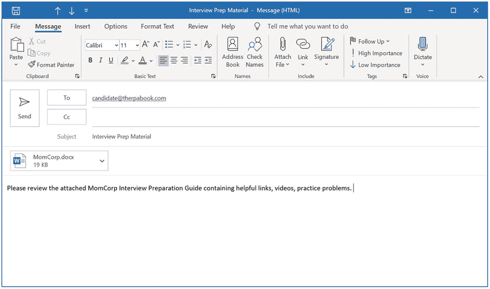

图 5-32

“草稿”文件夹中的新电子邮件

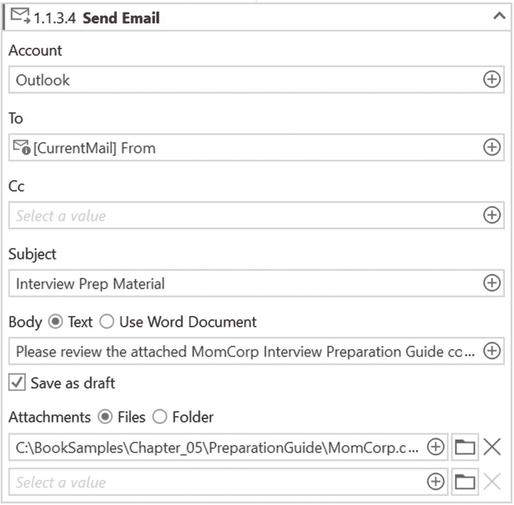

图 5-31

发送电子邮件练习的最终配置

### 发送日历邀请

**发送日历邀请**活动允许您创建并发送日历邀请。

#### 配置

本节提供如何配置**发送日历邀请**活动的说明，如图 5-33 所示。

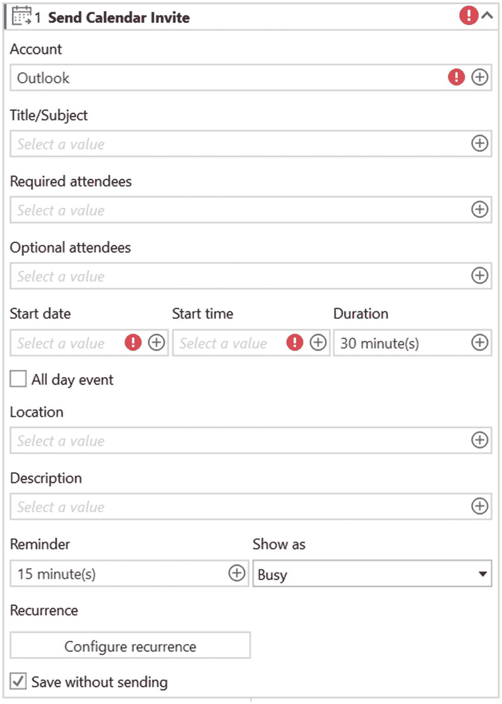

图 5-33

发送日历邀请的活动卡片

**账户**：这是活动卡片上的必填配置。此配置允许您指定用于发送日历邀请的电子邮件地址账户。

**标题/主题**：这是活动卡片上的可选配置。此配置用于指定日历邀请的标题/主题。

**必需与会者**：这是活动卡片上的可选配置。此配置用于指定必须参加会议的参与者。

**可选与会者**：这是活动卡片上的可选配置。此配置用于指定非必须参加会议的参与者。

**开始日期**：这是活动卡片上的必填配置。此配置允许您指定会议邀请的开始日期。

**开始时间**：这是活动卡片上的必填配置。此配置允许您指定会议邀请的开始时间。

**持续时间**：这是活动卡片上的必填配置。此配置允许您指定会议的持续时间。您必须以小时/分钟/秒的形式提供持续时间，或者勾选`全天事件`选项。如果勾选了`全天事件`，则会将会议设置为全天。

**地点**：这是活动卡片上的可选配置。此配置允许您指定会议的地点。

**描述**：这是活动卡片上的可选配置。此配置允许您以`文本`格式指定会议邀请的描述或正文。

**提醒**：这是活动卡片上的必填配置。此配置允许您指定何时显示会议提醒。默认情况下，该值设置为`15 分钟`。

**显示为**：这是活动卡片上的必填配置。此配置允许您指定会议在参与者日历上的标记方式。您可以选择以下选项之一：`空闲`、`暂定`、`忙碌`或`外出`。默认情况下，此选项设置为`忙碌`。

**重复周期**：这是活动卡片上的可选配置。此配置允许您将会议设置为按定义的频率重复。图 5-34 显示了定义重复周期的配置。

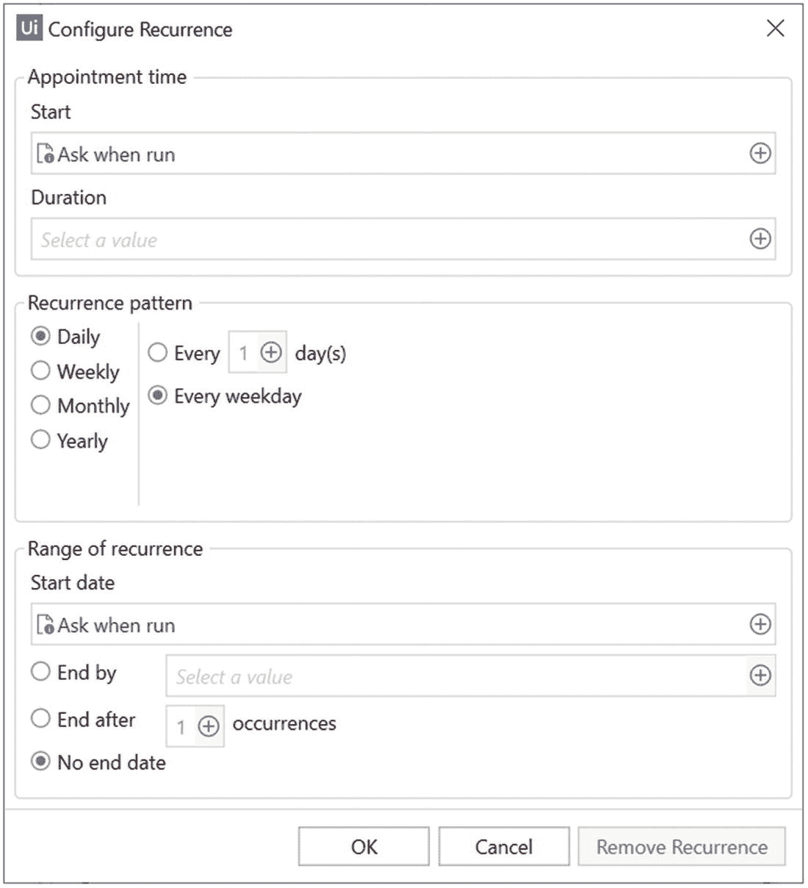

图 5-34

重复周期配置

**保存但不发送**：这是活动卡片上的可选配置。此配置默认处于勾选状态，表示日历邀请将被保存但不发送。建议在开发期间进行此设置。

练习

**目标**：基于之前的练习，如果申请与职位需求 `888701` 相关，则使用`发送日历邀请`活动向招聘经理和候选人发送初步面试会议邀请。以下是邀请的一些额外配置：

*   向招聘经理和面试者发送邀请。

*   提示输入会议邀请的日期和时间。

*   将会议提醒设置为事件前一小时。

*   将招聘经理的个人会议室链接指定为邀请的地点。该链接可在 JobPostingDetails.xlsx Excel 文件的`个人会议室`列中找到。

图 5-17 显示了收件箱的当前状态。

**源代码**：Chapter_5-MailAutomationExercise

**设置**：以下是分步实施说明：

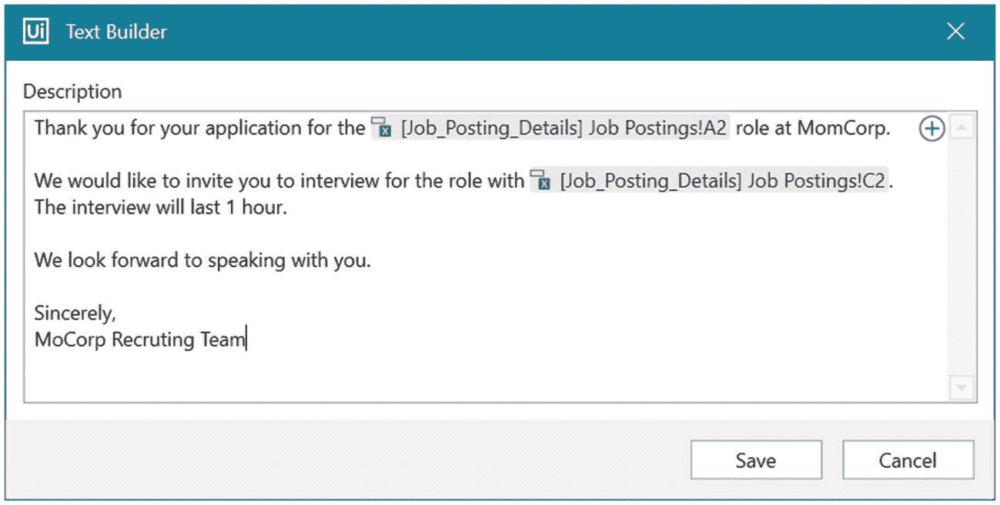

图 5-35

日历邀请的详细描述

1.  在 `StudioX` 中，将`发送日历邀请`活动添加到上一个练习中`发送电子邮件`活动之后的`If`活动的`Then`块中。

2.  在`标题/主题`字段中，单击`加号`图标，选择`文本`选项，然后输入`初步面试与`。

3.  接下来，在`文本生成器`中，单击`加号`图标，将鼠标悬停在`CurrentMail`上，然后选择`发件人`。单击`保存`。这将在日历邀请的标题中指定面试者。

4.  在`必需与会者`字段中，单击`加号`图标，然后选择`文本`选项。接下来，在`文本生成器`中，单击`加号`图标，将鼠标悬停在`CurrentMail`上，然后选择`发件人`。

5.  接下来，在`文本生成器`仍处于打开状态时，输入一个分号（`;`）。Outlook 使用分号来分隔多个收件人。

6.  接下来，在`文本生成器`中，单击`加号`图标，将鼠标悬停在`笔记本`上，然后选择`在 Excel 中指示`。选择单元格 `D2`，然后单击`确认`按钮。单击`保存`。

7.  在`开始日期`和`开始时间`字段中，单击`加号`图标，然后选择`运行时询问`。

8.  通过单击`持续时间`字段中的`加号`图标并在`小时`字段中指定`1`，来延长会议的默认持续时间。

9.  然后，在`地点`字段中，单击`加号`图标，将鼠标悬停在`笔记本`上，然后选择`在 Excel 中指示`。选择单元格 `E2` 以将招聘经理的个人会议室链接指定为会议地点。单击`确认`。

10. 单击`描述`字段中的`加号`图标后，选择`文本`选项，然后输入图 5-35 中所示的描述。为`职位名称`和`招聘经理姓名`指示单元格 `A2` 和 `C2`。

11. 将`提醒`字段更改为`1 小时`。

完成练习后，**发送日历邀请**活动的最终配置应类似于图 5-36。图 5-37 显示了此活动创建的日历邀请。

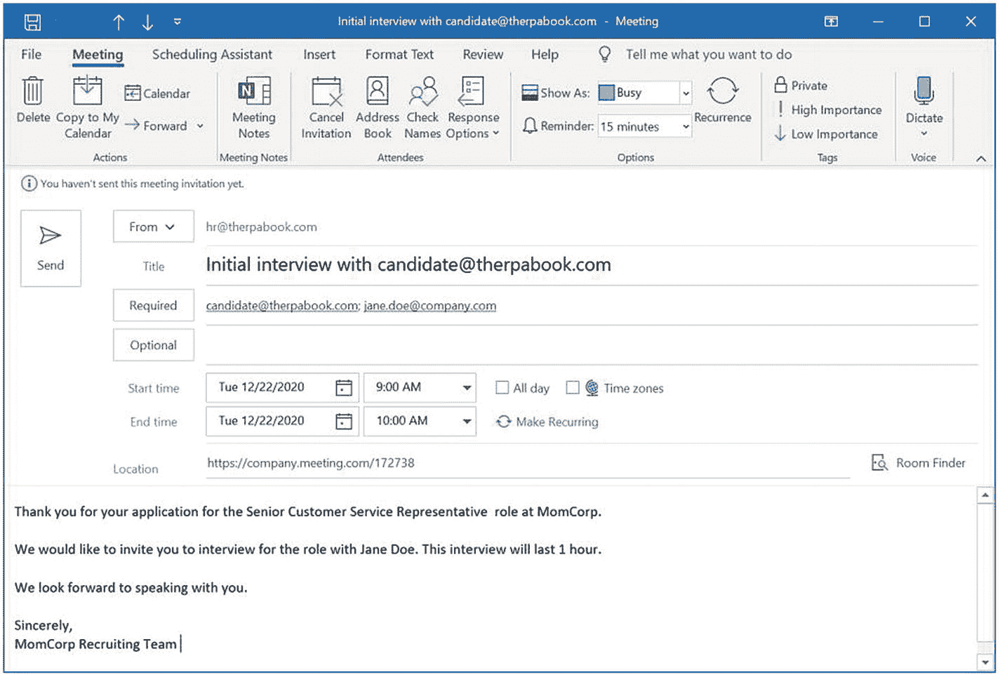

图 5-37

已保存的日历邀请

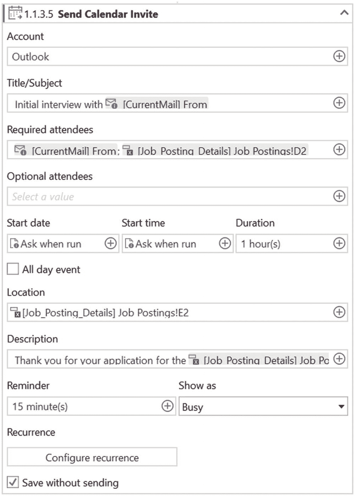

图 5-36

发送日历邀请练习的最终配置

### 移动电子邮件

**移动电子邮件**活动允许您将指定的电子邮件移动到某个文件夹。

#### 配置

本节提供如何配置**移动邮件**活动的说明，如图 5-38 所示。

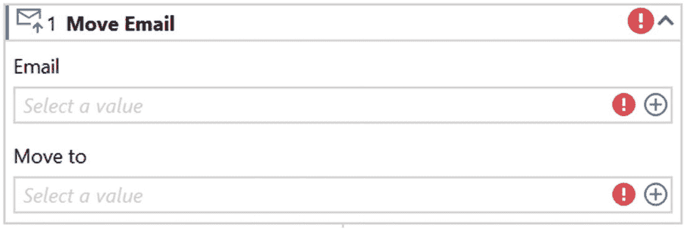

图 5-38

移动邮件的活动卡片

**邮件**：这是活动卡片上的一个必填配置。此配置指定将要移动的邮件。

对于桌面版 Outlook 应用程序，您还可以通过选择 `Outlook` ➤ `已选邮件` 选项来指定当前选中的邮件。这将在执行时作用于选中的邮件。

如果在 `遍历每封邮件` 活动中使用，您可以在循环中指定 `当前邮件` 消息。

**移至**：这是活动卡片上的一个必填配置。此配置指定邮件将要移动到的文件夹。

练习

**目标**：基于之前的练习，使用 `移动邮件` 活动，如果候选邮件与职位需求 `888701` 相关，则将其移动到 `收件箱` ➤ `初始筛选` 文件夹。图 5-17 显示了收件箱的当前状态。

**源代码**：Chapter_5-MailAutomationExercise

**设置**：以下是分步实施说明：

1.  在 `StudioX` 中，将 `移动邮件` 活动添加到上一个练习中 `发送日历邀请` 活动之后的 `如果` 活动的 `则` 块中。

2.  选择 `移至` 字段中的 `加号` 图标，以选择 `收件箱\初始筛选` Outlook 文件夹。

完成练习后，**移动邮件**活动的最终配置应类似于图 5-39。图 5-40 显示了此活动运行后收件箱的状态，而图 5-41 显示了邮件被移动到的初始筛选文件夹的状态。

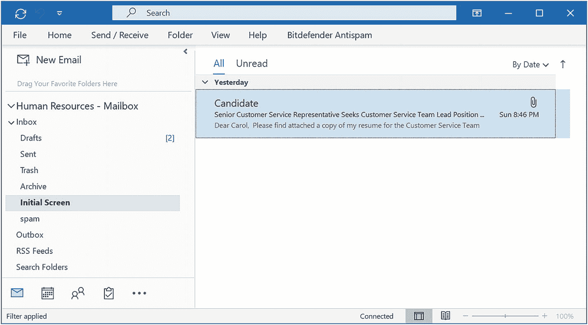

图 5-41

移动邮件练习后初始筛选文件夹的状态

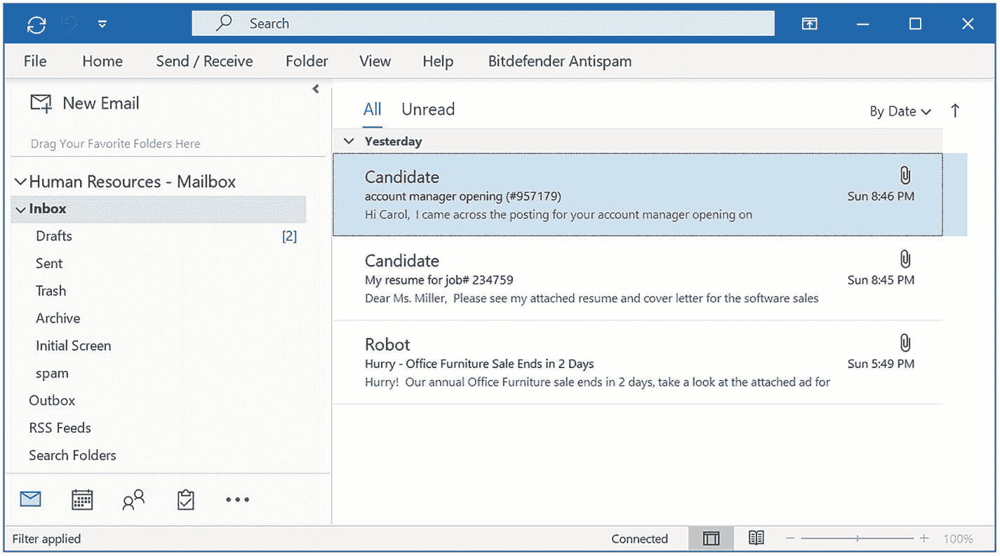

图 5-40

移动邮件练习后人力资源邮件收件箱的状态

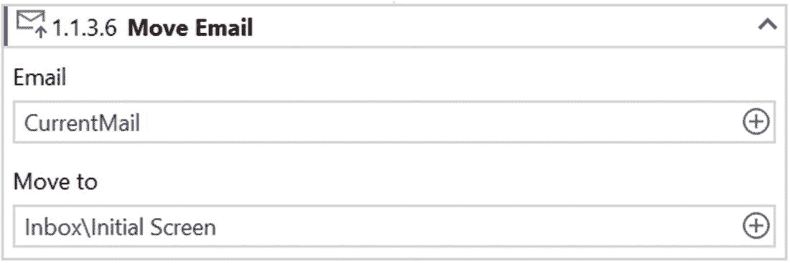

图 5-39

移动邮件练习的最终配置

### 回复邮件

**回复邮件**活动允许您回复指定的邮件消息。

#### 配置

本节提供如何配置**回复电子邮件**活动的说明，如图 5-42 所示。

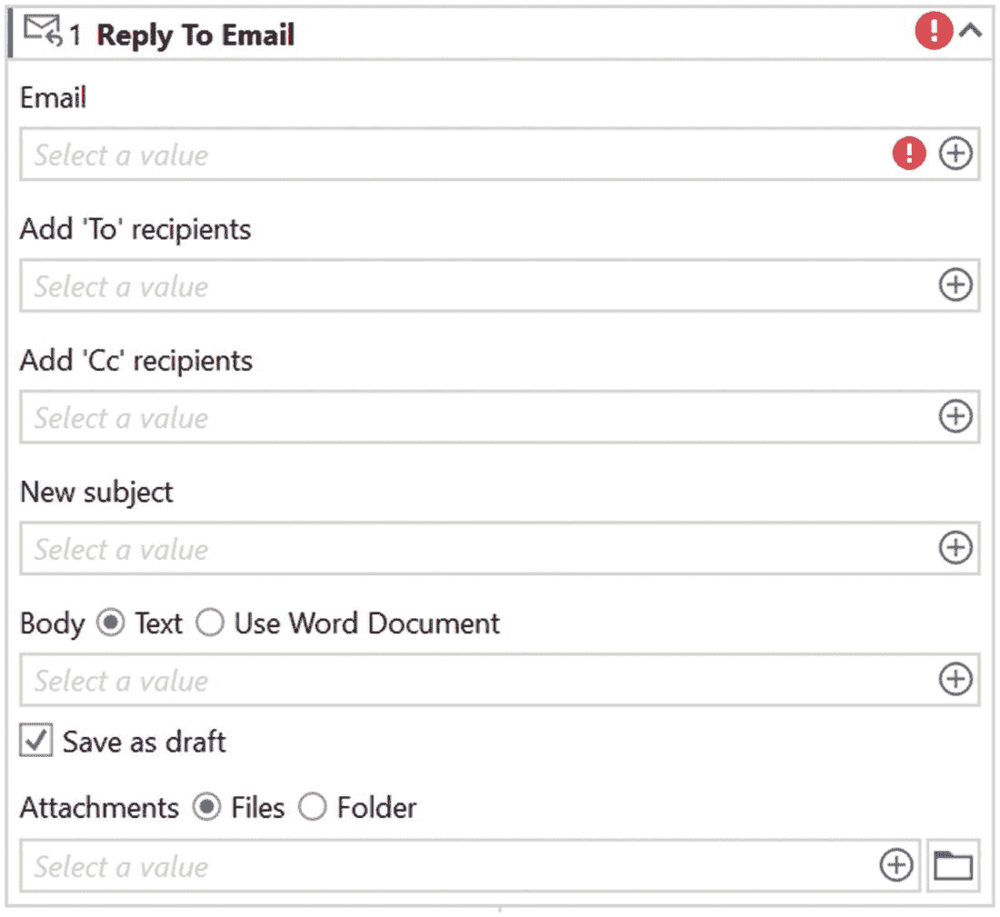

图 5-42

回复电子邮件活动卡片

**电子邮件**：这是活动卡片上的一个必填配置。此配置允许您指定要回复的电子邮件。

对于桌面版 Outlook 应用程序，您还可以通过选择 `Outlook` ➤ `Selected Email` 选项来指定当前选中的电子邮件。这将在执行时作用于选中的电子邮件。

如果在 `For Each Email` 活动中使用，您可以在循环中指定 `CurrentMail` 消息。

**全部回复**：这是 `Properties` 面板上的一个可选配置。此配置允许您指定回复是否应发送给电子邮件的所有原始收件人。默认情况下，该选项未选中。

**添加‘收件人’**：这是活动卡片上的一个必填配置。此配置指定回复电子邮件的收件人。

**添加‘抄送’收件人**：这是活动卡片上的一个可选配置。此配置指定回复消息的次要收件人。

**添加‘密送’收件人**：这是活动卡片上的一个可选配置。此配置指定回复消息的隐藏电子邮件收件人。

**新主题**：这是活动卡片上的一个可选配置。如果指定，回复电子邮件的主题将被更改。否则，将使用原始主题。

**正文**：这是活动卡片上的一个可选配置。您可以选择 `Text` 选项来输入正文文本，或选择 `Use Word Document` 选项来指定用作电子邮件正文的 Word 文档的文件路径。

**最大正文文档大小**：这是 `Properties` 面板上的一个可选配置。您可以指定正文文本中使用的 Word 文档的最大大小。默认情况下，大小设置为 `2 MB`。

**另存为草稿**：这是活动卡片上的一个可选配置。此配置默认勾选，表示电子邮件将保存为草稿。建议在开发期间进行此设置。

**附件**：这是活动卡片上的一个可选配置。您可以输入或浏览要附加到回复电子邮件的文件或文件夹。

练习

**目标**：基于之前的练习，使用 `Reply to Email` 活动回复与职位申请编号 `234759` 或 `957179` 相关的应聘者电子邮件。图 5-40 显示了收件箱的当前状态。

**源代码**：Chapter_5-MailAutomationExercise

**设置**：以下是分步实施说明：

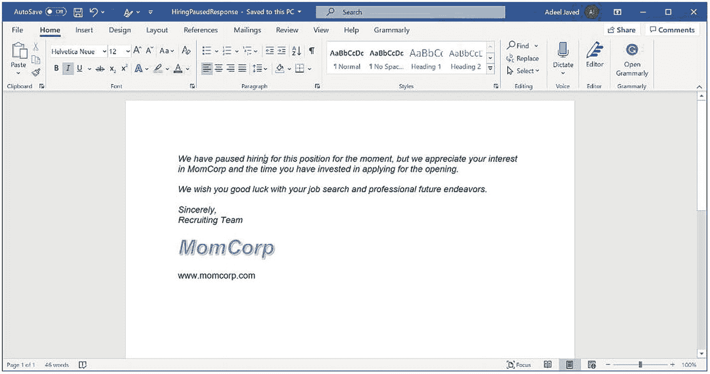

图 5-43

用于电子邮件回复的 Word 文档模板

1.  在 `StudioX` 中，在上一练习中 `If` 活动的 `Else` 块内添加一个 `If` 活动。这是为了筛选主题行包含 `Notebook` 中引用的特定职位申请编号的电子邮件。

2.  点击 `Condition` 字段中的 `Plus` 图标以打开 `Condition Builder`。

3.  在条件的左侧，点击 `Plus` 图标，然后悬停在 `CurrentMail` 上以选择 `Subject`。

4.  在 `condition` 下拉菜单中，选择 `contains`。

5.  在条件的右侧，点击 `Plus` 图标，然后悬停在 `Notebook` 上以选择 `Indicate in Excel`。选择单元格 `B3`，然后点击 `Confirm`。

6.  点击 `Condition Builder` 中的 `+ Add` 按钮以添加一个条件。

7.  从左上角的下拉菜单中选择 `Any (OR)`。

8.  重复步骤 3 和 4。

9.  在条件的右侧，点击 `Plus` 图标，然后悬停在 `Notebook` 上以选择 `Indicate in Excel`。选择单元格 `B4`，然后点击 `Confirm`。

10. 在新创建的 `If` 活动的 `Then` 块中添加一个 `Reply to Email` 活动。

11. 保持 `Email` 字段不变，使用默认值 `CurrentMail`。

12. 在 `To` 字段中，点击 `Plus` 图标，悬停在 `CurrentMail` 上，然后选择 `From`。这将把电子邮件回复发送给原始发件人。

13. 接下来，在 `New subject` 字段中，点击 `Plus` 图标，然后选择 `Text` 选项以打开 `Text Builder`。输入 `Thank you for your interest` 作为电子邮件主题行。点击 `Save`。

14. 在 `Body` 字段中，选择 `Use Word Document` 选项。点击 `Folder` 图标以浏览文件，然后选择 `C:\BookSamples\Chapter_05\EmailTemplates\HiringPausedResponse.docx` 文件。图 5-43 显示了用作电子邮件回复正文的 Word 文档内容。

完成练习后，**Reply to Email** 活动的最终配置应类似于图 5-44。图 5-45 显示了此活动在“草稿”文件夹中生成的电子邮件。

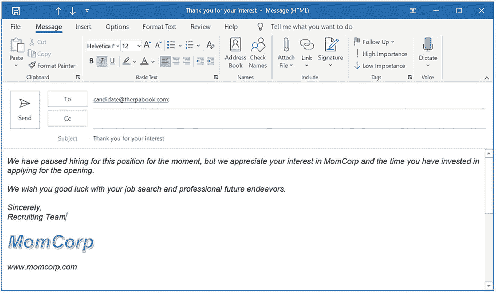

图 5-45

由“回复电子邮件”活动生成的草稿回复消息

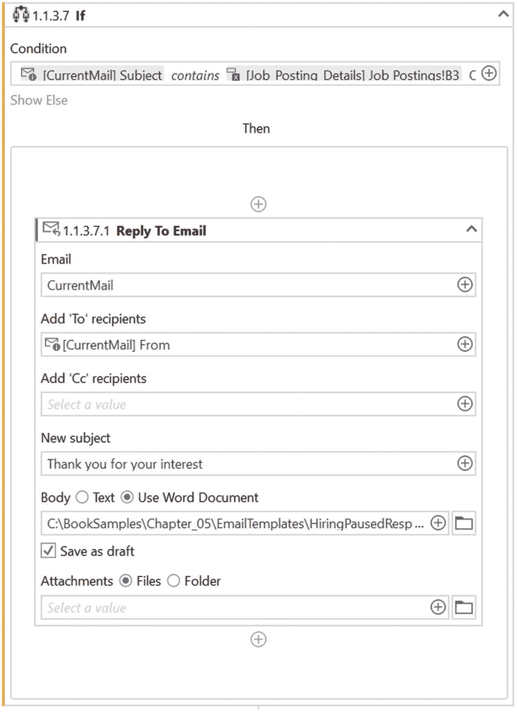

图 5-44

“回复电子邮件”练习的最终配置

### 归档电子邮件

**归档电子邮件**活动允许您归档一封电子邮件消息。

#### 配置

本节提供如何配置**归档电子邮件**活动的说明，如图 5-46 所示。

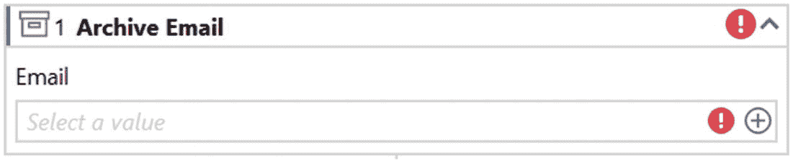

图 5-46

归档电子邮件活动卡片

**电子邮件**：这是活动卡片上的一个必填配置。此配置指定要归档的电子邮件。

对于桌面版 Outlook 应用程序，您还可以通过选择 `Outlook` ➤ `Selected Email` 选项来指定当前选中的电子邮件。这将在执行时作用于选中的电子邮件。

如果在 `For Each Email` 活动中使用，您可以在循环中指定 `CurrentMail` 消息。

练习

**目标**：基于之前的练习，使用 `Archive Email` 活动归档与职位申请编号 `234759` 或 `957179` 相关的电子邮件。图 5-40 显示了收件箱的当前状态。

**源代码**：Chapter_5-MailAutomationExercise

**设置**：以下是分步实施说明：

1.  在 `StudioX` 中，在 `Reply Email` 活动之后的 `If` 活动的 `Then` 块中添加一个 `Archive Email` 活动。

2.  保持 `Email` 字段不变，使用默认值 `CurrentMail`。

完成练习后，**Archive Email** 活动的最终配置应类似于图 5-47。图 5-48 显示了电子邮件归档到的“归档”文件夹。

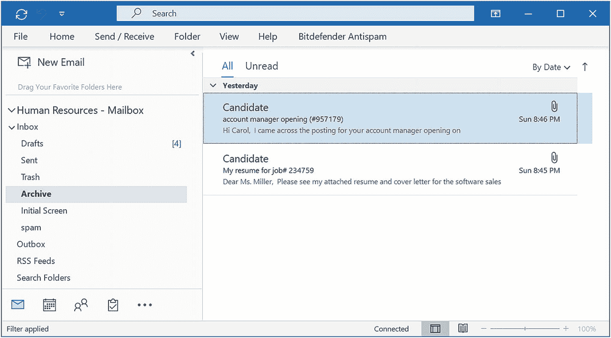

图 5-48

人力资源邮箱的归档文件夹

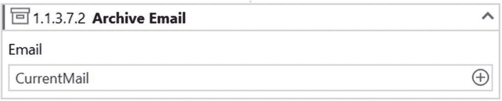

图 5-47

归档电子邮件练习的最终配置

### 删除电子邮件

**删除电子邮件**活动允许您删除指定的电子邮件消息。

#### 配置

本节提供如何配置**删除电子邮件**活动的说明，如图 5-49 所示。

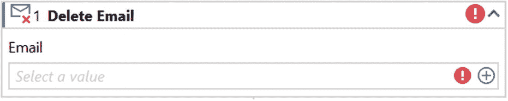

图 5-49

删除电子邮件的活动卡片

**电子邮件**：这是活动卡片上的一项必填配置。此配置用于指定要删除的电子邮件。

对于桌面版 Outlook 应用程序，您还可以通过选择 `Outlook` ➤ `选定电子邮件` 选项来指定当前选中的电子邮件。这将在执行时作用于选中的电子邮件。

如果在 `遍历电子邮件` 活动中使用，您可以指定循环中的 `CurrentMail` 消息。

练习

**目标**：基于之前的练习，使用 `删除电子邮件` 活动删除与任何职位需求 ID 无关的电子邮件。

**源代码**：Chapter_5-MailAutomationExercise

**设置**：以下是分步实施说明：

1.  点击 `If` 活动中的 `显示 Else` 选项。此步骤是上一练习的延续。

2.  在 `If` 活动的 `Else` 块中添加一个 `删除电子邮件` 活动。这将删除主题中不包含 `Notebook` 内职位需求 ID 的电子邮件。

完成练习后，**删除电子邮件**活动的最终配置应类似于图 5-50。图 5-51 显示了包含已删除电子邮件的“垃圾邮件”文件夹。

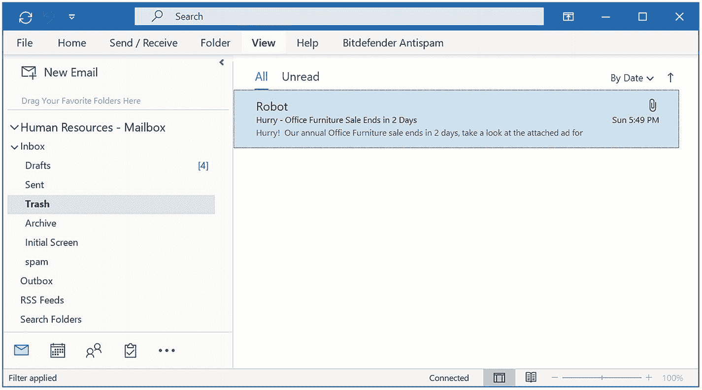

图 5-51

人力资源邮箱的“垃圾邮件”文件夹

图 5-50

删除电子邮件练习的最终配置

