# 6. Word 自动化

Microsoft Word 是全球组织中最流行、最通用的文字处理程序。Word 通常用于创建法律文档、财务文件、采购文档以及自定义模板和需求文档。UiPath StudioX Word 自动化为公民开发者提供了关键任务的自动化能力，例如读取内容、编写文本、添加图像、插入表格、导出为 PDF 以及创建包含表格、签名或徽标等内容的富 HTML 电子邮件正文。

## 学习目标

在本章结束时，您将学习如何

*   定义要自动化的 Word 作用域

*   将文档另存为其他文件

*   从文档中读取文本

*   替换文档中所有出现的文本

*   设置文档书签的文本

*   基于替代文本替换图片

*   相对于文本或书签插入数据表

*   在 Word 文档末尾添加图片

*   在 Word 文档中追加文本

*   将 Word 文档导出为 PDF

## 示例概述

在本章中，我们将使用一个简化版的发票生成流程来展示所有 Word 自动化活动的用法。本章讨论的概念可应用于从不同数据源填充信息，以完成模板化的 Word 文档，例如主服务协议、工作说明书、提案请求、处方和服务台工单。

本节将使您熟悉本章所有练习的先决条件。

### Word 设置

本节提供有关如何在 Word 中启用书签和为图像添加替代文本的信息。

#### 书签

首先，通过导航到 `文件` ➤ `选项` ➤ `高级` 中的“高级选项”，确保书签已显示。在 `显示文档内容` 部分，确认已勾选 `显示书签`。图 6-1 显示了配置后的设置。

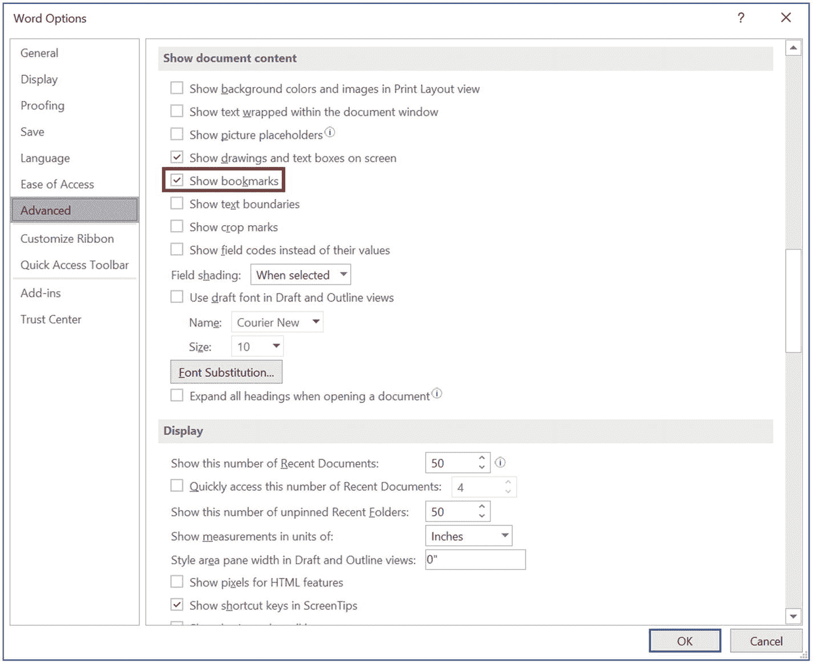

图 6-1

从 Word 高级选项中显示书签

#### 替代文本

StudioX 使用 Word 中图像的替代文本（Alt Text）来查找和替换图片。要查看图片的替代文本，请在 Word 文档中选择该图像，然后右键单击，并选择“编辑替代文本”。图 6-2 显示了发票模板中占位图片的替代文本。

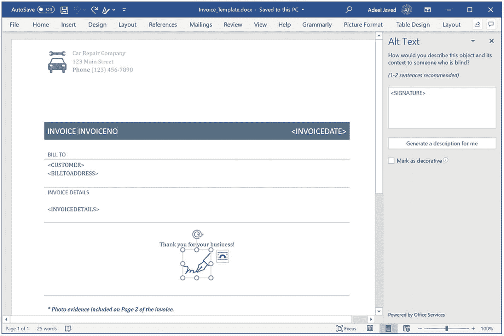

图 6-2

发票模板占位图像的替代文本

### 文件系统结构

接下来，从本书网站下载源代码，并确保将整个 BookSamples 文件夹移动到您的 C:\ 驱动器。本章所有练习均假定文件夹路径为 **C:\BookSamples\Chapter_06**。图 6-3 显示了此示例所需的物理文件夹结构。此文件夹结构随源代码一起提供。

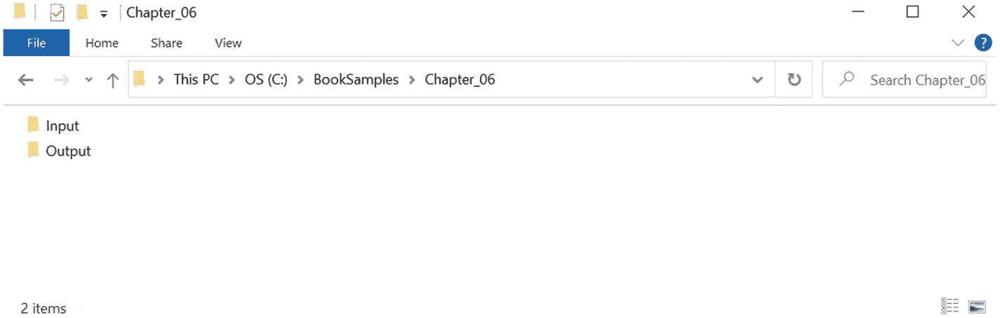

图 6-3

用于发票生成练习的文件夹结构

**输入**：此文件夹包含发票模板以及图像和一个 Excel 文件作为输入数据。图 6-4 显示了输入文件夹的内容。

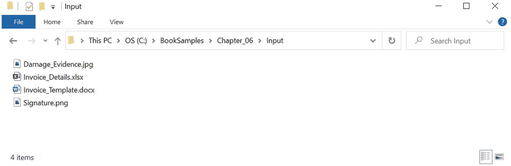

图 6-4

输入文件夹的内容

**输出**：此空文件夹用于存储完成的发票模板，并将在此处创建和保存最终的 PDF。图 6-5 显示了输出文件夹的内容。

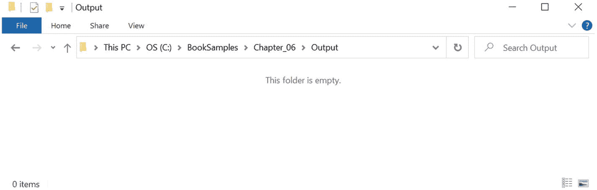

图 6-5

输出文件夹的内容

## 活动参考

如图 6-6 所示，所有 Word 自动化活动都可以在 Word 类别下找到。以下各节将提供有关如何配置和使用每个活动的说明。

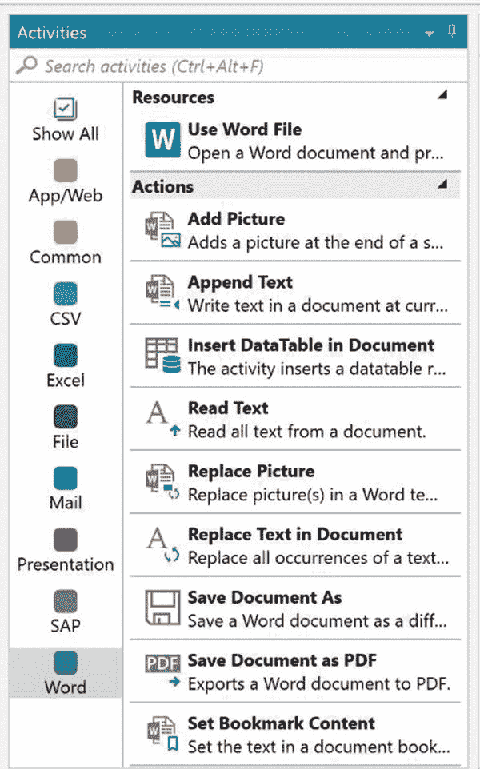

图 6-6

Word 自动化活动

### 使用 Word 文件

**使用 Word 文件**活动允许您为自动化定义一个 Word 作用域。当流程执行时，Word 文档会被打开，并在完成后关闭。

此活动将包含您希望对 Word 文档执行的所有操作。例如，如果您想将文档导出为 PDF，则**将文档另存为 PDF**活动将嵌套在**使用 Word 文件**活动的主体中。

#### 配置

本节提供如何配置**使用 Word 文件**活动的说明，如图 6-7 所示。

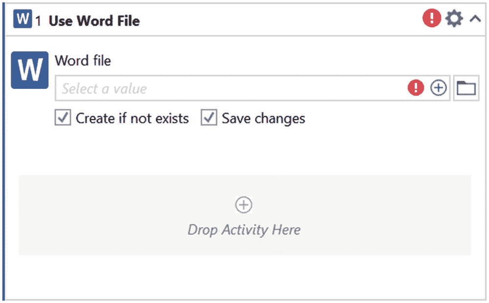

图 6-7

使用 Word 文件的活动卡片

注意

要配置此活动，请确保您的 Microsoft Word 桌面应用程序已登录。

**Word 文件**：这是活动卡片上的一项必填配置。此配置允许您指定要自动化的 Word 文档。

**不存在则创建**：这是活动卡片上的一项可选配置。勾选后，如果文档不存在，则会创建一个。默认情况下，此选项处于勾选状态。

**自动保存**：这是活动卡片上的一项可选配置。勾选后，运行流程时将保存更改。默认情况下，此选项处于勾选状态。

### 另存文档为

**另存文档为**活动允许您将文档保存为新文件或替换现有文件。**另存文档为**活动之后的任何活动都将影响已保存的 Word 文档。建议在自动化流程的最开始使用此活动，以防止对原始文件进行意外更改。

#### 配置

本节提供如何配置**另存文档为**活动的说明，如图 6-8 所示。

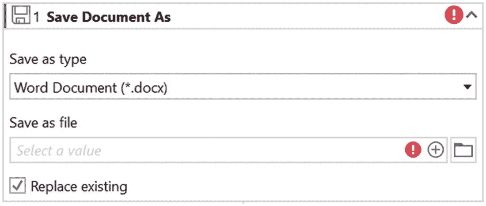

图 6-8

另存文档为活动卡片

**另存为类型**：这是活动卡片上的一项必需配置。此配置允许您指定保存文件时的文件扩展名。如图 6-9 所示，您可以查看可用的扩展名列表。

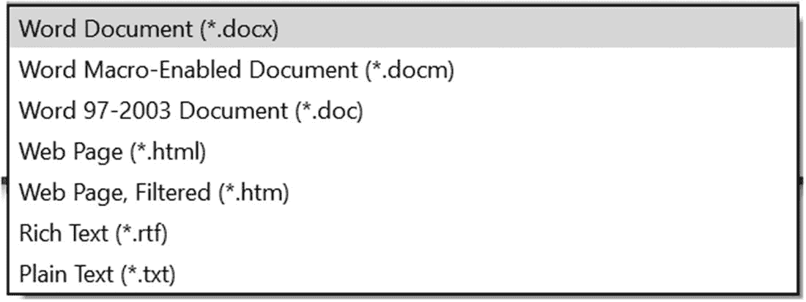

图 6-9

另存文档为活动的扩展名

**另存为文件**：这是活动卡片上的一项必需配置。您可以键入或浏览以选择要保存文档的文件。

**替换现有文件**：这是活动卡片上的一项可选配置。选中后，如果文件已存在，则会被替换。如果未选中且文件已存在，则会显示错误通知文件已存在。默认情况下，此选项处于选中状态。

练习

**目标**：使用`使用 Word 文件`和`另存文档为`活动创建 `C:\BookSamples\Chapter_06\Input\Invoice_Template.docx` 文件的副本。新文件将创建在 `C:\BookSamples\Chapter_06\Output` 文件夹中，名称为 `INV_CustomerName.docx`。这样做是为了在自动化执行时，原始发票模板不会被更改。图 6-5 显示了 Output 文件夹的当前状态。

**源代码**：Chapter_6-WordAutomationExercise

**设置**：以下是分步实施说明：

1.  在 `StudioX` 中，将`使用 Word 文件`活动添加到一个空白流程中。

2.  在 `Word 文件`字段中，单击`文件夹`图标以选择 `C:\BookSamples\Chapter_06\Input\Invoice_Template.docx` 文件。

3.  接下来，在`使用 Word 文件`活动的主体内部添加`另存文档为`活动。

4.  将`另存为类型`字段保留为默认值 `Word 文档 (*.docx)`。

5.  单击`另存为文件`字段的`加号`图标，然后选择`文本`选项。在`文本生成器`中，键入 `C:\BookSamples\Chapter_06\Output\INV`。

6.  在`文本生成器`中，单击`加号`图标，将鼠标悬停在`笔记本`上，然后选择`在 Excel 中指示`。选择单元格 `D2`，然后单击`确认`。

7.  接下来，在`文本生成器`中，键入 `.docx`。单击`保存`。

8.  保持`替换现有文件`字段处于选中状态。

完成练习后，**另存文档为**活动的最终配置应类似于图 6-10。图 6-11 显示了保存在 Output 文件夹中的发票模板副本。

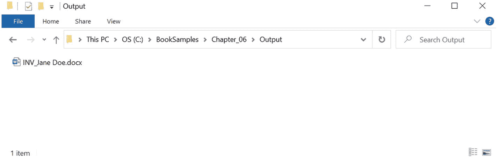

图 6-11

另存文档为活动练习的输出

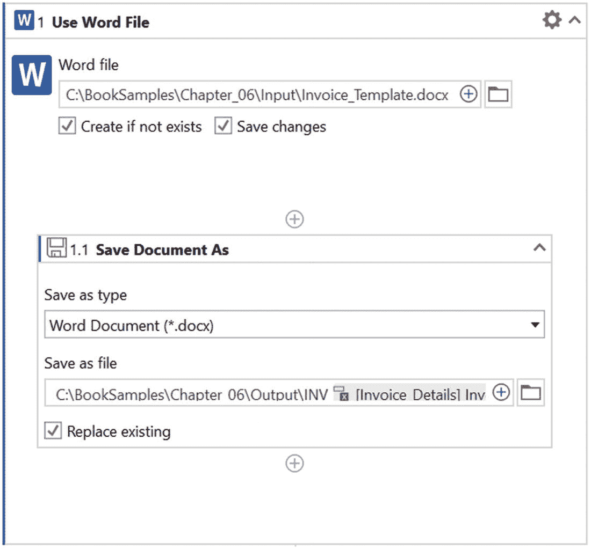

图 6-10

另存文档为活动练习的最终配置

### 读取文本

**读取文本**活动允许您读取文档中的所有文本，并将其保存到项目笔记本或剪贴板中，以便在自动化流程中引用。

#### 配置

本节提供如何配置**读取文本**活动的说明，如图 6-12 所示。

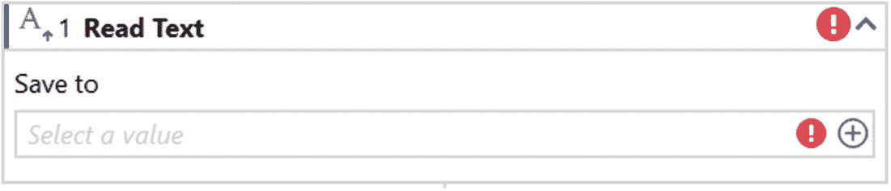

图 6-12

读取文本活动卡片

**保存到**：这是活动卡片上的一项必需配置。此配置指定文档文本的保存位置。

练习

**目标**：基于我们之前的练习，使用`读取文本`活动读取发票模板中的所有文本，并将其打印在输出面板中。

**源代码**：Chapter_6-WordAutomationExercise

**设置**：以下是分步实施说明：

1.  在 `StudioX` 中，在`使用 Word 文件`活动中的`另存文档为`活动之后添加`读取文本`活动。

2.  然后，在`保存到`字段中，单击`加号`图标并选择`复制到剪贴板`。

3.  接下来，在`使用 Word 文件`活动主体中的`读取文本`活动之后添加`写入行`活动。

4.  在`文本`字段中，单击`加号`图标，然后选择`从剪贴板粘贴`。

完成练习后，**读取文本**活动的最终配置应类似于图 6-13。自动化运行后，发票模板文档中的所有文本都将打印在输出面板中，如图 6-14 所示。

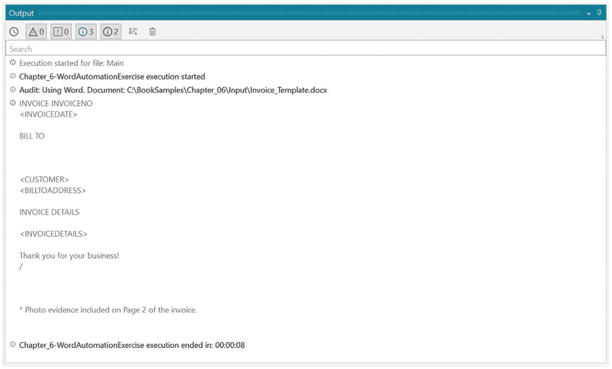

图 6-14

读取文本练习的输出

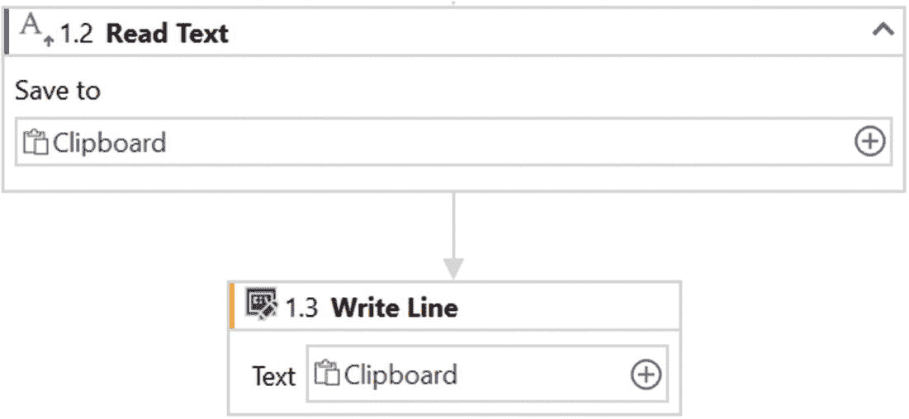

图 6-13

读取文本练习的最终配置

### 设置书签内容

**设置书签内容**活动允许您设置文档书签的文本。这在基于模板编辑文档时特别有用，因为它允许您移除文档的整个部分，例如，无薪实习合同中的付款部分。

#### 配置

本节提供如何配置**设置书签内容**活动的说明，如图 6-15 所示。

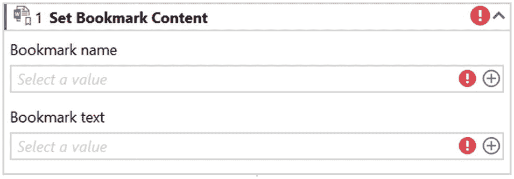

图 6-15

设置书签内容的活动卡片

**书签名称**：这是活动卡片上的一个必填配置。此配置允许您指定文档书签的名称。

**书签文本**：这是活动卡片上的一个必填配置。您可以指定要替换书签的文本。

提示

“Word 设置”部分演示了如何显示文档书签。

练习

**目标**：基于之前的练习，使用 `Set Bookmark Content` 活动，将文档书签 `INVOICENO` 替换为来自 `Notebook` 的发票编号值。图 6-2 显示了发票模板的当前状态。

**源代码**：Chapter_6-WordAutomationExercise

**设置**：以下是分步实施说明：

1.  在 `StudioX` 中，将 `Set Bookmark Content` 活动添加到 `Use Word File` 活动内的 `Write Line` 活动之后。这将用于将书签文本替换为发票编号。

2.  点击 `Bookmark name` 字段的 `Plus` 图标，然后选择 `Text` 选项。在 `Text Builder` 中，输入 `INVOICENO`。点击 `Save`。

3.  在 `Bookmark text` 字段中，点击 `Plus` 图标，将鼠标悬停在 `Notebook` 上，然后选择 `Indicate in Excel` 选项。

4.  在 Excel 文件中，选择 `Invoice Details` 工作表的单元格 `A2` 以指定发票编号，然后点击 `Confirm`。

完成练习后，**设置书签内容**活动的最终配置应类似于图 6-16。图 6-17 显示了运行此活动后生成的发票。

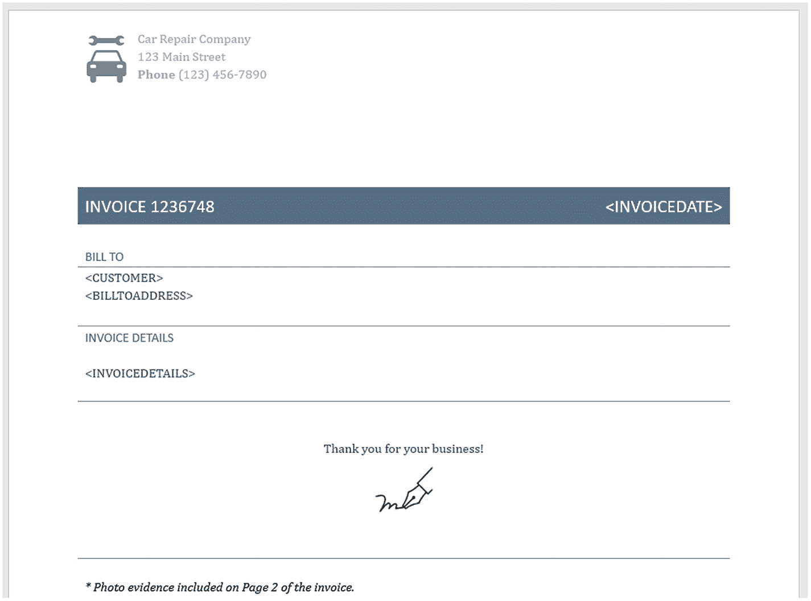

图 6-17

完成设置书签内容练习后生成的发票状态

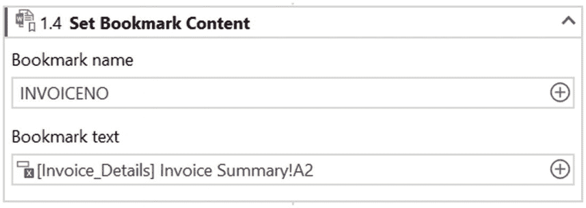

图 6-16

设置书签内容活动练习的最终配置

### 替换文档中的文本

**替换文档中的文本**活动允许您将文档中所有出现的文本替换为其他文本。当基于模板编辑文档时（例如，保险单上的姓名、姓氏和地址），可以使用此功能。

提示

为确保只替换目标文本，通常会在文本周围加上括号或方括号以使其具有唯一标识，例如，指定 `<Company Name>` 或 `{Invoice_No}`。

#### 配置

本节提供如何配置**替换文档中的文本**活动的说明，如图 6-18 所示。

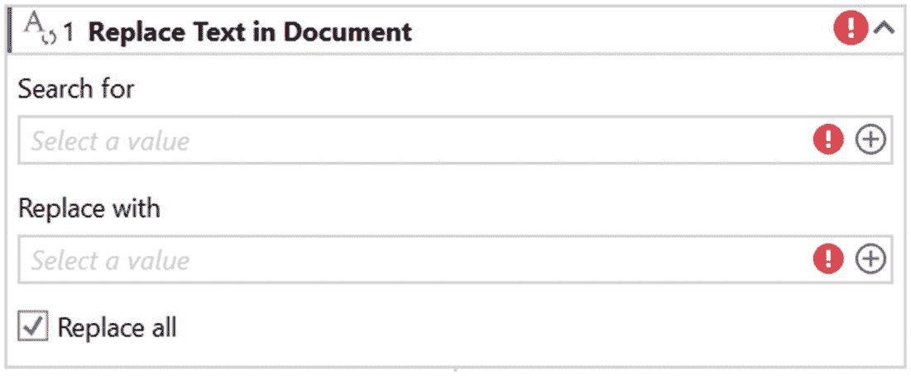

图 6-18

替换文档中的文本的活动卡片

**搜索内容**：这是活动卡片上的一个必填配置。此配置允许您指定要搜索并替换的文本。请注意，搜索不区分大小写。

**替换为**：这是活动卡片上的一个必填配置。此配置指定将替换搜索文本的文本。

**全部替换**：这是活动卡片上的一个可选配置。选中后，将替换所有出现的搜索文本。如果未选中，则仅替换搜索到的第一个文本。默认情况下，此选项处于选中状态。

**已找到**：这是 `Properties` 面板上的一个可选配置。此配置根据是否找到 `搜索内容` 文本返回 true 或 false。

练习

**目标**：基于之前的练习，使用 `Replace Text in Document` 活动，将 `<INVOICEDATE>`、`<CUSTOMER>` 和 `<BILLTOADDRESS>` 占位符替换为来自 `Notebook` 的 `Invoice Summary` 工作表中的实际客户详细信息。

发票日期将从 `Notebook` 的单元格 `B2` 读取，客户名称从单元格 `D2` 读取，账单地址从单元格 `E2` 读取。图 6-17 显示了发票模板的当前状态。

**源代码**：Chapter_6-WordAutomationExercise

**设置**：以下是分步实施说明：

1.  在 `StudioX` 中，将 `Replace Text in Document` 活动添加到 `Use Word File` 活动内的 `Set Bookmark Content` 活动之后。这将用于替换发票日期值。

2.  点击 `Search for` 字段中的 `Plus` 图标，然后选择 `Text` 选项。在 `Text Builder` 中，输入 `<INVOICEDATE>`。点击 `Save`。

3.  在 `Replace with` 字段中，点击 `Plus` 图标，将鼠标悬停在 `Notebook` 上，然后选择 `Indicate in Excel` 选项。在 Excel 文件中，选择单元格 `B2` 以指定发票日期，然后点击 `Confirm`。

4.  将 `Replace Text in Document` 活动添加到 `Use Word File` 活动内的 `Replace Text in Document` 活动之后。这将用于替换客户名称。

5.  点击 `Search for` 字段中的 `Plus` 图标，然后选择 `Text` 选项。在 `Text Builder` 中，输入 `<CUSTOMER>`。点击 `Save`。

6.  在 `Replace with` 字段中，点击 `Plus` 图标，将鼠标悬停在 `Notebook` 上，然后选择 `Indicate in Excel` 选项。在 Excel 文件中，选择单元格 `D2` 以指定客户名称，然后点击 `Confirm`。

7.  将 `Replace Text in Document` 活动添加到 `Use Word File` 活动内的 `Replace Text in Document` 活动之后。这将用于替换账单地址。

8.  点击 `Search for` 字段中的 `Plus` 图标，然后选择 `Text` 选项。在 `Text Builder` 中，输入 `<BILLTOADDRESS>`。点击 `Save`。

9.  在 `Replace with` 字段中，点击 `Plus` 图标，将鼠标悬停在 `Notebook` 上，然后选择 `Indicate in Excel` 选项。在 Excel 文件中，选择单元格 `E2` 以指定账单地址，然后点击 `Confirm`。

完成练习后，**替换文档中的文本**活动的最终配置应类似于图 6-19。图 6-20 显示了通过此活动替换占位符文本后生成的发票。

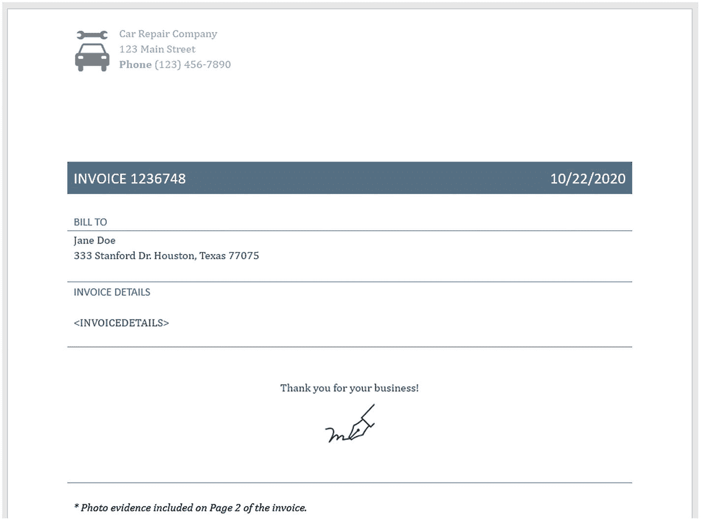

图 6-20

完成替换文档中的文本练习后生成的发票状态

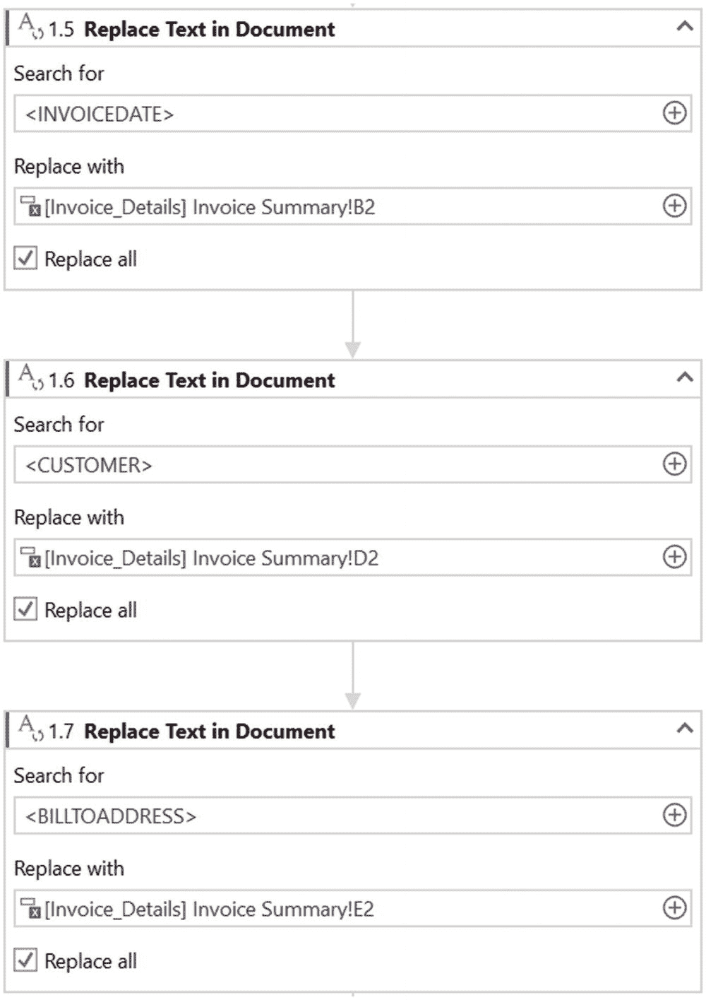

图 6-19

替换文档中的文本活动练习的最终配置

### 追加文本

**追加文本**活动允许您在文档中的当前光标位置写入文本。这可用于将文本追加到文档末尾。

#### 配置

本节提供如何配置**追加文本**活动的说明，如图 6-21 所示。

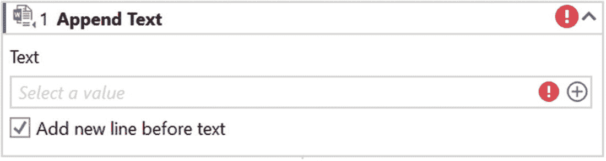

图 6-21

追加文本活动卡片

**文本**：这是活动卡片上的一个必填配置。此配置用于指定要在 Word 文档中当前光标位置追加的文本。

**在文本前添加新行**：这是活动卡片上的一个必填配置。此配置用于指定是否在追加的文本前添加新行。默认情况下，该选项处于选中状态。

练习

**目标**：基于之前的练习，使用`Append Text`活动追加与付款条款相关的文本。付款日期将从`Notebook`的`Invoice Summary`工作表的`C2`单元格中提取。图 6-20 显示了当前生成的发票状态。

**源代码**：Chapter_6-WordAutomationExercise

**设置**：以下是分步实施说明：

1.  在`StudioX`中，将`Append Text`活动添加到`Use Word File`活动中，位于上一个练习的`Replace Text in Document`活动之后。

2.  选择`Text`字段的`Plus`图标，然后选择`Text`选项。在`Text Builder`中，输入`Terms: Please pay invoice by`。

3.  接下来，选择`Text Builder`中的`Plus`图标，悬停并选择`Notebook` ➤ `Indicate in Excel`。

4.  在 Excel 文件中，选择`Invoice Details`工作表的`C2`单元格以指定付款到期日，然后点击`Confirm`。点击`Save`。

完成练习后，**追加文本**活动的最终配置应类似于图 6-22。图 6-23 显示了此活动运行后生成的发票状态。

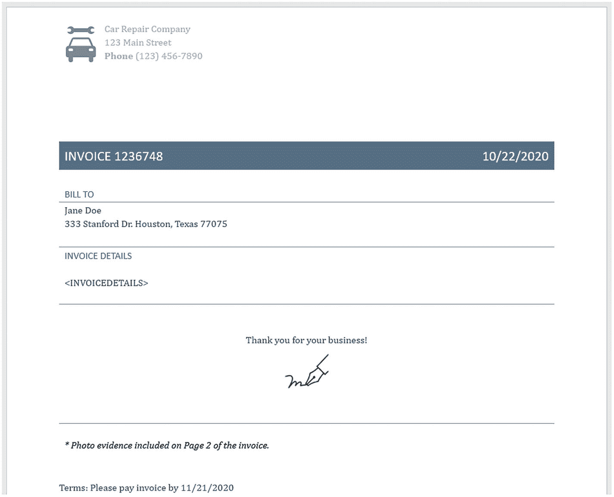

图 6-23

追加文本练习后生成的发票状态

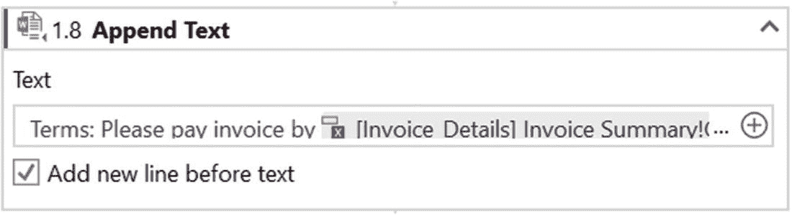

图 6-22

追加文本练习的最终配置

### 在文档中插入数据表

**在文档中插入数据表**活动允许您在文档中的特定位置添加表格，例如来自 Excel 或网页的表格。

#### 配置

本节提供如何配置**在文档中插入数据表**活动的说明，如图 6-24 所示。

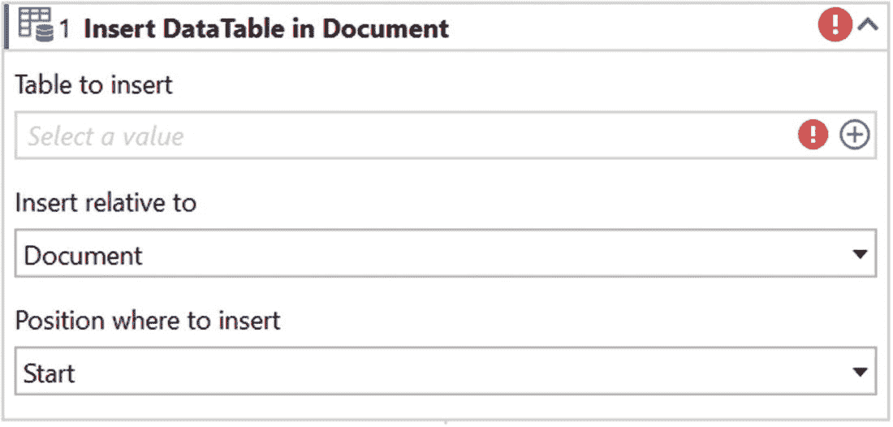

图 6-24

在文档中插入数据表活动卡片

**要插入的表格：** 这是活动卡片上的一个必填配置。此配置允许您指定要插入到文档中的数据表。

**插入相对于：** 这是活动卡片上的一个必填配置，默认设置为`Document`。此配置指定表格插入的相对位置。您可以选择相对于文档开头或结尾、书签或文本来插入数据表。根据此选择，配置字段会发生变化。

**插入位置：** 这是活动卡片上的一个必填配置，默认设置为`Start`。此配置根据 Word 中的“插入位置”设置指定表格的插入位置。您可以选择将数据表插入到文本或书签的位置，或者文档的开头或结尾。根据`insert relative to`的选择，配置字段会发生变化。

练习

**目标**：基于之前的练习，使用`Insert DataTable in Document`活动将所有占位符文本`<INVOICEDETAILS>`替换为来自`Notebook`的`Invoice Details`工作表的数据表。图 6-23 显示了当前发票模板的状态。

**源代码**：Chapter_6-WordAutomationExercise

**设置**：以下是分步实施说明：

1.  在`StudioX`中，将`Insert DataTable in Document`活动添加到`Use Word File`活动中，位于上一个练习的`Append Text`活动之后。

2.  选择`Table to insert`字段的`Plus`图标，悬停并选择`Notebook` ➤ `Invoice Table [Sheet]` ➤ `Table1 [Table]`。

3.  在`Insert relative to`字段中，从下拉菜单中选择`Text`。

4.  选择`Text to search for`字段的`Plus`图标，然后选择`Text`选项。在`Text Builder`中，输入`<table>`。点击`Save`。

5.  保持`Text occurrence`字段不变，使用默认值`All`。

6.  在`Position where to insert`字段中，从下拉菜单中选择`Replace`。

完成练习后，**在文档中插入数据表**活动的最终配置应类似于图 6-25。图 6-26 显示了此活动运行并添加发票详情数据表后发票模板的状态。

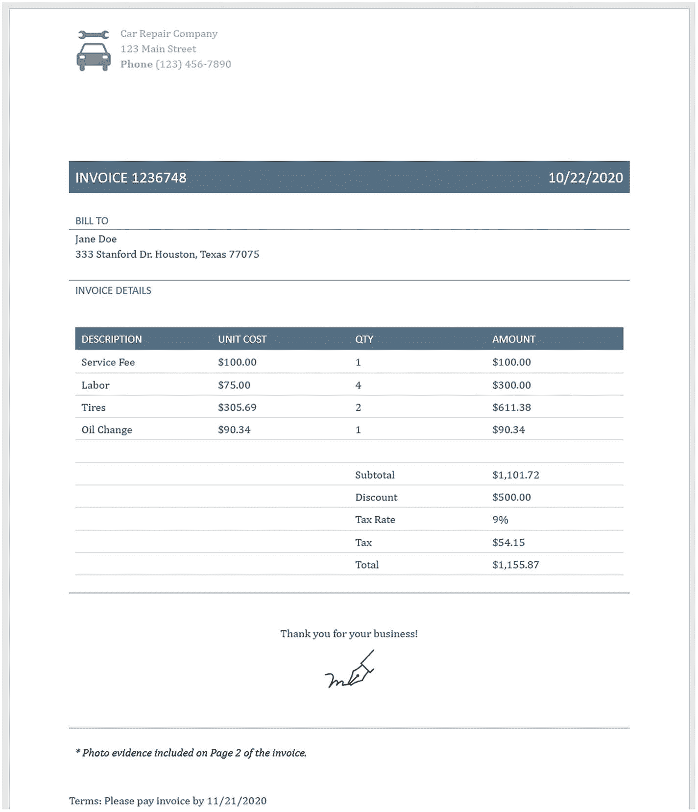

图 6-26

在文档中插入数据表练习后生成的发票状态

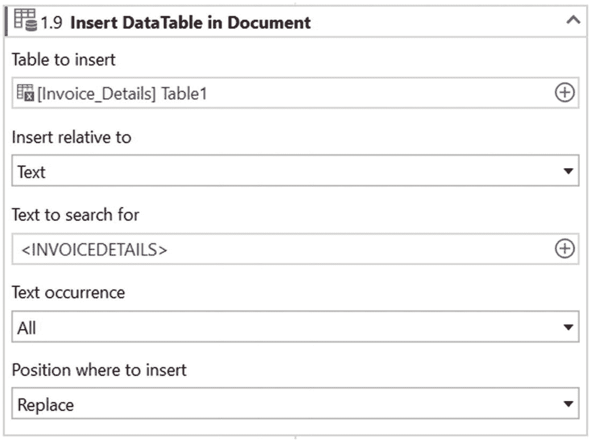

图 6-25

在文档中插入数据表练习的最终配置

### 替换图片

**替换图片**活动允许您使用替换文本替换 Word 文档中的图片。此活动可用于基于模板更新文档，例如，替换合同上的徽标或入职表单上的员工照片。

#### 配置

本节提供如何配置**替换图片**活动的说明，如图 6-27 所示。

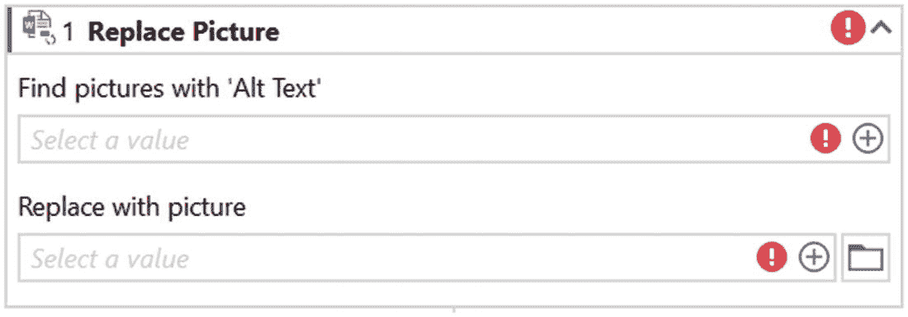

图 6-27

替换图片的活动卡片

**查找包含‘Alt 文本’的图片**：这是活动卡片上的一项必需配置。此配置允许您指定要替换的图片的 Alt 文本。

**替换为图片**：这是活动卡片上的一项必需配置。此配置允许您指定将替换具有 Alt 文本的图片的文件路径。

提示

“Word 设置”部分展示了如何查看占位图片的 Alt 文本。

练习

**目标**：基于之前的练习，使用 `Replace Picture` 活动将 Alt 文本为 `<SIGNATURE>` 的占位图片替换为位于 `C:\BookSamples\Chapter_06\Input\Signature.png` 的实际签名图片。图 6-26 显示了此练习前发票模板的当前状态。

**源代码**：Chapter_6-WordAutomationExercise

**设置**：以下是分步实施说明：

1.  在 `StudioX` 中，将 `Replace Picture` 活动添加到 `Use Word File` 活动中，位于上一个练习的 `Insert DataTable in Document` 活动之后。

2.  选择 `查找包含‘Alt 文本’的图片` 字段的 `Plus` 图标，然后选择 `Text` 选项。在 `文本生成器` 中，输入 `<SIGNATURE>`。点击 `保存`。

3.  选择 `替换为图片` 字段的 `Plus` 图标，然后选择 `文件夹` 图标以浏览文件，并选择 `C:\BookSamples\Chapter_06\Input\Signature.png` 文件。

完成练习后，**替换图片**活动的最终配置应类似于图 6-28。图 6-29 显示了运行此活动后，具有‘Alt 文本’的占位图片被实际签名替换后的状态。

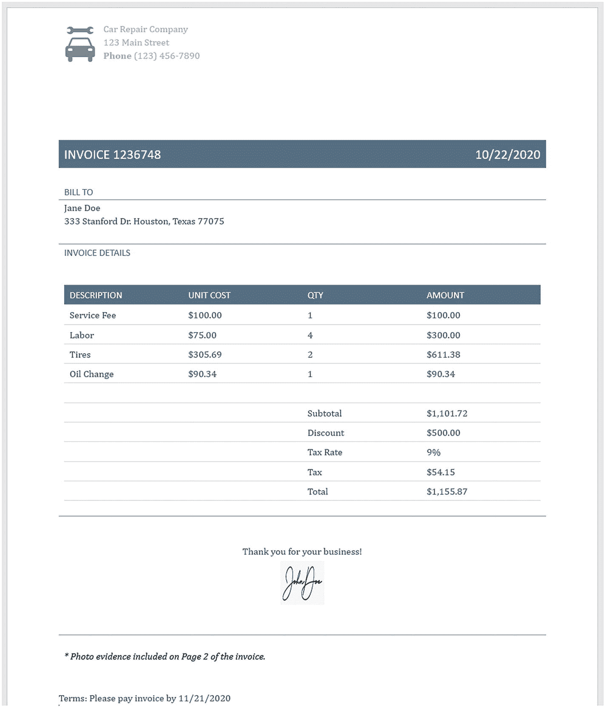

图 6-29

替换图片练习后生成的发票状态

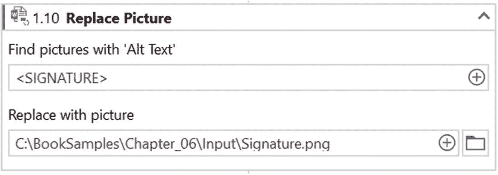

图 6-28

替换图片练习的最终配置

### 添加图片

**添加图片**活动允许您在 Word 文档末尾添加一张图片。

提示

此活动可用于通过**发送 Outlook 电子邮件**活动将电子邮件签名附加到电子邮件正文中。

#### 配置

本节提供如何配置**添加图片**活动的说明，如图 6-30 所示。

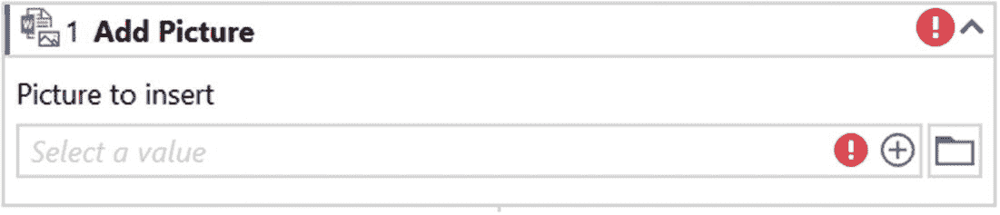

图 6-30

添加图片的活动卡片

**要插入的图片**：这是活动卡片上的一项必需配置。此配置允许您指定要插入到 Word 文档末尾的图片。

练习

**目标**：基于之前的练习，使用 `Add Picture` 活动插入位于 `C:\BookSamples\Chapter_06\Input\Damage_Evidence.jpg` 的损坏证据照片。图 6-29 显示了发票模板的当前状态。

**源代码**：Chapter_6-WordAutomationExercise

**设置**：以下是分步实施说明：

1.  在 `StudioX` 中，将 `Add Picture` 活动添加到 `Use Word File` 活动中，位于上一个练习的 `Replace Picture` 活动之后。

2.  选择 `要插入的图片` 字段的 `Plus` 图标，然后选择 `文件夹` 图标以浏览文件，并选择 `C:\BookSamples\Chapter_06\Input\Damage_Evidence.jpg` 文件。图 6-33 显示了要插入到发票模板末尾的签名。

完成练习后，**添加图片**活动的最终配置应类似于图 6-31。图 6-32 显示了运行此活动后，添加了新图片的生成发票。

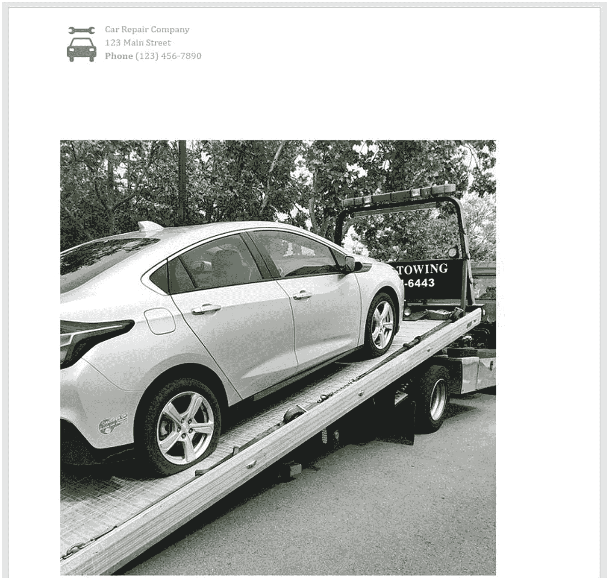

图 6-32

添加图片练习后生成的发票状态

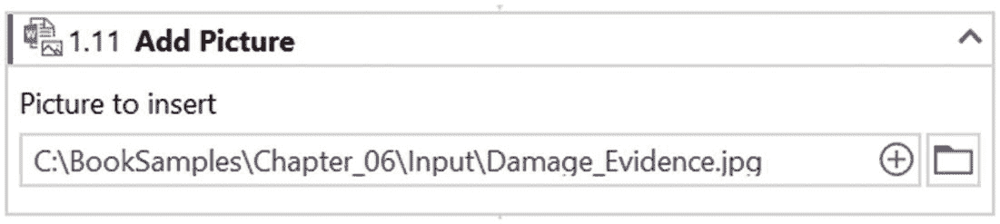

图 6-31

添加图片练习的最终配置

### 将文档另存为 PDF

**将文档另存为 PDF** 活动允许您将 Word 文档导出为 PDF 文件。当需要以 PDF 格式通过电子邮件发送文档以防止进一步编辑时，通常会使用此功能。

#### 配置

本节提供如何配置**将文档另存为 PDF** 活动的说明，如图 6-33 所示。

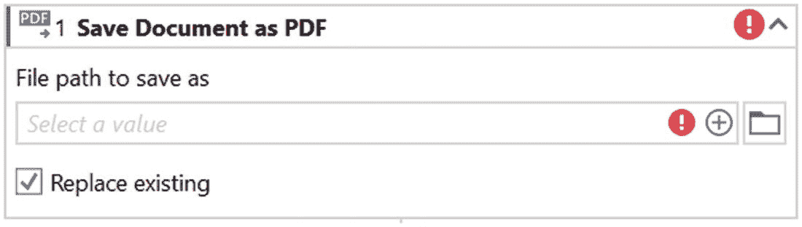

图 6-33

将文档另存为 PDF 的活动卡片

**另存为的文件路径**：这是活动卡片上的一项必需配置。此配置允许您指定导出的 PDF 文件的保存路径。

**替换现有文件**：这是活动卡片上的一项可选配置。选中后，如果文件已存在，将被替换。如果未选中且文件已存在，则会发出错误通知文件已存在。默认情况下，此选项处于选中状态。

练习

**目标**：基于之前的练习，使用 `Save Document as PDF` 活动将生成的发票导出为 PDF 版本。

**源代码**：Chapter_6-WordAutomationExercise

**设置**：以下是分步实施说明：

1.  在 `StudioX` 中，将 `Save Document as PDF` 活动添加到 `Use Word File` 活动中，位于上一个练习的 `Add Picture` 活动之后。

2.  点击 `另存为的文件路径` 字段的 `Plus` 图标，然后选择 `Text` 选项。在 `文本生成器` 中，输入 `C:\BookSamples\Chapter_06\Output\INV`。

3.  在 `文本生成器` 中，点击 `Plus` 图标，将鼠标悬停在 `Notebook` 上，然后选择 `Indicate in Excel`。选择单元格 `D2` 并点击 `确认`。

4.  接下来，在 `文本生成器` 中，输入 `.pdf`。点击 `保存`。

完成练习后，**将文档另存为 PDF** 活动的最终配置应类似于图 6-34。图 6-35 显示了输出文件夹的最终状态。

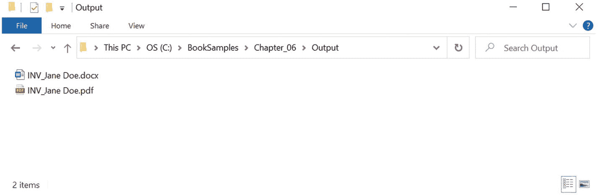

图 6-35

输出文件夹的内容

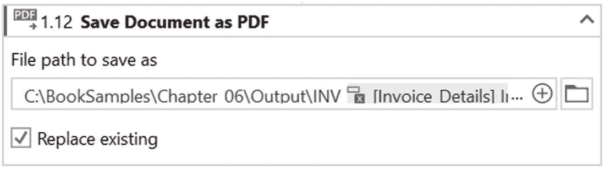

图 6-34

将文档另存为 PDF 活动的最终配置

