# 7. Excel 自动化

虽然 Excel 功能强大且在现代工作环境中被广泛使用，但历史上 Excel 自动化需要一定的技能和培训。UiPath 的 `StudioX` 与 Microsoft Excel 直观集成，简化了公民开发者在自动化提取、筛选、操作、写入、读取和传输数据等任务时的体验。

## 学习目标

学完本章后，你将学会如何：

*   定义要自动化的 Excel 范围
*   插入、删除、复制、重命名和遍历工作表
*   插入、删除和拆分列
*   插入、删除和遍历 Excel 行
*   向单元格写入值和公式
*   从单元格读取值和公式
*   创建、更改和刷新数据透视表
*   复制、追加、填充、写入、自动填充、清除和排序范围
*   以不同格式保存 Excel 文件，包括 PDF
*   将数据导出为 CSV 格式
*   应用筛选器和 `VLookup` 函数，并运行宏

## 示例概览

本章使用的示例场景是员工入职。练习包含三个 Excel 工作簿，供一家刚招聘了 20 名新员工的小公司的人力资源团队使用。

这些 Excel 文件的目的是为人力资源团队提供一个集中位置，用于管理新员工数据，并在他们适应组织的过程中报告其入职状态。

`EmployeeOnboarding.xlsx`：此工作簿用于管理员工列表，包含新员工入职日期、薪资和所需培训等详细信息。这将是本章大部分练习使用的主要文件，用于组织工作表、添加输入数据、填写公式以及创建分析表格。

`EmployeeOnboardingInput.xlsx`：此文件提供了五名新员工的数据，这些数据需要追加到包含最初 20 名员工的 `EmployeeOnboarding` Excel 文件中。

`EmployeeOnboarding Final.xlsm`：这是“新员工名单”工作表的最终版本，需要格式化并执行宏，以便准备交付。

图 7-1、7-2 和 7-3 展示了在执行本章详述的任何 Excel 自动化练习之前的电子表格。

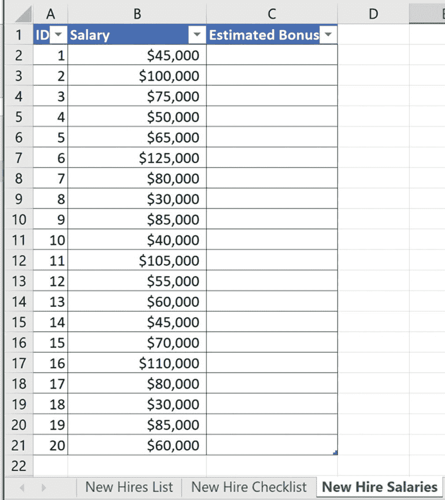
*图 7-3：示例员工入职 Excel 文件 – 新员工薪资工作表*

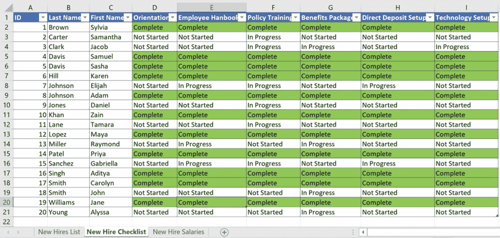
*图 7-2：示例员工入职 Excel 文件 – 新员工清单工作表*

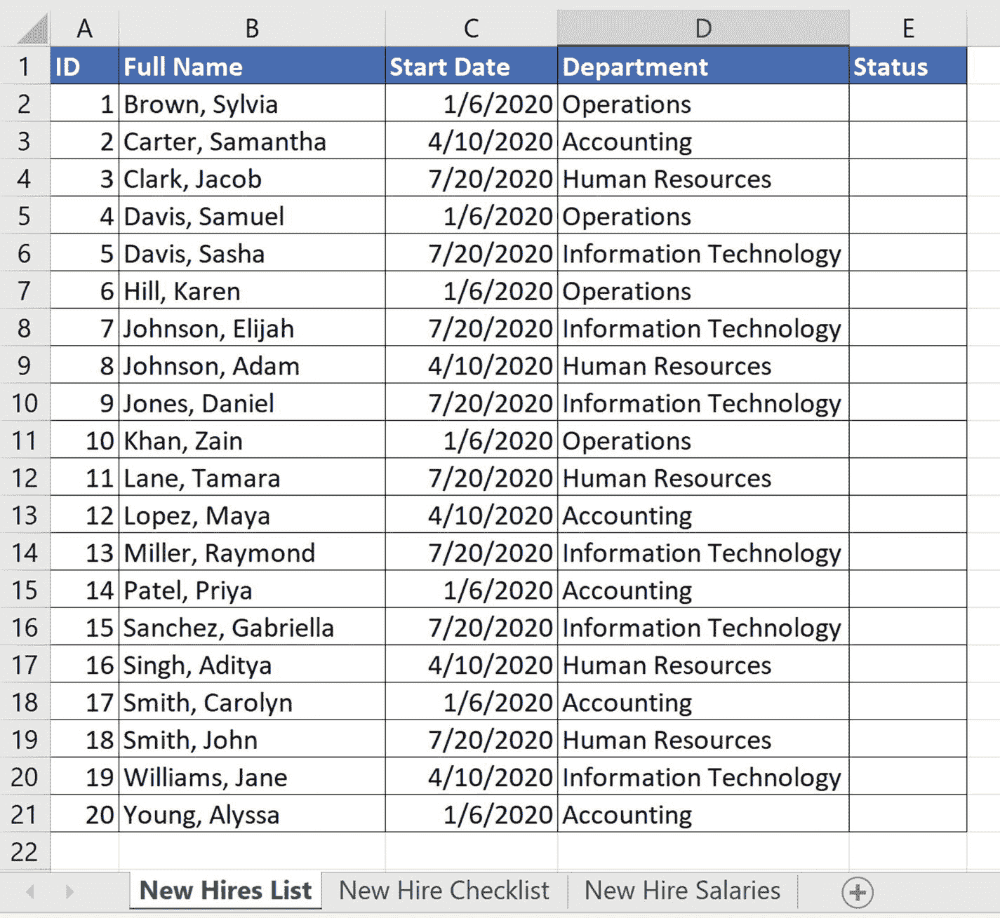
*图 7-1：示例员工入职 Excel 文件 – 新员工名单工作表*

## 活动参考

如图 7-4 所示，所有 Excel 自动化活动都可以在 Excel 类别/磁贴下找到。以下各节将提供有关如何配置和使用每个活动的说明。

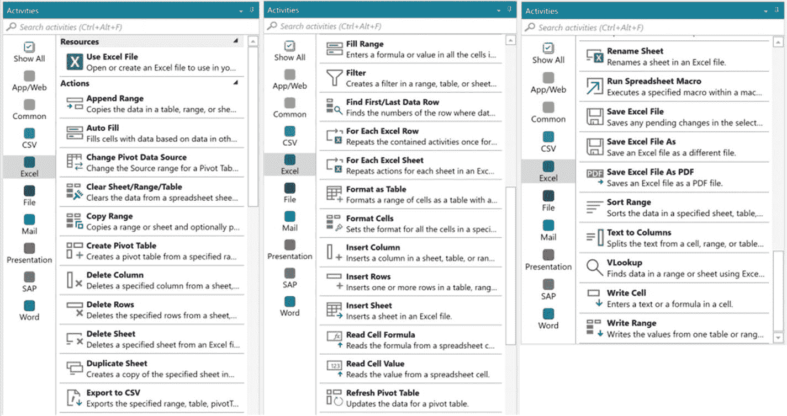
*图 7-4：Excel 自动化活动*

### 使用 Excel 文件

在“资源”下找到的`使用 Excel 文件`活动允许您创建或打开一个 Excel 文件，以便在自动化中使用该文件的数据。

这是 Excel 自动化的基础，并作为将 `StudioX` 与 Excel 集成的父活动。例如，复制粘贴、排序、筛选、插入和删除数据活动可以作为子活动添加到`使用 Excel 文件`活动中。

#### 配置

本节提供如何配置`使用 Excel 文件`活动的说明，如图 7-5 所示。

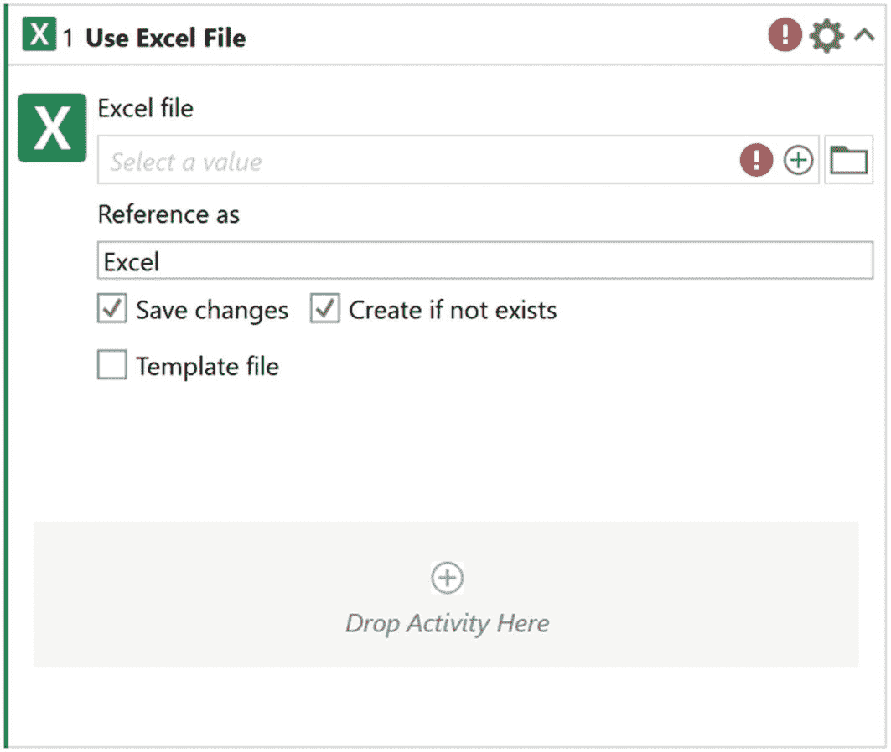
*图 7-5：使用 Excel 文件活动卡片*

*   `Excel 文件`：这是活动卡片上的一项必需配置。此配置为 `StudioX` 提供 Excel 自动化将使用的工作簿数据的完整文件路径。
*   `引用为`：这是活动卡片上的一项必需配置。建议为此字段填入一个唯一且描述性的名称，以便在自动化项目中引用该 Excel 文件，例如 `InvoiceData` 或 `EmployeeOnboarding`。默认情况下，该字段填入 `Excel`。
*   `保存更改`：这是活动卡片上的一项可选配置。此配置确保在对活动执行每个操作后保存工作簿。默认情况下，此选项处于选中状态。如果取消选中此选项，则会在数据管理器面板中的 Excel 文件旁边显示消息 `保存关闭`。
*   `不存在则创建`：这是活动卡片上的一项可选配置。此配置确保如果目标位置不存在文件，则创建一个空白文件。默认情况下，此选项处于选中状态。
*   `编辑密码`：这是`属性`面板上的一项可选配置。此字段用于编辑受密码保护的 Excel 文件。如有必要，请在此字段中输入密码。
*   `密码`：这是`属性`面板上的一项可选配置。此字段用于打开受密码保护的 Excel 文件。如有必要，请在此字段中输入密码。
*   `只读`：这是`属性`面板上的一项可选配置。如果选中，工作簿将以只读模式打开以供自动化使用。此选项将允许自动化从工作簿中提取数据，即使该工作簿受密码保护。默认情况下，此选项未选中。

> **注意**：以下关于“使用 Excel 文件”活动的练习必须在完成任何其他 Excel 活动部分的练习之前进行。

#### 练习

**目标**：使用`使用 Excel 文件`活动打开位于文件路径 `C:\BookSamples\Chapter_07\EmployeeOnboarding.xlsx` 的 `EmployeeOnboarding.xlsx` Excel 工作簿。

**设置**：以下是分步实施说明：

1.  在 `StudioX` 中，将`使用 Excel 文件`活动添加到一个空白流程中。
2.  接下来，单击`Excel 文件`字段中的`文件夹`图标，并选择 `C:\BookSamples\Chapter_07\EmployeeOnboarding.xlsx` 文件。
3.  接下来，在`引用为`字段中为此文件输入一个名称。对于此示例，输入名称 `EmployeeOnboarding`。
4.  对于此示例，保留默认配置不变。

完成练习后，`使用 Excel 文件`活动的最终配置应类似于图 7-6。此示例的输出将从所选文件路径读取 `EmployeeOnboarding.xlsx`，并将其作为此 `StudioX` 项目的 Excel 文件资源添加。

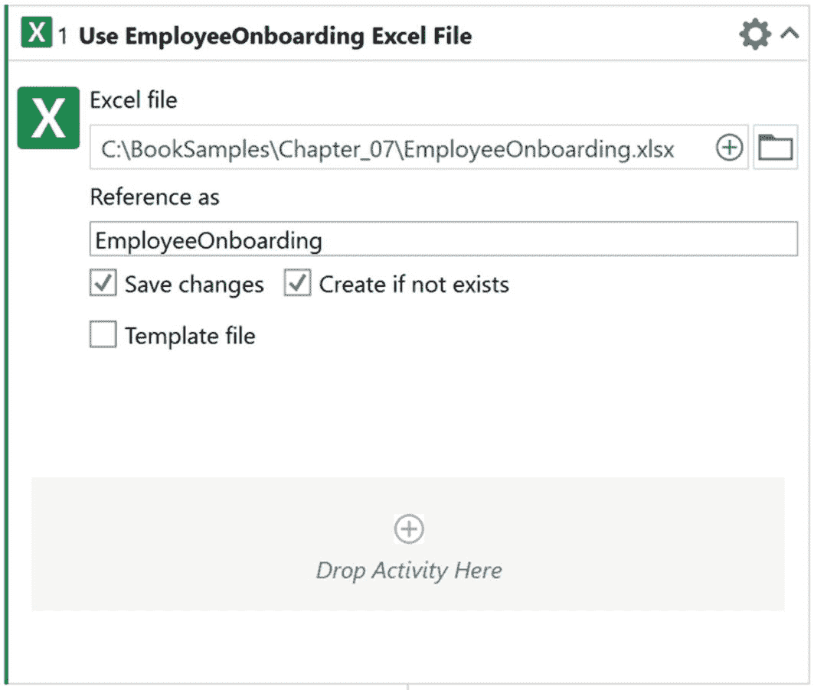
*图 7-6：在“使用 Excel 文件”活动中填充的 EmployeeOnboarding.xlsx*

### 插入工作表

`插入工作表`活动允许您向工作簿中添加一个空白工作表。

#### 配置

本节提供如何配置`插入工作表`活动的说明，如图 7-7 所示。

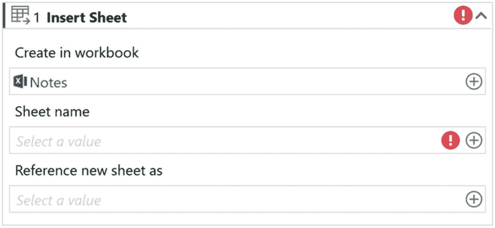
*图 7-7：插入工作表活动卡片*

*   `创建工作簿中`：这是活动卡片上的一项必需配置。此配置为 `StudioX` 提供要作为新工作表插入的工作簿。`创建工作簿中`字段会预先填入父级`使用 Excel 文件`活动中指定的工作簿。您可以点击`加号`图标来引用其他工作簿。
*   `工作表名称`：这是活动卡片上的一项必需配置。此配置决定新工作表的名称。
*   `将新工作表引用为`：这是活动卡片上的一项可选配置。此配置允许您指定一个名称，以便在后续活动中引用该工作表。通常通过`文本生成器`选项进行配置，以便您指定引用名称。

#### 练习

**目标**：基于之前的练习，使用`插入工作表`活动向`EmployeeOnboarding` Excel 文件添加一个新工作表。图 7-8 显示了 `EmployeeOnboarding.xlsx` 的初始状态。

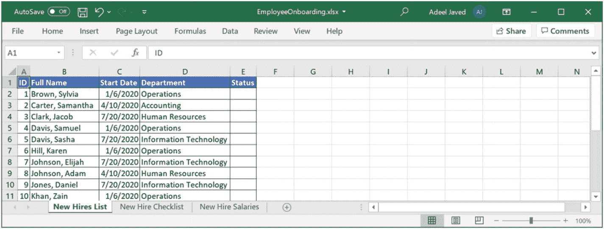
*图 7-8：显示自动化执行前的 EmployeeOnboarding Excel 工作簿*

**源代码**：`Chapter_7_ExcelSheetActivitiesExercise`

**设置**：以下是分步实施说明：

1.  在 `StudioX` 中，将`插入工作表`活动添加到`设计器`面板中父级`使用 Excel 文件`活动的主体中。

2.  `EmployeeOnboarding` 文件将自动填入`创建工作簿中`字段。保持原样：`[EmployeeOnboarding]`。
3.  接下来，点击`工作表名称`字段中的`加号`图标，选择`文本生成器`，然后输入 `New Data`。
4.  将`将新工作表引用为`字段留空。

完成练习后，`插入工作表`活动的最终配置应类似于图 7-9。

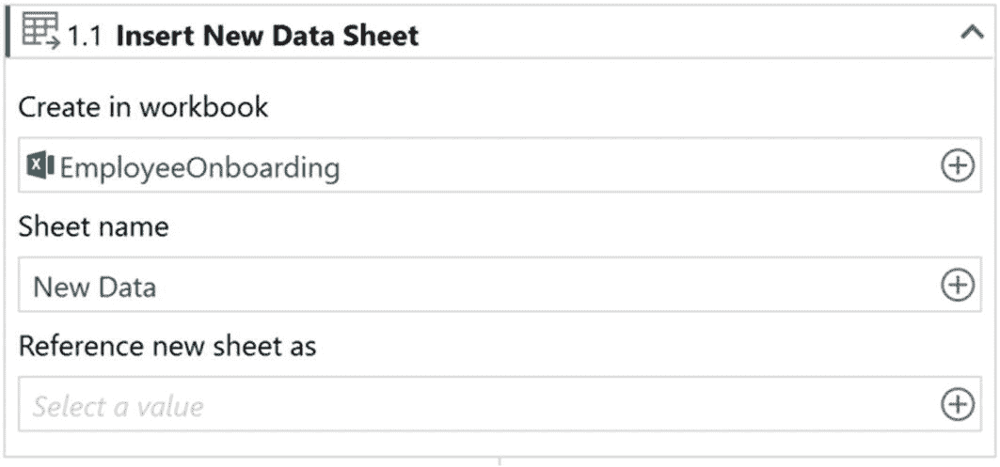
图 7-9 显示插入工作表活动的最终配置。

图 7-10 显示了插入工作表活动的输出，该活动已向 `EmployeeOnboarding` Excel 文件添加了一个 `New Data` 工作表。

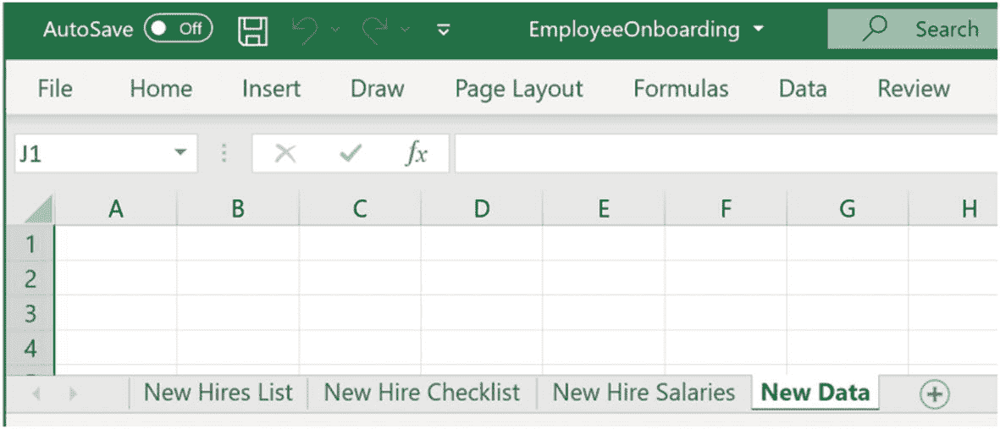
图 7-10 已向 `EmployeeOnboarding` Excel 文件添加一个新工作表。

### 重命名工作表

`重命名工作表`活动用于更改工作簿中现有工作表的名称。

#### 配置

本节提供如何配置`重命名工作表`活动的说明，如图 7-11 所示。

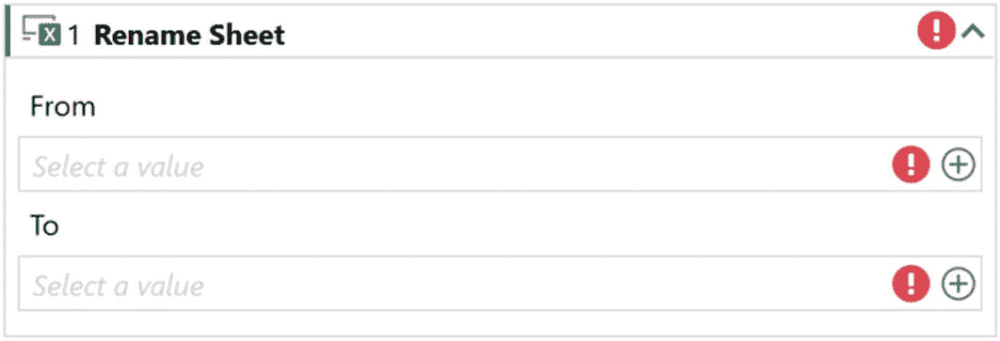
图 7-11 重命名工作表活动卡片。

`从`：这是活动卡片上的一项必需配置。此配置标识需要重命名的现有工作表。

`到`：这是活动卡片上的一项必需配置。此配置决定如何重命名`从`字段中标识的工作表。

**练习**

**目标**：基于之前的练习，使用`重命名工作表`活动将 `New Data` 工作表的名称更新为 `New Hire Statistics`。图 7-10 显示了自动化之前 `EmployeeOnboarding.xlsx` 文件中的工作表。

**源代码**：`Chapter_7_ExcelSheetActivitiesExercise`

**设置**：以下是分步实施说明：
1.  在 `StudioX` 中，将`重命名工作表`活动添加到`设计器`面板中父级`使用 Excel 文件`活动的主体中，位于上一个练习的`插入工作表`活动之后。
2.  接下来，点击`从`字段中的`加号`图标，悬停在 `EmployeeOnboarding` 工作簿上，选择 `New Data [Sheet]`。
3.  接下来，点击`到`字段中的`加号`图标，选择`文本`选项，然后使用`文本生成器`输入 `New Hire Statistics`。

完成练习后，`重命名工作表`活动的配置应类似于图 7-12。

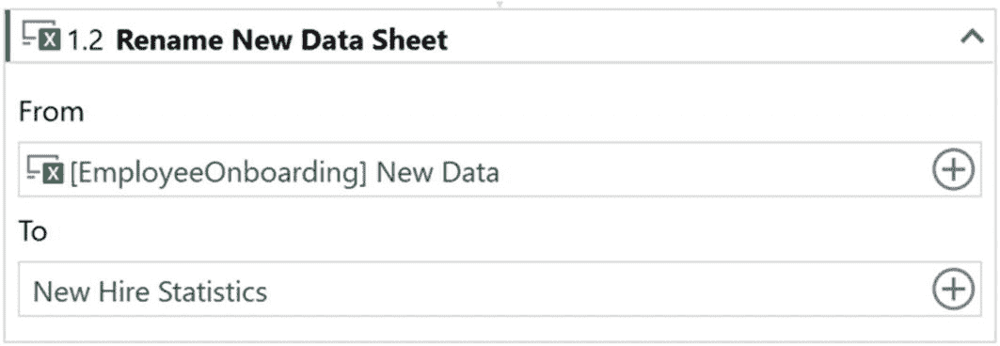
图 7-12 显示重命名工作表活动的最终配置。

图 7-13 显示了`重命名工作表`活动的输出，该活动已将 `New Data` 工作表的名称更新为 `New Hires Statistics`。

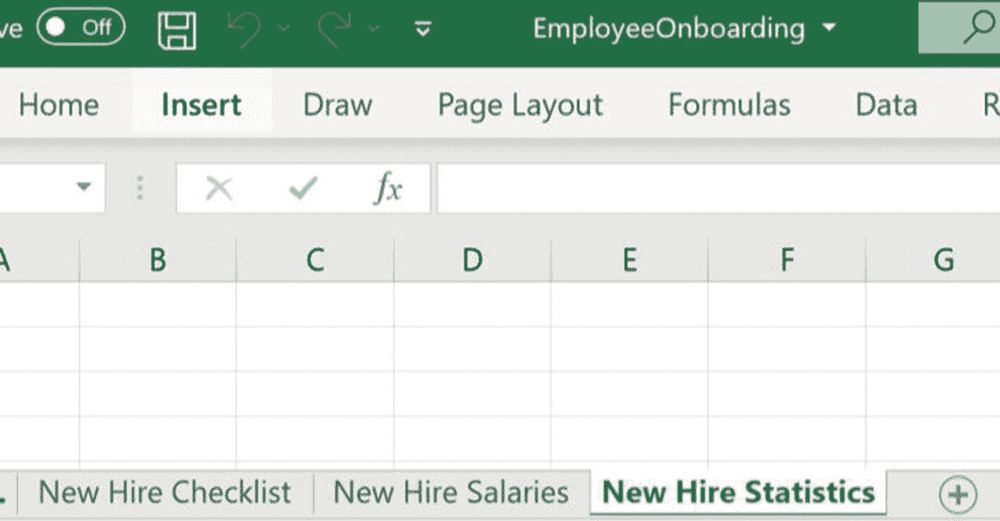
图 7-13 `New Data` 工作表已重命名为 `New Hire Statistics`。

### 复制工作表

`复制工作表`活动用于在同一工作簿内创建所选工作表的副本。

#### 配置

本节提供如何配置`复制工作表`活动的说明，如图 7-14 所示。

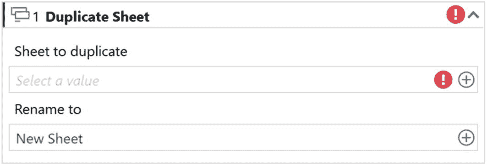
图 7-14 复制工作表活动卡片。

`要复制的工作表`：这是活动卡片上的一项必需配置。此配置提供将被复制的现有工作表的名称。

`重命名为`：虽然不是必需的，但建议配置此字段，为将创建的新工作表输入一个对工作簿有意义的名称。如果未配置此字段，则新复制的工作表将使用默认名称 `New Sheet` 创建。

**练习**

**目标**：基于之前的练习，使用`复制工作表`活动在 `EmployeeOnboarding` 工作簿中创建 `New Hire Salaries` 工作表的副本。图 7-13 显示了练习前 `EmployeeOnboarding.xlsx` 中的工作表。

**源代码**：`Chapter_7_ExcelSheetActivitiesExercise`

**设置**：以下是分步实施说明：
1.  在 `StudioX` 中，将`复制工作表`活动添加到`设计器`面板中父级`使用 Excel 文件`活动的主体中。
2.  接下来，点击`要复制的工作表`字段中的`加号`图标，悬停在 `EmployeeOnboarding` 工作簿上，选择 `New Hire Salaries [Sheet]`。
3.  接下来，点击`重命名为`字段中的`加号`图标，选择`文本生成器`选项，然后输入 `Salaries Copy`。

完成练习后，`复制工作表`活动的最终配置应类似于图 7-15。

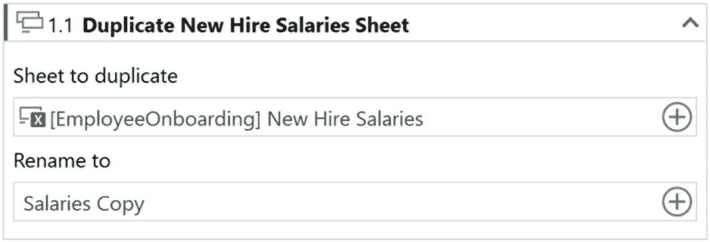
图 7-15 显示复制工作表活动的最终配置。

此示例的输出复制了 `New Hire Salaries` 工作表，名称为 `Salaries Copy`，如图 7-16 所示。

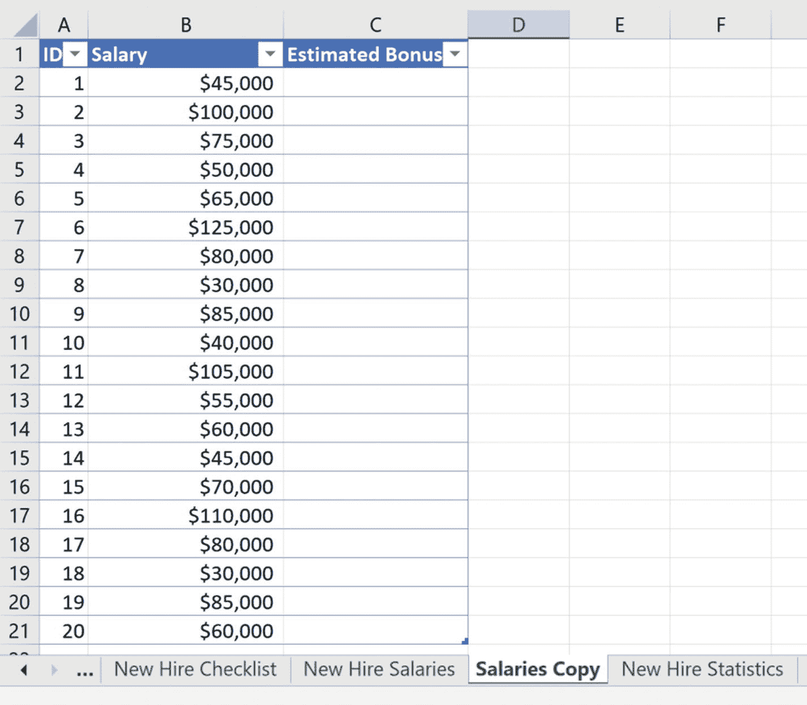
图 7-16 显示已复制的 `Salaries Copy` 工作表。

### 删除工作表

`删除工作表`活动用于从工作簿中删除指定的工作表。

#### 配置

本节提供如何配置`删除工作表`活动的说明，如图 7-17 所示。

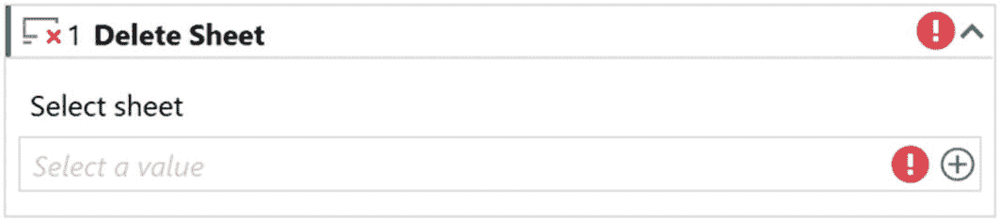
图 7-17 删除工作表活动卡片。

`选择工作表`：这是活动卡片上的一项必填配置。此配置用于标识要从工作簿中删除的具体工作表。

**练习**

**目标**：基于之前的练习，使用`Delete Sheet`活动从`EmployeeOnboarding` Excel 文件中删除`Salaries Copy`工作表。图 7-16 显示了练习前的`EmployeeOnboarding.xlsx`工作表。

**源代码**：`Chapter_7_ExcelSheetActivitiesExercise`

**设置**：以下是分步实施说明：
1.  在 `StudioX` 中，将`Delete Sheet`活动添加到`Designer`面板中父级`Use Excel File`活动之下。
2.  接着，点击`Select sheet`字段中的`Plus`图标，然后从`EmployeeOnboarding`工作簿中选择`Salaries Copy [Sheet]`。

完成练习后，`删除工作表`活动的最终配置应类似于图 7-18。

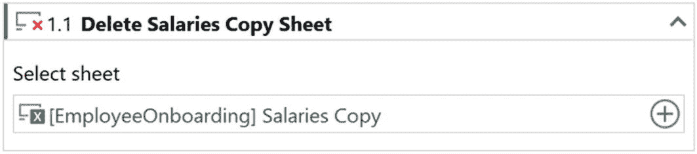
图 7-18 显示删除工作表活动的最终配置。

此示例的输出将删除 `EmployeeOnboarding.xlsx` 工作簿中名为 `Salaries Copy` 的工作表，如图 7-19 所示。

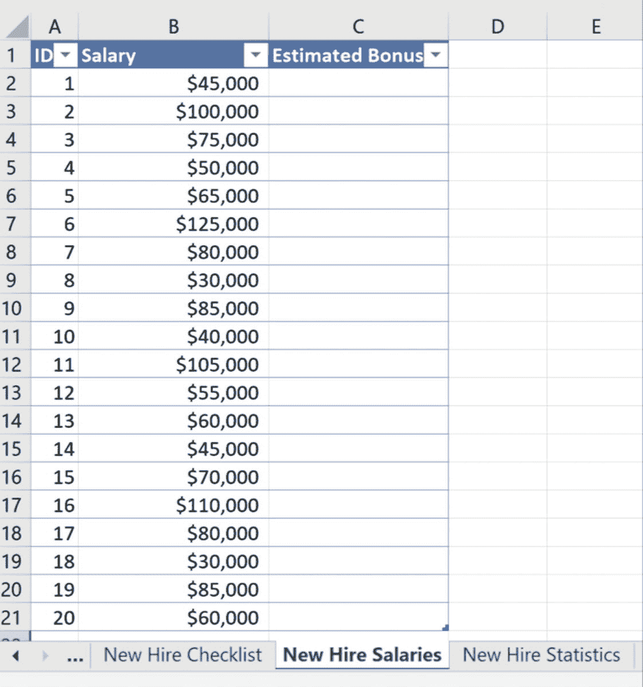
图 7-19 显示 `Salaries Copy` 工作表已被删除。

### 对于每个 Excel 工作表

`对于每个 Excel 工作表`活动允许您对同一工作簿中的每个工作表执行一个或多个活动。

**注意**

您必须在`对于每个 Excel 工作表`活动卡片内至少配置一个子活动，以便在一组工作表上迭代执行多个操作。

#### 配置

本节提供如何配置`对于每个 Excel 工作表`活动的说明，如图 7-20 所示。

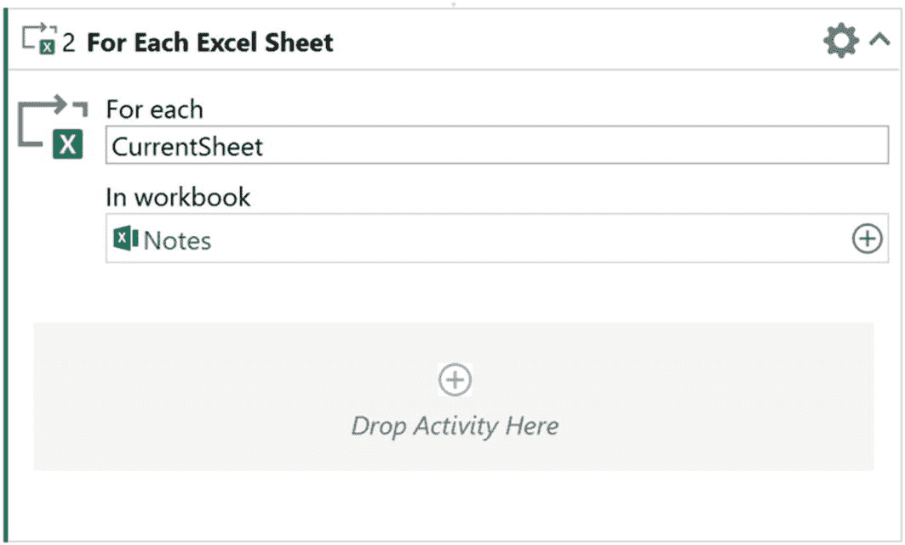
图 7-20

## 对于每个 Excel 工作表活动

`对于每个`：这是活动卡片上的一项必填配置。此配置允许您提供一个名称来引用当前正在迭代的工作表；这对于在子活动中进行引用尤其重要。默认文本为`CurrentSheet`，可以根据您正在迭代的数据进行更改。您可以简单地重命名此字段，或保留默认值。

`在工作簿中`：这是活动卡片上的一项必填配置。此配置用于标识包含需要迭代的工作表的工作簿。如果此活动位于父级“使用 Excel 文件”活动内部，则该字段将自动填充为父级 Excel 文件。

### 练习

**目标**：基于之前的练习，使用`For Each Excel Sheet`活动遍历`EmployeeOnboarding` Excel 文件中的工作表，并在输出面板中打印其名称。

**源代码**：`Chapter_7_ExcelSheetActivitiesExercise`

**设置**：以下是分步实施说明：

1. 在`StudioX`中，将`For Each Excel Sheet`活动添加到`Designer`面板中`Use Excel File`活动的主体中。
2. 接着，将`For each`字段保留默认文本`CurrentSheet`；将`In workbook`字段保留自动填充的`EmployeeOnboarding` Excel 文件。
3. 然后，添加一个`Write line`活动作为`For Each Excel Sheet`活动的子活动。
4. 接下来，点击`Text`字段中的`Plus`图标，然后从`CurrentSheet`中选择`Name`。这会将每个当前工作表的名称写入输出面板。

完成练习后，`对于每个 Excel 工作表`活动的最终配置应类似于图 7-21。

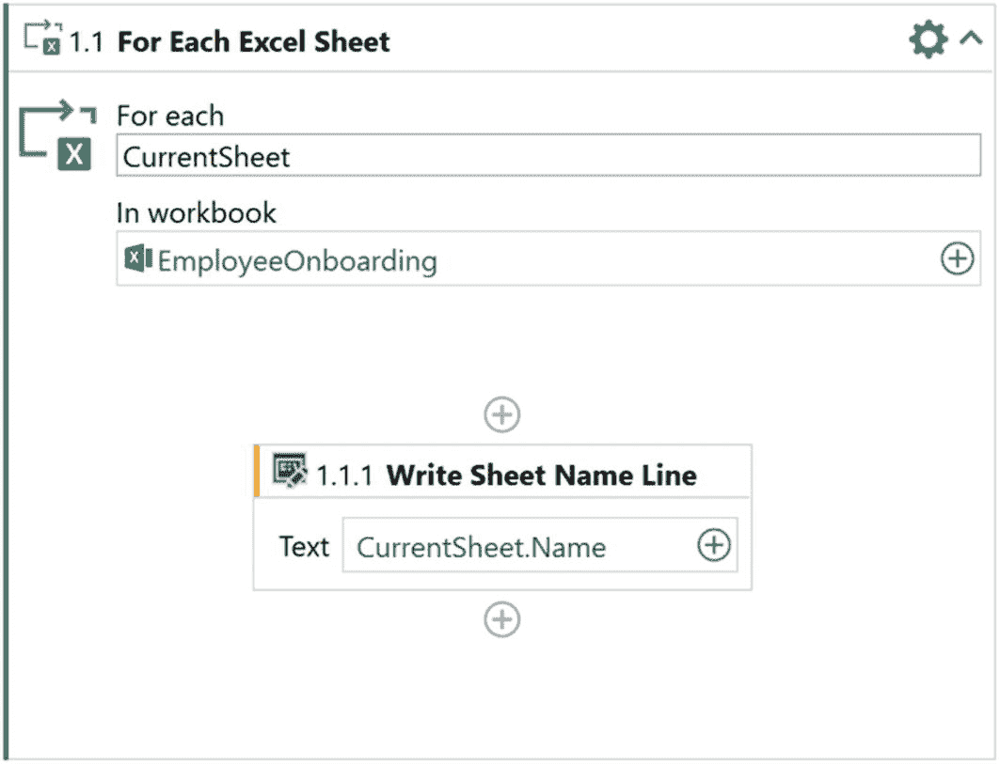
图 7-21 显示对于每个 Excel 工作表活动的最终配置

此练习的输出会将`EmployeeOnboarding.xlsx`工作簿中每个工作表的名称写入输出面板，如图 7-22 所示。

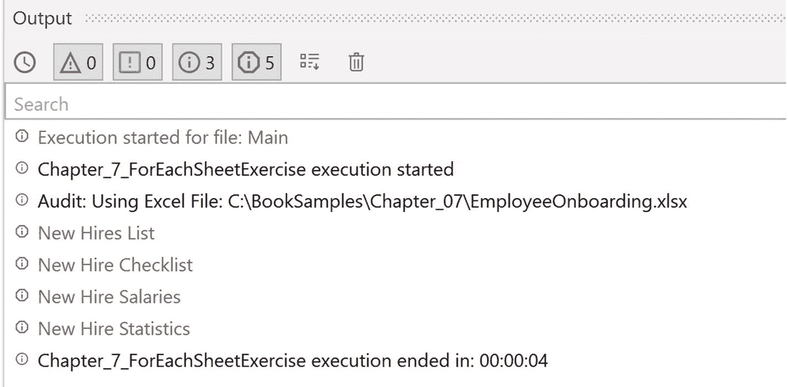
图 7-22 显示所有四个工作表的名称已写入输出面板

### 插入列

`插入列`活动向工作表中的某个范围、工作表或表格添加一个新定义的列。

#### 配置

本节提供如何配置`插入列`活动的说明，如图 7-23 所示。

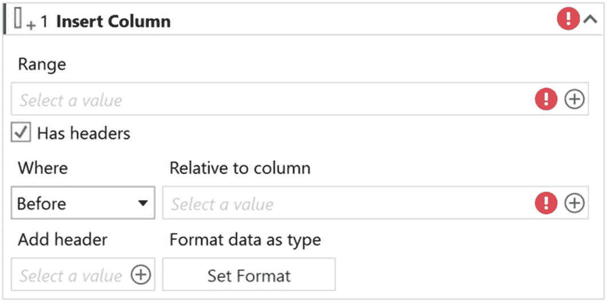
图 7-23 插入列活动卡片

`范围`：这是活动卡片上的一个必填配置。此配置为 StudioX 提供新列将添加到的范围。

`位置`：这是活动卡片上的一个必填配置。此配置允许您指定新列将插入到另一列之前还是之后。

`相对于列`：这是活动卡片上的一个必填配置。此配置允许您指定新列将相对于哪一列进行插入。

`添加标题`：这是活动卡片上的一个可选配置。此配置在执行自动化时为新列提供一个标题名称。建议配置此字段，以确保新列包含标题名称。

`将数据格式设置为类型`：这是活动卡片上的一个可选配置。此配置允许您设置新列中添加的单元格的格式。此字段的配置通过`Category`下拉菜单选择，该菜单中填充了可为单元格选择的可用格式。`Category`选项包括`General`、`Number`、`Date`、`Time`、`Percentage`、`Currency`、`Text`或`Custom`。

### 练习

**目标**：使用`Use Excel File`和`Insert Column`活动，在`Full Name`列之后，向`New Hires List`工作表中添加一个`Last Name`列和一个`First Name`列。图 7-24 显示了练习前的`New Hires List`范围。

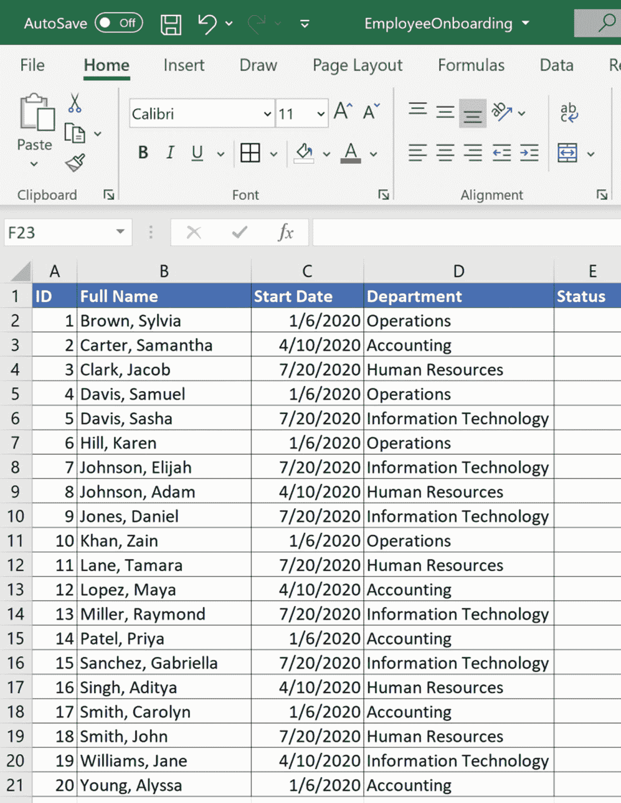
图 7-24 显示执行自动化之前的 New Hires List

**源代码**：`Chapter_7_ExcelColumnActivitiesExercise`

**设置**：以下是分步实施说明：

1. 在`StudioX`中，添加`Use Excel File`活动，并按照第一个练习中的演示，将其配置为`C:\BookSamples\Chapter_07\EmployeeOnboarding.xlsx`文件。
2. 然后，在`Designer`面板中，将`Insert Column`活动拖放到`Use Excel File`活动的主体中。
3. 接下来，点击`Range`字段中的`Plus`图标，并为`EmployeeOnboarding`工作簿选择`Indicate in Excel`选项。Excel 打开后，在`New Hires List`工作表中选择范围`A1:E21`。
4. 接下来，点击`Where`下拉菜单并选择`After`。
5. 接下来，点击`Relative to column`字段中的`Plus`图标，将鼠标悬停在`Range`上以选择`Full Name`列标题。
6. 接下来，点击`Add header`字段中的`Plus`图标，选择`Text`选项，然后输入`Last Name`。
7. 保持`Has headers`和`Format data as type`的默认选项不变。
8. 在第一个`Insert Column`活动下方添加第二个`Insert Column`活动。
9. `Range`配置将与步骤 3 相同。
10. 接下来，点击`Relative to column`字段中的`Plus`图标，并通过`Range`选项导航以选择`Start Date`列标题。
11. 保持`Has headers`、`Where`和`Format data as type`的默认选项不变。
12. 接下来，点击`Add header`字段中的`Plus`图标，选择`Text`选项，然后输入`First Name`。

**注意** 在您集成 Microsoft Excel 以使用“在 Excel 中指示”功能之前，您需要从`Home` ➤ `Tools` ➤ `Excel Add-in`安装相关扩展。

完成练习后，`插入列`活动的最终配置应类似于图 7-25。

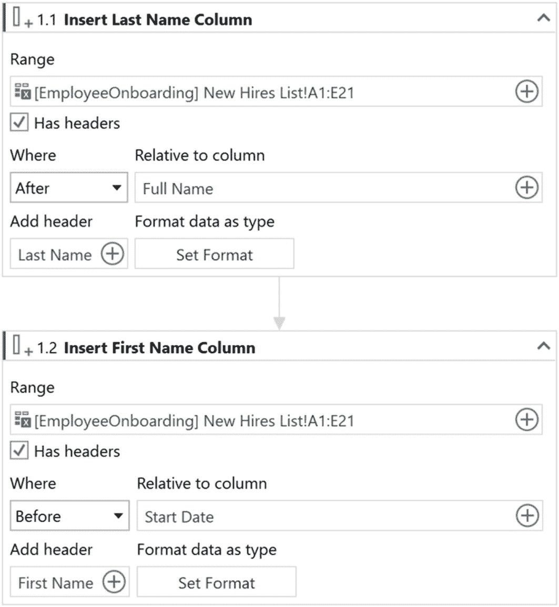
图 7-25 显示插入列活动的最终配置

图 7-26 显示了插入列活动的输出，该活动在`New Hires List`工作表的`Full Name`之后添加了`Last Name`和`First Name`列。

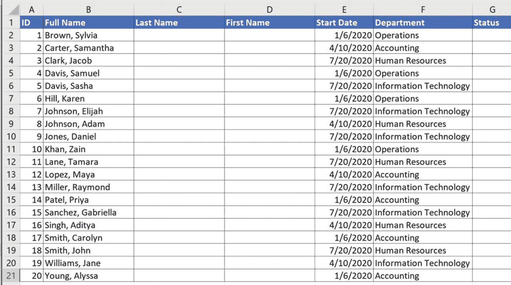
图 7-26 执行插入列活动后添加的 Last Name 和 First Name 列

### 文本转列

`文本转列`活动允许您将给定单元格、工作表或范围中的文本拆分到单独的列中。

此活动的常见示例包括将单行中的名字和姓氏拆分到单独的列，或将包含供应清单的单元格拆分为多列。

#### 配置

本节提供如何配置`文本分列`活动的说明，如图 7-27 所示。

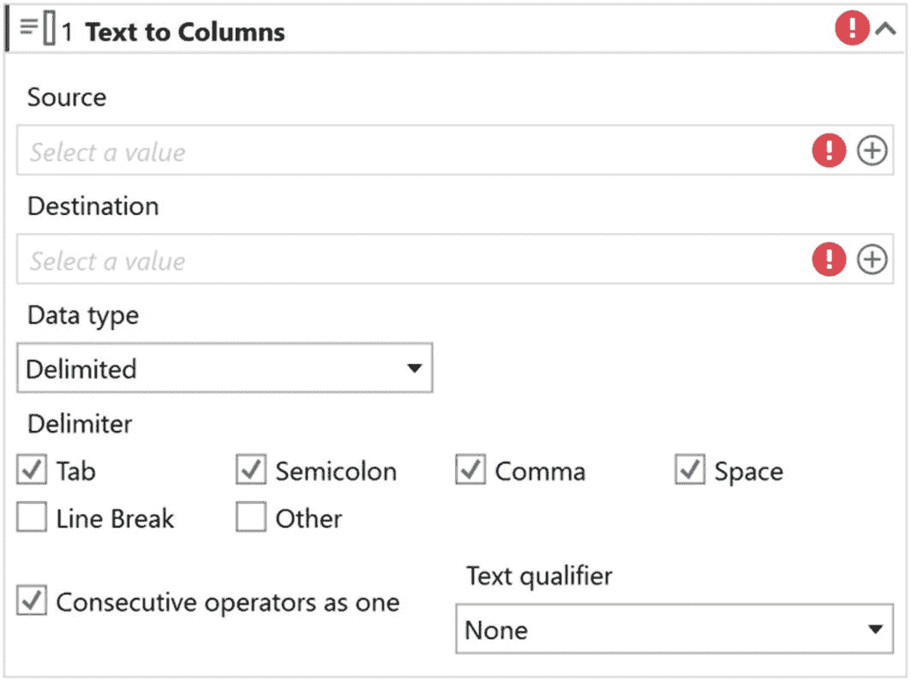
图 7-27 文本分列活动卡片

`源`：这是活动卡片上的一个必填配置。此配置用于标识包含需要拆分为列的数据的单元格、区域或表格。

`目标`：这是活动卡片上的一个必填配置。此配置用于指定拆分后数据应添加到的列的位置。

> **注意** 文本分列活动的目标必须与源位于同一工作表中。

数据类型、分隔符、连续分隔符视为一个、文本限定符、每列字符数

这是活动卡片上的一个必填配置。此配置指示源区域的数据以何种类型的分隔符进行拆分。此字段的默认选择是`分隔符`，表示源数据由特定字符分隔。如果源数据需要根据特定字符数进行拆分，则可将数据类型更改为`固定宽度`。

这是活动卡片上的一个必填配置。此配置仅在`数据类型`为`分隔符`时可用。此配置用于标识用作源区域数据分隔符的字符。默认情况下，`制表符`、`分号`、`逗号`和`空格`选项处于选中状态。`换行符`和`其他`处于未选中状态，如果选中，将打开一个文本字段以指定分隔符字符。

这是活动卡片上的一个必填配置。此配置仅在`数据类型`为`分隔符`时可用。此配置允许您指定是否有多个字符分隔数据。默认情况下，此选项处于选中状态。
例如，如果源单元格包含文本`notebooks;, clipboards`，则`;,`将作为一个分隔符。在这种情况下，`notebooks`将被添加到第一列，`clipboards`将被添加到第二列。

这是活动卡片上的一个必填配置。此配置仅在`数据类型`为`分隔符`时可用。默认情况下，此选项设置为`无`，表示被括起来的文本限定符不定义正在拆分的数据。此选项可以更改为`单引号`或`双引号`。
例如，如果`分隔符`是逗号，而`文本限定符`是双引号，则文本`notebooks, pens", clipboards`将被拆分为第一列的`notebooks, pens`和第二列的`clipboards`。

这是活动卡片上的一个必填配置。此配置仅在`数据类型`为`固定宽度`时需要。此字段提供要分组到列中的字符长度。

练习

**目标**：基于之前的练习，使用`文本分列`活动将`新员工名单`工作表中`全名`列的名字和姓氏拆分。图 7-26 显示了练习前的`新员工名单`工作表。

**源代码**：Chapter_7_ExcelColumnActivitiesExercise

**设置**：以下是分步实施说明：
1. 在 `StudioX` 中，将`文本分列`活动添加到`使用 Excel 文件`活动主体中，位于上一个练习的`插入列`活动之后。
2. 接下来，单击`源`字段中的`加号`图标，然后为 `EmployeeOnboarding` 工作簿选择`在 Excel 中指示`选项。Excel 打开后，在`新员工名单`工作表中选择区域 `B2:B21`。
3. 接下来，单击`目标`字段中的`加号`图标，然后为 `EmployeeOnboarding` 工作簿选择`在 Excel 中指示`选项。Excel 打开后，在`新员工名单`工作表中选择区域 `C2:D21`。
4. 然后，保持`数据类型`、`分隔符`、`连续分隔符视为一个`和`文本限定符`字段的所有默认配置不变。

完成练习后，`文本分列`活动的最终配置应类似于图 7-28。

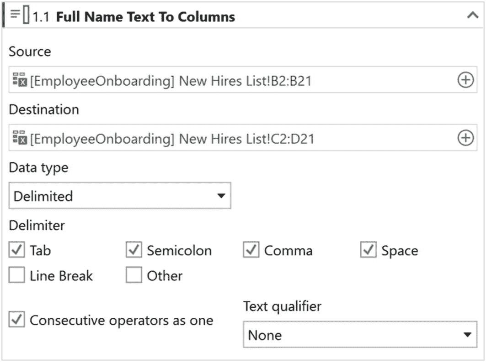
图 7-28 显示文本分列活动的最终配置

图 7-29 显示了文本分列活动的输出，该活动已将全名拆分为名字和姓氏列。

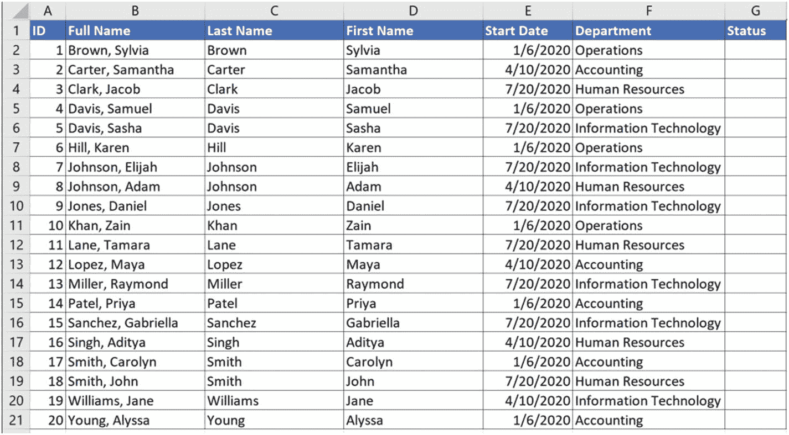
图 7-29 显示文本分列活动的输出

### 删除列

`删除列`活动允许您删除工作簿中工作表、区域或表格中的一列。

#### 配置

本节提供如何配置`删除列`活动的说明，如图 7-30 所示。

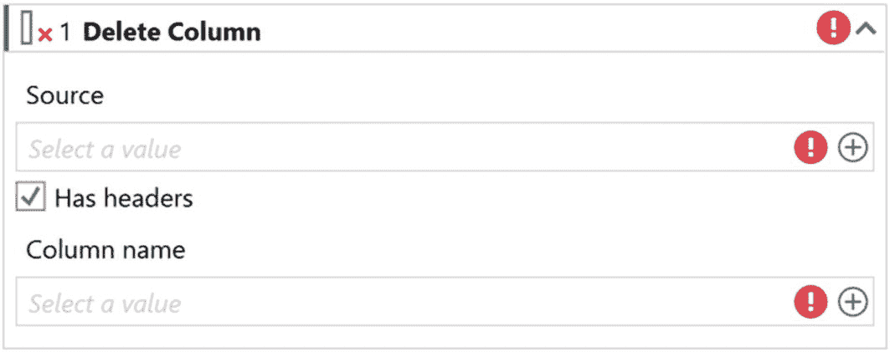
图 7-30 删除列活动卡片

**源**：这是活动卡片上的一个必填配置。此配置为 StudioX 提供需要从中删除列的范围、工作表或表格。

**列名**：这是活动卡片上的一个必填配置。此配置提供需要从 `Source` 字段中配置的指定范围、工作表或表格中删除的列。为此活动配置列名最常用的方法是从 `Range` 选择器中选择一个列标题，或使用 `Indicate in Excel` 选择所需的列标题。或者，如果目标是删除多列，则可以使用 `Text Builder` 来标识要删除的范围或逗号分隔的列列表。

**有标题**：这是活动卡片上的一个可选配置。此配置默认被选中，以便 StudioX 识别被删除的列具有标题，并根据第一行中的名称（而非 Excel 列标识符，如 A、B、C 等）来识别列。

练习

**目标**：基于之前的练习，使用 `Delete Column` 活动从 `EmployeeOnboarding.xlsx` 文件中的 `New Hires List` 工作表删除 `Full Name` 列。图 7-29 显示了自动化执行前的 `New Hires List`。

**源代码**：Chapter_7_ExcelColumnActivitiesExercise

**设置**：以下是分步实施说明：
1. 在 `StudioX` 中，将 `Delete Column` 活动添加到 `Use Excel File` 活动主体中，位于 `Text to Columns` 活动之后。
2. 接下来，点击 `Source` 字段中的 `Plus` 图标，导航到 `EmployeeOnboarding` 并选择 `New Hires List` 工作表。
3. 接下来，点击 `Column name` 字段中的 `Plus` 图标，选择 `Range` ➤ `Full Name` 选项。
4. 在此示例中，保持 `Has headers` 的默认配置不变。

完成练习后，`删除列`活动的最终配置应类似于图 7-31。

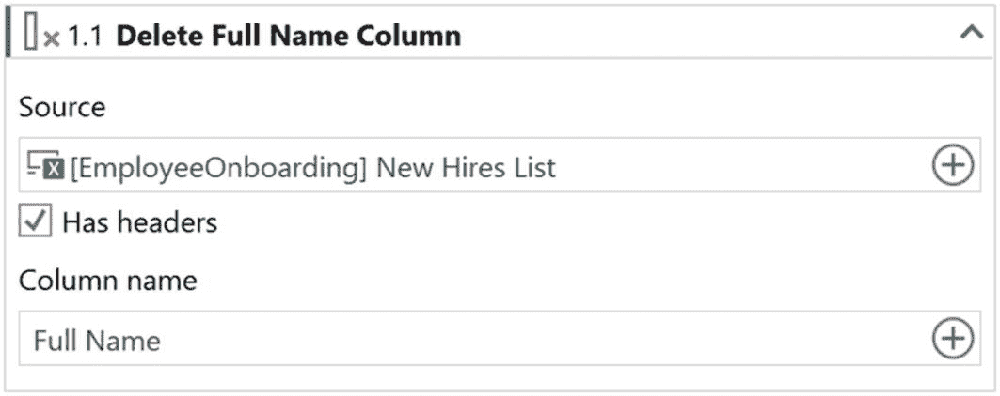
图 7-31 显示删除列活动的最终配置

此示例的输出将从 New Hires List 工作表中删除 Full Name 列，如图 7-32 所示。

图 7-32 执行删除列活动后，Full Name 列已被删除

### 插入行

`插入行`活动允许您向定义的范围、工作表或表格中添加一行或多行。

#### 配置

本节提供如何配置`插入行`活动的说明，如图 7-33 所示。

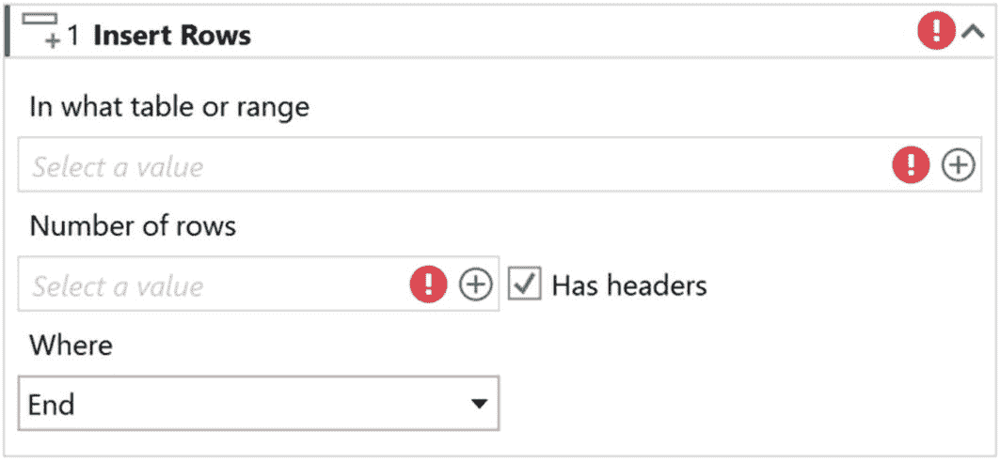
图 7-33 插入行活动卡片

**在哪个表格或范围中**：这是活动卡片上的一个必填配置。此配置为 StudioX 提供将添加新行的范围。

**行数**：这是活动卡片上的一个必填配置。此配置确定应向所选范围添加多少行。

**位置**：这是活动卡片上的一个必填配置。此配置默认选择为 `End`，意味着新插入的行将添加到 `In what table or range` 字段中所选范围的末尾。此字段配置可以更改为 `Start` 或 `Specific Index`。

**行号**：这是活动卡片上的一个必填配置。仅当在 `Where` 下拉菜单中选择了 `Specific Index` 时才需要此配置。此配置允许您指定一个确切的行号，新行将插入到该行号处。

**有标题**：这是活动卡片上的一个可选配置。此配置默认被选中，即范围中的第一行将被视为标题。例如，如果您在表格的开头插入三行并且选中了 Has headers，那么这三行将插入到表格的标题行之后。

练习

**目标**：使用 `Use Excel File` 和 `Insert Rows` 活动在 `New Hires List` 工作表的单元格处添加两行。图 7-32 显示了练习前包含 `20` 行数据的 `New Hires List`。

**源代码**：Chapter_7_ExcelRowActivitiesExercise

**设置**：以下是分步实施说明：
1. 在 `StudioX` 中，添加 `Use Excel File` 活动，并按照第一个练习所示，将其配置为 `C:\BookSamples\Chapter_07\EmployeeOnboarding.xlsx` 文件。
2. 然后，在 `Designer` 面板中，将 `Insert Rows` 活动拖放到 `Use Excel File` 活动的主体中。

### 插入行（续）

3.  接下来，点击 `In what table or range` 字段中的 `Plus` 图标，导航到 `EmployeeOnboarding` 并选择 `New Hires List` 工作表。
4.  接下来，点击 `Number of rows` 字段中的 `Plus` 图标，选择 `Number` 选项，并输入 `2`。
5.  接下来，点击 `Where` 下拉菜单并选择 `Specific index`。
6.  接下来，点击 `Row Number` 字段中的 `Plus` 图标，选择 `Number` 选项，并输入 `5`。
7.  保持 `Has headers` 的默认选项为选中状态。

完成练习后，`插入行` 活动的最终配置应类似于图 7-34。

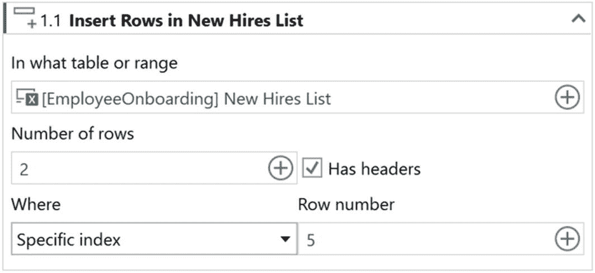
*图 7-34*

图 7-35 显示了插入行活动的输出，该活动已向 `New Hires List` 工作表添加了两行，现在范围从 `A1:F21` 扩展到了 `A1:F23`。

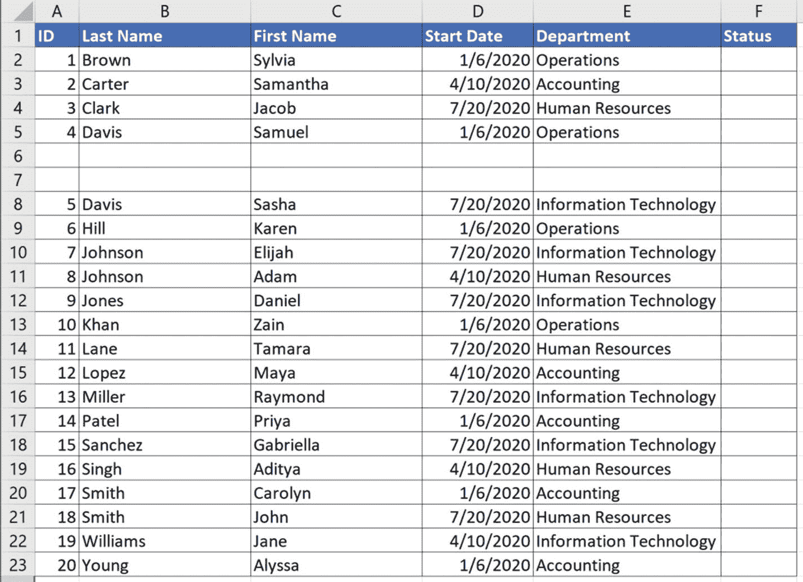
*图 7-35*

### 删除行

`删除行` 活动会删除工作簿中工作表、范围或表格内标识的一行或多行。

> 提示
> 您可以使用筛选活动来隐藏行，然后选择在删除行活动中删除所有隐藏的行。

#### 配置

本节提供如何配置 `删除行` 活动的说明，如图 7-36 所示。

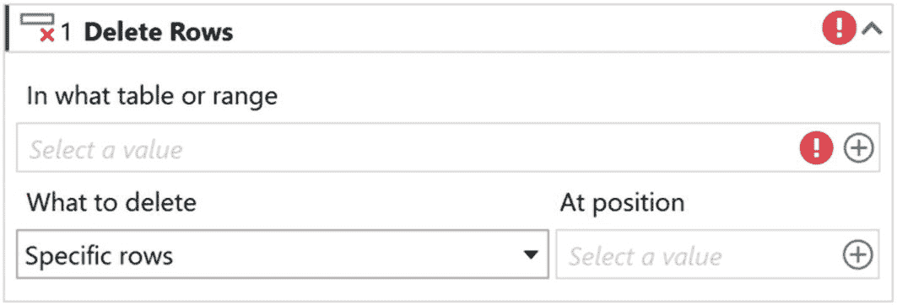
*图 7-36*

-   **在哪个表或范围中**：这是活动卡片上的一个必填配置。此配置为 StudioX 提供包含需要删除的行的范围、工作表或表。
-   **要删除什么**：这是活动卡片上的一个必填配置。此配置提供需要删除的行的类型。下拉选择选项包括 `指定行`、`所有可见行`、`所有隐藏行` 和 `所有重复行`。例如，如果有一个表，其中隐藏了三行，并且您选择了 `所有隐藏行` 选项，那么表中这三行隐藏行将被删除。
-   **在位置**：这是活动卡片上的一个必填配置。仅当在 `要删除什么` 中选择了 `指定行` 选项时，才需要此配置。配置 `在位置` 字段最常用的方法是使用 `文本生成器` 输入要删除的行号。
-   **有标题**：这是属性面板上的一个可选配置。默认情况下，此选项处于选中状态，即范围中的第一行将被视为标题行，不会被删除。

> 练习
> **目标**：基于之前的练习，使用 `删除行` 活动删除 `新员工名单` 中的第 6 行和第 7 行，这些行是在 `插入行` 练习中添加的，如图 7-35 所示。
>
> **源代码**：`Chapter_7_ExcelRowActivitiesExercise`
>
> **设置**：以下是分步实施说明：
> 1.  在 `StudioX` 中，将 `删除行` 活动添加到 `使用 Excel 文件` 活动主体中，位于 `插入行` 活动之后。
> 2.  接下来，点击 `在哪个表或范围中` 字段中的 `加号` 图标，导航到 `EmployeeOnboarding`，然后选择 `新员工名单` 工作表。
> 3.  将 `要删除什么` 下拉菜单保留为默认选择 `特定行`。
> 4.  接下来，点击 `在位置` 字段中的 `加号` 菜单，选择 `文本` 选项，然后输入 `6, 7`。
>
> 完成练习后，`删除行` 活动的最终配置应类似于图 7-37。

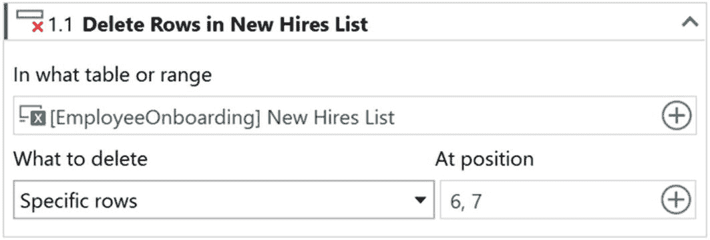
*图 7-37*

此示例的输出如图 7-38 所示，删除了 `新员工名单` 工作表中第 6 行和第 7 行的两个空白行。

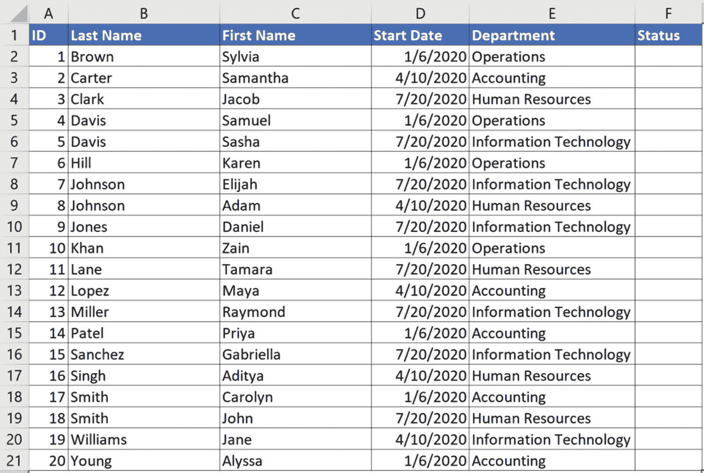
*图 7-38*

### 查找第一个/最后一个数据行

`查找第一个/最后一个数据行` 活动允许您在工作簿的工作表、表或范围中查找包含数据的第一个和最后一个行号。

> 提示
> 当需要知道数据的最后一行是什么，以便知道在何处追加或写入数据时，此活动会很有帮助。

#### 配置

本节提供如何配置 `查找第一个/最后一个数据行` 活动的说明，如图 7-39 所示。

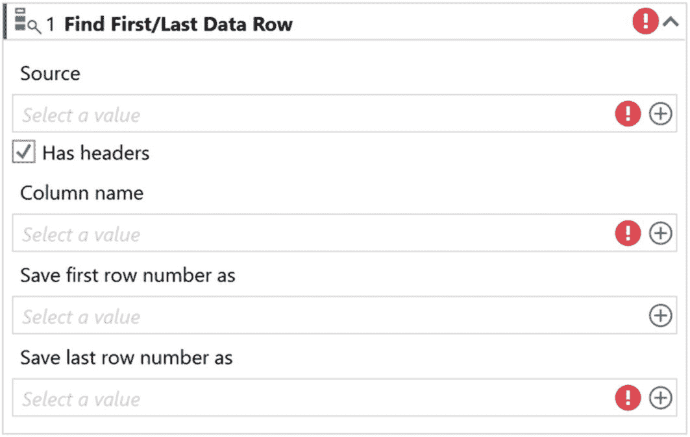
*图 7-39*

-   **源**：这是活动卡片上的一个必填配置。此配置提供包含需要搜索第一个和/或最后一个行号的数据的工作表、范围或表。
-   **有标题**：这是活动卡片上的一个可选配置。此配置指示 `源` 的第一行是标题行，不会计入输出。例如，如果范围 `A1:B20` 中有一个表，并且选中了 `有标题` 选项，则最后一个数据行计数将为 19。默认情况下，此选项处于选中状态，这意味着在计算输出时不会将第一行计入。如果取消选中，则第一行将与已识别范围中的任何其他行一样被计入。
-   **列名**：这是活动卡片上的一个必填配置。此配置指定需要搜索第一个和最后一个数据行的列的名称。通常，此字段通过选择在 `范围` 菜单中填充的列标题名称来配置。
-   **将第一个行号保存为**：这是活动卡片上的一个可选配置。此配置指定将源范围中包含数据的第一个行的数字索引存储到何处。通常，此值可以保存到 Excel 单元格中、保存以供以后使用，或复制到剪贴板。
-   **将最后一个行号保存为**：这是活动卡片上的一个必填配置。此配置指定将源范围中包含数据的最后一个行的数字索引存储到何处。通常，此值可以保存到 Excel 单元格中、保存以供以后使用，或复制到剪贴板。
-   **要跳过的空白行数**：这是通过属性面板中“输入”部分的一个可选配置。此配置指定自动化在确定已达到范围末尾之前应遇到的连续空白行数。此配置默认为 1。
-   **第一个行偏移**：这是通过属性面板中“输入”部分的一个可选配置。此配置允许用户添加指定数量的行，以偏移活动输出的第一个包含数据的行。例如，您可以输入数字 5；然后活动将搜索第五个包含数据的行的行号。此配置默认为 0。
-   **最后一个行偏移**：这是通过属性面板中“输入”部分的一个可选配置。此配置允许用户减去指定数量的行，以偏移活动输出的最后一个包含数据的行。例如，您可以输入数字 5；然后活动将从范围底部向上搜索第五个包含数据的行。此配置默认为 0。

> 练习
> **目标**：基于之前的练习，使用 `查找第一个/最后一个数据行` 活动查找 `新员工检查表` 的 `ID` 列中包含数据的最后一行。图 7-40 显示了将要搜索的数据。
>
> 
> *图 7-40*
>
> **源代码**：`Chapter_7_ExcelRowActivitiesExercise`
>
> **设置**：以下是分步实施说明：
> 1.  在 `StudioX` 中，将 `查找第一个/最后一个数据行` 活动添加到 `使用 Excel 文件` 活动主体中，位于 `删除行` 活动之后。
> 2.  接下来，点击 `源` 字段中的 `加号` 图标，导航到 `EmployeeOnboarding`，然后选择 `新员工检查表` 工作表。
> 3.  接下来，点击 `列名` 字段中的 `加号` 图标，然后导航至 `范围` 并选择 `ID` 列标题。
> 4.  接着，点击 `将最后行号另存为` 字段中的 `加号` 图标，然后选择 `复制到剪贴板` 选项。
> 5.  保持勾选 `有标题行` 选项。
> 6.  将 `将首行行号另存为` 字段留空。
> 7.  然后，在 `查找首行/末行数据` 活动之后，将 `写入行` 活动添加到 `使用 Excel 文件` 活动的主体中。
> 8.  在 `文本` 字段中，点击 `加号` 图标并选择 `从剪贴板粘贴` 选项。
>
> 完成练习后，`查找首行/末行数据` 活动的最终配置应如图 7-41 所示。

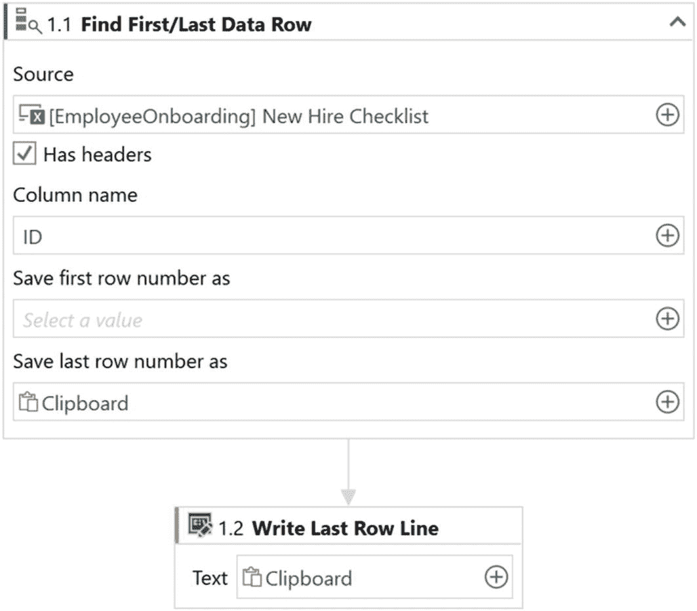
*图 7-41*

此示例将输出 21 作为新员工清单的最后一行，因为共有 20 名新员工。如图 7-42 所示。

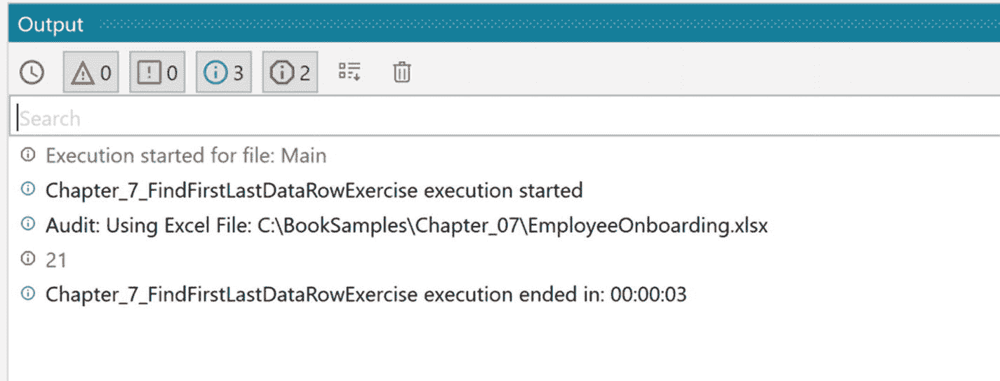

图 7-42

查找首行/末行数据练习的输出

### 对于每个 Excel 行

`对于每个 Excel 行`活动允许您对同一工作簿中的工作表、表格或范围内的每一行执行一个或多个活动。

注意

必须在`对于每个 Excel 行`活动中配置至少一个子活动，才能对多个 Excel 行执行迭代操作。

#### 配置

本节提供如何配置`对于每个 Excel 行`活动的说明，如图 7-43 所示。

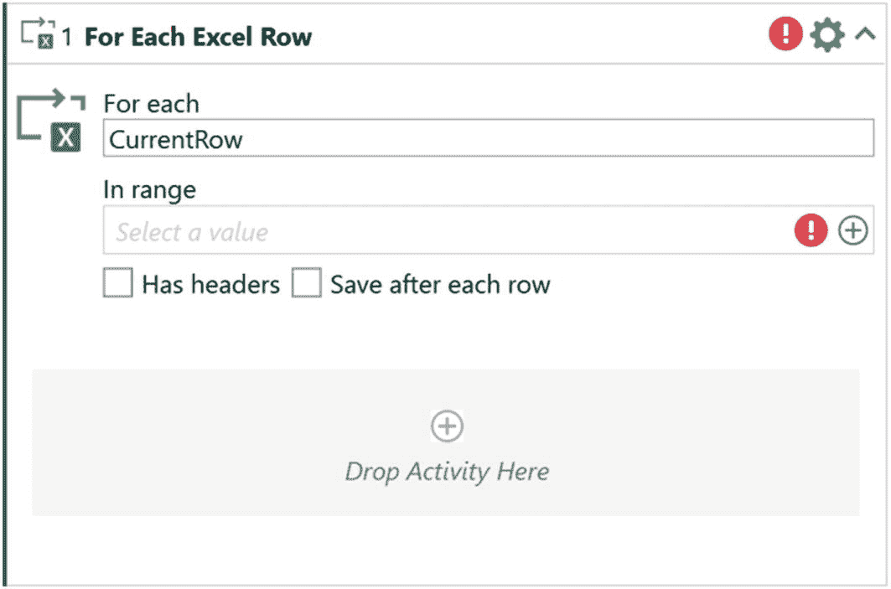

图 7-43

对于每个 Excel 行活动卡片

`对于每个`：这是活动卡片上的一个必填配置。此配置允许您提供一个名称来引用当前正在迭代的行；这对于在子活动中进行引用尤其重要。默认文本为`CurrentRow`，您可以根据正在迭代的数据进行更改。例如，当您对多个员工列表执行相同操作时，可以选择将当前行命名为`Employees`。您可以直接输入所需名称来配置此字段，或保留默认值。

`在范围中`：这是活动卡片上的一个必填配置。此配置提供包含需要迭代的数据行的工作表、范围或表格。

`有标题行`：这是活动卡片上的一个可选配置。此配置指示`在范围中`的第一行是标题行。选择此选项将有助于在子活动中引用`CurrentRow`数据的特定列名。此选项默认未选中。

`每行后保存`：这是活动卡片上的一个可选配置。此配置指定是否应在每次迭代一行后保存 Excel 文件。此选项默认未选中，意味着 Excel 文件将根据父级`使用 Excel 文件`活动中设置的保存配置或使用`保存 Excel 文件`活动进行保存。

`EmptyRowBehavior`：这是`属性`面板上的一个可选配置。此配置指示自动化在迭代数据时遇到空行时的行为。默认选项设置为`Stop`，意味着活动将停止迭代后续行。此选项可以更改为`Skip`，以便跳过空行并处理迭代中的下一行，或更改为`Process`，以便将空行包含在迭代数据处理中。

#### 练习

**目标**：基于之前的练习，使用`对于每个 Excel 行`活动遍历新员工列表数据范围中的每一行员工数据。此活动将与`写入单元格`活动练习一起执行。

**源代码**：`Chapter_7_ExcelRowActivitiesExercise`

**设置**：以下是分步实施说明：

1.  在`StudioX`中，将`对于每个 Excel 行`活动添加到上一个练习中`查找首行/末行数据`活动之后的`使用 Excel 文件`活动主体中。

2.  接着，在`对于每个`字段中，输入文本`Employee`。

3.  然后，点击`在范围中`字段中的`加号`图标，导航至`EmployeeOnboarding`并选择`新员工清单`工作表。

4.  接下来，勾选`有标题行`选项。

5.  勾选`每行后保存`选项。

6.  然后，点击`属性`面板并选择`EmptyRowBehavior`选项，将其更改为`Skip`。此步骤为可选。

完成练习后，`对于每个 Excel 行`活动的最终配置应如图 7-44 所示。

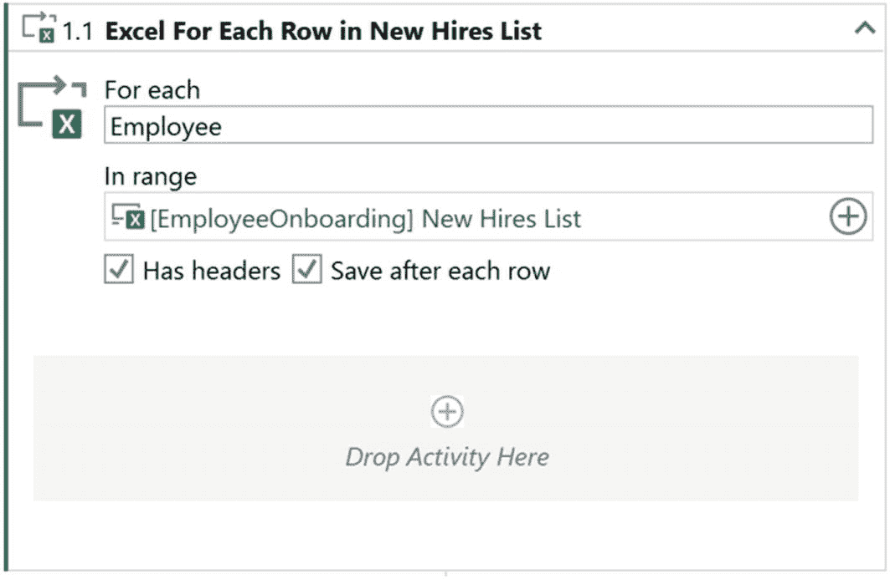

图 7-44

显示对于每个 Excel 行活动的配置

在接下来的活动部分中，自动化将遍历新员工清单工作表中的每一行 Employee 数据，并执行写入单元格操作。

### 写入单元格

`写入单元格`活动允许您将值或公式写入工作表中的指定单元格。

此活动的常见示例包括写入单个单元格，或使用`对于每个`活动将文本或公式写入多个单元格，并随每一行递增。

#### 配置

本节提供如何配置`写入单元格`活动的说明，如图 7-45 所示。

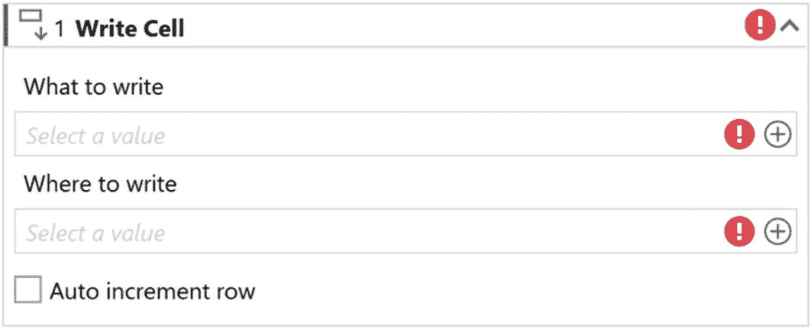

图 7-45

写入单元格活动卡片

`写入内容`：这是活动卡片上的必填配置。此配置用于标识需要输入到单元格中的文本或公式值。

`写入位置`：这是活动卡片上的必填配置。此配置提供了将 `What to write` 值输入到的单元格位置。

`自动递增行`：这是活动卡片上的可选配置。如果勾选此配置，将自动为每次迭代增加行号，并将单元格值写入范围内的多个单元格中。默认情况下，此字段未勾选，表示该值仅会输入到 `Where to write` 字段中指定的单个单元格。

注意

如果写入多个单元格，应将`自动递增行`选项与`遍历 Excel 行`、`遍历每封电子邮件`、`遍历文件夹中的每个文件`或`重复指定次数`活动结合使用。

#### 练习

**目标**：基于之前的练习，使用`写入单元格`活动与`遍历 Excel 行`活动，将文本`Active`作为状态写入`新员工名单`中的每位员工。图 7-38 显示了练习前的`新员工名单`。

**源代码**：`Chapter_7_ExcelRowActivitiesExercise`

**设置**：以下是分步实施说明：

1.  在 `StudioX` 中，将`写入单元格`活动添加到上一个练习中`遍历 Excel 行`活动的主体中。

2.  接下来，选择`写入内容`字段中的`加号`图标，选择`文本`选项，然后输入`Active`。

3.  接下来，选择`写入位置`字段中的`加号`图标，将鼠标悬停在`员工`选项上，然后选择`状态`字段。

4.  接下来，勾选`自动递增行`字段的复选框。

完成练习后，`写入单元格`活动的最终配置应类似于图 7-46。

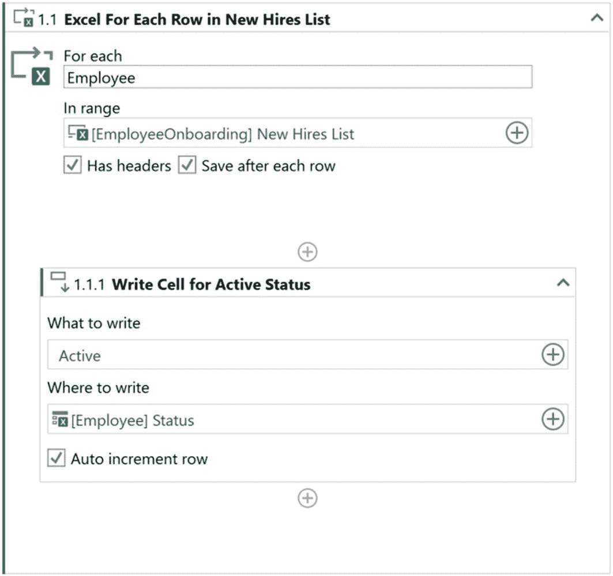

图 7-46

显示写入单元格活动的最终配置

图 7-47 显示了`写入单元格`和`遍历 Excel 行`活动的输出，该输出已为所有员工的状态列添加了 Active。

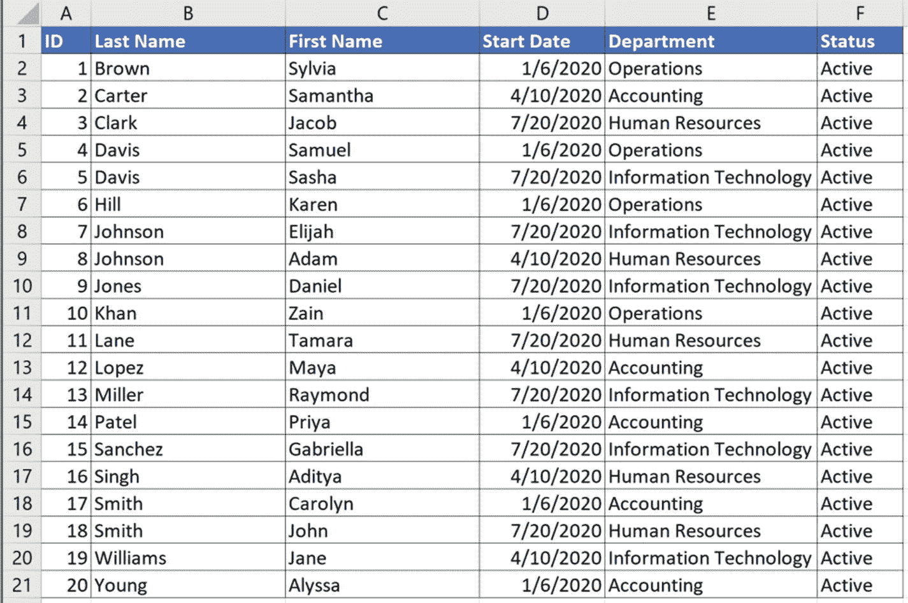

图 7-47

显示已为所有员工的状态添加的文本 Active

### 创建数据透视表

`创建数据透视表`活动用于创建数据透视表，帮助您组织、分析和汇总数据。此外，`创建数据透视表`活动还附带`添加数据透视字段`子活动，允许您向新的数据透视表中添加行、列、筛选器或值。

#### 配置

本节提供如何配置`创建数据透视表`活动的说明，如图 7-48 所示。

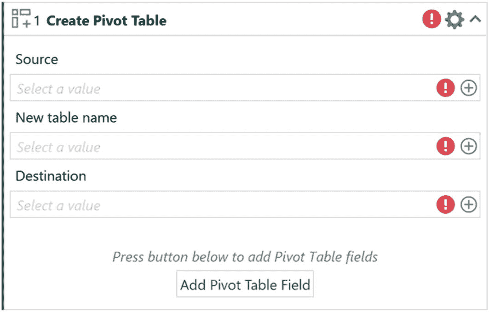

图 7-48

创建数据透视表活动卡片

`源`：这是活动卡片上的一个必填配置。此配置提供为新数据透视表提供数据的源范围或表。配置此字段的常用方法是选择一个命名表作为源。

`新表名称`：这是活动卡片上的一个必填配置。此配置提供数据透视表的名称。配置此字段最常见的方式是选择`文本生成器`选项，手动输入所需名称。

`目标位置`：这是活动卡片上的一个必填配置。此字段标识应在其中创建新数据透视表的工作表、表或范围。通常通过选择一个命名的工作表或表，或使用`在 Excel 中指示`选项来配置此字段。

`数据透视字段`：子活动允许您为父级`创建数据透视表`活动中正在创建的新数据透视表添加行、列、值和筛选器。

`字段`：`字段`值是`添加数据透视字段`子活动配置所必需的。此配置指定应将`源`中的哪个字段添加到新数据透视表中。您可以通过从`范围`选择器中选择一个`列标题`，或使用`在 Excel 中指示`来选择所需的列标题来进行配置。

`作为`：这是`数据透视字段`子活动卡片上的一个必填配置。此字段允许您选择添加到新数据透视表的字段是`行`、`列`、`筛选器`还是`值`。

`函数`：这是活动卡片上的一个可选配置。此配置仅在`作为`字段设置为`值`选项时出现。`函数`字段指定用于确定值的函数，其下拉选项如图 7-49 所示。

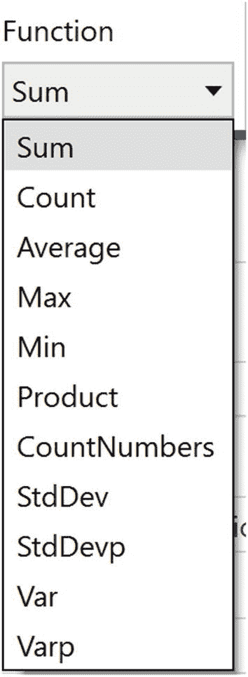

图 7-49

函数字段的下拉选项

#### 练习

# 第七章：Excel表格活动

## 创建数据透视表

**目标**：使用`使用 Excel 文件`和`创建数据透视表`活动，在`EmployeeOnboarding` Excel 文件中创建一个数据透视表，以统计`新员工名单`中前 10 名新员工按工作职能划分的员工`ID`数量。

**源代码**：`Chapter_7_ExcelTableActivitiesExercise`

**设置**：以下是分步实施说明：

1.  在 `StudioX` 中，添加`使用 Excel 文件`活动，并按照第一个练习中的演示，将其配置为 `C:\BookSamples\Chapter_07\EmployeeOnboarding.xlsx` 文件。
2.  然后，在`设计器`面板中，将`创建数据透视表`活动卡片拖放到`使用 Excel 文件`活动的主体中。
3.  接下来，点击`源`字段中的`加号`图标，并为`EmployeeOnboarding`文件选择`在 Excel 中指示`选项。Excel 打开后，在`新员工名单`工作表中选择范围 `A1:F11`。
4.  接下来，点击`新表名称`字段中的`加号`图标，选择`文本`选项，然后输入 `NewHireStats_PivotTable`。
5.  接下来，点击`目标位置`字段中的`加号`图标，导航到`EmployeeOnboarding` Excel 文件，并选择`新员工统计`工作表。
6.  接下来，点击`添加数据透视字段`按钮以添加第一个字段。
7.  接下来，点击`字段`选项中的`加号`图标，导航到`范围`选项，并选择`部门`。
8.  接下来，将`作为`选项保留为默认值`行`。
9.  接下来，点击`添加数据透视字段`按钮以添加第二个字段。
10. 接下来，点击`字段`选项中的`加号`图标，导航到`范围`选项，并选择`ID`。
11. 接下来，点击`作为`选项的下拉菜单，并选择值`值`。
12. 接下来，点击`函数`选项的下拉菜单，并选择值`计数`。

完成练习后，`创建数据透视表`活动的最终配置应类似于图 7-50。

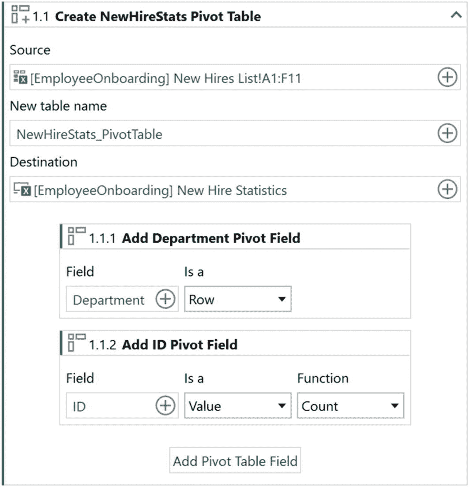

此示例的输出将创建一个名为 `NewHireStats` 的数据透视表，其中包含`部门`（Department）和`ID`列，显示按部门雇佣的员工数量。图 7-51 显示了 `EmployeeOnboarding` Excel 文件中的新数据透视表。

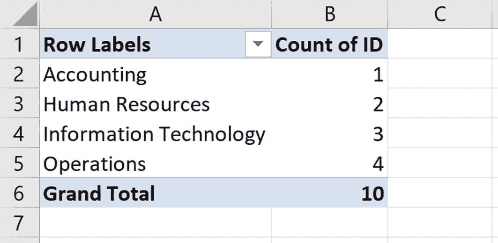

## 格式化为表格

`格式化为表格`活动将指定范围格式化为具有给定名称的新表格。

### 配置

本节提供如何配置`格式化为表格`活动的说明，如图 7-52 所示。

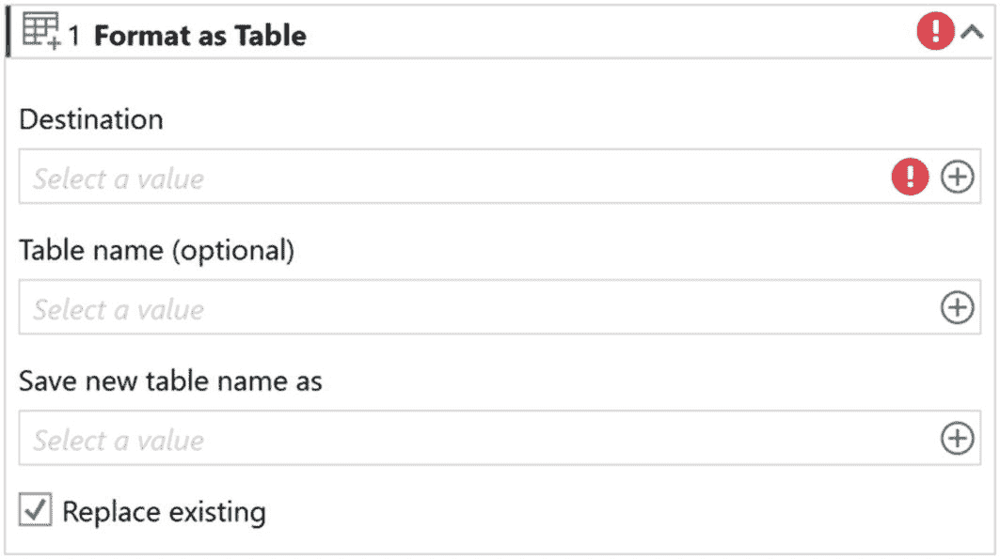

**目标**：这是活动卡片上的一个必填配置。此配置用于标识需要从区域转换为表格的单元格范围。通常通过使用 `Indicate in Excel` 选项来配置此字段。

**表格名称（可选）**：这是活动卡片上的一个可选配置。此配置用于为表格提供名称。配置此字段最常见的方式是选择 `Text Builder` 选项，然后手动输入所需的名称。如果留空，表格将自动被分配第一个可用的名称，例如“Table1”。

**将新表格名称另存为**：这是活动卡片上的一个可选配置。此配置用于提供引用该表格的名称，以便后续使用。如果`表格名称`配置留空，此配置会很有帮助，因为您可以检索由自动化分配的名称。配置此字段的常见方式是选择 `Save for later` 选项，并分配一个变量名称以输出供后续活动使用。

**替换现有**：这是活动卡片上的一个可选配置。此配置用于删除并替换与`将新表格名称另存为`中配置的名称相同的现有表格。默认情况下，此配置为选中状态。

### 练习

**目标**：基于之前的练习，使用 `Format as Table` 活动将 `EmployeeOnboarding.xlsx` 文件中的 `New Hires List` 区域格式化为表格。

**源代码**：`Chapter_7_ExcelTableActivitiesExercise`

**设置**：以下是分步实施说明：

1.  在 `StudioX` 中，将 `Format as Table` 活动添加到 `Use Excel File` 活动主体中，位于上一个练习的 `Change Pivot Table` 活动之后。
2.  点击 `目标` 字段中的 `Plus` 图标。导航到 `EmployeeOnboarding` 工作簿选项，并选择 `Indicate in Excel`。Excel 打开后，在 `New Hires List` 工作表中选择区域 `A1:F21`。
3.  接下来，点击 `新表格名称` 字段中的 `Plus` 图标，选择 `Text` 选项，然后输入 `NewHiresList_Table`。
4.  将 `保存引用名称` 留空。

完成练习后，`格式化为表格`活动的最终配置应类似于图 7-53。

图 7-54 显示了现已转换为新表格的区域 `A1:F21`。

## 更改数据透视表数据源

`更改数据透视表数据源`活动允许您更改现有数据透视表的源区域数据。

### 配置

本节提供如何配置`更改数据透视表数据源`活动的说明，如图 7-55 所示。

**数据透视表**：这是活动卡片上的一个必填配置。此配置用于从 Excel 文件中标识将要使用新源数据进行更新的数据透视表。

**新源**：这是活动卡片上的一个必填配置。此配置用于标识将更新数据透视表中数据的新源表格或区域。

### 练习

**目标**：基于之前的练习，使用 `Change Pivot Data Source` 活动将 `NewHireStats_PivotTable` 的数据源从区域 `A1:F11` 更改为在 `Format as Table` 活动练习中添加的 `NewHiresList_Table`。图 7-51 显示了练习前的数据透视表。

**源代码**：`Chapter_7_ExcelTableActivitiesExercise`

**设置**：以下是分步实施说明：

1.  在 `StudioX` 中，将 `Change Pivot Data Source` 活动添加到 `Use Excel File` 活动主体中，位于上一个练习的 `Format as Table` 活动之后。
2.  点击 `数据透视表` 字段中的 `Plus` 图标。导航到 `EmployeeOnboarding` 工作簿中的 `New Hire Statistics` 工作表，并选择 `NewHireStats_PivotTable [Pivot Table]`。
3.  点击 `新源` 字段中的 `Plus` 图标。导航到 `EmployeeOnboarding` 工作簿中的 `New Hires List` 工作表，并选择 `NewHiresList_Table [Table]`。

完成练习后，`更改数据透视表数据源`活动的最终配置应类似于图 7-56。

执行`更改数据透视表数据源`活动后，图 7-57 显示了 `NewHireStats_PivotTable` 更新后的数据输出，现在已包含全部 20 名员工。

图 7-57

“更改数据透视表数据源”活动输出

## 刷新数据透视表

`Refresh Pivot Table` 活动利用 Excel 中的刷新功能，使您能够使用源数据区域中发生的任何数据更改来更新数据透视表。

### 配置

本节提供如何配置 `Refresh Pivot Table` 活动的说明，如图 7-58 所示。

图 7-58

刷新数据透视表活动卡片

`Pivot table to refresh`：这是活动卡片上的一项必需配置。此配置为 `StudioX` 提供因源数据表或区域发生更改而需要更新的数据透视表。您可以通过点击 `Plus` 图标并选择一个已命名的数据透视表来配置此字段。

练习

**目标**：基于之前的练习，使用 `Refresh Pivot Table` 活动更新 `NewHireStats_PivotTable` 中的新员工计数。这将基于一个 `Write Cell` 活动，该活动将第一位员工的部门从 `Operations` 更新为 `Accounting`。图 7-57 显示了练习前的 `NewHireStats_PivotTable`。

**源代码**：`Chapter_7_ExcelTableActivitiesExercise`

**设置**：以下是分步实施说明：

1. 在 `StudioX` 中，将 `Write Cell` 活动添加到 `Use Excel File` 活动主体内，位于 `Change Pivot Data Source` 活动之后。

2. 接着，在 `What to write` 字段中，点击 `Plus` 图标，选择 `Text` 选项，然后输入 `Accounting`。

3. 然后，在 `Where to write` 字段中，选择 `New Hires List` 工作表中的单元格 `E2`。

4. 接下来，在 `Designer` 面板中，将 `Refresh Pivot Table` 活动拖放到 `Use Excel File` 活动主体内，位于 `Write Cell` 活动之后。

5. 然后，点击 `Pivot table to refresh` 字段中的 `Plus` 图标，导航至 `EmployeeOnboarding` 工作簿中的 `New Hire Statistics` 工作表，并选择 `NewHireStats_PivotTable`。

完成练习后，`Write Cell` 和 `Refresh Pivot Table` 活动的最终配置应类似于图 7-59。

图 7-59

显示刷新数据透视表活动的最终配置

图 7-60 显示了刷新数据透视表活动的输出，该活动已更新了会计和运营部门的新员工计数。

图 7-60

显示刷新后的数据透视表

## 追加区域

`Append Range` 活动从特定工作表、区域或表格中复制数据，并将其粘贴/追加到另一个工作表区域或表格的数据之后。

### 配置

本节提供如何配置 `Append Range` 活动的说明，如图 7-61 所示。

图 7-61

追加区域活动卡片

`Append after range`：这是活动卡片上的一项必需配置。此配置提供数据将被追加到其后的工作表、区域或表格的位置。

`What to append`：这是活动卡片上的一项必需配置。此配置提供数据将被追加到其后的工作表、区域或表格的位置。

`What to copy`：这是活动卡片上的一项可选配置。此字段决定在此活动期间如何粘贴数据，例如，选择 `All` 会复制 `What to append` 中所选数据的值、格式和所有公式。此字段默认为 `All` 选项，可更改为 `Values`、`Formulas` 或 `Formats`。

`Has headers`：这是活动卡片上的一项可选配置。如果选中，它会将 `What to append` 区域中的第一行视为标题而不复制。默认情况下未选中。

`Transpose`：这是活动卡片上的一项可选配置。`Transpose` 会将正在复制的数据从列旋转到行，反之亦然。默认情况下，此选项未选中。

练习

**目标**：使用 `Use Excel File` 和 `Append Range` 活动，将 `EmployeeOnboardingInput` Excel 文件中 `5` 名新员工的数据追加到父文件 `Employee Onboarding` 中的 `NewHiresList_Table`。图 7-62 显示了包含需要追加的 `5` 行员工数据的 `EmployeeOnboardingInput` 文件。

图 7-62

显示需要被追加的员工入职输入数据

**源代码**：`Chapter_7_ExcelRangeActivitiesExercise`

**设置**：以下是分步实施说明：

1. 在 `StudioX` 中，添加 `Use Excel File` 活动，并按照第一个练习中的演示，将其配置为 `C:\BookSamples\Chapter_07\EmployeeOnboarding.xlsx` 文件。

2. 然后，在第一个活动的主体中拖入第二个 `Use Excel File` 活动，用于 `C:\BookSamples\Chapter_07\EmployeeOnboardingInput.xlsx` 文件路径，并将 `Reference as` 设置为 `EmployeeOnboardingInput`。

3. 接下来，将 `Append Range` 活动卡片添加到嵌套的 `Use Excel File` 活动主体中。

4. 点击 `Append after range` 字段中的 `Plus` 图标。导航至 `EmployeeOnboarding` 工作簿选项，并选择 `NewHiresList_Table`。

5. 点击 `What to append` 字段中的 `Plus` 图标。导航至 `EmployeeOnboardingInput` 工作簿选项，并选择 `New Employees Input sheet` 区域。

6. 勾选 `Has headers` 选项。

完成练习后，`Append Range` 活动的最终配置应类似于图 7-63。

图 7-63

追加区域活动卡片的最终配置

此活动的输出如图 7-64 所示，已将输入文件中的五新行追加到 `EmployeeOnboarding.xlsx` 文件中的 `NewHiresList_Table`。

图 7-64

在 `A22:F26` 区域中追加了范围的 `NewHiresList_Table`

## 复制区域

`Copy Range` 活动允许您将区域、工作表或表格从一个位置复制并粘贴到自动化可用的 Excel 工作簿中的另一个位置。

### 配置

本节提供如何配置 `Copy Range` 活动的说明，如图 7-65 所示。

图 7-65

复制区域活动卡片

注意

与从第一个空行开始粘贴数据的 `Append Range` 活动不同，`Copy Range` 活动在粘贴时会覆盖数据。

`Source`：这是活动卡片上的一个必填配置。此字段标识需要复制的源数据所在的工作表、表格或区域。通常通过选择命名的工作表或表格，或使用 `Indicate in Excel` 选项来配置此字段。

`目标`：这是活动卡片上的一个必填配置。此字段标识`源`数据应粘贴到的工作表、表格或区域。通常通过选择命名的工作表或表格，或使用`Indicate in Excel`选项来配置此字段。

`要复制的内容`：这是活动卡片上的一个可选配置。`要复制的内容`字段决定在此活动期间如何粘贴数据，例如，选择“全部”会复制在“要追加的内容”中所选数据的值、格式和任何公式。此字段默认为`全部`选项，可更改为`值`、`公式`或`格式`。

`转置`：这是活动卡片上的一个可选配置。`转置`会将正在复制的数据从列旋转到行，反之亦然。默认情况下，此选项未选中。

## 练习

`目标`：基于之前的练习，使用`复制区域`活动将`NewHiresList_Table`中第 `22–26` 行的员工`ID`、`姓氏`和`名字`复制到`NewHireChecklist Table`。复制区域练习之前的“新员工清单”表如图 7-66 所示。

图 7-66 复制区域活动之前的“新员工清单”

`源代码`：`Chapter_7_ExcelRangeActivitiesExercise`

`设置`：以下是分步实施说明：

1.  在 `StudioX` 中，将`复制区域`活动添加到嵌套的`使用 Excel 文件`活动主体中，位于上一个练习的`追加区域`活动之后。
2.  接下来，单击`源`字段中的`加号`图标，导航到`EmployeeOnboarding`文件，然后选择`Indicate in Excel`。Excel 打开后，在`New Hires List`工作表中选择区域 `A22:C26`。
3.  接下来，单击`目标`字段中的`加号`图标，导航到`EmployeeOnboarding`文件，然后选择`Indicate in Excel`。Excel 打开后，在`New Hire Checklist`工作表中选择单元格 `A22:C26`。
4.  将`要复制的内容`和`转置`选项保留为默认选择。

完成练习后，`复制区域`活动的最终配置应类似于图 7-67。

图 7-67 复制区域活动配置

此示例的输出将复制“新员工列表”中的区域 `A22:C26`，并将其粘贴到“新员工清单”中的区域 `A22:C26`，如图 7-68 所示。

图 7-68 复制区域活动输出

## 清除工作表/区域/表格

`清除工作表/区域/表格`活动允许您清除自动化可访问的 Excel 工作簿中指定工作表、区域或表格的数据。

### 配置

本节提供如何配置`清除工作表/区域/表格`活动的说明，如图 7-69 所示。

图 7-69 清除工作表/区域/表格活动卡片

`要清除的区域`：这是活动卡片上的一个必填配置。此字段标识需要清除的源数据所在的工作表、表格或区域。通常通过选择命名的工作表或表格，或使用`Indicate in Excel`选项来配置此字段。

`包含标题`：这是活动卡片上的一个可选配置。此配置默认未选中，意味着所有数据都将被清除。如果选中，则指定区域中的标题行将不会被清除。

### 练习

`目标`：基于之前的练习，使用`清除工作表/区域/表格`活动清除`EmployeeOnboardingInput` Excel 文件中的 `InputTable` 数据。图 7-62 显示了清除前的这些数据。

`源代码`：`Chapter_7_ExcelRangeActivitiesExercise`

`设置`：以下是分步实施说明：

1.  在 `StudioX` 中，将`清除工作表/区域/表格`活动添加到内部`使用 Excel 文件`活动主体中，位于`复制区域`活动之后。
2.  接下来，单击`要清除的区域`字段中的`加号`图标，导航到`EmployeeOnboardingInput`文件中的`New Employees Input [Sheet]`，然后选择`InputTable [Table]`。
3.  然后，勾选`包含标题`选项，以便不清除标题行。

完成练习后，`清除工作表/区域/表格`活动的最终配置应类似于图 7-70。

图 7-70 清除工作表/区域/表格活动配置

此示例的输出将清除 `EmployeeOnboardingInput` 文件中的 `InputTable`，并保留标题行不变；如图 7-71 所示。

图 7-71 `InputTable` 数据已清除

## 排序区域

`排序区域`活动允许您按一个或多个列对 Excel 中工作表、区域或表格的数据进行排序。

### 配置

本节提供如何配置`排序范围`活动的说明，如图 7-72 所示。

图 7-72 排序范围活动卡片

`范围`：这是活动卡片上的一个必填配置。`Range` 字段用于标识包含需要排序的列或目标位置的工作表、表格或范围。

`排序列`：至少需要为`Sort Range`活动配置一个`Sort By Column`子活动。可以通过点击`Sort Range`活动卡片上的`Add Sort Column`按钮来添加`Sort By Column`子活动。可以根据需求对同一范围多次使用`Add Sort Column`选项，以按所需数量的列进行排序。`Sort By Column`子活动要求配置`Column`和`Direction`字段。

> **注意**
> 如果通过“添加排序列”选项指定了多个列，则自动化将按照这些列在父级“排序范围”活动中的放置顺序对数据进行排序。

`列`：这是`Sort By Column`子活动卡片上的一个必填字段。此字段标识范围内要依据其排序数据的列。通常，此字段通过`Range`选项来标识，方法是选择从`Range`字段自动填充的列标题名称，或使用`Indicate in Excel`选择目标列中的任意单元格。图 7-73 显示了配置此字段的其他选项。

图 7-73 显示“列”字段的配置选项

`方向`：这是`Sort By Column`子活动卡片上的一个必填字段。`Direction`字段提供对已识别列进行排序的方向。此字段的默认选择是`Ascending`，可以通过下拉菜单更改为`Descending`。

### 练习

`目标`：基于之前的练习，使用`Sort Range`活动按`Last Name`的字母顺序对员工进行排序。图 7-74 显示了在执行`Sort Range`活动之前的`NewHiresList_Table`。

图 7-74 排序范围活动练习前的新员工列表表格

`源代码`：`Chapter_7_ExcelRangeActivitiesExercise`

`设置`：以下是分步实施说明：

1.  在`StudioX`中，将`Sort Range`活动添加到内部`Use Excel File`活动的主体中，位于上一个练习中的`Clear Sheet/Range/Table`活动之后。
2.  接下来，点击`Range`字段中的`Plus`图标，导航到`EmployeeOnboarding` Excel 文件，选择`New Hires List` ➤ `NewHiresList_Table`。
3.  然后，点击`Add sort column`按钮以添加`Sort By Column`子活动。

## 自动填充

自动填充`Auto Fill`活动利用 Excel 中的自动填充功能，根据现有数据填充相邻单元格（同一列中的单元格），类似于使用 Excel 中的“填充”选项或拖动单元格角落的`Plus`图标到其他周围单元格。自动填充数据的常见用例包括需要自动填充到 Excel 中相邻字段的日期、文本、数字或公式字段。

### 配置

本节提供如何配置自动填充`Auto Fill`活动的说明，如图 7-77 所示。

**选择源**：这是活动卡片上的一个必填配置。此字段标识将用于填充相邻字段数据的参考单元格或范围字段。例如，如果日期 1/1/2020 在单元格`A1`中，并且需要自动填充到下面的单元格中，依次为 1/2/2020 等，那么单元格`A1`就是源。

### 练习

**目标**：基于之前的练习，使用`Auto Fill`活动自动在`New Hires List`工作表的空白`Status`字段中填充`Active`状态。

**源代码**：`Chapter_7_ExcelRangeActivitiesExercise`

**设置**：以下是分步实施说明：

1.  在`StudioX`中，将`Auto Fill`活动添加到内部`Use Excel File`活动的主体中，位于上一个练习中的`Sort Range`活动之后。
2.  在`Select source`字段中，点击`Plus`图标，导航到`EmployeeOnboarding`工作簿，并选择`Indicate in Excel`选项。Excel 打开后，选择`New Hires List`工作表中的单元格`F2`，然后按`Confirm`进行填充。

完成练习后，自动填充`Auto Fill`活动的最终配置应类似于图 7-78。

执行此自动化后，缺失的状态数据将根据单元格`F2`自动填充为`Active`。图 7-79 显示了状态已自动填充的新员工列表工作表。

## 填充范围

填充范围`Fill Range`活动允许您将文本或公式插入到父级“使用 Excel 文件”活动或项目笔记本中的指定范围/表格中。

### 配置

本节提供如何配置填充范围`Fill Range`活动的说明，如图 7-80 所示。

**写入位置**：这是活动卡片上的一项必填配置。此配置为`StudioX`提供要写入数据的范围或表格。配置此字段的常用方法是点击`Plus`图标，然后选择一个已命名的表格。

**写入内容**：这是活动卡片上的一项必填配置。此配置决定了需要添加到范围或表格单元格中的值或公式。配置此字段的常用方法是使用`Text`或`Number`生成器输入值。

> **注意**：如果选择在某个范围内写入公式，则被填充的单元格将使用 Excel 的自动递增功能。

### 练习

**目标**：基于之前的练习，使用填充范围`Fill Range`活动在“新员工薪资”工作表的`B2`单元格中，为“奖金”列写入一个公式，该公式计算`Salary`金额的 10%。

**源代码**：`Chapter_7_ExcelRangeActivitiesExercise`

**设置**：以下是分步实施说明：

1.  在`StudioX`中，将`Fill Range`活动添加到内部`Use Excel File`活动的主体中，位于上一个练习的`Auto Fill`活动之后。
2.  接着，点击“写入位置”字段中的`Plus`图标，导航到`EmployeeOnboarding`工作簿，并选择“在 Excel 中指示”选项。Excel 打开后，点击“新员工薪资”工作表，并选择单元格`C2`。
3.  然后，点击“写入内容”字段中的`Plus`图标，选择“文本”选项，并输入公式`=B2*0.10`。

完成练习后，填充范围`Fill Range`活动的最终配置应类似于图 7-81。

图 7-82 显示了此活动的输出，该活动已将公式`=B2*0.10`添加到新员工薪资工作表的`C2:C21`单元格中，显示了薪资 10% 的计算结果。

## 写入范围

写入范围`Write Range`活动允许您将来自范围、表格、工作表或自动化中保存的数据值，写入到自动化可访问的 Excel 工作簿中的另一个指定范围。

> **注意**：与仅从 Excel 复制特定范围的“复制范围”和“追加范围”活动不同，“写入范围”活动可以从其他来源（例如数据抓取中保存的值）写入范围。

### 配置

本节提供如何配置写入范围`Write Range`活动的说明，如图 7-83 所示。

**写入内容**：这是活动卡片上的一项必填配置。此字段标识需要写入的工作表、表格或范围源数据。此字段通常通过使用“在 Excel 中指示”选项选择工作表、范围或表格来配置。或者，也可以指示来自 Excel 或任何其他兼容源的已保存值。

**目标位置**：这是活动卡片上的一项必填配置。此字段标识应将“写入内容”数据写入的工作表、表格或范围。此字段通常通过选择已命名的工作表或表格，或使用“在 Excel 中指示”选项来配置。

**追加**：这是活动卡片上的一项可选配置。此字段决定写入的数据是否应追加到目标范围。如果选中，数据将从范围内的第一个空单元格开始写入。如果未选中，数据将写入目标范围，覆盖任何现有数据。此选项默认未选中。

**排除标题**：这是活动卡片上的一项可选配置。此字段决定写入的源数据是否应包含或排除标题。如果选中，则“写入内容”源数据中的标题将不会写入“目标位置”范围。如果未选中，则写入的数据将包含标题。此选项默认未选中。

### 练习

**目标**：基于之前的练习，使用写入范围`Write Range`活动将输入 Excel 文件中的薪资写入到员工入职 Excel 文件中。图 7-84 显示了新员工薪资。

**源代码**：`Chapter_7_ExcelRangeActivitiesExercise`

**设置**：以下是分步实施说明：

1.  在`StudioX`中，将`Write Range`活动添加到内部`Use Excel File`活动的主体中，位于上一个练习的`Fill Range`活动之后。

2. 接着，点击“写入内容”字段中的 `Plus` 图标，导航到 `EmployeeOnboardingInput` 文件，并选择“在 Excel 中指示”。Excel 打开后，在“新员工薪资”工作表中选中单元格 `A2`。

3. 然后，点击“目标位置”字段中的 `Plus` 图标，导航到 `EmployeeOnboarding` 文件，并选择“新员工薪资”工作表。

4. 接着，选中“追加”和“排除标题”选项。

完成练习后，`写入范围` 活动的最终配置应类似于图 7-85。

图 7-85 `写入范围`活动配置

此示例的输出会将薪资输入数据中的范围 `A2:B6` 写入到员工入职 Excel 文件中的新员工薪资数据中。这将导致新员工薪资数据扩展到 25 名员工，如图 7-86 所示。C 列的数据也已自动填充，因为这是上一个练习中填充了奖金值的范围。

图 7-86 `写入范围`活动输出

### 读取单元格公式

`读取单元格公式` 活动允许您从自动化中使用的 Excel 工作簿的指定单元格中读取公式。

#### 配置

本节提供如何配置`读取单元格公式`活动的说明，如图 7-87 所示。

图 7-87 `读取单元格公式`活动卡片

`单元格`：这是活动卡片上的一个必填配置。此配置提供了要从中读取公式的单元格位置。配置此字段的常用方法是通过`在 Excel 中指示`选项。

`保存到`：这是活动卡片上的一个必填配置。此配置决定了从`单元格`读取的公式将保存到何处。

#### 练习

**目标**：使用`使用 Excel 文件`和`读取单元格公式`活动，从`新员工薪资`工作表中读取并打印单元格 `C2` 中的公式。

**源代码**：`Chapter_7_ExcelCellActivitiesExercise`

**设置**：以下是分步实施说明：

1. 在 `StudioX` 中，添加`使用 Excel 文件`活动，并按照第一个练习中的演示，将其配置为 `C:\BookSamples\Chapter_07\EmployeeOnboarding.xlsx` 文件。

2. 然后在`使用 Excel 文件`活动的主体中添加一个`读取单元格公式`活动。

3. 接下来，点击`单元格`字段中的`加号`图标，导航至 `EmployeeOnboarding` 工作簿，选择`在 Excel 中指示`选项。Excel 打开后，点击`新员工薪资`工作表，并选择单元格 `C2`。

4. 接下来，点击`保存到`字段中的`加号`图标，选择`保存以备后用`选项，并将值命名为 `CellFormulaValue`。

5. 然后在`读取单元格公式`活动之后添加一个`写入行`活动。

6. 接下来，点击`文本`字段中的`加号`图标，悬停在`使用已保存的值`上，然后选择 `CellFormulaValue`。

完成练习后，`读取单元格公式` 活动的最终配置应类似于图 7-88。

图 7-88 显示`读取单元格公式`活动的最终配置

图 7-91 显示了此活动的输出，该输出已将公式 `=B2*0.10` 返回到输出面板。

### 读取单元格值

`读取单元格值` 活动允许您从自动化中使用的 Excel 工作簿的指定单元格中读取值。

#### 配置

本节提供如何配置`读取单元格值`活动的说明，如图 7-89 所示。

图 7-89 `读取单元格值`活动卡片

`单元格`：这是活动卡片上的一个必填配置。此配置提供了要从中读取值的单元格位置。配置此字段的常用方法是通过`在 Excel 中指示`选项。

`保存到`：这是活动卡片上的一个必填配置。此配置决定了从`单元格`读取的值将保存到何处。

`获取格式化文本`：这是活动卡片上的一个可选配置。此选项默认选中，意味着将同时读取单元格的值和数字格式，例如日期、货币或百分比。如果取消选中，则仅读取单元格的值。

#### 练习

**目标**：基于我们之前的练习，使用`读取单元格值`活动从`新员工薪资`工作表中读取并打印单元格 `C2` 中的值。这与读取单元格公式的练习类似，不同之处在于，本练习将打印单元格值 `$4,500`，而不是打印公式 `B2*0.10`。

**源代码**：`Chapter_7_ExcelCellActivitiesExercise`

**设置**：以下是分步实施说明：

1. 在 `StudioX` 中，在`使用 Excel 文件`活动的主体中，于上一个练习的`读取单元格公式`活动之后添加`读取单元格值`活动。

2. 接下来，点击`单元格`字段中的`加号`图标，导航至 `EmployeeOnboarding` 工作簿，选择`在 Excel 中指示`选项。Excel 打开后，点击`新员工薪资`工作表，并选择单元格 `C2`。

3. 接下来，点击`保存到`字段中的`加号`图标，选择`保存以备后用`选项，并将值命名为 `CellValue`。

4. 然后在`读取单元格值`活动之后添加一个`写入行`活动。

5. 接下来，点击`文本`字段中的`加号`图标，悬停在`使用已保存的值`上，然后选择 `CellValue`。

完成练习后，`读取单元格值` 活动的最终配置应类似于图 7-90。

图 7-90 显示`读取单元格值`活动的最终配置

图 7-91 显示了此活动的输出，该输出已将单元格 `C2` 中的值 `$4,500` 返回到输出面板。

图 7-91 `读取单元格公式`和`读取单元格值`活动的输出

### 格式化单元格

`格式化单元格` 活动会更新指定范围内单元格的格式。

注意：`格式化单元格`活动将格式化指定范围内的所有单元格，并覆盖任何现有格式。

#### 配置

本节提供如何配置`设置单元格格式`活动的说明，如图 7-92 所示。

图 7-92 `设置单元格格式`活动卡片

`源`：这是活动卡片上的一个必填配置。此配置为 StudioX 提供包含待格式化单元格的区域。

`将数据格式设置为类型`：这是活动卡片上的一个必填配置。此配置决定了`源`区域中字段的格式。您可以通过单击`设置格式`按钮并选择合适的`类别`来提供此配置。`类别`下拉菜单包含`常规`、`数字`、`日期`、`时间`、`百分比`、`货币`、`文本`和`自定义`选项。

#### 练习

**目标**：基于之前的练习，使用`设置单元格格式`活动将`新员工薪资`工作表中的`薪资`和`预估奖金`列格式化为`货币`格式。

**源代码**：`Chapter_7_ExcelCellActivitiesExercise`

**设置**：以下是分步实施说明：

图 7-93 显示“将数据格式设置为类型”字段的配置

1. 在`StudioX`中，将`设置单元格格式`活动添加到`使用 Excel 文件`活动主体中，位于上一个练习的`读取单元格值`活动之后。

2. 接下来，单击`源`字段中的`加号`图标，导航至`EmployeeOnboarding`工作簿，并选择`在 Excel 中指示`选项。Excel 打开后，单击`新员工薪资`工作表，并选择区域`B2:C21`。

3. 接下来，单击`将数据格式设置为类型`字段中的`设置格式`按钮。

4. 当`将数据格式设置为类型`对话框打开后，从`类别`下拉菜单中选择`货币`，在`小数位数`字段中输入`2`，勾选`使用千位分隔符`，在`符号`字段中输入`$`，并取消勾选`置于末尾`。图 7-93 显示了此配置。

完成练习后，`设置单元格格式`活动的最终配置应类似于图 7-94。

图 7-94 显示设置单元格格式活动的最终配置

图 7-95 显示了设置单元格格式活动的输出，该活动已将薪资和预估奖金列区域 `B2:C21` 中的单元格更新为货币格式。

图 7-95 新员工薪资工作表中的薪资列和预估奖金列现已格式化为货币

### 导出为 CSV

`导出为 CSV`活动允许您将 Excel 文件中的区域、工作表或表格导出到 CSV 文件。

#### 配置

本节提供如何配置`导出为 CSV`活动的说明，如图 7-96 所示。

图 7-96 导出为 CSV 活动卡片

**写入到哪个文件**：这是活动卡片上的一个必填配置。此配置指定了区域、工作表或表格将被导出到的 CSV 文件路径。

**从何处写入**：这是活动卡片上的一个必填配置。此配置决定了将从 Excel 文件导出到 CSV 文件的区域、表格或工作表。

**练习**

**目标**：使用`使用 Excel 文件`和`导出为 CSV`活动，将`EmployeeOnboarding` Excel 文件中的`新员工名单 [工作表]`导出到`Employee Onboarding Summary.csv`文件。

**源代码**：`Chapter_7_ExcelMiscActivitiesExercise`

**设置**：以下是分步实施说明：
1. 在`StudioX`中，添加`使用 Excel 文件`活动，并将其配置为使用`C:\BookSamples\Chapter_07\EmployeeOnboarding.xlsx`文件，如第一个练习所示。
2. 然后，将`导出为 CSV`活动卡片拖放到`Designer`面板中`使用 Excel 文件`活动的主体中。
3. 接下来，单击`写入到哪个文件`字段中的`加号`图标，选择`文本`选项，并输入文件路径`C:\BookSamples\Chapter_07\Employee Onboarding CSV.csv`。
4. 接下来，单击`从何处写入`字段中的`加号`图标，导航至`EmployeeOnboarding`工作簿，并选择`新员工名单`工作表。

完成练习后，`导出为 CSV`活动的最终配置应类似于图 7-97。

图 7-97 显示导出为 CSV 活动的最终配置

此示例的输出将新员工名单工作表从 `EmployeeOnboarding` Excel 文件导出到 `Employee Onboarding Summary` CSV 文件，如图 7-98 所示。

图 7-98 `Employee Onboarding CSV` 文件已填充新员工名单

### 保存 Excel 文件

`保存 Excel 文件`活动允许您在 UiPath 项目中执行 Excel 自动化活动后保存引用的 Excel 文件。

#### 配置

本节提供如何配置`保存 Excel 文件`活动的说明，如图 7-99 所示。

图 7-99 保存 Excel 文件活动卡片

**文件**：这是活动卡片上的一个必填配置。此配置标识需要保存的工作簿。默认情况下，此字段会填充来自父级`使用 Excel 文件`活动的工作簿。

> **提示**：`保存 Excel 文件`活动对于在发生任何错误时增量保存更改非常有用。

**练习**

**目标**：基于之前的练习，使用`保存 Excel 文件`活动保存`EmployeeOnboarding` Excel 文件。

**源代码**：`Chapter_7_ExcelMiscActivitiesExercise`

**设置**：以下是分步实施说明：
1. 在`StudioX`中，将`保存 Excel 文件`活动添加到`使用 Excel 文件`活动主体中，位于上一个练习的`导出为 CSV`活动之后。
2. `文件`字段将预先填充来自父活动的`EmployeeOnboarding` Excel 文件。

完成练习后，`保存 Excel 文件`活动的最终配置应类似于图 7-100。

图 7-100 显示保存 Excel 文件活动的最终配置

### 另存 Excel 文件为

`另存 Excel 文件为`活动允许您将引用的 Excel 文件另存为不同的 Excel 文件类型，包括 `.xlsx`、`.xlsb`、`.xlsm` 和 `.xls`。

#### 配置

本节提供如何配置`将 Excel 文件另存为`活动的说明，如图 7-101 所示。

图 7-101 将 Excel 文件另存为活动卡片

**工作簿**：这是活动卡片上的一个必填配置。此字段用于标识需要以不同 Excel 文件类型保存的工作簿。此字段会预填充来自父级`Use Excel File`活动的工作簿。

> **注意**：`将 Excel 文件另存为`活动仅能将 Excel 文件保存为扩展名限于 `.xlsx`、`.xls`、`.xlsm` 和 `.xlsb` 的其他 Excel 文件类型。

**另存为类型**：这是活动卡片上的一个必填配置。此字段用于标识通过该活动将工作簿保存为的新 Excel 格式。以下是可用的下拉选项：
* `Excel 工作簿 (*.xlsx)`
* `Excel 二进制工作簿 (*.xlsb)`
* `Excel 启用宏的工作簿 (*.xlsm)`
* `Excel 97-2003 工作簿 (*.xls)`

**另存为文件**：这是活动卡片上的一个必填配置。此字段提供将保存为新 Excel 格式的 Excel 文件的名称。

**替换现有文件**：这是活动卡片上的一个可选配置。如果选中，将替换目标位置中同名的现有文件。默认情况下，此字段为选中状态。

**练习**

**目标**：基于之前的练习，使用`将 Excel 文件另存为`活动将`EmployeeOnboarding.xlsx`文件保存为`Employee Onboarding Macro Enabled.xlsm`文件。

**源代码**：`Chapter_7_ExcelMiscActivitiesExercise`

**设置**：以下是分步实施说明：
1. 在`StudioX`中，将`将 Excel 文件另存为`活动添加到`Use Excel File`活动主体中，位于上一个练习的`保存 Excel 文件`活动之后。
2. `工作簿`字段将预填充来自父级活动的`EmployeeOnboarding` Excel 文件。
3. 接下来，单击`另存为类型`下拉菜单，选择`Excel 启用宏的工作簿 (*.xlsm)`选项。
4. 接下来，单击`另存为文件`字段中的`加号`图标，选择`文本`选项，然后输入文件路径`C:\BookSamples\Chapter_07\Employee Onboarding Macro Enabled.xlsm`。
5. 保持选中`替换现有文件`选项。

完成练习后，`将 Excel 文件另存为`活动的最终配置应类似于图 7-102。

图 7-102

显示“将 Excel 文件另存为”活动的最终配置

图 7-103 显示了“将 Excel 文件另存为”活动的输出，该活动已将 `.xlsm` 文件添加到 `Chapter_07` 文件夹中。

图 7-103

已添加 `Employee Onboarding Macro Enabled xlsm` 文件

### 将 Excel 文件另存为 PDF

`将 Excel 文件另存为 PDF` 活动允许您将引用的 Excel 文件或项目笔记本保存为 PDF 文件。

#### 配置

本节提供如何配置 `将 Excel 文件另存为 PDF` 活动的说明，如图 7-104 所示。

图 7-104

将 Excel 文件另存为 PDF 活动卡片

**工作簿**：这是活动卡片上的一个必填配置。此字段用于标识需要保存为 PDF 的工作簿。此字段会预填充来自父级 `Use Excel File` 活动的工作簿。

**另存为文件**：这是活动卡片上的一个必填配置。此字段提供用于保存由该活动创建的新 PDF 文件的文件路径。

**替换现有文件**：这是活动卡片上的一个可选配置。如果选中，将替换目标位置中同名的现有文件。默认情况下，此字段为选中状态。

#### 练习

**目标**：基于之前的练习，使用“将 Excel 文件另存为 PDF”活动将 `EmployeeOnboarding.xlsx` 文件保存为 `Employee Onboarding.pdf` 文件。

**源代码**：`Chapter_7_ExcelMiscActivitiesExercise`

**设置**：以下是分步实施说明：

1.  在 `StudioX` 中，将 `将 Excel 文件另存为 PDF` 活动添加到 `Use Excel File` 活动主体中，位于上一个练习的“将 Excel 文件另存为”活动之后。
2.  `工作簿` 字段将预填充来自父级活动的 `EmployeeOnboarding` Excel 文件。
3.  接下来，单击 `另存为文件` 字段中的 `加号` 图标，选择 `文本` 选项，然后输入文件路径 `C:\BookSamples\Chapter_07\Employee Onboarding PDF.pdf`。
4.  保持选中 `替换现有文件` 选项。

完成练习后，`将 Excel 文件另存为 PDF` 活动的最终配置应类似于图 7-105。

图 7-105

显示“将 Excel 文件另存为 PDF”活动的最终配置

图 7-106 显示了“将 Excel 文件另存为 PDF”活动的输出，该活动已将 `Employee Onboarding PDF` 文件保存到 `Chapter_07` 文件夹中。

图 7-106

已保存 `Employee Onboarding PDF`

### VLookup

`VLookup` 活动利用 Excel 的 `VLookup` 函数在引用的 Excel 文件中的某个区域、工作表或表格中查找数据。

`VLookup` 活动的常见示例包括查找库存项目，然后定位并返回该项目的确切价格，或者查找员工，然后定位该特定员工的开始日期。

#### 配置

本节提供如何配置 `VLookup` 活动的说明，如图 7-107 所示。

图 7-107

VLookup 活动卡片

**要查找的值**：这是活动卡片上的一个必填配置。`Value to lookup` 字段用于标识您要在目标范围中搜索的值。例如，要查找 John Smith 的开始日期，则“要查找的值”字段将包含姓氏 `Smith` 的单元格地址。

**注意**
“要查找的值”字段必须始终位于所标识范围的第一列，这与 Excel 中 `VLookup` 函数的要求相同。

**在范围中**：这是活动卡片上的一个必填配置。`In range` 选择用于提供包含要查找值的工作表、表格或范围。

**列索引**：这是活动卡片上的一个必填配置。此字段用于标识范围中包含要查找并返回的值的列。例如，如果 John Smith 的开始日期位于表格的 `D` 列，则“列索引”应为数字 `4`，表示该值位于范围的第四列。

**精确匹配**：这是活动卡片上的一个可选配置。勾选此字段意味着 `VLookup` 活动将仅返回精确匹配项；若未勾选，则活动将返回近似匹配项。此字段的默认选择为勾选状态，通常保持原样。

**保存到**：这是活动卡片上的一个可选配置；但这是一个输出字段，应为 `VLookup` 活动定义。`Save to` 字段用于提供应保存 `VLookup` 活动返回值的单元格。

#### 练习

**目标**：基于之前的练习，使用 `VLookup` 活动从 `NewHiresList_Table` 中保存并打印 `Aera Lee` 的 `Department`。

**源代码**：`Chapter_7_ExcelMiscActivitiesExercise`

**设置**：以下是分步实施说明：

1.  在 `StudioX` 中，将 `VLookup` 活动添加到 `Use Excel File` 活动主体中，位于上一个练习的 `Save Excel File As PDF` 活动之后。
2.  接下来，点击 `Value to lookup` 字段中的 `Plus` 图标，导航至 `EmployeeOnboarding` Excel 文件，选择 `Indicate in Excel` 选项。Excel 打开后，在 `New Hires List` 工作表中选中包含 `Aera Lee` 的 `ID` 编号的单元格 `A15`。
3.  接下来，点击 `In range` 字段中的 `Plus` 图标，导航至 `EmployeeOnboarding` Excel 文件中的 `New Hires List [Sheet]`，并选择 `NewHiresList_Table [Table]`。
4.  接下来，点击 `Column Index` 字段中的 `Plus` 图标，选择 `Number` 选项。数字编辑器打开后，输入数字 `5`。
5.  保持 `Exact match` 字段为默认的勾选状态。
6.  接下来，点击 `Save to` 字段中的 `Plus` 图标，选择 `Save for later use` 选项。对话框打开后，输入 `Aera Lee- Department` 作为保存值的名称。
7.  然后，在 `VLookup` 活动下方添加一个 `Write Line` 活动。
8.  接下来，点击 `Text` 字段中的 `Plus` 图标，导航至 `Use Saved Value` 选项，并选择 `Aera Lee- Department`。

完成练习后，`VLookup` 和 `Write Line` 活动的最终配置应如图 7-108 所示。

图 7-108

显示 `VLookup` 和 `Write Line` 活动的最终配置

图 7-109 显示了 `VLookup` 活动的输出，该活动已将 `Operations` 的部门值保存到 `Aera Lee- Department` 值中。

图 7-109

显示来自 `VLookup` 活动的新保存值

### 筛选

`Filter` 活动利用 Excel 中的数据筛选选项，允许您根据引用的 Excel 文件中的给定值，对范围、工作表或表格中的列进行筛选。

#### 配置

## 筛选活动

本节提供如何配置`筛选`活动的说明，如图 7-110 所示。

`源`：这是活动卡片上的一项必填配置。此配置为 StudioX 提供需要筛选的工作表、区域或表格。

`列名`：这是活动卡片上的一项必填配置。此配置确定需要筛选的区域、工作表或表格中的列标题。例如，如果要筛选“已完成”交易，则可以选择“交易状态”作为列标题。

`配置筛选条件`：这是活动卡片上的一项必填配置。此配置提供列应依据其进行筛选的值。例如，要查找前面示例中`列名`字段的“已完成”交易，您的`Configure Filter`值应为“Completed”。

要配置此字段，请使用`Basic filter`选项，该选项允许您使用与`Column name`字段中相同的配置选项输入一个或多个值进行筛选。您可以使用此选项通过按`Add`在同一列中添加第二个筛选值来筛选一个或多个值。

通过`Advanced filter`可以使用其他选项，它允许您指定条件筛选，例如 Excel 中的“自定义自动筛选”选项。例如，您可以使用`Advanced filter`筛选出“数量”列中大于 100 的值。

`清除任何现有筛选`：这是活动卡片上的一项可选配置。此配置允许您清除在`Source`字段中定义的区域、工作表或表格中的任何现有筛选。默认情况下，此选项未选中。

### 练习

**目标**：基于之前的练习，使用`Filter`活动筛选`NewHiresList`表，以获取`Department`为`Accounting`或`Human Resources`的`Employees`。

**源代码**：Chapter_7_ExcelMiscActivitiesExercise

**设置**：以下是分步实施说明：

1. 在`StudioX`中，将`Filter`活动添加到`Use Excel File`活动主体中，位于上一个练习的`VLookup`活动之后。
2. 接下来，单击`Source`字段中的`Plus`图标，导航到`EmployeeOnboarding`工作簿，选择`New Hires List [Sheet]`，然后选择`NewHiresList_Table [Table]`。
3. 接下来，单击`Column name`字段中的`Plus`图标，将鼠标悬停在`Range`上，然后选择`Department`列。
4. 接下来，单击`Configure Filter`按钮，在选中`Basic filter`选项的情况下，单击`Value`部分中`Is equal to`字段的`Plus`图标。使用`Text`选项输入`Accounting`。
5. 单击`Add`按钮添加另一个筛选条件。单击`Plus`图标，选择`Text`选项，然后为第二个筛选条件输入`Human Resources`。完成后，单击`OK`。您的筛选条件应类似于图 7-111。

完成练习后，`筛选`活动的最终配置应类似于图 7-112。

图 7-113 显示了 Output 活动的输出，其中`NewHiresList_Table`已从 25 行筛选为 13 行，仅包含`Accounting`和`Human Resources`部门。

## 运行电子表格宏

`运行电子表格宏`活动允许您在引用的 Excel 文件中运行选定的宏。

### 配置

本节提供如何配置`运行电子表格宏`活动的说明，如图 7-114 所示。

`源工作簿`：这是活动卡片上的一项必填配置。此配置标识需要执行宏的工作簿。默认情况下，此字段会预填充父级`Use Excel File`活动中的工作簿。

> **注意**：运行宏活动必须在启用宏的 Excel 文件中执行。

`宏名称`：这是活动卡片上的一项必填配置。此配置提供将通过此活动执行的宏的名称。您可以使用`Text Builder`手动输入宏名称。

`输出到`：这是活动卡片上的一项可选配置。此配置提供保存宏返回的任何值（如果需要）的位置。

`添加宏参数`：这是活动卡片上的一项可选配置。此配置允许您在执行`Run Macro`活动时传递一个输入`Argument value`。如果宏需要，可以通过此子活动添加多个参数值。

### 练习

**目标**：使用`Use Excel File`和`Run Spreadsheet Macro`活动，在 EmployeeOnboarding for Run Macro Exercise.xlsm 文件中运行`NewHiresListMacro`宏。图 7-115 显示了执行前的 New Hires List 工作表。

**源代码**：Chapter_7_ExcelMacroActivitiesExercise

**设置**：以下是分步实施说明：

1. 在`StudioX`中，添加`Use Excel File`活动，并配置为使用`C:\BookSamples\Chapter_07\EmployeeOnboarding Final.xlsm`文件，`Reference as`设置为`EmployeeOnboardingMacro`。
2. 然后，将`Run Spreadsheet Macro`活动卡片拖放到`Use Excel File`活动主体中。
3. `Source workbook`字段将自动填充来自父级活动的`EmployeeOnboardingMacro` Excel 文件。
4. 接下来，单击`Macro name`字段中的`Text`选项，并在`Text`构建器中输入`NewHiresListMacro`。

完成后，`运行宏`活动卡片的最终配置如图 7-116 所示。

图 7-117 显示了运行宏活动的输出，该活动已在 EmployeeOnboarding Excel 文件中执行了`NewHiresListMacro`。结果，字体已更改为 Times New Roman，按 ID 排序，并且 New Hire Statistics 工作表已移动到 New Hires List 工作表之后。

