# 8. CSV 自动化

CSV 是一种以逗号分隔值的文件，它以单一的表格格式保存数据，使组织能够以压缩格式管理和传输大型数据库。常见的用例包括存储大量客户或产品数据以供整个组织使用，这使得 CSV 自动化成为以数据为中心的组织的一项关键能力。UiPath StudioX CSV 自动化允许公民开发者使用易于使用的 StudioX 设计器执行关键操作，例如读取、追加和写入 CSV 文件。

## 学习目标

在本章结束时，你将学习如何

*   将数据写入 CSV 文件
*   将数据追加到 CSV 文件
*   读取 CSV 文件并使用数据

## 示例概述

在本章中，我们将使用员工数据来展示所有 CSV 自动化活动。在此用例中，一家小公司的人力资源团队每天检索新入职员工的数据。然后将这些数据追加并编译到一个员工汇总 CSV 数据文件中，该文件允许组织维护其员工信息，并保持数据准确且最新以供处理。

本节将帮助你熟悉本章所有练习的先决条件。

从本书网站下载源代码，并确保将整个`BookSamples`文件夹移动到你的 C 盘。本章所有练习均假定文件夹路径为`C:\BookSamples\Chapter_08`。图 8-1 显示了此示例所需的物理文件夹结构。此文件夹结构随源代码一起提供。

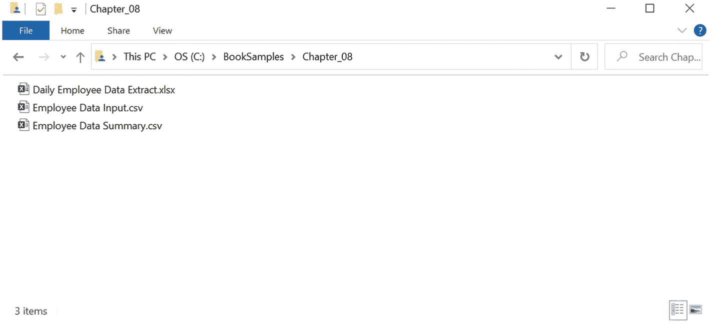
图 8-1 CSV 练习使用的文件夹结构

**Employee Data Summary.csv：** 汇总 CSV 文件捕获了员工 ID、名字和姓氏的汇总数据。

**Employee Data Input.csv：** 输入 CSV 文件捕获了需要添加到汇总文件中的新员工数据。

**Daily Employee Data Extract.xlsx：** 此 Excel 文件用作员工数据的源文件，这些数据将被复制或追加到 CSV 文件中。

## 活动参考

如图 8-2 所示，所有 CSV 自动化活动都可以在 CSV 类别下找到。以下各节将提供有关如何配置和使用每个活动的说明。

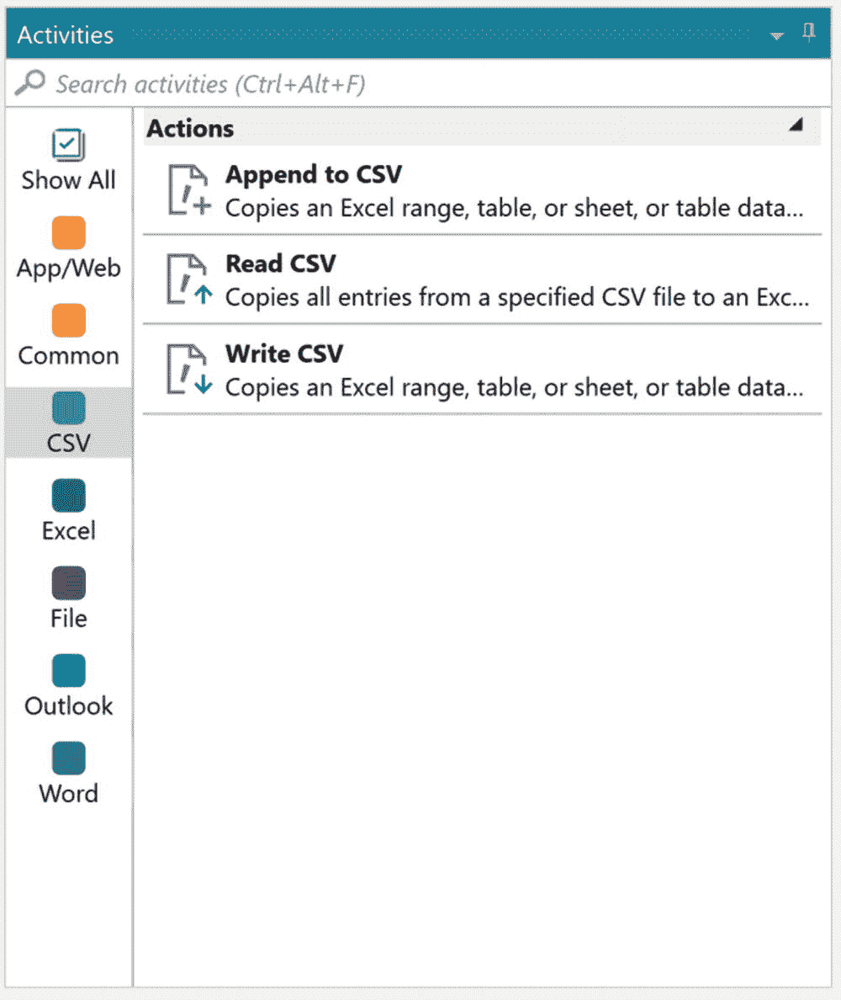
图 8-2 CSV 自动化活动

### 写入 CSV

**写入 CSV** 活动允许你从 Excel 文件中复制一个范围、工作表或表格，并将数据写入或覆盖到指定的 CSV 文件中。

#### 配置

本节提供有关如何配置**写入 CSV** 活动的说明，如图 8-3 所示。

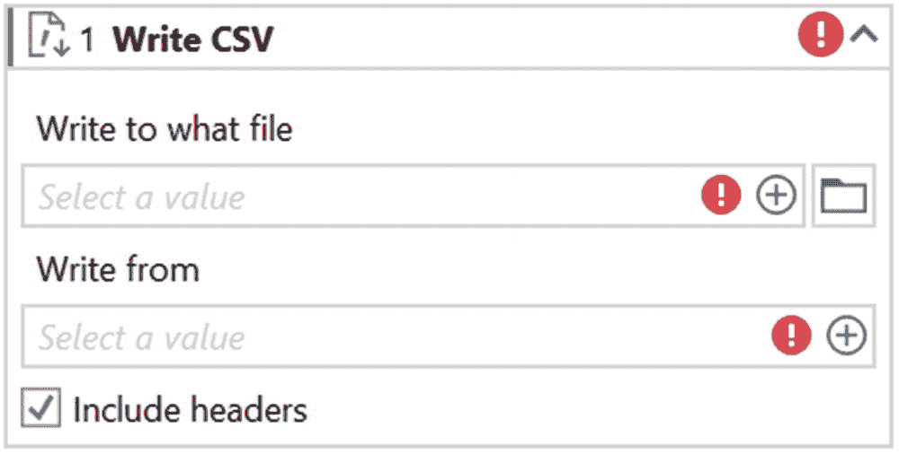
图 8-3 写入 CSV 的活动卡片

**写入到哪个文件**：这是活动卡片上的一个必填配置。此配置标识要读取和复制数据的 CSV 文件的完整文件路径。

**从何处写入**：这是活动卡片上的一个必填配置。此配置提供需要从 Excel 文件复制的 DataTable。

提示：如果 DataTable 是从父级 Excel 文件复制到 CSV，请将“写入 CSV”活动作为子活动添加到“使用 Excel 文件”活动卡片下。

**包含标题**：这是活动卡片上的一个可选配置。此配置指定源 Excel 文件中的第一行是否为标题行，以及是否应将其复制到 CSV 文件。默认情况下，此选项处于选中状态，即标题将被复制。

**分隔符**：这是`Properties`面板上的一个可选配置。此配置指定用于分隔 CSV 文件中值的分隔符。默认情况下，`Delimiter`值设置为`Comma`。可以在下拉列表中将其更改为`Tab`、`Semicolon`、`Caret`或`Pipe`，如图 8-4 所示。

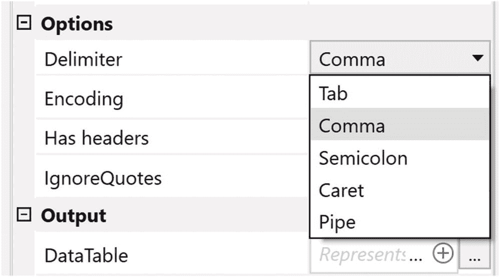
图 8-4 分隔符字段下拉值

**编码**：这是`Properties`面板上的一个可选配置。如果内容包含标准英文字符以外的任何字符，此配置允许你指定`Encoding`^(¹,²)。

练习

**目标**：使用`Write CSV`活动将`Daily Employee Data Extract.xlsx`文件中的`Employee ID`、`First Name`和`Last Name`写入到`Employee Data Input.csv`文件。图 8-5 显示了需要写入 CSV 的 Excel 文件中的源数据。

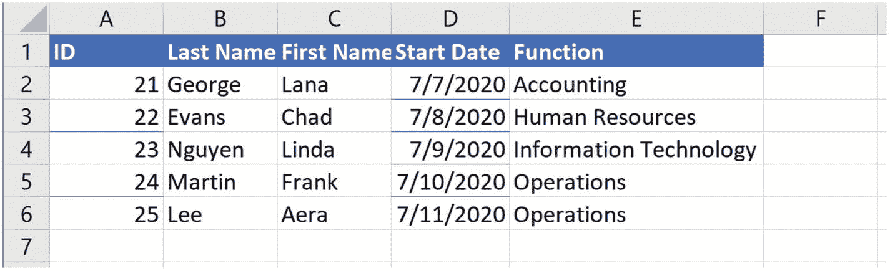
图 8-5 显示每日员工数据提取 Excel 文件

**源代码**：Chapter_8_CSVActivities

**设置**：以下是分步实施说明：

1.  在`StudioX`中，将`Use Excel File`活动添加到一个空白流程中（有关`Use Excel File`活动的说明，请参见第 7 章）。
2.  接下来，单击`Use Excel File`活动的`Excel file`字段中的`Folder`图标，并通过文件资源管理器导航以选择`C:\BookSamples\Chapter_08\Daily Employee Data Extract.xlsx`。
3.  接下来，在`Reference as`字段中，键入`EmployeeExcelData`。
4.  接下来，将一个`Write CSV`活动添加到`Use Excel File`活动的主体中。
5.  接下来，单击`Write CSV`活动上`Write to what file`字段中的`Folder`图标。通过文件资源管理器导航以选择`C:\BookSamples\Chapter_08\Employee Data Input.csv`。
6.  接下来，单击`Write from`字段中的`Plus`图标，将鼠标悬停在`EmployeeExcelData`上，然后选择`Indicate in Excel`。Excel 打开后，选择范围`A1:C6`。
7.  取消选中`Include headers`选项。

完成练习后，**写入 CSV** 活动的最终配置应类似于图 8-6。

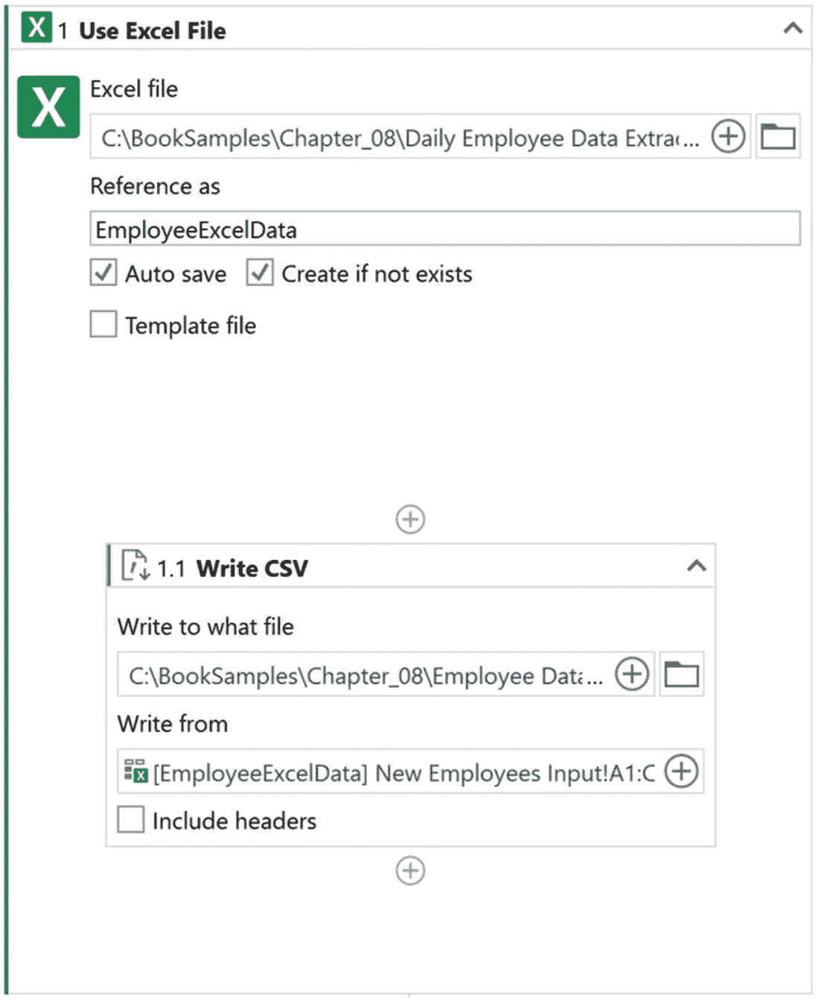
图 8-6 显示写入 CSV 活动的最终配置

图 8-7 显示了**写入 CSV** 活动的输出，该活动已将 Excel 数据范围写入到 Employee Data Input CSV 文件中。

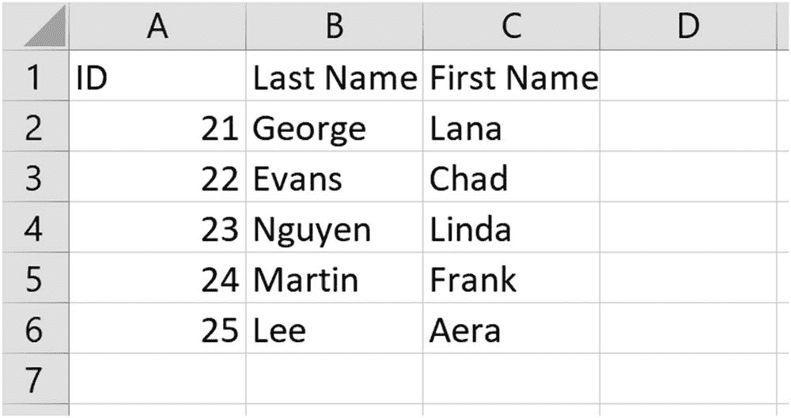
图 8-7 显示写入 CSV 活动的输出

### 追加到 CSV

**追加到 CSV** 活动允许你将来自 Excel 文件的范围、工作表或表格中的 DataTable 追加到指定的 CSV 文件中。

#### 配置

本节提供如何配置**追加到 CSV** 活动的说明，如图 8-8 所示。

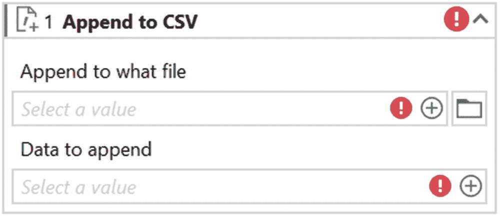
图 8-8 追加到 CSV 的活动卡片

**追加到哪个文件**：这是活动卡片上的一个必填配置。此配置用于指定要读取和复制的 CSV 文件的完整文件路径。

**要追加的数据**：这是活动卡片上的一个必填配置。此配置提供需要追加到 CSV 文件的 DataTable。

提示：如果需要追加的 DataTable 来自父级 Excel 文件，请将“追加到 CSV”活动作为子活动添加到“使用 Excel 文件”活动卡片下。

**分隔符**：这是`Properties`面板上的一个可选配置。此配置指定用于分隔 CSV 文件中值的分隔符。默认情况下，`Delimiter`值设置为`Comma`。可以在下拉菜单中将其更改为`Tab`、`Semicolon`、`Caret`或`Pipe`。

**编码**：这是`Properties`面板上的一个可选配置。如果内容包含标准英文字符以外的任何字符，此配置允许您指定`Encoding`^(³,⁴)。

练习

## 目标
使用 `Append To CSV` 活动将 `Daily Employee Data Extract.xlsx` 文件中的 `Employee ID`、`First Name` 和 `Last Name` 追加到 `Employee Data Summary.csv` 文件中。图 8-9 显示了此练习之前的 Employee Data Summary CSV 文件。

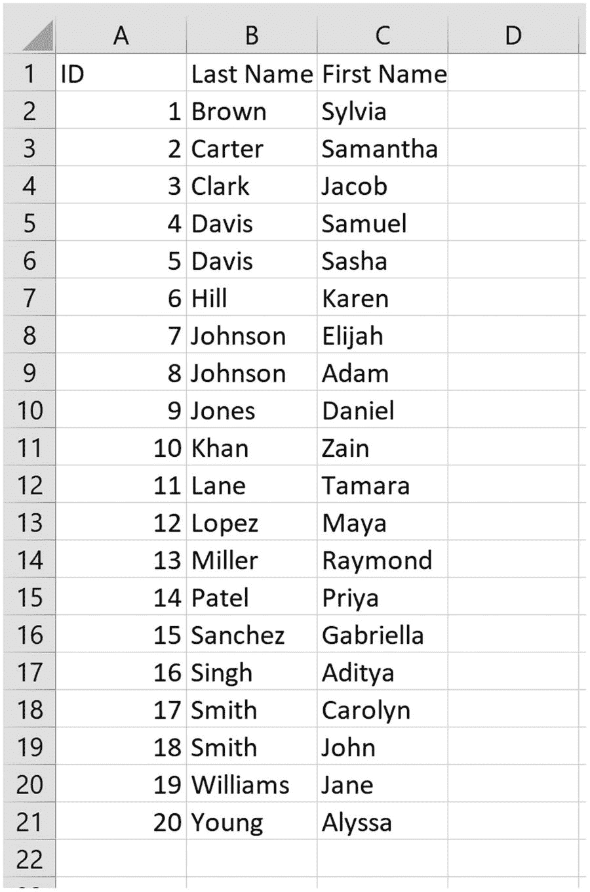

**源代码**：`Chapter_8_CSVActivities`

**设置**：以下是分步实施说明：

1.  在 `StudioX` 中，将 `Append To CSV` 活动添加到 `Designer` 面板，嵌套在 `Use Excel File` 下，位于上一个练习中引用的 `Write CSV` 活动之后。
2.  接下来，单击 `Append to what file` 字段中的 `Folder` 图标。通过文件资源管理器导航，选择 `C:\BookSamples\Chapter_08\Employee Data Summary.csv`。
3.  接下来，单击 `Data to append` 字段中的 `Plus` 图标，将鼠标悬停在 `EmployeeExcelData` 上，然后选择 `Indicate in Excel`。Excel 打开后，选择范围 `A2:C6`。

完成练习后，`Append To CSV` 活动的最终配置应类似于图 8-10。

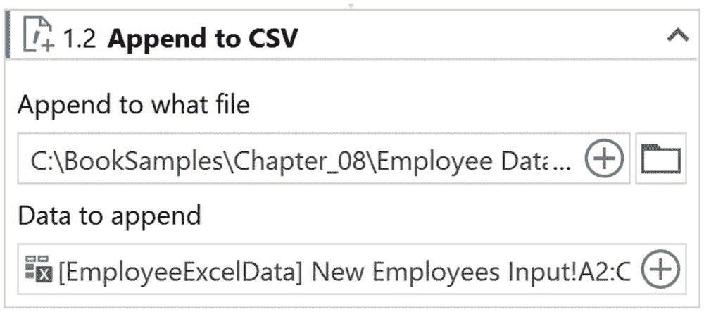

图 8-11 显示了 `Append To CSV` 活动的输出，该活动已将输入文件中的数据追加到汇总文件中。

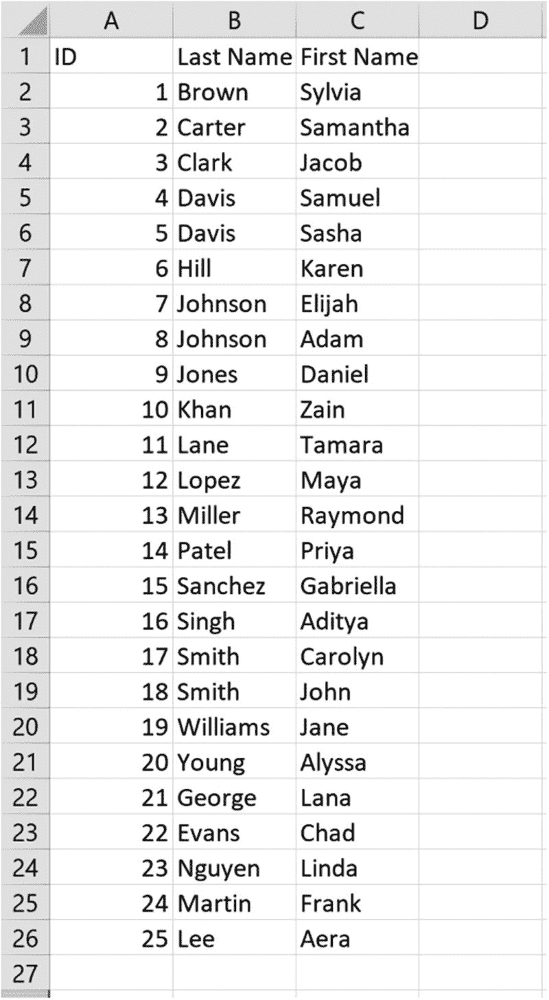

### 读取 CSV
`Read CSV` 活动允许您读取和复制 CSV 文件中的数据，并将其写入 Excel 范围、工作表或表格，或将值保存到剪贴板以供以后使用。

#### 配置
本节提供如何配置 `Read CSV` 活动的说明，如图 8-12 所示。

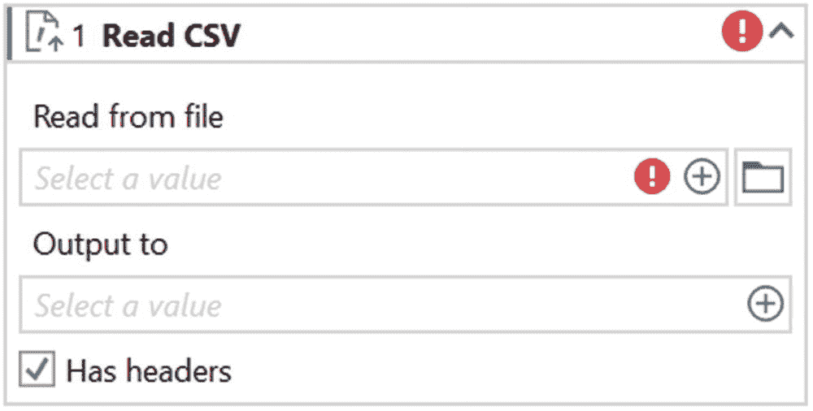

**`从文件读取`**：这是活动卡片上的一个必填配置。此配置指定要读取的 CSV 文件的完整文件路径。

**`输出到`**：这是活动卡片上的一个必填配置。此配置提供应复制 CSV 数据的输出数据表位置。

> 提示
> 如果 CSV 数据应复制到父级 Excel 文件，请将“读取 CSV”活动作为子活动添加到“使用 Excel 文件”活动卡片下。

**`有标题`**：这是活动卡片上的一个可选配置。此配置默认选中，表示 CSV 文件中的第一行是标题行。如果取消选中，则不会读取标题行。

**`分隔符`**：这是 `Properties` 面板上的一个可选配置。此配置指定用于分隔 CSV 文件中值的分隔符。默认情况下，`Delimiter` 值设置为 `Comma`。可以在下拉菜单中将其更改为 `Tab`、`Semicolon`、`Caret` 或 `Pipe`，如图 8-13 所示。

**`编码`**：这是 `Properties` 面板上的一个可选配置。如果内容包含标准英文字符以外的任何字符，此配置允许您指定 `Encoding`^(⁵,⁶)。

**`IgnoreQuotes`**：这是 `Properties` 面板上的一个可选配置。此配置指定在读取 CSV 文件时是否应忽略引号。默认情况下，此字段为空，如果选中，则表示活动也会复制引号。

#### 练习
**目标**：使用 `Read CSV` 活动读取 `Employee Data Summary.csv` 文件，并将内容打印到 `Output` 面板中。

**源代码**：`Chapter_8_CSVActivities`

**设置**：以下是分步实施说明：

1.  在 `StudioX` 中，将 `Read CSV` 活动添加到 `Designer` 面板，位于 `Use Excel File` 活动之后。
2.  接下来，单击 `Read from file` 字段中的 `Folder` 图标。通过文件资源管理器导航到 `C:\BookSamples\Chapter_08\Employee Data Summary.csv`。
3.  接下来，单击 `Output to` 字段中的 `Plus` 图标，然后选择 `Clipboard` 选项。
4.  保持选中 `Has headers` 选项。
5.  然后，在 `Read CSV` 活动卡片下添加一个 `Write Line` 活动。
6.  接下来，单击 `Text` 字段中的 `Plus` 图标，然后选择 `Clipboard` 选项。

完成练习后，`Read CSV` 活动的最终配置应类似于图 8-14。

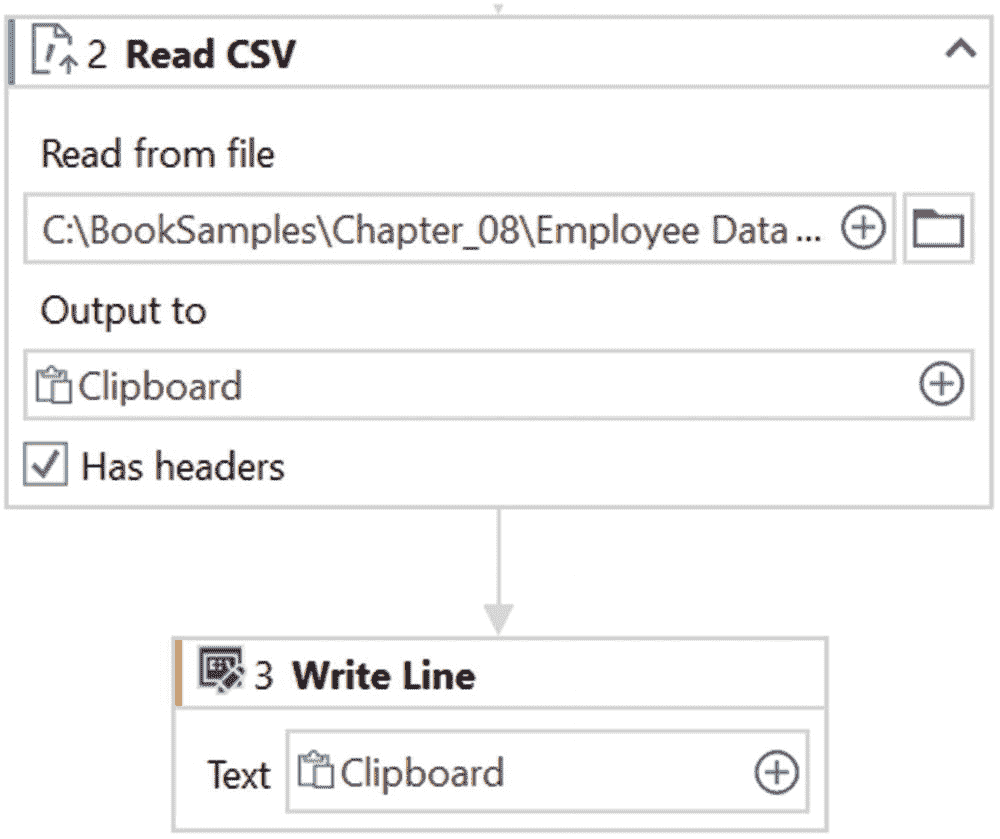

图 8-15 显示了 `Read CSV` 活动的输出，该活动已将 25 行员工数据添加到 `Output` 面板中。

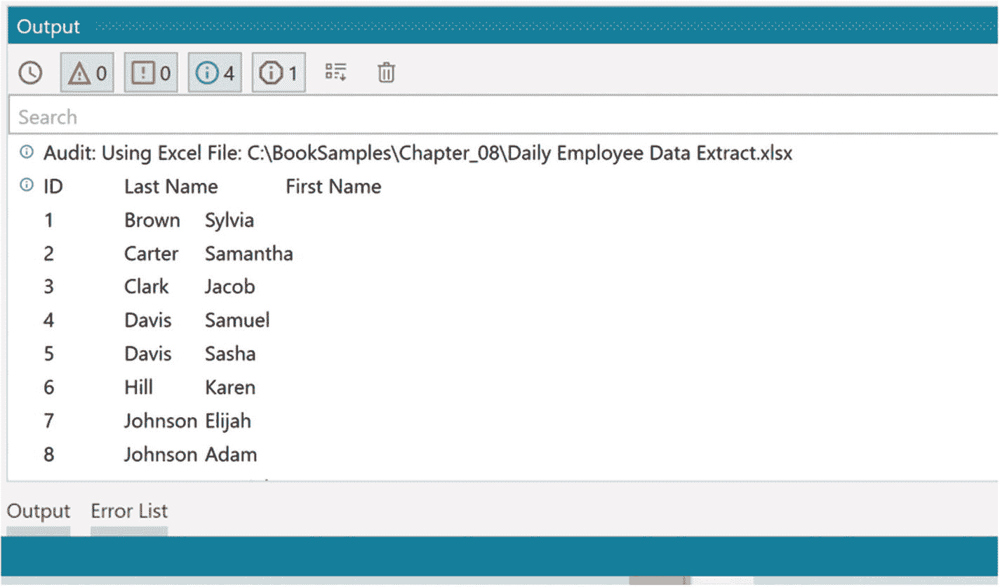

脚注 1   2   3   4   5   6