# 9. 文件自动化

管理数据（无论是物理数据还是数字数据）是我们日常工作中的关键部分。随着当今工作环境中可用数据量的不断增长，一个有效的文件和文件夹管理系统变得比以往任何时候都更加重要。我们使用文件夹来帮助组织信息，以便日后可以轻松搜索和检索。文件夹也可以用作待办事项列表，即根据文件的状态将其存储在文件夹中。在日常工作中，文件的使用也相当普遍，例如，从系统中以 Excel/CSV 格式导出数据、在系统之间移动数据，以及使用 Word 或 Excel 文件模板生成订单和发票。因此，UiPath StudioX 中用于组织、管理和编辑文件和文件夹的文件自动化功能成为一项有用且必不可少的工具。

## 学习目标

在本章结束时，您将学习如何：

*   获取文件夹的属性
*   检查文件夹是否已存在
*   创建、删除、复制和移动文件夹
*   获取文件夹中的所有文件
*   获取文件的属性
*   检查文件是否已存在
*   创建、删除、复制和移动文件
*   提取压缩文件的内容
*   创建压缩文件
*   读取文本文件的内容
*   向文本文件写入和追加内容

## 示例概览

在本章中，我们将使用一个简化版的招聘流程来展示所有文件自动化活动。本节将使您熟悉本章所有练习的先决条件。

从本书网站下载源代码，并确保将整个 `BookSamples` 文件夹移动到您的 C:\ 驱动器。本章中的所有练习都假定文件夹路径为 `C:\BookSamples\Chapter_09`。图 9-1 显示了此示例所需的文件夹结构。此文件夹结构随源代码一起提供。

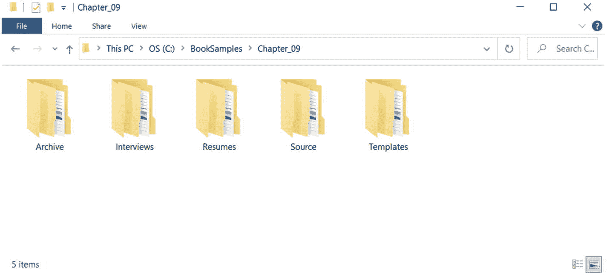
图 9-1 示例招聘管理流程的文件夹结构

> 注意：要多次运行练习，请确保所需的文件可用；否则，UiPath StudioX 将抛出错误。

*   `Archive`：此文件夹用于归档旧文件夹和文件。已存在一个用于过去日期的示例子文件夹，该子文件夹将在某个练习中使用。
*   `Interviews`：此文件夹用于跟踪面试情况。此文件夹包含两个子文件夹：`Pending` 和 `Scheduled`。每天结束时，`MoveForward` 文件夹中的简历会被移动到 `Interviews\Pending` 文件夹。面试安排好后，简历会被移动到 `Interviews\Scheduled` 文件夹。
*   `Resumes`：此文件夹用于跟踪每天收到的简历。如图 9-2 所示，每天都会创建一个新文件夹。已存在三个用于过去日期的示例子文件夹，这些子文件夹将在几个练习中使用。

图 9-2 `Resumes` 文件夹的内容

每个日文件夹包含三个子文件夹：`New`、`MoveForward` 和 `Reject`。每当创建新的日文件夹时，这些子文件夹都会从 `Templates` 文件夹复制过来。所有简历都添加到 `New` 子文件夹中，审核后，简历会被移动到 `MoveForward` 或 `Reject` 子文件夹。

*   `Source`：如图 9-3 所示，此文件夹用于接收来自外部招聘机构的压缩文件。这些压缩文件包含候选人的简历。默认情况下，此文件夹包含三个示例提取文件，这些文件将在几个练习中使用。

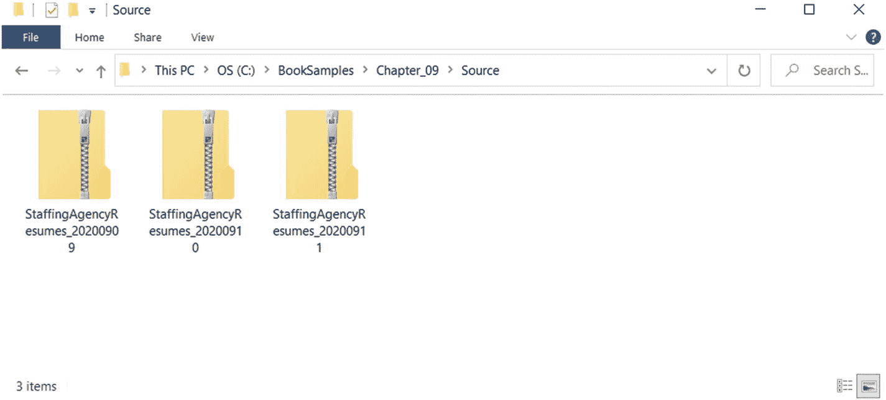
图 9-3 `Source` 文件夹的内容

*   `Templates`：这是一个静态文件夹。如图 9-4 所示，它包含文件夹和文件的模板，这些模板会在流程中被复制到其他文件夹。这有助于避免重复创建相同的文件夹结构。

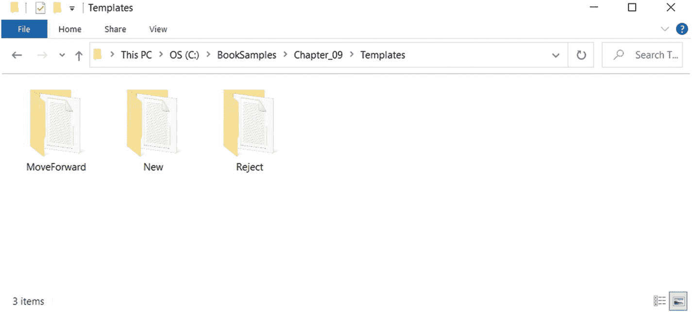
图 9-4 `Templates` 文件夹的内容

## 活动参考

如图 9-5 所示，所有文件夹自动化活动都可以在“文件”类别下找到。以下各节将提供有关如何配置和使用每个活动的说明。

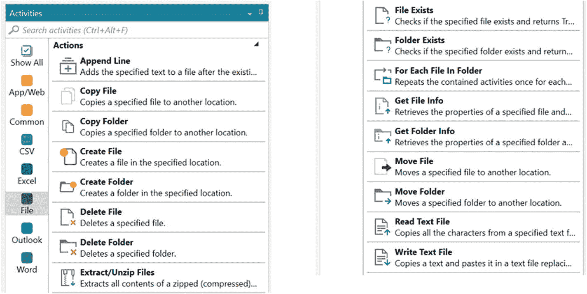
图 9-5 文件自动化活动

### 获取文件夹信息

`获取文件夹信息`活动允许您检索并保存指定文件夹的属性。

#### 配置

本节提供如何配置`获取文件夹信息`活动的说明，如图 9-6 所示。

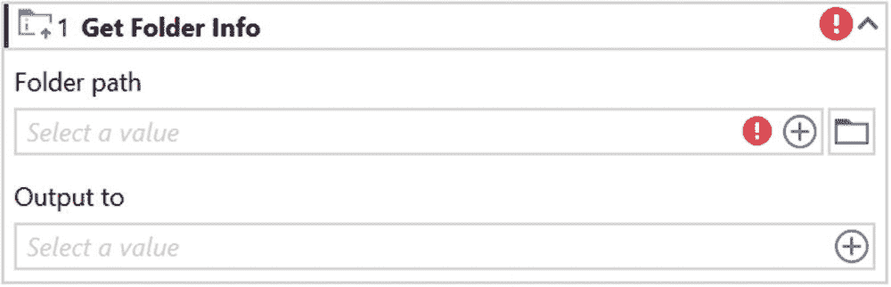
图 9-6 获取文件夹信息活动卡片

*   `文件夹路径`：这是活动卡片上的一个必填配置。此配置允许您指定要检索信息的文件夹的完整路径。
*   `输出到`：这是活动卡片上的一个可选配置。此配置允许您保存文件夹信息以供后续使用，如图 9-7 所示。

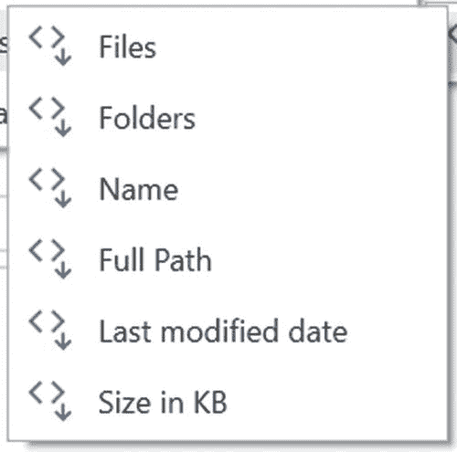
图 9-7 获取文件夹信息活动返回的属性

表 9-1 提供了此活动返回的所有属性的简要说明。

表 9-1 获取文件夹信息活动返回的属性

| 属性 | 说明 |
| --- | --- |
| `Files` | 所有子文件夹中的文件数量 |
| `Folders` | 子文件夹数量 |
| `Name` | 指定文件夹的名称 |
| `Full path` | 指定文件夹的完整路径 |
| `Last modified date` | 指定文件夹的最后修改日期和时间 |
| `Size in KB` | 指定文件夹的大小（以千字节 (KB) 为单位） |

#### 练习

**目标**：使用 `Get Folder Info` 活动获取 `C:\BookSamples\Chapter_09\Resumes\20200910` 文件夹的属性，并打印最后修改日期。

**源代码**：`Chapter_9_FolderActivitiesExercise`

**设置**：以下是分步实施说明：

1.  在 `StudioX` 中，将 `Get Folder Info` 活动添加到一个空白流程中。
2.  在 `Folder path` 字段中，单击 `Folder` 图标并选择 `C:\BookSamples\Chapter_09\Resumes\20200910` 文件夹。
3.  单击 `Output to` 字段中的 `Plus` 图标，将值命名为 `FolderInfo`，然后单击 `Ok`。
4.  接下来，在 `Designer` 面板中的 `Get Folder Info` 活动之后添加一个 `Write Line` 活动。
5.  在 `Text` 字段中，单击 `Plus` 图标，然后选择 `Text` 选项。
6.  在 `Text Builder` 中，输入 `Folder`。
7.  在 `Text Builder` 仍处于打开状态时，单击 `Plus` 图标，选择 `Use Saved Value` 选项，然后将鼠标悬停在 `FolderInfo` 上以选择 `Name`。
8.  接下来，在 `Text Builder` 中，输入 `was last modified on:`。
9.  接下来，在 `Text Builder` 中，单击 `Plus` 图标，选择 `Use Saved Value` 选项，然后将鼠标悬停在 `FolderInfo` 上以选择 `LastModifiedDate`。完整的文本应显示为 `Folder FolderInfo Name was last modified on: FolderInfo LastModifiedDate`。
10. 单击 `Save`。

完成练习后，`获取文件夹信息`活动的最终配置应类似于图 9-8。图 9-9 显示了此练习的输出。

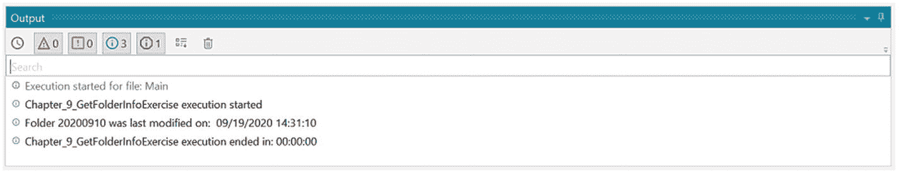
图 9-9 获取文件夹信息活动的输出

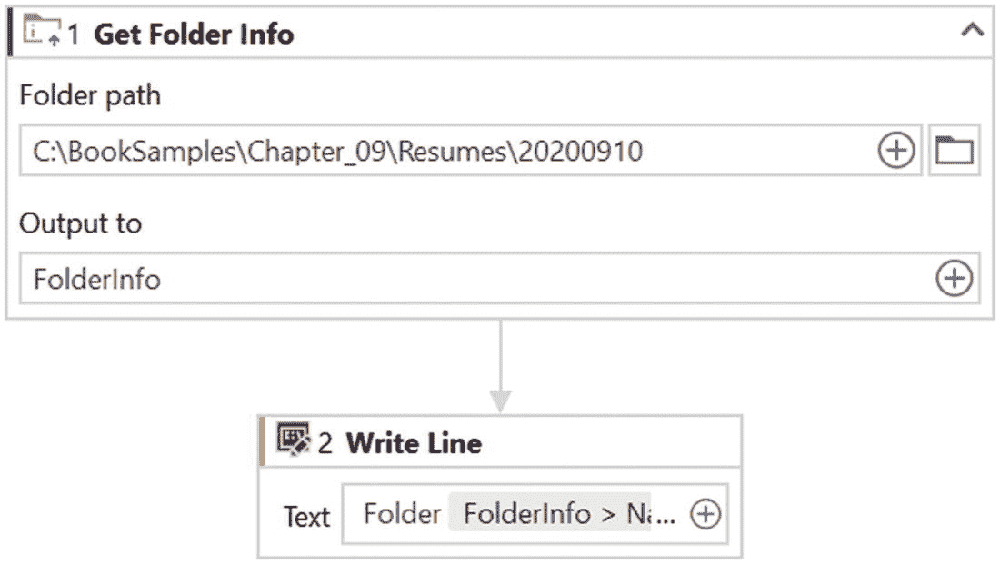
图 9-8 获取文件夹信息活动的最终配置

### 文件夹存在

`文件夹存在`活动允许您检查目标位置是否已存在某个文件夹。

#### 配置

本节提供如何配置`文件夹存在`活动的说明，如图 9-10 所示。

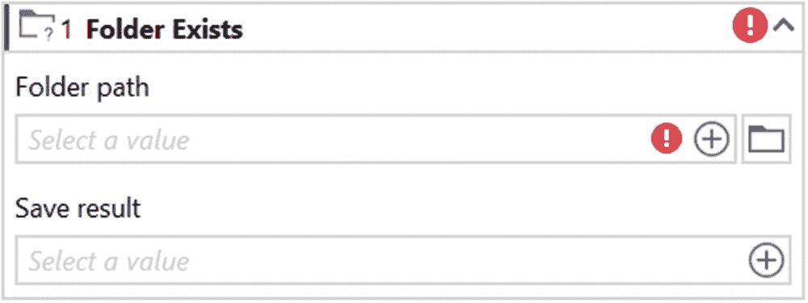

`文件夹路径`：这是活动卡片上的一个必填配置。此配置允许您指定要检查其是否存在的文件夹的完整路径。

`保存结果`：这是活动卡片上的一个可选配置。此配置允许您指定保存结果的位置以供后续使用。如果文件夹存在，此活动返回`True`；如果文件夹不存在，则返回`False`。

#### 练习

**目标**：使用`Folder Exists`活动检查当前日期文件夹 (`YYYYMMDD`) 是否已存在于`C:\BookSamples\Chapter_09\Resumes`位置，并打印结果。

**源代码**：`Chapter_9_FolderActivitiesExercise`

**设置**：以下是分步实施说明：

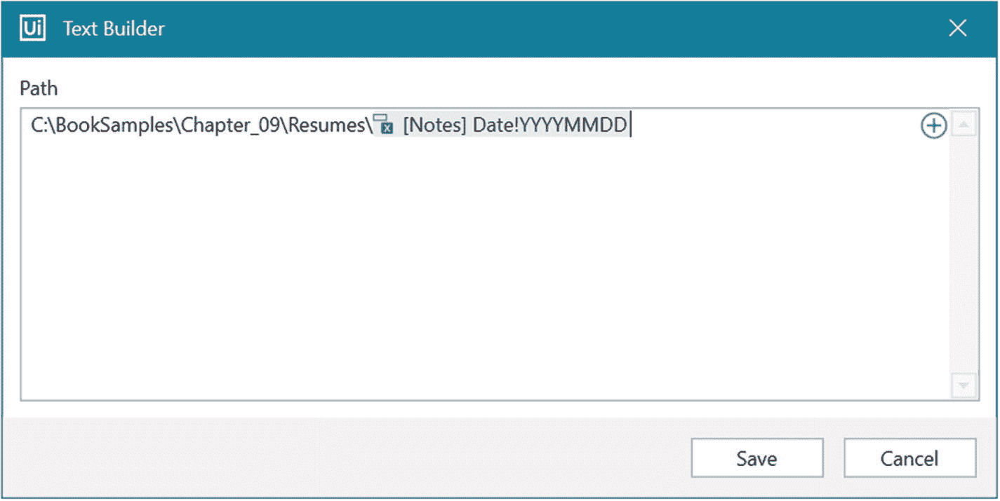

1.  在`StudioX`中，将`Folder Exists`活动添加到一个空白流程中。
2.  我们将动态生成要检查其是否存在的文件夹的路径。在`Folder path`字段中，单击`Plus`图标，选择`Text`选项，然后输入`C:\BookSamples\Chapter_09\Resumes\`。
3.  然后在`Text Builder`中单击`Plus`图标，将鼠标悬停在`Project Notebook (Notes)`上，选择`[Notes] Date!YYYYMMDD`。图 9-11（下一页）显示了文本应如何显示。单击`Save`。
4.  单击`Save result`字段中的`Plus`图标，将值命名为`FolderExists`，然后单击`Ok`。
5.  将`Write Line`活动添加到`Designer`面板中的`Folder Exists`活动之后。
6.  在`Text`字段中，单击`Plus`图标并选择`Text`选项。在`Text Builder`中，输入`Folder exists:`。
7.  在`Text Builder`仍处于打开状态时，单击`Plus`图标，将鼠标悬停在`Use Saved Value`上以选择`FolderExists`。单击`Save`。

完成练习后，`文件夹存在`活动的最终配置应类似于图 9-12。图 9-13 显示了此练习的输出。

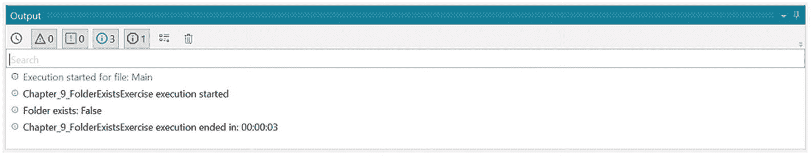
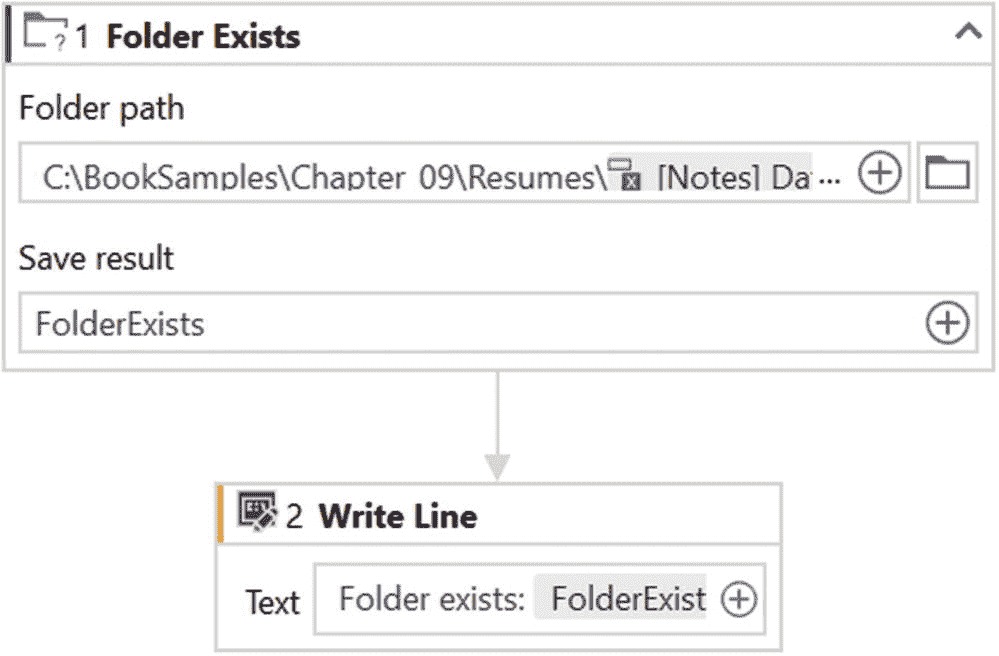

### 创建文件夹

`创建文件夹`活动允许您在指定位置创建一个新文件夹。

#### 配置

本节提供如何配置`创建文件夹`活动的说明，如图 9-14 所示。

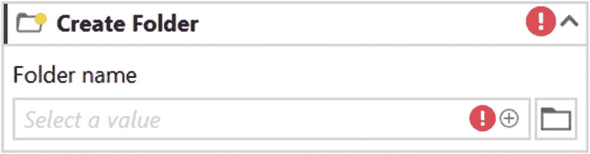

`文件夹名称`：这是活动卡片上的一项必需配置。此配置允许您指定要创建的文件夹的完整路径。

#### 练习

**目标**：使用`Create Folder`活动在`C:\BookSamples\Chapter_09\Resumes`位置为当前日期 (`YYYYMMDD`) 创建一个新文件夹。

**源代码**：`Chapter_9_FolderActivitiesExercise`

**设置**：以下是分步实施说明：

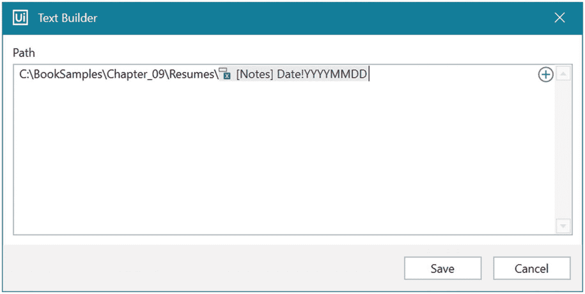

1.  在`StudioX`中，将`Create Folder`活动添加到一个空白流程中。
2.  我们将动态生成文件夹路径。在`文件夹路径`字段中，点击`加号`图标，选择`文本`选项，然后输入`C:\BookSamples\Chapter_09\Resumes\`。
3.  接下来，点击`文本生成器`中的`加号`图标，将鼠标悬停在`项目笔记本 (Notes)`上，选择`[Notes] Date!YYYYMMDD`。图 9-15 显示了在`文本生成器`中输入的最终文本。点击`保存`。

完成练习后，`创建文件夹`活动的最终配置应类似于图 9-16。图 9-17 显示了此练习前后目标位置的文件夹结构。

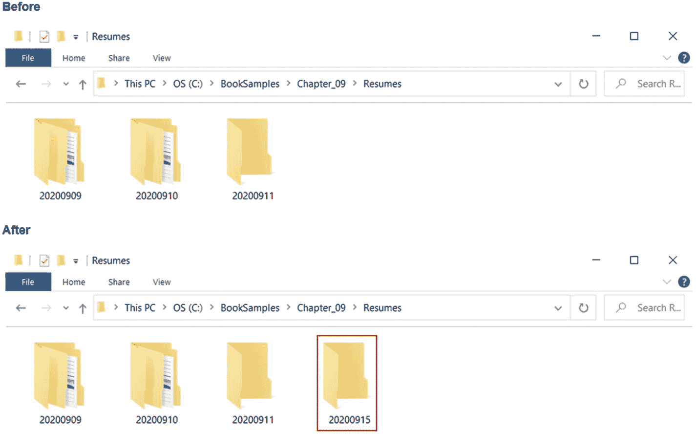
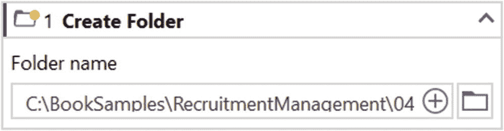

### 删除文件夹

`删除文件夹`活动允许您删除指定的文件夹。

#### 配置

本节提供如何配置`删除文件夹`活动的说明，如图 9-18 所示。

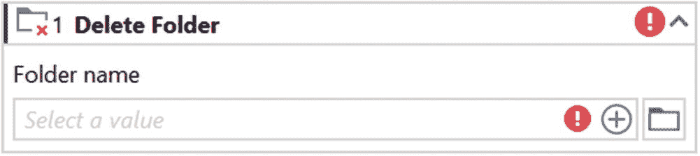

`文件夹名称`：这是活动卡片上的一项必需配置。此配置允许您指定要删除的文件夹的完整路径。

`递归`：这是`属性`面板上的一项可选配置。此配置允许您指定是删除文件夹及其所有内容和子文件夹，还是仅在文件夹为空时才删除。默认情况下，该值为选中状态，即文件夹及其所有内容都将被删除。

**提示**：如果您收到如图 9-19 所示的错误，则需要将`递归`标志设置为`True`。

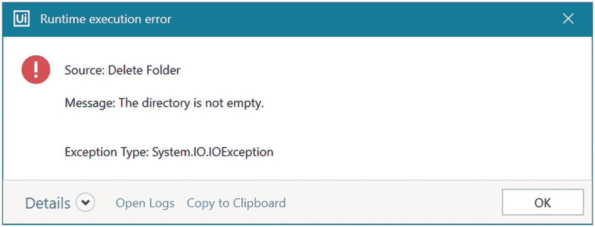

#### 练习

**目标**：使用`Delete Folder`活动删除`C:\BookSamples\Chapter_09\Archive\20200908`文件夹及其所有内容。

**源代码**：`Chapter_9_FolderActivitiesExercise`

**设置**：以下是分步实施说明：

1.  在`StudioX`中，将`Delete Folder`活动添加到一个空白流程中。
2.  点击`文件夹`图标，选择`C:\BookSamples\Chapter_09\Archive\20200908`文件夹。
3.  将`递归`属性保留为默认值`True`。这将确保所有子文件夹和文件也被删除。

完成练习后，`删除文件夹`活动的最终配置应类似于图 9-20。图 9-21 显示了此练习前后目标位置的文件夹结构。

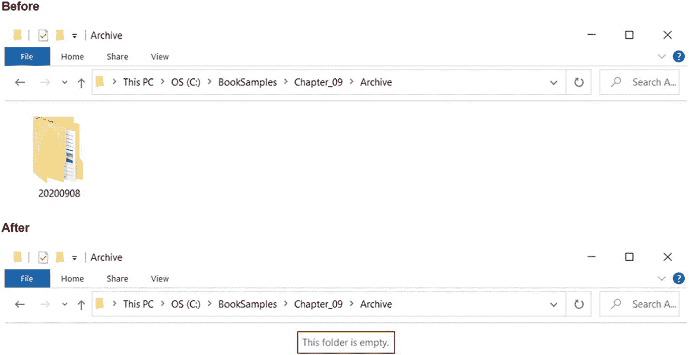
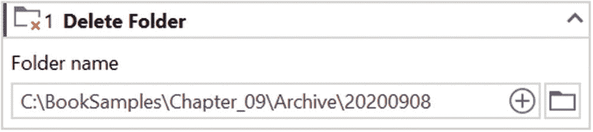

### 复制文件夹

`复制文件夹`活动允许您将指定的文件夹复制到另一个位置。

**注意**：此活动会保留原始文件夹。

#### 配置

本节提供如何配置`复制文件夹`活动的说明，如图 9-22 所示。

# 复制文件夹

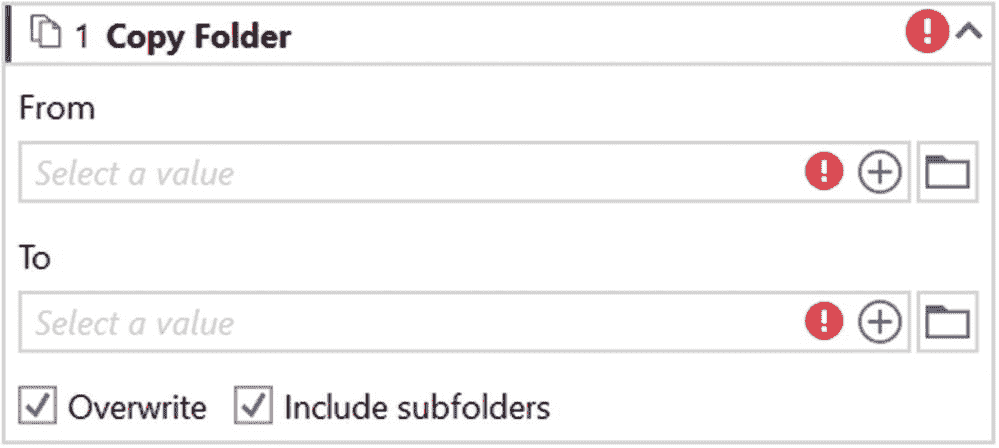
图 9-22 复制文件夹的活动卡片

## 来源
这是活动卡片上的一项必需配置。此配置允许您指定要复制的文件夹的完整路径。

## 目标
这是活动卡片上的一项必需配置。此配置允许您指定`来源`文件夹需要复制到的目标位置。

## 覆盖
这是活动卡片上的一项可选配置。此配置允许您指定，如果目标位置存在同名文件夹，自动化是否覆盖其内容。

## 包含子文件夹
这是活动卡片上的一项可选配置。此配置允许您指定是否也需要将源文件夹的所有子文件夹复制到目标位置。

## 练习
**目标**：使用`Copy Folder`活动将`C:\BookSamples\Chapter_09\Templates`文件夹的所有内容复制到`C:\BookSamples\Chapter_09\Resumes\20200911`。在此练习之前，目标文件夹为空。

**源代码**：`Chapter_9_FolderActivitiesExercise`

**设置**：以下是分步实施说明：
1.  在`StudioX`中，将`Copy Folder`活动添加到一个空白流程中。
2.  在`来源`字段中，点击`文件夹`图标，选择`C:\BookSamples\Chapter_09\Templates\`文件夹。
3.  在`目标`字段中，点击`文件夹`图标，选择`C:\BookSamples\Chapter_09\Resumes\20200911`文件夹。
4.  此练习中的`来源`文件夹没有任何子文件夹，因此您可以保持`覆盖`和`包含子文件夹`的选中状态不变。

完成练习后，`复制文件夹`活动的最终配置应类似于图 9-23。图 9-24 显示了此练习前后目标位置的文件夹结构。

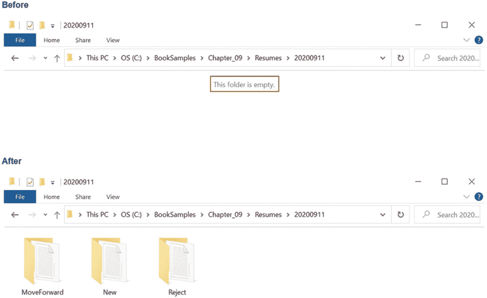
图 9-24 复制文件夹活动练习的结果

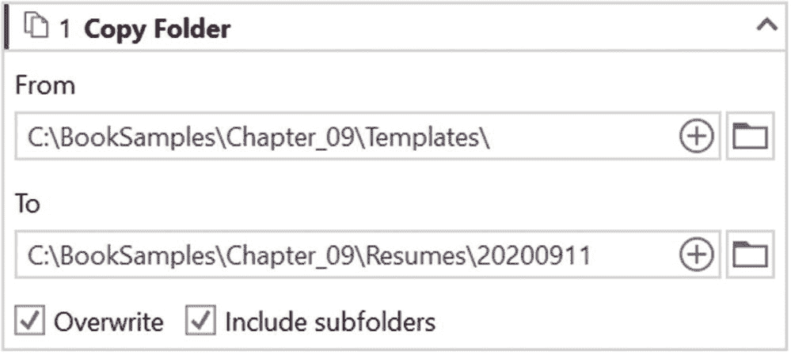
图 9-23 复制文件夹活动练习的最终配置

# 移动文件夹

`移动文件夹`活动允许您将指定的文件夹复制到另一个位置。

> **注意**：与保留原始文件夹不变的`Copy Folder`活动不同，此活动会移动原始文件夹。

## 配置
本节提供如何配置`移动文件夹`活动的说明，如图 9-25 所示。

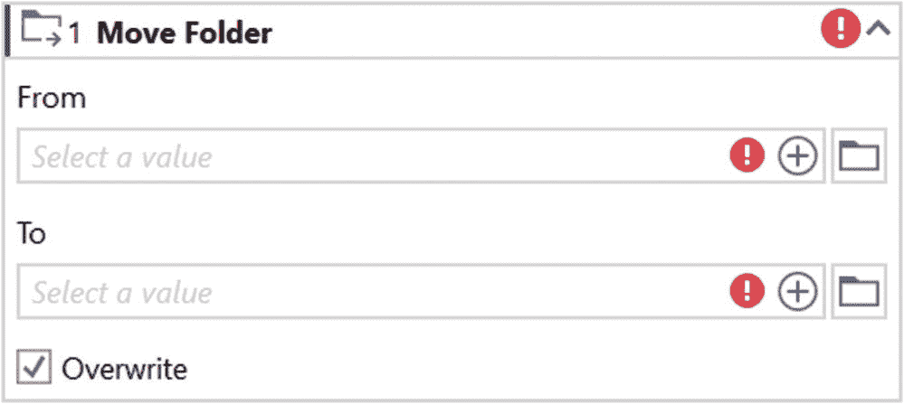
图 9-25 移动文件夹的活动卡片

### 来源
这是活动卡片上的一个必填配置。此配置允许您指定要移动的文件夹的完整路径。

### 目标
这是活动卡片上的一个必填配置。此配置允许您指定`来源`文件夹需要移动到的目标位置。

### 覆盖
这是活动卡片上的一个可选配置。此配置允许您指定：如果目标位置存在同名文件夹，自动化是否应覆盖其内容。

## 练习
**目标**：使用`移动文件夹`活动，将`C:\BookSamples\Chapter_09\Resumes\20200909`文件夹的所有内容移动到`C:\BookSamples\Chapter_09\Archive`。

**源代码**：`Chapter_9_FolderActivitiesExercise`

**设置**：以下是分步实施说明：
1.  在`StudioX`中，将`移动文件夹`活动添加到一个空白流程中。
2.  在`来源`字段中，单击`文件夹`图标，然后选择`C:\BookSamples\Chapter_09\Resumes\20200909`文件夹。
3.  在`目标`字段中，单击`文件夹`图标，然后选择`C:\BookSamples\Chapter_09\Archive`文件夹。
4.  保持选中`覆盖`复选框。

完成练习后，`移动文件夹`活动的最终配置应类似于图 9-26。图 9-27 显示了此练习前后目标位置的文件夹结构。

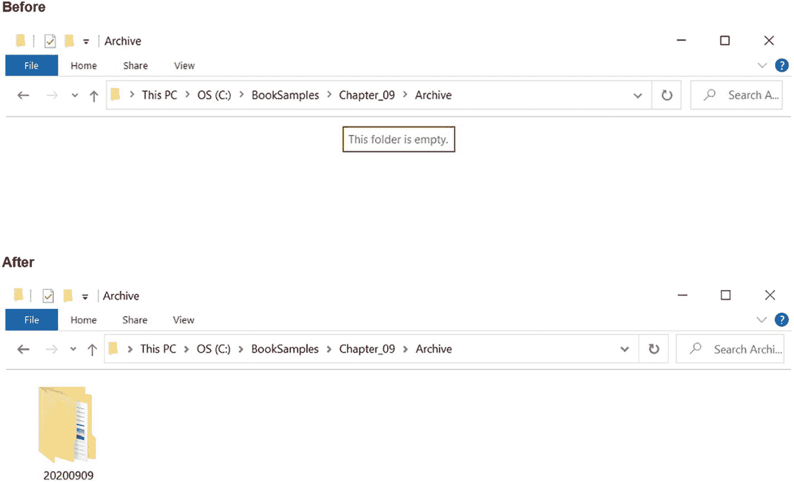
图 9-27 移动文件夹活动练习的结果

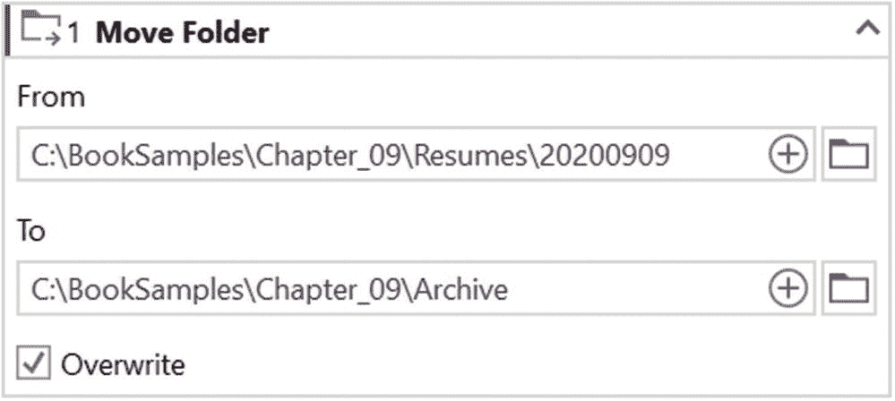
图 9-26 移动文件夹活动练习的最终配置

# 对于文件夹中的每个文件

`对于文件夹中的每个文件`活动允许您对文件夹及其子文件夹中的所有文件执行操作。您可以在`对于文件夹中的每个文件`活动的主体中添加其他活动，所有这些活动都将针对指定文件夹中的每个文件执行。

## 配置
本节提供如何配置`对于文件夹中的每个文件`活动的说明，如图 9-28 所示。

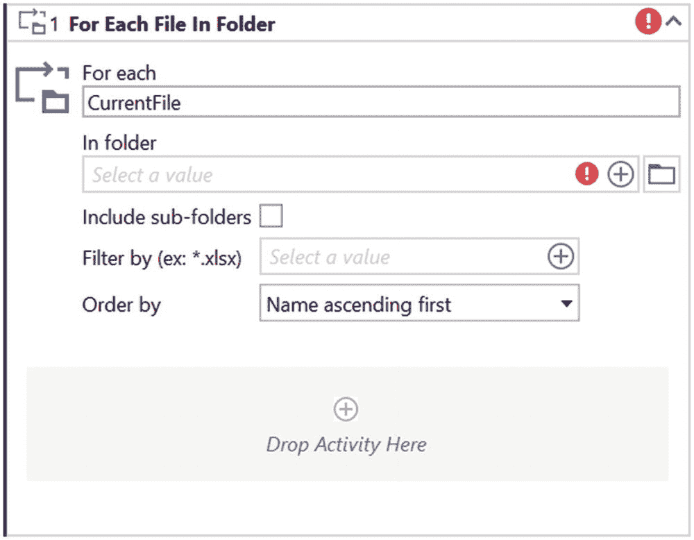
图 9-28 对于文件夹中的每个文件的活动卡片

### 对于每个
这是活动卡片上的一个必填配置。此配置允许您指定如何在嵌套活动中引用文件。默认情况下，该值为`CurrentFile`。图 9-29 显示了`对于文件夹中的每个文件`活动主体中的其他活动如何使用此值。

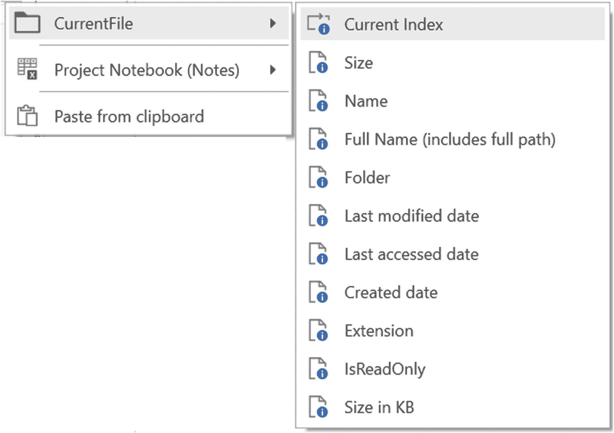
图 9-29 对于文件夹中的每个文件活动主体中的活动可用的文件属性

### 在文件夹中
这是活动卡片上的一个必填配置。此配置允许您指定要迭代的文件夹的完整路径。

### 包含子文件夹
这是活动卡片上的一个可选配置。此配置允许您指定是否也要对子文件夹中的文件执行嵌套活动。默认情况下，此选项未选中。

### 按条件筛选
这是活动卡片上的一个可选配置。此配置允许您从指定文件夹中选取特定类型的文件。例如，您的文件夹可能包含 .txt、.docx 和 .xlsx 文件，但您只想处理 .docx 文件而忽略其余文件；您可以使用此属性指定 `*.docx`。

### 排序依据
这是活动卡片上的一个可选配置。此配置允许您指定子活动的执行顺序。图 9-30 提供了用于对文件列表进行排序的所有可用选项列表。

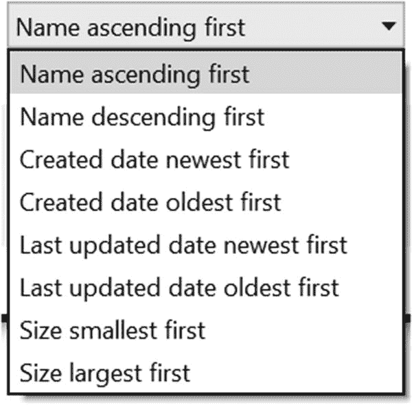
图 9-30 排序依据配置选项

## 练习
**目标**：使用`对于文件夹中的每个文件`活动，打印`C:\BookSamples\Chapter_09\Resumes`文件夹（包括子文件夹）中所有 Word 文档 (`*.docx`) 的名称。

**源代码**：`Chapter_9_FolderActivitiesExercise`

**设置**：以下是分步实施说明：
1.  在`StudioX`中，将`对于文件夹中的每个文件`活动添加到一个空白流程中。
2.  在`在文件夹中`字段中，单击`文件夹`图标，然后选择`C:\BookSamples\Chapter_09\Resumes`文件夹。
3.  选中`包含子文件夹`复选框。
4.  在`按条件筛选`字段中，单击`加号`图标，选择`文本`，然后输入 `*.docx`。这将确保仅返回 Word 文档文件。
5.  在`对于文件夹中的每个文件`活动的主体中添加`写入行`活动。在`文本`字段中，单击`加号`图标，将鼠标悬停在`当前文件`上，然后选择`完整名称（包含完整路径）`。

完成练习后，`对于文件夹中的每个文件`活动的最终配置应类似于图 9-31。图 9-32 显示了此练习的输出。

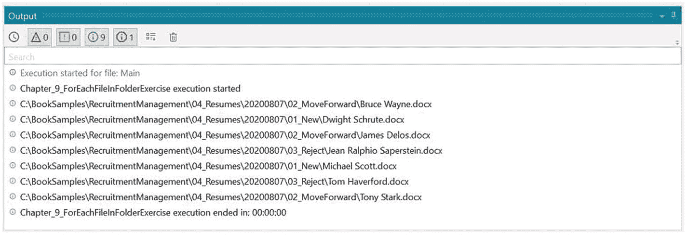
图 9-32 对于文件夹中的每个文件活动的输出

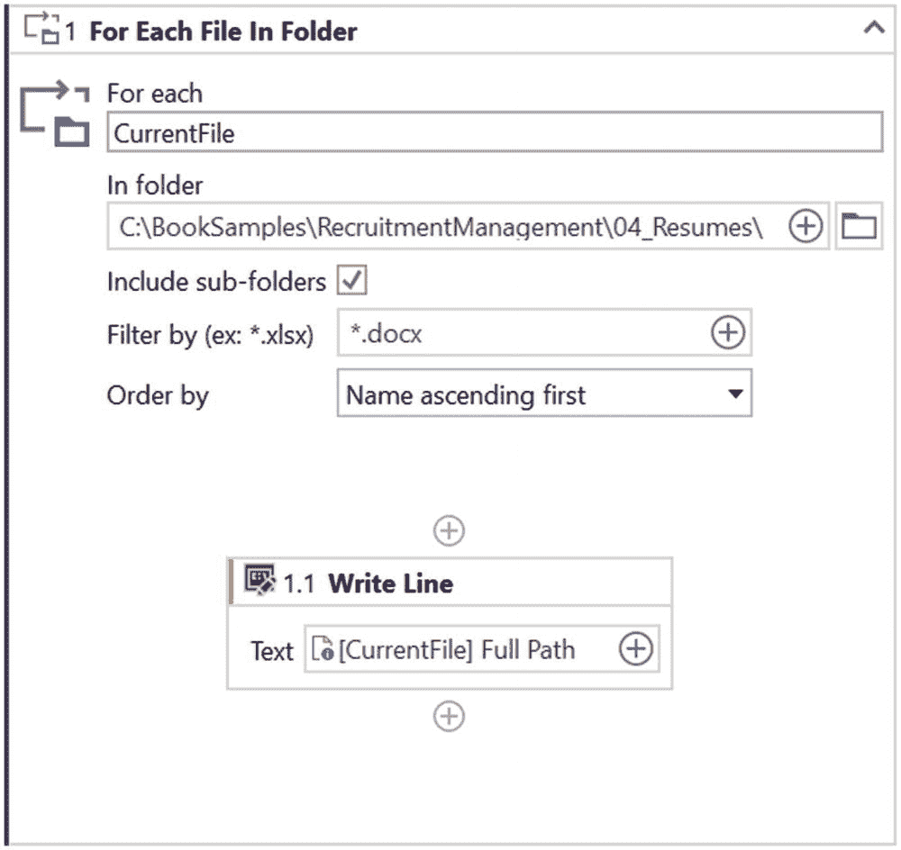
图 9-31

# 对于文件夹中的每个文件活动练习的最终配置

## 压缩/Zip 文件

`压缩/Zip 文件`活动允许您使用多个文件或多个文件夹创建一个压缩文件。

### 配置

本节提供如何配置`压缩/Zip 文件`活动的说明，如图 9-33 所示。

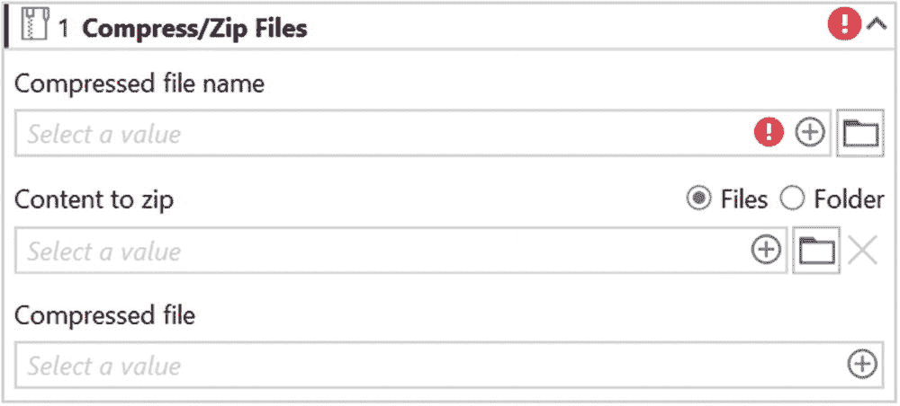

图 9-33 压缩/Zip 文件的活动卡片

`压缩文件名`：这是活动卡片上的一个必填配置。此配置允许您指定将要创建的压缩文件 (`.zip`) 的名称。

`要压缩的内容`：这是活动卡片上的一个可选配置。此配置允许您指定希望文件被提取到的目标位置。

`压缩文件`：这是活动卡片上的一个可选配置。此配置允许您保存有关压缩文件的信息。这将创建一个可在以后使用的变量。

`压缩级别`：这是`属性`面板上的一个可选配置。此配置允许您指定将文件压缩到多小。您想要的压缩率越高，速度就越慢。有四个选项：`无`（默认）、`快速`、`正常`和`最大`。

`覆盖现有文件`：这是`属性`面板上的一个可选配置。此配置允许您指定，如果目标位置存在同名文件，自动化是否应覆盖它。默认情况下，此选项处于选中状态，即自动化应覆盖同名文件。

`密码`：这是`属性`面板上的一个可选配置。此配置允许您为压缩文件设置密码。

### 练习

`目标`：使用`压缩/Zip 文件`活动将`C:\BookSamples\Chapter_09\Resumes\20200910\MoveForward`文件夹的内容压缩到`MoveForwardResumes_20200910.zip`文件中。

`源代码`：`Chapter_9_CompressedFilesExercise`

`设置`：以下是分步实施说明：

1. 在`StudioX`中，将`压缩/Zip 文件`活动添加到一个空白流程中。
2. 在`压缩文件名`字段中，单击加号图标，选择“文本”，然后输入`C:\BookSamples\Chapter_09\Resumes\20200910\MoveForward\MoveForwardResumes_20200910.zip`。
3. 在`要压缩的内容`字段中，选择`文件夹`选项。单击`文件夹`图标，然后选择`C:\BookSamples\Chapter_09\Resumes\20200910\MoveForward`文件夹。
4. 在`压缩文件`字段中，单击`加号`图标，选择`保存以备后用`，并将该值命名为`CompressedFileInfo`。
5. 在`压缩/Zip 文件`活动之后立即添加`写入行`活动。在`文本`字段中，单击`加号`图标，选择`使用已保存的值`，然后将鼠标悬停在`CompressedFileInfo`上以选择`完整路径`。

完成练习后，`压缩/Zip 文件`活动的最终配置应类似于图 9-34。图 9-35 显示了目标位置的前后文件夹结构。

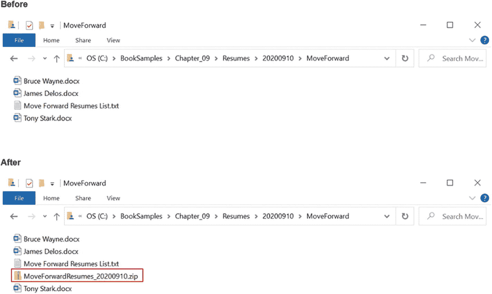

图 9-35 压缩/Zip 文件活动练习的结果

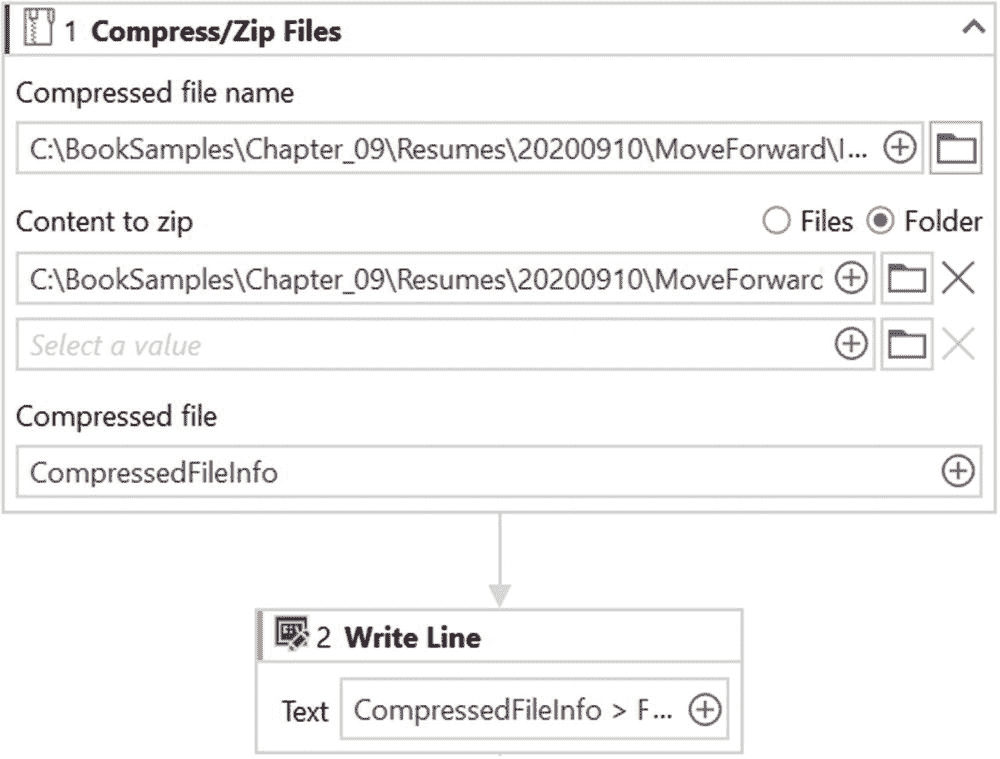

图 9-34 压缩/Zip 文件活动的最终配置

## 提取/解压文件

`提取/解压文件`活动允许您将压缩文件的内容提取到特定文件夹。

### 配置

本节提供如何配置`提取/解压文件`活动的说明，如图 9-36 所示。

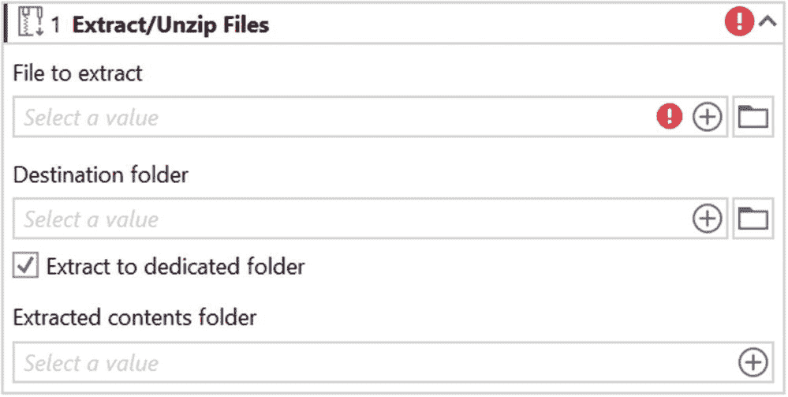

图 9-36 提取/解压文件的活动卡片

`要提取的文件`：这是活动卡片上的一个必填配置。此配置允许您指定要提取的压缩文件 (`.zip`) 的完整路径。

`目标文件夹`：这是活动卡片上的一个可选配置。此配置允许您指定希望文件被提取到的目标位置。

`提取到专用文件夹`：这是活动卡片上的一个可选配置。此配置允许您指定是否要将文件提取到`目标文件夹`内的一个专用文件夹中。新文件夹的名称将与压缩文件的名称相同。这有助于确保`目标文件夹`中的同名文件不会被覆盖。

`提取的内容文件夹`：这是活动卡片上的一个可选配置。此配置允许您保存有关提取文件夹的信息。如果选中了`提取到专用文件夹`标志，则保存该文件夹的所有属性；否则，将`目标文件夹`的所有属性保存到`数据管理器`中。默认情况下，此选项处于未选中状态。

`密码`：这是`属性`面板上的一个可选配置。如果压缩文件受密码保护，此配置允许您指定密码。

`跳过不支持的文件`：这是`属性`面板上的一个可选配置。此配置允许您跳过无法提取的文件。这有助于避免在 StudioX 无法提取指定文件时可能抛出的任何错误。默认情况下，此值未设置。

### 练习

`目标`：使用`提取/解压文件`活动将`C:\BookSamples\Chapter_09\Source\StaffingAgencyResumes_20200911.zip`文件的内容提取到`C:\BookSamples\Chapter_09\Resumes\20200911\New`文件夹，并打印有关提取文件夹的信息。

`源代码`：`Chapter_9_CompressedFilesExercise`

`设置`：以下是分步实施说明：

1. 在`StudioX`中，将`提取/解压文件`活动添加到一个空白流程中。
2. 在`要提取的文件`字段中，单击`文件夹`图标，然后选择`C:\BookSamples\Chapter_09\Source\StaffingAgencyResumes_20200911.zip`文件。
3. 在`目标文件夹`字段中，单击`文件夹`图标，然后选择`C:\BookSamples\Chapter_09\Resumes\20200911\New`文件夹。
4. 取消选中`提取到专用文件夹`标志，因为我们希望将所有文件提取到指定的文件夹中。
5. 在`提取的内容文件夹`字段中，单击`加号`图标，选择`保存以备后用`，并将该值命名为`DestinationFolderInfo`。
6. 在`提取/解压文件`活动之后立即添加`写入行`活动。在`文本`字段中，单击`加号`图标，选择`使用已保存的值`，然后将鼠标悬停在`DestinationFolderInfo`上以选择`完整路径`。

完成练习后，`提取/解压文件`活动的最终配置应类似于图 9-37。图 9-38 显示了提取文件的内容，而图 9-39 显示了有关提取文件夹的信息。

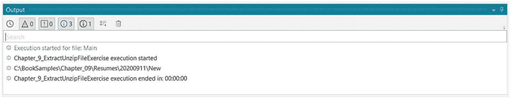

图 9-39 提取/解压文件活动的输出

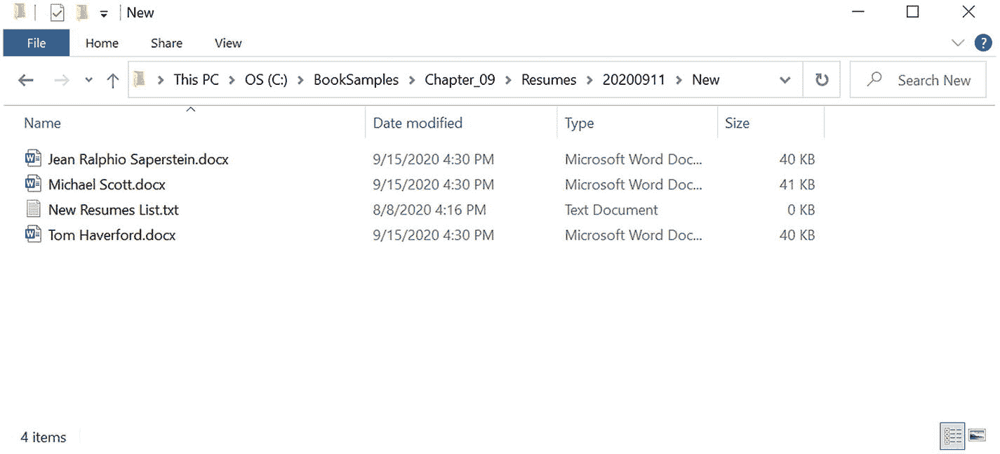

图 9-38 提取文件的内容

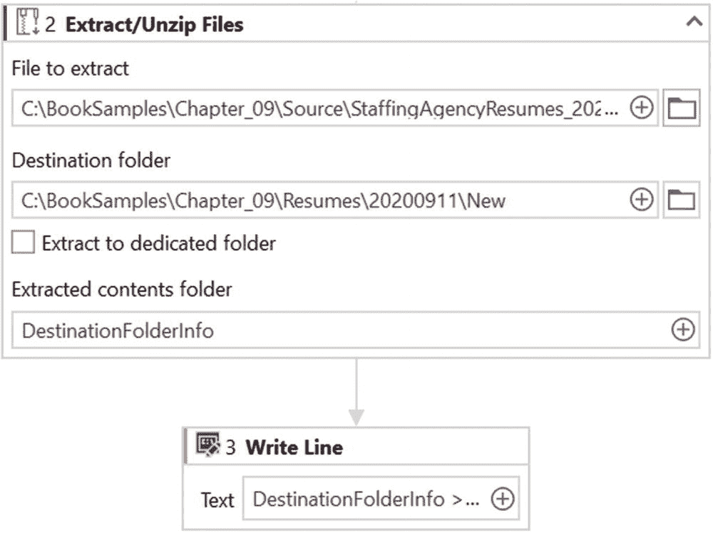

图 9-37 提取/解压文件活动的最终配置

## 获取文件信息

`获取文件信息`活动允许您检索并保存指定文件的特定属性。图 9-40 展示了使用此活动可访问的文件属性。

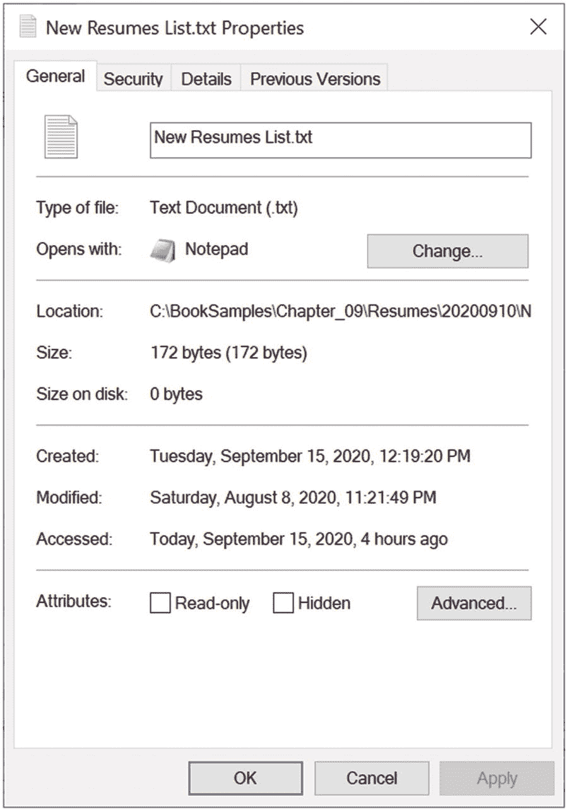

图 9-40 文件属性窗口

### 配置

本节提供如何配置`获取文件信息`活动的说明，如图 9-41 所示。

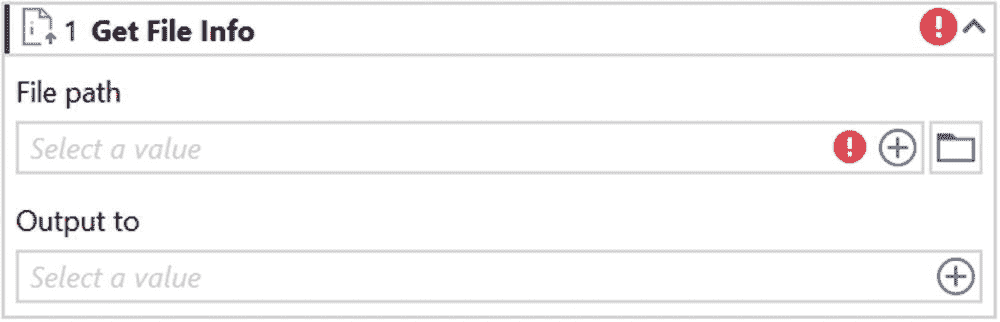

图 9-41 获取文件信息活动卡片

`文件路径`：这是活动卡片上的必填配置项。此配置允许您指定要从中检索信息的文件的完整路径。

`输出到`：这是活动卡片上的可选配置项。此配置允许您将检索到的信息保存到`Data Manager`中，以供后续使用。

此活动返回的属性（如图 9-42 所示）可用于决定是否需要执行特定操作。例如，如果您的自动化程序频繁从某个站点下载数据，您可以使用先前下载文件的`创建日期`属性（见表 9-2 中的描述）来检查上次下载数据的时间。您可以使用此信息仅下载自上次下载以来的增量数据。

**表 9-2：获取文件信息活动返回的属性**

| 属性 | 描述 |
| --- | --- |
| `Name` | 指定文件的名称（不含文件夹路径） |
| `Full Name` | 指定文件的名称（含文件夹路径） |
| `Folder` | 包含该文件的文件夹路径 |
| `Extension` | 指定文件的扩展名（例如，txt 或 docx） |
| `Created date` | 指定文件的创建日期和时间 |
| `Last modified date` | 指定文件的最后修改日期和时间 |
| `Last accessed date` | 指定文件的最后访问日期和时间 |
| `Size` | 文件大小（以字节为单位） |
| `Size in KB` | 指定文件夹的大小（以千字节 KB 为单位） |
| `IsReadOnly` | 指示文件是否为只读的标志，即无法编辑 |

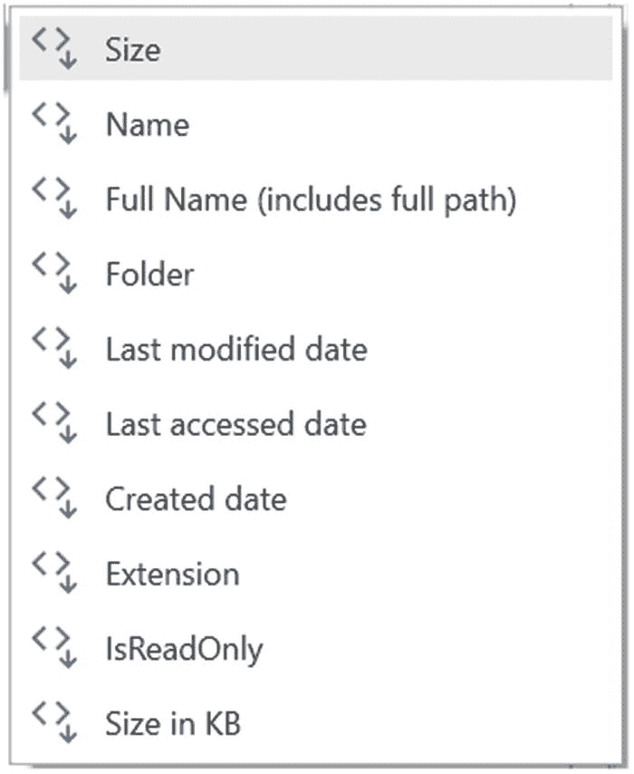

**图 9-42**：获取文件信息活动返回的属性

表 9-2 提供了此活动返回的所有属性的简要说明。

### 练习

**目标**：使用`获取文件信息`活动获取`C:\BookSamples\Chapter_09\Resumes\20200910\New\New Resumes List.txt`文件的属性，并打印最后修改日期。

**源代码**：`Chapter_9_FileActivitiesExercise`

**设置**：以下是分步实施说明：

1.  在`StudioX`中，将`获取文件信息`活动添加到一个空白流程中。
2.  在`文件路径`字段中，点击`文件夹`图标，然后选择`C:\BookSamples\Chapter_09\Resumes\20200910\New\New Resumes List.txt`文件。
3.  点击`输出到`字段中的`加号`图标，将值命名为`FileInfo`，然后点击`确定`。
4.  接下来，在`设计器`面板中，于`获取文件信息`活动之后添加一个`写入行`活动。
5.  在`文本`字段中，点击`加号`图标，然后选择`文本`。在`文本生成器`中，输入`文件最后修改于：`。
6.  在`文本生成器`仍处于打开状态时，点击`加号`图标，选择`使用已保存的值`选项，然后悬停在`FileInfo`上并选择`LastModifiedDate`。完整的文本应显示为`文件最后修改于：FileInfo.LastModifiedDate`。点击`保存`。

完成练习后，`获取文件信息`活动的最终配置应类似于图 9-43。图 9-44 显示了此练习的输出。

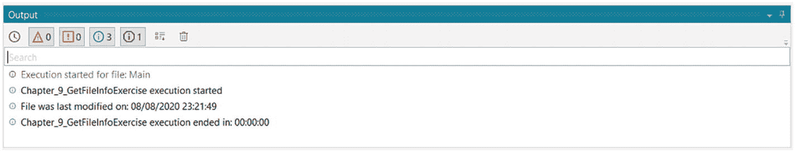

**图 9-44**：获取文件信息活动练习的输出

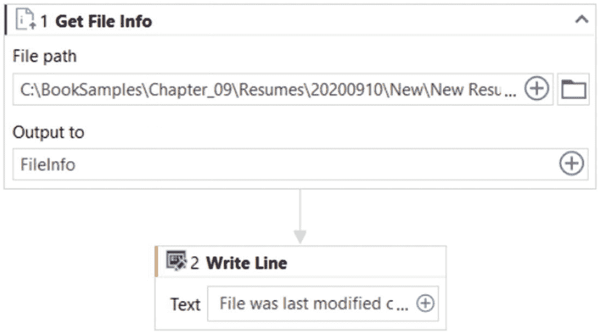

**图 9-43**：获取文件信息活动练习的最终配置

### 文件存在

`文件存在`活动允许您检查目标位置是否已存在某个文件。

#### 配置

本节提供如何配置`文件存在`活动的说明，如图 9-45 所示。

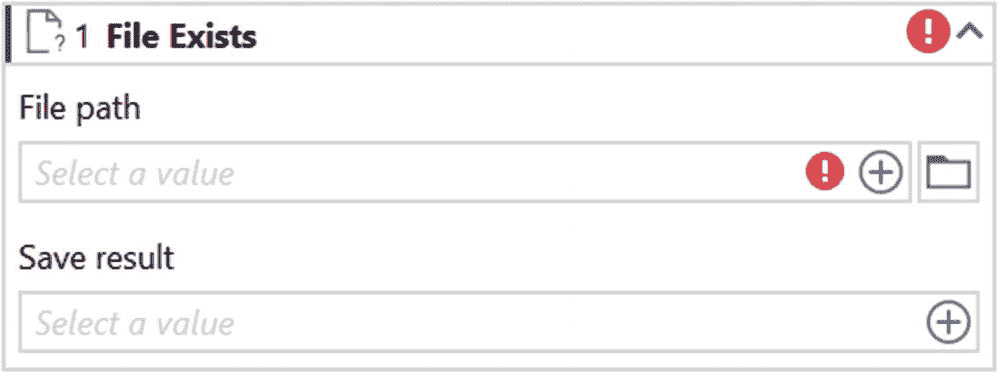

**图 9-45**：文件存在活动卡片

**文件路径**：这是活动卡片上的必填配置项。此配置允许您指定要检查其存在与否的文件的完整路径。
**保存结果**：这是活动卡片上的可选配置项。此配置允许您将此活动的结果保存到`Data Manager`中，以供后续使用。如果文件存在，此活动返回`True`；如果文件不存在，则返回`False`。例如，假设此活动返回文件已存在，您可以使用此信息来决定是否需要删除、移动、更新或覆盖该现有文件。

#### 练习

**目标**：使用`文件存在`活动检查`C:\BookSamples\Chapter_09\Resumes\20200911\New\New Resumes List.txt`是否已存在，并打印结果。

**源代码**：`Chapter_9_FileActivitiesExercise`

**设置**：以下是分步实施说明：

1.  在`StudioX`中，将`文件存在`活动添加到一个空白流程中。
2.  在`文件路径`字段中，点击`加号`图标，选择`文本`选项，然后输入`C:\BookSamples\Chapter_09\Resumes\20200911\New\New Resumes List.txt`。
3.  点击`保存结果`字段中的`加号`图标，将值命名为`FileExists`，然后点击`确定`。
4.  将`写入行`活动添加到`设计器`面板中，位于`文件存在`活动之后。
5.  在`文本`字段中，点击`加号`图标，然后选择`文本`选项。在`文本生成器`中，输入`文件存在：`。
6.  在`文本生成器`仍处于打开状态时，点击`加号`图标，然后悬停在`使用已保存的值`上并选择`FileExists`。点击`保存`。

完成练习后，`文件存在`活动的最终配置应类似于图 9-46。图 9-47 显示了此练习的输出。

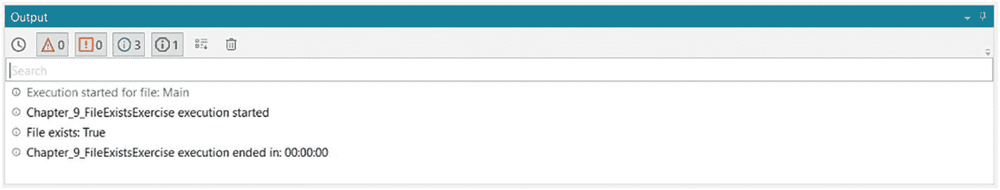

**图 9-47**：文件存在活动练习的输出

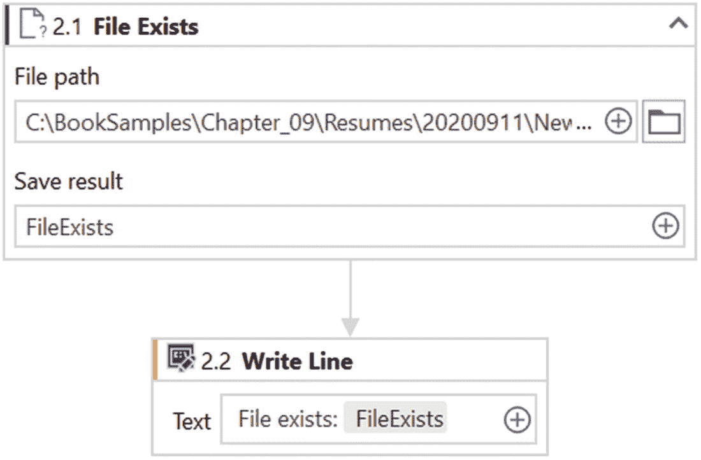

**图 9-46**：文件存在活动练习的最终配置

### 创建文件

`创建文件`活动允许您在指定位置创建一个新文件。

#### 配置

本节提供如何配置`创建文件`活动的说明，如图 9-48 所示。

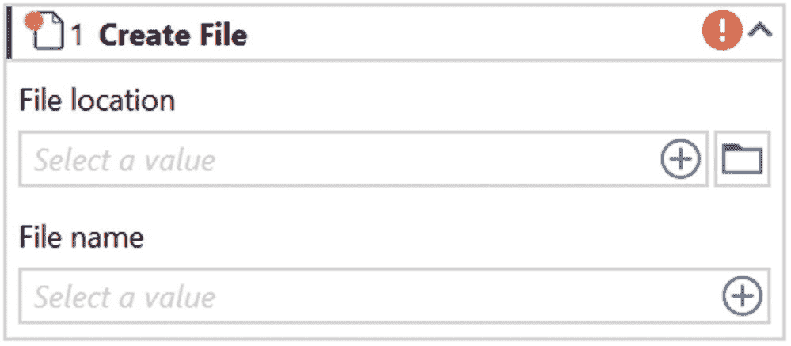

**图 9-48**：创建文件的活动卡片

**文件位置**：这是活动卡片上的一项必需配置。此配置允许您指定要创建新文件的文件夹的完整路径。
**文件名**：这是活动卡片上的一项必需配置。此配置允许您指定要创建的新文件的名称。

#### 练习

**目标**：使用`Create File`活动在`C:\BookSamples\Chapter_09\Interviews\Pending`位置创建一个名为`Pending Interview List.txt`的新文件。

**源代码**：`Chapter_9_FileActivitiesExercise`

**设置**：以下是分步实施说明：

1.  在`StudioX`中，将`Create File`活动添加到一个空白流程中。
2.  在`文件位置`字段中，单击`文件夹`图标，然后选择`C:\BookSamples\Chapter_09\Interviews\Pending`。
3.  在`文件名`字段中，单击`加号`图标，选择`文本`选项，然后输入`Pending Interview List.txt`。单击`保存`。

完成练习后，`创建文件`活动的最终配置应类似于图 9-49。图 9-50 显示了此练习前后目标位置的文件夹结构。

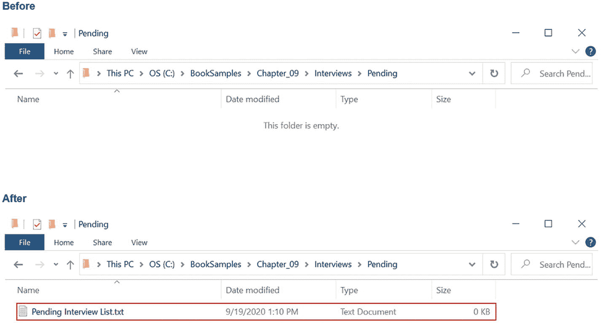

**图 9-50**：创建文件活动练习的结果

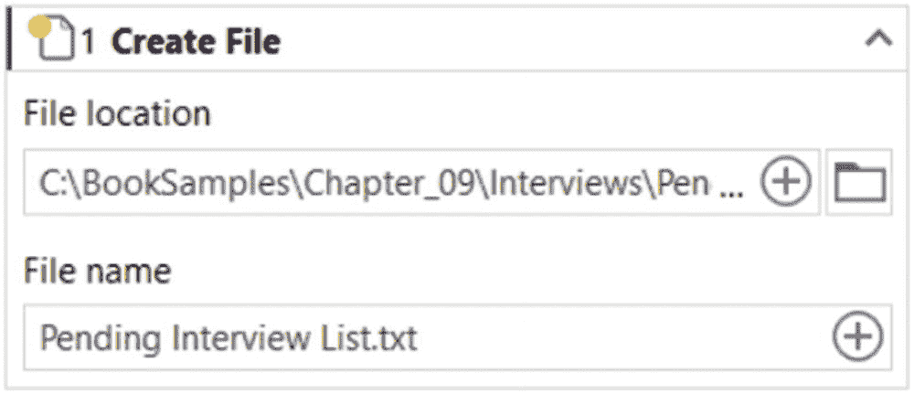

**图 9-49**：创建文件活动的最终配置

### 删除文件

`删除文件`活动允许您删除指定的文件。

#### 配置

本节提供如何配置`删除文件`活动的说明，如图 9-51 所示。

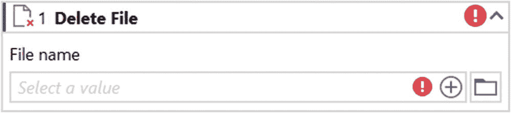

**图 9-51**：删除文件的活动卡片

# 文件操作活动

**文件名**：这是活动卡片上的一项强制配置。此配置允许您指定要删除的文件的完整路径。

## 练习

**目标**：使用 `Delete File` 活动删除 `C:\BookSamples\Chapter_09\Source\StaffingAgencyResumes_20200911.zip` 文件。

**源代码**：Chapter_9_FileActivitiesExercise

**设置**：以下是分步实施说明：

1.  在 `StudioX` 中，将 `Delete File` 活动添加到一个空白流程中。
2.  单击 `文件夹` 图标，然后选择 `C:\BookSamples\Chapter_09\Source\StaffingAgencyResumes_20200911.zip` 文件。

完成练习后，**删除文件**活动的最终配置应类似于图 9-52。图 9-53 显示了目标位置前后的文件夹结构。

*图 9-53 删除文件活动练习的结果*

*图 9-52 删除文件活动练习的最终配置*

## 复制文件

**复制文件**活动允许您将指定的文件复制到另一个位置。

> **注意**：此活动会保留原始文件在原位置。

### 配置

本节提供如何配置**复制文件**活动的说明，如图 9-54 所示。

*图 9-54 复制文件的活动卡片*

**来源**：这是活动卡片上的一项必需配置。此配置允许您指定要复制的文件的完整路径。

**目标**：这是活动卡片上的一项必需配置。此配置允许您指定 `来源` 文件需要被复制到的目标位置。您需要指定文件名——它可以与原始文件相同或不同。

**覆盖**：这是活动卡片上的一项可选配置。此配置允许您指定，如果目标位置存在同名文件，自动化是否应覆盖其内容。

### 练习

**目标**：使用 `Copy File` 活动将 `C:\BookSamples\Chapter_09\Source\StaffingAgencyResumes_20200909.zip` 文件复制到 `C:\BookSamples\Chapter_09\Archive` 位置。

**源代码**：Chapter_9_FileActivitiesExercise

**设置**：以下是分步实施说明：

1.  在 `StudioX` 中，将 `Copy File` 活动添加到一个空白流程中。
2.  在 `来源` 字段中，单击 `文件夹` 图标，然后选择 `C:\BookSamples\Chapter_09\Source\StaffingAgencyResumes_20200909.zip` 文件。
3.  在 `目标` 字段中，单击 `加号` 图标，选择 `文件夹` 图标，然后选择 `C:\BookSamples\Chapter_09\Archive` 文件夹。您还需要在此处指定文件名，并输入 `StaffingAgencyResumes_20200909.zip`。单击 `保存`。
4.  勾选 `覆盖` 标志。

完成练习后，**复制文件**活动的最终配置应类似于图 9-55。图 9-56 显示了目标位置前后的文件夹结构。如果您查看原始文件，它仍会保留在原始文件夹中。

*图 9-56 复制文件活动练习的结果*

*图 9-55 复制文件活动练习的最终配置*

## 移动文件

**移动文件夹**活动允许您将指定的文件夹复制到另一个位置。

> **注意**：与 `Copy File` 活动不同，此活动不会将原始文件保留在原位置。

### 配置

本节提供如何配置**移动文件**活动的说明，如图 9-57 所示。

*图 9-57 移动文件的活动卡片*

**来源**：这是活动卡片上的一个必填配置。此配置允许您指定要移动的文件的完整路径。

**目标**：这是活动卡片上的一个必填配置。此配置允许您指定需要将`来源`文件复制到的目标位置。

**覆盖**：这是活动卡片上的一个可选配置。此配置允许您指定：如果目标位置存在同名文件，自动化程序是否覆盖其内容。

### 练习

**目标**：使用`移动文件`活动将 `C:\BookSamples\Chapter_09\Resumes\20200910\MoveForward\Bruce Wayne.docx` 文件移动到 `C:\BookSamples\Chapter_09\Interviews\Pending` 位置。

**源代码**：Chapter_9_FileActivitiesExercise

**设置**：以下是分步实施说明：

1.  在 `StudioX` 中，将`移动文件`活动添加到一个空白流程中。
2.  在`来源`字段中，点击`文件夹`图标，然后选择 `C:\BookSamples\Chapter_09\Resumes\20200910\MoveForward\Bruce Wayne.docx` 文件夹。
3.  在`目标`字段中，点击`文件夹`图标，然后选择 `C:\BookSamples\Chapter_09\Interviews\Pending` 文件夹。
4.  保持`覆盖`字段为未选中状态。

完成练习后，**移动文件**活动的最终配置应类似于图 9-58。图 9-59 显示了源位置和目标位置在操作前后的文件夹结构。如果查看原始文件，它仍会保留在原始文件夹中。

*图 9-59 移动文件活动练习的结果*

*图 9-58 移动文件活动练习的最终配置*

## 写入文本文件

**写入文本文件**活动允许您将指定的文本写入一个基于文本的文件中。^(⁷)

> **注意** 如果指定的文件不存在，则此活动将首先创建该文件，然后将文本写入文件。此外，此活动将始终覆盖指定文件中已有的任何文本。

### 配置

本节提供如何配置**写入文本文件**活动的说明，如图 9-60 所示。

*图 9-60 写入文本文件的活动卡片*

**文本**：这是活动卡片上的一个必填配置。此配置允许您指定要写入目标文件的文本。您可以使用文本生成器来配置此项。

**写入到文件名**：这是活动卡片上的一个必填配置。此配置允许您指定要写入文本的文件。

**编码**：这是`属性`面板上的一个可选配置。如果内容包含标准英文字符以外的任何字符，此配置允许您指定`编码`^(⁸,⁹)。

### 练习

**目标**：使用`写入文本文件`活动将文本写入 `C:\BookSamples\Chapter_09\Resumes\20200911\New\New Resumes List.txt` 文件。

**源代码**：Chapter_9_TextFileActivitiesExercise

**设置**：以下是分步实施说明：

1.  在 `StudioX` 中，将`写入文本文件`活动添加到一个空白流程中。
2.  在`文本`字段中，点击`加号`图标，然后选择`文本`。在`文本生成器`中，输入 `Resumes received on`，点击`加号`图标，将鼠标悬停在`项目笔记本（笔记）`上，然后选择 `[Notes] Date!YYYYMMDD`。
3.  在`写入到文件名`字段中，点击`文件夹`图标，然后选择 `C:\BookSamples\Chapter_09\Resumes\20200911\New\New Resumes List.txt` 文件。

# 追加行与读取文本文件活动

完成练习后，`写入文本文件`活动的最终配置应类似于图 9-61。图 9-62 显示了包含更新内容的文本文件。

*图 9-62：写入文本文件活动练习的结果*

*图 9-61：写入文本文件活动练习的最终配置*

## 追加行

`追加行`活动允许您将一行文本添加到基于文本的文件的末尾。

**注意**：`追加行`活动不会覆盖或删除文件中已有的任何文本。

### 配置

本节提供如何配置`追加行`活动的说明，如图 9-63 所示。

*图 9-63：追加行活动卡片*

- **文本**：这是活动卡片上的一个必填配置。此配置允许您指定要追加到文件中的文本。
- **写入文件名**：这是活动卡片上的一个必填配置。此配置允许您指定要追加文本的目标文件。
- **编码**：这是`属性`面板上的一个可选配置。如果内容包含标准英语以外的任何字符，此配置允许您指定`编码`^(¹⁰,¹¹)。
- **使用默认编码**：这是`属性`面板上的一个可选配置。此配置允许您指定是否将`StudioX`设置为文件的默认编码。默认情况下，该值设置为 False，即不使用默认编码。

### 练习

**目标**：使用`追加行`活动将 `C:\BookSamples\Chapter_09\Resumes\20200911\New` 文件夹中每个 Word 文件的名称追加到 `New Resumes List.txt` 文件（位于同一文件夹中）。

**源代码**：`Chapter_9_TextFileActivitiesExercise`

**设置**：以下是分步实施说明：

1.  在 `StudioX` 中，将`遍历文件夹中的每个文件`活动添加到一个空白流程中。
2.  在`文件夹`字段中，单击`文件夹`图标，然后选择 `C:\BookSamples\Chapter_09\Resumes\20200911\New` 文件夹。
3.  在`按条件筛选`字段中，单击`加号`图标，选择`文本`选项，然后输入 `*.docx`。这将确保仅返回 Word 文档文件。
4.  在`遍历文件夹中的每个文件`活动的主体中添加`追加行`活动。
5.  在`文本`字段中，单击`加号`图标，悬停在`当前文件`上，然后选择`名称`。
6.  在`写入文件名`字段中，单击`文件夹`图标，然后选择 `C:\BookSamples\Chapter_09\Resumes\20200911\New\New Resumes List.txt` 文件。

完成练习后，`追加行`活动的最终配置应类似于图 9-64。图 9-65 显示了更新内容后的文本文件。

*图 9-65：追加行活动练习结果*

*图 9-64：追加行活动练习的最终配置*

## 读取文本文件

`读取文本文件`活动允许您读取文本文件中的内容（所有字符）。

### 配置

本节提供如何配置`读取文本文件`活动的说明，如图 9-66 所示。

*图 9-66：读取文本文件活动卡片*

- **文件名**：这是活动卡片上的一个必填配置。此配置允许您指定要从中读取文本的文件。
- **输出到**：这是活动卡片上的一个可选配置。此配置允许您保存文本文件的内容以供后续使用。
- **编码**：这是`属性`面板上的一个可选配置。如果内容包含标准英语以外的任何字符，此配置允许您指定`编码`^(¹²,¹³)。

### 练习

**目标**：使用`读取文本文件`活动读取 `C:\BookSamples\Chapter_09\Resumes\20200911\New\New Resumes List.txt` 文件的内容。

**源代码**：`Chapter_9_TextFileActivitiesExercise`

**设置**：以下是分步实施说明：

1.  在 `StudioX` 中，将`读取文本文件`活动添加到一个空白流程中。
2.  在`文件名`字段中，单击`文件夹`图标，然后选择 `C:\BookSamples\Chapter_09\Resumes\20200911\New\New Resumes List.txt` 文件。
3.  在`输出到`字段中，单击`加号`图标，然后选择`复制到剪贴板`选项。
4.  在`读取文本文件`活动之后立即添加`写入行`活动，单击`加号`图标，然后选择`从剪贴板粘贴`选项。

完成练习后，`读取文本文件`活动的最终配置应类似于图 9-67。图 9-68 显示了此练习的输出。

*图 9-68：读取文本文件活动练习的输出*

*图 9-67：读取文本文件活动练习的最终配置*

---
脚注 1   2   3   4   5   6   7