# 10. 演示文稿自动化

PowerPoint 演示文稿是组织最常用且最有效的软件，用于展示关键信息，并在从董事会会议和行业会议到公司培训和项目实施的各类演示场景中吸引受众。UiPath 的 StudioX 演示文稿自动化功能允许用户自动执行常见任务，例如添加或替换文本、复制粘贴幻灯片，以及在 PowerPoint 幻灯片中添加数据/图像/文件。

## 学习目标

在本章结束时，您将学习如何：

*   在演示文稿中添加、删除、复制和移动幻灯片
*   在幻灯片中添加或替换文本
*   向幻灯片添加表格、图像、视频和文件
*   在 PowerPoint 中运行宏
*   将 PowerPoint 另存为 PDF 或其他 PowerPoint 文件类型

## 示例概述

在本章中，我们将使用一个简化版的报告生成流程来展示所有演示文稿自动化活动的用法。本节将使您熟悉本章所有练习的先决条件。

### 文件系统结构

从本书网站下载源代码，并确保将整个 BookSamples 文件夹移动到您的 `C:\` 驱动器。本章中的所有练习均假定文件夹路径为 `C:\BookSamples\Chapter_10`。图 10-1 显示了此示例所需的物理文件夹结构。此文件夹结构随源代码一起提供。

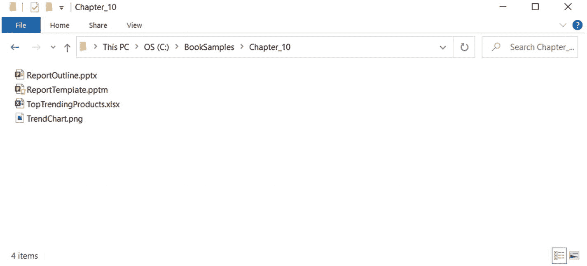

图 10-1 用于报告生成练习的文件

*   **ReportTemplate.pptm**：这是一个启用宏的 PowerPoint 文件，我们将把它用作生成报告的模板。图 10-2 显示了演示文稿的初始状态。
*   **ReportOutline.pptx**：这是一个单张幻灯片的 PowerPoint 文件。我们将把这张幻灯片复制到我们的报告中。
*   **TopTrendingProducts.xlsx**：此 Excel 电子表格包含热门产品的列表。我们将在报告中使用此电子表格中的数据，并将此文件附加到报告中。
*   **TrendChart.png**：这是一个图像文件。我们将在报告中显示此图像。

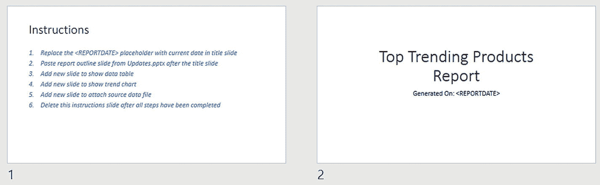

图 10-2 演示文稿的初始状态

## 活动参考

如图 10-3 所示，所有演示自动化活动均可在“演示”类别下找到。以下各节将提供有关如何配置和使用每个活动的说明。

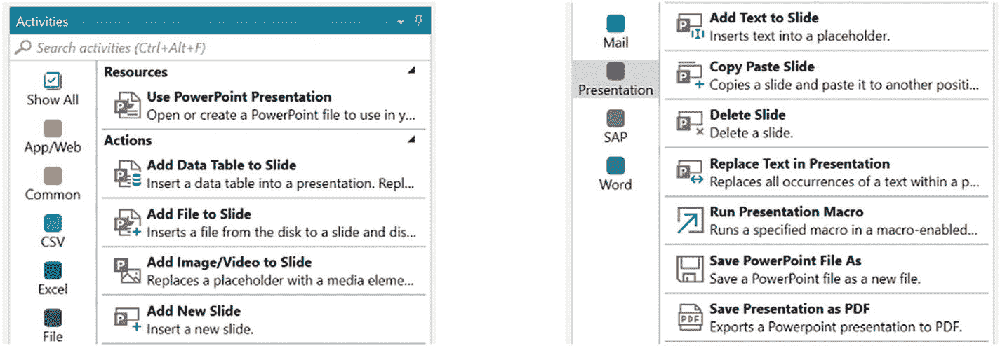

图 10-3 演示自动化活动

### 使用 PowerPoint 演示文稿

`使用 PowerPoint 演示文稿`活动允许您选择要自动化的 PowerPoint 演示文稿。此活动将包含您要对 PowerPoint 执行的所有操作。例如，如果要添加新幻灯片，`添加新幻灯片`活动将嵌套在`使用 PowerPoint 演示文稿`活动的主体中。

#### 配置

本节提供有关如何配置`使用 PowerPoint 演示文稿`活动的说明，如图 10-4 所示。

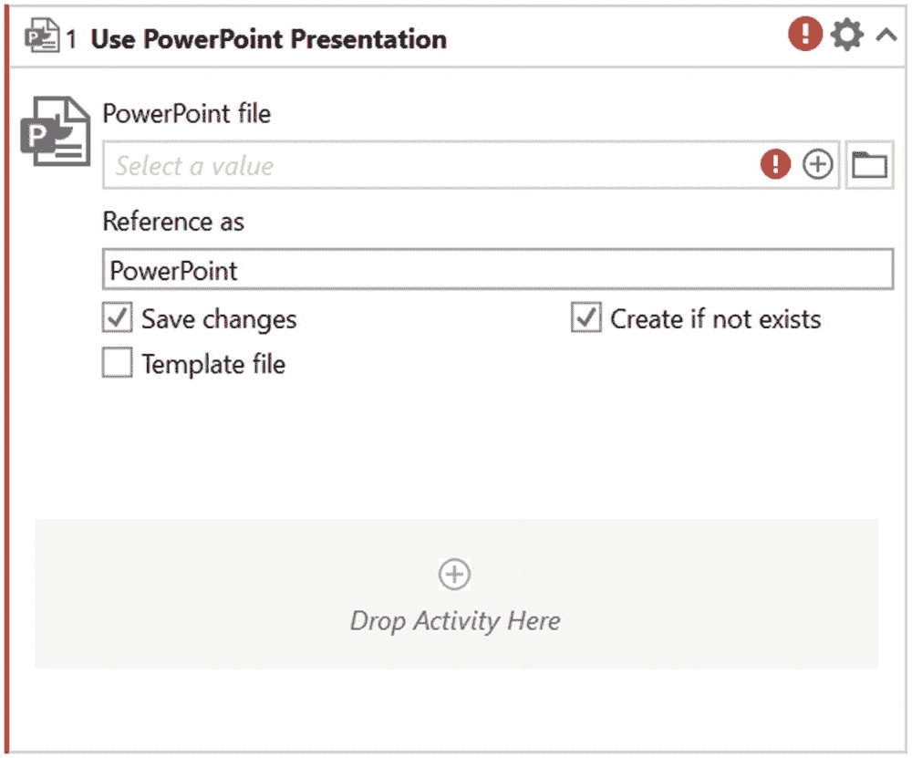

图 10-4 使用 PowerPoint 演示文稿的活动卡片

*   `PowerPoint 文件`：这是活动卡片上的一个必填配置。此配置允许您指定要自动化的 PowerPoint 文件。
*   `引用为`：这是活动卡片上的一个必填配置。此配置允许您为 PowerPoint 文件提供一个名称。所有需要使用所选 PowerPoint 的活动都将通过此名称来引用它。
*   `保存更改`：这是活动卡片上的一个可选配置。此配置确保在对活动执行每个操作后保存 PowerPoint。默认情况下，此选项处于选中状态。
*   `不存在则创建`：这是活动卡片上的一个可选配置。此配置确保如果目标位置不存在文件，则创建一个空白文件。默认情况下，此选项处于选中状态。
*   `模板文件`：这是活动卡片上的一个可选配置。此配置适用于创建新的 PowerPoint 文件时。此配置允许您指定一个模板文件，StudioX 会使用该模板文件的幻灯片母版来创建新的 PowerPoint 文件。
*   `编辑密码`：这是`属性`面板上的一个可选配置。此字段用于编辑受密码保护的 PowerPoint 文件。如有必要，请在此字段中输入密码。
*   `密码`：这是`属性`面板上的一个可选配置。此字段用于打开受密码保护的 PowerPoint 文件。如有必要，请在此字段中输入密码。
*   `只读`：这是`属性`面板上的一个可选配置。如果选中，PowerPoint 将以只读模式打开以进行自动化。此选项将允许自动化从 PowerPoint 中提取数据，即使它受密码保护。默认情况下，此选项未选中。

### 复制粘贴幻灯片

`复制粘贴幻灯片`活动允许您在同一个 PowerPoint 演示文稿内或从一个 PowerPoint 演示文稿复制或移动幻灯片到另一个。

#### 配置

本节提供有关如何配置`复制粘贴幻灯片`活动的说明，如图 10-5 所示。

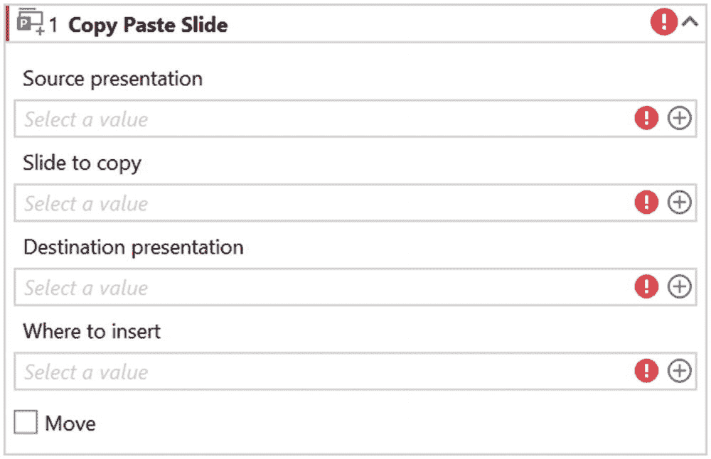

图 10-5 复制粘贴幻灯片的活动卡片

*   `源演示文稿`：这是活动卡片上的一个必填配置。此配置指定要从中复制或移动幻灯片的 PowerPoint 演示文稿。
*   `要复制的幻灯片`：这是活动卡片上的一个必填配置。此配置允许您指定需要从源 PowerPoint 演示文稿中复制或移动的幻灯片。
*   `目标演示文稿`：这是活动卡片上的一个必填配置。此配置指定要将幻灯片复制或移动到的目标 PowerPoint 演示文稿。
*   `插入位置`：这是活动卡片上的一个必填配置。此配置允许您指定应将幻灯片插入到目标 PowerPoint 演示文稿中的哪个位置。
*   `移动`：这是活动卡片上的一个可选配置。此配置指定幻灯片是仅复制还是移动到目标 PowerPoint 演示文稿。默认情况下，此选项未选中。

**练习**

**目标**：使用`复制粘贴幻灯片`活动从 `ReportOutline.pptx` 复制“报告大纲”幻灯片，并将其粘贴到 `ReportTemplate.pptm` 中的“标题”幻灯片之后。图 10-2 显示了此练习之前演示文稿的状态。

**源代码**：`Chapter_10-PresentationAutomationExercise`

**设置**：以下是分步实施说明：

1.  在 `StudioX` 中，添加`使用 PowerPoint 演示文稿`活动。
2.  在 `PowerPoint 文件` 字段中，单击`文件夹`图标，然后选择`C:\BookSamples\Chapter_10\ReportTemplate.pptm`。
3.  将 `引用为` 字段的值设置为 `ReportTemplatePPT`。
4.  取消选中`保存更改`和`不存在则创建`标志。
5.  在`使用 PowerPoint 演示文稿`活动的主体中，添加另一个`使用 PowerPoint 演示文稿`活动。外部的活动将用于引用目标 PowerPoint 演示文稿，内部的活动将引用源 PowerPoint 演示文稿。
6.  在 `PowerPoint 文件` 字段中，单击文件夹图标，然后选择`C:\BookSamples\Chapter_10\ReportOutline.pptx`。
7.  在 `引用为` 字段中，输入 `ReportOutlinePPT`。
8.  取消选中`保存更改`和`不存在则创建`标志。
9.  在内部的`使用 PowerPoint 演示文稿`活动中，添加`复制粘贴幻灯片`活动。
10. 在 `源演示文稿` 字段中，选择 `ReportOutlinePPT`。
11. 在 `要复制的幻灯片` 字段中，选择`幻灯片 1`，或使用`加号`图标输入 `1`。
12. 在 `目标演示文稿` 字段中，选择 `ReportTemplatePPT`。
13. 在 `插入位置` 字段中，单击加号图标，选择`数字`选项，然后输入 `3`。

完成练习后，`复制粘贴幻灯片`活动的最终配置应类似于图 10-6。

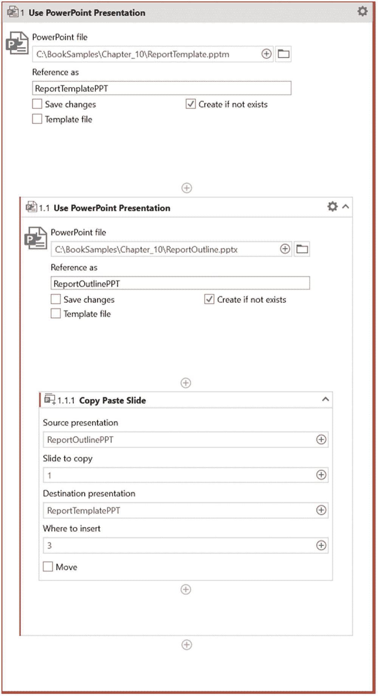

图 10-6 复制粘贴幻灯片练习的最终配置

注意 我们取消了选中“保存更改”选项，因此在运行自动化之前，请打开 `ReportTemplate.pptm`；这将允许您查看自动化所做的所有更改。

自动化运行后，“报告大纲”幻灯片将被插入到 `ReportTemplate.pptm` 的末尾，如图 10-7 所示。

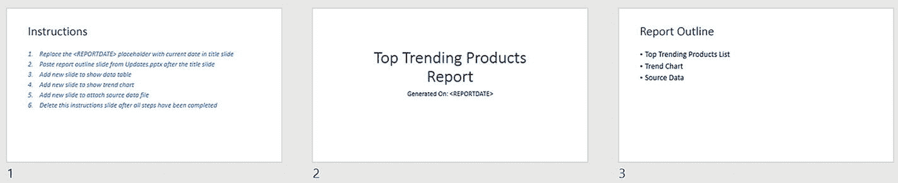

图 10-7 复制粘贴幻灯片练习后 `ReportTemplate.pptm` 的状态

## 删除幻灯片

`删除幻灯片`活动允许您从 PowerPoint 演示文稿中删除指定的幻灯片。

### 配置

本节提供如何配置`删除幻灯片`活动的说明，如图 10-8 所示。

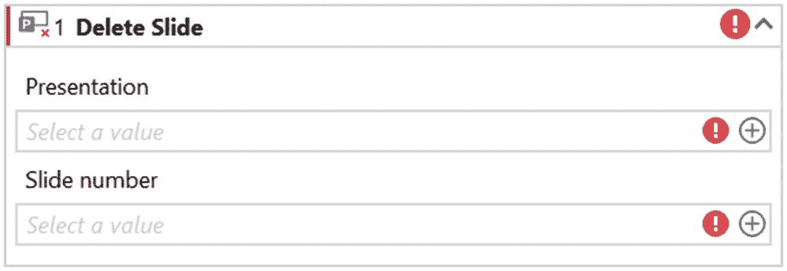

图 10-8 删除幻灯片的活动卡片

`演示文稿`：这是活动卡片上的一个必填配置。此配置指定需要从中删除幻灯片的 PowerPoint 演示文稿。此字段会预填充来自父级 `Use PowerPoint Presentation` 活动的 PowerPoint 演示文稿。

`幻灯片编号`：这是活动卡片上的一个必填配置。此配置指定需要删除的幻灯片编号。

### 练习

**目标**：基于之前的练习，使用 `Delete Slide` 活动从 `C:\BookSamples\Chapter_10\ReportTemplate.pptm` 中删除“说明”幻灯片。图 10-7 显示了演示文稿的当前状态。

**源代码**：`Chapter_10-PresentationAutomationExercise`

**设置**：以下是分步实施说明：

1.  在 `StudioX` 中，将 `Delete Slide` 活动添加到外部 `Use PowerPoint Presentation` 活动的主体中，位于上一个练习中内部 `Use PowerPoint Presentation` 活动之后。

2.  `Presentation` 字段将预填充来自父级活动的 `ReportTemplatePPT` 引用。

3.  在 `Slide number` 字段中，单击 `Plus` 图标，然后选择 `Number` 选项。如图 10-7 所示，“说明”幻灯片是演示文稿中的第一张幻灯片，因此输入 `1`。

完成练习后，`删除幻灯片`活动的最终配置应类似于图 10-9。

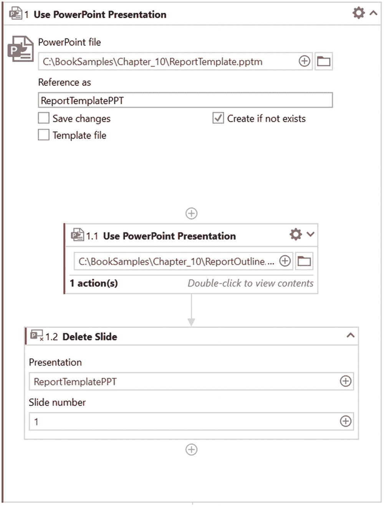

图 10-9 删除幻灯片活动练习的最终配置

> **注意**：我们取消了“保存更改”选项，因此在运行自动化之前，请打开 `ReportTemplate.pptm`；这将允许您查看自动化所做的所有更改。

图 10-10 显示了运行此活动后演示文稿的状态。

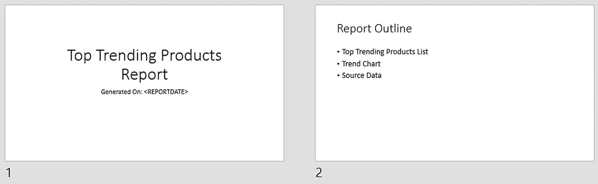

图 10-10 删除幻灯片练习后 `ReportTemplate.pptm` 的状态

## 添加新幻灯片

`添加新幻灯片`活动允许您向 PowerPoint 演示文稿中添加一张新幻灯片。

### 配置

本节提供如何配置`添加新幻灯片`活动的说明，如图 10-11 所示。

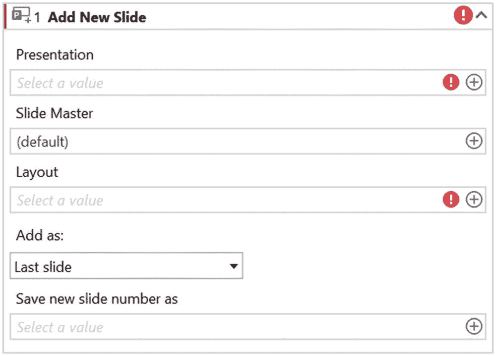

图 10-11 添加新幻灯片的活动卡片

`演示文稿`：这是活动卡片上的一个必填配置。此配置指定需要添加新幻灯片的 PowerPoint 演示文稿。此字段会预填充来自父级 `Use PowerPoint Presentation` 活动的 PowerPoint 演示文稿。

`幻灯片母版`：这是活动卡片上的一个必填配置。在 PowerPoint 中，您可以从`设计`选项卡更新主题，如图 10-12 所示。当此活动放置在 `Use PowerPoint Presentation` 活动中时，它会列出幻灯片当前使用的主题。此配置可用于指定新幻灯片应使用的主题。默认情况下，此配置的值为 `(default)`。

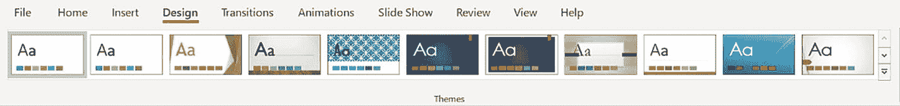

图 10-12 PowerPoint 中的主题

`布局`：这是活动卡片上的一个必填配置。在 PowerPoint 中，您可以通过右键单击幻灯片来查看幻灯片的布局选项。图 10-13 显示了所选主题中所有可用的布局选项。StudioX 也允许您指定布局。

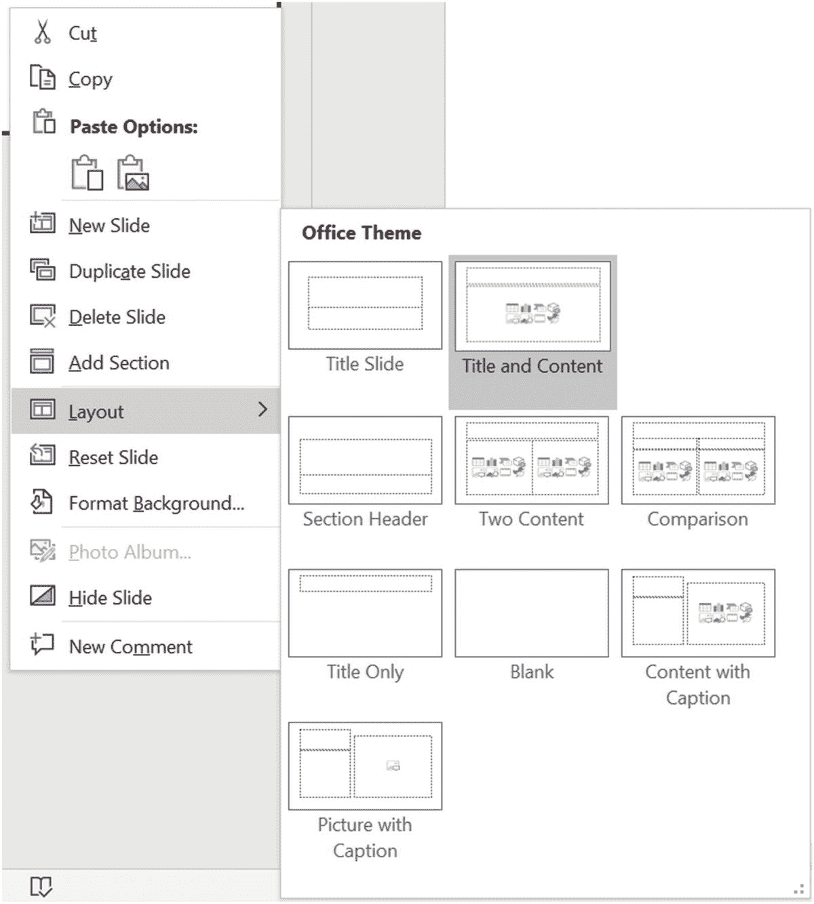

图 10-13 PowerPoint 中的布局选项

`添加为`：这是活动卡片上的一个必填配置。此配置允许您指定新幻灯片应添加到的位置。您可以选择 `First Slide`、`Last Slide` 或 `Slide number` 作为选项。默认情况下，选择 `Last Slide`。

`将新幻灯片编号另存为`：这是活动卡片上的一个可选配置。此配置允许您保存此新创建幻灯片的编号以供以后使用。

### 练习

**目标**：基于之前的练习，使用 `Add New Slide` 活动向 `C:\BookSamples\Chapter_10\ReportTemplate.pptm` 添加三张新幻灯片。所有三张幻灯片都应使用“标题和内容”布局。图 10-10 显示了此练习之前 PowerPoint 演示文稿的状态。

**源代码**：`Chapter_10-PresentationAutomationExercise`

**设置**：以下是分步实施说明：

1.  在 `StudioX` 中，将 `Add New Slide` 活动添加到外部 `Use PowerPoint Presentation` 活动的主体中，位于上一个练习中的 `Delete Slide` 活动之后。此幻灯片稍后将用于添加包含所有热门产品的数据表。

2.  `Presentation` 字段将预填充来自父级活动的 `ReportTemplatePPT` 引用。

3.  在 `Layout` 字段中，选择 `Title and Content` 选项。

4.  在 `Add as` 字段中，在下拉菜单中保留默认值 `Last slide`。

5.  在 `Save new slide number as` 字段中，单击 `Plus` 图标，选择 `Save for Later Use` 选项，然后输入 `DataTableSlideNumber` 作为值。

6.  重复步骤 1-4。这第二张新幻灯片将用于显示热门产品图表图像。在 `Save new slide number as` 字段中，单击 `Plus` 图标，选择 `Save for Later Use` 选项，然后输入 `TrendChartSlideNumber` 作为值。

7.  重复步骤 1-4。这第三张新幻灯片将用于附加源数据电子表格。在 `Save new slide number as` 字段中，单击 `Plus` 图标，选择 `Save for Later Use` 选项，然后输入 `SourceDataSlideNumber` 作为值。

完成练习后，`添加新幻灯片`活动的最终配置应类似于图 10-14。

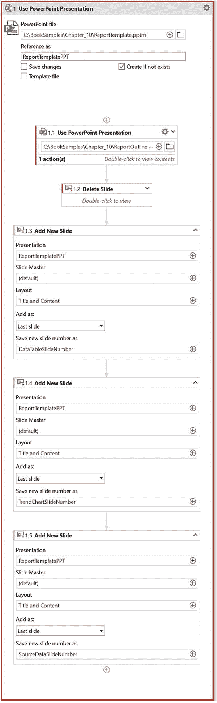

图 10-14 添加新幻灯片活动练习的最终配置

> **注意**：我们取消了“保存更改”选项，因此在运行自动化之前，请打开 `ReportTemplate.pptm`；这将允许您查看自动化所做的所有更改。

图 10-15 显示了运行此活动后演示文稿的状态。

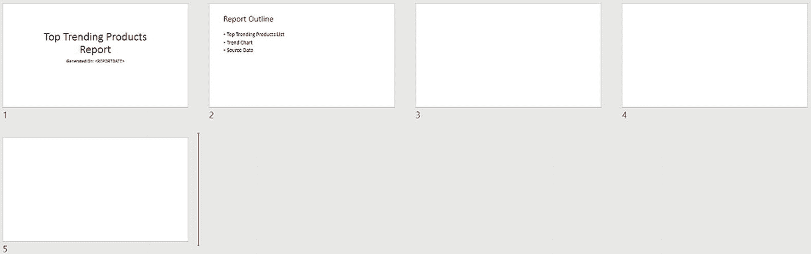

图 10-15 添加新幻灯片练习后 `ReportTemplate.pptm` 的状态

## 替换演示文稿中的文本

`替换演示文稿中的文本`活动允许您替换演示文稿中所有指定文本的匹配项。

### 配置

本节提供如何配置`替换演示文稿中的文本`活动的说明，如图 10-16 所示。

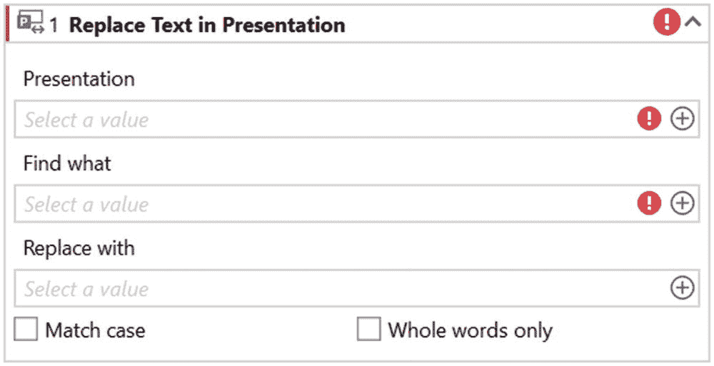

图 10-16

替换演示文稿中的文本活动卡片

## 替换演示文稿中的文本

**演示文稿**：这是活动卡片上的一个必填配置。此配置指定需要添加新幻灯片的 `PowerPoint` 演示文稿。此字段会预填充来自父级 `Use PowerPoint Presentation` 活动的 `PowerPoint` 演示文稿。

**查找内容**：这是活动卡片上的一个必填配置。您可以使用此配置来指定需要搜索和替换的文本。

**替换为**：这是活动卡片上的一个可选配置。此配置允许您指定将替换 `查找内容` 配置中指定的文本的新文本。

**匹配大小写**：这是活动卡片上的一个可选配置。此配置允许您指定搜索是否区分大小写。如果选中此选项，则搜索将区分大小写。

**全字匹配**：这是活动卡片上的一个可选配置。此配置允许您指定 `StudioX` 是否仅替换整个单词，而不替换作为较长单词一部分的文本。

**替换次数**：这是 `属性` 面板上的一个可选配置。此配置输出活动执行的替换次数。

### 练习

**目标**：基于我们之前的练习，使用 `替换演示文稿中的文本` 活动将标题幻灯片上的 `<REPORTDATE>` 替换为实际日期。图 10-15 反映了演示文稿的当前状态。

**源代码**：`Chapter_10-PresentationAutomationExercise`

**设置**：以下是分步实施说明：

1.  在 `StudioX` 中，将 `替换演示文稿中的文本` 活动添加到外部 `Use PowerPoint Presentation` 活动的主体中，位于上一个练习的 `添加新幻灯片` 活动之后。

2.  `演示文稿` 字段将预填充来自父级活动的 `ReportTemplatePPT` 引用。

3.  在 `查找内容` 字段中，单击 `加号` 图标，选择 `文本` 选项，然后输入 `<REPORTDATE>`。

4.  在 `替换为` 字段中，单击 `加号` 图标，将鼠标悬停在 `笔记本` 菜单上，选择 `日期 [工作表]` `今天 [单元格]` 值。这将返回当前日期。

5.  其余配置保持不变。

完成练习后，`替换演示文稿中的文本` 活动的最终配置应类似于图 10-17。

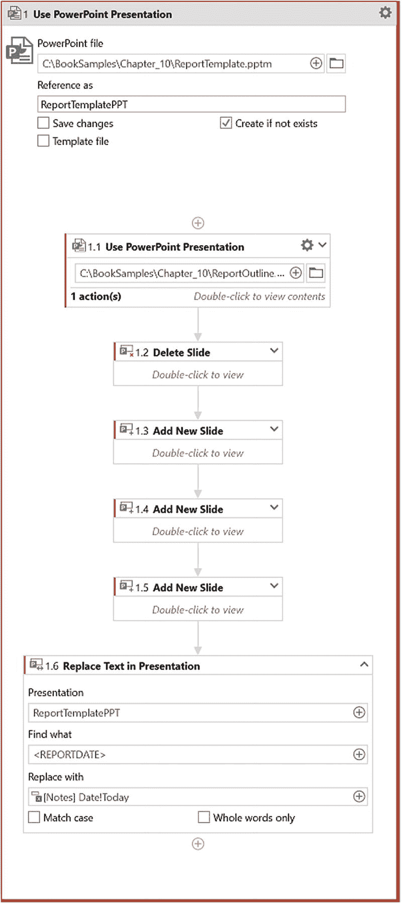

图 10-17

替换演示文稿中的文本活动练习的最终配置

注意：我们取消了“保存更改”选项的勾选，因此在运行自动化之前，请打开 `ReportTemplate.pptm`；这将允许您查看自动化所做的所有更改。

图 10-18 显示了运行此活动后标题幻灯片的状态。

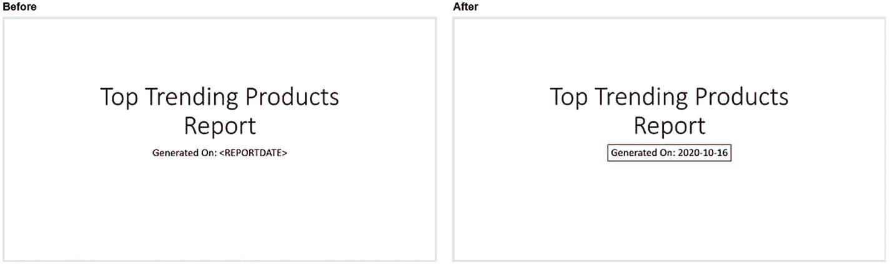

图 10-18

`ReportTemplate.pptm` 中标题幻灯片的前后对比视图

### 向幻灯片添加文本

`向幻灯片添加文本` 活动允许您向幻灯片上的指定占位符添加文本。

#### 配置

本节提供如何配置 `向幻灯片添加文本` 活动的说明，如图 10-19 所示。

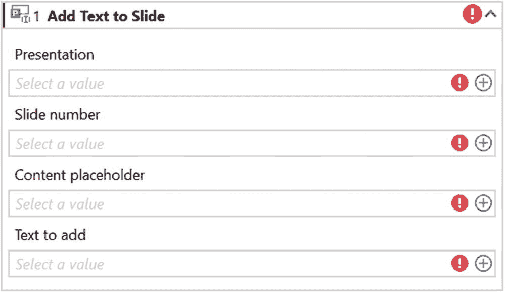

图 10-19

向幻灯片添加文本活动卡片

**演示文稿**：这是活动卡片上的一个必填配置。此配置指定您要添加文本的 `PowerPoint` 演示文稿。此字段会预填充来自父级 `Use PowerPoint Presentation` 活动的 `PowerPoint` 演示文稿。

**幻灯片编号**：这是活动卡片上的一个必填配置。此配置指定您要添加文本的幻灯片编号。

**内容占位符**：这是活动卡片上的一个必填配置。此配置允许您指定要添加文本的占位符名称。

提示：要查找占位符的名称，请在 `PowerPoint` 中转到“开始”选项卡，在“编辑”组中，单击“选择”并选择“选择窗格”，如图 10-20 所示。

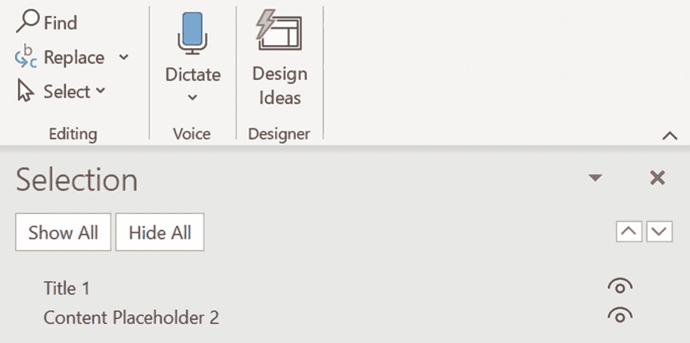

图 10-20

选择窗格包含 `PowerPoint` 中占位符的名称

*   幻灯片 3 的标题应为“热门趋势产品列表”。
*   幻灯片 4 的标题应为“趋势图表”。
*   幻灯片 5 的标题应为“源数据”。

**要添加的文本**：这是活动卡片上的一个必填配置。此配置允许您指定将添加到指定占位符的实际文本。

### 练习

**目标**：基于我们之前的练习，使用 `向幻灯片添加文本` 活动为在 `添加新幻灯片` 练习中创建的三张新幻灯片（幻灯片 3、4 和 5）添加标题。

图 10-15 显示了此练习之前 `PowerPoint` 演示文稿的状态。

**源代码**：`Chapter_10-PresentationAutomationExercise`

**设置**：以下是分步实施说明：

1.  在 `StudioX` 中，将 `向幻灯片添加文本` 活动添加到外部 `Use PowerPoint Presentation` 活动的主体中，位于上一个练习的 `替换演示文稿中的文本` 活动之后。

2.  `演示文稿` 字段将预填充来自父级活动的 `ReportTemplatePPT` 引用。

3.  首先，我们将更新幻灯片 3 的标题。在 `幻灯片编号` 字段中，单击 `加号` 图标，选择 `数字` 选项，然后输入 `3`。

4.  在 `内容占位符` 字段中，单击 `加号` 图标，选择 `文本` 选项，然后输入 `Title 1`。我们使用 `添加新幻灯片` 活动添加的所有新幻灯片都使用了“标题和内容”布局。标题占位符将被命名为 `Title 1`。

5.  接下来，在 `要添加的文本` 字段中，单击 `加号` 图标，选择 `文本` 选项，然后输入 `Top Trending Products List`。

6.  对另外两张幻灯片（即幻灯片 4 和 5）重复步骤 1-5。根据“目标”部分提供的信息更新 `幻灯片编号` 和 `要添加的文本` 字段。

完成练习后，`向幻灯片添加文本` 活动的最终配置应类似于图 10-21。

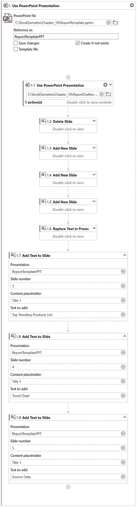

图 10-21

向幻灯片添加文本练习的最终配置

注意：我们取消了“保存更改”选项的勾选，因此在运行自动化之前，请打开 `ReportTemplate.pptm`；这将允许您查看自动化所做的所有更改。

图 10-22 显示了运行此活动后演示文稿的状态。

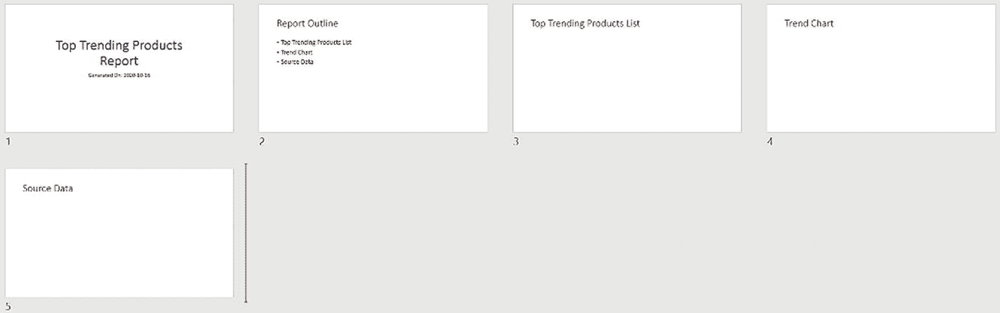

图 10-22

向幻灯片添加文本练习后 `ReportTemplate.pptm` 的状态

### 向幻灯片添加数据表

`向幻灯片添加数据表` 活动允许您向幻灯片上的指定占位符添加数据表。

#### 配置

本节提供如何配置 `向幻灯片添加数据表` 活动的说明，如图 10-23 所示。

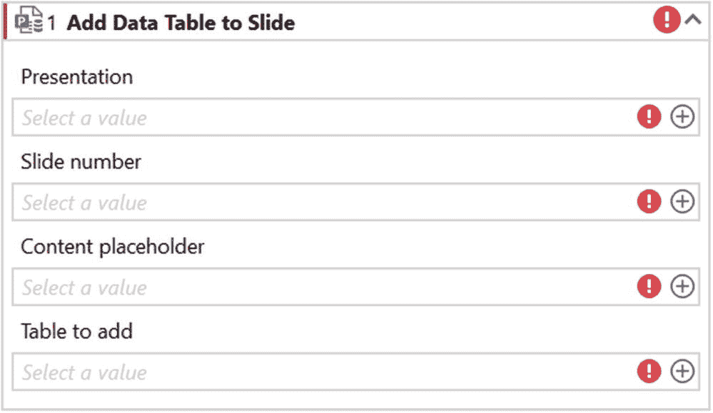

图 10-23

“向幻灯片添加数据表”活动卡片

**演示文稿**：这是活动卡片上的一项必需配置。此配置用于指定要添加数据表的 `PowerPoint` 演示文稿。此字段会预先填充来自父级 `Use PowerPoint Presentation` 活动的 `PowerPoint` 演示文稿。

**幻灯片编号**：这是活动卡片上的一项必需配置。此配置用于指定要添加数据表的幻灯片编号。

**内容占位符**：这是活动卡片上的一项必需配置。此配置允许您指定要添加数据表的占位符名称。请参阅 `Add Text to Slide` 活动，了解如何在 `PowerPoint` 中查找占位符名称。

**要添加的表**：这是活动卡片上的一项必需配置。此配置允许您指定将添加到指定占位符的实际数据表。

# 向幻灯片添加数据表

**目标**：基于之前的练习，使用 `Add Data Table to Slide` 活动将 `C:\BookSamples\Chapter_10\TopTrendingProducts.xlsx` 文件中的数据表添加到演示文稿的第 3 张幻灯片。图 10-22 显示了此练习开始前 PowerPoint 演示文稿的状态。

**源代码**：`Chapter_10-PresentationAutomationExercise`

**设置**：以下是分步实施说明：

1.  我们首先需要访问 Excel 中的数据表。因此，在 `StudioX` 中，将 `Use Excel File` 活动添加到外部 `Use PowerPoint Presentation` 活动的主体中，位于上一个练习中的 `Add Text to Slide` 活动之后。
2.  在 `Excel file` 字段中，单击 `Folder` 图标，然后选择 `C:\BookSamples\Chapter_10\TopTrendingProducts.xlsx`。
3.  在 `Reference as` 字段中，保留默认值 `Excel`。
4.  取消选中 `Save changes` 和 `Create if not exists` 选项。
5.  将 `Add Data Table to Slide` 活动添加到 `Use Excel File` 活动的主体中。
6.  `Presentation` 字段将预先填充来自父级活动的 `ReportTemplatePPT` 引用。
7.  我们将数据表添加到第 3 张幻灯片。在 `Slide number` 字段中，单击 `Plus` 图标，选择 `Number` 选项，然后输入 `3`。
8.  在 `Content placeholder` 字段中，单击 `Plus` 图标，选择 `Text` 选项，然后输入 `Content Placeholder 2`。我们使用 `Add New Slide` 活动添加的所有新幻灯片都使用了 `Title and Content` 布局。标题占位符将被命名为 `Content Placeholder 2`。
9.  接下来，在 `Table to add` 字段中，单击 `Plus` 图标，将鼠标悬停在 `Excel` 上，然后选择 `Top Trending Products [Sheet]`。

完成练习后，“向幻灯片添加数据表”活动的最终配置应类似于图 10-24。

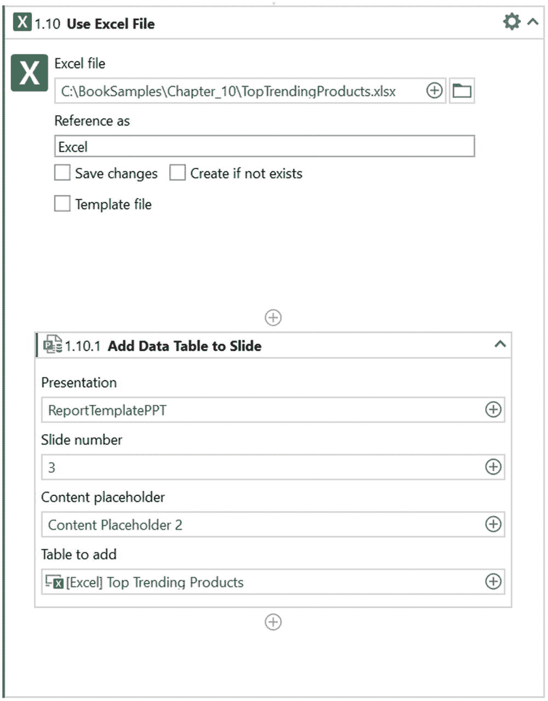

图 10-24 “向幻灯片添加数据表”练习的最终配置

注意 我们取消了“保存更改”选项，因此在运行自动化之前，请打开 `ReportTemplate.pptm`；这将允许您查看自动化所做的所有更改。

图 10-25 显示了运行此活动后标题幻灯片的状态。

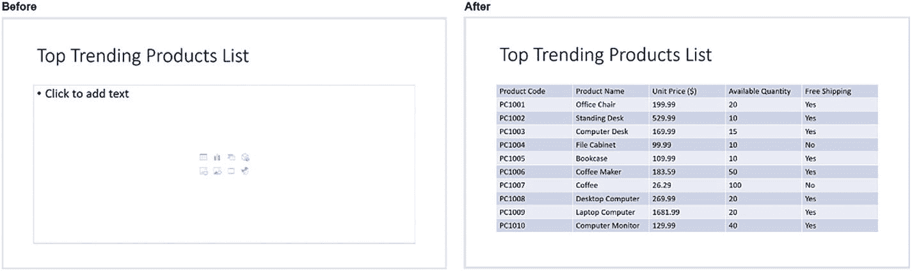

图 10-25 `ReportTemplate.pptm` 中数据表幻灯片的前后视图

# 向幻灯片添加图像/视频

“向幻灯片添加图像/视频”活动允许您将图像或视频添加到幻灯片上的指定占位符。

## 配置

本节提供如何配置“向幻灯片添加图像/视频”活动的说明，如图 10-26 所示。

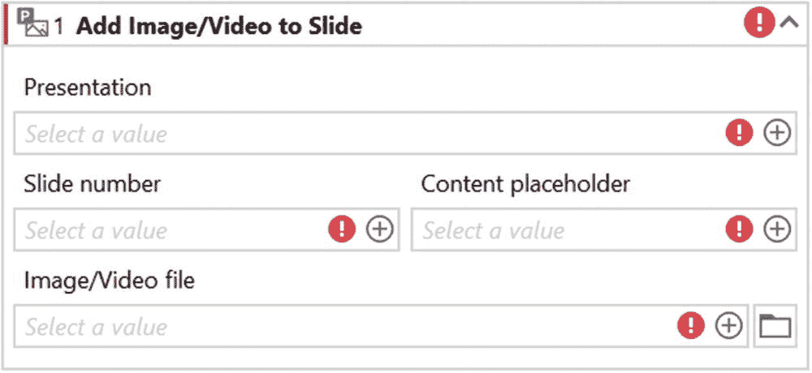

图 10-26 “向幻灯片添加图像/视频”活动卡片

**演示文稿**：这是活动卡片上的一项必需配置。此配置用于指定要添加图像或视频的 PowerPoint 演示文稿。此字段会预先填充来自父级 `Use PowerPoint Presentation` 活动的 PowerPoint 演示文稿。

**幻灯片编号**：这是活动卡片上的一项必需配置。此配置用于指定要添加图像或视频的幻灯片编号。

**内容占位符**：这是活动卡片上的一项必需配置。此配置允许您指定要添加图像或视频的占位符名称。请参阅 `Add Text to Slide` 活动，了解如何在 PowerPoint 中查找占位符名称。

**图像/视频文件**：这是活动卡片上的一项必需配置。此配置允许您指定将添加到指定占位符的实际图像或视频文件。

## 练习

**目标**：基于之前的练习，使用 `Add Image/Video to Slide` 活动将 `C:\BookSamples\Chapter_10\TrendChart.png` 文件中的趋势图图像添加到演示文稿的第 4 张幻灯片。图 10-22 显示了此练习开始前 PowerPoint 演示文稿的状态。

**源代码**：`Chapter_10-PresentationAutomationExercise`

**设置**：以下是分步实施说明：

1.  在 `StudioX` 中，将 `Add Image/Video to Slide` 活动添加到外部 `Use PowerPoint Presentation` 活动的主体中，位于上一个练习中的 `Use Excel File` 活动之后。
2.  `Presentation` 字段将预先填充来自父级活动的 `ReportTemplatePPT` 引用。
3.  我们将图像添加到第 4 张幻灯片。在 `Slide number` 字段中，单击 `Plus` 图标，选择 `Number` 选项，然后输入 `4`。
4.  在 `Content placeholder` 字段中，单击 `Plus` 图标，选择 `Text` 选项，然后输入 `Content Placeholder 2`。我们使用 `Add New Slide` 活动添加的所有新幻灯片都使用了 `Title and Content` 布局。标题占位符将被命名为 `Content Placeholder 2`。
5.  接下来，在 `Image/Video file` 字段中，单击 `Folder` 图标，然后选择 `C:\BookSamples\Chapter_10\TrendChart.png` 文件。

完成练习后，“向幻灯片添加图像/视频”活动的最终配置应类似于图 10-27。

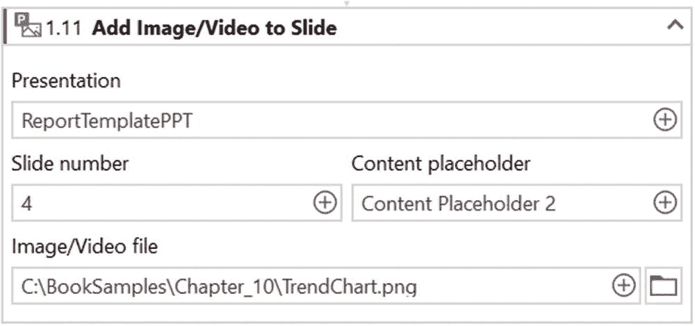

图 10-27 “向幻灯片添加图像/视频”练习的最终配置

注意 我们取消了“保存更改”选项，因此在运行自动化之前，请打开 `ReportTemplate.pptm`；这将允许您查看自动化所做的所有更改。

图 10-28 显示了运行此活动后标题幻灯片的状态。

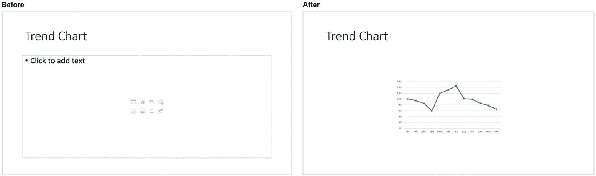

图 10-28 趋势图幻灯片的前后视图

# 向幻灯片添加文件

“向幻灯片添加文件”活动允许您将文件作为附件添加到演示文稿的幻灯片中。

## 配置

本节提供如何配置“将文件添加到幻灯片”活动的说明，如图 10-29 所示。

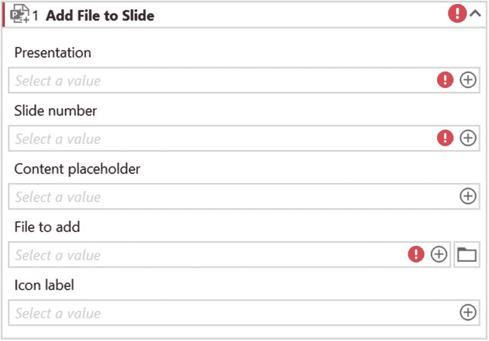

图 10-29 “将文件添加到幻灯片”活动卡片

**演示文稿**：这是活动卡片上的一个必填配置。此配置用于指定您要添加文件的 PowerPoint 演示文稿。此字段会预先填充来自父级 `Use PowerPoint Presentation` 活动的 PowerPoint 演示文稿。

**幻灯片编号**：这是活动卡片上的一个必填配置。此配置用于指定您要添加文件的幻灯片编号。

**内容占位符**：这是活动卡片上的一个可选配置。此配置允许您指定要添加文件的占位符名称。请参阅 `Add Text to Slide` 活动，了解如何在 PowerPoint 中查找占位符名称。

**要添加的文件**：这是活动卡片上的一个必填配置。此配置允许您指定将添加到指定占位符的实际文件。

**图标标签**：这是活动卡片上的一个可选配置。此配置允许您指定将显示在幻灯片上的图标标签。

## 练习

**目标**：基于之前的练习，使用 `Add File to Slide` 活动将源数据电子表格 `C:\BookSamples\Chapter_10\TopTrendingProducts.xlsx` 添加到演示文稿的第 5 张幻灯片。图 10-22 显示了此练习开始前 PowerPoint 演示文稿的状态。

# 源代码：Chapter_10-PresentationAutomationExercise

**设置**：以下是分步实施说明：

1.  在 `StudioX` 中，将 `Add File to Slide` 活动添加到外部 `Use PowerPoint Presentation` 活动的主体中，位置在上一个练习的 `Add Image/Video to Slide` 活动之后。

2.  `Presentation` 字段将预先填充来自父级活动的 `ReportTemplatePPT` 引用。

3.  我们将文件添加到第 5 张幻灯片。在 `Slide number` 字段中，单击 `Plus` 图标，选择 `Number` 选项，然后输入 `5`。

4.  在 `Content placeholder` 字段中，单击 `Plus` 图标，选择 `Text` 选项，然后输入 `Content Placeholder 2`。我们使用 `Add New Slide` 活动添加的所有新幻灯片都使用了“标题和内容”布局。标题占位符将被命名为 `Content Placeholder 2`。

5.  接下来，在 `File to add` 字段中，单击 `Folder` 图标，然后选择 `C:\BookSamples\Chapter_10\TopTrendingProducts.xlsx` 文件。

6.  在 `Icon label` 字段中，单击 `Plus` 图标，选择 `Text` 选项，然后输入 `Source Data`。

完成练习后，`Add File to Slide` 活动的最终配置应类似于图 10-30。

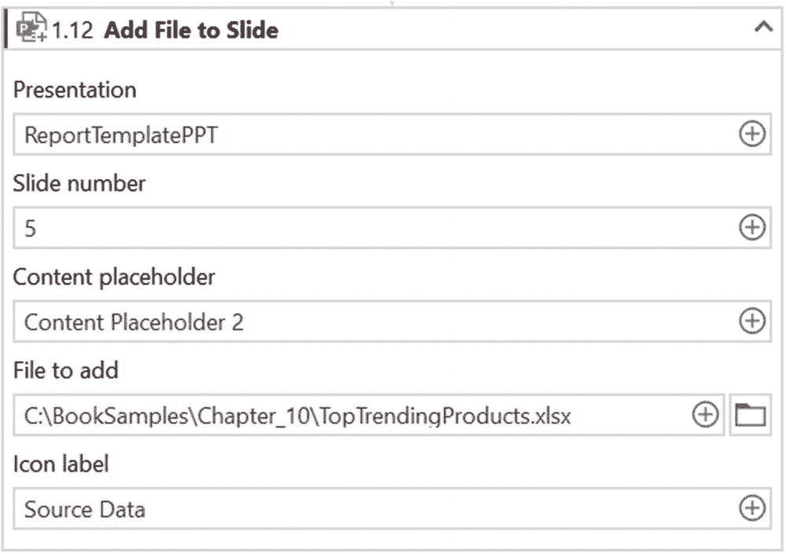

图 10-30 `Add File to Slide` 练习的最终配置

> **注意**：我们取消了“保存更改”选项，因此在运行自动化之前，请打开 `ReportTemplate.pptm`；这将允许您查看自动化所做的所有更改。

图 10-31 显示了运行此活动后标题幻灯片的状态。

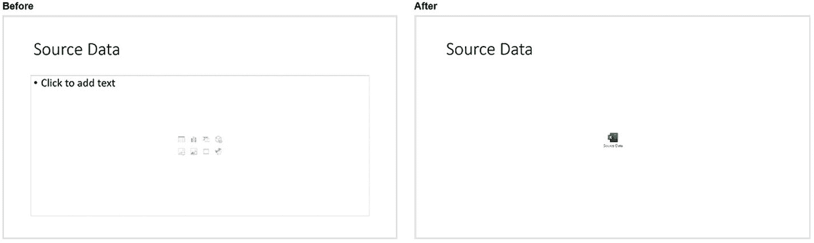

图 10-31 `ReportTemplate.pptm` 中源数据文件幻灯片的前后视图

## 运行演示文稿宏

`Run Presentation Macro` 活动允许您在 PowerPoint 演示文稿中运行指定的宏。

### 配置

本节提供如何配置 `Run Presentation Macro` 活动的说明，如图 10-32 所示。

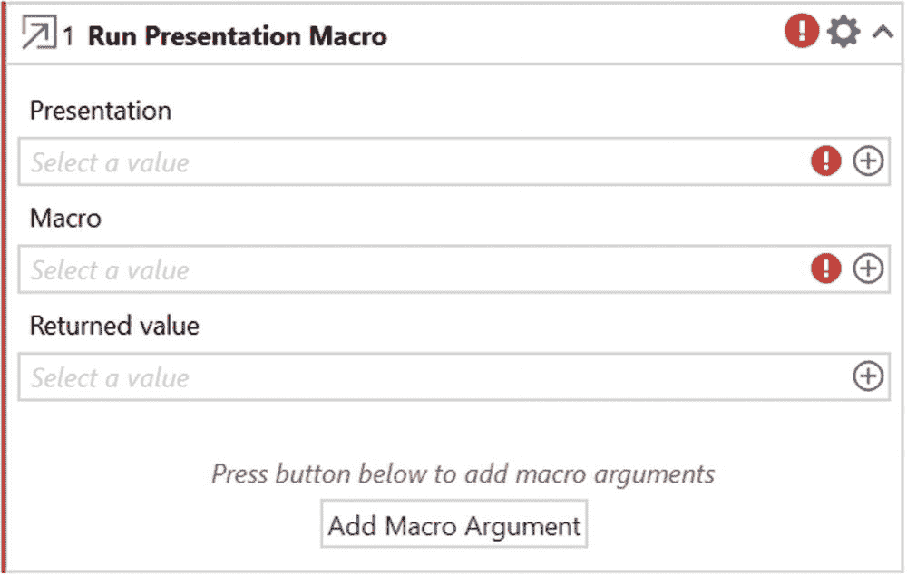

图 10-32 `Run Presentation Macro` 活动卡片

**演示文稿**：这是活动卡片上的一个必填配置。此字段用于标识包含您要运行的宏的 PowerPoint 演示文稿。此字段会预先填充来自父级 `Use PowerPoint Presentation` 活动的 PowerPoint 演示文稿。

**宏**：这是活动卡片上的一个必填配置。此配置允许您选择或输入要运行的宏的名称。

**返回值**：这是活动卡片上的一个可选配置。此配置允许您保存宏返回的任何值。

**添加宏参数**：这是活动卡片上的一个可选配置。此配置允许您向宏传递一个或多个参数（数据）。

### 练习

**目标**：基于之前的练习，使用 `Run Presentation Macro` 活动运行 `ResizeImageToCoverFullSlide` 宏。此宏将调整第 4 张幻灯片上的趋势图图像大小，使其占据整个幻灯片。图 10-28 显示了幻灯片的当前状态。

**源代码**：`Chapter_10-PresentationAutomationExercise`

**设置**：以下是分步实施说明：

1.  在 `StudioX` 中，将 `Run Presentation Macro` 活动添加到外部 `Use PowerPoint Presentation` 活动的主体中，位置在上一个练习的 `Add File to Slide` 活动之后。

2.  `Presentation` 字段将预先填充来自父级活动的 `ReportTemplatePPT` 引用。

3.  在 `Macro` 字段中，单击 `Plus` 图标，选择 `Text` 选项，然后输入 `ResizeImage`。

完成练习后，`Run Presentation Macro` 活动的最终配置应类似于图 10-33。

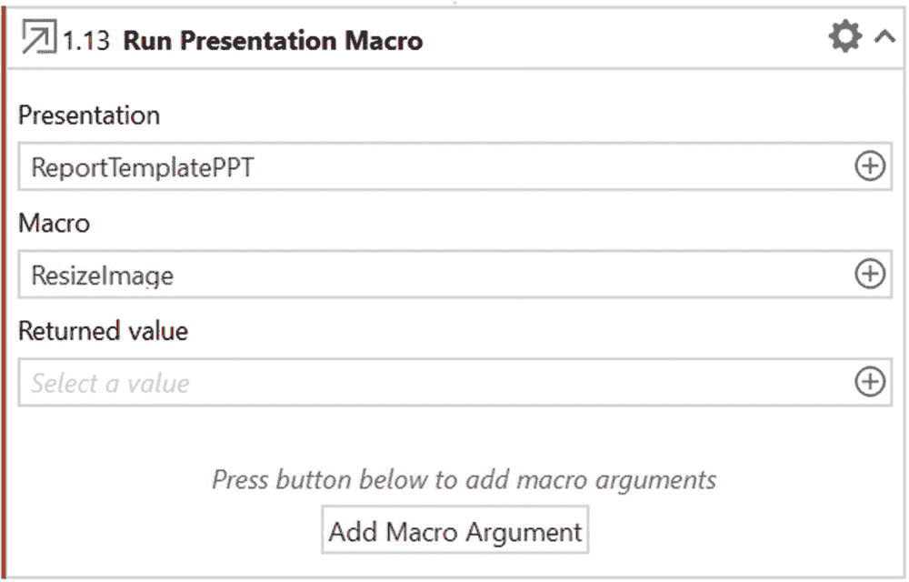

图 10-33 `Run Presentation Macro` 练习的最终配置

> **注意**：我们取消了“保存更改”选项，因此在运行自动化之前，请打开 `ReportTemplate.pptm`；这将允许您查看自动化所做的所有更改。

图 10-34 显示了运行此活动后标题幻灯片的状态。

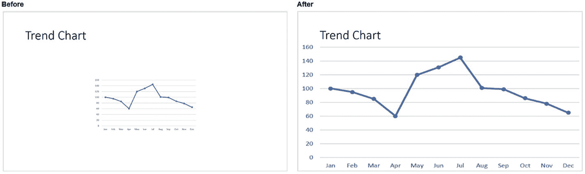

图 10-34 `ReportTemplate.pptm` 中趋势图幻灯片的前后视图

## 将 PowerPoint 文件另存为

`Save PowerPoint File As` 活动允许您将引用的 PowerPoint 文件保存为不同的 PowerPoint 文件类型，包括 `.pptx`、`.pptm` 和 `.ppt`。

### 配置

本节提供如何配置 `Save PowerPoint File As` 活动的说明，如图 10-35 所示。

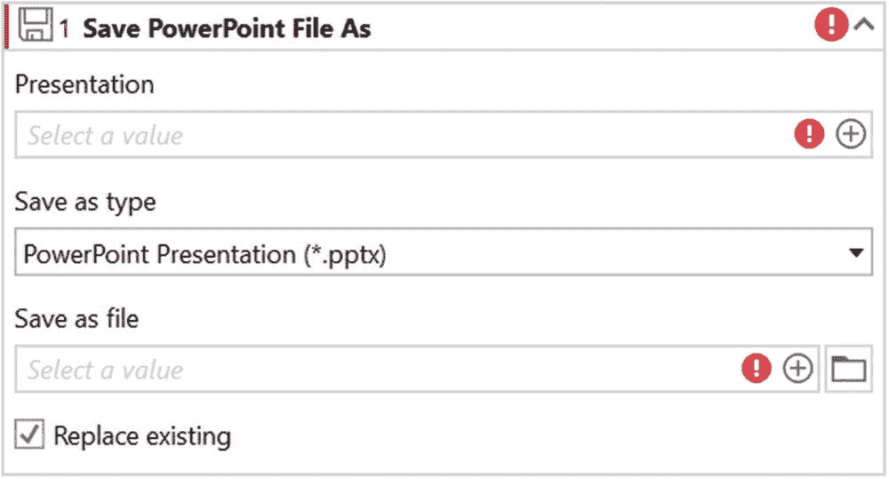

图 10-35 `Save PowerPoint File As` 活动卡片

**演示文稿**：这是活动卡片上的一个必填配置。此字段用于标识需要以不同 PowerPoint 文件类型保存的 PowerPoint 演示文稿。此字段会预填充来自父级 `Use PowerPoint Presentation` 活动的 PowerPoint 演示文稿。

> **注意**：`Save PowerPoint File As` 活动仅能将 PowerPoint 文件保存为 `.pptx`、`.ppt` 和 `.pptm` 类型。

**另存为类型**：这是活动卡片上的一个必填配置。此字段用于标识通过该活动将演示文稿保存为的新 PowerPoint 格式。以下是可用的下拉选项：

*   PowerPoint 演示文稿 (*.pptx)
*   启用宏的 PowerPoint 演示文稿 (*.pptm)
*   PowerPoint 97-2003 演示文稿 (*.ppt)

**另存为文件**：这是活动卡片上的一个必填配置。此字段提供将保存为新 PowerPoint 格式的 PowerPoint 文件的名称。

**替换现有文件**：这是活动卡片上的一个可选配置。如果选中，将替换目标位置中同名的现有文件。默认情况下，此字段处于选中状态。

### 练习

**目标**：基于之前的练习，使用 `Save PowerPoint File As` 活动将 `ReportTemplate.pptm` 文件保存为 `Report_YYYYMMDD.pptx` 文件。其中 `YYYYMMDD` 将被替换为生成报告的实际日期。

**设置**：以下是分步实施说明：

1.  在 `StudioX` 中，将 `Save PowerPoint File As` 活动添加到外部 `Use PowerPoint Presentation` 活动的主体中，位于上一个练习中的 `Run Presentation Macro` 活动之后。

2.  `Presentation` 字段将预填充来自父级活动的 `ReportTemplatePPT` 引用。

3.  接下来，点击 `Save as type` 下拉菜单，选择 `PowerPoint Presentation (*.pptx)` 选项。

4.  接下来，点击 `Save as file` 字段中的 `Plus` 图标，选择 `Text` 选项，并输入文件路径 `C:\BookSamples\Chapter_10\Report_`。

5.  然后，在 `Text Builder` 中，点击 `Plus` 图标，悬停在 `Notebook` 上，选择 `Date [Sheet] &#x`F0E4; `YYYYMMDD [Cell]`。

6.  在末尾添加 `.pptx` 并点击 `Save`。

7.  保持 `Replace existing` 选项处于选中状态。

完成练习后，`Save PowerPoint File As` 活动的最终配置应如图 10-36 所示。

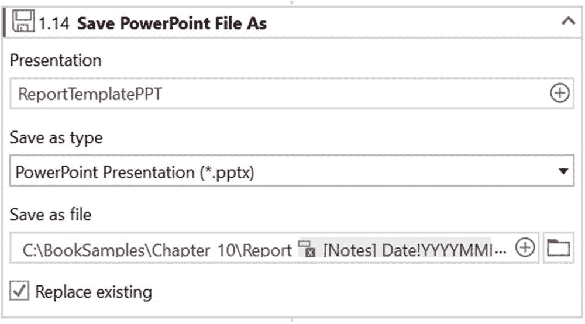
图 10-36
“将 PowerPoint 文件另存为”练习的最终配置

运行此活动后，将在目标文件夹中生成并保存一个新文件。

### 将演示文稿另存为 PDF

`将演示文稿另存为 PDF` 活动允许您将引用的 PowerPoint 演示文稿保存为 PDF 文件。

#### 配置

本节提供如何配置`将演示文稿另存为 PDF`活动的说明，如图 10-37 所示。

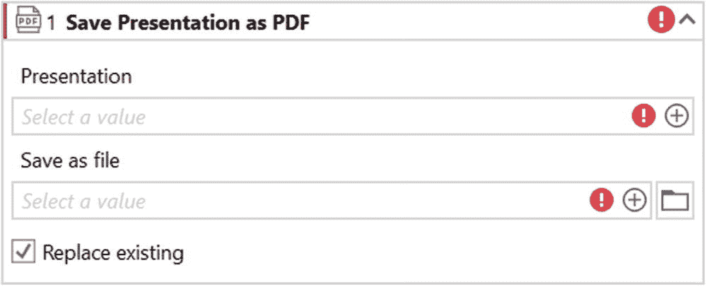
图 10-37
“将演示文稿另存为 PDF”活动卡片

`演示文稿`：这是活动卡片上的一个必填配置。此字段用于标识需要保存为 PDF 的 PowerPoint 演示文稿。此字段会预填充来自父级 `Use PowerPoint Presentation` 活动的 PowerPoint。

`另存为文件`：这是活动卡片上的一个必填配置。此字段提供用于保存由该活动创建的新 PDF 文件的文件路径。

`替换现有文件`：这是活动卡片上的一个可选配置。如果选中，将替换目标位置中同名的现有文件。默认情况下，此字段处于选中状态。

### 练习

**目标**：基于之前的练习，使用 `Save Presentation as PDF` 活动将 `ReportTemplate.pptm` 文件保存为 `Report_YYYYMMDD.pdf` 文件。其中 `YYYYMMDD` 将被替换为生成报告的实际日期。

**设置**：以下是分步实施说明：

1. 在 `StudioX` 中，将 `Save Presentation as PDF` 活动添加到外部 `Use PowerPoint Presentation` 活动的主体中，位于上一个练习中的 `Save PowerPoint File As` 活动之后。

2. `Presentation` 字段将预填充来自父级活动的 `ReportTemplatePPT` 引用。

3. 接下来，点击 `Save as file` 字段中的 `Plus` 图标，选择 `Text` 选项，并输入文件路径 `C:\BookSamples\Chapter_10\Report_`。

4. 然后，在 `Text Builder` 中，点击 `Plus` 图标，悬停在 `Notebook` 上，选择 `Date [Sheet] &#x`F0E4; `YYYYMMDD [Cell]`。

5. 在末尾添加 `.pdf` 并点击 `Save`。

6. 保持 `Replace existing` 选项处于选中状态。

完成练习后，`Save Presentation as PDF` 活动的最终配置应如图 10-38 所示。

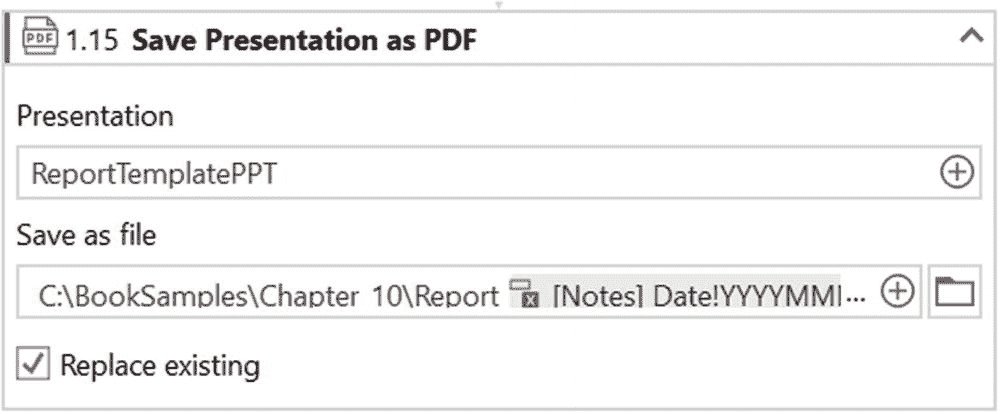
图 10-38
“将演示文稿另存为 PDF”练习的最终配置

运行此活动后，将在目标文件夹中生成并保存一个新文件。