# 11. 产品数据录入自动化

在本章中，我们将自动化一项日常任务，即作为库存管理流程的一部分录入产品数据。

## 学习目标

此自动化将帮助您理解以下主题：

*   创建文件夹结构、复制和移动文件

*   获取过滤后的电子邮件列表、保存电子邮件附件、移动电子邮件和发送电子邮件

*   在 Excel 中读取、过滤和保存数据

*   使用 Excel 跟踪状态

*   在 Web 应用程序中输入数据

## 手动任务概述

当库存管理员收到采购团队发来的新库存邮件时，任务便开始了。图 11-1 展示了产品数据录入任务的高级概览。

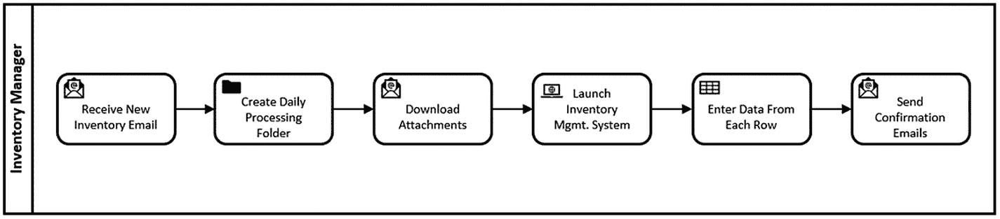

图 11-1

产品数据录入任务的高级概览

库存管理员会定期检查 Outlook 收件箱中是否有未读的新库存邮件。图 11-2 展示了一封示例邮件。

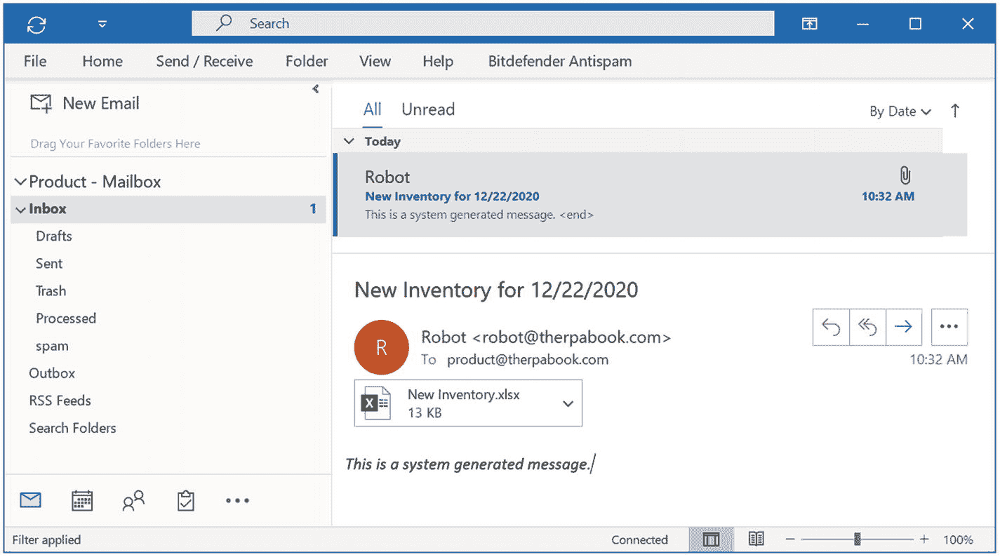

图 11-2

新库存邮件示例

如果存在一封带有产品列表附件的未读新库存邮件，库存管理员会将附件下载到一个文件夹中以便进一步处理。为确保同一封邮件不被重复处理，库存管理员会将该邮件移至 Outlook 中的“已处理”文件夹。

如果这是当天的第一封邮件，那么在下载附件之前，库存管理员会创建一个新的文件夹结构来管理处理流程。这个新文件夹以 YYYYMMDD 格式的当前日期命名，位于 DailyProcessing 文件夹下。在当前日期文件夹下，库存管理员还会创建两个子文件夹：“待处理”和“已处理”。

所有附件默认下载到“待处理”文件夹，一旦文件中的所有新产品都已录入库存管理系统，文件就会被移至“已处理”文件夹。图 11-3 展示了用于管理产品数据录入任务的文件夹结构。

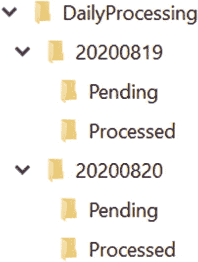

图 11-3

用于管理产品数据录入任务的文件夹结构

需要录入库存的产品以 Excel 附件的形式包含在邮件中。该 Excel 文件采用预定义格式，如图 11-4 所示。

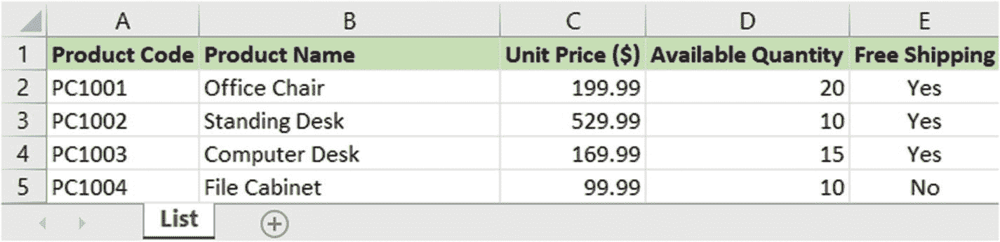

图 11-4

产品列表 Excel 附件示例

库存管理员在 Web 浏览器中启动库存管理系统，如图 11-5 所示。同时，库存管理员在 Excel 中打开产品列表。

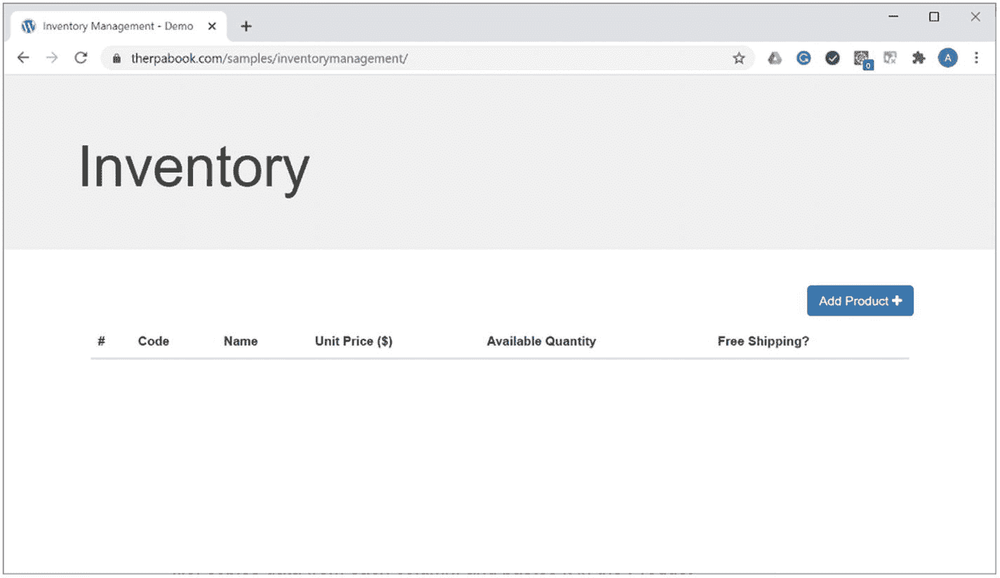

图 11-5

库存管理系统

库存管理员逐行浏览 Excel 文件，从每一列复制数据，并将其粘贴到库存管理系统的“产品详情”对话框中，如图 11-6 所示。

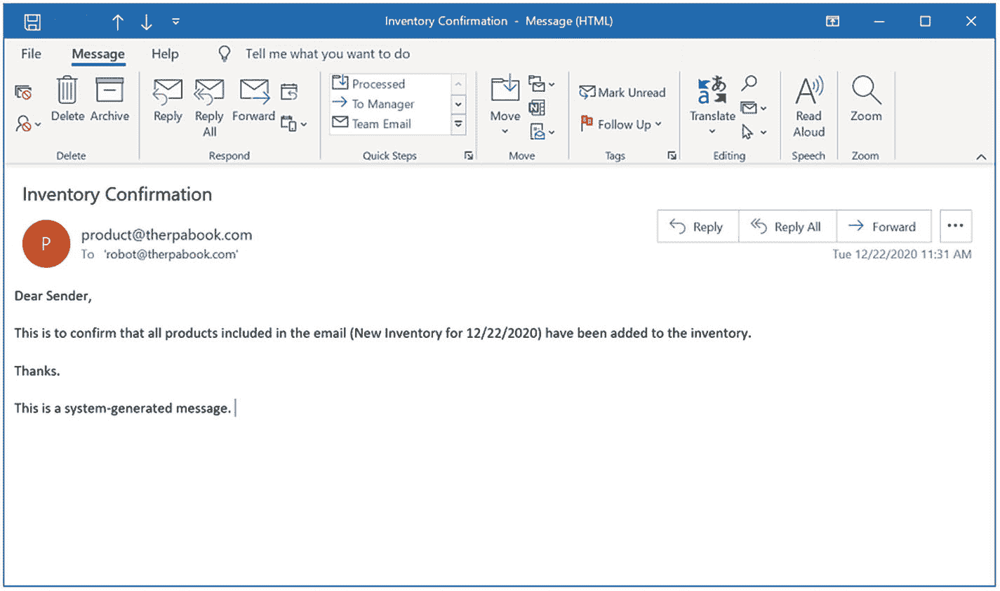

图 11-7

新库存确认邮件示例

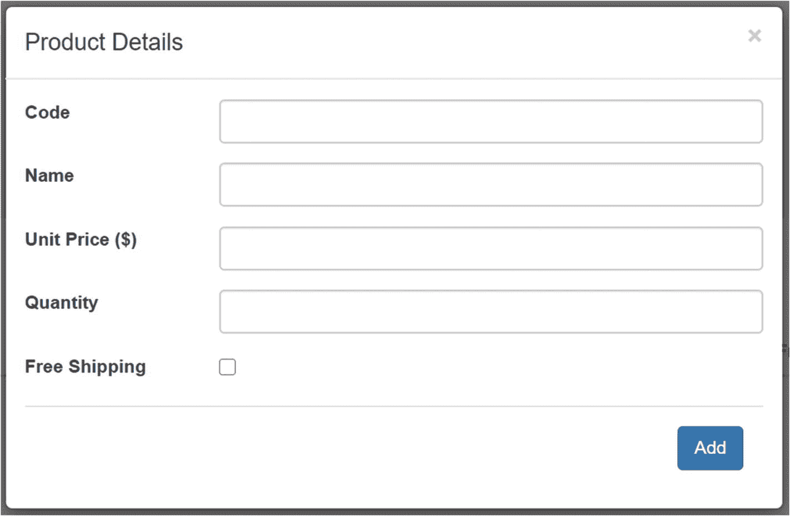

图 11-6

库存管理系统的“产品详情”对话框

所有产品都录入库存管理系统后，库存管理员会向发件人发送一封邮件，确认处理已完成。

## 解决方案设计

本节概述了我们将如何设计自动化流程。图 11-8 展示了产品数据录入任务自动化的流程图。

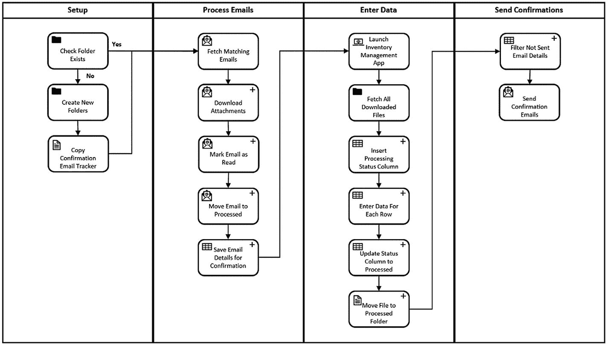

图 11-8

产品数据录入任务自动化的解决方案设计

将自动化流程划分为更小、更合乎逻辑的流程有助于简化实施和调试过程。如图 11-8 所示，我们将把自动化流程划分为四个逻辑流程。

### 初始化

在此流程中，自动化将执行以下步骤：

*   自动化将首先检查当前日期所需的文件夹结构是否存在。

*   如果文件夹不存在，自动化将创建所需的文件夹结构。这还包括将“确认邮件跟踪器”文件复制到当前日期文件夹。

### 处理邮件

在此流程中，自动化将执行以下步骤：

*   获取一封或多封未读的新库存邮件。

*   将附件下载到 `DailyProcessing\YYYYMMDD` 文件夹下的“待处理”文件夹中。

*   将邮件标记为已读，并将其移至“已处理”文件夹，以确保不会被再次拾取。

*   保存邮件信息，以便自动化稍后发送确认通知。

### 录入数据

在此流程中，自动化将执行以下步骤：

*   在浏览器中启动库存管理系统。

*   获取“待处理”文件夹中的所有新库存 Excel 文件。

*   在每个 Excel 文件中插入一个“状态”列，以便在单个行级别跟踪处理状态。

*   自动化将从所有行复制数据，并将数据录入到库存管理 Web 应用程序中。

*   一旦单行数据录入完成，自动化会将状态更新为“已处理”。

*   整个文件处理完毕后，自动化会将该文件移至“已处理”文件夹。这将确保文件不会被重复处理。

### 发送确认

在此流程中，自动化将执行以下步骤：

*   自动化将从“确认邮件跟踪器”中获取状态为“未发送”的邮件列表。

*   自动化将向所有发件人发送确认邮件。

## 实施

现在我们已经很好地理解了如何设计自动化流程，可以开始实施了。

### 步骤 1：设置

本实施的第一步是确保已从本书的 GitHub 仓库下载了演示应用程序及相关模板。

注意

本章假设自动化文件夹 `ProductDataEntryAutomation` 位于 `C:\BookSamples\` 文件夹内。

`ProductDataEntryAutomation` 文件夹包含三个子文件夹，如图 11-9 所示。

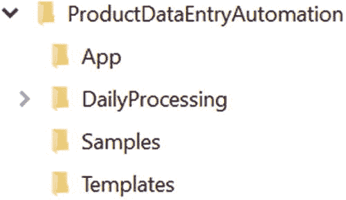

图 11-9

产品数据录入自动化的文件夹结构

#### 应用程序

此子文件夹包含库存管理 Web 应用程序。您可以通过单击 `home.html` 来启动该 Web 应用程序，它将在您的默认 Web 浏览器中打开。

您也可以在浏览器中通过 [`https://therpabook.com/samples/inventorymanagement/`](https://therpabook.com/samples/inventorymanagement/) 访问库存管理 Web 应用程序。

#### 模板

此子文件夹包含自动化流程使用的两个 Excel 模板。

`ProductsList.xlsx` 模板帮助 UiPath 理解通过电子邮件接收的 Excel 附件的结构。图 11-10 展示了此 Excel 模板的结构。

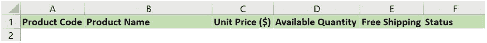

图 11-10

作为电子邮件附件接收的产品列表的 Excel 模板

`ConfirmationEmailTracker.xlsx` 模板的副本将被创建在 `DailyProcessing\YYYYMMDD` 文件夹中。自动化流程将使用此 Excel 文件来存储电子邮件详情，以便在每次运行结束时发送确认邮件。图 11-11 展示了此 Excel 模板的结构。

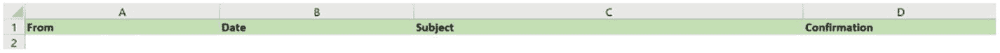

图 11-11

用于确认邮件追踪器的 Excel 模板

#### DailyProcessing

此子文件夹为空，自动化流程将使用它来创建新文件夹，并保存和处理附件。

#### Samples

此子文件夹包含一个可用于测试的示例库存文件。

### 步骤 2：创建项目

接下来，我们将在 UiPath StudioX 中创建一个新项目。以下是创建新项目的步骤。您不必使用完全相同的名称和描述。

1.  启动 `UiPath StudioX`。

2.  在 `Home` 屏幕上，点击 `Blank Task` 从头开始创建一个新项目。

3.  在 `Process name:` 字段中，输入 `Chapter_11_ProductDataEntryPrototype`。

4.  在 `Description:` 字段中，输入 `Automation for product data entry prototype`。

5.  点击 `Create` 按钮创建项目。

图 11-12 展示了此步骤的最终配置。

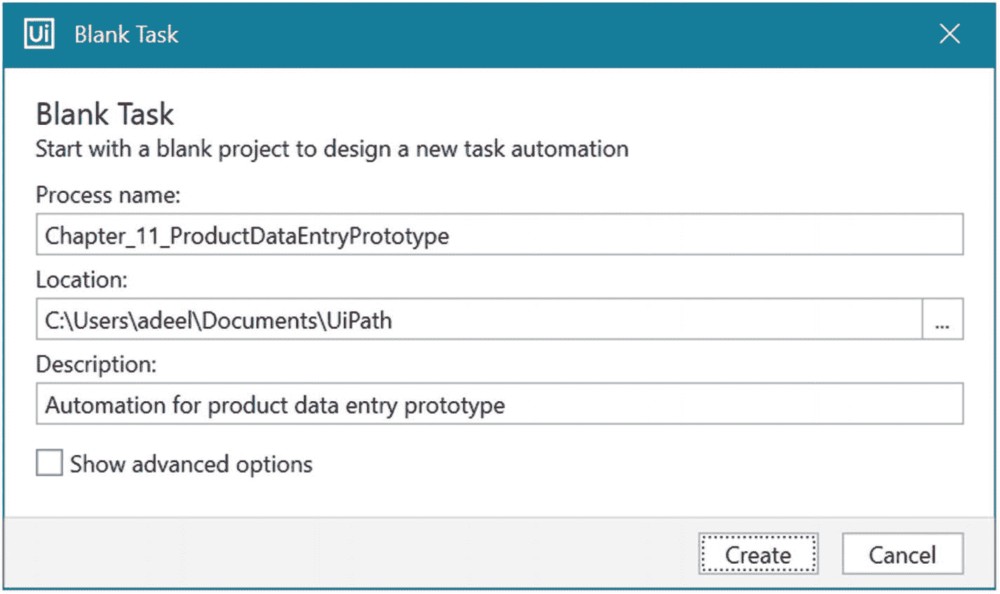

图 11-12

创建新项目

### 步骤 3：设置项目笔记本

此自动化流程将使用自定义公式来生成文件夹和文件路径。

我们将配置一个自定义笔记本，用于管理所有自定义公式。图 11-13 展示了包含自动化流程使用的所有公式的自定义笔记本。

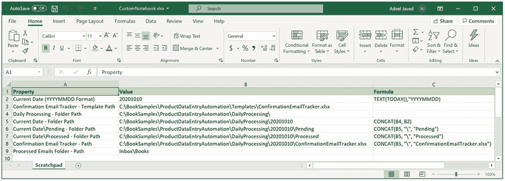

图 11-13

项目笔记本中的自定义公式

表 11-1 描述了图 11-13 中每个值的用途。

表 11-1

Scratchpad 中每个值的说明

| 属性 | 说明 |
| --- | --- |
| 当前日期 | 单元格 B2 中的公式将生成 YYYYMMDD 格式的当前日期，该日期将被后续行中的所有路径使用。 |
| 确认邮件追踪器 – 模板路径 | `ConfirmationEmailTracker.xlsx` 模板的静态路径。 |
| 每日处理 – 文件夹路径 | 自动化流程用于存储每日处理文件夹和文件的静态路径。 |
| 当前日期 – 文件夹路径 | 自动化流程用于管理当日处理的动态文件夹路径。 |
| 当前日期\待处理 – 文件夹路径 | 自动化流程用于存储待处理附件的动态文件夹路径。 |
| 当前日期\已处理 – 文件夹路径 | 自动化流程用于存储已处理附件的动态文件夹路径。 |
| 确认邮件追踪器 – 路径 | 存放当日 `ConfirmationEmailTracker.xlsx` 副本的动态路径。 |
| 已处理邮件文件夹 – 路径 | Outlook 文件夹的静态路径，所有邮件在处理后将被移入该文件夹。 |

以下是配置自定义笔记本的分步说明：

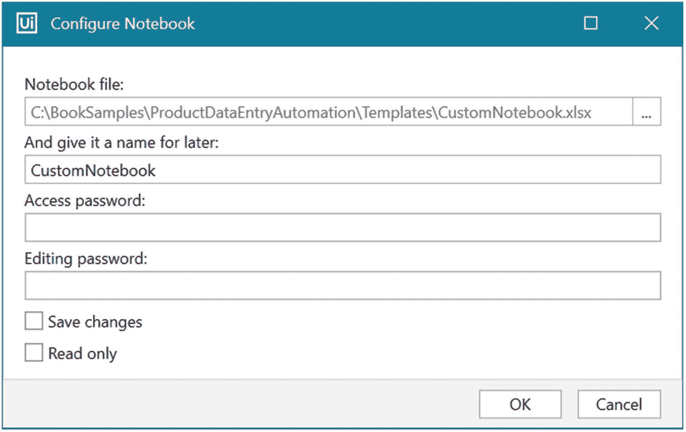

图 11-14

配置自定义笔记本

1.  在 `StudioX` 中，点击顶部功能区中的 `Notebook` ➤ `Configure Notebook` 菜单。

2.  在 `Notebook file` 字段中，点击 `...` 并选择 `C:\BookSamples\ProductDataEntryAutomation\Templates\CustomNotebook.xlsx` 文件，如图 11-14 所示。

3.  点击 `OK` 按钮。

### 步骤 4：检查文件夹结构是否存在

自动化流程可以在一天内运行多次。当天的首次运行将创建所需的文件夹结构，因此后续运行无需重复此步骤。为此，自动化流程需要检查 `DailyProcessing` 文件夹下是否已存在当前日期（YYYYMMDD 格式）的文件夹：

1.  在 `StudioX` 中，将 `Group` 活动添加到一个空白流程中。

2.  将 `Display Name` 更新为 `Initialize`。

3.  将 `Folder Exists` 活动添加到 `Initialize` 组活动的主体中。

4.  将 `Display Name` 更新为 `Check Folder Structure Exists`。

5.  在 `Folder path` 字段中，选择 `Notebook` ➤ `Indicate in Excel` 选项。从 `Scratchpad` 工作表中选择单元格 `B5`。如表 11-1 所述，此单元格将包含当前日期文件夹的动态路径。

6.  在 `Save result` 字段中，使用 `Save for Later Use` 选项，并将保存的值命名为 `CurrentDateFolderExists`。

在此步骤中，我们不会指定文件夹存在时需要执行的操作。我们将在下一步中进行。图 11-15 展示了此步骤的配置。

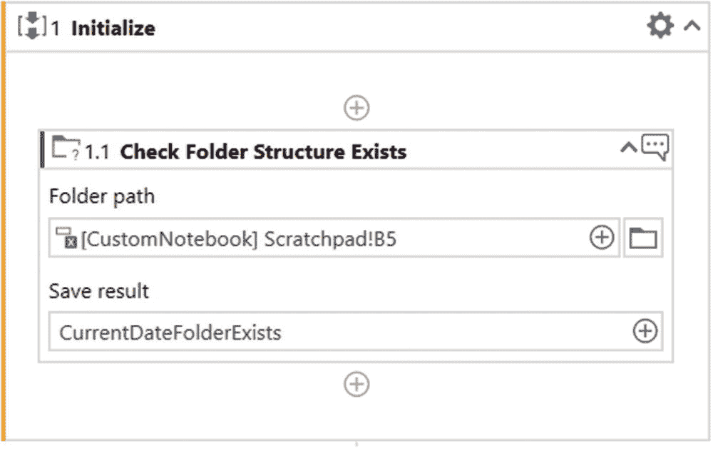

图 11-15

“检查文件夹结构是否存在”步骤的配置

### 步骤 5：创建新文件夹

接下来，我们将使用“检查文件夹结构是否存在”活动中的结果 `CurrentDateFolderExists`，并指定自动化需要执行的操作。

如果 `CurrentDateFolderExists` 为 true，则表示文件夹结构已由之前的运行创建。另一方面，如果 `CurrentDateFolderExists` 为 false，则自动化需要在继续之前创建必要的文件夹结构。

创建文件夹结构后，此流程的最后一步是将 `ConfirmationEmailTracker.xlsx` 复制到当前日期文件夹。自动化将使用此 Excel 文件保存电子邮件详细信息，以便在运行结束时向发件人发送完成确认电子邮件：

1.  在 `StudioX` 中，将 `If` 活动添加到 `Initialize` 组活动主体中，位于 `Check Folder Structure Exists` 活动之后。

2.  将 `Display Name` 更新为 `Create` `Folder Structure`。

3.  使用 `Condition Builder` 创建一个条件 `CurrentDateFolderExists is false`。

4.  在 `Create Folder Structure` 活动的 `Then` 块中添加一个 `Create Folder` 活动。

5.  将 `Display Name` 更新为 `Create Current Date Folder`。

6.  在 `Folder name` 字段中，选择 `Notebook` ➤ `Indicate in Excel` 选项。从 `Scratchpad` 工作表中选择单元格 `B5`。

7.  在 `Create Folder Structure` 活动的 `Then` 块中，于 `Create Current Date Folder` 活动之后添加另一个 `Create Folder` 活动。

8.  将 `Display Name` 更新为 `Create Pending Sub-Folder`。

9.  在 `Folder name` 字段中，选择 `Notebook` ➤ `Indicate in Excel` 选项。从 `Scratchpad` 工作表中选择单元格 `B6`。如表 11-1 所述，此单元格将包含当前日期 Pending 文件夹的动态路径。

10.  在 `Create Folder Structure` 活动的 `Then` 块中，于 `Create Pending Sub-Folder` 活动之后添加另一个 `Create Folder` 活动。

11.  将 `Display Name` 更新为 `Create Processed Sub-Folder`。

12.  在 `Folder name` 字段中，选择 `Notebook` ➤ `Indicate in Excel` 选项。从 `Scratchpad` 工作表中选择单元格 `B7`。如表 11-1 所述，此单元格将包含当前日期 Processed 文件夹的动态路径。

13.  在 `Create Folder Structure` 活动的 `Then` 块中，于 `Create Processed Sub-Folder` 活动之后添加一个 `Copy File` 活动。

14.  将 `Display Name` 更新为 `Copy Confirmation Email Tracker`。

15.  在 `From` 字段中，选择 `Notebook` ➤ `Indicate in Excel` 选项。从 `Scratchpad` 工作表中选择单元格 `B3`。如表 11-1 所述，此单元格将包含 `ConfirmationEmailTracker.xlsx` 模板文件的静态路径。

16.  在 `To` 字段中，选择 `Notebook` ➤ `Indicate in Excel` 选项。从 `Scratchpad` 工作表中选择单元格 `B8`。如表 11-1 所述，此单元格将包含放置跟踪器的动态路径。

图 11-16 显示了此步骤的配置。

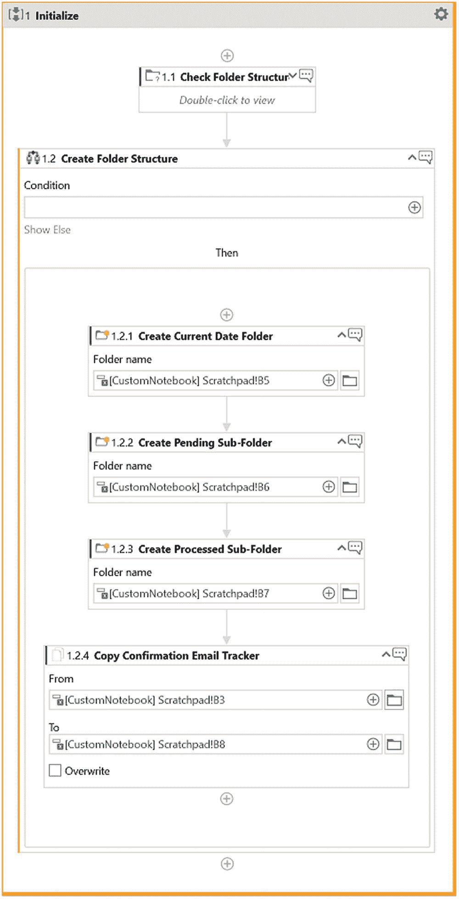

图 11-16

创建文件夹结构步骤的配置

### 步骤 6：处理电子邮件

接下来，自动化需要连接 Outlook 帐户并获取相关电子邮件。为了缩小自动化需要获取和处理的电子邮件列表，我们还将添加一个筛选器。对于每封电子邮件，自动化都需要下载附件，将邮件标记为已读，并将邮件移动到 Processed 文件夹：

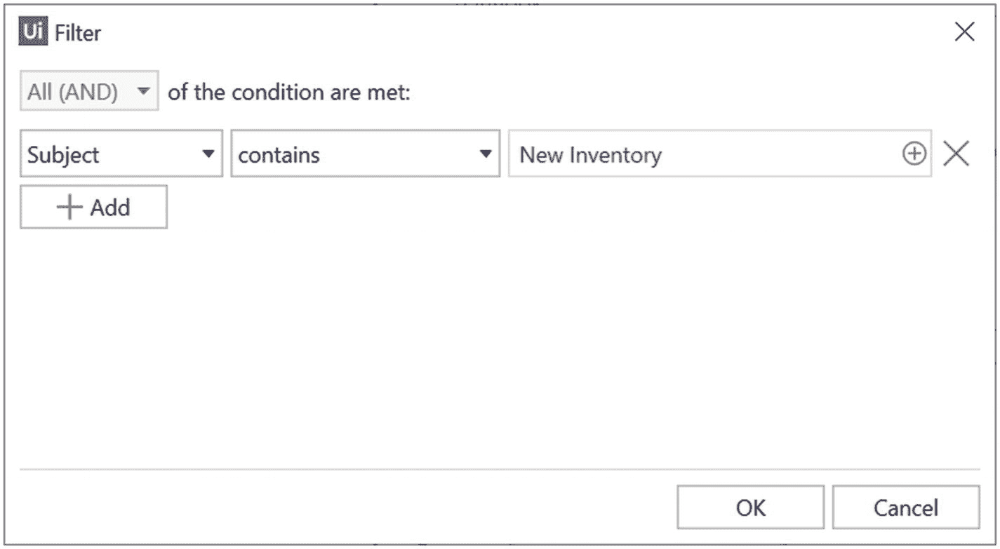

图 11-17

用于获取 Outlook 电子邮件的附加筛选器对话框

1.  在 `StudioX` 中，将 `Use Desktop Outlook App` 活动添加到 `Initialize` 组活动之后。

2.  将 `Display Name` 更新为 `Process Emails`。

3.  如果您在 Outlook 中设置了多个帐户，请从 `Account` 下拉菜单中选择合适的帐户。否则，您可以使用 `Default Email Account`。对于此自动化，您可以使用同一帐户发送和接收电子邮件。

4.  将 `Reference as` 字段中的值保留为 `Outlook`。

5.  在 `Process Emails` 活动的主体中添加 `For Each Email` 活动。这将允许您获取所有匹配的电子邮件并逐一处理。

6.  将 `Display Name` 更新为 `Fetch Matching Emails`。

7.  在 `For each` 字段中，将值保留为 `CurrentMail`。`Fetch Matching Emails` 活动主体中的所有活动都可以通过引用 `CurrentMail` 来访问当前电子邮件的属性。

8.  在 `Emails from` 字段中，选择接收电子邮件的文件夹；这通常是 `Inbox` 文件夹。

9.  将 `Limit emails to first` 字段更新为 `10`。由于这是一个原型，我们预计不会有太多电子邮件，因此 10 是可以的，但这会根据您的实际使用情况而变化。

10.  自动化只对带有附件的未读电子邮件感兴趣，因此请勾选 `Unread mail` 和 `With attachments only` 复选框。

11.  为了进一步限制自动化获取的电子邮件，请在电子邮件主题上添加一个 `Additional Filter`，如图 11-17 所示。

12.  在 `Fetch Matching Emails` 活动的主体中添加一个 `Save Email Attachments` 活动。

13.  将 `Display Name` 更新为 `Download Attachments`。

14.  在 `Email` 字段中，选择 `CurrentMail`。

15.  电子邮件将仅包含 Excel 附件，但为了确保自动化仅从电子邮件中下载 Excel 附件，请在 `Filter by file name` 字段中输入 `*.xls*`。

16.  在 `Save to folder` 字段中，选择 `Notebook` ➤ `Indicate in Excel` 选项。从 `Scratchpad` 工作表中选择单元格 `B6`。

17.  在 `Fetch Matching Emails` 活动的主体中，于 `Download Attachments` 活动之后添加一个 `Mark Email As Read/Unread` 活动。

18.  将 `Display Name` 更新为 `Mark Email As Read`。

19.  在 `Email` 字段中，选择 `CurrentMail`。

20.  在 `Mark as` 字段中，选择 `Read`。

21.  在 `Fetch Matching Emails` 活动的主体中，于 `Mark Email As Read` 活动之后添加一个 `Move Email` 活动。

22.  将 `Display Name` 更新为 `Move Email to Processed`。

23.  在 `Email` 字段中，选择 `CurrentMail`。

24.  在 `Move to` 字段中，选择 `Inbox\Processed`。

图 11-18 显示了处理电子邮件步骤的配置。

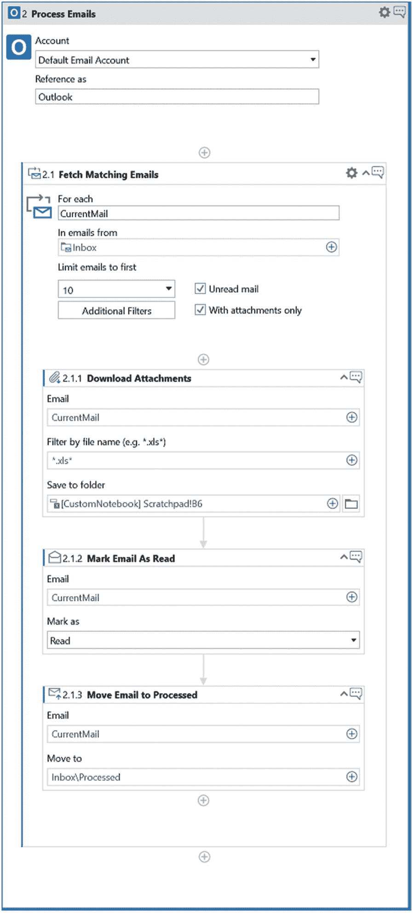

图 11-18

处理电子邮件步骤的配置

### 第 7 步：保存邮件详情以备确认

接下来，自动化流程需要将邮件详情保存到 `ConfirmationEmailTracker.xlsx` 中，以便稍后检索并发送确认邮件：

1.  在 `StudioX` 中，在 `获取匹配邮件` 活动主体内的 `将邮件移至已处理` 活动之后，添加 `使用 Excel 文件` 活动。

2.  将 `显示名称` 更新为 `保存邮件详情以备确认`。

3.  在 `Excel` 字段中，选择 `笔记本` ➤ `在 Excel 中指示` 选项。从 `Scratchpad` 工作表中选择单元格 `B8`。如表 11-1 所述，此单元格将包含 `ConfirmationEmailTracker.xlsx` 放置位置的动态路径。

4.  将 `引用` 字段更新为 `ConfirmationEmailTracker`。

5.  勾选 `保存更改` 标志，以确保每次迭代后文件都被保存。

6.  取消勾选 `不存在则创建` 标志。

7.  勾选 `模板文件` 标志，选择 `浏览文件` 选项，然后选择 `C:\BookSamples\ProductDataEntryAutomation\Templates\ ConfirmationEmailTracker.xlsx`。

8.  现在自动化流程已拥有对 `ConfirmationEmailTracker.xlsx` 的引用，在 `保存邮件详情以备确认` 活动主体内添加一个 `写入单元格` 活动。

9.  将 `显示名称` 更新为 `保存发件人邮箱地址`。

10. 在 `要写入的内容` 字段中，选择 `[当前邮件] 发件人`；这包含了当前邮件的发件人邮箱地址。

11. 在 `写入位置` 字段中，您需要提供一个要输入数据的单元格。选择 `ConfirmationEmailTracker` ➤ `在 Excel 中指示` 选项，然后选择单元格 `A2`。您只需提供起始单元格编号。

12. 勾选 `自动递增行` 选项。如上一所述，您只需提供起始单元格，因为此自动递增配置将确保自动化流程在 `对于每封邮件` 循环的每次迭代中，自动移至下一行。

13. 复制并粘贴 `写入单元格` 活动。将 `显示名称` 更新为 `保存发送日期`。将 `要写入的内容` 字段更新为 `[当前邮件] 日期`。将 `写入位置` 字段更新为单元格 `B2`。

14. 复制并粘贴 `写入单元格` 活动。将 `显示名称` 更新为 `保存邮件主题`。将 `要写入的内容` 字段更新为 `[当前邮件] 主题`。将 `写入位置` 字段更新为单元格 `C2`。

15. 复制并粘贴 `写入单元格` 活动。将 `显示名称` 更新为 `保存默认确认状态`。在 `要写入的内容` 字段中，输入 `未发送`。将 `写入位置` 字段更新为单元格 `D2`。自动化流程稍后会将状态更新为 `已发送`。添加此默认 `未发送` 状态的原因是，如果一天内需要多次发送邮件，自动化流程可以据此在 Excel 中筛选 `已发送` 和 `未发送` 的行。

图 11-19 展示了此步骤的配置。

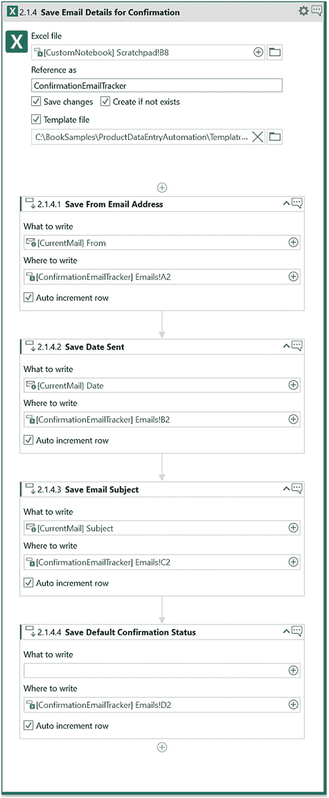

图 11-19

“保存邮件详情以备确认”活动的配置

### 第 8 步：启动库存管理应用

接下来，我们将配置自动化流程，以启动库存管理系统的新实例：

1.  打开您常用的浏览器，并打开 [`https://therpabook.com/samples/inventorymanagement/`](https://therpabook.com/samples/inventorymanagement/) 网页应用。

2.  在 `StudioX` 中，在 `处理邮件` 活动之后，添加 `使用应用程序/浏览器` 活动。

3.  将 `显示名称` 更新为 `输入数据`。

4.  点击 `向自动化指示应用程序 (I)` 链接，并选择当前打开了该网页应用的浏览器。UiPath 将自动检测到您正在尝试与浏览器交互，并会自动填充 `URL`。

5.  从 `属性` 面板中，为 `选项` ➤ `打开` 属性选择 `始终` 选项。这将确保每次运行自动化流程时都会打开一个新的浏览器。

6.  在 `输入数据` 活动主体内添加 `获取活动窗口` 活动。

7.  打开 `属性` 面板，在 `输出` ➤ `应用程序窗口` 属性中，点击 `加号` 图标。使用 `保存以备后用` 选项，并将保存的值命名为 `InventoryManagementWindow`。

8.  在 `获取活动窗口` 活动主体内添加 `最大化窗口` 活动。

9.  打开 `属性` 面板，在 `输出` ➤ `应用程序窗口` 属性中，点击 `加号` 图标。悬停在 `使用已保存的值` 选项上，选择 `InventoryManagementWindow`。

图 11-20 展示了此步骤的配置。

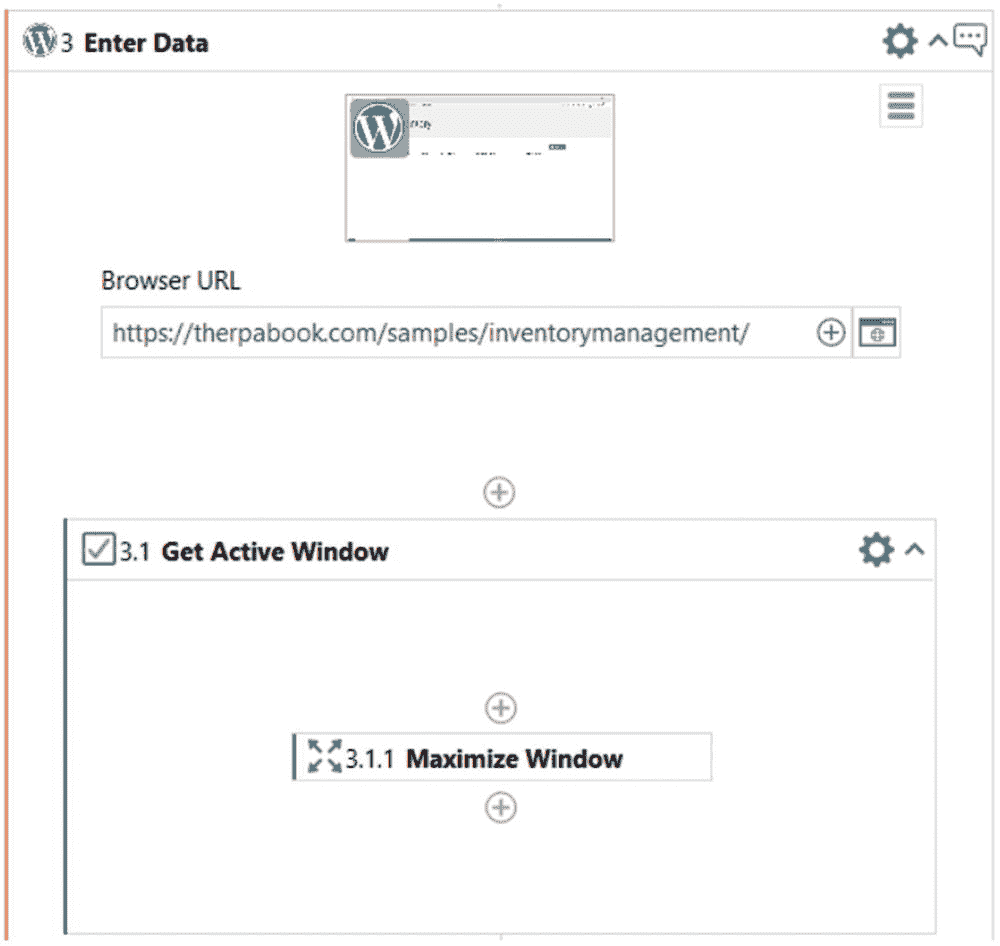

图 11-20

“输入数据”活动的配置

### 第 9 步：获取所有已下载的文件

如解决方案设计所述，并在“处理邮件”流程中实现的那样，我们可能会收到一封或多封新的库存邮件。每封邮件都包含一个附件，因此“待处理”文件夹可能包含多个文件（数量与收到的邮件数相同）。在此步骤中，我们将使自动化流程能够从“待处理”文件夹中获取所有文件：

1.  在 `StudioX` 中，在 `输入数据` 活动主体内的 `刷新网页` 活动之后，添加 `对于文件夹中的每个文件` 活动。

2.  将 `显示名称` 更新为 `获取所有已下载的文件`。

3.  在 `对于每个` 字段中，将引用保留为 `CurrentFile`。

4.  在 `在文件夹中` 字段中，选择 `笔记本` ➤ `在 Excel 中指示` 选项。从 `Scratchpad` 工作表中选择单元格 `B6`。

5.  取消勾选 `包含子文件夹` 选项，因为没有子文件夹。

6.  在 `按筛选` 字段中，输入 `*.xlsx`。这将确保只从文件夹中选取 Excel 文件。

7.  在 `排序方式` 字段中，输入 `创建日期最早的优先`。这将按从旧到新的顺序返回文件。

图 11-21 展示了此步骤的配置。

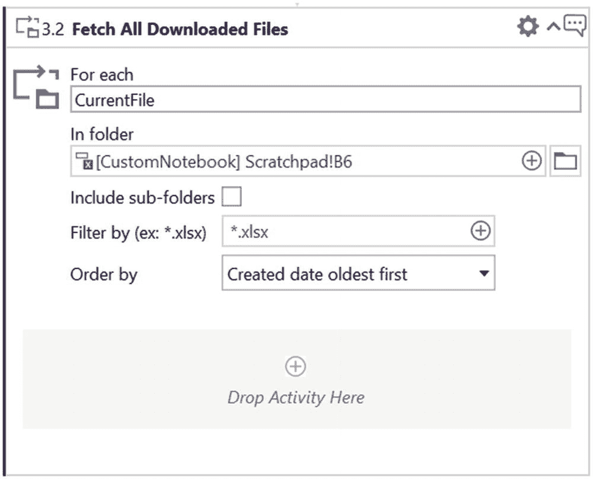

图 11-21

“获取所有已下载的文件”活动的配置

### 第 10 步：插入处理状态列

当自动化流程处理每个文件的每一行时，我们还需要跟踪已处理的行。新的库存文件中没有状态列，因此，首先我们将在每个 Excel 文件中插入一个新列：

1.  在 `StudioX` 中，在 `获取所有已下载的文件` 活动主体内添加 `使用 Excel 文件` 活动。

2.  将 `显示名称` 更新为 `处理产品列表 Excel`。

3.  在 `Excel 文件` 字段中，使用 `[CurrentFile] 完整路径`。这将引用 `对于文件夹中的每个文件` 循环正在处理的当前 Excel 文件。

4.  将 `引用为` 更新为 `Products`。

5.  勾选 `保存更改` 选项。

6.  取消勾选 `不存在则创建` 选项。

7.  勾选 `模板` 选项，并使用 `浏览文件` 选项选择 `C:\BookSamples\ProductDataEntryAutomation\Templates\ProductsList.xlsx`。

8.  在 `处理产品列表 Excel` 活动主体内添加 `插入列` 活动。

9.  将 `显示名称` 更新为 `插入处理状态列`。

10. 在 `范围` 字段中，选择 `[Products] 列表` 选项。由于我们指定了模板，UiPath 可以提取有关运行时将接收的文件的元数据。

11. 勾选 `有标题` 选项。

12. 从 `位置` 下拉菜单中，选择 `之后` 选项。在 `相对于列` 字段中，选择 `范围` ➤ `免运费` 列。这将确保新列创建在 Excel 中 `免运费` 列之后。

13. 在 `添加标题` 字段中，输入 `状态`。

14. 使用 `类别` 列表，将列的 `设置格式` 设置为 `文本`。

图 11-22 展示了此步骤的最终配置。

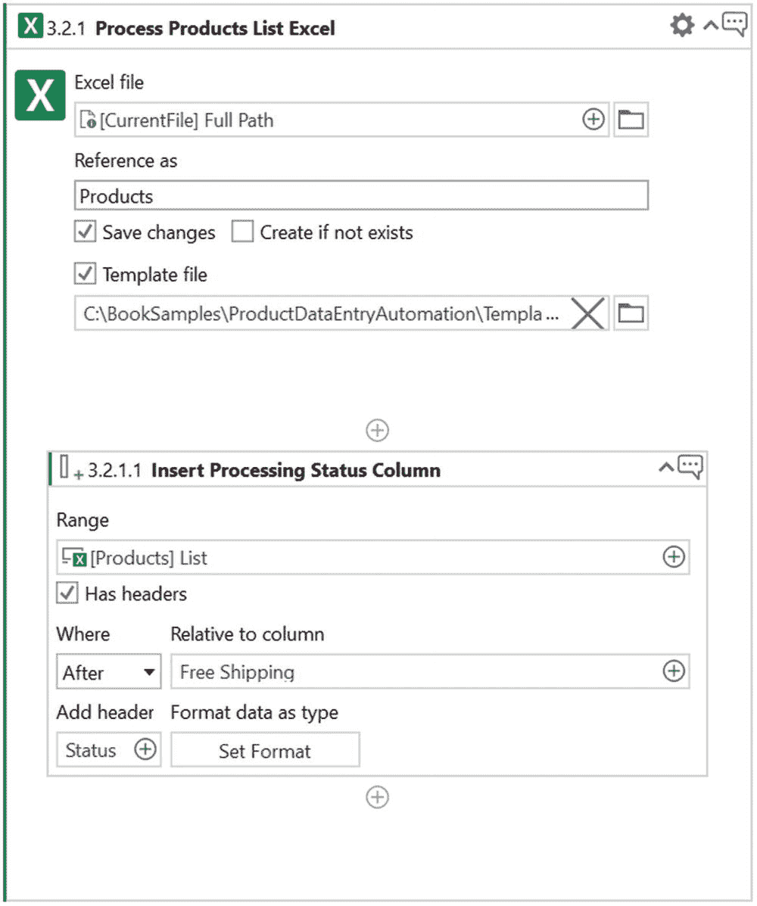

图 11-22

“插入处理状态列”步骤的配置

### 步骤 11：为每一行输入数据并更新状态

接下来，我们将配置自动化流程，使其从库存管理系统中的每个 Excel 行输入数据：

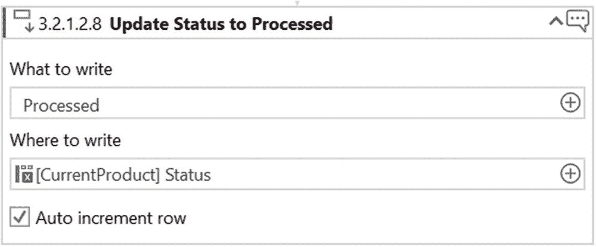

图 11-27

“将状态更新为已处理”活动的配置

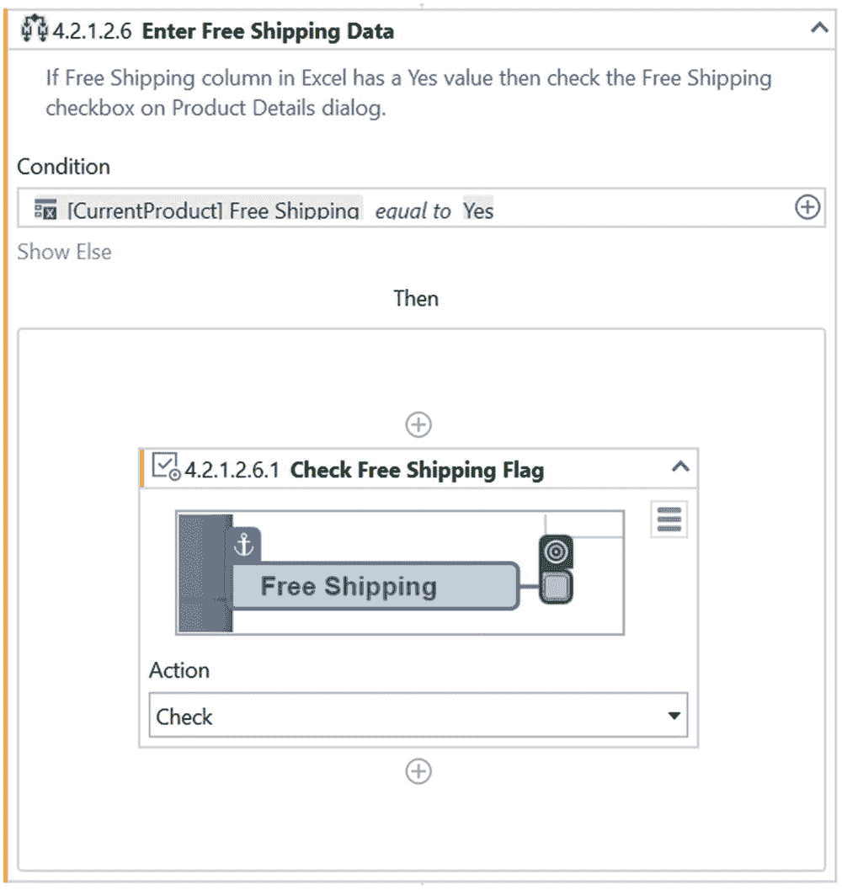

图 11-26

“输入免运费数据”活动的配置

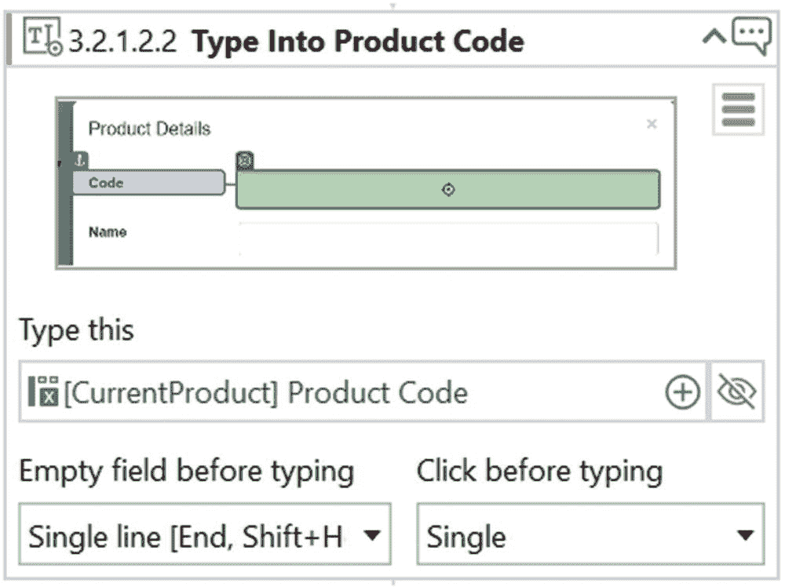

图 11-25

“输入产品代码”活动的配置

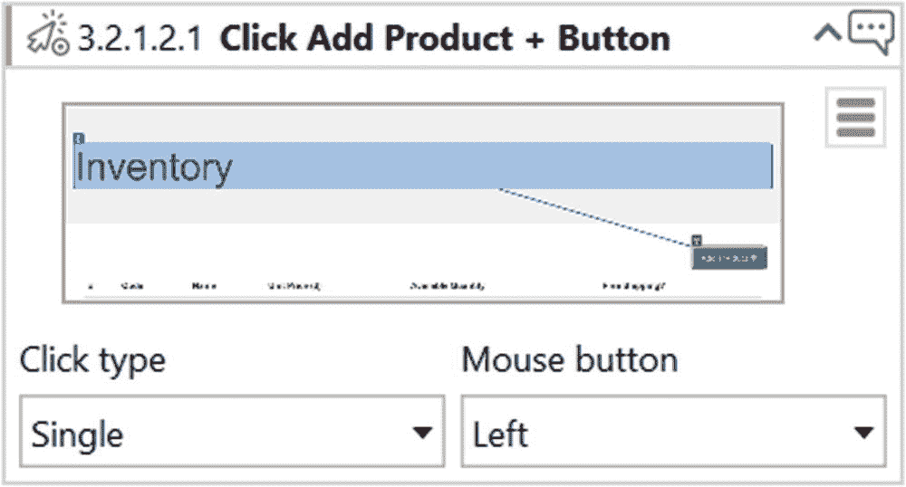

图 11-24

“点击添加产品 + 按钮”活动的配置

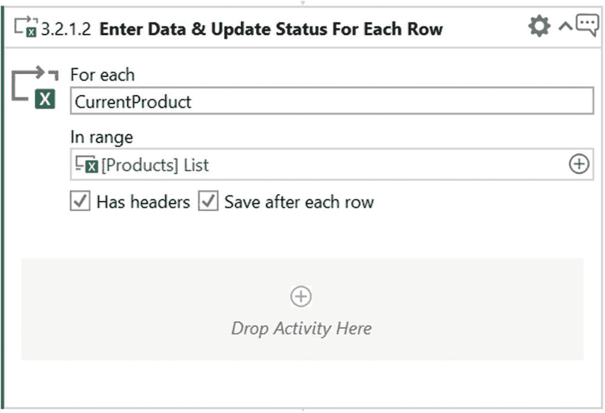

图 11-23

“遍历每个 Excel 行”活动的配置

1.  在 `StudioX` 中，将 `遍历每个 Excel 行` 活动添加到 `处理产品列表 Excel` 活动主体内，位于 `插入处理状态列` 活动之后。

2.  将 `显示名称` 更新为 `为每一行输入数据并更新状态`。

3.  在 `遍历` 字段中，输入 `CurrentProduct` 作为当前行的引用名称。

4.  在 `范围` 字段中，选择 `[产品] 列表`。

5.  勾选 `包含标题` 和 `每行后保存` 两个选项。现在，我们已准备好开始在 Web 应用程序中输入数据。此时，此活动的配置应如图 11-23 所示。

6.  Web 应用程序已在浏览器中打开；现在，我们需要点击 `添加产品 +` 按钮以打开 `产品详情` 对话框。在 `为每一行输入数据并更新状态` 活动主体中添加一个 `点击` 活动。

7.  点击 `指示屏幕上的目标 (I)` 链接，并选择 `添加产品 +` 按钮。使用屏幕标题作为锚点。

8.  将 `显示名称` 更新为 `点击添加产品 + 按钮`。图 11-24 显示了此时活动应有的外观。

9.  接下来，在 `为每一行输入数据并更新状态` 活动主体中，于 `点击添加产品 + 按钮` 活动之后添加一个 `输入` 活动。

10. 点击 `指示屏幕上的目标 (I)` 链接，并选择 `产品详情` 对话框中的 `代码` 文本字段。`StudioX` 将自动检测标签作为锚点。

11. 将 `显示名称` 更新为 `输入产品代码`。

12. 在 `输入此内容` 字段中，点击 `加号` 图标，悬停在 `CurrentProduct` 上，然后选择 `产品代码`。我们指定输入新库存 Excel 文件中“产品代码”列当前单元格的值。图 11-25 显示了此时活动应有的外观。

13. 接下来，在 `为每一行输入数据并更新状态` 活动主体中，于 `输入产品代码` 活动之后添加另一个 `输入` 活动。

14. 点击 `指示屏幕上的目标 (I)` 链接，并选择 `产品详情` 对话框中的 `名称` 文本字段。使用标签作为锚点。

15. 将 `显示名称` 更新为 `输入产品名称`。

16. 在 `输入此内容` 字段中，点击 `加号` 图标，悬停在 `CurrentProduct` 上，然后选择 `产品名称`。

17. 接下来，在 `为每一行输入数据并更新状态` 活动主体中，于 `输入产品名称` 活动之后添加另一个 `输入` 活动。

18. 点击 `指示屏幕上的目标 (I)` 链接，并选择 `产品详情` 对话框中的 `单价 ($)` 文本字段。使用标签作为锚点。

19. 将 `显示名称` 更新为 `输入单价 ($)`。

20. 在 `输入此内容` 字段中，点击 `加号` 图标，悬停在 `CurrentProduct` 上，然后选择 `单价 ($)`。

21. 接下来，在 `为每一行输入数据并更新状态` 活动主体中，于 `输入单价 ($)` 活动之后添加另一个 `输入` 活动。

22. 点击 `指示屏幕上的目标 (I)` 链接，并选择 `产品详情` 对话框中的 `数量` 文本字段。使用标签作为锚点。

23. 将 `显示名称` 更新为 `输入数量`。

24. 在 `输入此内容` 字段中，点击 `加号` 图标，悬停在 `CurrentProduct` 上，然后选择 `可用数量`。

25. 接下来，我们将添加逻辑以检查免运费标志。在源 Excel 文件中，此信息存储为“是”或“否”。“是”表示需要勾选免运费标志；“否”表示应保持该标志未勾选。为此，我们首先需要在 `为每一行输入数据并更新状态` 活动主体中，于 `输入数量` 活动之后添加一个 `如果` 活动。

26. 将 `显示名称` 更新为 `输入免运费数据`。

27. 使用条件构建器创建一个新条件 `[CurrentProduct] 免运费 等于 是`。点击 `保存`。

28. 由于我们仅在满足条件时才执行操作，因此我们将在 `输入免运费数据` 活动的 `则` 块主体中添加一个 `勾选/取消勾选` 活动。

29. 点击 `指示屏幕上的目标 (I)` 链接，并选择 `产品详情` 对话框中的 `免运费` 复选框。使用标签作为锚点。

30. 将 `显示名称` 更新为 `勾选免运费标志`。图 11-26 显示了这些配置后 `勾选/取消勾选` 活动的最终状态。

31. 在 `为每一行输入数据并更新状态` 活动主体中，于 `输入免运费数据` 活动之后添加一个 `点击` 活动。

32. 点击 `指示屏幕上的目标 (I)` 链接，并选择 `添加` 按钮。使用对话框页脚作为锚点。

33. 将 `显示名称` 更新为 `点击添加按钮`。

34. 现在，我们已在库存管理应用程序中输入了单个 Excel 行的数据，需要将 `状态` 标记为 `已处理`。为此，在 `为每一行输入数据并更新状态` 活动主体中，于 `点击添加按钮` 活动之后添加一个 `写入单元格` 活动。

35. 将 `显示名称` 更新为 `将状态更新为已处理`。

36. 在 `写入内容` 字段中，输入 `已处理`。

37. 在 `写入位置` 中，您需要提供一个需要输入数据的单元格。点击 `加号` 图标，悬停在 `CurrentProduct` 上，然后选择 `状态`。

38. 勾选 `自动递增行` 选项。图 11-27 显示了这些配置后 `写入单元格` 活动的最终状态。

图 11-28 显示了此步骤中所有活动的顺序。

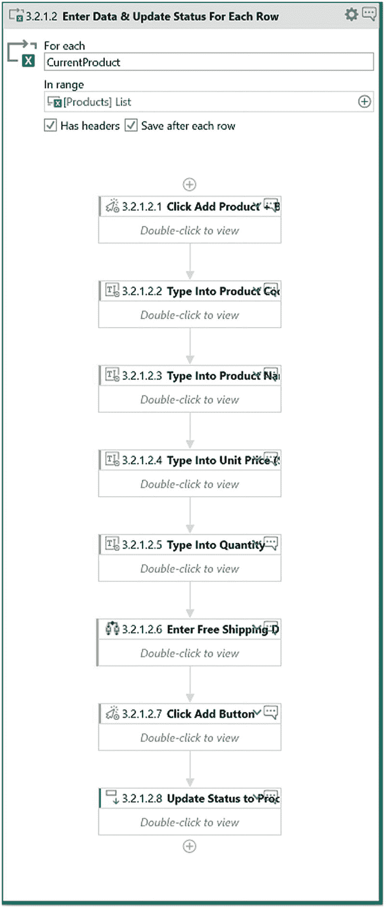

图 11-28

“为每一行输入数据并更新状态”活动的配置

### 步骤 12：将文件移至已处理文件夹

此时，自动化程序将已从 Excel 的所有行中提取数据并录入到库存管理系统。为确保同一 Excel 文件不被重复处理，我们将其从“待处理”文件夹移至“已处理”文件夹：

1.  在 `StudioX` 中，在“获取所有已下载文件”活动主体内的“处理产品列表 Excel”活动之后，添加“移动文件”活动。

2.  将“显示名称”更新为“将文件移至已处理文件夹”。

3.  在“来源”字段中，点击“加号”图标，悬停在 `CurrentFile` 上，然后选择“完整路径”。这将引用当前由“对于每个文件在文件夹中”循环正在处理的 Excel 文件。

4.  在“目标”字段中，悬停在“笔记本”上，点击“在 Excel 中指示”，然后选择单元格 `B7`。如表 11-1 所示，此单元格包含“已处理”文件夹的路径。

图 11-29 展示了此步骤的配置。

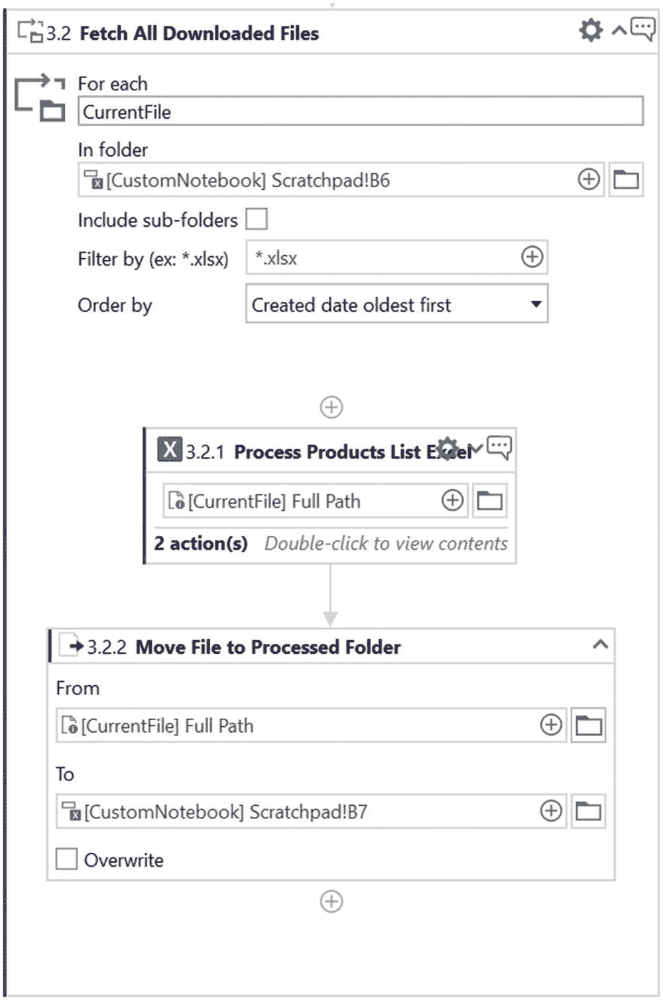

图 11-29

“将文件移至已处理文件夹”活动的配置

### 步骤 13：发送确认邮件

自动化的最后一步是向发送新库存邮件的采购团队发送确认邮件：

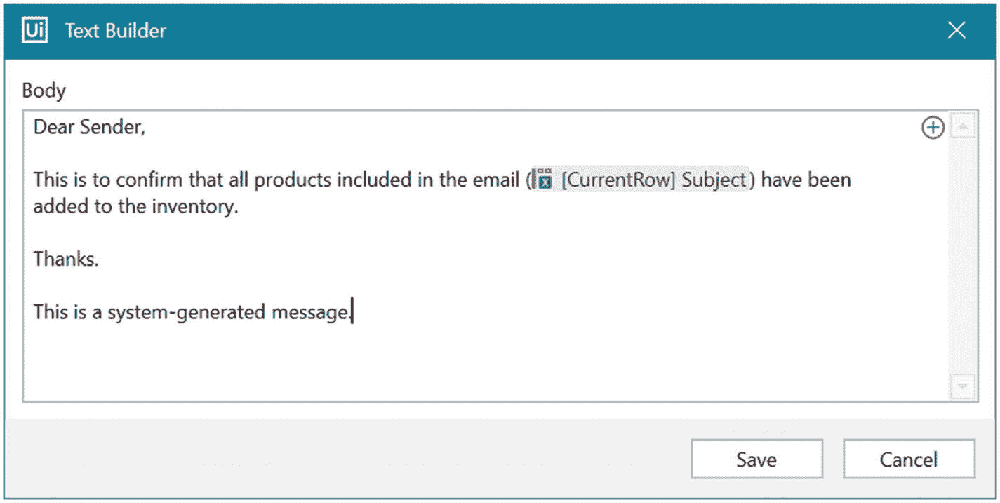

图 11-32

确认邮件正文

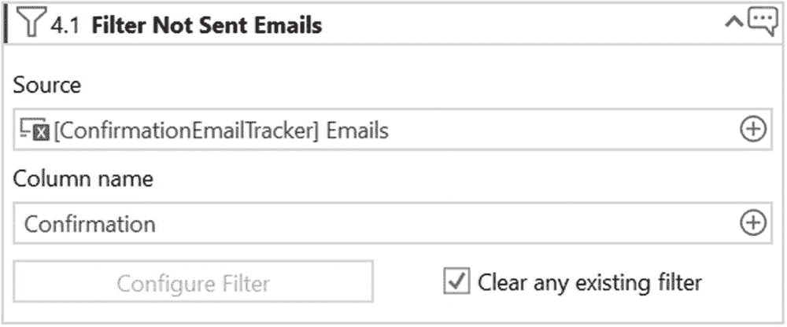

图 11-31

“筛选未发送邮件”的配置

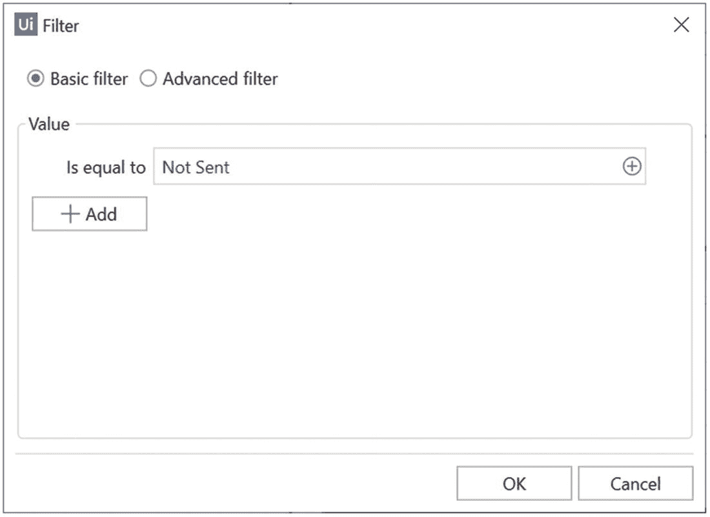

图 11-30

对“确认”列的 Excel 筛选

1.  在 `StudioX` 中，在设计器面板的“输入数据”活动之后，添加“使用 Excel 文件”活动。

2.  将“显示名称”更新为“发送确认邮件”。

3.  在“Excel”字段中，选择“笔记本” ➤ “在 Excel 中指示”选项。从“草稿”工作表中选中单元格 `B8`。如表 11-1 所示，单元格 `B8` 包含 `ConfirmationEmailTracker.xlsx` 文件的路径，该文件包含所有已接收邮件的详细信息。

4.  将“引用”字段更新为 `ConfirmationEmailTracker`。

5.  取消选中“保存更改”标志。

6.  取消选中“不存在则创建”标志。

7.  勾选“模板文件”，并使用“文件夹”图标选择 `C:\BookSamples\ProductDataEntryAutomation\Templates\ ConfirmationEmailTracker.xlsx`。这为 StudioX 提供了文件的元数据。

8.  接下来，我们需要筛选 Excel，以便仅显示“确认”列值为“未发送”的行。在“使用 Excel 文件（发送确认邮件）”活动主体内添加“筛选”活动。

9.  将“显示名称”更新为“筛选未发送邮件”。

10.  在“来源”字段中，悬停在 `ConfirmationEmailTracker` 上，然后选择“Emails [工作表]”。

11.  在“列名”字段中，悬停在“范围”上，然后选择“确认”。这是我们用于筛选的列。

12.  点击“配置筛选器”，并将筛选条件设置为“等于 未发送”。图 11-30 展示了筛选器应有的外观，图 11-31 展示了“筛选”活动的配置。

13.  勾选“清除任何现有筛选器”标志，以确保没有其他可能返回错误数据的筛选器被应用。

14.  在“使用 Excel 文件（发送确认邮件）”活动主体内的“筛选未发送邮件”活动之后，添加“对于每个 Excel 行”活动。

15.  将“显示名称”更新为“处理状态为未发送的行”。

16.  在“对于每个”字段中，输入 `CurrentRow` 作为当前行的引用名称。

17.  在“在范围中”字段中，悬停在 `ConfirmationEmailTracker` 上，然后选择“Emails [工作表]”选项。

18.  勾选“有标题”和“每行后保存”标志。现在我们可以开始发送邮件了。

19.  在“处理状态为未发送的行”活动主体内添加“使用桌面 Outlook 帐户”活动。

20.  将“显示名称”更新为“发送确认邮件”。

21.  如果您在 Outlook 中设置了多个帐户，请从“帐户”下拉菜单中选择合适的帐户。否则，您可以使用“默认电子邮件帐户”。

22.  将“引用为”字段中的值保留为 `Outlook`。

23.  在“使用桌面 Outlook 帐户”活动主体内添加“发送邮件”活动。

24.  在“帐户”字段中选择 `Outlook`。

25.  在“收件人”字段中，悬停在 `CurrentRow` 上，然后选择“发件人”选项。这将包含原始发件人的电子邮件地址。

26.  在“主题”字段中，使用“文本生成器”输入 `Inventory Confirmation`。

27.  在“正文”字段中，使用“文本”选项创建动态文本。图 11-32 展示了文本应有的外观。

28.  取消选中“另存为草稿”标志。

29.  在“处理状态为未发送的行”活动主体内的“发送确认邮件”活动之后，添加“写入单元格”活动。

30.  将“显示名称”更新为“将确认状态更新为已发送”。

31.  在“写入内容”字段中，选择“文本”选项，然后输入 `Sent`。

32.  在“写入位置”中，您需要提供一个需要输入数据的单元格。悬停在 `CurrentRow` 上，然后选择“确认”选项。

33.  勾选“自动递增行”标志。

图 11-33 展示了此步骤的配置。

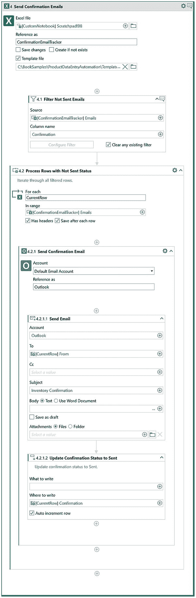

图 11-33

“发送确认邮件”步骤的配置

## 测试

理想情况下，在整个实施过程中，您应该持续测试较小的部分。本节包含如何测试完整自动化的说明：

1.  打开您的 Outlook，并创建一封标题为 `New Inventory MM/DD/YYYY` 的新邮件。

2.  在“收件人”字段中，输入您在“实施”部分步骤 6 中配置的用于接收邮件的电子邮件地址。

3.  将 `New Inventory.xlsx` 文件附加到邮件中。此文件位于 `C:\BookSamples\ProductDataEntryAutomation\Samples` 路径下。

4.  发送邮件。

5.  在 `StudioX` 中，打开您的自动化项目，然后从功能区点击“运行”。

自动化程序将从 Outlook 中提取新发送的邮件。它将附件下载到新创建的文件夹结构中。自动化程序将在一个新浏览器中启动库存管理系统，并开始录入所有产品。一旦所有产品录入完毕，自动化程序将发送一封邮件。

