# 12. 发票生成自动化

在本章中，我们将自动化订单管理流程中的发票生成任务。

## 学习目标

此自动化将帮助您理解以下主题：
* 创建文件夹结构、复制和移动文件
* 与桌面应用程序交互
* 从多个表中读取数据
* 使用 Excel 临时存储和操作数据
* 在 Word 文档中动态输入单条和表格数据
* 从 Word 文档生成 PDF 文档

## 手动流程概述

应收账款分析师（以下简称“分析师”）每天运行发票生成流程。图 12-1 展示了发票生成任务的高级概览。

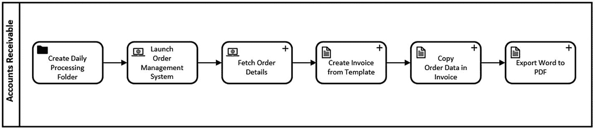
图 12-1 发票生成任务的高级概览

由于此任务每天执行，为了按天整理发票，分析师首先在 `DailyProcessing` 文件夹下，以 `YYYYMMDD` 格式为当前日期创建一个新文件夹。图 12-2 展示了 `DailyProcessing` 文件夹的结构。

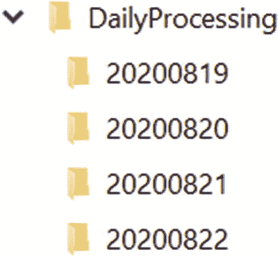
图 12-2 用于管理每日发票生成任务的文件夹结构

接下来，分析师启动订单管理系统，并筛选出状态为“待开票”的订单，如图 12-3 所示。

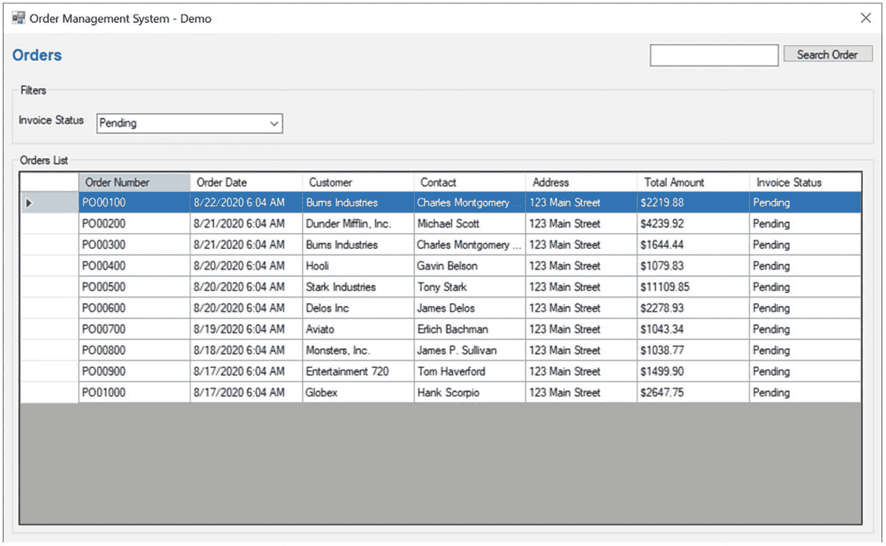
图 12-3 按“待开票”状态筛选后的订单

对于每个状态为“待开票”的订单，分析师在“搜索”字段中输入订单号，并点击“搜索订单”按钮。这将打开“订单详情”界面，如图 12-4 所示。

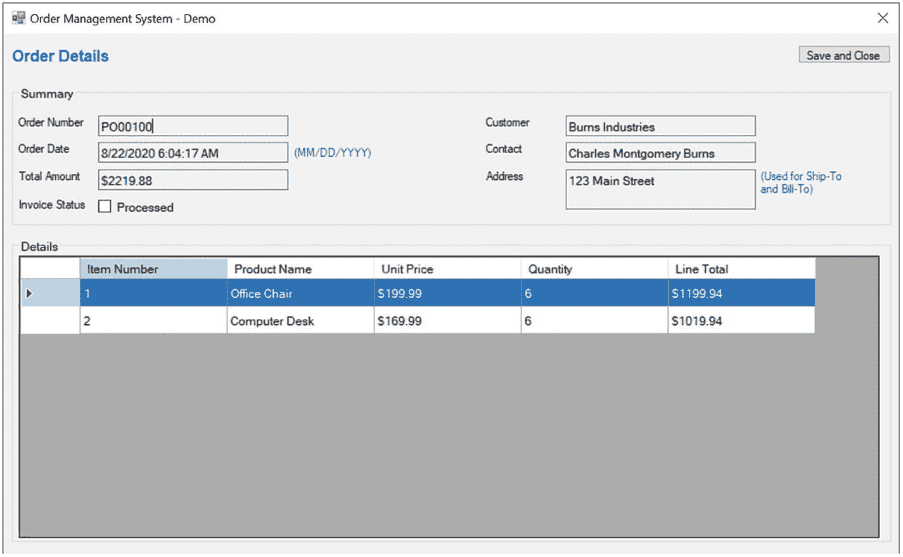
图 12-4 订单详情界面

与此同时，分析师根据 Word 模板（DOCX）创建一份新的发票副本。该发票文件存放在当前日期文件夹中，文件名反映发票编号。

发票编号的生成方式是将订单号中的 `PO` 前缀替换为 `INV`，例如，`PO00100` 将变为 `INV00100`。

接着，分析师从“订单详情”界面复制数据，并将其粘贴到发票中。

所有数据复制到发票后，分析师将其导出为 PDF 格式。图 12-5 展示了一份已生成发票的示例。

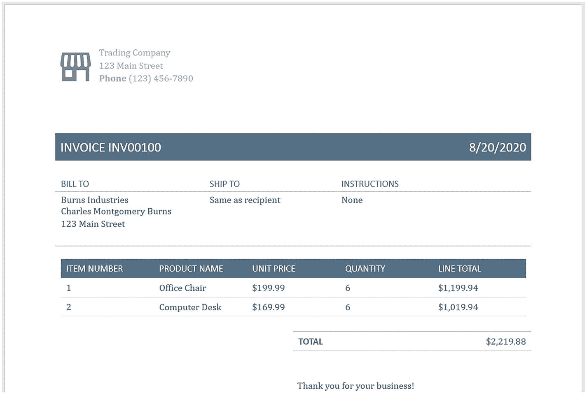
图 12-5 已生成发票的示例

## 解决方案设计

本节概述了我们如何设计自动化流程。图 12-6 展示了库存管理流程自动化的流程图。

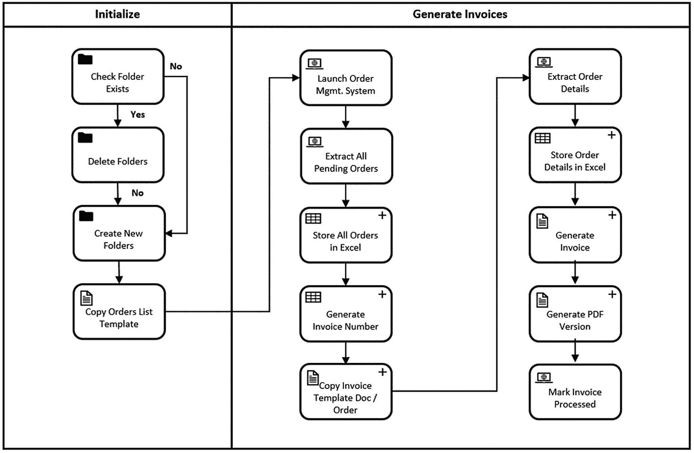
图 12-6 自动化的解决方案设计

将自动化流程拆分为更小、更符合逻辑的流程有助于简化实施和调试过程。如图 12-6 所示，我们将把自动化流程分为两个逻辑流程。

该自动化将每天运行一次。唯一需要在同一天内多次运行的情况是遇到错误并需要重启。每次自动化运行时，我们都要确保清除上一次运行的所有数据。

## 实施

现在我们已经充分了解了如何设计自动化流程，可以开始实施工作了。

### 步骤 1：设置

在开始实施之前，请从本书的 GitHub 仓库下载项目文件夹，其中包含演示应用程序和相关模板。

> 注意
>
> 本章假设自动化文件夹 `InvoiceGenerationAutomation` 位于 `C:\BookSamples\` 文件夹内。

`InvoiceGenerationAutomation` 文件夹包含三个子文件夹，如图 12-7 所示。

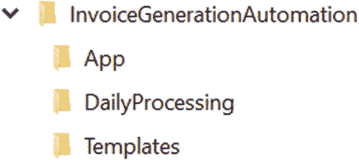
图 12-7 发票生成自动化的文件夹结构

#### App

此子文件夹包含订单管理系统。您可以通过点击 `OrderManagement.exe` 来启动该桌面应用程序。

#### Templates

此子文件夹包含自动化使用的三个模板。

`OrdersList.xlsx` 模板将由自动化复制到 `DailyProcessing\YYYYMMDD` 文件夹。此 Excel 模板将用于存储所有待生成发票的订单信息。图 12-8 展示了此 Excel 模板的结构。

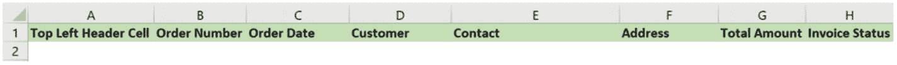
图 12-8 用于管理待生成发票订单列表的 Excel 模板

对于每个订单，将在 `DailyProcessing\YYYYMMDD` 文件夹中创建一份 `OrderDetails.xlsx` 模板的副本。此 Excel 文件将用于临时存储每个订单的行项目明细。每个文件将根据“订单号”命名。图 12-9 展示了此 Excel 模板的结构。

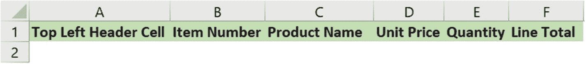
图 12-9 用于管理单个订单明细的 Excel 模板

最后，`InvoiceTemplate.docx` 将用于为每个订单生成发票。图 12-10 展示了该 Word 模板。

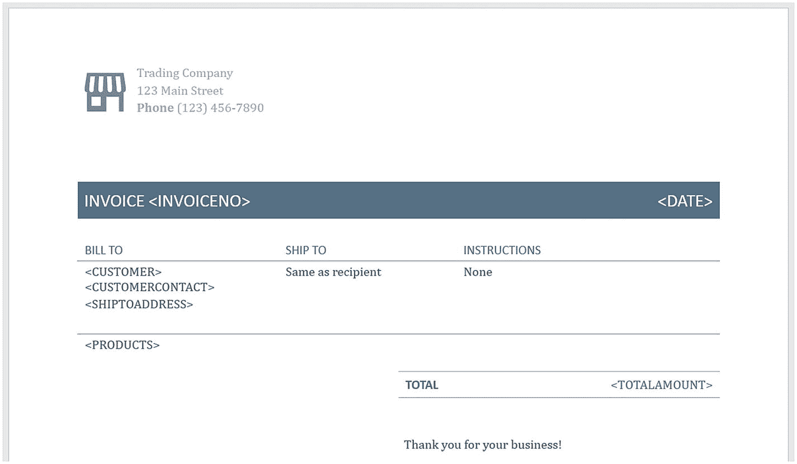
图 12-10 发票的 Word 模板

#### DailyProcessing

此子文件夹为空，自动化将使用它来为自动化运行的日期创建文件夹，并存储生成的发票。

### 步骤 2：创建项目

接下来，我们将在 `UiPath StudioX` 中创建一个新项目。以下是创建新项目的步骤。您不必使用完全相同的名称、路径和描述。

1. 启动 `UiPath StudioX`。
2. 在“后台视图”中，点击“空白任务”以从头开始创建新项目。
3. 在“流程名称：”字段中，输入 `Chapter_12_InvoiceGenerationAutomation`。
4. 在“描述：”字段中，输入 `发票生成任务自动化`。
5. 点击“创建”按钮以创建项目。

图 12-11 展示了项目的配置。

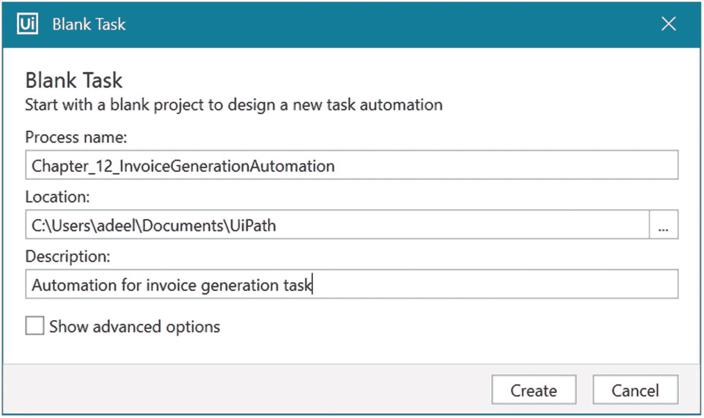
图 12-11 创建新项目

### 步骤 3：设置项目笔记本

此自动化将使用自定义公式来生成文件夹和文件路径。

我们将配置一个自定义笔记本，用于管理所有自定义公式。图 12-12 展示了包含自动化所用全部公式的自定义笔记本。

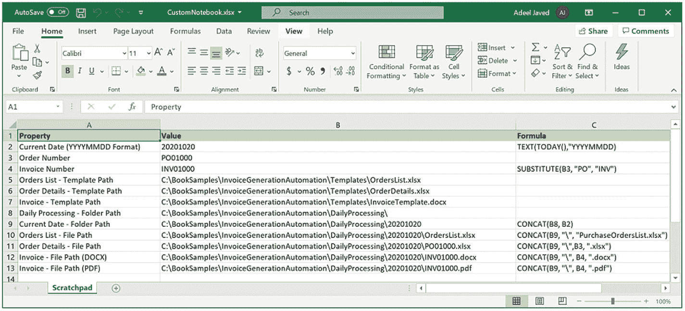
图 12-12 笔记本中的自定义公式

表 12-1 描述了图 12-12 中每个值的用途。

表 12-1 暂存区中各值的说明

| 属性 | 说明 |
| --- | --- |
| 当前日期 | 单元格 B2 中的公式将生成 `YYYYMMDD` 格式的当前日期，该日期将被后续行中的所有路径使用。 |
| 订单号 | 单元格 B3 被其他单元格用于生成发票号和文件路径。当自动化处理每个订单时，此字段将填入当前正在处理的订单号。 |
| 发票号 | 单元格 B4 中的公式使用单元格 B3 中的数值，并将 `PO` 替换为 `INV` 以生成发票号。 |
| 订单列表 – 模板路径 | `OrdersList.xlsx` 模板的静态路径。 |
| 订单详情 – 模板路径 | `OrderDetails.xlsx` 模板的静态路径。 |
| 发票 – 模板路径 | `InvoiceTemplate.docx` 模板的静态路径。 |
| 每日处理 – 文件夹路径 | 自动化用于存储每日处理文件夹和文件的文件夹的静态路径。 |
| 当前日期 – 文件夹路径 | 自动化用于存储当天所有文件的文件夹的动态路径。 |

# 配置自定义笔记本与初始化

| 订单列表 – 文件路径 | `OrdersList.xlsx` 副本将被放置的动态路径。 |
| --- | --- |
| 订单详情 – 文件路径 | 当前采购订单的 `OrderDetails.xlsx` 副本将被放置的动态路径。 |
| 发票 – 文件路径 (DOCX) | 当前发票的 MS Word 副本将被创建到的动态路径。 |
| 发票 – 文件路径 (PDF) | 当前发票的 PDF 版本将被创建到的动态路径。 |

以下是配置自定义笔记本的分步说明：

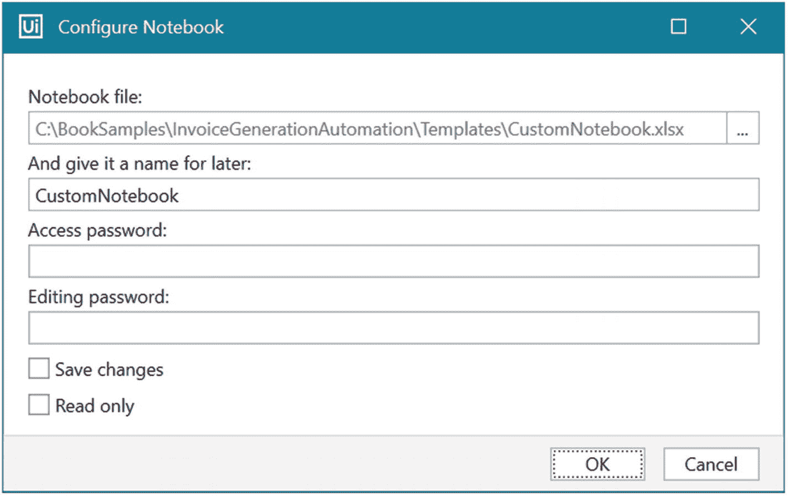

**图 12-13** 配置自定义笔记本

1. 在 `StudioX` 中，单击顶部功能区中的 `Notebook` ➤ `Configure Notebook` 菜单。
2. 在 `Notebook file` 字段中，单击 `…` 并选择 `C:\BookSamples\InvoiceGenerationAutomation\Templates\CustomNotebook.xlsx` 文件，如图 12-13 所示。
3. 单击 `OK` 按钮。

## 步骤 4：初始化

自动化需要执行的第一个活动是检查 `DailyProcessing` 文件夹下是否已存在当前日期（`YYYYMMDD` 格式）的文件夹。此操作的结果将存储在 `CurrentDateFolderExists` 变量中。

接下来，根据结果，我们将指定自动化需要执行的操作。如果 `CurrentDateFolderExists` 为 `true`，则表示文件夹结构已存在，需要删除。另一方面，如果 `CurrentDateFolderExists` 为 `false`，则自动化需要创建必要的文件夹结构。

最后的初始化步骤要求我们在 `DailyProcessing\Current Date (YYYYMMDD)` 文件夹中创建 `Templates\OrdersList.xlsx` 的副本。自动化将使用此文件来存储待生成发票的订单列表。

1. 在 `StudioX` 中，将 `Group` 活动添加到一个空白流程中。
2. 将 `Display Name` 属性更新为 `Initialize`。
3. 接下来，将 `Folder Exists` 活动添加到 `Initialize (Group)` 活动的主体中。
4. 将 `Display Name` 更新为 `Check Folder Structure Exists`。
5. 在 `Folder path` 字段中，选择 `CustomNotebook` ➤ `Indicate in Excel` 选项。从 `Scratchpad` 工作表中选择单元格 `B9`。如表 12-1 所述，此单元格将包含当前日期文件夹的动态路径。
6. 在 `Save result` 字段中，使用 `Save for Later Use` 选项，并将保存的值命名为 `CurrentDateFolderExists`。
7. 在 `Check Folder Structure Exists` 活动之后添加一个 `If` 活动。
8. 将 `Display Name` 更新为 `Create Folder Structure`。
9. 使用 `Condition Builder`，创建一个新条件 `CurrentDateFolderExists is true`。
10. 在 `Create Folder Structure` 活动的 `Then` 块中添加一个 `Delete Folder` 活动。
11. 将 `Display Name` 更新为 `Delete Current Date Folder & Contents`。
12. 在 `Folder name` 字段中，选择 `CustomNotebook` ➤ `Indicate in Excel` 选项。从 `Scratchpad` 工作表中选择单元格 `B9`。
13. 在 `Create Folder Structure` 活动的 `Then` 块中，于 `Delete Current Date Folder & Contents` 活动之后添加一个 `Create Folder` 活动。
14. 将 `Display Name` 更新为 `Create Current Date Folder`。
15. 在 `Folder name` 字段中，选择 `CustomNotebook` ➤ `Indicate in Excel` 选项。从 `Scratchpad` 工作表中选择单元格 `B9`。
16. 复制 `Create Current Date Folder` 活动，并将其粘贴到 `Create Folder Structure` 活动的 `Else` 块中。
17. 接下来，在 `Initialize` 活动的主体中，于 `Create Folder Structure (If)` 活动之后添加 `Copy File` 活动。
18. 将 `Display Name` 更新为 `Create Orders List Excel Copy`。
19. 在 `From` 字段中，选择 `CustomNotebook` ➤ `Indicate in Excel` 选项。从 `Scratchpad` 工作表中选择单元格 `B5`。如表 12-1 所述，此单元格将包含 `OrdersList.xlsx` 文件的静态路径。
20. 在 `To` 字段中，选择 `CustomNotebook` ➤ `Indicate in Excel` 选项。从 `Scratchpad` 工作表中选择单元格 `B10`。如表 12-1 所述，此单元格将包含 `OrdersList.xlsx` 文件的动态路径。

图 12-14 展示了此步骤的配置。

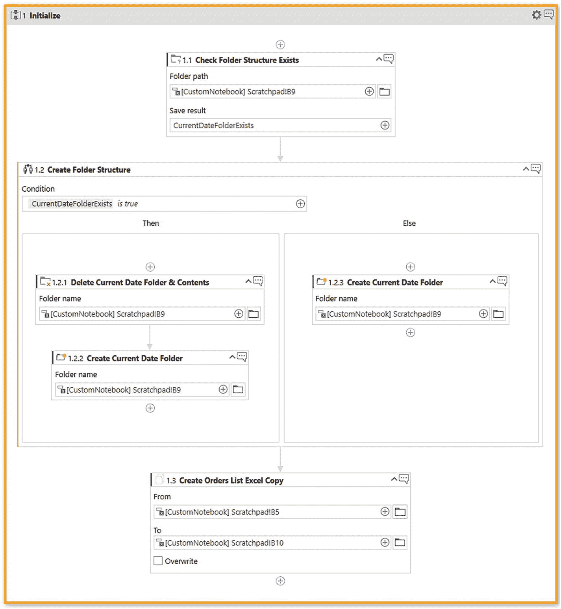

**图 12-14** 初始化步骤的配置

## 步骤 5：生成发票

这是将包含所有剩余活动的父级活动。此活动将处理与订单管理系统的交互以及发票的生成。

在整个流程运行过程中，自动化将与订单管理系统进行交互，因此我们将从启动应用程序开始：

1. 通过单击 `C:\BookSamples\InvoiceGenerationAutomation\App` 文件夹中的可执行文件来启动 `Order Management System` 应用程序。
2. 在 `StudioX` 中，将 `Use Application/Browser` 活动添加到 `Initialize` 活动之后的设计器面板中。
3. 单击 `Indicate Application` 链接，并将鼠标指向您刚刚启动的订单管理系统应用程序。`StudioX` 将自动检测到您正在尝试与桌面应用程序交互，并且还会自动填充 `Application path`。
4. 从 `Properties` 面板中，为 `Options` ➤ `Open` 属性选择 `Always` 选项。这将确保每次运行自动化时都会创建一个新的应用程序实例。
5. 将 `Display Name` 更新为 `Generate Invoices`。

图 12-15 展示了此步骤的配置。

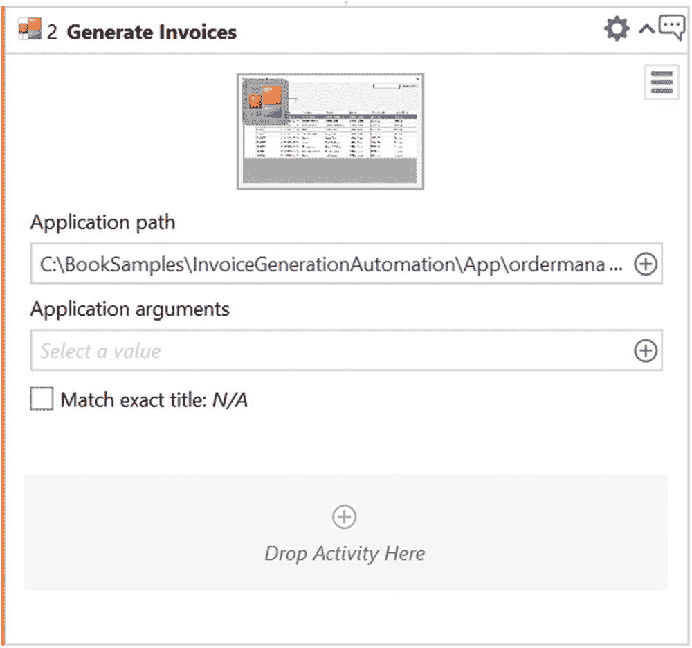

**图 12-15** 生成发票步骤的配置

> **提示**：根据您的屏幕分辨率，您可能还需要添加一个 `Maximize Window` 活动，以确保应用程序完全可见。

## 第 6 步：提取并处理所有订单

接下来，我们将配置自动化流程，将订单列表存储到 `OrdersList.xlsx` Excel 文件中：

1. 在 `StudioX` 中，将 `使用 Excel 文件` 活动添加到 `生成发票` 活动的主体中。
2. 将 `显示名称` 更新为 `提取并处理所有订单`。
3. 在 `Excel 文件` 字段中，选择 `CustomNotebook` ➤ `在 Excel 中指示` 选项。从 `Scratchpad` 工作表中选择单元格 `B10`。
4. 将 `引用为` 字段更新为 `OrdersList`。
5. 勾选 `保存更改` 标志，以确保文件在每次更改后自动保存。
6. 取消勾选 `不存在则创建` 标志。
7. 勾选 `模板文件` 标志。提供模板文件将帮助 `StudioX` 理解 Excel 的结构。
8. 选择 `浏览文件` 图标，然后选择 `C:\BookSamples\InvoiceGenerationAutomation\Templates\OrdersList.xlsx` 文件。

图 12-16 展示了此步骤的配置。

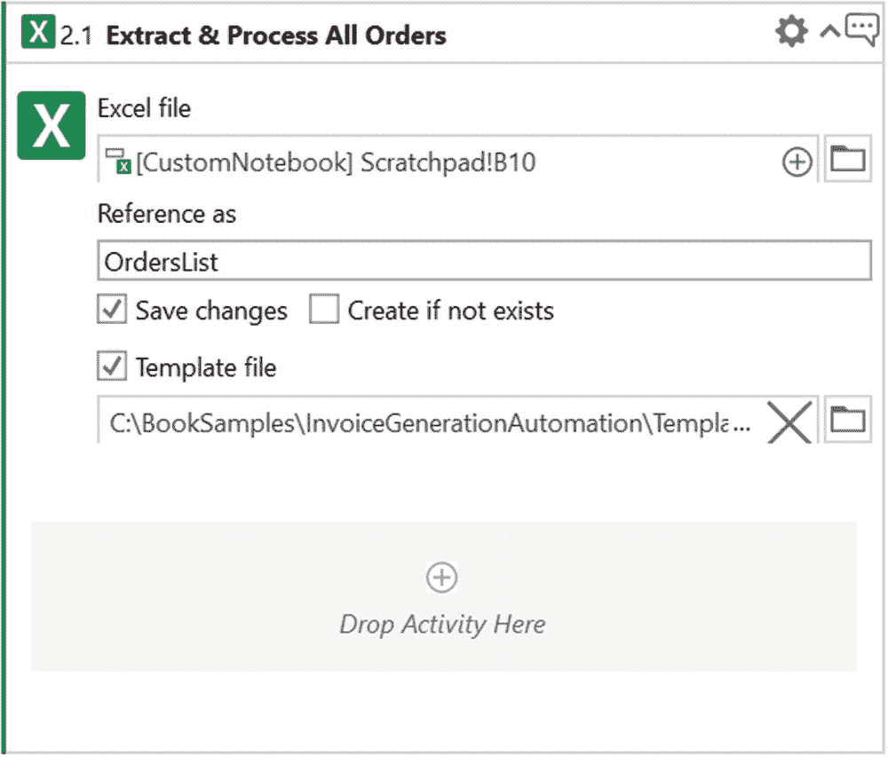
图 12-16 提取并处理所有订单步骤的配置

## 第 7 步：筛选待处理发票的订单
订单管理系统可能包含一些已生成发票的订单。因此，为了确保我们只提取需要生成发票的订单，我们将把 `发票状态` 筛选器设置为 `待处理`：
1.  在 `StudioX` 中，将 `选择项目` 活动添加到 `提取并处理所有订单` 活动的主体中。
2.  点击 `在屏幕上指示目标 (I)` 链接，然后选择 `筛选器` 部分中的 `发票状态` 下拉菜单。使用标签作为锚点。
3.  `要选择的项目` 列表将填充所有筛选选项，因此从列表中选择 `待处理` 选项。
4.  将 `显示名称` 更新为 `筛选待处理发票的订单`。

图 12-17 展示了此步骤的配置。
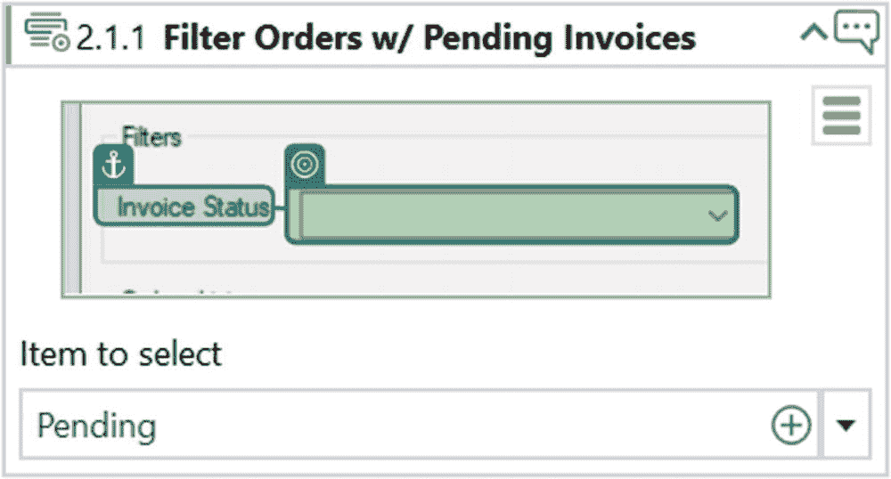
图 12-17 筛选待处理发票的订单步骤的配置

## 第 8 步：提取订单表格数据
接下来，我们将配置自动化流程，从表格中提取所有订单，并将其存储到初始化步骤中讨论的 `OrdersList.xlsx` 文件中：
1.  在 `StudioX` 中，将 `提取表格数据` 活动添加到 `提取并处理所有订单` 活动的主体中，位于 `筛选待处理发票的订单` 活动之后。
2.  点击 `在屏幕上指示目标 (I)` 链接，这将启动 `提取向导`。
3.  在 `选择元素` 步骤中，点击 `下一步`。
4.  在 `订单管理系统` 的主屏幕上，点击 `订单` 表格中 `订单号` 列的标题。
5.  `提取向导` 将以预览模式显示数据表格。点击 `完成`。这将结束表格数据提取向导。
6.  在 `提取到` 字段中，悬停在 `OrdersList` 上，然后选择 `汇总 [工作表]` 选项。这将把所有表格行存储到 `OrdersList.xlsx` 文件的 `汇总` 工作表中。
7.  将 `显示名称` 更新为 `提取订单表格数据`。

图 12-18 展示了此步骤的配置。
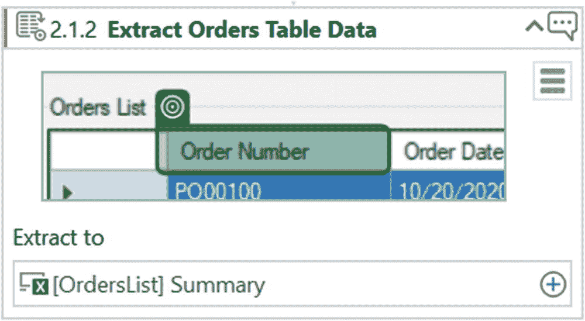
图 12-18 提取订单表格数据步骤的配置

## 第 9 步：处理所有订单
至此，我们已获得需要为其生成发票的所有订单的列表。在此步骤中，我们将配置自动化流程，以遍历列表中的每个订单。在后续步骤中，我们将添加自动化流程需要为每个订单执行的操作。
1.  在 `StudioX` 中，将 `对于每个 Excel 行` 活动添加到 `提取并处理所有订单` 活动的主体中，位于 `提取订单表格数据` 活动之后。
2.  将 `显示名称` 更新为 `处理所有采购订单`。
3.  在 `对于每个` 字段中，输入 `CurrentOrder` 作为当前订单或行的引用名称。
4.  在 `范围` 字段中，悬停在 `OrdersList` 上，然后选择 `汇总 [工作表]` 选项。
5.  勾选 `有标题` 和 `每行后保存` 标志。

图 12-19 展示了此步骤的配置。
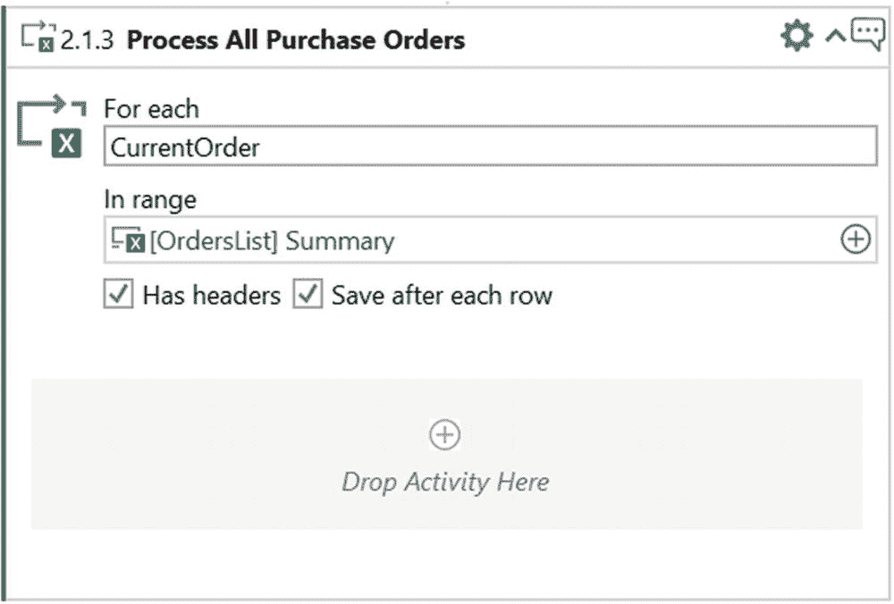
图 12-19 处理所有订单步骤的配置

## 第 10 步：生成发票编号
对于每个采购订单，我们首先需要创建一个对应的发票编号。我们将使用在第 2 步中在 `CustomNotebook` ➤ `Scratchpad` 工作表中定义的自定义公式。在此步骤中，我们将把当前的 `订单号` 粘贴到单元格 `B3` 中，单元格 `B4` 中的自定义公式将生成一个 `发票编号`：
1.  在 `StudioX` 中，将 `写入单元格` 活动添加到 `处理所有订单` 活动的主体中。
2.  将 `显示名称` 更新为 `生成发票编号`。
3.  在 `要写入的内容` 字段中，悬停在 `CurrentOrder` 上，然后选择 `订单号`；这将包含当前正在处理的订单的 `订单号`。
4.  在 `写入位置` 中，您需要提供一个需要输入数据的单元格。选择 `CustomNotebook` ➤ `在 Excel 中指示` 选项。从 `Scratchpad` 工作表中选择单元格 `B3`。
5.  保持 `自动递增行` 标志未选中状态，因为订单号将始终写入同一个单元格。

图 12-20 展示了此步骤的配置。
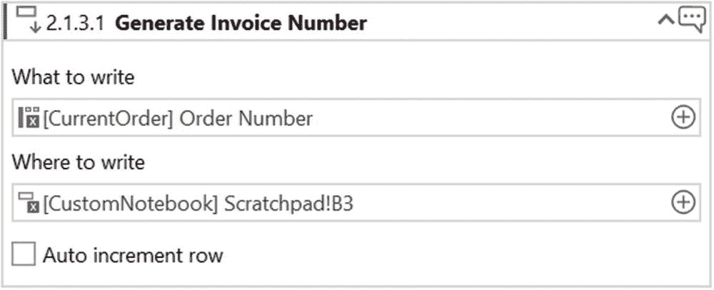
图 12-20 生成发票编号步骤的配置

## 第 11 步：创建订单详情 Excel 副本
对于每个订单，我们需要将详细信息存储在一个临时的 Excel 文件中。为此，我们需要在 `DailyProcessing\当前日期 (YYYYMMDD)` 文件夹中创建 `OrderDetails.xlsx` 模板的副本。每个文件将使用 `订单号` 命名：
1.  在 `StudioX` 中，将 `复制文件` 活动添加到 `处理所有订单` 活动的主体中，位于 `生成发票编号` 活动之后。
2.  将 `显示名称` 更新为 `创建订单详情 Excel 副本`。
3.  在 `从` 字段中，选择 `CustomNotebook` ➤ `在 Excel 中指示` 选项。从 `Scratchpad` 工作表中选择单元格 `B6`。如表 12-1 所述，此单元格将包含 `OrderDetails.xlsx` 文件的静态路径。
4.  在 `到` 字段中，选择 `CustomNotebook` ➤ `在 Excel 中指示` 选项。从 `Scratchpad` 工作表中选择单元格 `B11`。如表 12-1 所述，此单元格将包含订单详情 Excel 文件的动态路径。

图 12-21 展示了此步骤的配置。
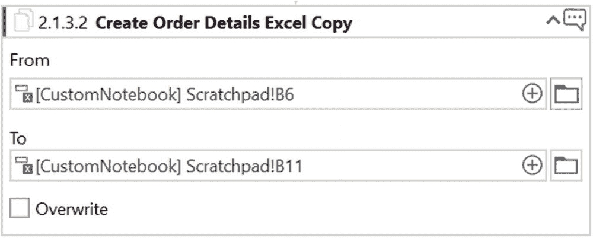
图 12-21 创建订单详情 Excel 副本步骤的配置

## 步骤 12：创建发票模板副本
对于每个订单，我们还需要在 `DailyProcessing\当前日期 (YYYYMMDD)` 文件夹中创建 `InvoiceTemplate.docx` 的副本。每个文件将使用自定义公式生成的 `发票编号` 命名：
1.  在 `StudioX` 中，在 `处理所有订单` 活动主体内的 `创建订单详情 Excel 副本` 活动之后，添加 `复制文件` 活动。
2.  将 `显示名称` 更新为 `创建发票模板副本`。
3.  在 `来源` 字段中，选择 `CustomNotebook` ➤ `在 Excel 中指示` 选项。从 `Scratchpad` 工作表中选择单元格 `B7`。如表 12-1 所述，此单元格将包含 `InvoiceTemplate.docx` 文件的静态路径。
4.  在 `目标` 字段中，选择 `CustomNotebook` ➤ `在 Excel 中指示` 选项。从 `Scratchpad` 工作表中选择单元格 `B12`。如表 12-1 所述，此单元格将包含特定发票的 Word 文档的动态路径。

图 12-22 展示了此步骤的配置。
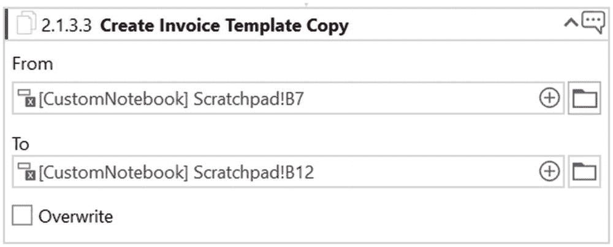
图 12-22 创建发票模板副本步骤的配置

## 步骤 13：提取订单详情并生成发票
在步骤 11 中，我们创建了 `OrderDetails.xlsx` 的副本来存储当前订单的详细信息。接下来，我们将启用自动化来使用此 Excel 文件：
1.  在 `StudioX` 中，在 `处理所有订单` 活动主体内的 `创建发票模板副本` 活动之后，添加 `使用 Excel 文件` 活动。
2.  将 `显示名称` 更新为 `提取订单详情并生成发票`。
3.  在 `Excel 文件` 字段中，选择 `CustomNotebook` ➤ `在 Excel 中指示` 选项。从 `Scratchpad` 工作表中选择单元格 `B11`。
4.  将 `引用为` 字段更新为 `OrderDetails`。
5.  勾选 `保存更改` 标志，以确保文件在每次更改后都能保存。
6.  取消勾选 `不存在则创建` 标志。

7.  勾选`模板文件`标志。提供模板将帮助`StudioX`理解Excel的结构。

8.  选择`浏览文件`图标，然后选择`C:\BookSamples\InvoiceGenerationAutomation\Templates\OrderDetails.xlsx`文件。

图 12-23 展示了此步骤的配置。

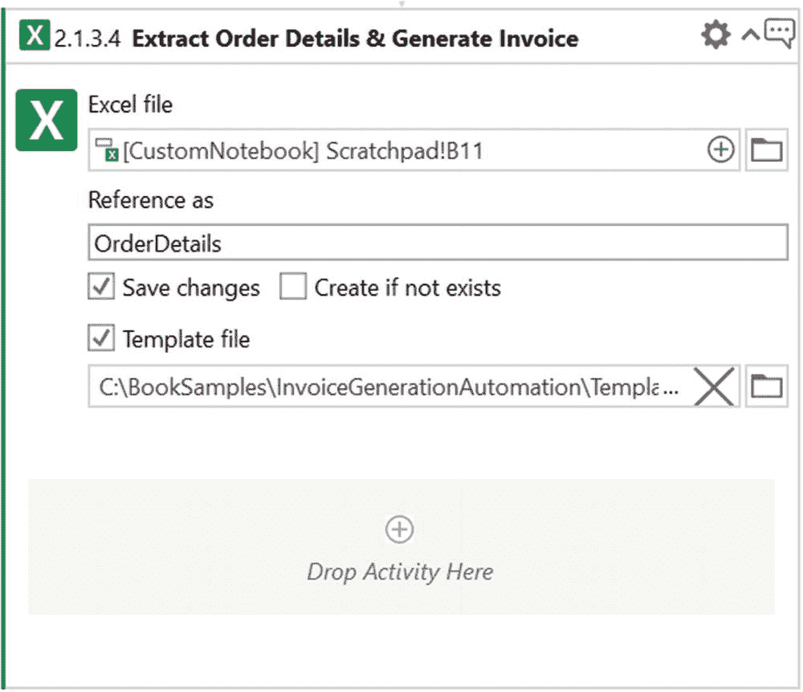

图 12-23
提取订单详情并生成发票步骤的配置

### 步骤 14：提取订单详情表格数据

接下来，我们将使用当前订单的`订单编号`，从`订单管理系统`中获取订单详情：

1.  在`StudioX`中，在`提取订单详情并生成发票`活动主体内添加`键入`活动。

2.  点击`在屏幕上指示目标 (I)`链接，并选择主页屏幕上的`搜索`文本字段。使用`搜索订单`按钮作为锚点。

3.  在`键入此文本`字段中，悬停在`CurrentOrder`上并选择`订单编号`。

4.  将`显示名称`更新为`键入搜索字段`。

5.  在`提取订单详情并生成发票`活动主体内的`键入搜索字段`活动之后，添加一个`点击`活动。

6.  点击`在屏幕上指示目标 (I)`链接，并选择`搜索订单`按钮。使用`搜索订单`文本字段作为锚点。

7.  将`显示名称`更新为`点击搜索订单按钮`。

8.  在`提取订单详情并生成发票`活动主体内的`点击搜索订单按钮`活动之后，添加一个`提取表格数据`活动。

9.  点击`在屏幕上指示目标 (I)`链接，这将启动`提取向导`。

10. 在`选择一个值`步骤中，点击`下一步`。

11. 将鼠标指向并点击`订单详情`屏幕中表格的`项目编号`列标题。

12. `提取向导`将以预览模式显示数据。点击`完成`。这将结束表格数据提取向导。

13. 在`提取到`字段中，悬停在`OrderDetails`上并选择`行项目 [工作表]`选项。

14. 将`显示名称`更新为`提取订单详情表格数据`。

15. `提取订单详情表格数据`活动会在Excel文件的开头添加一个额外的列`左上角标题单元格`。此列无需复制到发票中，且没有实际用途，因此我们需要在继续之前将其删除。在`提取订单详情并生成发票`活动主体内的`提取订单详情表格数据`活动之后，添加一个`删除列`活动。

16. 将`显示名称`更新为`删除额外列`。

17. 在`来源`字段中，悬停在`OrderDetails`上并选择`行项目 [工作表]`选项。

18. 勾选`包含标题`标志。

19. 在`列名`字段中，使用`文本`选项，并输入`左上角标题单元格`。

图 12-24 展示了此步骤的配置。

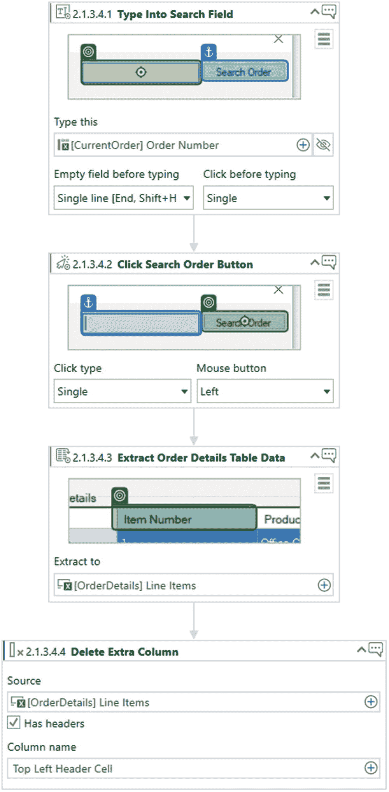

图 12-24
提取订单详情表格数据步骤的配置

### 步骤 15：为当前订单生成发票

我们已经有了发票模板的副本以及生成发票所需的所有数据。现在，我们可以配置自动化流程，为当前正在处理的订单生成发票：

1.  在`StudioX`中，将`使用 Word 文件`活动添加到`提取订单详情并生成发票`活动主体内，位于`删除多余列`活动之后。

2.  将`显示名称`更新为`为当前订单生成发票`。

3.  在`Word 文件`字段中，选择`CustomNotebook` ➤ `在 Excel 中指示`选项。从`Scratchpad`工作表中选择单元格`B12`。

4.  取消勾选`不存在则创建`标志。

5.  勾选`保存更改`标志，以确保每次迭代后文件都被保存。

6.  在`为当前订单生成发票`活动主体内添加一个`替换文档中的文本`活动。

7.  将`显示名称`更新为`输入发票编号`。

8.  在`搜索`字段中，选择`文本`选项，并输入`<INVOICENO>`。这是发票模板中的占位符，将被搜索并替换为下一步配置中提供的值。

9.  在`替换为`字段中，选择`CustomNotebook` ➤ `在 Excel 中指示`选项。从`Scratchpad`工作表中选择单元格`B4`。如表 12-1 所述，此单元格将包含使用自定义公式生成的发票编号。

10. 在`为当前订单生成发票`活动主体内，于`输入发票编号`活动之后添加一个`替换文档中的文本`活动。

11. 将`显示名称`更新为`输入发票日期`。

12. 在`搜索`字段中，选择`文本`选项，并输入`<DATE>`。

13. 在`替换为`字段中，选择`CustomNotebook` ➤ `在 Excel 中指示`选项。从`Scratchpad`工作表中选择单元格`B2`。这将提供当前日期的值。

14. 在`为当前订单生成发票`活动主体内，于`输入发票日期`活动之后添加一个`替换文档中的文本`活动。

15. 将`显示名称`更新为`输入客户`。

16. 在`搜索`字段中，选择`文本`选项，并输入`<CUSTOMER>`。

17. 在`替换为`字段中，悬停在`CurrentOrder`上并选择`客户`选项。这将提供当前正在处理的订单的客户值。

18. 在`为当前订单生成发票`活动主体内，于`输入客户`活动之后添加一个`替换文档中的文本`活动。

19. 将`显示名称`更新为`输入客户联系方式`。

20. 在`搜索`字段中，选择`文本`选项，并输入`<CUSTOMERCONTACT>`。

21. 在`替换为`字段中，悬停在`CurrentOrder`上并选择`联系方式`选项。这将提供当前正在处理的订单的客户联系方式值。

22. 在`为当前订单生成发票`活动主体内，于`输入客户联系方式`活动之后添加一个`替换文档中的文本`活动。

23. 将`显示名称`更新为`输入收货地址`。

24. 在`搜索`字段中，选择`文本`选项，并输入`<SHIPTOADDRESS>`。

25. 在`替换为`字段中，悬停在`CurrentOrder`上并选择`地址`选项。这将提供当前正在处理的订单的收货地址值。

26. 在`为当前订单生成发票`活动主体内，于`输入收货地址`活动之后添加一个`替换文档中的文本`活动。

27. 将`显示名称`更新为`输入总金额`。

28. 在`搜索`字段中，选择`文本`选项，并输入`<TOTALAMOUNT>`。

29. 在`替换为`字段中，悬停在`CurrentOrder`上并选择`总金额`选项。这将提供当前正在处理的订单的总金额值。

30. 到目前为止，我们已经替换了所有单项内容；现在我们要在Word中插入一个来自Excel的完整表格。在`为当前订单生成发票`活动主体内，于`输入总金额`活动之后添加一个`在文档中插入数据表`活动。

31. 将`显示名称`更新为`在发票中插入订单详情表`。

32. 在`要插入的表格`字段中，悬停在`OrderDetails`上并选择`行项目 [Sheet]`选项。这包含了Excel中我们将作为表格插入到Word文档的所有数据。

33. 在`插入相对于`字段中，从下拉菜单中选择`文本`选项。

34. 在`要搜索的文本`字段中，选择`文本`选项并输入`<PRODUCTS>`。这是发票模板中将要插入表格的占位符。

35. 在`文本出现位置`字段中，从下拉菜单中选择`第一个`。

36. 在`插入位置`字段中，选择`替换`选项。我们将用实际表格替换`<PRODUCTS>`文本。

37. 此时，发票将以Word格式生成。接下来，我们将配置自动化流程以PDF格式导出发票。在`为当前订单生成发票`活动主体内，于`在发票中插入订单详情表`活动之后添加一个`将文档另存为 PDF`活动。

38. 在`要保存的文件路径`字段中，选择`CustomNotebook` ➤ `在 Excel 中指示`选项。从`Scratchpad`工作表中选择单元格`B13`。如表 12-1 所述，此单元格将包含PDF文件的动态路径。

图 12-25 展示了此步骤的配置。

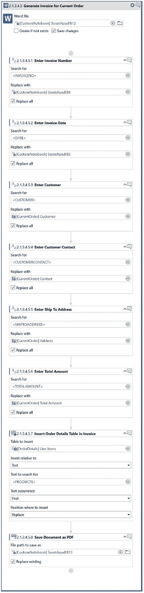

图 12-25
为当前订单生成发票步骤的配置

### 步骤 16：将采购订单标记为已处理

现在发票已生成，我们将在订单管理系统中将当前订单的发票状态标记为“已处理”，并关闭订单详情屏幕：

### 步骤 16：将采购订单标记为已处理

1. 在 `StudioX` 中，将 `勾选/取消勾选` 活动添加到 `提取订单详情并生成发票` 活动主体内，位于 `为当前订单生成发票` 活动之后。
2. 点击 `在屏幕上指示目标 (I)` 链接，并选择 `已处理` 复选框。使用标签作为锚点。
3. 将 `操作` 字段设置为 `勾选`。这将把发票标记为“已处理”。
4. 将 `显示名称` 更新为 `将发票标记为已处理`。
5. 在 `提取订单详情并生成发票` 活动主体内，于 `将发票标记为已处理` 活动之后添加一个 `点击` 活动。
6. 点击 `在屏幕上指示目标 (I)` 链接，并选择 `保存并关闭` 按钮。对于锚点，请使用 `保存并关闭` 按钮所在的标题区域。
7. 将 `显示名称` 更新为 `点击保存并关闭按钮`。

图 12-26 展示了此步骤的配置。

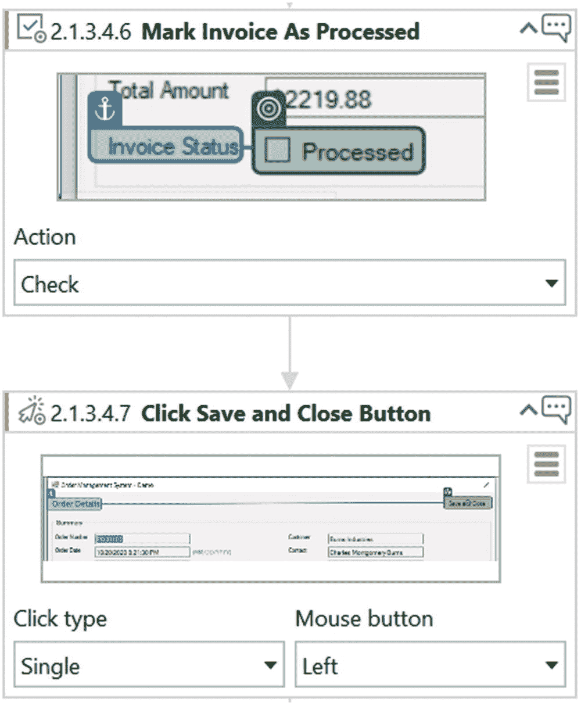

**图 12-26** 将采购订单标记为已处理步骤的配置

### 步骤 17：删除临时订单详情 Excel 文件

这是自动化的最后一步。既然已为当前正在处理的订单生成了发票，我们可以安全地删除 `OrderDetails.xlsx` 文件。此文件是临时创建的，仅用于存储当前订单的订单详情。

1. 在 `StudioX` 中，将 `删除文件` 活动添加到 `处理所有采购订单` 活动主体内，位于 `提取订单详情并生成发票` 活动之后。
2. 将 `显示名称` 更新为 `删除临时订单详情 Excel 文件`。
3. 在 `文件名` 字段中，选择 `CustomNotebook` ➤ `在 Excel 中指示` 选项。从 `Scratchpad` 工作表中选择单元格 `B11`。

图 12-27 展示了此步骤的配置。

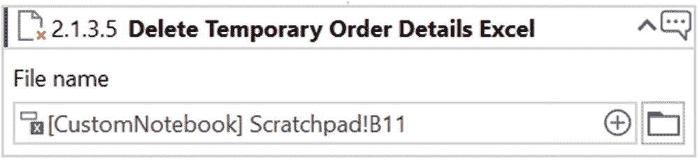

**图 12-27** 删除临时订单详情 Excel 文件步骤的配置

## 测试

一旦你点击 `Run` 按钮，自动化程序将为每个订单生成一张发票，并将其放置在 `DailyProcessing\Current Date (YYYYMMDD)` 文件夹中。图 12-28 展示了自动化程序的最终输出结果。

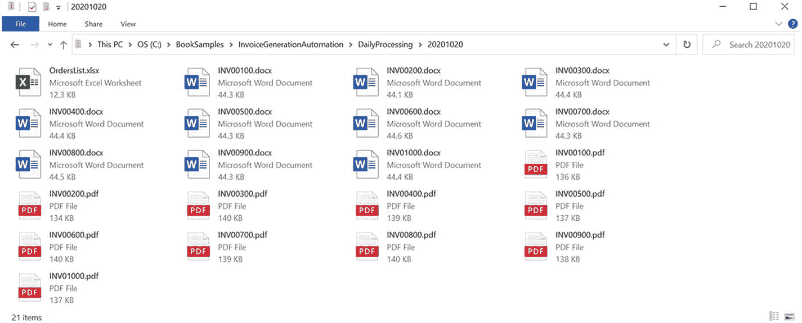

**图 12-28** 自动化运行输出

## 索引

**A, B**
- 有人值守机器人
- 逗号分隔值 (CSV)
- 通用活动
- 通用属性
- 压缩/解压文件
- 活动卡片配置
- 实现
- 结果
- 复制文件
- 活动卡片配置
- 实现
- 结果
- CSV 自动化活动
- 追加到 CSV
- 活动卡片配置
- 分隔符
- 员工数据
- 编码
- 实现
- 输出
- 文件夹结构
- 读取 CSV
- 活动卡片配置
- 分隔符
- 员工数据
- 编码
- IgnoreQuotes
- 实现
- 源代码
- 写入 CSV
- 活动卡片配置
- 分隔符
- 员工数据
- 编码
- 实现
- 输出

**C, D, E**
- 数据输入
- 数据输出
- 延迟活动
- 持续时间
- 输入
- 电子邮件
- Excel
- 追加区域
- 自动填充
- 更改数据透视表数据源
- 清除工作表/区域/表格
- 复制区域
- 创建数据透视表
- 定义
- 删除列
- 删除行
- 删除工作表活动
- 复制工作表活动
- 员工入职
- 导出为 CSV
- 填充区域
- 筛选
- 查找第一个/最后一个数据行活动
- 对于每个 Excel 行活动
- 对于每个 Excel 工作表
- 格式化为表格
- 格式化单元格
- 人力资源团队
- 插入工作表
- 插入列
- 插入行
- 读取单元格公式
- 读取单元格值
- 刷新数据透视表
- 重命名工作表活动
- 运行电子表格宏活动
- 保存 Excel 文件
- 将 Excel 文件另存为
- 将 Excel 文件另存为 PDF
- 排序区域
- 文本转列
- 使用 Excel 文件
- VLookup
- 写入单元格
- 写入区域
- 退出循环活动

**F, G, H, I, J, K, L**
- 文件自动化活动
- 追加行
- 归档文件夹
- 复制文件夹
- 创建文件
- 创建文件夹
- 活动卡片配置
- 动态路径
- 实现
- 输出
- 删除文件
- 删除文件夹
- 提取/解压文件
- 活动卡片配置
- 内容
- 实现
- 输出
- 文件存在
- 活动卡片配置
- 实现
- 输出
- 文件夹存在
- 活动卡片配置
- 动态路径
- 实现
- 输出
- 文件夹结构
- 面试文件夹
- 移动文件
- 活动卡片配置
- 实现
- 结果
- 移动文件夹
- 读取文本文件
- 简历文件夹
- 源代码
- 源文件夹
- 模板文件夹
- 写入文本文件
- 对于每个文件夹中的文件
- 活动卡片配置
- 实现
- 输出
- 结果
- 获取文件信息
- 活动卡片配置
- 文件属性窗口
- 实现
- 输出
- 属性
- 获取文件夹信息
- 活动卡片配置
- 实现
- 输出
- 属性
- 获取 Orchestrator 资产活动
- 获取用户名/密码活动
- 组活动
- 人力资源 (HR)
- 混合机器人
- If 活动
- 输入对话框活动
- 发票生成自动化
- DailyProcessing
- 文件夹结构
- 实现
- 创建发票模板
- 复制
- 创建订单详情 Excel
- 复制
- 创建项目
- 自定义笔记本
- DailyProcessing
- 删除临时订单详情 Excel
- 提取订单详情/生成发票
- 提取订单详情表格数据
- 提取订单表格数据
- 提取/处理所有订单
- 筛选待处理发票的订单
- 文件夹结构
- 为当前订单生成发票
- 生成发票编号
- 生成发票
- 初始化
- 将采购订单标记为已处理
- 订单管理系统
- 处理所有订单
- 模板
- 发票文件
- 订单详情屏幕
- 订单管理系统概述
- 解决方案设计
- 测试

**M, N, O, P, Q, R, S, T**
- 邮件自动化活动
- 参考, 回复邮件
- 归档邮件
- 删除邮件
- 桌面 Outlook
- 设置
- 文件系统结构
- 对于每个
- Gmail
- 转发邮件
- 将邮件标记为已读/未读
- 移动邮件
- 回复邮件
- 保存邮件
- 保存邮件附件
- 发送日历邀请
- 发送邮件
- 使用桌面 Outlook 应用
- 使用 Gmail
- 使用 Outlook 365
- 消息框活动
- Microsoft Word 活动
- 添加图片
- 追加文本
- 定义
- 在文档中插入数据表
- 读取文本活动
- 替换图片
- 替换文档中的文本
- 将文档另存为
- 将文档另存为 PDF
- 设置书签内容
- 使用 Word 文件
- Word 设置
- 修改文本活动
- 笔记本
- 演示文稿自动化活动
- 向幻灯片添加数据表
- 活动卡片配置
- 实现
- ReportTemplate.pptm
- 向幻灯片添加文件
- 活动卡片配置
- 实现
- ReportTemplate.pptm
- 向幻灯片添加图片/视频
- 添加新幻灯片
- 活动卡片配置
- 实现
- ReportTemplate.pptm
- 向幻灯片添加文本
- 活动卡片配置
- 实现
- ReportTemplate.pptm
- 复制粘贴幻灯片
- 活动卡片配置
- 实现
- ReportTemplate.pptm
- 删除幻灯片
- 文件系统结构
- 替换演示文稿中的文本
- 活动卡片配置
- 实现
- 替换次数
- ReportTemplate.pptm
- 运行演示文稿宏活动
- 活动卡片配置
- 实现
- 趋势图幻灯片
- 将 PowerPoint 文件另存为
- 将演示文稿另存为 PDF
- 使用 PowerPoint 演示文稿
- 产品数据录入自动化
- 创建文件夹
- 自定义笔记本
- 为每个 Excel 行输入数据/更新状态
- 自动递增行
- 点击添加产品 + 按钮
- 配置
- 创建条件
- 输入免运费数据
- 产品详情
- 键入
- 产品代码
- 单价 ($)
- 将状态更新为已处理
- 实现
- 检查文件夹结构是否存在
- 创建项目
- DailyProcessing
- 演示应用
- 获取所有已下载文件
- 文件夹结构
- 插入处理状态列
- 库存管理应用
- 库存管理 Web 应用
- 将文件移动到已处理文件夹示例
- 保存邮件详情
- 模板
- 手动任务
- DailyProcessing 文件夹
- Excel 附件
- 文件夹结构
- 高级概述
- 库存邮件
- 库存管理系统
- 库存经理
- 产品详情
- 处理邮件
- 发送确认邮件
- 正文配置
- ConfirmationEmailTracker Excel
- 筛选
- 筛选未发送邮件
- 对于每个 Excel 行
- 使用桌面 Outlook 账户
- 写入单元格
- 解决方案设计
- 测试
- 重复次数活动
- 投资回报率 (ROI)
- 机器人流程自动化 (RPA)
- 人力
- 劳动力
- ROI
- StudioX 工具
- 类型
- UiPath
- 稍后保存活动
- 跳过当前活动
- 切换活动
- 文本输入
- 文本向左/向右活动

**U, V, W, X, Y, Z**
- UI 自动化
- 应用/网页
- 检查应用状态活动
- 点击活动
- 提取表格数据活动
- 获取活动窗口活动
- 获取属性活动
- 获取文本活动
- 转到 URL 活动
- 隐藏窗口活动
- 高亮活动
- 悬停活动
- 键盘快捷键活动
- 最大化窗口活动
- 最小化窗口活动
- 模式窗口活动
- 导航浏览器活动
- 恢复窗口活动
- 选择项目活动
- 截屏活动
- 键入活动
- 使用应用/浏览器
- UiPath 的 StudioX 工具
- 业务用户
- 公民开发者
- 社区许可证
- 设计
- 分析
- 应用/网页录制器
- 剪切/复制/粘贴
- Excel 导出
- 导出
- 管理包
- 笔记本
- 项目
- 发布
- 功能区
- 运行
- 保存
- 表格提取
- 下载安装程序
- 硬件要求
- 主屏幕
- 帮助
- 设置
- 开始选项卡
- 模板
- 工具
- 安装
- 安装
- 项目工作区
- 活动面板
- 上下文菜单
- 数据管理器面板
- 设计器面板
- 输出面板
- 属性面板
- 注册
- 软件要求
- 试用
- 无人值守机器人
- 等待下载活动
- 写入行活动