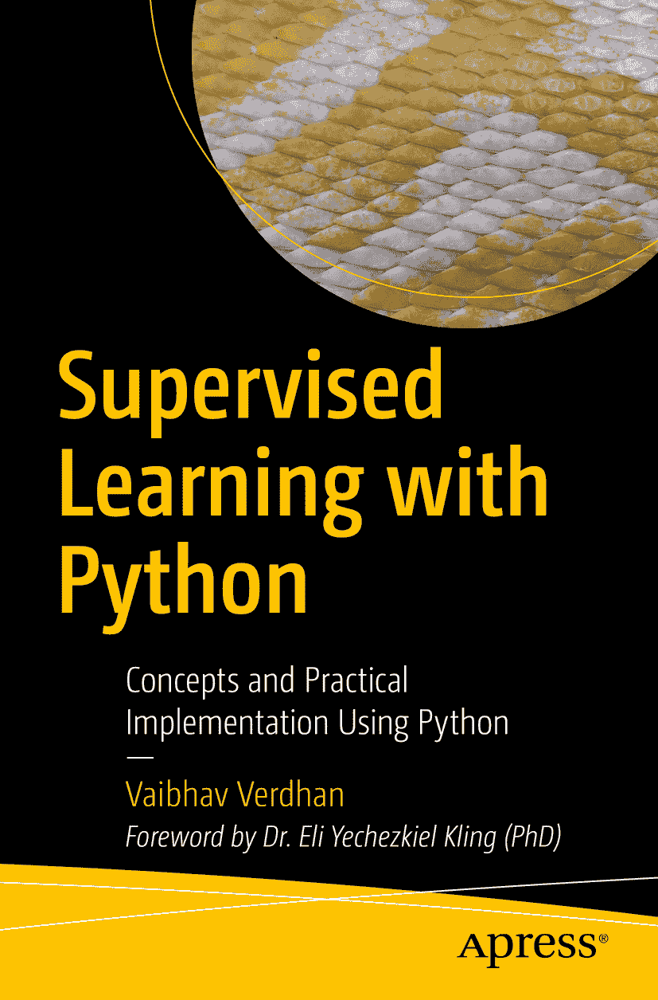

ISBN 978-1-4842-6155-2e-ISBN 978-1-4842-6156-9 [`doi.org/10.1007/978-1-4842-6156-9`](https://doi.org/10.1007/978-1-4842-6156-9) © Vaibhav Verdhan 2020 Apress Standard 本出版物中使用的通用描述性名称、注册商标名称、商标、服务标志等，即使未作明确声明，也不意味着这些名称不受相关保护性法律和法规的约束，因此可供自由使用。出版商、作者和编辑假定本书中的建议和信息在出版之日是真实准确的。出版商、作者和编辑均不对本书所含内容或可能存在的任何错误或遗漏提供明示或暗示的担保。出版商对已出版地图中的管辖权主张和机构隶属关系保持中立。本书由 Springer Science+Business Media New York 在全球图书贸易中发行，地址：233 Spring Street, 6th Floor, New York, NY 10013。电话：1-800-SPRINGER，传真：(201) 348-4505，电子邮件：orders-ny@springer-sbm.com，或访问 www.springeronline.com。Apress Media, LLC 是加利福尼亚州的有限责任公司，其唯一成员（所有者）是 Springer Science + Business Media Finance Inc (SSBM Finance Inc)。SSBM Finance Inc 是特拉华州的一家公司。

*献给 Yashi、Pakhi 和 Rudra。*

# 前言

在家分娩有多安全？这是一个好问题。暂停片刻，让自己思考一下。

我相信你能看到这个问题的答案如何影响个人决策和政策选择。答案可以是一个概率、一个等级分类，或者一个替代成本。另一种自然的反应是“视情况而定”。有许多因素可能影响在家分娩的安全性。

我带你进行这个思维练习，是为了向你展示你天生就像数据科学家一样思考。你理解了明确界定分析重点以及解释不同结果的因素的重要性。你开始阅读这本书的原因在于，你不确定如何用数学方式表达这些直觉概念，并指示计算机“找出”“特征”与“目标”之间的关系。

当我三十多年前开始职业生涯时，这属于统计学家的领域，他们精心设计了一种数学语言来描述关系和噪声。预测建模的本质目的，是作为一种工具，从看似混乱的信息中分离出信号或模式，并报告分离的效果如何。

如今，利用计算蛮力的机器学习算法增加了一种新的范式。这催生了一个新职业：数据科学家。数据科学家是一位实践者，能够以统计方法论思考，指示计算机执行所需的处理，并解释结果和报告。

成为一名优秀的数据科学家是一段旅程，从学习基础知识和机制开始。当你探索完这本书后，你可能也能更好地看清自己希望在哪些方面深化理论知识。我想建议你，研究一般统计建模理论，特别是贝叶斯范式，可能会很有趣。毕竟，机器学习就是计算统计学。

Eli. Y. Kling 博士（工程学学士、硕士、博士）

英国伦敦，2020 年 6 月。

# 引言

> *“做出预测很难，尤其是关于未来的预测。”*
> 
> ——约吉·贝拉

2019 年，麻省理工学院的凯蒂·布曼处理了 5 拍字节的数据，开发出了有史以来第一张黑洞图像。数据科学、机器学习和人工智能在这一非凡发现中发挥了核心作用。

数据是新的电力，根据《哈佛商业评论》的说法，数据科学家是 21 世纪“最性感”的工作。数据正在推动商业决策，并在所有行业和生活中产生影响。它使我们能够创造智能产品、改进营销策略、创新商业战略、增强安全机制、遏制欺诈、减少环境污染，并开发突破性药物。我们的日常生活更加丰富，社交媒体互动更加有序。它使我们能够降低成本、增加利润并优化运营。它提供了极好的成长和职业发展道路，但该领域人才匮乏。

本书旨在向读者介绍机器学习的一个分支——*监督学习*。本书涵盖了一系列监督学习算法及其相应的 Python 实现。在整本书中，我们讨论了算法的构建模块、其细节、数学基础和后台过程。学习过程辅以从零开始开发实际 Python 代码，并逐步解释代码。

本书首先介绍机器学习，讨论机器学习概念、监督学习、半监督学习和无监督学习方法之间的区别，以及实际用例。在下一章中，我们研究回归算法，如线性回归、多项回归、决策树、随机森林等。接着是一章关于分类算法的内容，使用逻辑回归、朴素贝叶斯、KNN、决策树和随机森林。在下一章中，研究 GBM、SVM 和神经网络的高级概念。我们在本书中处理结构化数据以及文本和图像数据。实用的 Python 实现补充了理解。随后是最后一章，关于端到端模型开发。读者将获得 Python 代码、数据集、最佳实践、常见问题和陷阱的解决方案，以及实施算法的实用第一手知识。读者将能够运行代码并以创新方式扩展它们，同时理解如何处理监督学习问题。你作为数据科学爱好者的能力将得到极大提升，所以准备好迎接这些富有成果的课程吧！

本书适合希望探索监督学习概念并结合 Python 实现的研究人员和学生。推荐给渴望紧跟技术前沿、澄清高级概念、获取最佳实践和常见挑战解决方案的在职专业人士。也适合希望获得第一手知识并在与团队和客户沟通时建立自信的商业领袖。最重要的是，本书适合那些试图探索监督学习算法如何工作，并希望尝试 Python 的好奇人士。

保持祝福，保持健康！

> ——Vaibhav Verdhan
> 
> 利默里克，
> 
> 爱尔兰，2020 年 6 月

# 致谢

我要感谢 Apress 出版社、Celestin John、Shrikant Vishwarkarma 和 Irfan Elahi 给予的信任和支持。非常感谢 Eli Kling 博士为本书撰写的精彩前言。特别感谢我的家人——Yashi、Pakhi 和 Rudra——没有他们的支持，完成这项工作是不可能的。

# 关于作者

# 关于技术审校者