# 1. 监督学习简介

> “未来属于那些今天为之准备的人。”
> — 马尔科姆·X

未来总是让我们感兴趣。我们想知道前方有什么，然后才能为之规划。如果我们能预测未来，就可以调整商业策略、最小化损失并增加利润。预测历来都令我们着迷。而你刚刚迈出了学习预测未来的第一步。恭喜你，欢迎踏上这段激动人心的旅程！

你可能听说过数据是新时代的石油。数据科学和机器学习（ML）正在利用数据的力量为我们生成预测。这些能力使我们能够审视趋势和异常、收集可操作的见解，并为商业决策提供方向。本书旨在帮助你培养这些能力。我们将学习机器学习的概念，并使用 Python 开发实用的代码。你将使用多个数据集，从数据中生成见解，并利用 Python 创建预测模型。

当你读完本书时，你将精通数据科学和机器学习的概念，并重点关注监督学习。我们将研究监督学习算法的概念以解决回归问题，学习分类问题，并解决不同的现实案例研究。我们还将研究高级监督学习算法和深度学习概念。数据集包括结构化数据以及文本和图像。我们将学习端到端的模型开发和部署流程，以完成整个学习过程。

在此过程中，我们将研究监督学习算法、它们的细节、统计和数学方程及过程、后台发生的情况，以及我们如何使用数据来创建解决方案。所有代码均使用 Python，数据集已上传至 GitHub 仓库（`https://github.com/Apress/supervised-learning-w-python`）以便访问。建议你自行复现这些代码。

让我们开始这段学习之旅。

## 什么是机器学习？

当我们在 Facebook 上发布照片、在亚马逊购物、发推文或在 YouTube 上观看视频时，这些平台都在为我们收集数据。在每一次互动中，我们都在留下数字足迹。这些生成的数据点被收集和分析，而机器学习使这些巨头能够向我们提供合理的推荐。根据我们喜欢的视频类型，Netflix/YouTube 可以更新我们的播放列表、我们可以点击的链接以及我们可以反应的状态；Facebook 可以推荐帖子给我们，观察我们频繁购买的产品类型；亚马逊可以根据我们的消费能力建议下一次购买！很神奇，对吧？

机器学习的简短定义如下：“在机器学习中，我们研究统计/数学算法，从数据中学习模式，然后用于预测未来。”

而且机器学习并不仅限于在线媒介。它的能力已扩展到多个领域、地域和用例。我们将在本章最后一节详细描述这些用例。

因此，在机器学习中，我们分析大量数据并发现其中的模式。然后将这些模式应用于现实世界的数据以预测未来。这些现实世界的数据是未见过的，预测将帮助企业制定各自的策略。我们不需要显式地对计算机进行编程来完成这些任务；相反，算法会根据历史数据和统计模型做出决策。

但机器学习如何融入更大的数据分析格局呢？我们经常遇到数据分析、数据挖掘、机器学习和人工智能（AI）等术语。数据科学也是一个使用松散、没有确切定义的短语。现在探讨这些术语是个好主意。

### 数据分析、数据挖掘、机器学习和人工智能之间的关系

*数据挖掘*是当今的热门词汇。它用于描述从大型数据集、数据库和数据湖中收集数据，从该数据中提取信息和模式，并将这些见解转化为可用结构的过程。它涉及数据管理、预处理、可视化等。但它通常是任何数据分析项目的第一步。

检查数据的过程称为*数据分析*。通常，我们分析数据趋势、识别异常，并使用表格、图表、直方图、交叉表等生成见解。数据分析是最重要的步骤之一，并且非常强大，因为生成的智能易于理解、关联性强且直观。通常，我们使用 Microsoft Excel、SQL 进行探索性数据分析（EDA）。它也是创建机器学习模型之前的重要步骤。

有一个经常讨论的问题——机器学习、人工智能和深度学习之间的关系是什么？数据科学又如何融入其中？图 1-1 描绘了这些领域之间的交集。人工智能可以被视为替代人类密集型任务的自动化解决方案。因此，人工智能降低了成本和时间消耗，并提高了整体效率。

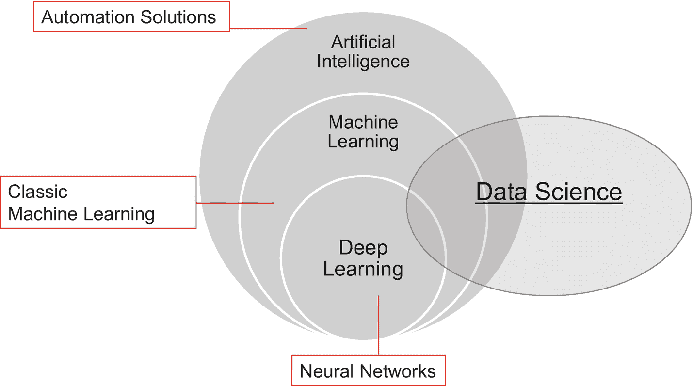

图 1-1

人工智能、机器学习、深度学习和数据科学之间的关系展示了这些领域如何相互关联并相互赋能

深度学习是当前最热门的趋势之一。神经网络是深度学习的心脏和灵魂。深度学习是人工智能和机器学习的一个子集，涉及开发复杂的数学模型来解决业务问题。我们主要使用神经网络来分类图像以及分析文本、音频和视频数据。

数据科学位于这些不同领域的交汇点。它不仅涉及机器学习，还涉及统计学理解、编码专业知识和商业头脑来解决业务问题。数据科学家的职责是解决业务问题并为业务生成可操作的见解。请参考表 1-1 了解数据科学的能力及其局限性。

表 1-1

数据科学：它如何帮助我们、其用途及局限性

| -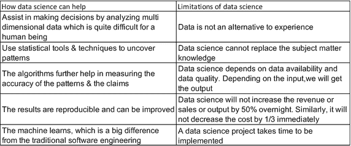 |

通过以上讨论，你应该清楚机器学习的作用及其与其他数据相关领域的关系。到现在你大概已经意识到，“数据”在机器学习中扮演着关键角色。让我们进一步探索数据、其类型和属性。

### 数据、数据类型与数据来源

你肯定已经对数据有了一定的了解。重温这些知识，并讨论不同类型生成的数据集及其示例，将是一个好主意。图 1-2 展示了数据的区分。

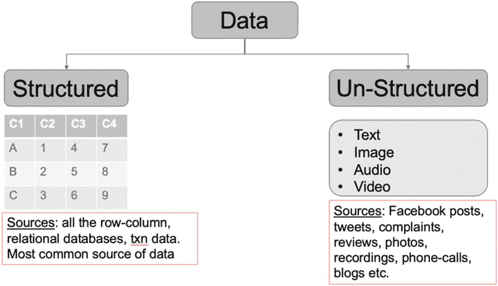

图 1-2

数据可分为结构化数据和非结构化数据。结构化数据更容易处理，而深度学习通常用于处理非结构化数据。

数据产生于我们进行的所有交互和交易中。无论线上还是线下：我们每时每刻都在生成数据。在银行、零售店、社交媒体上，拨打移动电话：每一次交互都会产生数据。

数据有两种类型：结构化数据和非结构化数据。当你给朋友打移动电话时，电信运营商会获取通话数据，如通话时长、通话费用、通话时间等。同样，当你使用银行门户进行在线交易时，会产生关于交易金额、收款人、交易原因、日期/时间等数据。所有能够以行列结构表示的数据点都称为*结构化数据*。大多数被使用和分析的数据都是结构化的。这些数据使用 `Oracle`、`SQL`、`AWS`、`MySQL` 等工具存储在数据库和服务器中。

*非结构化数据*是那些无法以行列结构表示的数据类型，至少在其基本格式下无法表示。非结构化数据的例子包括文本数据（Facebook 帖子、推文、评论、评价等）、图像和照片（Instagram、产品照片）、音频文件（广告歌、录音、呼叫中心通话）以及视频（广告、YouTube 帖子等）。不过，所有非结构化数据都可以被保存和分析。正如你所想，分析非结构化数据比分析结构化数据更困难。需要注意的一个重要点是，非结构化数据也必须转换为整数，以便计算机能够理解并处理它。例如，一张彩色图像包含像素，每个像素都有从 0 到 255 的 `RGB`（红、绿、蓝）值。这意味着每张图像都可以用包含整数的矩阵形式来表示。因此，这些数据可以被输入计算机进行进一步分析。

注意

我们使用自然语言处理、图像分析以及诸如卷积神经网络、循环神经网络等神经网络技术来分析文本和图像数据。

一个经常被忽视且讨论较少的关键方面是*数据质量*。数据质量决定了分析结果和生成的洞察的质量。请记住，*垃圾进，垃圾出*。

一个优质数据集的属性如图 1-3 所示。在处理问题时，你必须投入大量时间来确保你的数据具有最高质量。

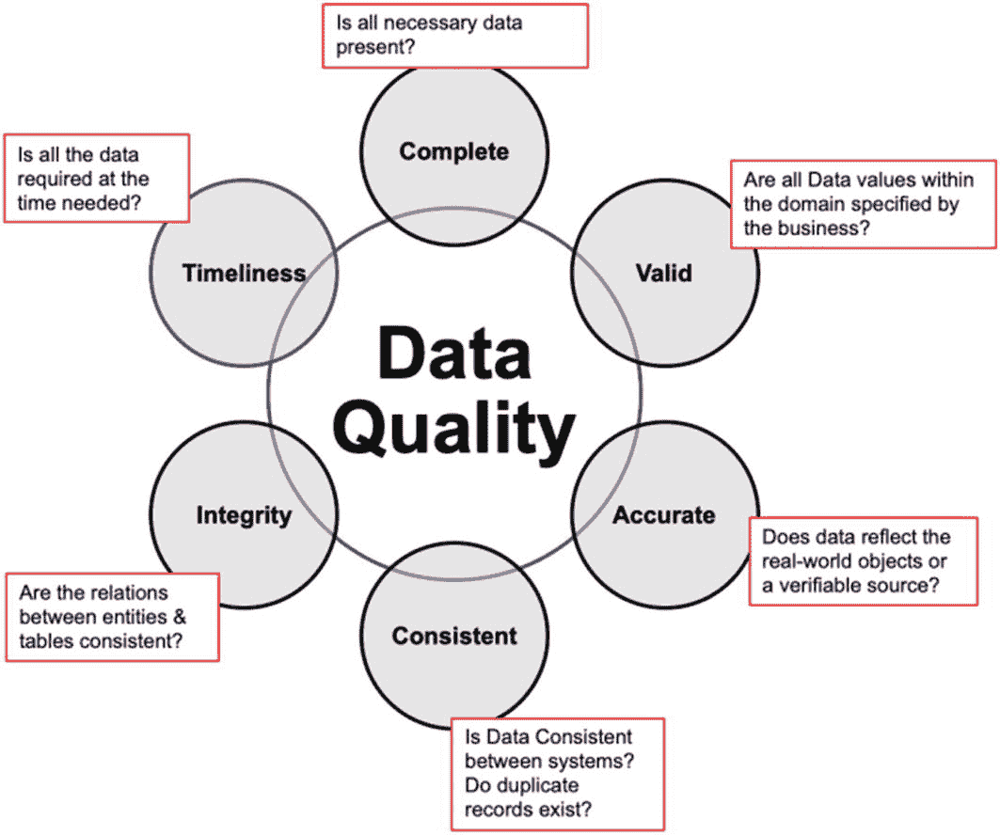

图 1-3

数据质量在机器学习解决方案的开发中起着至关重要的作用；大量时间和精力都投入到提高数据质量上。

我们应该确保我们可用的数据符合以下标准：

*   **数据的完整性**指的是可用属性的百分比。在现实世界的业务中，我们发现许多属性缺失，或者具有 `NULL` 或 `NA` 值。建议确保我们正确地获取数据并保证其完整性。在数据准备阶段，我们会处理这些变量，并根据需求替换或删除它们。例如，如果你在处理零售交易数据，必须确保所有月份（或几乎所有月份）的收入都是可用的。

*   **数据有效性**是为了确保在数据识别阶段捕获所有关键绩效指标（`KPI`）。业务领域专家（`SME`）的输入对于确保这一点至关重要。这些 `KPI` 会被计算并由领域专家进行验证。例如，在计算移动用户的平均通话费用时，领域专家可能会建议增加或删除一些费用，如频谱费、获取成本等。

*   **数据的准确性**是为了确保所有捕获的数据点都是正确的，并且我们的数据中没有不一致的信息。据观察，由于人为错误或软件问题，有时会捕获错误的信息。例如，在捕获零售店购买顾客数量时，周末的数字通常高于工作日。这一点需要在探索阶段确保。

# 机器学习基础

*   使用的数据必须具有`一致性`，并且不应在不同系统和接口之间发生变化。通常，不同的系统被用来表示同一个`KPI`。例如，网站页面的点击次数可能以不同的方式记录。这个`KPI`的一致性将确保进行正确的分析，并生成一致的洞察。

*   当你将数据保存在数据库和表中时，不同实体和属性之间的关系通常不一致，或者更糟，可能根本不存在。系统的数据`完整性`确保我们不会遇到此类问题。一个健壮的数据结构对于高效、完整且正确的数据挖掘过程是必需的。

*   数据分析的目标是发现数据中的趋势和模式。存在季节性变化、与日期/时间/事件相关的波动等。有时，我们必须捕获过去几年的数据来衡量`KPI`的变化。所捕获数据的`时效性`必须具有足够的代表性，以捕捉这些变化。

数据中最常见的问题包括缺失值、重复值、垃圾值、异常值等。你将详细学习如何以逻辑和数学的方式解决这些问题。

到现在为止，你已经理解了什么是机器学习，以及高质量数据的属性是什么，以确保良好的分析。但还有一个问题尚未解答。既然我们有软件工程可用，为什么还需要机器学习？你将在下一节中找到这个问题的答案。

## 机器学习与软件工程的区别

软件工程和机器学习都旨在解决业务问题。两者都与数据库交互、分析和编写代码模块，并生成供业务使用的输出。对业务领域的理解以及可用性对这两个领域都至关重要。在这些参数上，软件工程和机器学习是相似的。然而，关键区别在于执行方式和解决业务挑战所采用的方法。

软件编写涉及编写可由处理器（即计算机）执行的精确代码。另一方面，机器学习收集历史数据并理解数据中的趋势。基于这些趋势，机器学习算法将预测所需的输出。让我们先通过一个简单的例子来看一下。

考虑一下：你想自动化打开一罐可乐的过程。使用软件，你会用精确的坐标和指令编写出确切的步骤。为此，你需要知道这些精确的细节。然而，使用机器学习，你会多次向系统“展示”打开罐子的过程。系统会通过观察各个步骤来学习这个过程，或者说“训练”自己。下次，系统就能自己打开罐子了。现在让我们看一个现实生活中的例子。

想象你在一家提供信用卡的银行工作。你在欺诈检测部门，你的工作是将交易分类为欺诈或真实。当然，有一些验收标准，比如交易金额、交易时间、交易方式、交易城市等等。

让我们用软件来实现一个假设的解决方案；你可能会实现像图 1-4 中描述的那些条件。就像决策树一样，可以做出最终决策。步骤 1：如果交易金额低于阈值`X`，则转到步骤 2，否则接受它。在步骤 2 中，可能会检查交易时间，然后过程会从那里继续。

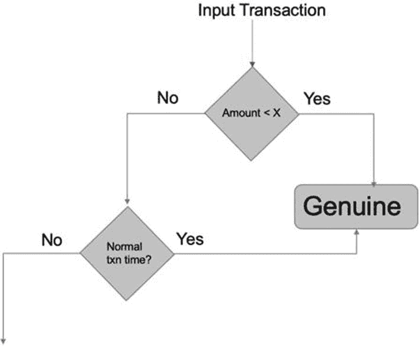

图 1-4

欺诈检测系统的假设性软件工程流程。软件工程不同于机器学习。

然而，使用机器学习，你将收集包含过去交易的历史数据。它将包含欺诈和真实交易。然后，你将把这些交易暴露给统计算法并训练它。统计算法将揭示交易属性与其真实/欺诈性质之间的关系，并将该知识保存起来以供进一步使用。

下次，当系统遇到一笔新交易时，它将根据从过去交易中生成的历史知识以及这笔新未见交易的属性，将其分类为欺诈或真实。因此，由机器学习算法生成的规则集依赖于趋势和模式，并提供了更高水平的灵活性。

机器学习解决方案的开发通常比软件工程更具迭代性。此外，它不像软件那样精确。但机器学习无疑是一个很好的通用解决方案。对于复杂的业务问题，它是一个极好的解决方案，并且通常是我们人类无法理解的真正复杂问题的唯一解决方案。在这里，机器学习扮演着关键角色。它的美妙之处在于，如果训练数据发生变化，无需从头开始开发过程。模型可以重新训练，然后你就可以继续了！

所以机器学习无疑非常有用，对吧！是时候让你了解机器学习项目中的步骤了。这将为你更深入地探索机器学习做好准备。

### 机器学习项目

机器学习项目和其他项目一样。它有一个要实现业务目标、一些输入信息、工具和团队、期望的准确度水平以及一个截止日期！

然而，机器学习项目的执行方式却大不相同。机器学习过程中的第一步是相同的，即定义业务目标和衡量成功标准的可量化参数。图 1-5 显示了机器学习项目中的后续步骤。

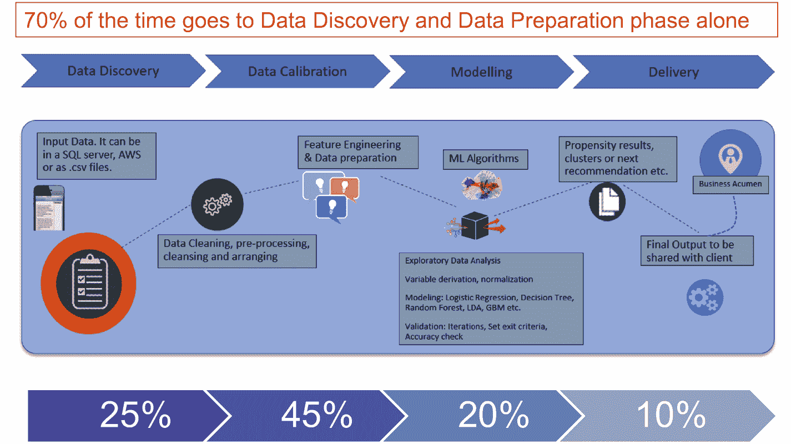

图 1-5

机器学习项目与其他项目一样，包含各种步骤和流程。像任何其他项目一样，机器学习项目需要适当的规划和执行。

后续步骤是：

1.  进行数据发现，以探索我们可以使用的各种数据源。数据集可能存在于`SQL`服务器、Excel 文件、文本或 `.csv` 文件中，或者云服务器上。

2.  在数据挖掘和校准阶段，我们从所有来源提取相关字段。数据被适当地清理和处理，为下一阶段做好准备。创建新的派生变量，并丢弃信息量不大的变量。

3.  然后是探索性数据分析（`EDA`）阶段。使用分析工具，从数据中生成一般性见解。趋势、模式和异常值是这一阶段的输出，这些对于下一阶段（即统计建模）非常有用。

4.  机器学习建模或统计建模是实际的模型开发阶段。我们将在本书中详细讨论这个阶段。

5.  建模后，结果与业务团队共享，并将统计模型部署到生产环境中。

由于可用的大部分数据很少是干净的，项目时间的 60%–70% 以上都花在了数据挖掘、数据发现、清理和数据准备阶段。

在项目开始之前，存在一些预期的挑战。在图 1-6 中，我们讨论了在开始机器学习项目之前应该问的几个问题。

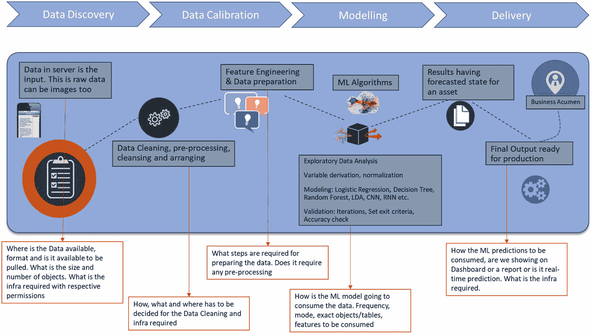

图 1-6

开始机器学习项目前应做的准备。至关重要的是，所有相关问题都清晰明了，并且关键绩效指标（`KPI`）已经确定。

我们应该能够回答关于数据可用性、数据质量、数据准备、机器学习模型预测测量等方面的问题。在启动项目之前找到这些问题的答案是至关重要的；否则，我们可能会给自己带来压力，并在后期错过截止日期。

现在你了解了什么是机器学习以及机器学习项目中的各个阶段。这对于你设想一个机器学习模型以及过程中的各个步骤将很有帮助。在深入之前，我们有必要复习一些统计和数学概念。你也会同意，统计和数学知识是理解机器学习所必需的。

## 机器学习的统计与数学概念

统计学和数学对于全面、扎实地掌握机器学习知识至关重要。用于进行预测的数学和统计算法基于线性代数、矩阵乘法、几何概念、向量空间图等概念。其中一些概念你可能已经学过。在后续章节学习算法时，我们也会详细研究算法背后的数学原理。

以下是一些对你理解非常有用的重要概念。它们是数据科学和机器学习的基石：

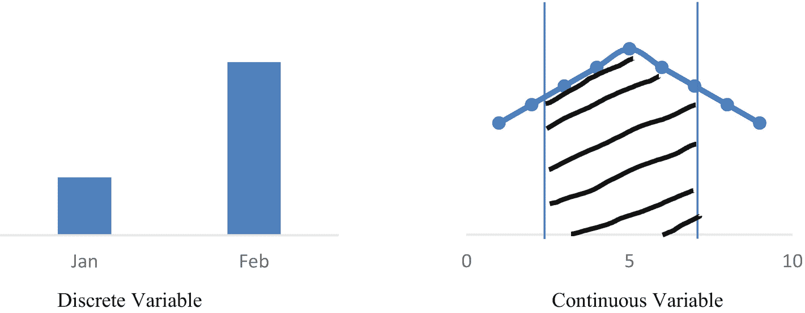

图 1-8

离散变量是可数的，而连续变量则在一个时间范围内

*   **总体 vs. 样本**：顾名思义，当我们考虑所有可用的数据点时，我们考虑的是整个总体。如果从总体中取出一部分，则称为样本。如图 1-7 所示。

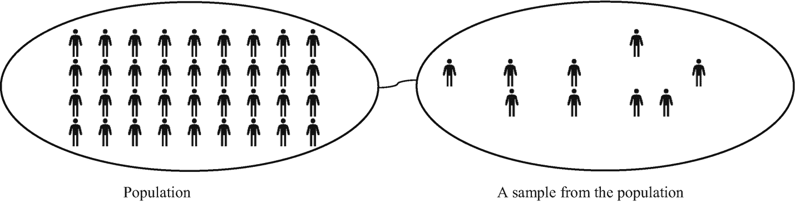

图 1-7

总体与来自总体的样本。样本是总体的真实代表。抽样时应牢记避免偏差。

*   **参数 vs. 统计量**：参数是总体的描述性度量，例如：总体均值、总体方差等。样本的描述性度量称为统计量。例如，样本均值、样本方差等。

*   **描述性统计 vs. 推断性统计**：当我们收集一组数据并得出关于同一组数据的结论时，这称为描述性统计。然而，如果从样本中收集数据，并利用生成的统计量来推断该样本所来自的总体，则称为推断性统计。

*   **数值型 vs. 分类型数据**：所有定量的数据点都是数值型的，例如身高、体重、体积、收入、收益率百分比等。

    *   定性的数据点是分类型数据点：例如，性别、电影评分、邮政编码、出生地等。分类变量有两种类型：`名义型`和`有序型`。名义型变量在不同值之间没有等级之分，而有序型变量则有等级。

*   名义数据的例子有性别、宗教、邮政编码、身份证号等。有序变量的例子有电影评分、财富 50 强排名等。

*   **离散型 vs. 连续型变量**：可数的数据点是离散的；否则数据是连续的（图 1-8）。

例如，一批产品中的缺陷数量是可数的，因此是离散的；而零售店顾客到达的时间间隔则是连续的。

*   **集中趋势度量**：均值、中位数、众数、标准差和方差是集中趋势的度量。这些度量对于衡量各种关键绩效指标至关重要。还有其他跟踪的度量，如总计、十分位或四分位分布。例如，在报告一天内完成的交易数量时，我们会报告一天的总交易数量和日均交易数量。我们还会报告该关键绩效指标的时间/日期变化。

*   **泊松分布**：泊松分布用于确定在固定的时间或空间间隔内，给定数量的事件发生的概率。其假设是这些事件相互独立，并且以恒定的均值发生。

泊松分布的方程如下：

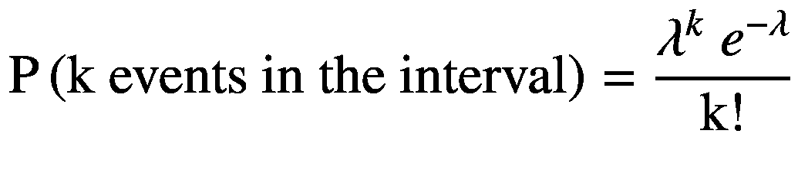

例如：如果我们想模拟下午 4 点到 5 点之间访问商店的顾客数量，或者晚上 11 点到凌晨 4 点之间访问服务器的交易数量，我们可以使用泊松分布。

你可以使用以下 Python 代码生成泊松分布：

```python
import numpy as np
import matplotlib.pyplot as plt
s = np.random.poisson(5, 10000)
count, bins, ignored = plt.hist(s, 14, normed=True)
plt.show()
```

*   **二项分布**：我们使用二项分布来模拟从总体“N”中抽取的样本“n”中成功次数的分布。条件是此抽样必须是有放回的。因此，在“n”个独立事件的序列中，每个事件的成功与否由一个布尔结果决定。显然，如果成功的概率是“p”，那么失败的概率就是“1–p”。

二项分布的方程如下：

`P (X) = ^nC[x] p^x (1–p)^(n-x)`

二项分布最简单的例子是抛硬币。每次抛硬币的事件都是相互独立的。

你可以使用以下 Python 代码生成二项分布：

```python
import numpy as np
import matplotlib.pyplot as plt
n, p = 10, .5
s = np.random.binomial(n, p, 1000)
count, bins, ignored = plt.hist(s, 14, normed=True)
plt.show()
```

*   **正态分布或高斯分布**：正态分布或高斯分布是最著名的分布。它就是著名的钟形曲线，在自然界中经常出现。

对于正态分布，人们认为当大量微小的、随机的扰动共同作用时，分布就会呈现这种形式。而这些微小的扰动各自都有其独特的分布。

高斯分布是著名的 68–95–99.7 规则的基础，该规则指出，在正态分布中，68.27%、95.45% 和 99.73% 的值分别位于均值的一个、两个和三个标准差之内。以下 Python 代码用于生成正态分布，如图 1-9 所示。

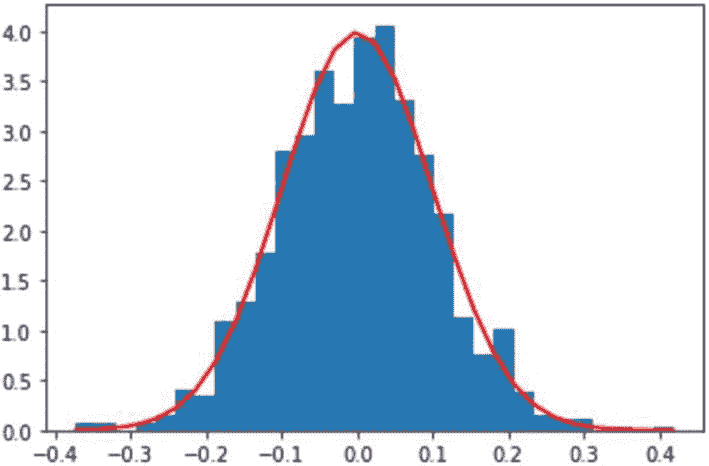

图 1-9

正态分布曲线是最著名的曲线

```python
import numpy as np
import matplotlib.pyplot as plt
mu, sigma = 0, 0.1
s = np.random.normal(mu, sigma, 1000)
count, bins, ignored = plt.hist(s, 30, normed=True)
plt.plot(bins, 1/(sigma * np.sqrt(2 * np.pi)) * np.exp( - (bins - mu)**2 / (2 * sigma**2) ),linewidth=2, color="r")
plt.show()
```

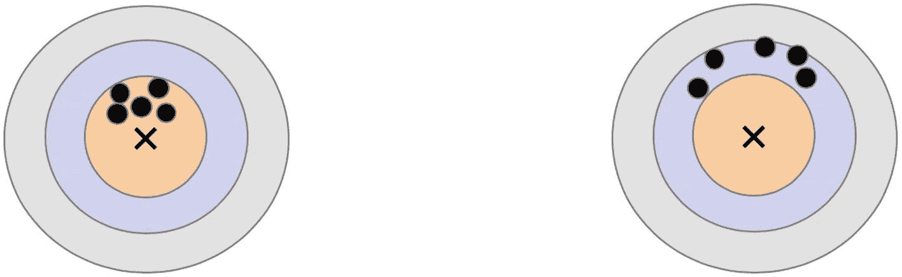

图 1-11

低方差/低偏差和高方差/高偏差。最终选定的模型期望具有低方差和低偏差。

表 1-2

偏差与方差的比较

| 偏差 | 方差 |
| :--- | :--- |
| 衡量预测值与实际值的偏离程度。 | 衡量仅针对一个数据点的预测值之间的差异程度。 |
| 好的模型应具有低偏差。 | 好的模型应具有低方差。 |
| 高偏差是由于训练期间做出了错误假设，或者模型欠拟合，未能考虑数据中存在的所有信息而导致的。 | 高方差是由于模型对训练数据过拟合，未能推导出通用规则。因此，它在对新数据集进行预测时表现不佳。 |

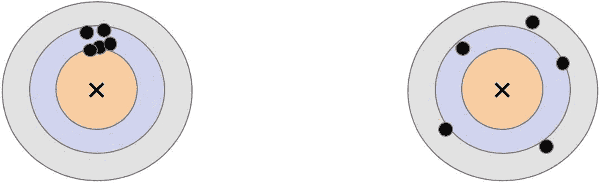

图 1-10

偏差是模型的欠拟合，而方差是模型的过拟合。为了获得稳健的机器学习解决方案，两者都必须加以管理。

*   **偏差**–**方差权衡**：为了衡量模型的性能，我们会计算误差，即实际值与预测值之间的差值。这种误差可能来自两个来源：偏差和方差，如图 1-10 所示，并在表 1-2 中定义。

误差可以表示为：

误差 = 偏差² + 方差 + 不可约误差

*   **向量与矩阵**：我们使用的数据集可以用向量空间图来表示。因此，让我们简要回顾一下向量和矩阵的定义。

**向量**可以定义如下：

1.  向量是一个既有大小又有方向的对象。
2.  它们是以数学形式表示任何形式数据的绝佳工具。
3.  一个典型的向量看起来像这样：`[1,2,3,4,5]`。
4.  在数学术语中，向量表示为顶部带箭头的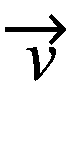。
5.  它既可用于数值数据，也可用于非数值数据。非结构化数据以数学格式的表示是通过向量化和嵌入来实现的。

**矩阵**可以定义如下：

1.  矩阵是向量的扩展。
2.  它们是一堆堆叠在一起的向量；因此，矩阵由按行和列排列的数字组成。
3.  它们是表示和保存数据集以执行数学运算的一种非常简单的方式。
4.  一个典型的矩阵看起来像这样：

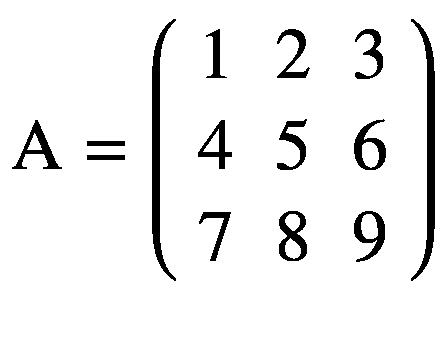

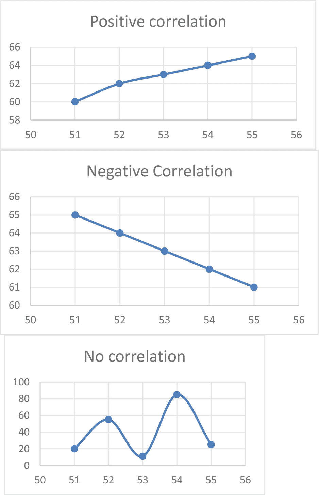

图 1-12

数据中的正相关、负相关和无相关

*   **相关性与协方差**：当我们试图理解变量之间的关系时，相关性和协方差是非常重要的度量指标。
    1.  协方差和相关性是衡量两个变量之间依赖关系的指标。
    2.  例如，对于一个孩子来说，随着身高的增加，体重通常也会增加。在这种情况下，身高和体重是正相关的。
    3.  数据点之间可能存在负相关和零相关。
    4.  例如，缺课次数的增加可能会导致成绩下降。如果在多个样本中观察到相同的趋势，那么这些参数就是负相关的。
    5.  零相关表示没有线性依赖关系，但可能存在非线性依赖关系。例如，大米价格的上涨与手机价格的上涨/下跌是零相关的。
    6.  相关性是协方差的缩放值。
    7.  三种类型的相关性——正相关、负相关和无相关——如图 1-12 所示。

还有一些概念需要讨论，比如衡量算法准确度的方法、R²、调整后的 R²、AIC 值、一致性比率、KS 值等等。我们将分两部分讨论它们：第 2 章针对回归问题，第 3 章针对分类问题。

干得漂亮！现在你已经复习了主要的统计学概念。机器学习和统计学是相辅相成的，所以值得称赞。

现在是时候让你深入机器学习的概念了，我们将从不同类型的算法开始。机器学习算法有不同的类型：监督学习、无监督学习、半监督学习、自学习、特征学习等等。我们将首先研究监督学习算法。

## 监督学习算法

监督学习可以说是机器学习最常见的用法。如你所知，在机器学习中，统计算法通过历史数据来学习模式。这个过程被称为*训练*算法。历史数据或*训练*数据包含输入和输出变量。它包含一组由算法学习的训练样本。

在训练阶段，算法将在输出变量和输入变量之间建立关系。目标是生成一个能够利用输入变量预测输出变量的数学方程。输出变量也称为*目标*变量或*因*变量，而输入变量称为*自*变量。

为了理解这个过程，让我们举一个例子。假设我们想根据房屋的属性预测其预期价格（以英镑计）。房屋属性包括其面积（平方米）、位置、卧室数量、阳台数量、与最近机场的距离等等。对于这个模型，我们有一些历史数据可供使用，如表 1-3 所示。这些数据就是用于训练模型的训练数据。

表 1-3

用于预测房价的数据集结构

| 面积（平方米） | 卧室数量 | 阳台数量 | 距机场距离（公里） | 价格（百万英镑） |
| :--- | :--- | :--- | :--- | :--- |
| 100 | 2 | 0 | 20 | 1.1 |
| 200 | 3 | 1 | 60 | 0.8 |
| 300 | 4 | 1 | 25 | 2.9 |

# 监督学习算法

| 400 | 4 | 2 | 5 | 4.5 |
| --- | --- | --- | --- | --- |
| 500 | 5 | 2 | 60 | 2.5 |

如果同样的数据用向量空间图表示，它将如图 1-13 所示。每一行或每个训练样本都是一个`数组`或`特征`向量。

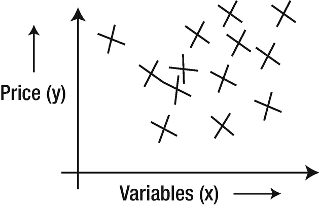

图 1-13

价格及其他变量在向量空间图中的表示。如果我们有多个变量，可以将其视为一个多维向量空间。

现在我们开始训练过程。我们会迭代地尝试找到一个数学函数，并尝试优化它。目标始终是提高其预测房价的准确性。

基本上，我们想要实现的是一个关于价格的函数`f`：

`价格 = f（面积，位置，卧室数量，距市中心距离，阳台数量……）`

我们机器学习模型的目标就是得到这个方程。这里，`价格`是`目标变量`，其余是`自变量`。在图 1-14 中，`价格`是我们的`目标变量`或`y`，其余属性是`自变量`或`x`，红线表示机器学习方程或数学函数。它也被称为`最佳拟合线`。

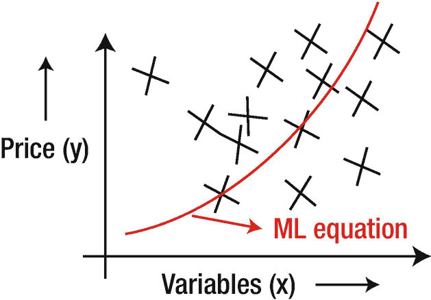

图 1-14

在向量空间图中使用回归得到的机器学习方程。该方程是用于对未见数据集进行预测的最佳拟合线。

这个问题的唯一目标就是得出这个数学方程。通过更多的训练数据点、更好更先进的算法以及更严谨的态度，我们不断努力提高这个方程的准确性。这个方程被认为是我们数据点的最佳表示。或者，使用这个方程，我们可以捕捉数据中存在的最大随机性。

前面的例子是使用一种称为线性回归的监督学习算法解决的。对于同一个问题，像决策树这样的不同监督算法将需要不同的方法。

因此，监督学习算法的定义如下：“监督学习算法创建一个统计机器学习模型来预测`目标变量`的值。输入数据同时包含`自变量`和`目标变量`。”

监督学习算法的目标是找到一个优化函数，该函数能够预测与新的、未见过的数据相关联的输出。这些新的、未见过的数据不属于训练数据的一部分。我们想要优化的函数被称为`目标`函数。

监督学习算法用于解决两类问题：`回归`和`分类`。现在我们来讨论它们。

### 回归问题与分类问题

简单来说，当我们想要预测一个连续变量的值时，使用回归；而当我们想要预测一个分类变量的值时，则使用分类。回归问题的输出将是一个连续值。

因此，前面引用的房价预测示例就是一个回归问题，因为我们想要预测确切的房价。其他例子包括：预测企业未来 30 天的收入、下个季度将有多少客户进行购买、明天降落的航班数量，以及有多少客户会续签他们的保险单。

另一方面，假设我们想要预测客户是否会流失、信用卡交易是否欺诈、价格是否会涨跌：这些都是`二分类`问题的例子。如果我们想要在超过两个类别之间进行分类，那将是一个`多分类`问题。例如，如果我们想要预测一台机器的下一个状态——运行中、停止或暂停——我们将使用多分类问题。分类算法的输出可能是一个概率分数。因此，如果我们想要判断一笔传入的交易是否欺诈，分类算法可以为该交易生成一个介于 0 和 1 之间的概率分数，以判断其是欺诈还是真实交易。

监督学习算法有不少：

1. 线性回归，用于回归问题
2. 逻辑回归，用于分类问题
3. 决策树，用于回归和分类问题
4. 随机森林，用于回归和分类问题
5. 支持向量机（SVM），用于回归和分类问题

还有很多其他算法，比如 k-近邻、朴素贝叶斯、LDA 等等。神经网络也可以用于分类和回归任务。我们将在本书中详细学习所有这些算法。我们还将开发 Python 解决方案。

**提示**

在一般的商业实践中，我们会比较四到五种算法的准确率，并选择最佳的机器学习模型投入生产。

我们已经了解了监督学习算法的定义和一些例子。现在，我们将探讨监督学习问题中的步骤。建议你熟悉这些步骤，因为在整本书中，我们会反复遵循它们。

### 监督学习算法的步骤

我们之前讨论过机器学习项目中的步骤。在这里，我们将专门探讨监督学习算法的步骤。数据质量、完整性和稳健性的原则适用于监督问题的每一个步骤。

为了解决一个监督学习问题，我们遵循图 1-15 中所示的步骤。需要注意的是，这是一个迭代过程。很多时候，我们会发现一些见解，促使我们退回一步。或者我们可能意识到，一个之前被认为有用的属性不再有效。这些迭代是机器学习的一部分，监督学习也不例外。

**步骤 1**：当我们必须解决一个监督学习算法时，我们手头有`目标变量`和`自变量`。`目标变量`的定义是解决监督学习问题的核心。其错误的定义可能会使结果完全相反。

例如：如果我们必须创建一个解决方案来检测一封传入的电子邮件是否为垃圾邮件，训练数据中的`目标变量`可以是“垃圾邮件类别”。如果垃圾邮件类别是“1”，则该邮件是垃圾邮件；如果是“0”，则该邮件不是垃圾邮件。在这种情况下，模型的输出将是一个概率分数，用于判断传入的电子邮件是否为垃圾邮件。概率分数越高，该邮件是垃圾邮件的可能性就越大。

在这一步中，一旦我们确定了`目标变量`，我们还将确定这是一个回归问题还是分类问题。如果是一个分类问题，我们将深入一层，以确定它是二分类问题还是多分类问题。

在步骤 1 结束时，我们定义了一个`目标变量`，并决定了它是回归问题还是分类问题。

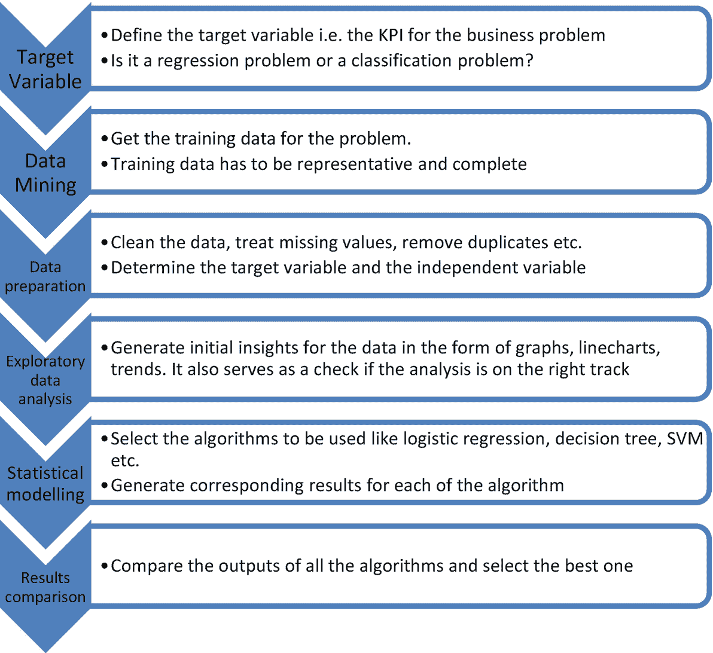

图 1-15

监督学习算法中从变量定义到模型选择所遵循的主要步骤

**步骤 2**：在第二步中，我们为模型确定训练数据。在这一步中，必须遵守关于数据质量的最佳原则。训练数据包含`自变量`和`目标变量`。这些训练数据将来自所有潜在的数据源。它还应该具有足够的代表性，以捕捉所有时间段的变异，从而确保完整性。

**步骤 3**：在这一步中，数据被准备好用于统计建模。通常，数据是不干净的，并且包含大量异常。我们会在数据中发现空值、`NA`、`NaN`、重复值等。在日期字段中，我们可能会发现字符串值，名称可能包含整数，等等，我们必须清理所有这些数据。在这个阶段，`目标变量`被识别出来，`自变量`也是已知的。`自变量`可以是分类变量或连续变量。类似地，`目标变量`可以是连续的或分类的。

这一步还涉及创建新的派生变量，例如平均收入、最大持续时间、不同月份的数量等。

**步骤 4**：探索性分析是下一步，从数据中生成初步见解。会生成`自变量`的分布、彼此之间的关系、相关性、散点图、趋势等。我们对数据有了很好的理解。通常，在这一步也会创建许多新变量。

**步骤 5**：现在我们执行统计建模。从一系列监督学习算法中，我们开始创建一个模型。然后也会使用后续的算法。要使用的算法通常根据问题陈述和经验来决定。会生成不同方法的准确率图。

在训练算法时，遵循以下步骤：

1. 整个数据集可按 60:20:20 的比例划分为测试集、训练集和验证集。有时，我们也会按 80:20 的比例划分为训练集和测试集。
2. 但如果原始数据（例如图像）的数量非常大（100 万），一些研究建议采用 98% 训练集、1% 测试集和 1% 验证集的划分方式。
3. 不过，这三个数据集都应始终从原始数据中随机抽样，确保选择过程无偏差。这一点至关重要，因为如果测试集或验证集不能真实代表训练数据，我们就无法正确衡量模型的有效性。
4. 然而，在某些情况下，抽样偏差是不可避免的。例如，在构建需求预测解决方案时，我们会使用历史时间段的数据来训练算法。在创建训练集和测试集时，时间维度将被纳入考量。
5. 训练数据集用于训练算法。其中，`自变量`作为指导因素，而`目标变量`则是我们试图预测的对象。
6. 测试数据集用于比较测试精度。在训练阶段，测试/验证数据不会暴露给算法。
7. 我们应当注意，测试精度远比训练精度重要。由于算法需要能够更好地泛化到未见过的数据上，因此重点在于测试精度。
8. 在某些情况下，精度可能并非我们想要最大化的关键绩效指标（KPI）。例如，在构建预测信用卡交易是否欺诈的解决方案时，精度就不是目标 KPI。
9. 在模型开发过程中，我们会反复调整模型的各项输入参数，这些参数被称为`超参数`。进行超参数调优是为了获得最佳且最稳定的解决方案。
10. 验证数据集应仅在算法/网络最终确定并完成调优后，才暴露给算法一次。

**步骤 6**：在此步骤中，我们比较和对比在步骤 4 中从各种算法生成的精度。最终解决方案是此步骤的输出。随后，与领域专家（SME）进行讨论，然后在生产环境中实施。

以上是监督学习算法的主要步骤。这些解决方案将在第 2、3 和 4 章中详细展开。

**注意**

像归一化这样的预处理步骤仅针对训练数据进行，而不针对验证数据集，以避免数据泄露。

至此，我们对监督学习算法的讨论就结束了。接下来，我们将关注其他类型的机器学习算法，下一个要介绍的是无监督学习。

# 无监督学习算法

我们知道，监督学习算法有一个我们想要预测的`目标变量`。另一方面，无监督算法没有任何预先标记的数据，因此它们会在数据中寻找未被发现的模式。这是监督算法和无监督算法之间的关键区别。

例如，零售商的营销团队可能希望提高客户粘性和客户生命周期价值，增加客户的平均收入，并通过营销活动提高目标定位的精准度。因此，如果能够将客户分群并划分到相似的簇中，这种方法将非常有效。这个问题可以使用无监督学习算法来解决。无监督分析主要可以分为`聚类分析`和降维技术，例如`主成分分析（PCA）`。我们先来讨论聚类分析。

### 聚类分析

最著名的无监督学习应用是`聚类分析`。聚类分析基于数据中可见的相似模式和共同属性对数据进行分组。这些共同模式可以是这些相似特征的存在或缺失。需要注意的一点是，我们没有任何基准或标记数据来指导；因此，算法是在自行寻找模式。前面讨论的例子就是使用聚类分析进行客户细分的用例。零售商的客户将具有诸如产生的收入、发票数量、购买的不同产品、线上/线下比率、访问的商店数量、最后交易日期等属性。当这些客户在向量空间图中可视化时，它们看起来会像图 1-16(i) 所示。在根据客户的相似性进行聚类后，数据将看起来像图 1-16(ii)。

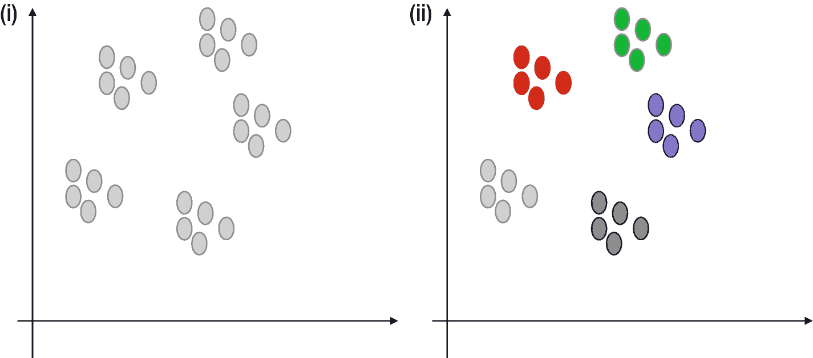
图 1-16
(i) 数据聚类前；(ii) 数据聚类后

有相当多的聚类算法可用——`k-means` 聚类、`层次`聚类、`DBScan`、`谱`聚类等等。最著名且使用最广泛的聚类算法是 `k-means` 聚类。

### PCA

在机器学习和数据科学中，我们总是努力从随机性中找出一些意义，并从杂乱无章的数据源中收集见解。回顾监督学习算法的讨论和图 1-9，我们展示了最佳拟合线，即能够捕捉数据中最大随机性的数学方程。这种随机性是通过各种属性或自变量来捕捉的。但想象一下，如果你有 80 个、100 个或 500 个这样的变量。这难道不是一项繁琐的任务吗？这时，`PCA` 就能帮助我们。

参考图 1-17。两个主成分，`PC 1` 和 `PC 2`，彼此正交，并捕捉数据中的最大随机性。这就是 `PCA`。

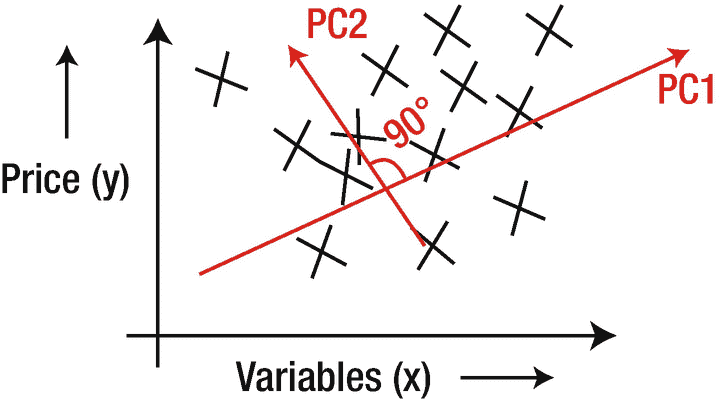
图 1-17
主成分 `PC1` 和 `PC2`，用于捕捉数据中的最大随机性。`PCA` 是一种非常流行的降维技术。

因此，在 `PCA` 中，我们通过一个能够捕捉最大变异的主成分来定义数据中的随机性。下一个主成分与第一个正交，以便它能捕捉最大的剩余变异，依此类推。因此，`PCA` 为我们提供了一种降维解决方案。我们不需要使用所有属性，而是使用这些主成分来替代所有属性。

现在，我们将探讨半监督类型的机器学习算法。

## 半监督学习算法

半监督算法可视为监督学习与无监督学习算法的结合，或者说介于两者之间。当我们拥有少量标记数据和大量未标记数据时，半监督算法能帮助我们解决问题。

半监督学习的基本假设是：属于同一聚类或群组的数据点往往具有相同的标签。因此，一旦像 `k-means` 聚类这样的无监督算法划分出输出簇，我们就可以利用标记数据进一步提高数据质量。

半监督学习算法适用于以下场景：要么无法生成标记数据，要么对目标变量进行标记将耗费大量时间和成本。生成模型、基于图的方法以及低密度分离是半监督学习算法中常用的几种方法。

至此，关于主要机器学习算法类型的讨论就结束了。还有其他算法家族，例如基于关联规则的购物篮分析、`强化学习`等，建议你也去探索一下。

在下一节中，我们将介绍一系列可用的技术工具，这些工具能帮助我们进行数据管理、数据分析、机器学习和数据可视化。

## 技术栈

工具是数据科学和机器学习不可或缺的组成部分。数据管理、数据挖掘、分析以及构建实际的机器学习模型都需要工具。

以下是各种实用程序、语言和工具的简要列表：

*   **数据工程**：`Spark`、`Hadoop`、`SQL`、`Redshift`、`Kafka`、`Java`、`C++`
*   **数据分析**：`Excel`、`SQL`、`postgres`、`mySQL`、`NoSQL`、`R`、`Python`
*   **机器学习**：`SAS`、`R`、`Python`、`Weka`、`SPSS`、`MATLAB`
*   **数据可视化**：`Tableau`、`PowerBI`、`Qlik`、`COGNOS`
*   **云服务**：`Microsoft Azure`、`Amazon Web Services`、`Google Cloud Platform`

这些工具，或者更确切地说是它们的组合，被用于完整的项目——从数据管理和数据挖掘，到机器学习和数据可视化。

> **提示**
> 所有工具都很好用，并且会产生类似的结果。选择通常在于开源与授权之间，或者解决方案预期的可扩展性如何。

这些工具是项目的构建模块。建议你对每个组件都有一定程度的了解。这将有助于你理解数据科学项目的各个方面。

在选择机器学习工具以得出最佳解决方案套件时，我们还应该考虑以下参数：

*   **部署便捷性**：将模型部署到生产环境的难易程度
*   **可扩展性**：解决方案是否可以扩展到其他产品和环境
*   **维护与模型刷新**：定期维护和刷新模型的便捷性
*   **速度**：进行预测的速度；有时需要实时响应
*   **成本**（许可证和所需工时）：许可证成本以及所需的工作量
*   **可用支持**：团队能为我们提供何种类型的支持；例如，`MATLAB` 团队会提供支持，因为它需要许可证，而 `Python` 是开源的，没有像 `MATLAB` 那样的支持体系

建议你对每个类别中的至少一两个工具有相当程度的了解。`SQL` 和 `Microsoft Excel` 无处不在，因此推荐使用。`Python` 是机器学习和人工智能领域的领先工具。随着 `TensorFlow` 和 `Keras` 等深度学习框架的发布，`Python` 拥有了庞大的用户基础。在本书中，我们也只使用 `Python`。

我们即将结束第一章。在下一节中，我们将讨论机器学习在商业中被广泛使用的原因。

## 机器学习的普及

机器学习算法的美妙之处在于它们能够解决那些我们人类难以解决的复杂问题。我们人类只能同时可视化少数几个维度。而使用机器学习算法，不仅可以同时可视化和分析多个维度，还能轻松检测趋势和异常。

使用机器学习，我们可以处理像图像和文本这样难以用其他方式分析的复杂数据。机器学习，尤其是深度学习，使我们能够创建自动化解决方案。

以下是推动机器学习普及的一些关键因素：

1.  **商业兴趣**：如今，企业和利益相关者对利用数据力量和实施机器学习重新燃起了兴趣。组织内部设立了数据科学部门，并有专门的团队主导与各种流程的讨论。我们也看到进入该领域的初创公司数量激增。
2.  **计算能力**：与几十年前相比，我们现在拥有的计算能力非常强大，而且成本低廉。GPU 和 TPU 使计算速度更快，我们现在拥有存储 TB 级数据的存储库。基于云的计算使整个过程更加迅速。我们现在可以使用 `Google Colaboratory`，利用其卓越的计算资源来运行代码。
3.  **数据爆炸**：我们可用的数据量呈指数级增长。随着社交媒体平台和互动的增多，以及世界向在线和虚拟化发展，跨领域产生的数据量巨大。现在，越来越多的企业和流程正在捕获基于时间的属性，并创建系统动态和虚拟化来捕获数据点。我们现在在 ERP、`SAP` 系统中存储了更多结构化的数据点。更多的视频被上传到 `YouTube`，照片被上传到 `Facebook` 和 `Instagram`，文本新闻在全球流动——所有这些都意味着 ZB 级的数据正在生成并准备进行分析。
4.  **技术进步**：现在我们拥有更复杂的统计算法可供使用。深度学习正在不断突破极限。现在，大量的精力和努力被投入到数据工程中，随着新兴技术的发展，我们不断改进系统的效率和准确性。
5.  **人力资源的可用性**：人们对掌握数据科学和机器学习的兴趣日益浓厚；因此，数据分析师和数据科学家的数量正在增加。

这些是使机器学习成为最受追捧的新兴技术之一的部分因素。而且，它确实在跨领域和流程中交付了出色的成果。下一节将列出一些重要的应用，我们将讨论机器学习的用途。

## 机器学习的应用案例

机器学习正被广泛应用于各个领域和业务中。我们在此分享一些已在行业内落地的应用案例。这并非详尽无遗的列表，仅列举部分示例：

*   **银行、金融服务和保险业**：BFSI 行业在实施机器学习和人工智能方面相当先进。在整个价值链中，已实施了多种解决方案，其中部分如下：
    *   信用卡欺诈检测模型用于将信用卡交易分类为欺诈或真实交易。虽然存在基于规则的解决方案，但机器学习模型进一步增强了其能力。此处可使用监督分类算法。
    *   交叉销售和向上销售产品：这使得银行和保险公司能够提高客户的产品持有率。可以使用无监督聚类对客户进行细分，随后开展有针对性的营销活动。
    *   提升客户生命周期价值，提高客户留存率。可以使用监督分类算法构建客户倾向模型。
    *   使用监督分类算法识别潜在的保险费违约者。
*   **零售业**：杂货、服装、鞋类、手表、珠宝、电子产品零售等，正在以多种方式利用数据科学和机器学习。以下是一些示例：
    *   使用无监督学习算法进行客户细分，以提高客户参与度。通过有针对性和定制化的营销活动，可以提升客户的收入和交易数量。

# 需求预测与优化

*   使用监督回归方法进行需求预测，以实现更好的规划。同时也在开发定价模型，以更智能的方式为商品定价。
*   使用机器学习进行库存优化，从而提高效率并降低总成本。
*   客户流失倾向模型预测哪些客户将在未来几个月内流失。可以采取主动措施来防止这些客户流失。监督分类算法有助于创建该模型。
*   使用数据科学和机器学习进行供应链优化，以优化库存。

# 应用领域与案例

## 电信业
电信行业也不例外，并且在利用数据科学和机器学习方面非常领先。一些应用案例如下：
*   使用无监督学习算法进行客户细分，以提高 `ARPU`（每用户平均收入）和 `VLR`（访问位置寄存器）。
*   使用基于监督分类算法的客户流失倾向模型来改善客户留存。
*   使用数据科学和机器学习算法进行网络优化。
*   产品推荐模型用于根据客户的使用情况和行为，向客户推荐下一个最佳预测和下一个最佳优惠。

## 制造业
制造业在每个流程中都会产生大量数据。利用数据科学和机器学习，一些应用案例如下：
*   使用监督学习算法进行预测性维护；这可以避免机器故障，并可以采取主动措施。
*   进行需求预测以实现更好的规划和资源优化。
*   进行流程优化以识别瓶颈并减少开销。
*   使用监督学习算法预测能够产生最佳结果的工具及其组合。

还有许多其他领域和途径正在实施机器学习，例如航空、能源、公用事业、医疗保健等。人工智能通过以下方式开辟了新的能力：在呼叫中心实现语音到文本的转换，在监控中实现目标检测和跟踪，在制造业中通过图像分类识别缺陷产品，在安防系统和人群中使用面部识别等。

机器学习是一个非常强大的工具，应明智地使用。它可以帮助我们自动化许多流程，并成倍地增强我们的能力。

至此，我们即将结束第一章。现在让我们进入总结部分！

# 总结
数据正在改变我们处理决策过程的方式。越来越多的商业决策现在由数据驱动。无论是市场营销、供应链、人力资源、定价还是产品管理——没有任何一个业务流程能置身事外。而数据科学和机器学习正在让这一过程变得更加容易。

机器学习和人工智能正在迅速改变我们的世界。趋势被密切监控，异常被检测，警报被触发，偏离正常流程的偏差被记录，并采取预防措施。预防措施带来了成本节约、流程优化、时间和资源节省，在某些情况下甚至挽救了生命。

确保我们可用的数据质量良好至关重要。它决定了模型的成功因素。同样，工具通常在最终的成功或失败中扮演着关键角色。组织因其灵活性和对使用新工具的开放态度而备受期待。

在设计数据库、构思业务问题或组建团队以交付解决方案时，采取适当的预防措施也是必要的。这需要一个系统化的过程和对业务领域的深刻理解。业务流程负责人和主题专家（`SME`）应成为团队不可或缺的一部分。

在本第一章中，我们探讨了机器学习的各种类型、数据及数据质量的属性，以及机器学习流程。至此，你已经获得了数据科学领域的显著知识。我们还学习了各种类型的机器学习算法、它们各自的应用案例和示例，以及如何利用它们解决业务问题。本章为后续章节奠定了基础和垫脚石。在下一章中，我们将开始专注于监督学习算法，并从回归问题开始。我们将讨论各种类型的回归算法、数学原理、优缺点以及 `Python` 实现。

你应该能够回答以下问题。

# 练习题
问题 1：什么是机器学习？它与软件工程有何不同？
问题 2：有哪些可用的数据类型？高质量数据的属性是什么？
问题 3：有哪些类型的机器学习算法可供使用？
问题 4：泊松分布、二项分布和正态分布之间有什么区别？每种分布各举一个例子。
问题 5：监督学习算法的步骤是什么？
问题 6：机器学习应用在哪些领域？
问题 7：数据工程、数据分析、机器学习和数据可视化有哪些可用的工具？
问题 8：为什么机器学习变得如此流行？它有哪些显著优势？