# 2. 监督学习在回归分析中的应用

> *“唯一确定的就是不确定性。”*
> 
> ——老普林尼

未来无疑充满不确定性。我们所能做的最好就是为之规划。而要进行周密的规划，我们需要对未来有所预见。如果我们能提前知道产品的预期需求量，就能进行恰到好处的生产——不多也不少。如果我们知道货物的预期流量，就能纠正供应链中的瓶颈。机场如果能预知旅客的预期流入量，就能更好地规划资源。电商门户网站如果能知道即将到来的促销季预计会有多少次点击，就能规划好预期负载。

准确预测或许不可能，但预测这些数值确实是必要的。无论是否采用基于机器学习的预测模型，人们一直在进行这类预测，用于财务预算规划、资源分配、政策指导、预期增长率等。因此，对这些数值的估算至关重要。在第二章中，我们将学习预测这些数值的具体概念。

在第一章中，我们介绍了监督学习。我们还讨论了监督学习、无监督学习和半监督学习之间的区别。我们也探讨了两种监督学习算法：回归和分类。在第二章中，我们将深入研究监督回归算法的更深层概念。

我们将研究回归过程、模型如何训练、幕后流程，以及最终所有算法的执行。我们将学习每种算法的假设条件、优缺点以及背后的统计原理。我们还将使用 Python 编写代码来实现这些算法。数据准备、数据预处理、变量创建、训练-测试集划分、拟合机器学习模型、获取显著变量以及衡量准确率等步骤，都将通过 Python 进行学习和实现。代码和数据集已上传至 GitHub 仓库，方便获取。建议您亲自复现这些代码。

## 所需技术工具包

本书将使用 Python 3.5 或更高版本。建议您在机器上安装 Python。我们将使用 Jupyter notebook；执行代码需要安装 Anaconda-Navigator。所有数据集和代码均已上传至 GitHub 仓库 [`https://github.com/Apress/supervised-learning-w-python/tree/master/Chapter2`](https://github.com/Apress/supervised-learning-w-python/tree/master/Chapter2)，方便下载和执行。

主要使用的库包括 numpy、pandas、matplotlib、seaborn、scikit learn 等。建议您在 Python 环境中安装这些库。

现在，让我们深入回归分析，详细探讨相关概念！

## 回归分析与用例

回归分析用于估算一个*连续*变量的值。回顾一下，连续变量是可以取任意数值的变量；例如，销售额、降雨量、客户数量、交易数量等。如果我们想估算下个月的销售额、下周预计到达航站楼的旅客人数、或者预计进行银行交易的客户数量，我们就会使用回归分析。

简单来说，如果我们想使用监督学习算法来预测一个连续变量的值，就会使用回归方法。回归分析对于解决商业问题和决策制定至关重要。预测值有助于利益相关者相应地分配资源，并为业务的预期增长或下滑做好规划。

以下用例将清晰地说明回归算法的用途：

1.  零售商希望估算即将到来的促销季可能迎来的客户数量。基于此估算，企业可以规划商品库存、所需员工数量、所需资源等，以满足需求。回归算法有助于进行此类估算。

2.  一家制造工厂正在进行年度预算规划。作为该工作的一部分，需要根据预期需求来估算电费、水费、原材料、人力资源等各个项目下的支出。回归算法有助于分析历史数据并为业务生成估算值。

3.  一家房地产中介希望扩大其客户群。其中一个重要属性是公寓的价格，可以合理地进行调整和设定。该中介希望分析影响房产价格的多个参数，这可以通过回归分析来实现。

4.  一家国际机场希望改进规划并衡量下个月的预期客流量。这将使团队能够维持最佳服务质量。回归分析有助于此，并能估算出预计的旅客数量。

5.  一家向客户提供信用卡的银行需要确定应向新客户提供多少信用额度。需要根据客户的年龄、职业、月薪、支出、历史记录等详细信息来规定信用额度。监督回归算法将对此决策有所帮助。

有相当多的统计算法可用于解决回归问题。主要算法列举如下：

1.  线性回归

2.  决策树

3.  随机森林

4.  支持向量机

5.  贝叶斯方法

6.  神经网络

我们将在本章学习前三种算法，其余算法将在第 4 章学习。下一节我们将从线性回归开始。


## 什么是线性回归

回顾第一章 1 中我们讨论的利用面积、卧室数量、阳台、位置等因素预测房价的问题。图 2-1(i)展示了数据在向量空间图中的表示方式，而右侧的图 2-1(ii)则提出了一种机器学习方程，称为最佳拟合线，用于解释数据中的随机性并预测价格。

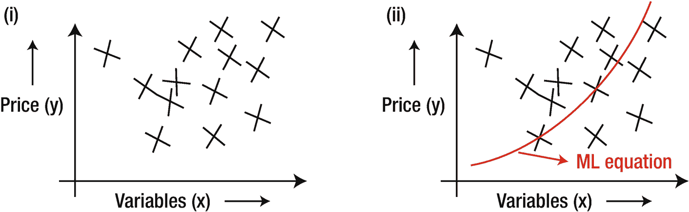

图 2-1

(i) 向量空间图中的数据展示了价格如何依赖于各种变量。(ii) 使用一种称为最佳拟合线的机器学习回归方程来建模这种关系，该方程可用于对未见过的数据集进行未来预测。

在前面的例子中，我们假设价格与面积、卧室数量等因素相关。我们在上一章讨论了*相关性*。让我们回顾一下关于相关性的要点：

*   相关性分析用于衡量两个变量之间关联（线性关系）的强度。

*   如果两个变量同向变动，则它们呈正相关。例如：身高和体重呈正相关关系。如果两个变量反向变动，则它们呈负相关。例如，成本与利润呈负相关关系。

*   相关系数的取值范围为 –1 到 +1。如果值为 –1，则为绝对负相关；如果值为 +1，则为绝对正相关。

*   如果相关性为 0，则意味着两者之间关系不大。例如，鞋子和电脑的价格相关性较低。

线性回归分析的目的是衡量这种关系，并得出该关系的数学方程。该关系可用于预测未见数据点的值。例如，在房价问题中，预测房屋价格将是分析的目标。

正式地说，线性回归用于根据至少一个自变量的值来预测因变量的值。它还能解释自变量的变化对因变量的影响。因变量也称为目标变量或*内生*变量。自变量也称为解释变量或*外生*变量。

线性回归已经存在了很长时间。尽管有相当多的先进算法（其中一些我们将在后续章节讨论），但线性回归仍然被广泛使用。它作为一个基准模型，通常是研究监督学习的第一步。建议你在学习更高级的算法之前，先深入理解和仔细研究线性回归。

假设我们有一组 x 和 Y 的观测值，其中 x 是自变量，Y 是因变量。方程 2-1 描述了 x 和 Y 之间的线性关系：

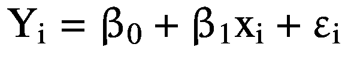

(方程 2-1)

其中

Y[i] = *因*变量或我们想要预测的目标变量

x[i] = *自*变量或用于预测 Y 值的预测变量

β[0] = 总体 Y *截距*。它表示当 x[i] 的值为零时 Y 的值

β[1] = 总体斜率*系数*。它表示 x[i] 每变化一个单位时，Y 值的预期变化

ε = 模型中的*随机误差*项

有时，β[0] 和 β[1] 被称为*总体模型系数*。

在上面的方程中，我们假设 Y 的变化是由 x 的变化引起的。因此，我们可以使用该方程来预测 Y 的值。数据和方程 2-1 的表示将如图 2-2 所示。

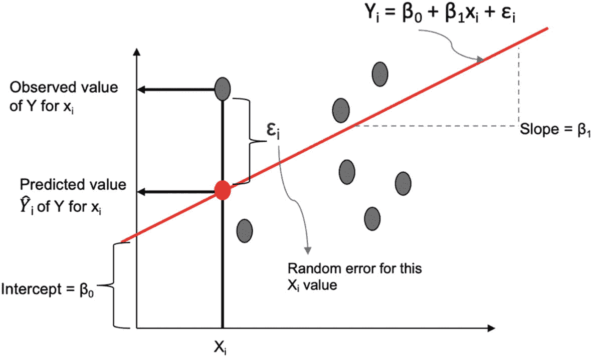

图 2-2

在图表上描绘的线性回归方程，显示了截距、斜率以及目标变量的实际值和预测值；红线表示最佳拟合线

这些模型系数（β[0] 和 β[1]）起着重要作用。Y 截距（β[0]）是当自变量值为 0 时因变量的值，即因变量的默认值。斜率（β[1]）是方程的斜率。它表示 x 值每变化一个单位时，Y 值的预期变化。它衡量了 x 对 Y 值的影响程度。β[1] 的绝对值越高，最终影响越大。

图 2-2 也显示了预测值。我们可以理解，对于观测值 i 的 x 值，因变量的实际值是 *Y*[i]，而预测值或估计值是 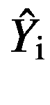。

这里还有一个术语，*随机误差*，用 ε 表示。在我们做出估计之后，我们想知道我们的表现如何，即预测值与实际值相差多远。这由随机误差表示，它是 Y 的预测值与实际值之差，由 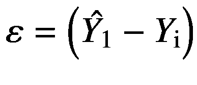 给出。需要注意的是，这个误差值越小，预测效果越好。

这里还有一个重要的点需要考虑。可能存在多条线都可以表示这种关系。例如，在房价预测问题中，我们可以使用许多方程来确定关系，如图 2-3(ii) 中不同颜色的线条所示。

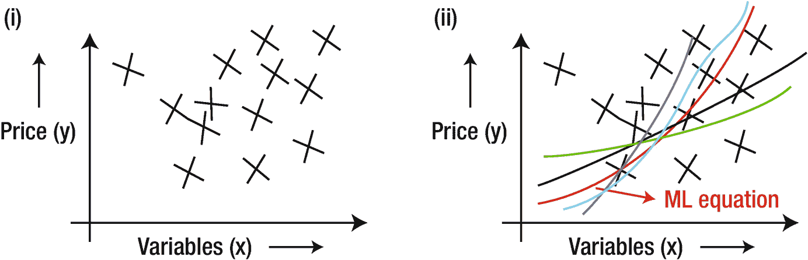

图 2-3

(i) 向量空间图中的数据展示了价格如何依赖于各种变量。(ii) 在尝试对数据进行建模时，可能存在多条可以拟合的线性方程，但目标是找到能够使当前数据损失最小的方程。

因此，我们需要找出能够最小化随机误差的最佳数学方程，从而用于进行预测。这是在回归算法的训练过程中实现的。在训练线性回归模型的过程中，我们得到 β[0] 和 β[1] 的值，这些值将最小化误差，并可用于为我们生成预测。

线性回归模型对所使用的数据做出了一些假设。这些条件是检验我们分析的数据是否满足要求的试金石。通常情况下，数据*并不*符合这些假设，因此我们必须采取纠正措施使其变得更好。现在将讨论这些假设。


### 线性回归的假设

线性回归有一些需要满足的假设。我们需要检验这些条件，并根据结果决定后续步骤：

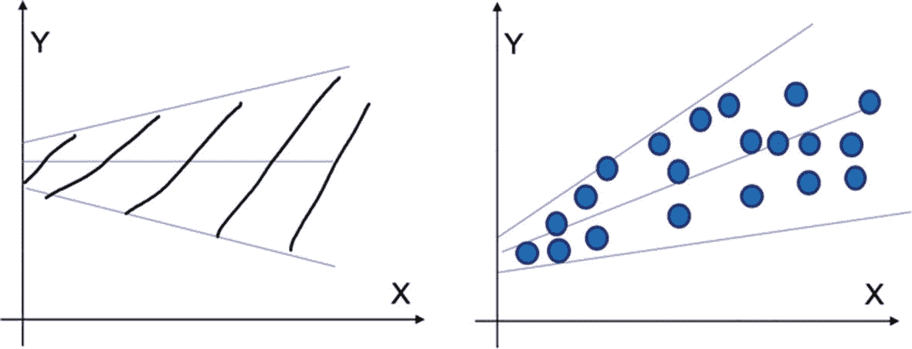

图 2-5

数据集中存在异方差性，因此残差散点图呈现锥形形状

1.  线性回归要求因变量与自变量之间的关系是线性的。同时，检查异常值也很重要，因为线性回归对异常值敏感。线性假设最好通过散点图来检验。在图 2-4 中，我们可以看到线性关系与非线性关系的含义。左侧的图呈现某种线性关系，而右侧的图则没有线性关系。

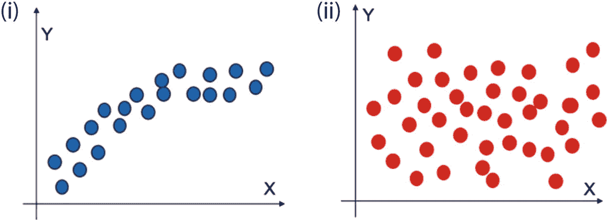

图 2-4

(i) X 与 Y 之间存在线性关系。(ii) X 与 Y 变量之间没有太多关系；在这种情况下，将难以对关系进行建模。

2.  线性回归要求所有自变量服从多元正态分布。该假设可以通过直方图或 Q-Q 图来检验。正态性可以通过拟合优度检验（如 Kolmogorov-Smirnov 检验）来检查。如果数据不服从正态分布，可以采用非线性变换（如对数变换）来解决问题。

3.  第三个假设是数据中几乎没有或完全没有*多重共线性*。当自变量之间高度相关时，就会产生多重共线性。多重共线性可以通过三种方法检验：
    1.  **相关矩阵**：该方法测量所有自变量之间的皮尔逊双变量相关系数。该值越接近 1 或 –1，相关性越高。

2.  **容忍度**：容忍度仅在回归分析过程中得出，用于衡量一个自变量对其他自变量的影响程度。其表示为 (1 – R²)。我们将在下一节讨论 R²。如果容忍度值 < 0.1，则数据中可能存在多重共线性。如果小于 0.01，则可以确定确实存在多重共线性。

3.  **方差膨胀因子 (VIF)**：VIF 可定义为容忍度的倒数 (1/T)。如果 VIF 值大于 10，则数据中可能存在多重共线性。如果大于 100，则可以确定确实存在多重共线性。

**注意** 对数据进行中心化处理（从每个分数中减去均值）有助于解决多重共线性问题。我们将在第 5 章详细讨论这一点！

4.  线性回归假设数据中几乎没有或完全没有*自相关*。自相关意味着残差之间并非相互独立。自相关数据的最佳示例是时间序列数据，例如股票价格。T[n+1] 时刻的股票价格依赖于 T[n] 时刻的价格。虽然我们使用散点图来检查自相关，但也可以使用德宾-沃森“d 检验”来检查自相关。其原假设是残差不存在自相关。如果 d 值在 2 左右，则意味着不存在自相关。通常 d 可以取 0 到 4 之间的任何值，但根据经验法则，1.5 < d < 2.5 意味着数据中不存在自相关。但德宾-沃森检验有一个缺陷。由于它仅分析线性自相关且仅分析直接相邻项，因此很多时候散点图就能满足我们的需求。

5.  线性回归问题的最后一个假设是*同方差性*，这意味着残差在回归线上是相等的。虽然可以使用散点图来检查同方差性，但也可以使用戈德菲尔德-匡特检验来检查异方差性。该检验将数据分为两组，然后检验两组之间残差的方差是否相似。图 2-5 展示了一个非同方差残差的示例。在这种情况下，我们可以进行非线性校正来解决问题。如图 2-5 所示，异方差性导致残差图中出现独特的锥形形状。

检验这些假设至关重要，我们通常会对数据进行转换和清洗。这是必要的，因为我们希望解决方案能够良好运行并具有较高的预测精度。一个准确的机器学习模型将具有较低的损失。机器学习模型的这种精度测量过程基于目标变量。对于分类问题和回归问题，其测量方法不同。在本章中，我们讨论回归基础模型，而在下一章中，我们将研究分类模型的精度测量参数。这引出了衡量回归问题精度的重要主题，这也是我们接下来要讨论的话题。


## 衡量回归问题的效能

衡量回归问题稳健性的方法有多种。*普通最小二乘法（OLS）* 是最常用且被引用最多的方法之一。在该方法中，通过找到使 Y 与 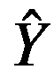 之间平方距离之和最小的 β[0] 和 β[1] 值来获得它们，这里的 Y 和  分别代表因变量的实际值和预测值，如图 2-6 所示。这被称为*损失函数*，即进行预测时产生的损失。毋庸置疑，我们希望最小化这个损失以获得最佳模型。这些误差也被称为*残差*。

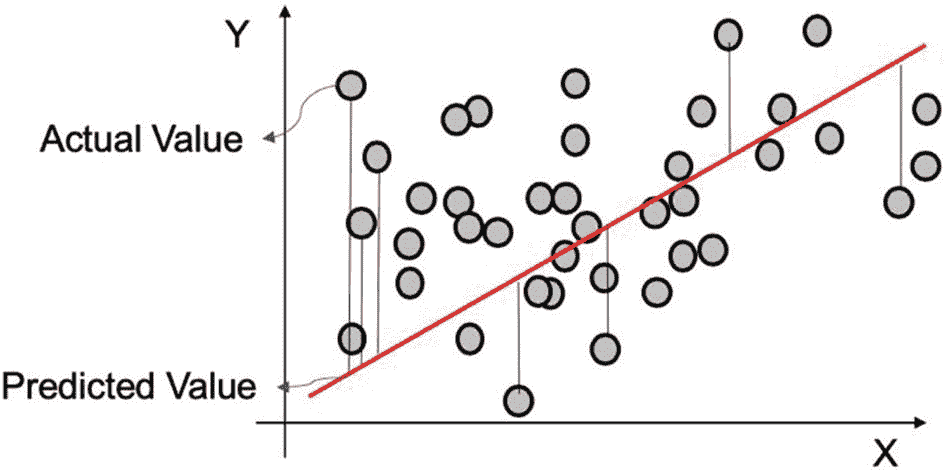

图 2-6

目标变量的实际值与预测值之间的差异。这是在做出预测时产生的误差，作为最佳模型，需要将此误差最小化。

一个非常重要的点：为什么我们要对误差取平方？原因是，如果我们不对误差取平方，正负项可能会相互抵消。例如，如果误差[1]是 +2，误差[2]是 -2，那么净误差将是 0！

从图 2-6 中，我们可以得出

![$$ {\displaystyle \begin{array}{l}\mathrm{Minimum}\kern0.17em \mathrm{squared}\;\mathrm{sum}\;\mathrm{of}\kern0.17em \mathrm{error}=\min\;\Sigma\;{\mathrm{e}}_{\mathrm{i}}²\\ {}\kern7.799994em =\min\;\Sigma\;\left({\mathrm{Y}}_{\mathrm{i}}-\hat{{\mathrm{Y}}_{\mathrm{i}}}\right)\\ {}\kern5.279997em =\min\;\Sigma\;{\left[{\mathrm{Y}}_{\mathrm{i}}-\left({\upbeta}_0+{\upbeta}_1{\mathrm{x}}_{\mathrm{i}}\right)\right]}²\end{array}} $$](images/499122_1_En_2_Chapter/499122_1_En_2_Chapter_TeX_Equ2.png)

（公式 2-2）

估计的斜率系数为

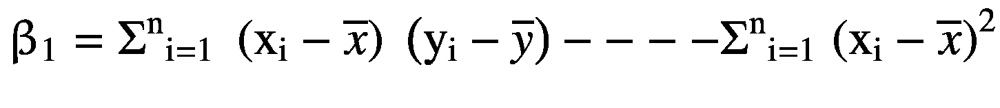

（公式 2-3）

估计的截距系数为

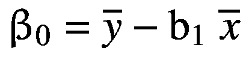

（公式 2-4）

需要注意的一点是，回归线总是经过均值点  和 。

基于上述讨论，我们可以研究变异度量。总变异由两部分组成，可以用以下公式表示：

![$$ {\displaystyle \begin{array}{l} SST= SSR+ SSE\\ {}\mathrm{Total}\;\mathrm{sum}\;\mathrm{of}\kern0.17em \mathrm{squares}=\mathrm{Regression}\;\mathrm{sum}\;\mathrm{of}\ \mathrm{squares}+\mathrm{Error}\;\mathrm{sum}\;\mathrm{of}\kern0.17em \mathrm{squares}\\ {} SST=\Sigma\;{\left({\mathrm{y}}_{\mathrm{i}}-\overline{y}\right)}²\kern1.56em SSR=\Sigma\;{\left({\hat{Y}}_{\mathrm{i}}-\overline{y}\right)}²\kern2.4em SSE=\Sigma\;{\left({\mathrm{y}}_{\mathrm{i}}-{\hat{Y}}_{\mathrm{i}}\right)}²\end{array}} $$](img/499122_1_En_2_Chapter_TeX_Equa.png)

其中 ：因变量的平均值

Y[i]：因变量的观测值

：对于给定 xi 值的 y 的预测值

在上式中，SST 是总平方和。它衡量 y[i] 围绕其均值 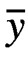 的变异。SSR 是回归平方和，是由 x 和 y 之间的线性关系所解释的变异。SSE 是误差平方和，是由 x 和 y 之间线性关系以外的因素引起的变异。理解这一概念的最佳方式是通过图 2-7。

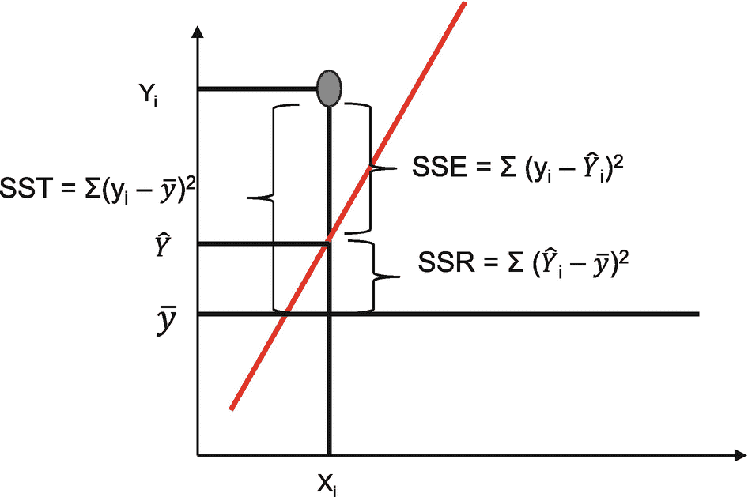

图 2-7

SST = 总平方和：SSE = 误差平方和，SSR = 回归平方和

上述讨论的概念为我们研究各种衡量回归模型准确性的度量和参数奠定了基础，我们现在就来讨论这些内容：

1.  平均绝对误差（MAE）：顾名思义，它是目标变量实际值与预测值之间绝对差的平均值，如公式 2-5 所示。

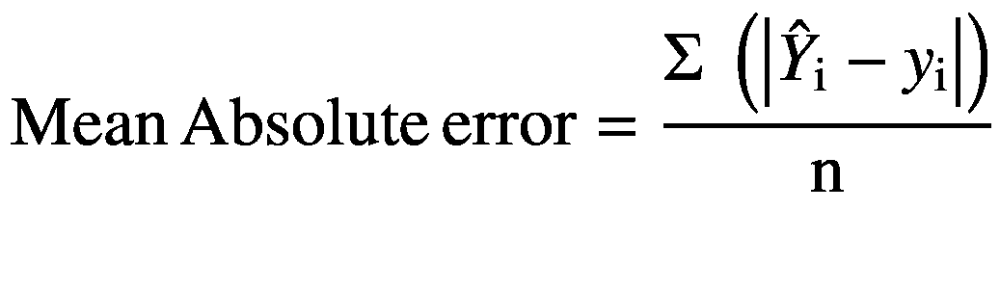

（公式 2-5）

MAE 的值越大，我们模型中的误差就越大。

1.  均方误差（MSE）：MSE 是误差平方的平均值，即实际值与预测值之差的平方的平均值，如公式 2-6 所示。与 MAE 类似，MSE 值越高意味着模型中的误差越大。

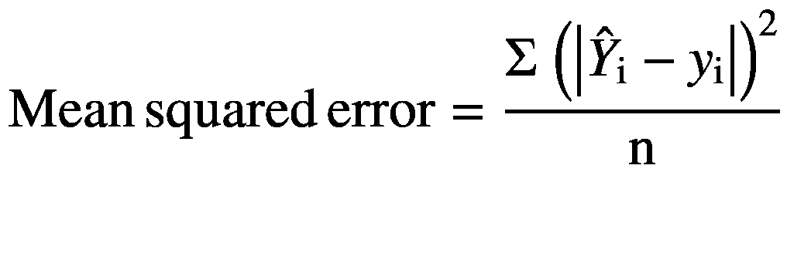

（公式 2-6）

1.  均方根误差（Root MSE）：均方根误差是平均平方误差的平方根，由公式 2-7 表示。

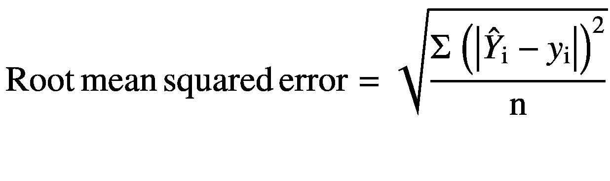

（公式 2-7）

1.  R 平方（R²）：它表示我们的模型能够解释数据中多少随机性。换句话说，在我们的数据总变异中，我们的模型能够解释多少。

R² = SSR/SST = 回归平方和/总平方和

R² 的值总是在 0 到 1 之间，或 0% 到 100% 之间。R² 的值越高越好。可视化 R² 的方式如下图所示。在图 2-8 中，R² 的值等于 1，这意味着 Y 值中 100% 的变异都可以由 x 解释。在图 2-9 中，R² 的值介于 0 和 1 之间，表明模型理解了部分变异。在最后一种情况，图 2-9 中，R² = 0，这表明模型没有理解任何变异。在正常的业务场景中，我们得到的 R² 介于 0 和 1 之间，即模型解释了部分变异。

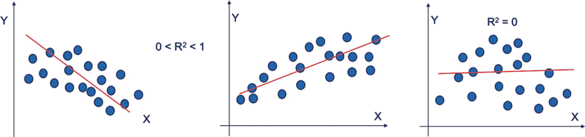

图 2-9

如果 R² 的值介于 0 和 1 之间，则模型解释了部分变异。如果值为 0，则回归模型没有解释任何变异

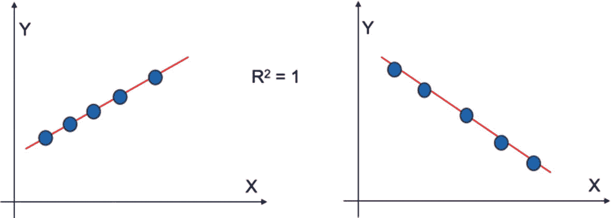

图 2-8

R² 等于 1；这表明我们的回归模型解释了自变量值中 100% 的变异


2.  **伪 R 方**：它扩展了 R 方的概念。如果我们在模型中包含不显著的变量，它会惩罚该值。我们可以按照公式 2-8 计算伪 R²。

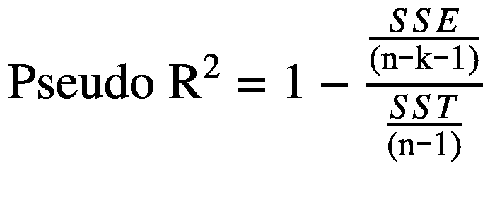

（公式 2-8）

其中，n 是样本量，k 是自变量的数量。

使用 R 方，我们衡量模型中解释的所有随机性。但是，如果我们包含所有自变量（包括不显著的变量），我们就不能声称该模型是稳健的。因此，我们可以说伪 R 方是衡量模型稳健性的更好表示和度量。

**提示**

在 R² 和伪 R² 之间，我们更倾向于使用伪 R²。该值越高，模型越好。

现在，我们清楚了回归模型的假设以及如何衡量回归模型的性能。接下来，让我们研究线性回归的类型，然后开发一个 Python 解决方案。

线性回归可以研究两种形式：简单线性回归和多元线性回归。

**简单线性回归**，顾名思义，易于理解和应用。它仅使用一个自变量来预测目标变量的值。如前一个例子所示，如果我们只有房屋面积作为自变量来预测房价，这就是一个简单线性回归的例子。样本数据仅包含面积和价格，如下所示。在图 2-10 中，我们展示了相同数据的散点图。

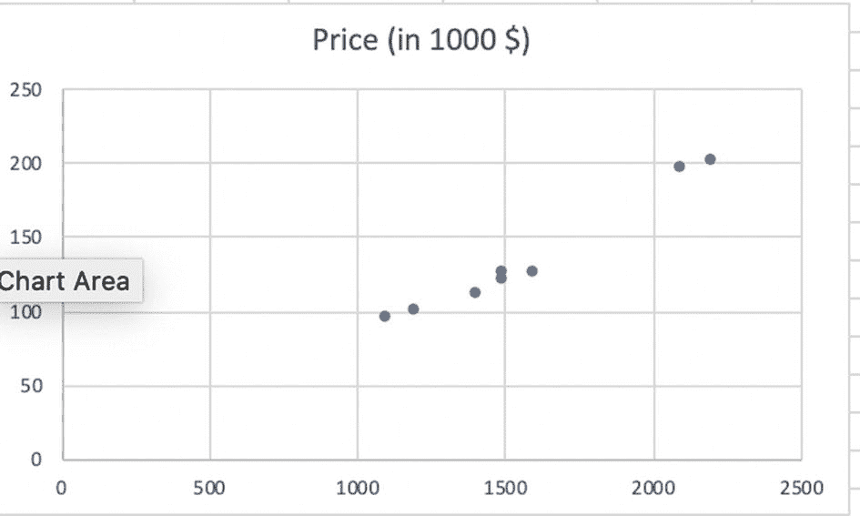

图 2-10

价格与面积数据的散点图

| 平方英尺 (x) | 价格 (单位：千美元) |
| --- | --- |
| 1200 | 100 |
| 1500 | 120 |
| 1600 | 125 |
| 1100 | 95 |
| 1500 | 125 |
| 2200 | 200 |
| 2100 | 195 |
| 1410 | 110 |

我们可以用公式 2-9 表示这些数据。


（公式 2-9）

这里，价格是 Y（因变量），面积是 x 变量（自变量）。简单线性回归的目标是估计 β[0] 和 β[1] 的值，以便我们能够预测价格的值。

如果我们运行回归分析，我们将得到系数 β[0] 和 β[1] 的相应值，分别为 –28.07 和 0.10。稍后我们将使用 Python 运行代码，但让我们先解释其含义以便理解。

1.  β[0] 的值为 –28.07，意味着当平方英尺数为 0 时，价格为 –28,070 美元。现在，不可能有面积为 0 的房子；这只是表明，对于观察到的尺寸范围内的房屋，28,070 美元是房价中未被面积解释的部分。

2.  β[1] 为 0.10；这表明，房屋的平均价值每增加一平方英尺，平均增加 0.1 × (1000) = 100 美元。

线性回归有一个重要的局限性。我们不能用它来预测超出训练所用变量范围的值。例如，在前面的数据集中，我们无法建模预测面积在 2200 平方英尺以上和 1100 平方英尺以下的房价。这是因为我们没有针对这些值训练模型。因此，该模型仅对最小值和最大值之间的值足够有效；在前面的例子中，有效范围是 1100 平方英尺到 2200 平方英尺。

是时候动手实践，使用 Python 中的数据集来解决问题了。我们使用 Python，以下是 Python 代码中的一些重要属性。这些属性在我们训练数据、设置参数和进行预测时使用：

*   **常见超参数**
    *   `fit_intercept`：如果我们想计算模型的截距，则使用此参数；如果数据已中心化，则不需要。
    *   `normalize`：X 将通过减去均值并除以标准差进行归一化。
    *   在将数据输入模型之前进行标准化，系数可以表明特征的重要性。
*   **常见属性**
    *   `coef_`：每个自变量的权重。
    *   `intercept_`：线性模型中独立项的偏置。
*   **常见函数**
    *   `fit`：训练模型。将 X 和 Y 作为输入值并训练模型。
    *   `predict`：模型训练完成后，对于给定的 X，可以使用 `predict` 函数预测 Y。
*   **训练模型**
    *   X 应为数据行格式，`X.ndim == 2`。
    *   对于单个目标，Y 应为 1D；对于多个目标，Y 应为 2D。
    *   `fit` 函数用于训练模型。

我们将创建两个简单线性回归的例子。在第一个例子中，我们将生成一个简单线性回归问题。然后在第二个例子中，将解决简单线性回归问题。现在让我们开始第一个例子。

### 示例 1：创建一个简单线性回归

我们将通过生成一个数据集来创建一个简单线性回归。这段代码只是一个热身练习，将使您熟悉最简单形式的简单线性回归。

**步骤 1：** 首先导入必要的库。我们将导入 `numpy`、`pandas`、`matplotlib` 和 `scikit learn`。

```
import numpy as np
import pandas as pd
import matplotlib.pyplot as plt
%matplotlib inline
from sklearn.linear_model import LinearRegression
from sklearn.datasets import make_regression
```

**步骤 2：** 下一步，我们将创建一个可用于回归的样本数据集。

```
X,Y = make_regression(n_features=1, noise=5, n_samples=5000)
```

在上述代码中，`n_features` 是我们希望数据集中拥有的特征数量。`n_samples` 是我们希望生成的样本数量。`noise` 是应用于输出的高斯噪声的标准差。

**步骤 3：** 使用 `matplotlib` 库绘制数据。`xlabel` 和 `ylabel` 将为图形提供标签。

```
plt.xlabel('特征 - X')
plt.ylabel('目标 - Y')
plt.scatter(X,Y,s=5)
```

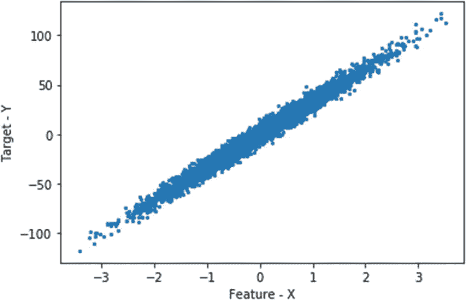

**步骤 4：** 现在初始化一个线性回归实例。变量名为 `linear_model`。

```
linear_model = LinearRegression()
```

**步骤 5：** 现在拟合线性回归。输入自变量是 X，目标变量是 Y。

```
linear_model.fit(X,Y)
```

**步骤 6：** 模型现在已训练完成。让我们查看线性回归模型的截距和斜率的系数值。

```
linear_model.coef_
linear_model.intercept_
```

截距的值为 0.6759344，斜率为 33.1810。

**步骤 7：** 我们使用这个训练好的模型，通过 X 来预测值，然后绘制出来。

```
pred = linear_model.predict(X)
plt.scatter(X,Y,s=25, label="训练数据")
plt.scatter(X,pred,s=25, label="预测数据")
plt.xlabel('特征 - X')
plt.ylabel('目标 - Y')
plt.legend()
plt.show()
```

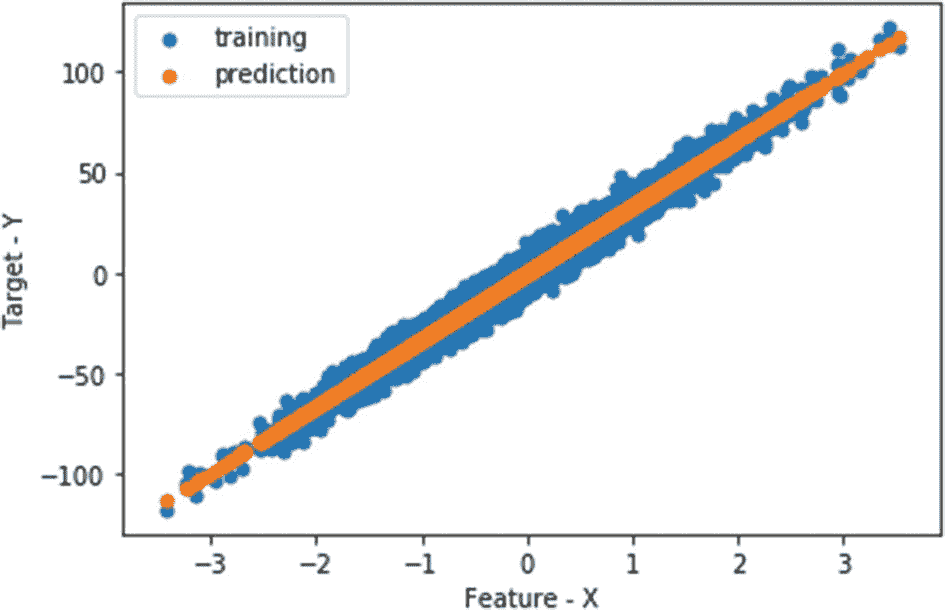

蓝点代表映射到实际目标数据，而橙点代表预测值。

我们可以看到训练数据和实际预测值是多么接近。现在，我们将使用一个数据集为简单线性回归创建一个解决方案。


### 示例 2：针对房屋数据集的简单线性回归

我们有一个包含一个自变量（面积，以平方英尺为单位）的数据集，需要预测房价。这同样是简单线性回归的一个例子，即我们只有一个输入变量。代码和数据集已上传至本章开头分享的 Github 链接。

步骤 1：在此处导入所有必需的库：

```
import pandas as pd
import numpy as np
import matplotlib.pyplot as plt
import seaborn as sns
%matplotlib inline
import warnings
warnings.filterwarnings(action="ignore", module="scipy", message="^internal gelsd")
```

步骤 2：使用 pandas 函数加载数据集：

```
house_df= pd.read_csv('House_data_LR.csv')
```

注意

数据可能以 `.xls` 或 `.txt` 文件的形式存在。有时，需要通过建立数据库连接直接从数据库加载数据。

```
house_df.head()
```

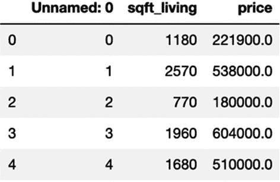

步骤 3：检查数据集中是否存在任何空值：

```
house_df.isnull().any()
```

步骤 4：存在一个无意义的变量。我们删除变量“Unnamed”：

```
house_df.drop('Unnamed: 0', axis = 1, inplace = True)
```

步骤 5：删除该变量后，让我们查看数据集的前几行：

```
house_df.head()
```

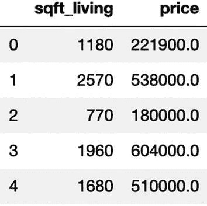

步骤 6：现在，我们将通过分离自变量和目标变量来准备用于模型构建的数据集。

```
X = house_df.iloc[:, :1].values
y = house_df.iloc[:, -1].values
```

步骤 7：现在将数据拆分为训练集和测试集。

**训练/测试拆分**：创建训练集和测试集涉及将数据集分别拆分为互斥的训练集和测试集。之后，使用训练集进行训练，并使用测试集进行测试。这将提供更准确的样本外准确性评估，因为测试数据集并非用于训练模型的数据集的一部分。这对于现实世界的问题来说更加真实。

这意味着我们知道该数据集中每个数据点的结果，因此非常适合进行测试！并且由于这些数据未用于训练模型，因此模型对这些数据点的结果一无所知。所以，本质上，这确实是样本外测试。此处测试数据占比为 25% 或 0.25。

随机状态，顾名思义，用于初始化内部随机数生成器，该生成器进而决定训练/测试索引的拆分。保持其固定可以让我们复制相同的训练/测试拆分，从而验证输出。

```
from sklearn.model_selection import train_test_split
X_train, X_test, y_train, y_test = train_test_split(X, y, test_size = 0.25, random_state = 5)
```

步骤 8：现在使用线性回归模型拟合数据：

```
from sklearn.linear_model import LinearRegression
simple_lr= LinearRegression()
simple_lr.fit(X_train, y_train)
```

步骤 9：模型现已训练完成。让我们用它来预测测试数据：

```
y_pred = simple_lr.predict(X_test)
```

步骤 10：我们首先在训练数据上测试模型。我们将尝试预测训练数据并可视化结果。

```
plt.scatter(X_train, y_train, color = 'r')
plt.plot(X_train, simple_lr.predict(X_train), color = 'b')
plt.title('Sqft Living vs Price for Training')
plt.xlabel('Square feet')
plt.ylabel('House Price')
plt.show()
```

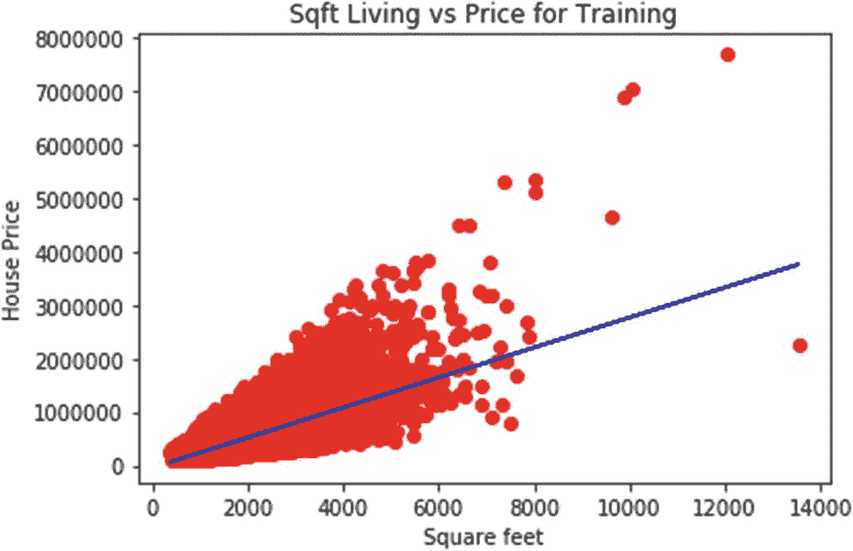

步骤 11：现在让我们在测试数据上测试模型。这是检查模型鲁棒性的正确衡量标准。

```
plt.scatter(X_test, y_test, color = 'r')
plt.plot(X_train, simple_lr.predict(X_train), color = 'b')
plt.title('Sqft Living vs Price for Test')
plt.xlabel('Square feet')
plt.ylabel('House Price')
```

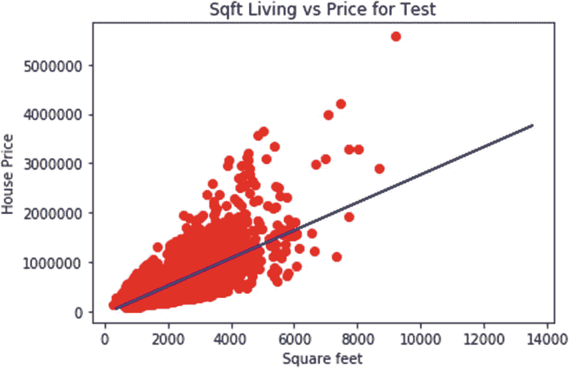

步骤 12：现在让我们弄清楚预测效果的好坏。我们将计算 MSE 和 R²。

```
from sklearn.metrics import mean_squared_error
from math import sqrt
rmse = sqrt(mean_squared_error(y_test, y_pred))
from sklearn.metrics import r2_score
r2 = r2_score(y_test, y_pred)
adj_r2 = 1 - float(len(y)-1)/(len(y)-len(simple_lr.coef_)-1)*(1 - r2)
rmse, r2, adj_r2, simple_lr.coef_, simple_lr.intercept_
```

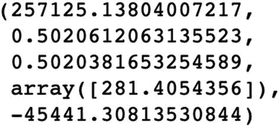

步骤 13：现在我们将对未见过的 x 值进行预测：

```
import numpy as np
x_unseen=np.array([1500]).reshape(1,1)
simple_lr.predict(x_unseen)
预测结果为 376666.84
```

在前两个示例中，我们了解了如何使用简单线性回归来训练模型并进行预测。在现实世界的问题中，几乎不会只有一个自变量。大多数商业世界问题都有多个变量，此类问题使用我们正在讨论的多元线性回归算法来解决。

**多元线性回归**或多元回归可以看作是简单线性回归的扩展，其中我们拥有不止一个自变量，而是多个自变量。例如，图 2-11 展示了类似数据集的多个变量在向量空间图中的表示：

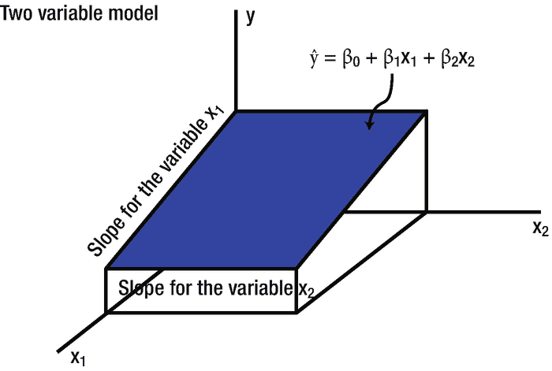

图 2-11

向量空间图中描绘的多元回归模型，其中我们有两个自变量，x[1] 和 x[2]

| 平方英尺 | 卧室数量 | 价格（千美元） |
| --- | --- | --- |
| 1200 | 2 | 100 |
| 1500 | 3 | 120 |
| 1600 | 3 | 125 |
| 1100 | 2 | 95 |
| 1500 | 2 | 125 |
| 2200 | 4 | 200 |
| 2100 | 4 | 195 |
| 1410 | 2 | 110 |

因此，多元线性回归的方程如公式 2-10 所示。

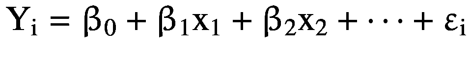

（公式 2-10）

因此，在简单线性回归的多元训练情况下，我们将得到 β[0]、β[1] 等的估计值。

多元回归模型中的残差如图 2-12 所示。该示例针对一个双变量模型，我们可以清晰地看到残差值，即实际值与预测值之间的差异。

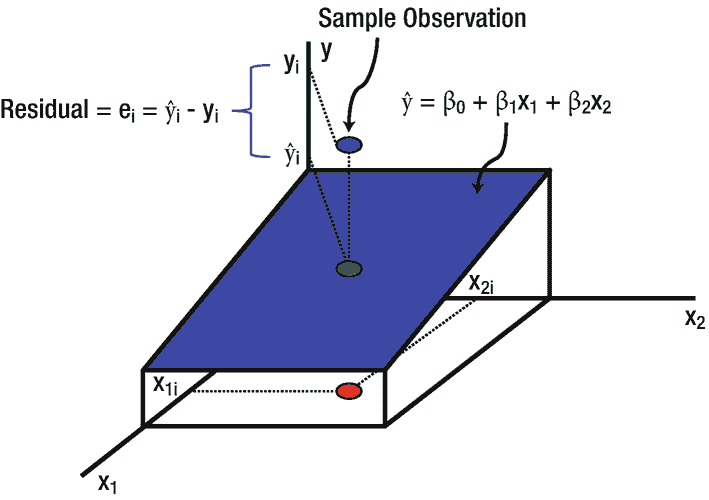

图 2-12

由 x[1] 和 x[2] 描绘的多元线性回归模型，以及针对一个样本观测值显示的残差。残差是实际值与预测值之间的差异。

现在，我们将使用多元线性回归模型创建两个示例案例。在模型开发过程中，我们将进行 EDA（探索性数据分析），这是第一步，并且还将解决数据中的空值问题以及如何处理分类变量。


### 示例 3：房价数据集的多元线性回归

我们正在处理房价数据集。目标变量是房价预测，并包含一些自变量。数据集和代码已上传至本章开头分享的 Github 链接。

**步骤 1：** 首先导入所有必需的库。

```
import pandas as pd
import numpy as np
import matplotlib.pyplot as plt
import seaborn as sns
%matplotlib inline
import warnings
warnings.filterwarnings(action="ignore", module="scipy", message="^internal gelsd")
```

**步骤 2：** 导入 .csv 格式的数据，然后查看前几行。

```
house_mlr = pd.read_csv('House_data.csv')
house_mlr.head()
```

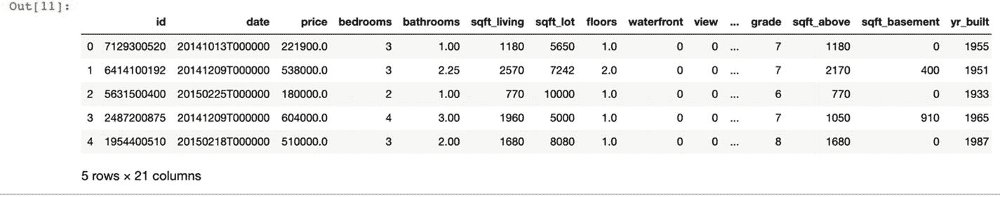

该数据集包含 21 个变量。

**步骤 3：** 接下来，让我们探索一下数据集。这通过 `house_mlr.info()` 命令完成。

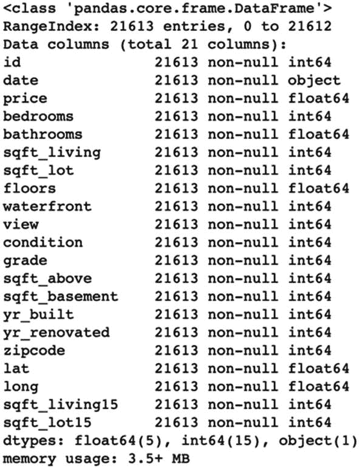

通过分析输出，我们可以看到在 21 个变量中，有少量浮点型变量、一些对象型变量和一些整数型变量。我们将把这些分类变量转换为整数变量。

**步骤 4：** `house_mlr.describe()` 命令将提供所有数值变量的详细信息。

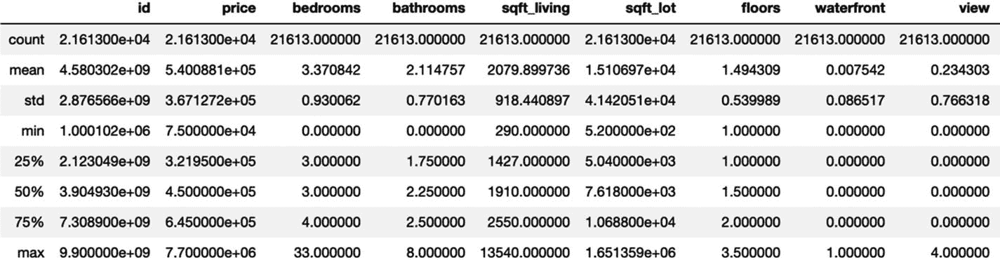

这里我们可以看到所有数值变量的范围：均值、标准差、第 25 百分位、第 50 百分位和第 75 百分位的值。同时显示了最小值和最大值。

可视化变量的一种非常好的方法是使用箱线图，代码如下：

```
fig = plt.figure(1, figsize=(9, 6))
ax = fig.add_subplot(111)
ax.boxplot(house_mlr['sqft_living15'])
```

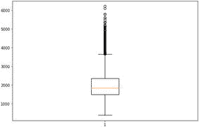

该图显示存在一些异常值。在此案例中，我们不处理这些异常值。在后续章节中，我们将探讨处理异常值的最佳实践。

**步骤 5：** 现在我们将检查变量之间的相关性。这将通过使用以下代码构建的相关矩阵来完成：

```
house_mlr.drop(['id', 'date'], axis = 1, inplace = True)
fig, ax = plt.subplots(figsize = (12,12))
ax = sns.heatmap(house_mlr.corr(),annot = True)
```

对相关矩阵的分析表明，某些变量之间存在一定的相关性。例如，`sqft_above` 和 `sqft_living` 之间的相关系数为 0.88。这相当符合预期。对于这个简单的入门示例，我们不处理相关变量。

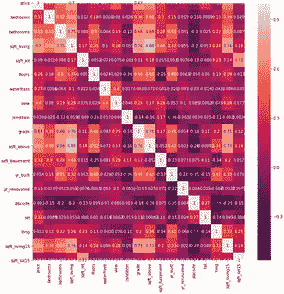

**步骤 6：** 现在我们将对数据进行一些清理。数据集中存在一些空值。我们现在删除这些空值。我们将在第 5 章中探讨缺失值处理的概念。

```
house_mlr.isnull().any()
house_mlr ['basement'] = (house_mlr ['sqft_basement'] > 0).astype(int)
house_mlr ['renovated'] = (house_mlr ['yr_renovated'] > 0).astype(int)
to_drop = ['sqft_basement', 'yr_renovated']
house_mlr.drop(to_drop, axis = 1, inplace = True)
house_mlr.head()
```

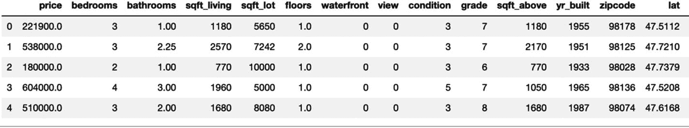

**步骤 7：** 使用独热编码将分类变量转换为数值变量。

独热编码将分类变量转换为数值变量。简单来说，它会根据分类变量的值向数据集添加值为 0 或 1 的新列，如下所示：

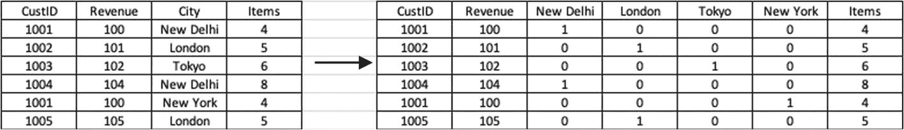

```
categorical_variables = ['waterfront', 'view', 'condition', 'grade', 'floors','zipcode']
house_mlr = pd.get_dummies(house_mlr, columns = categorical_variables, drop_first=True)
house_mlr.head()
```

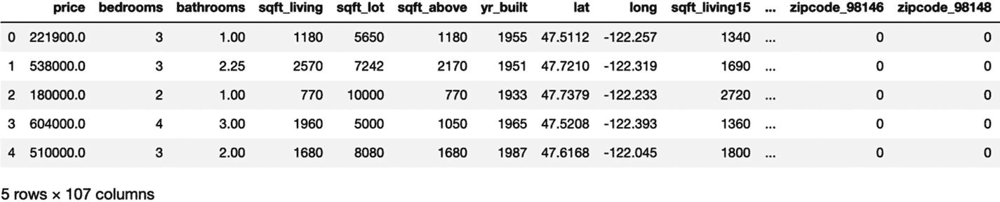

**步骤 8：** 现在我们将数据拆分为训练集和测试集，然后拟合模型。测试集占数据的 25%。

```
X = house_mlr.iloc[:, 1:].values
y = house_mlr.iloc[:, 0].values
from sklearn.model_selection import train_test_split
X_train, X_test, y_train, y_test = train_test_split(X, y, test_size = 0.25, random_state = 5)
from sklearn.linear_model import LinearRegression
multiple_regression = LinearRegression()
multiple_regression.fit(X_train, y_train)
```

**步骤 9：** 预测测试集结果。

```
y_pred = multiple_regression.predict(X_test)
```

**步骤 10：** 现在我们将检查模型的准确性。

```
from sklearn.metrics import mean_squared_error
from math import sqrt
rmse = sqrt(mean_squared_error(y_test, y_pred))
from sklearn.metrics import r2_score
r2 = r2_score(y_test, y_pred)
adj_r2 = 1 - float(len(y)-1)/(len(y)-len(multiple_regression.coef_)-1)*(1 - r2)
rmse, r2, adj_r2
```

我们得到的输出是 (147274.98522602883, 0.8366403242154088, 0.8358351477235848)。

本示例中使用的步骤可以扩展到任何需要预测连续变量的场景。在这个问题中，我们预测了一个连续变量的值，但*没有*从可用变量列表中筛选出显著变量。显著变量是指在预测中比其他自变量更重要的变量。有多种方法可以筛选变量。我们将在下一节中讨论其中一种使用集成技术的方法。使用 p 值的流行方法将在第 3 章中讨论。

至此，我们已经讨论了使用线性回归的概念和实现。到目前为止，我们假设因变量和自变量之间的关系是线性的。但如果这种关系不是线性的呢？这就是我们的下一个主题：非线性回归。


## 非线性回归分析

思考一下。在物理学中，我们有运动定律来描述物体与作用于其上的所有力之间的关系，以及运动如何响应这些力。在其中一个定律中，初速度和末速度的关系由以下方程给出：

末速度 = 初速度 + ½ 加速度 * 时间² 或 v = u + ½ at²

如果我们分析这个方程，可以看出末速度与时间的关系并非线性，而是二次的。*非线性*回归用于对这种关系进行建模。我们可以查看散点图来判断关系是否为非线性，如图 2-13 所示。

正式地说，如果目标变量与自变量之间的关系本质上不是线性的，那么就使用*非线性回归*来拟合数据。

非线性回归的模型形式是一个数学方程，可以表示为方程 2-11 以及图 2-13 中的曲线。曲线的形状取决于“n”的值以及 β[0]、β[1]……等的相应值。

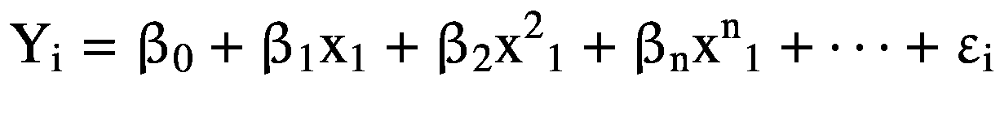

（方程 2-11）

其中 β[0]：Y 截距

β[1]：X 对 Y 线性效应的回归系数

β[2] = X² 对 Y 二次效应的回归系数，以此类推

ε[i] = 观测值 i 中 Y 的随机误差

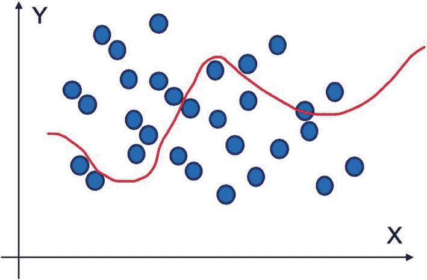

图 2-13

非线性回归在拟合数据集方面会比简单线性模型表现更好。因变量和自变量之间不存在线性关系。

让我们以二次方程为例，更深入地理解非线性关系。如果因变量之间存在二次关系，可以用方程 2-12 表示。

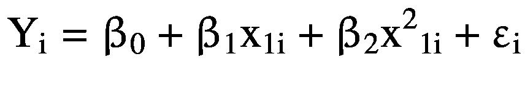

（方程 2-12）

其中 β[0]：Y 截距

β[1]：X 对 Y 线性效应的回归系数

β[2] = X² 对 Y 二次效应的回归系数

ε[i] = 观测值 i 中 Y 的随机误差

二次模型将根据 β[1] 和 β[2] 的值呈现以下形状，如图 2-14 所示，其中 β[1] 是线性项的系数，β[2] 是平方项的系数。

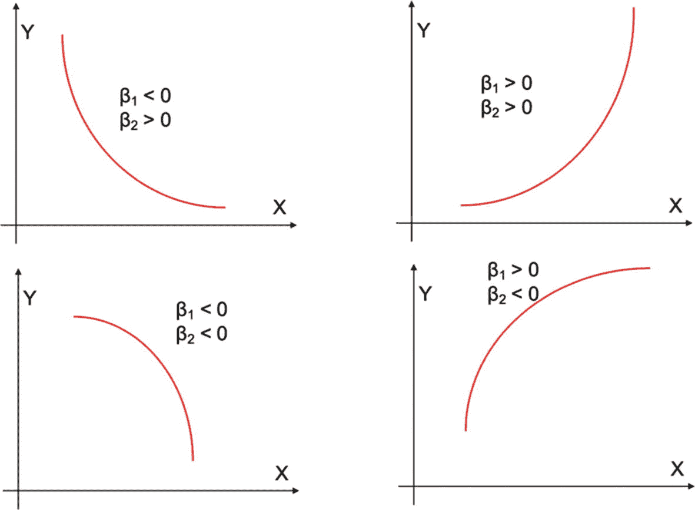

图 2-14

曲线的值取决于 β[1] 和 β[2] 的值。该图描绘了曲线在不同方向上的不同形状。

根据系数的值，曲线的形状会发生变化。以下数据展示了这样一个例子。右侧的图 2-15 显示了两个变量（速度和距离）之间的关系：

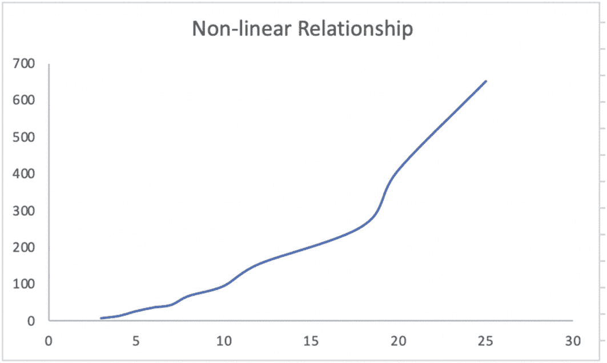

图 2-15

此处描绘了速度与距离之间的非线性关系

| 速度 | 距离 |
| --- | --- |
| 3 | 9 |
| 4 | 15 |
| 5 | 28 |
| 6 | 38 |
| 7 | 45 |
| 8 | 69 |
| 10 | 96 |
| 12 | 155 |
| 18 | 260 |
| 20 | 410 |
| 25 | 650 |

这些数据及其相应的数据图表明存在非线性关系。尽管如此，我们仍应知道如何检测目标变量与自变量之间的关系是否为非线性，接下来我们将讨论这一点。

## 识别非线性关系

当我们尝试拟合非线性模型时，首先必须确保确实需要非线性方程。可以通过标准的零假设检验来检查二次效应的显著性。

1.  线性回归情况下的估计值为 ŷ = b[0] + b[1]x[1]

2.  二次回归情况下的估计值为  = b[0] + b[1]x[1] + b[2]x²[1]

3.  零假设为：
    1.  H[0] : β[2] = 0（二次项并未改进模型）

    2.  H[1] : β[2] ≠ 0（二次项改进了模型）

4.  一旦我们运行了统计检验，我们将接受或拒绝零假设

但这并不总是可行。在处理实际业务问题时，我们可以采取以下两个步骤：

1.  为了识别非线性关系，我们可以在拟合线性模型后分析残差。如果我们尝试拟合线性关系，而实际关系是非线性的，那么残差将不是随机的，而是会呈现某种模式，如图 2-16 所示。如果改用非线性关系建模，残差将是随机的。

    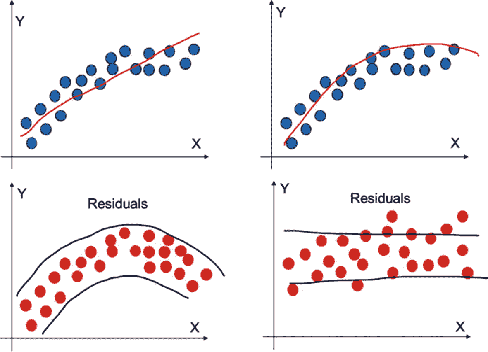

    图 2-16

    如果残差遵循某种模式，则表明数据中可能存在非线性关系，而该数据正在使用线性模型进行建模。线性拟合不会产生随机残差，而非线性拟合会产生随机残差。

2.  我们还可以比较线性和非线性回归模型各自的 R² 值。如果非线性模型的 R² 更大，则意味着非线性模型的关系拟合得更好。

与线性回归类似，非线性模型也有一些假设，我们现在就来讨论。

### 非线性回归的假设

1.  非线性回归中的误差服从正态分布。误差是实际值与预测值之间的差值，非线性回归要求变量服从正态分布。

2.  所有误差必须具有恒定方差。

3.  误差彼此独立，且不遵循任何模式。这是一个非常重要的假设，因为如果误差彼此不独立，则意味着模型方程中仍有一些信息我们尚未提取出来。

我们也可以使用**对数变换**来解决某些非线性模型。对数变换的方程可以表示为方程 2-13 和方程 2-14。

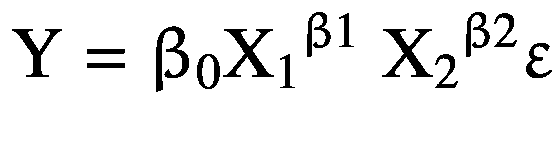

（方程 2-13）

并对两边取对数变换：

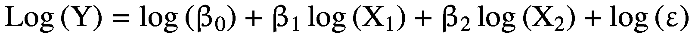

（方程 2-14）

自变量的系数可以解释如下：自变量 X[1] 每变化 1%，会导致 Y 的平均值估计变化 β[1] 个百分点。

注意

有时，β[1] 也可以指 Y 相对于 X[1] 变化的弹性。

我们已经学习了不同类型的回归模型。它是最稳定的解决方案之一，但与其他任何工具或解决方案一样，回归模型也存在一些缺陷。其中一些缺陷会在进行探索性数据分析（EDA）时以重要见解的形式被发现。在为统计建模准备数据时，必须处理这些挑战。我们现在就来讨论这些挑战。


## 回归模型面临的挑战

尽管回归是一种相当稳健的模型，但我们在使用该算法时仍会面临一些挑战：

1.  **非线性**：现实世界的数据点要复杂得多，通常不遵循线性关系。即使我们拥有非常大量的数据点，线性方法也可能过于简单，无法构建稳健的模型，如图 2-17 所示。线性模型无法很好地处理左侧的数据，而如果我们使用非线性模型，则方程拟合效果更好。例如，我们很少会发现价格和尺寸之间存在线性关系。

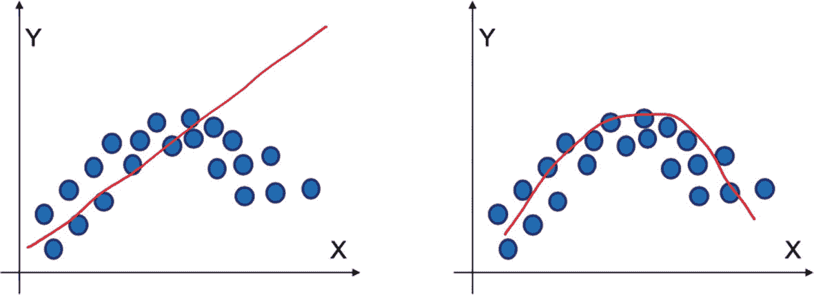

图 2-17

左侧的图显示我们试图用线性模型来拟合非线性数据。右侧的图是正确方程。线性关系是线性回归中重要的假设之一。

2.  **多重共线性**：我们在本章前面已经讨论过多重共线性的概念。如果在模型中使用相关变量，就会面临多重共线性问题。例如，如果我们同时使用以千为单位的销售额和以美元为单位的收入作为变量，那么这两个变量本质上描述的是相同的信息。如果存在多重共线性问题，它会对模型产生如下影响：
    1.  自变量的估计系数对模型中的微小变化变得非常敏感，因此它们的值可能会快速变化。

2.  由于自变量估计系数的精度可能受到影响，模型的整体预测能力会下降。

3.  我们可能无法信任系数的 p 值，因此不能完全依赖模型所显示的显著性。

4.  因此，这会削弱训练模型的整体质量，必须对多重共线性进行处理。

3.  **异方差性**：这是我们在建模回归问题时面临的另一个挑战。目标变量的变异性直接依赖于自变量值的变化。这会在残差中形成一种锥形模式，如图 2-5 所示。这给我们带来了一些挑战，例如：
    1.  异方差性会干扰自变量的显著性。它会夸大系数估计的方差。我们期望 OLS 过程能检测到这种增加，但 OLS 无法做到。因此，计算出的 t 值和 F 值是错误的，进而导致估计的相应 p 值偏小。这会使我们对自变量的显著性得出错误的结论。

2.  异方差性会导致自变量的系数估计不准确。因此，最终得到的模型将是有偏的。

4.  **异常值**：异常值会给我们的回归模型带来很多问题。它会改变我们的结果，并对我们的洞察和机器学习模型产生巨大影响。其影响如下：
    1.  如图 2-18 所示，在存在异常值的情况下，我们的模型方程会受到严重影响。当存在异常值时，回归方程也会试图拟合它们，因此实际方程将不是最优的。

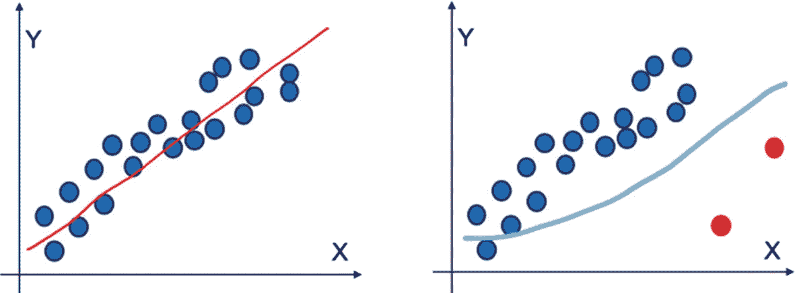

图 2-18

数据集中的异常值会严重影响回归模型的准确性，因为方程也会试图拟合异常值点；因此，结果将是有偏的。

2.  异常值会使模型的估计产生偏差，并增加误差方差。

3.  如果要进行统计检验，其检验功效和影响会受到严重影响。

4.  总的来说，从数据分析的角度来看，我们无法信任模型的系数，因此模型得出的所有洞察都将是有误的。

注意

我们将在第 5 章中讨论如何检测异常值以及如何处理它们。

线性回归是预测连续变量最广泛使用的技术之一。其应用广泛，遍及多个领域。它通常是我们对连续变量进行建模时最先使用的几种方法之一，并作为其他机器学习模型的基准。

至此，我们对线性回归模型的讨论就结束了。接下来，我们将讨论一类非常流行的机器学习模型，称为树模型或基于树的模型。基于树的模型可用于回归和分类问题。在本章中，我们将只研究回归问题，在下一章中，我们将研究分类问题。


## 基于树的回归方法

用于解决机器学习问题的下一类算法是*基于树的算法*。基于树的算法非常易于理解和开发。它们可用于回归和分类问题。决策树是一种监督学习算法，因此我们有一个目标变量，根据问题的不同，它要么是分类问题，要么是回归问题。

决策树如图 2-19 所示。如您所见，整个总体会根据某个标准被连续分割成组和子组。我们从树顶端的整个总体开始，随后将总体划分为更小的子集；同时，一个相关的决策树会逐步构建。就像我们在现实生活中所做的那样，我们首先考虑最重要的因素，然后围绕它划分可能性。类似地，决策树的构建始于寻找最佳分割条件的特征。

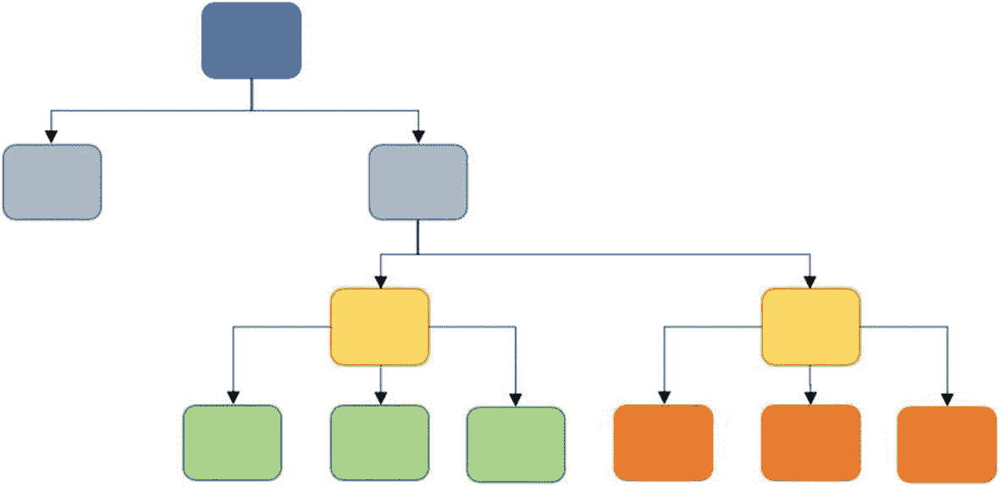

图 2-19

决策树的基本结构展示了如何进行迭代分割决策

决策树可用于预测连续变量和分类变量。对于回归树，终端节点获得的值是落入该区域的所有值的平均值。而对于分类树，则是观测值的众数。我们将在本书中讨论这两种方法。在本章中，我们研究回归问题；在下一章中，将使用决策树解决分类问题。

在继续之前，我们必须研究决策树的构建模块。如图 2-20 所示，决策树由根节点、决策节点、终端节点和分支表示。


图 2-20

决策树的构建模块，包括根节点、决策节点、终端节点和分支

1.  **根节点** 是被分析的整个总体，显示在决策树的顶部。

2.  **决策节点** 表示会进一步分裂成子节点的子节点。

3.  **终端节点** 是决策树中的最终元素。基本上，当一个节点无法再分裂时，该路径就结束了。该节点被称为*终端*节点。有时也被称为*叶节点*。

4.  **分支** 是树的一个子部分。有时被称为*子树*。

5.  **父节点和子节点** 仅是对节点的引用。被分割的节点是父节点，分割后的子节点称为子节点。

现在让我们通过房价预测问题来理解决策树。为了便于理解，我们假设第一个分割标准是面积。如果面积小于 100 平方公里，则整个总体被分割成两个节点，如图 2-21(i) 所示。在右侧，我们可以看到下一个标准是卧室数量。如果卧室数量少于四个，预测价格为 100；否则，预测价格为 150。对于左侧，分割标准是距离。这个过程将持续进行以预测价格值。

决策树也可以看作是一组嵌套的 IF-ELSE 条件（如图 2-21(ii) 所示），可以建模为一棵树，其中决策在内部节点做出，输出在叶节点获得。决策树将自变量划分为不重叠的空间。这些空间彼此也是不同的。从几何角度看，决策树也可以看作是一组平行的超平面，将空间划分为多个超长方体，如图 2-21(iii) 所示。我们根据未知数据落入哪个超长方体来预测其值。


图 2-21

(i) 基于决策树的房价预测问题分割。(ii) 决策树可以看作是一个嵌套的 IF-ELSE 块。(iii) 决策树的几何表示展示了平行的超平面。

现在您已经理解了什么是决策树。让我们也研究一下节点分割的标准。

决策树采用*自顶向下的贪心方法*。我们知道，决策树从整个总体开始，然后递归地分割数据；因此被称为*自顶向下*。它被称为贪心方法，因为算法在决定分割时，仅基于当前可用的最佳标准（即变量）来做出当前分割的决策，而不是基于未来可能产生更好模型的分割。换句话说，对于贪心方法，重点仅在于当前分割，而非未来的分割。这种分割递归进行，直到树完全生长并达到停止标准。对于分类树，有三种分割方法：基尼指数、熵损失和分类误差。由于它们处理分类问题，我们将在下一章中研究这些标准。

对于回归树，方差减少是分割的标准。在方差分割中，每个节点的方差使用以下公式计算。


(公式 2-15)

我们将每次分割的方差计算为每个节点方差的加权平均值。然后选择方差较小的分割用于分割。

目前有相当多的决策树算法可用，例如 ID3、CART、C4.5、CHAID 等。这些算法将在第 3 章中，在我们讨论了使用决策树进行分类的概念后进行更详细的探讨。


## 案例研究：使用决策树预测汽油消耗量

现在，我们将使用决策树来开发一个 Python 解决方案。相关代码和数据集已上传至 Github 仓库。建议你从本章开头提供的 Github 链接下载数据集。

**步骤 1：首先导入所有库。**

```
import pandas as pd
import numpy as np
import matplotlib.pyplot as plt
%matplotlib inline
```

**步骤 2：使用 `read_csv` 命令导入数据集。**

```
petrol_data = pd.read_csv('petrol_consumption.csv')
petrol_data.head(5)
```


**步骤 3：探索自变量主要统计指标：**

```
petrol_data.describe()
```


**步骤 4：现在我们将数据拆分为训练集和测试集，然后尝试拟合模型。首先分离 X 和 y 变量，然后将它们拆分为训练集和测试集。测试集占训练数据的 20%。**

```
X = petrol_data.drop('Petrol_Consumption', axis=1)
y = petrol_data ['Petrol_Consumption']
from sklearn.model_selection import train_test_split
X_train, X_test, y_train, y_test = train_test_split(X, y, test_size=0.2, random_state=0)
from sklearn.tree import DecisionTreeRegressor
decision_regressor = DecisionTreeRegressor()
decision_regressor.fit(X_train, y_train)
```

**步骤 5：使用模型对测试数据集进行预测。**

```
y_pred = decision_regressor.predict(X_test)
df=pd.DataFrame({'Actual':y_test, 'Predicted':y_pred})
df
```


**步骤 6：使用各种衡量参数评估所创建模型的性能。**

```
from sklearn import metrics
print('Mean Absolute Error:', metrics.mean_absolute_error(y_test, y_pred))
print('Mean Squared Error:', metrics.mean_squared_error(y_test, y_pred))
print('Root Mean Squared Error:', np.sqrt(metrics.mean_squared_error(y_test, y_pred)))
```


我们算法的 MAE 为 50.9，小于 'Petrol_Consumption' 列所有值平均值的 10%，这表明我们的算法表现良好。

上述解决方案的可视化代码已提交至 GitHub 链接。


这是决策树的 Python 实现。该代码可复制用于任何我们想用决策树解决的问题。现在，我们将探讨决策树算法的优缺点。

**决策树的优点**

1.  决策树易于构建和理解。由于它们模仿人类决策逻辑，因此输出看起来结构清晰且易于掌握。
2.  它们所需的数据准备工作量很少。它们既能处理回归问题，也能处理分类问题，并且可以处理大型数据集。
3.  决策树受变量共线性的影响不大。其内置了重要变量识别功能，我们可以通过统计检验来验证决策树的输出结果。
4.  决策树最重要的优点可能是其非常直观。即使没有数据科学背景的利益相关者或决策者也能理解决策树。

**决策树的缺点**

1.  过拟合是决策树面临的最大问题。当模型训练准确率很高但测试准确率很低时，就会出现过拟合。这意味着模型能够很好地理解训练数据，但在处理未见过的数据时表现不佳。过拟合是一个棘手的问题，我们必须减少模型中的过拟合。我们将在第 5 章中讨论过拟合及其减少方法。
2.  创建决策树时采用的是贪心算法。因此，它可能无法生成最佳树或全局最优树。有一些方法被提出来减少贪心算法的影响，例如*双重信息距离*（DID）。DID 启发式方法通过同时考虑属性选择对整体解决方案的即时和未来潜在影响来做出决策。分类树是通过在分区图上搜索最短路径来构建的。识别出的最短路径由所选特征定义。DID 方法考虑了：
    1.  所选分区之间的正交性，
    2.  在给定所选属性的情况下，类分区不确定性的减少。
3.  它们对训练数据的变化相当“敏感”，因此有时训练数据的微小变化就可能导致最终预测结果的变化。
4.  对于分类树，分裂偏向于具有更多类别的变量。

我们已经讨论了决策树的概念，并使用 Python 开发了一个案例研究。它非常易于理解、可视化和解释。每个人都能与决策树产生共鸣，因为它以我们做决策的方式运作。我们选择最佳参数和方向，然后对下一步做出决策。这是一种非常直观的方法！

至此，我们关于基于决策树的解决方案的讨论就结束了。到目前为止，我们已经讨论了简单线性回归、多项式回归、非线性回归和决策树。我们理解了相关概念、优缺点和假设，并使用 Python 开发了相应的解决方案。这是迈向机器学习非常关键且相关的一步。

但是，所有这些算法都是单独且一次一个地工作的。这使我们能够推出下一代解决方案，称为*集成方法*，我们接下来将对此进行探讨。


## 集成方法用于回归

*“团结就是力量”* 是集成方法的座右铭。它们使用多个预测器，然后“联合”或整理信息以做出最终决策。

正式地说，集成方法在一个数据集上训练多个预测器。这些预测模型本身可能是也可能不是弱预测器。它们被选择和训练的方式使得每个模型都有一个略有不同的训练数据集，并可能得到略有不同的结果。这些单独的预测器可能从彼此身上学到不同的模式。最后，它们的单独预测被组合起来，做出最终决策。有时，这个组合的学习器群体被称为*元*模型。

在集成方法中，我们确保每个预测器获得略有不同的训练数据集。这通常通过随机有放回抽样或*自助法*来实现。在另一种方法中，我们可以调整分配给每个数据点的权重。这会增加权重，即对这些数据点的关注度。

为了直观地了解集成方法如何进行预测，我们可以参考图 2-22，其中展示了一个随机森林，并且预测模型在略有不同的数据集上进行训练。


图 2-22

基于集成学习的随机森林，其中原始数据被分割成随机选择的子特征，然后创建独立的并行决策树。最终结果是所有子树预测的平均值。

集成方法可以分为两大类：装袋和提升。

1.  **装袋模型** 或自助聚合通过多个弱模型来提高整体准确性。以下是装袋模型的主要属性：
    1.  装袋使用有放回抽样生成多个数据集*。*
    2.  它同时且相互独立地构建多个预测器。
    3.  为了做出最终决策，会进行平均/投票。这意味着，如果我们试图构建一个回归模型，将取所有相应预测的平均值或中位数；而对于分类模型，则进行投票。
    4.  装袋是解决方差和减少过拟合的有效方法。
    5.  随机森林是装袋方法的一个例子（如图 2-22 所示）。

2.  **提升**：与装袋类似，提升也是一种集成方法。以下是关于提升算法的主要要点：
    1.  在提升中，学习器是从上一个学习器顺序生成的。
    2.  每个后续学习器都从上一轮迭代中改进，并更关注上一轮迭代中的错误。
    3.  在投票过程中，表现更好的学习器会获得更高的投票权重。
    4.  提升通常比装袋慢，但大多数情况下性能更好。
    5.  梯度提升、极端梯度提升和 AdaBoost 是一些示例解决方案。

现在是我们使用随机森林开发一个解决方案的时候了。我们将在第 4 章中进一步探讨提升，届时我们将研究监督分类算法。

## 案例研究：使用随机森林预测汽油消耗量

对于随机森林回归问题，我们将使用与决策树相同的案例研究。为了节省篇幅，我们直接从创建训练和测试数据集之后开始。

步骤 1：导入所有库和数据集。我们在实现决策树算法时已经涵盖了这些步骤。

```
import pandas as pd
import numpy as np
import matplotlib.pyplot as plt
%matplotlib inline
petrol_data = pd.read_csv('petrol_consumption.csv')
X = petrol_data.drop('Petrol_Consumption', axis=1)
y = petrol_data['Petrol_Consumption']
from sklearn.model_selection import train_test_split
X_train, X_test, y_train, y_test = train_test_split(X, y, test_size=0.20, random_state=0)
```

步骤 2：导入随机森林回归器库并初始化一个 `RandomForestRegressor` 变量。

```
from sklearn.ensemble import RandomForestRegressor
randomForestModel = RandomForestRegressor(n_estimators=200,
bootstrap = True,
max_features = 'sqrt')
```

步骤 3：现在在训练和测试数据上拟合模型。

```
randomForestModel.fit(X_train, y_train)
```

步骤 4：我们现在将预测实际值并检查模型的准确性。

```
rf_predictions = randomForestModel.predict(X_test)
from sklearn import metrics
print('Mean Absolute Error:', metrics.mean_absolute_error(y_test, rf_predictions))
print('Mean Squared Error:', metrics.mean_squared_error(y_test, rf_predictions))
print('Root Mean Squared Error:', np.sqrt(metrics.mean_squared_error(y_test, rf_predictions)))
```


步骤 5：现在我们将提取两个最重要的特征。获取数据集中所有列的列表，我们将得到数值化的特征重要性。

```
feature_list=X_train.columns
importances = list(randomForestModel.feature_importances_)
feature_importances = [(feature, round(importance, 2)) for feature, importance in zip(feature_list, importances)]
feature_importances = sorted(feature_importances, key = lambda x: x[1], reverse = True)
[print('Variable: {:20} Importance: {}'.format(*pair)) for pair in feature_importances];
```


步骤 6：我们现在将使用重要变量重新创建模型。

```
rf_most_important = RandomForestRegressor(n_estimators= 500, random_state=5)
important_indices = [feature_list[2], feature_list[1]]
train_important = X_train.loc[:, ['Paved_Highways','Average_income','Population_Driver_licence(%)']]
test_important = X_test.loc[:, ['Paved_Highways','Average_income','Population_Driver_licence(%)']]
train_important = X_train.loc[:, ['Paved_Highways','Average_income','Population_Driver_licence(%)']]
test_important = X_test.loc[:, ['Paved_Highways','Average_income','Population_Driver_licence(%)']]
```

步骤 7：训练随机森林算法。

```
rf_most_important.fit(train_important, y_train)
```

步骤 8：进行预测并确定误差。

```
predictions = rf_most_important.predict(test_important)
predictions
```

步骤 9：打印平均绝对误差、均方误差和均方根误差。

```
print('Mean Absolute Error:', metrics.mean_absolute_error(y_test, predictions))
print('Mean Squared Error:', metrics.mean_squared_error(y_test, predictions))
print('Root Mean Squared Error:', np.sqrt(metrics.mean_squared_error(y_test, predictions)))
```


正如我们观察到的，在选择显著变量后，随机森林的误差已经减小。


集成学习使我们能够整合多个模型的力量，然后进行预测。这些模型单独来看是弱模型，但组合在一起就能成为强大的预测模型。这正是集成学习的精妙之处。接下来我们将讨论集成学习的优缺点。

集成学习的优势：

1.  集成模型可以降低方差和偏差。它们通常对数据有更深入的理解。

2.  集成方法的准确率通常高于常规方法。

3.  随机森林模型用于解决过拟合问题，这通常是决策树面临的问题。而提升方法则用于降低偏差。

4.  最重要的是，集成方法是多个独立模型的集合。因此，它能对数据产生更复杂的理解。

集成学习面临的挑战：

1.  由于集成学习的复杂性，它难以理解。例如，虽然我们可以轻松地可视化决策树，但很难可视化随机森林模型。

2.  模型的复杂性使得它们不易于训练、测试、部署和更新，而其他模型通常不存在这些问题。

3.  有时，集成模型需要很长时间才能收敛和训练。这增加了训练时间。

我们已经介绍了集成学习的概念，并使用随机森林开发了一个回归解决方案。集成学习长期以来一直很受欢迎，并在 Kaggle 比赛中赢得了不少奖项。建议你理解这些概念并复现代码实现。

在结束集成学习的讨论之前，我们还需要学习一个额外的概念：使用决策树进行特征选择。回顾上一节我们开发了一个多元回归问题；我们将继续使用同一个问题来选择重要变量。

## 使用基于树的方法进行特征选择

我们继续使用上一节中用于开发房屋数据多元回归解决方案的数据集。我们将使用基于集成的 `ExtraTreeClassifier` 来选择最重要的特征。

导入库和数据集的初始步骤保持不变。

**步骤 1：导入库和数据集。**

```
import numpy as np
import pandas as pd
import matplotlib.pyplot as plt
%matplotlib inline
feature_df = pd.read_csv('House_data.csv')
```

**步骤 2：执行与回归问题中相同的数据预处理。**

```
feature_df['basement'] = (feature_df['sqft_basement'] > 0).astype(int)
feature_df['renovated'] = (feature_df['yr_renovated'] > 0).astype(int)
to_drop = ['id', 'date', 'sqft_basement', 'yr_renovated']
feature_df.drop(to_drop, axis = 1, inplace = True)
cat_cols = ['waterfront', 'view', 'condition', 'grade', 'floors']
feature_df = pd.get_dummies(feature_df, columns = cat_cols, drop_first=True)
y = feature_df.iloc[:, 0].values
X = feature_df.iloc[:, 1:].values
```

**步骤 3：现在创建一个 `ExtraTreeClassifier`。**

```
from sklearn.ensemble import ExtraTreesClassifier
tree_clf = ExtraTreesClassifier()
tree_clf.fit(X, y)
tree_clf.feature_importances_
```

**步骤 4：现在我们获取各个变量的重要性，并按重要性降序排列。**

```
importances = tree_clf.feature_importances_
feature_names = feature_df.iloc[:, 1:].columns.tolist()
feature_names
feature_imp_dir = dict(zip(feature_names, importances))
features = sorted(feature_imp_dir.items(), key=lambda x: x[1], reverse=True)
feature_imp_dir
```

**步骤 5：我们将按重要性顺序可视化这些特征。**

```
plt.bar(range(len(features)), [imp[1] for imp in features], align="center")
plt.title('The important features in House Data');
```


**步骤 6：现在我们将分析选择了多少个变量，以及移除了多少个变量。**

```
from sklearn.feature_selection import SelectFromModel
abc = SelectFromModel(tree_clf, prefit = True)
x_updated = abc.transform(X)
print('Total Features count:', np.array(X).shape[1])
print('Selected Features: ',np.array(x_updated).shape[1])
```

输出显示变量总数为 30；从该列表中，发现 11 个变量是显著的。

使用基于集成学习的 `ExtraTreeClassifier` 是筛选重要变量的技术之一。我们也可以查看各自的 p 值来筛选变量。

集成学习是一种非常强大的方法，它能够整合弱预测器的力量，使其足够强大以做出更好的预测。它提供了一种快速、简单且灵活的解决方案，适用于分类和回归问题。由于其灵活性，有时我们会遇到过拟合问题，但像随机森林这样的装袋方法往往能克服过拟合问题。由于集成技术促进了建模方法的多样性，并使用多种预测器来做出最终决策，因此它们常常优于经典算法，从而获得了广泛的欢迎。

至此，集成学习方法的内容就结束了。我们将在第 3 章和第 4 章中再次讨论它们。

到目前为止，我们已经介绍了简单线性回归、多元线性回归、非线性回归、决策树和随机森林，并为它们开发了 Python 代码。现在，我们该进入本章的总结了。


## 摘要

我们正以更具创新性的方式利用数据的力量。无论是通过报告和仪表板、可视化、数据分析还是统计建模，数据都在为我们的业务和流程决策提供动力。监督式回归学习正迅速而悄然地影响着决策过程。我们能够预测业务的各项指标，并为此采取主动措施。其应用场景涵盖定价、营销、运营、质量、客户关系管理（CRM），实际上几乎涉及所有业务职能。

而回归解决方案正是这样一系列强大的工具。回归解决方案非常深刻、多样、稳健且便捷。尽管与分类问题相比，回归问题的应用场景较少，但它们仍然是监督学习模型的基础。回归解决方案对异常值和目标变量值的变化相当敏感。主要原因是目标变量本质上是连续的。

回归解决方案有助于对趋势和模式进行建模，解读异常情况，并预测未知的未来。借助回归解决方案，业务决策可以更具洞察力。同时，我们也应谨慎并意识到，回归模型无法处理未经训练过的未知事件和数值。诸如战争、自然灾害、政府政策变化、宏观/微观经济因素等未计划的事件将不会被模型捕捉到。我们应当认识到，任何机器学习模型都依赖于数据的质量。而要获得干净、稳健的数据集，有效的数据采集流程和成熟的数据工程是前提。只有这样，才能真正发挥数据的力量。

在第一章中，我们学习了机器学习、数据及数据质量属性，以及各种机器学习流程。在第二章中，我们详细研究了回归模型。我们探讨了模型是如何创建的，如何评估模型的准确性，模型的优缺点，以及如何在 Python 中实现。在下一章中，我们将研究监督学习分类算法。

你应该能够回答以下问题。

练习题

问题 1：什么是回归？回归问题的应用场景有哪些？

问题 2：线性回归的假设条件是什么？

问题 3：线性回归的优缺点是什么？

问题 4：决策树如何对一个节点进行分裂？

问题 5：集成方法如何进行预测？

问题 6：Bagging 和 Boosting 方法有什么区别？

问题 7：使用以下命令加载鸢尾花（Iris）数据集：

```
from sklearn.datasets import load_iris
iris = load_iris()
```

使用线性回归和决策树预测鸢尾花的萼片长度，并比较结果。

问题 8：从 Github 链接加载 auto-mpg.csv 数据集，使用决策树和随机森林预测汽车的油耗，并比较结果。找出最重要的变量，并重新创建解决方案以比较性能。

问题 9：下一个数据集包含在 [`www.cardekho.com`](http://www.cardekho.com) 上列出的二手车信息。它可用于价格预测。从 [`https://www.kaggle.com/nehalbirla/vehicle-dataset-from-cardekho`](https://www.kaggle.com/nehalbirla/vehicle-dataset-from-cardekho) 下载数据集，执行探索性数据分析（EDA），并拟合一个线性回归模型。

问题 10：下一个数据集是七种常见鱼类的记录。从 [`https://www.kaggle.com/aungpyaeap/fish-market`](https://www.kaggle.com/aungpyaeap/fish-market) 下载数据，并使用回归技术估算鱼的重量。

问题 11：阅读关于决策树的研究论文，链接为 [`https://ieeexplore.ieee.org/document/9071392`](https://ieeexplore.ieee.org/document/9071392) 和 [`https://ieeexplore.ieee.org/document/8969926`](https://ieeexplore.ieee.org/document/8969926)。

问题 12：阅读关于回归的研究论文，链接为 [`https://ieeexplore.ieee.org/document/9017166`](https://ieeexplore.ieee.org/document/9017166) 和 [`https://agupubs.onlinelibrary.wiley.com/doi/full/10.1002/2013WR014203`](https://agupubs.onlinelibrary.wiley.com/doi/full/10.1002/2013WR014203)。

