# 3. 分类问题的监督学习

> *“预测非常困难，尤其是关于未来的预测。”*
> 
> —— 尼尔斯·玻尔

我们生活在一个对事件的预测能帮助我们调整计划的世界里。如果我们知道今天会下雨，我们就不会去露营。如果我们知道股市会崩盘，我们会暂时持有投资。如果我们知道某个客户将从我们的业务中流失，我们会采取一些措施来吸引他们回来。所有这些预测都极具洞察力，对我们的业务具有战略重要性。

了解哪些因素导致我们的销售额上升/下降、使一封邮件有效或导致产品失败，也会有所帮助。我们可以改进缺点，并继续保持优点。整个客户定位策略都可以利用此类知识进行修改。我们可以改造在线互动或改变产品测试：其应用方式多种多样。这类机器学习模型被称为*分类*算法，这也是本章的重点。

在第二章中，我们研究了用于预测连续变量的回归问题。在第三章中，我们将探讨预测分类变量的概念。我们将研究我们对某个事件是否发生的置信度。本章我们将学习逻辑回归、决策树、K-近邻、朴素贝叶斯和随机森林。我们将研究所有算法，并使用实际数据集开发 Python 代码。我们将处理缺失值、重复值和异常值，进行探索性数据分析（EDA），衡量算法的准确性，并选择最佳算法。最后，我们将通过一个案例研究来完善理解。

## 所需技术工具包

本书使用 Python 3.5+。建议你在机器上安装 Python。我们使用 Jupyter notebook；需要安装 Anaconda-Navigator 来执行代码。

主要使用的库包括 numpy、pandas、matplotlib、seaborn、scikitlearn 等。建议你在 Python 环境中安装这些库。所有代码和数据集已上传至 Github 仓库，链接如下： [`https://github.com/Apress/supervised-learning-w-python/tree/master/Chapter%203`](https://github.com/Apress/supervised-learning-w-python/tree/master/Chapter%25203)

在开始学习分类“机器学习”之前，有必要先研究一下统计概念中的临界区域和 p 值，我们现在就来学习。它们有助于判断所有自变量中某个变量的显著性。这确实是一个非常强大且关键的概念！


## 假设检验与 p 值

假设市场上推出了一种名为 X 的新药，声称能在 5 周内治愈 90% 的糖尿病患者。该公司对 100 名患者进行了测试，其中 90 名在 5 周内痊愈。我们如何确保该药物确实有效，或者该公司是否在虚假宣传，或者抽样方法是否存在偏差？

假设检验恰恰有助于回答这些问题。

在假设检验中，我们首先确定一个假设。在上述新药的例子中，我们的假设是：药物 X 能在 5 周内治愈 90% 的糖尿病患者。这被称为*零假设*，用 H[0] 表示。在本例中，H[0] 为 0.9。如果基于证据拒绝了零假设，则需要接受一个*备择假设* H[1]。在本例中，H[1] < 0.9。我们总是从假设零假设为真开始。

然后我们定义显著性水平 α。它衡量的是，在拒绝零假设 H[0] 之前，我们希望样本结果有多不可能出现。请参考图 3-1(i)，你将能理解其中的关联。

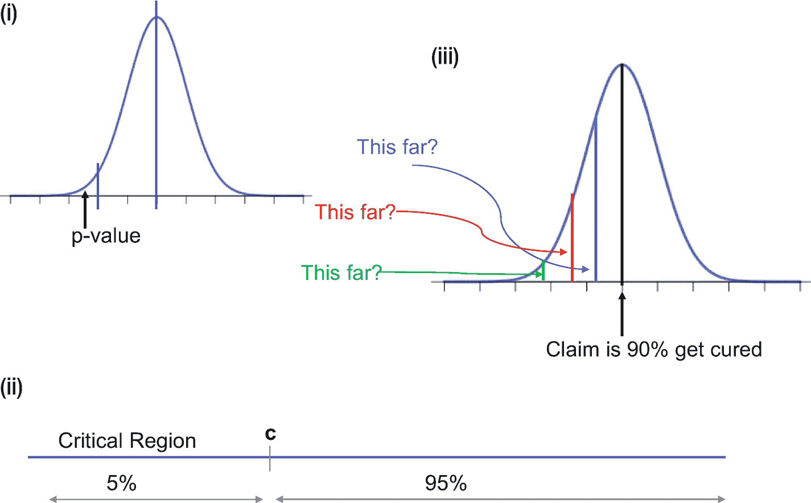

图 3-1

(i) 必须指定显著性水平，即我们接受结果且不拒绝零假设的临界点。(ii) 临界区域是中间图像中显示的 5% 区域。(iii) 右侧图像显示了 p 值以及它在本例中如何落入临界区域。

然后我们将临界区域定义为“c”，如图 3-1(ii) 所示。

如果 X 表示治愈的糖尿病患者人数，则临界区域定义为 P(X<c) < α，其中 α = 5%。在 95% 的置信区间内，有 5% 的可能性样本不包含总体均值。这可以解释为：如果我们感兴趣的样本落在临界区域内，那么我们可以安全地拒绝零假设。

这正是 5% 或 0.05 被称为*显著性水平*的原因。如果我们想要 99% 的置信区间，那么 0.01 就是显著性水平。

下一步是获取 p 值。请参考图 3-1(iii) 以获得更好的理解。

正式地讲，*p 值*是在临界区域方向上，得到样本值及更极端值的概率。它是一种检查样本结果是否落在假设检验临界区域内的方法。因此，我们根据 p 值来决定是拒绝还是接受零假设。

一旦计算出 p 值，我们就分析该值是否落在临界区域内。如果答案是肯定的，我们就可以拒绝零假设。

关于假设检验和 p 值的知识至关重要，因为它为识别*显著变量*铺平了道路。每当我们训练机器学习算法时，除了其他结果外，我们还会得到每个变量的 p 值。根据经验法则，如果 p 值小于或等于 0.05，则该变量被视为显著变量。

在这种情况下，零假设是自变量不显著，且不影响目标变量。如果 p 值小于或等于 0.05，我们可以拒绝零假设，从而得出结论：该变量确实是显著的。用统计学的语言来说，如果自变量 x 的 p 值小于或等于 0.05，则表明有强有力的证据反对零假设，因为零假设成立的概率低于 5%。或者换句话说，变量 x 是预测目标变量 y 的显著变量。但这并不意味着备择假设有 95% 的概率是正确的。需要注意的是，p 值是一个基于零假设的条件，与备择假设无关。

我们使用 p 值来筛选显著变量，并比较它们各自的重要性。这是一个被普遍接受的用于选择显著变量的指标。

接下来，我们将在下一节中探讨分类算法的概念。


## 分类算法

在日常业务中，我们常常需要做出决策：是否投资某只股票、是否向客户发送通知、接受或拒绝某个产品、批准或忽略某项申请。这些决策的基础，是我们对业务、流程、目标以及影响决策的各种因素所拥有的某种洞察。同时，我们也期望这些决策能带来有利的结果。

*监督分类*算法正是用于生成此类洞察并帮助我们做出决策的。它们预测某个事件发生或不发生的概率。同时，根据所选的监督学习算法，我们还能了解影响此类事件发生的因素。

从形式上讲，*分类*算法是监督式机器学习算法的一个分支，用于对某个类别的概率进行建模。例如，如果我们要进行二分类，就会对两类进行建模，比如通过/未通过、健康/生病、欺诈/真实、是/否等。它还可以扩展到多分类问题——例如，好/坏/中性、红/黄/蓝/绿、猫/狗/马/车等。

与回归模型类似，分类算法也有一个目标变量和多个自变量。唯一的区别在于，目标变量本质上是分类变量。用于预测的自变量可以是连续型或分类型，具体取决于建模所使用的算法。

以下用例将有助于阐明分类算法的用途：

1.  一家零售商正在流失其回头客，即那些曾经购买过商品的顾客不再光顾。监督学习算法将帮助识别那些更容易流失且不再回来的客户。然后，零售商可以有选择地针对这些客户，提供折扣以吸引他们重新光顾。

2.  一家制造工厂必须保持其产品的最佳质量。为此，技术团队希望确定特定的工具、原材料和物理条件组合是否能带来最佳质量和产量。监督算法可以帮助进行这种选择。

3.  一家保险公司希望对哪些客户应该给予保单进行建模。需要根据客户的历史记录、就业详情、交易模式等做出决策。在这里，分类机器学习模型可以帮助预测客户的接受分数，该分数可用于批准或拒绝申请。

4.  一家向客户提供信用卡的银行需要识别哪些传入交易是欺诈性的，哪些是真实的。需要根据交易详情（如来源、金额、交易时间、方式）以及其他客户参数做出决策。监督分类算法将有助于做出该决策。

5.  一家电信运营商希望在市场上推出一款新的数据产品。为此，需要锁定那些对该产品感兴趣并可能充值使用的用户。监督分类算法能够为每个用户生成一个分数，随后可以据此提供优惠。

上述用例是行业中一些实际的应用。分类算法会为某个事件生成一个概率分数，销售、市场、运营、质量、风险等团队据此可以做出业务决策。这是一种非常强大且便捷的用法！

有不少算法可以实现这一目的，我们将在本章讨论其中一部分，其余部分将在第 4 章中讨论。

可以使用的算法包括：

*   逻辑回归
*   k-近邻
*   决策树
*   随机森林
*   朴素贝叶斯
*   支持向量机
*   梯度提升
*   神经网络

我们将在本章讨论前五种算法，其余的在下一章讨论。让我们从下一节的逻辑回归算法开始讨论。


### 用于分类的逻辑回归

在第 2 章中，我们学习了如何使用线性回归预测连续变量的值，例如客户数量、销售额、降雨量等。现在，我们需要预测客户是否会到访、销售额是否会增长等问题。通过使用逻辑回归，我们可以对上述问题进行建模和求解。

正式地说，逻辑回归是一种利用逻辑函数对分类问题（即分类因变量）进行建模的统计模型。在基本形式中，我们建模的是*二元*分类问题，并将其称为二元逻辑回归。在需要建模多个类别的复杂问题中，我们使用*多项*逻辑回归。

让我们通过一个例子来理解逻辑回归。

假设我们需要判断一笔信用卡交易是否具有欺诈性。响应是二元的（是或否）；如果交易看起来可信，它将被接受，否则将被拒绝。我们将获得传入的交易属性，如金额、交易时间、支付方式等，并且需要基于这些属性做出决策。

对于此类问题，逻辑回归对欺诈概率进行建模。在上述情况下，欺诈概率可以表示为：

概率（欺诈 = 是 | 金额）

该概率的值将介于 0 和 1 之间。可以解释如下：给定一个“欺诈金额”的值，我们可以对信用卡交易的真实性进行预测。

问题在于我们如何对这种关系进行建模。如果我们使用*线性*方程，可以简单地将其写为：

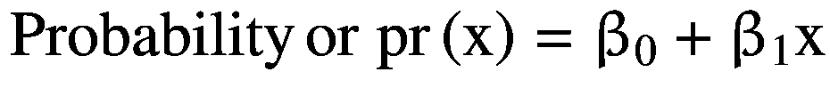

（方程 3-1）

如果我们想通过拟合上述公式，使用“金额”来预测“成功”，可以用以下图表的形式表示。对于较小的欺诈金额值，我们可以看到概率小于零，而对于较大的值，欺诈概率大于一。这两种情况都是不可能的。

因此，逻辑回归被用来解决这个问题。逻辑回归使用 *sigmoid* 函数，该函数接受任何实数值作为输入，并输出介于 0 和 1 之间的值。标准的*逻辑回归*方程可以表示为方程 3-2，并在图 3-2 中展示。

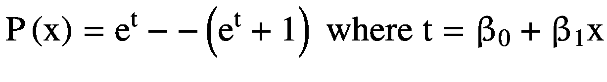

（方程 3-2）

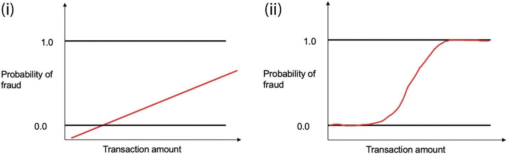

图 3-2

(i) 线性回归函数无法很好地完成预测欺诈的任务。(ii) 具有“S”形曲线的逻辑回归将更合适，因为它会给出介于 0 和 1 之间的分数。

可以重写为：

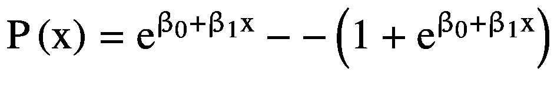

（方程 3-3）

接下来想到的问题是，如何拟合这个方程。回想一下，在线性回归中，我们希望预测的目标变量尽可能接近实际值。这里也采用了类似的方法。逻辑回归的拟合是使用*最大似然*函数完成的。似然函数衡量统计模型的拟合优度，对于逻辑回归，有时也称为对数似然函数。其数学证明超出了本书的范围。

如果我们对方程 3-3 进行变换，将得到：

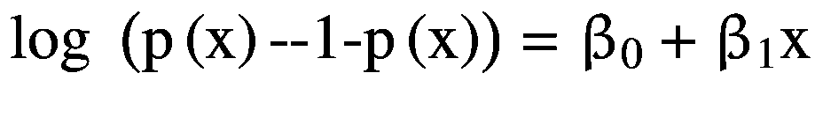

（方程 3-4）

如果我们对两边取自然对数：

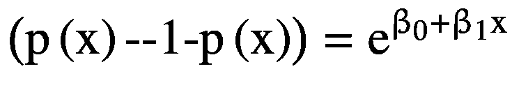

（方程 3-5）

在方程 3-5 中，量 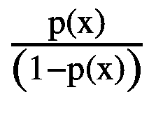 被称为*优势比*。之所以称为优势比，是因为与概率相比它更直观，因为优势比是博彩中的常用术语。

项 log 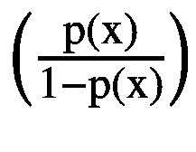 被称为 *logit*。如果与线性回归方程进行比较，我们可以很容易地发现，随着 x 每增加一个单位，logit（有时也称为对数优势比）会变化 β[1]。该值可以取 0 到无穷大之间的任何值。我们可以在图 3-2(ii) 中可视化该函数。

在大多数业务问题中，我们拥有不止一个自变量，因此我们使用多项逻辑回归来解决。数学上，它可以表示如下：

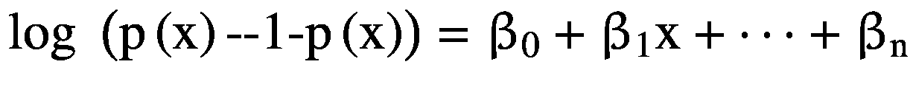

（方程 3-6）

但还有一个问题仍未解答：既然我们有线性回归，为什么还需要逻辑回归？

假设一家银行正在根据客户的历史交易和服务细节评估其服务质量。在这种情况下，预测的响应将是正面的、负面的或中性的。我们将这些响应编码为：

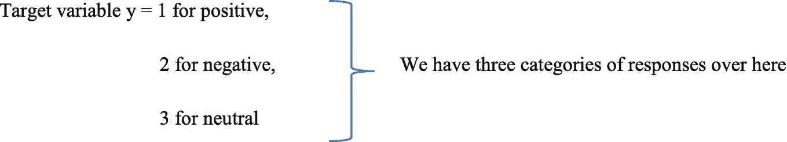

如果我们将目标变量视为连续变量，这意味着我们必须预测 y 的实际值。但这意味着正面比负面少一，负面比中性少一。并且正面与负面之间的差异与负面与中性之间的差异相同。这个论点本质上是错误的，并且没有任何实际意义。

此外，即使我们将响应的数量从三个减少到两个，比如只有正面和负面，线性回归也可能给出超过 1 或小于 0 的概率分数，这在数学上是不可能的。如果我们拟合最佳回归线，仍然不足以确定任何可以用来区分这两个类别的点。它会将一些正面分类为负面，反之亦然。此外，如果我们从线性回归中得到 0.5 的分数，应该将其分类为正面还是负面？而一个异常值可能会完全打乱我们的输出。因此，使用像逻辑回归这样的分类算法而不是线性回归模型来解决问题，在实践中更为合理。

与线性回归一样，逻辑回归也有一些假设：

1.  作为一种分类算法，逻辑回归模型的结果是一个二元或二分变量，例如成功/失败、是/否或零/一。

2.  结果变量的 logit 与每个自变量之间存在线性关系。

3.  不存在异常值，或者至少连续变量没有显著的异常值。

4.  自变量之间不存在相关性。


需要注意的一点是，算法的准确性取决于用于训练算法的训练数据。如果训练数据不具有代表性，那么最终得到的模型将不够稳健。训练数据应符合我们在第 1 章中讨论的数据质量标准。我们将在第 5 章中详细重新探讨这一概念。

提示

为了获得具有代表性的数据集，建议每个自变量相对于其最不频繁的值至少要有 10 个数据点。例如，对于 20 个自变量和一个最不频繁的结果值 0.2，我们应该有 (20*10)/0.2 = 1000 个数据点。

关于逻辑回归需要注意的要点：

1.  逻辑分类模型的输出通常是一个事件的概率分数。它可用于二分类和多分类问题。

2.  由于输出是概率，因此它不能大于 1，也不能小于 0。因此逻辑曲线的形状是“S”形。

3.  它可以处理任意数量的类别作为目标变量，也可以处理分类变量和连续自变量。

4.  最大似然算法有助于确定方程中各自的系数。自变量不需要服从正态分布，也不需要在每个组中具有相等的方差。

5.  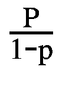 是优势比，只要这个值为正，成功的概率就超过 50%。

6.  在逻辑回归中，系数的解释比较困难，因为其关系不像线性回归那样直接。

在继续之前，必须仔细审视准确度测量方法。建议你彻底掌握每一种方法。这确实是监督学习中的一个关键组成部分！

## 评估解决方案的准确性

创建机器学习解决方案的目标是为了预测未来事件。但在将模型部署到生产环境之前，我们必须衡量模型的性能。此外，我们通常会通过多次迭代训练多个算法。我们必须根据各种准确的 KPI 来选择最佳算法。在本节中，我们将学习最重要的准确性评估标准。

衡量分类问题效能的最重要指标如下：

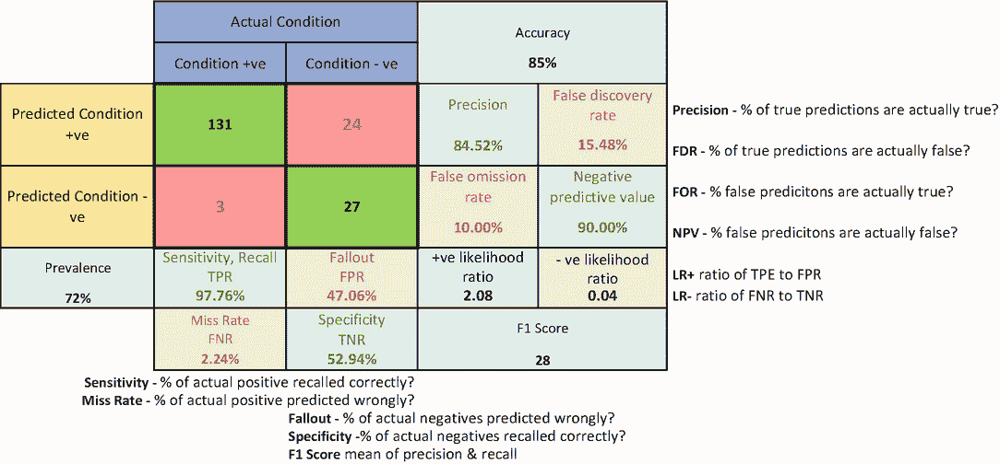

图 3-3

混淆矩阵是衡量机器学习模型效能的一个绝佳方法。通过它，我们可以计算精确率、召回率、准确率和 F1 分数，以了解模型的性能。

1.  **混淆矩阵**：最流行的方法之一是*混淆矩阵*。它可用于二分类和多分类问题。其最简单的形式如图 3-3 所示，为一个 2×2 矩阵。

现在我们将分别学习每个参数：

1.  **准确率**：准确率是指预测正确的数量。在前面的例子中，准确率为 (131+27)/ (131+27+3+24) = 85%

2.  **精确率**：精确率表示在所有预测为正类的样本中，实际为正类的比例。在前面的例子中，精确率为 131/ (131+24) = 84%

3.  **召回率或灵敏度**：召回率是指所有实际为正类的事件中，我们成功捕获的比例。在这个例子中，为 131/ (131+3) = 97%

4.  **特异度或真负率**：特异度是指所有实际为负类的样本中，被正确预测的比例。在这个例子中：27/ (27+24) = 92%

5.  **ROC 曲线和 AUC 值**：ROC（接收者操作特征）曲线用于比较不同模型。它是 TPR（真正率）和 FPR（假正率）之间的曲线图。ROC 曲线下的面积（AUC）是衡量模型好坏的标准。AUC 值越高，模型越好，如图 3-4 所示。与水平方向成 45 度角的直线代表 50%的准确率。一个好的模型其面积应大于 0.5，并且曲线应紧贴图形的左上角，如图 3-4 所示。图中绿色的曲线似乎是最好的模型。

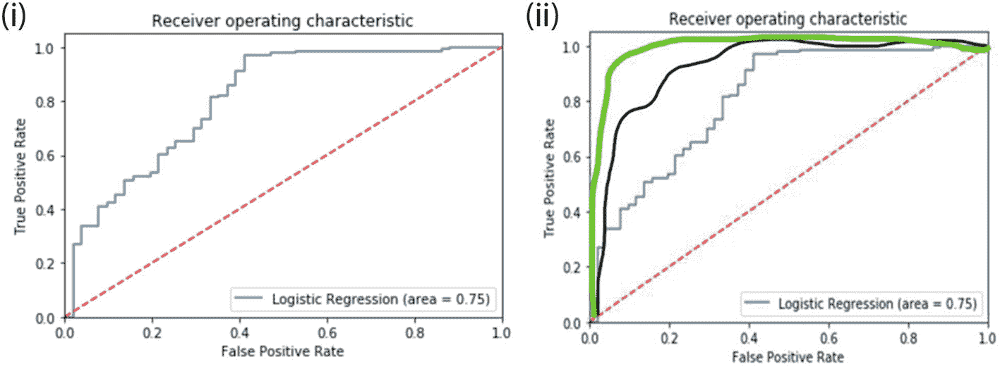

图 3-4

(i) 左侧显示的是 ROC 曲线。(ii) 右侧显示的是不同的 ROC 曲线。绿色的 ROC 曲线是最好的；它紧贴左上角，并且具有最大的 AUC 值。

6.  **基尼系数**：我们也使用基尼系数来衡量模型拟合的好坏。正式地说，它是 ROC 曲线中面积之比，是 AUC 的缩放版本。

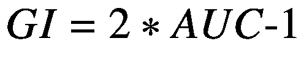

(公式 3-7)

与 AUC 值类似，我们更倾向于选择基尼系数值更高的模型。

7.  **F1 分数**：很多时候，我们在比较模型时会面临选择哪个 KPI 的问题（即更高的精确率还是更高的召回率）。F1 分数为我们解决了这个难题。


(公式 3-8)

F1 分数是精确率和召回率的调和平均数。F1 分数越高越好。

8.  **AIC 和 BIC**：赤池信息准则（AIC）和贝叶斯信息准则（BIC）用于选择最佳模型。AIC 源于频率概率，而 BIC 源于贝叶斯概率。


(公式 3-9) 而


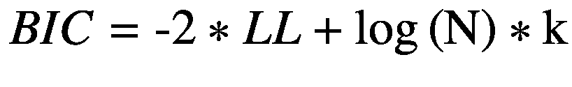

（公式 3-10）

在这两个公式中，N 是训练集中的样本数量，LL 是模型在训练数据集上的对数似然，k 是模型中的变量数量。BIC 中的对数是以 e 为底的自然对数，称为自然算法。

我们倾向于 AIC 和 BIC 的较低值。AIC 会因模型的复杂度而对其进行惩罚，但 BIC 对模型的惩罚比 AIC 更重。如果在这两者之间进行选择，与 BIC 相比，AIC 会选择更复杂的模型。

提示

在非常复杂的模型与精度相近的简单模型之间进行选择时，请选择更简单的那个。记住，自然总是偏爱简洁！

1.  **一致性与不一致性**：一致性是衡量模型的一种指标。让我们先理解一致性与不一致性的含义。

假设你正在构建一个模型来预测客户是否会流失。输出结果是流失概率。数据如表 3-1 所示。

表 3-1

客户是否流失的相应概率得分

| 客户 ID | 概率 | 是否流失 |
    | --- | --- | --- |
    | 1001 | 1 | 0.75 |
    | 2001 | 0 | 0.24 |
    | 3001 | 1 | 0.34 |
    | 4001 | 0 | 0.62 |

组 1：（流失 = 1）：客户 1001 和 3001

组 2：（流失 = 0）：客户 2001 和 4001

现在，我们从组 1 和组 2 中各取一个数据点组成配对，然后进行比较。因此，配对情况如下：

配对 1：1001 和 2001

配对 2：1001 和 4001

配对 3：3001 和 2001

配对 4：3001 和 4001

通过分析这些配对，我们可以很容易地发现，在前三个配对中，模型将较高概率的分类为流失者。这里模型的分类是正确的。这些配对被称为一致对。配对 4 中，模型将较低概率的分类为流失者，这不合逻辑。这个配对被称为不一致对。如果两个配对的概率相近，则称为并列对。

我们可以使用 Somers D 来衡量质量，其公式为：

Somers D = （一致对百分比 – 不一致对百分比）。Somers D 越高，模型越好。

一致性本身不能作为模型选择的唯一参数。它应作为衡量指标之一，同时还应检查其他指标。

2.  **KS 统计量**：KS 统计量或 Kolmogorov-Smirnov 统计量是衡量模型有效性的指标之一。它是累积真正例与累积假正例之间的最大差值。KS 值越高，模型越好。

3.  还建议在以下数据集上测试模型性能并比较关键绩效指标（KPI）：
    1.  训练数据集：用于训练算法的数据集

2.  测试数据集：用于测试算法的数据集

3.  验证数据集：该数据集仅在最终验证阶段使用一次

4.  时间外验证：进行时间外测试是一种良好实践。例如，如果训练/测试/验证数据集来自 2015 年 1 月至 2017 年 12 月，我们可以使用 2018 年 1 月至 2018 年 12 月作为时间外样本。其目的是测试模型在未见数据集上的性能。

以上是用于检查模型准确性的各种指标。我们通常使用多种算法创建多个模型。并且对于每种算法，都会进行多次迭代。因此，这些指标也用于比较模型，并挑选出最佳模型。

还有一点我们需要注意。我们总是希望系统能够准确。我们想要更好地预测股价是上涨还是下跌，或者明天是否会下雨。但有时，准确性可能具有欺骗性。我们将通过一个例子来理解这一点。

例如，在开发信用卡欺诈交易系统时，我们的业务目标是检测欺诈交易。通常，绝大多数（超过 99%）的交易并非欺诈。这意味着，如果一个模型将每笔传入的交易都预测为正常，该模型的准确率仍将达到 99%！但该模型并未实现其识别欺诈交易的业务目标。在这种业务场景下，召回率才是我们应该关注的重要参数。

至此，我们结束了对准确性评估的讨论。通常，对于分类问题，逻辑回归是我们用于建立基线的第一个算法。现在，让我们求解一个逻辑回归问题的示例。


## 案例研究：信用风险

**业务背景**：信用风险即借款人未能偿还任何贷款。在银行业，这是在批准申请人贷款前需要考虑的重要因素。梦想住房金融公司主营所有住房贷款业务，业务覆盖城市、半城市和农村地区。客户首先申请住房贷款，随后公司会验证客户的贷款资格。

**业务目标**：公司希望根据客户在线申请表中填写的详细信息，实现贷款资格审核流程的自动化（实时）。这些详细信息包括性别、婚姻状况、教育程度、受抚养人数、收入、贷款金额、信用记录等。为实现此流程自动化，他们提出了一个问题：识别出有资格获得特定贷款金额的客户群体，以便能精准定位这些客户。这里他们提供了一个部分数据集。

**数据集**：数据集和代码可在本章开头提供的书籍 GitHub 链接中找到。变量描述如下：

变量说明

1.  Loan_ID：唯一贷款编号
2.  Gender：性别（男/女）
3.  Married：申请人是否已婚（是/否）
4.  Dependents：受抚养人数
5.  Education：申请人教育程度（本科/本科以下）
6.  Self_Employed：是否自雇（是/否）
7.  ApplicantIncome：申请人收入
8.  CoapplicantIncome：共同申请人收入
9.  LoanAmount：贷款金额（单位：千）
10.  Loan_Amount_Term：贷款期限（单位：月）
11.  Credit_History：信用记录是否符合要求
12.  Property_Area：房产区域（城市/半城市/农村）
13.  Loan_Status：贷款是否获批（是/否）

现在开始使用逻辑回归进行编码。我们将探索数据集、清洗并转换数据、拟合模型，然后衡量解决方案的准确率。

**步骤 1**：首先导入所有必需的库。导入 seaborn 用于统计绘图；为了将数据框拆分为训练集和测试集，我们将使用 sklearn 包中基于随机函数的数据拆分功能。为了计算准确率指标和混淆矩阵，我们从 sklearn 导入了 metrics 模块。

```
import pandas as pd
from sklearn.linear_model import LogisticRegression
import matplotlib.pyplot as plt
import seaborn as sns
from sklearn.model_selection import train_test_split
import numpy as np
import os,sys
from scipy import stats
from sklearn import metrics
import seaborn as sn
%matplotlib inline
```

**步骤 2**：使用 read_csv 命令加载数据集。输出结果如下所示。

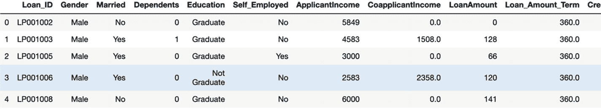

```
loan_df = pd.read_csv('CreditRisk.csv')
loan_df.head()
```

**步骤 3**：检查数据的形状：

```
loan_df.shape
```

**步骤 4**：credit_df = loan_df.drop('Loan_ID', axis =1 ) # 删除此列，因为它无论如何都是一一映射：

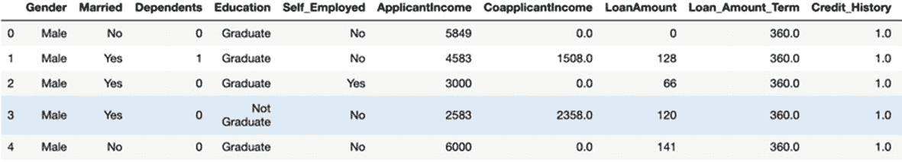

```
credit_df.head()
```

**步骤 5**：接下来对贷款金额的值进行归一化处理，并进行可视化。

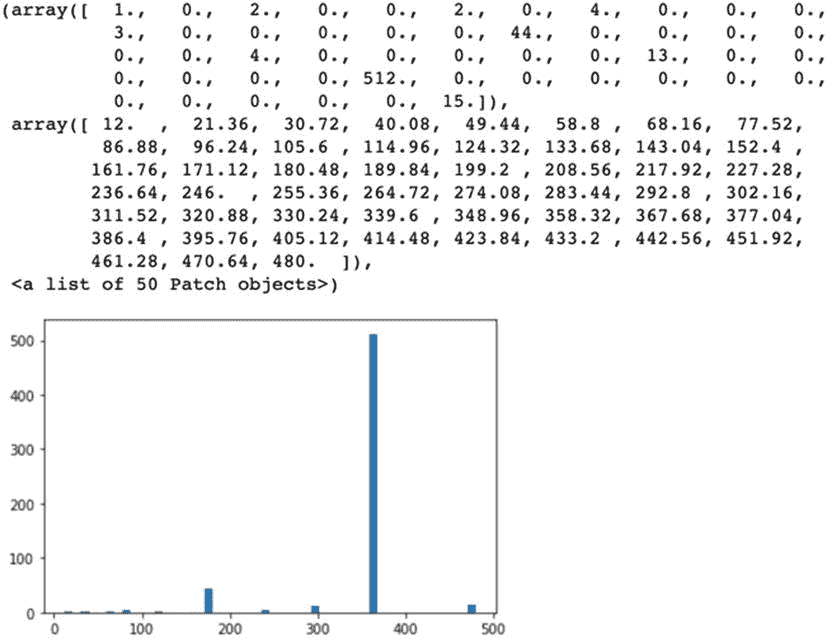

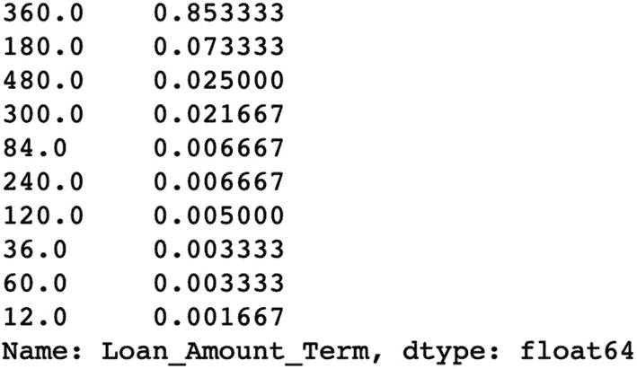

```
credit_df['Loan_Amount_Term'].value_counts(normalize=True)
plt.hist(credit_df['Loan_Amount_Term'], 50)
```

**步骤 6**：接下来以折线图的形式可视化数据。

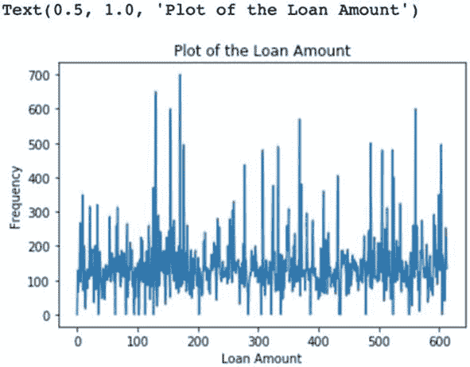

```
plt.plot(credit_df.LoanAmount)
plt.xlabel('贷款金额')
plt.ylabel('频率')
plt.title("贷款金额分布图")
```

提示

我们仅展示了一种可视化方式。建议您生成更多图表和图形。请记住，图表是直观呈现数据的绝佳方式！


**步骤 7**：`Loan_Amount_Term`（贷款金额期限）高度偏斜，因此我们删除此变量。

```
credit_df.drop(['Loan_Amount_Term'], axis=1, inplace=True)
```

**步骤 8**：接下来进行缺失值处理，每个变量的缺失值都用 0 替换。将缺失值替换为中位数后比较结果。

```
credit_df = credit_df.fillna('0')
##credit_df = credit_df.replace({'NaN':credit_df.median()})
credit_df
```

**步骤 9**：接下来我们将分析变量的分布情况。

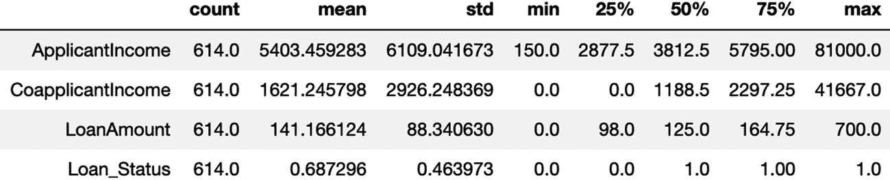

```
credit_df.describe().transpose()
```

建议你按照我们在第 2 章中讨论的方法创建箱线图。

**步骤 10**：让我们查看目标列 `Loan_Status`（贷款状态），以了解数据在不同值之间的分布情况。

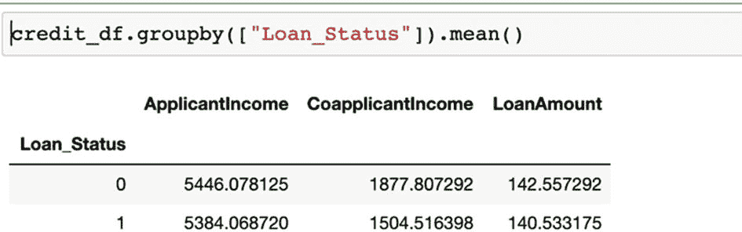

```
credit_df.groupby(["Loan_Status"]).mean()
```

**步骤 11**：现在我们将 X 和 Y 变量转换为分类变量。

```
credit_df['Loan_Status'] = credit_df['Loan_Status'].astype('category')
credit_df['Credit_History'] = credit_df['Credit_History'].astype('category')
```

**步骤 12**：检查当前数据中存在的数据类型，如下所示：

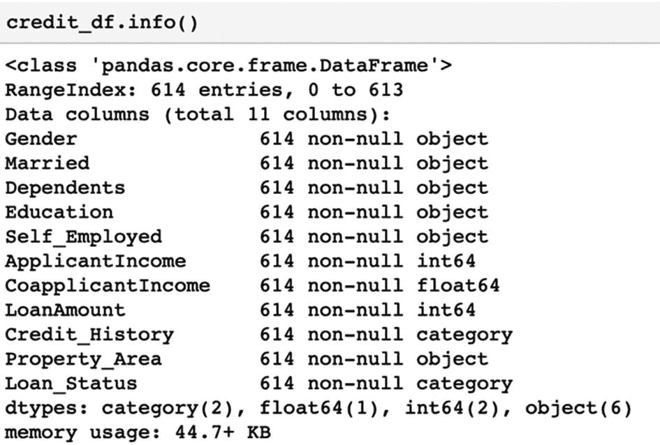

**步骤 13**：检查数据的平衡性。我们将得到以下输出。

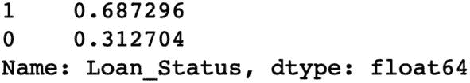

```
prop_Y = credit_df['Loan_Status'].value_counts(normalize=True)
print(prop_Y)
```

数据集中似乎存在轻微的不平衡，一个类别占 31.28%，另一个类别占 68.72%。

注意

虽然数据集并非严重不平衡，但我们仍将在第 5 章中探讨如何处理数据不平衡问题。

**步骤 14**：现在我们将定义 X 和 Y 变量。

```
X = credit_df.drop('Loan_Status', axis=1)
Y = credit_df[['Loan_Status']]
```

**步骤 15**：使用独热编码将分类变量转换为数值变量：

```
X = pd.get_dummies(X, drop_first=True)
```

**步骤 16**：现在分割为训练集和测试集。我们按 70:30 的比例进行分割。

```
from sklearn.model_selection import train_test_split
X_train, X_test, y_train, y_test = train_test_split(X, Y, test_size=0.30)
```

**步骤 17**：现在构建实际的逻辑回归模型：

```
import statsmodels.api as sm
logit = sm.Logit(y_train, sm.add_constant(X_train))
lg = logit.fit()
```

**步骤 18**：我们现在检查模型的摘要。结果如下：

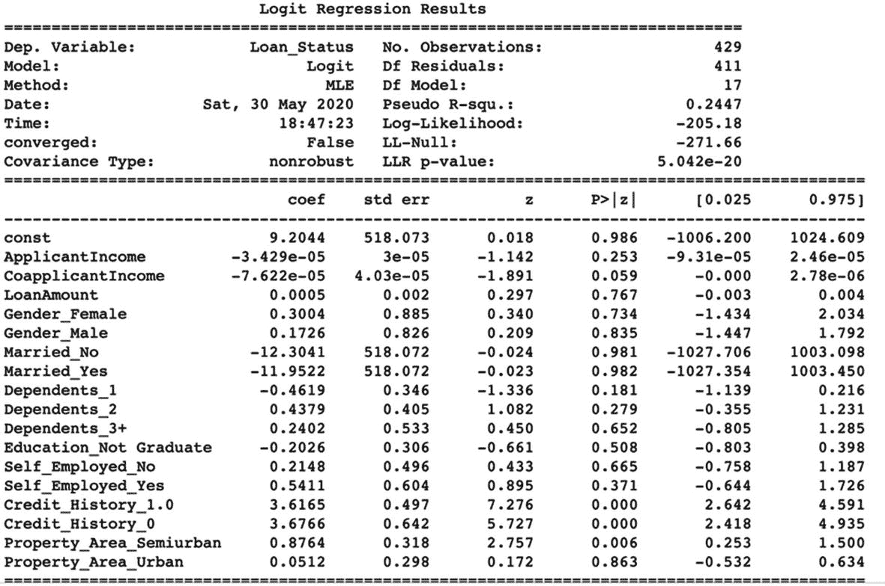

```
from scipy import stats
stats.chisqprob = lambda chisq, df: stats.chi2.sf(chisq, df)
print(lg.summary())
```

让我们解释一下结果。伪 R 方显示，模型仅解释了数据中全部变异的 24%。这确实不是一个好模型！

**步骤 19**：接下来，我们将使用公式优势比=exp(系数) 从系数计算优势比。然后，我们将使用公式概率 = 优势比 / (1+优势比) 从优势比计算概率。

```
log_coef = pd.DataFrame(lg.params, columns=['coef'])
log_coef.loc[:, "Odds_ratio"] = np.exp(log_coef.coef)
log_coef['probability'] = log_coef['Odds_ratio']/(1+log_coef['Odds_ratio'])
log_coef['pval']=lg.pvalues
pd.options.display.float_format = '{:.2f}'.format
```

**步骤 20**：我们现在将根据显著的 p 值（p 值 < 0.1）筛选所有自变量，并按优势比降序排序。我们将得到以下输出：

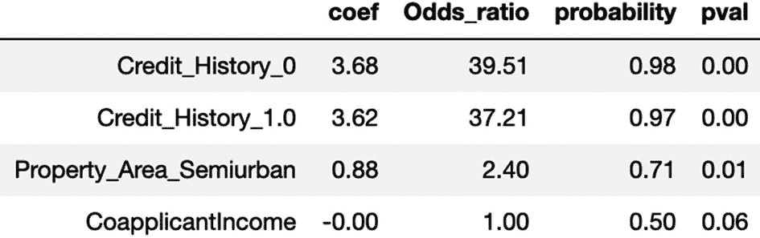

```
log_coef = log_coef.sort_values(by="Odds_ratio", ascending=False)
pval_filter = log_coef['pval']<=0.1
log_coef[pval_filter]
```

如果我们分析数据，可以看到信用记录为 1 的客户有 97% 的概率违约贷款，而信用记录为 0 的客户有 98% 的概率违约。

类似地，与其他客户相比，半城市地区的客户违约的优势比为 2.50 倍。

**步骤 21**：我们现在使用训练数据拟合模型。`.fit` 是用于此目的的函数。

```
from sklearn import metrics
from sklearn.linear_model import LogisticRegression
log_reg = LogisticRegression()
log_reg.fit(X_train, y_train)
```

**步骤 22**：模型准备就绪并拟合后，我们可以使用它进行预测。但首先，我们必须使用混淆矩阵检查模型在训练数据上的准确性；输出如下。

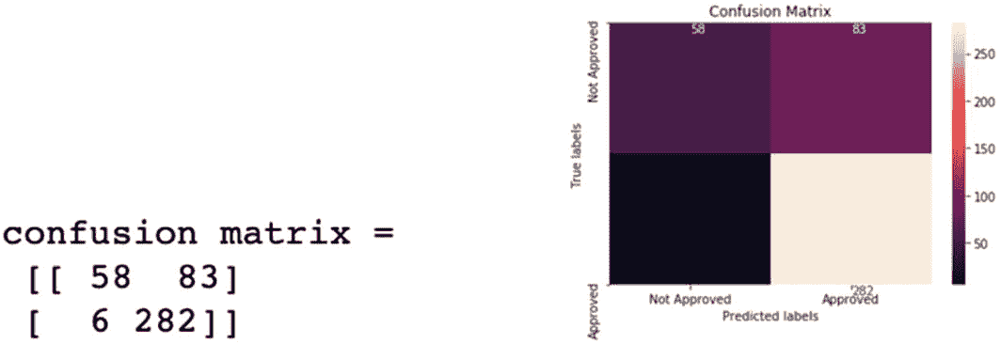

```
pred_train = log_reg.predict(X_train)
from sklearn.metrics import classification_report,confusion_matrix
mat_train = confusion_matrix(y_train,pred_train)
print("confusion matrix = \n",mat_train)
```

**步骤 23**：接下来，我们将对测试集进行预测并可视化，我们将得到以下输出。

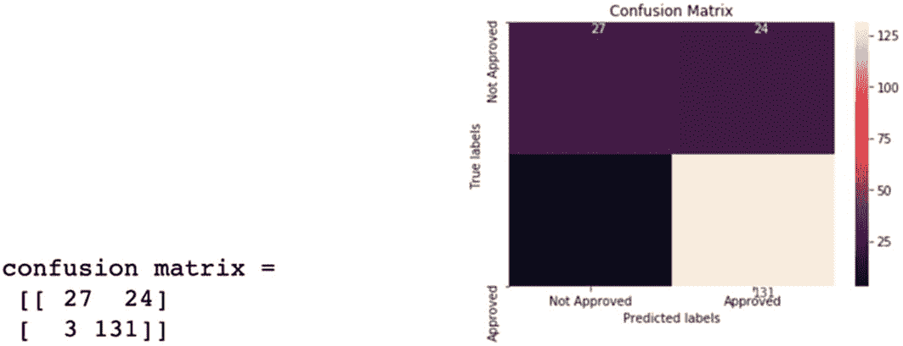

```
pred_test = log_reg.predict(X_test)
mat_test = confusion_matrix(y_test,pred_test)
print("confusion matrix = \n",mat_test)
ax= plt.subplot()
ax.set_ylim(2.0, 0)
annot_kws = {"ha": 'left',"va": 'top'}
sns.heatmap(mat_test, annot=True, ax = ax, fmt= 'g',annot_kws=annot_kws); #annot=True to annotate cells
ax.set_xlabel('Predicted labels');
ax.set_ylabel('True labels');
ax.set_title('Confusion Matrix');
ax.xaxis.set_ticklabels(['Not Approved', 'Approved']);
ax.yaxis.set_ticklabels(['Not Approved', 'Approved']);
```

**步骤 24**：现在让我们创建 AUC ROC 曲线并获取 AUC 分数。我们将得到以下输出。

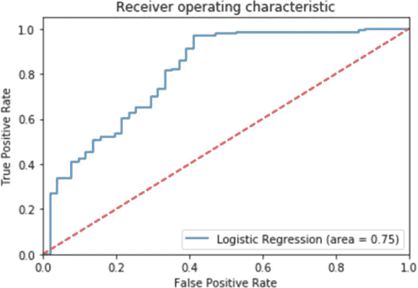

```
from sklearn.metrics import roc_auc_score
from sklearn.metrics import roc_curve
logit_roc_auc = roc_auc_score(y_test, log_reg.predict(X_test))
fpr, tpr, thresholds = roc_curve(y_test, log_reg.predict_proba(X_test)[:,1])
plt.figure()
plt.plot(fpr, tpr, label='Logistic Regression (area = %0.2f)' % logit_roc_auc)
plt.plot([0, 1], [0, 1],'r--')
plt.xlim([0.0, 1.0])
plt.ylim([0.0, 1.05])
plt.xlabel('False Positive Rate')
plt.ylabel('True Positive Rate')
plt.title('Receiver operating characteristic')
plt.legend(loc="lower right")
plt.savefig('Log_ROC')
plt.show()
```

```
auc_score = metrics.roc_auc_score(y_test, log_reg.predict_proba(X_test)[:,1])
round( float( auc_score ), 2 )
The output is 0.81.
```

**结果解读：** 通过比较训练混淆矩阵和测试混淆矩阵，我们可以确定解决方案的有效性，如混淆矩阵所示。

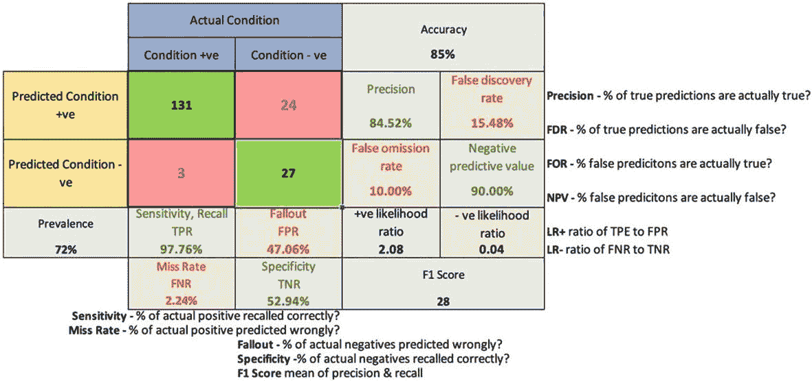

在测试数据上，模型的总体准确率为 85%。灵敏度或召回率为 97%，精确率为 84%。该模型具有良好的总体准确率。然而，该模型可以改进，因为我们可以看到有 24 个申请被预测为已批准，而实际上它们并未被批准。


### 补充说明

你可以使用以下代码，通过一条命令快速可视化所有变量，如下图所示。该图展示了贷款状态与所有变量之间的关系。

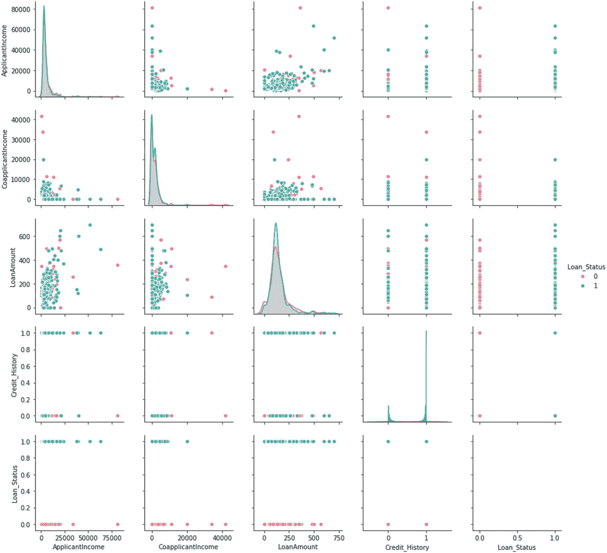

```
import seaborn as sns
sns.pairplot(credit_df, hue="Loan_Status", palette="husl")
```

注意

如果测试准确率与训练准确率不相似且显著较低，则意味着模型过拟合。我们将在第 5 章中学习如何处理这个问题。

逻辑回归通常是我们在处理分类问题时最先使用的算法之一。它速度快、易于理解，并且能够简洁地处理分类数据和连续数据。因此，它非常流行。它还可以用于获取问题中的显著变量。

现在我们已经详细研究了逻辑回归，接下来让我们转向第二个非常重要的分类器：朴素贝叶斯。不要被“朴素”这个词误导；这个算法在分类方面相当稳健！

## 朴素贝叶斯分类

设想一下：你正在计划一次露营。这次旅行将取决于几个因素，比如天气如何、是否有降雨预报、你是否请到了假、你的朋友们是否来，等等。你拥有历史数据，可以预测你是否会去露营，如表 3-2 所示。

表 3-2

计划露营时需考虑的因素

| 是否休假 | 天气 | 朋友是否来 | 湿度 | 是否去露营 |
| --- | --- | --- | --- | --- |
| 是 | 下雨 | 否 | 高 | 是 |
| 否 | 晴天 | 是 | 低 | 是 |
| 是 | 阴天 | 否 | 低 | 否 |
| 是 | 下雨 | 否 | 高 | 是 |
| 是 | 晴天 | 是 | 低 | 是 |
| 是 | 下雨 | 是 | 高 | 是 |
| 否 | 晴天 | 否 | 高 | 否 |
| 否 | 阴天 | 是 | 低 | 是 |

如表所示，是否去露营的最终决定取决于其他事件的结果。这引出了*条件概率*的概念。我们首先讨论几个与概率相关的关键点，以帮助更好地理解：

1.  如果 A 是任意事件，那么 A 的补事件，记作 Â，表示 A 不发生的事件。
2.  事件 A 的概率用 P(A) 表示，其补事件的概率 P() = 1 – P(A)。
3.  设 A 和 B 为任意事件，其概率分别为 P(A) 和 P(B)。如果已知 B 已发生，那么 A 的概率可能会改变。如前面的例子，如果天气下雨，那么露营的概率就会改变。A 的这个新概率称为给定 B 条件下 A 的*条件概率*，可以写作 P(A|B)。
4.  数学上，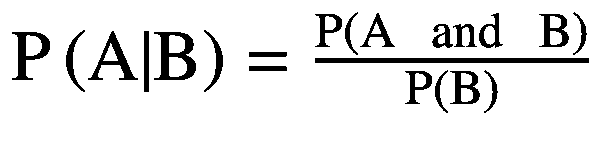，其中 P(A|B) 表示给定 B 条件下 A 的概率，即已知 B 已发生时 A 的概率。
5.  这种关系可以看作是*概率性*依赖，称为*条件*概率。这意味着在评估另一个事件的概率时，了解一个事件是重要的。
6.  如果两个事件相互独立，那么乘法规则简化为 P(A and B) = P(A)P(B)。例如，牛奶的价格不会对你的露营计划产生影响。

有许多事件是相互依赖的，因此理解 P(A|B) 和 P(B|A) 之间的关系变得至关重要。在商业活动中也是如此，销售额取决于到店顾客的数量，顾客是否会再次购物取决于之前的体验，等等。贝叶斯定理有助于对这些因素进行建模并做出预测。

根据*贝叶斯规则*，如果我们有两个事件 A 和 B。那么给定 B 条件下 A 的条件概率可以表示为

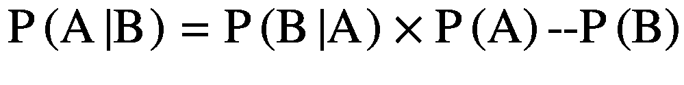

（公式 3-11）

其中 P(A) 和 P(B) 分别是 A 和 B 的概率，P(A|B) 是给定 B 条件下 A 的概率，P(B|A) 是给定 A 条件下 B 的概率。

例如，如果我们想知道一名患有糖尿病的患者患心脏病的概率。我们拥有的数据如下：进入诊所的患者中有 10% 患有心脏病，而 5% 的患者患有糖尿病。在确诊心脏病的患者中，8% 患有糖尿病。那么 P(A) = 0.10，P(B) = 0.05，P(B|A) = 0.08。根据贝叶斯规则，P(A|B) = (0.08×0.1)/0.05 = 0.16。


如果我们对规则进行泛化，令 A[1] 到 A[n] 为一组互斥的结果。事件 A 的概率为 P(A[1]) 到 P(A[n])。这些被称为*先验*概率。由于信息结果可能会影响我们对任何 A[i] 概率的思考，我们需要为每个结果 A[i] 找到条件概率 P(A[i]|B)。这被称为 A[i] 的*后验*概率。

利用贝叶斯法则，我们可以说：

![$$ \mathrm{P}\left({\mathrm{A}}_{\mathrm{i}}\left|\mathrm{B}\right.\right)=\mathrm{P}\left(\mathrm{B}\left|{\mathrm{A}}_{\mathrm{i}}\right.\right)\;\mathrm{P}\left({\mathrm{A}}_{\mathrm{i}}\right)/\left\{\mathrm{P}\right(\mathrm{B}\left|{\mathrm{A}}_1\left)\;\mathrm{P}\left({\mathrm{A}}_1\right)+\mathrm{P}\right(\mathrm{B}\left|{\mathrm{A}}_2\left)\;\mathrm{P}\left({\mathrm{A}}_2\right)+\dots +\mathrm{P}\right(\mathrm{B}\left|{\mathrm{A}}_{\mathrm{n}}\Big)\;\mathrm{P}\left({\mathrm{A}}_{\mathrm{n}}\right)\right.\right.\right. $$](img/499122_1_En_3_Chapter_TeX_Equ12.png)

（公式 3-12）

贝叶斯法则指出，后验概率等于似然乘以先验概率，再除以似然乘以先验概率的总和。贝叶斯法则中的分母是概率 P(B)。


（公式 3-13）

贝叶斯定理用于进行分类（二分类或多分类），它被称为*朴素贝叶斯*。之所以称为朴素，是因为它有一个非常强的假设，即变量和特征彼此独立，这在现实世界中通常不成立。通常这个假设会被违反，但朴素贝叶斯仍然表现良好。其思想是将所有可用证据以预测变量的形式纳入朴素贝叶斯规则，以获得更准确的类别预测概率。

根据贝叶斯法则，朴素贝叶斯估计条件概率（即在某事件已发生的情况下，另一事件发生的概率）。例如，如果我们想设计一个电子邮件垃圾邮件过滤器，并发现如果出现“折扣”这个词，则给定邮件是垃圾邮件。它易于实现、快速、稳健且相当准确。由于其易用性，它是一种非常流行的技术。

朴素贝叶斯算法的优点：

1.  它是一种简单、容易、快速且非常稳健的方法。

2.  它在干净数据和噪声数据上表现良好。

3.  它只需要少量样本进行训练，但其基本假设是训练数据集是总体的真实代表。

4.  很容易获得预测的概率。

朴素贝叶斯算法的缺点：

1.  它依赖于一个非常强的假设，即自变量之间不相关。

2.  它通常不适用于具有大量数值属性的数据集。

3.  在实践中，朴素贝叶斯算法预测的概率被认为不如预测的类别可靠。

4.  在某些情况下，已经观察到，如果罕见事件不在训练数据中但出现在测试中，那么估计的概率将是错误的。

但是，当我们的某些自变量是连续变量时，我们无法计算条件概率！因此，在实际变量中，朴素贝叶斯被扩展为高斯朴素贝叶斯。

在高斯朴素贝叶斯中，与每个属性或自变量相关的连续值被假定遵循高斯分布。它们也更容易处理，因为在训练时我们只需要估计连续变量的均值和标准差。

让我们进入案例研究，以开发朴素贝叶斯解决方案。

## 案例研究：基于人口普查数据的收入预测

**业务目标**：我们拥有人口普查数据，目标是基于其他属性的值预测个人的收入是否超过 50K/年。

**数据集**：数据集和代码可在本章开头共享的 Github 链接中找到。

变量描述：

*   Age：连续变量

*   Workclass：Private, Self-emp-not-inc, Self-emp-inc, Federal-gov, Local-gov, State-gov, Without-pay, Never-worked.

*   fnlwgt：连续变量。

*   Education：Bachelors, Some-college, 11th, HS-grad, Prof-school, Assoc-acdm, Assoc-voc, 9th, 7th-8th, 12th, Masters, 1st-4th, 10th, Doctorate, 5th-6th, Preschool.

*   Education-num：连续变量。

*   Marital-status：Married-civ-spouse, Divorced, Never-married, Separated, Widowed, Married-spouse-absent, Married-AF-spouse.

*   Occupation：Tech-support, Craft-repair, Other-service, Sales, Exec-managerial, Prof-specialty, Handlers-cleaners, Machine-op-inspct, Adm-clerical, Farming-fishing, Transport-moving, Priv-house-serv, Protective-serv, Armed-Forces.

*   Relationship：Wife, Own-child, Husband, Not-in-family, Other-relative, Unmarried.

*   Race：White, Asian-Pac-Islander, Amer-Indian-Eskimo, Other, Black.

*   Sex：Female, Male.

*   Capital-gain：连续变量。

*   Capital-loss：连续变量。

*   Hours-per-week：连续变量。

*   Native-country：United States, Cambodia, England, Puerto Rico, Canada, Germany, Outlying-US (Guam-USVI-etc), India, Japan, Greece, South, China, Cuba, Iran, Honduras, Philippines, Italy, Poland, Jamaica, Vietnam, Mexico, Portugal, Ireland, France, Dominican Republic, Laos, Ecuador, Taiwan, Haiti, Colombia, Hungary, Guatemala, Nicaragua, Scotland, Thailand, Yugoslavia, El Salvador, Trinadad&Tobago, Peru, Hong, Holland-Netherlands.

*   Class：>50K, <=50K

**步骤 1**：在此处导入必要的库。

```
import pandas as pd
import numpy as np
from sklearn import preprocessing
from sklearn.model_selection import train_test_split# 用于将数据集拆分为训练集和测试集
from sklearn.naive_bayes import GaussianNB # 用于建模高斯朴素贝叶斯分类器
from sklearn.metrics import accuracy_score # 用于计算模型的准确率分数
```

**步骤 2**：我们现在导入数据。请注意，此文件具有 .data 扩展名。现在为了导入人口普查数据，我们传递四个参数。‘adult.data’ 参数是文件名。header 参数表示数据的第一行是否包含文件的标题。对于我们的数据集，没有标题，因此我们可以传递 ‘None’。delimiter 参数指示分隔数据的定界符。这里，我们使用 ‘ , ’ 定界符。此定界符允许该方法删除数据值前后的空格。当数据值使用的空格不一致时，这非常有用。

```
census_df = pd.read_csv('adult.data', header = None, delimiter=' *, *', engine="python")
```

**步骤 3**：我们现在向数据框添加标题。这是必需的，以便我们以后能够访问列并更好地理解：

```
census_df.columns = ['age', 'workclass', 'fnlwgt', 'education', 'education_num', 'marital_status', 'occupation', 'relationship', 'race', 'sex', 'capital_gain', 'capital_loss', 'hours_per_week', 'native_country', 'income']
```

**步骤 4**：让我们打印数据框中的总记录数（行数）：

```
len(census_df)
输出结果为 32561
```

**步骤 5**：检查数据集中是否存在空值，如下所示：

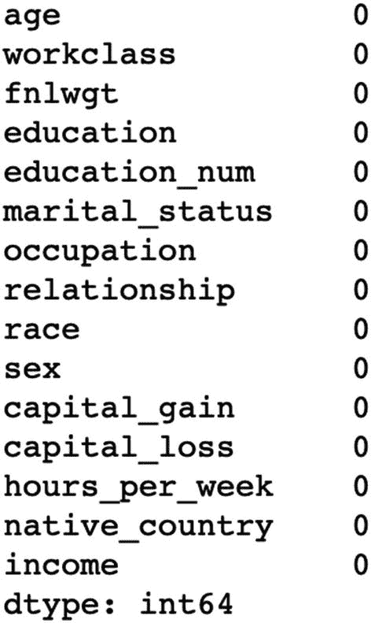

```
census_df.isnull().sum()
```

上述输出显示我们的数据集中没有“null”值。

可能存在一些分类变量有缺失值。我们将检查这一点，有时它们会用“?”代替缺失值。

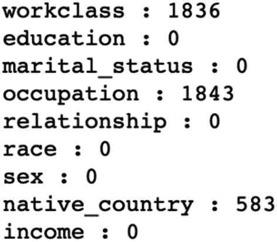


```
for value in ['workclass','education','marital_status','occupation','relationship','race','sex','native_country','income']:
print(value,":", sum(census_df[value] == '?'))
```

上述代码片段的输出显示，`workclass` 属性中存在 1836 个缺失值，`occupation` 属性中存在 1843 个缺失值，`native_country` 属性中存在 583 个缺失值。

**第 6 步**：接下来我们将进行数据预处理。首先，创建数据框的一个深层副本：

```
census_df_rev = census_df.copy(deep=True)
```

**第 7 步**：在执行缺失值处理任务之前，我们需要获取数据框的一些汇总统计信息。为此，我们可以使用 `describe()` 方法。该方法可用于生成各种汇总统计信息，但不包括 NaN 值。

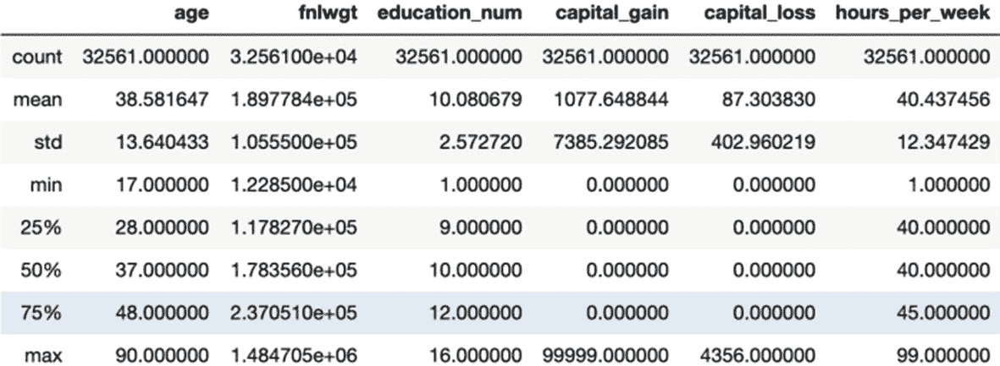

```
census_df_rev.describe(), as follows:
```

```
census_df_rev.describe(include= 'all')
```

如果传递了 `all`，则表示我们希望检查所有属性的汇总信息，如下所示：

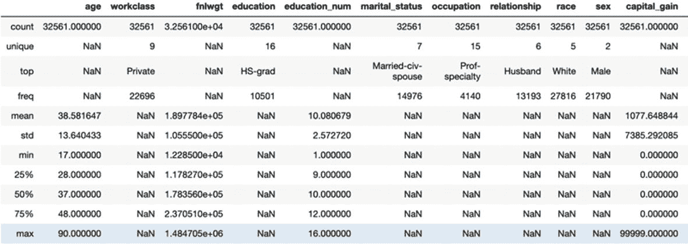

**第 8 步**：现在我们将对缺失的分类值进行插补：

```
for value in ['workclass','education','marital_status','occupation','relationship','race','sex','native_country','income']:
replaceValue = census_df_rev.describe(include='all')[value][2]
census_df_rev[value][census_df_rev[value]=='?'] = replaceValue
```

**第 9 步**：独热编码，将所有分类变量转换为数值型

```
le = preprocessing.LabelEncoder()
workclass_category = le.fit_transform(census_df.workclass)
education_category = le.fit_transform(census_df.education)
marital_category   = le.fit_transform(census_df.marital_status)
occupation_category = le.fit_transform(census_df.occupation)
relationship_category = le.fit_transform(census_df.relationship)
race_category = le.fit_transform(census_df.race)
sex_category = le.fit_transform(census_df.sex)
native_country_category = le.fit_transform(census_df.native_country)
```

**第 10 步**：现在初始化编码后的分类列：

```
census_df_rev['workclass_category'] = workclass_category
census_df_rev['education_category'] = education_category
census_df_rev['marital_category'] = marital_category
census_df_rev['occupation_category'] = occupation_category
census_df_rev['relationship_category'] = relationship_category
census_df_rev['race_category'] = race_category
census_df_rev['sex_category'] = sex_category
census_df_rev['native_country_category'] = native_country_category
```

**第 11 步**：查看数据的前几行：

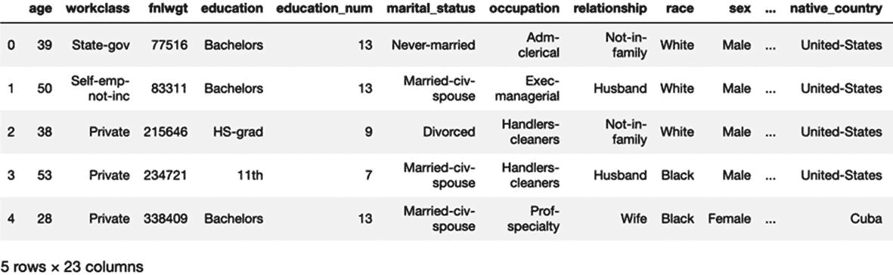

```
census_df_rev.head()
```

**第 12 步**：旧的分类列已不再需要，我们可以安全地删除它们：

```
dummy_fields = ['workclass','education','marital_status','occupation','relationship','race', 'sex', 'native_country']
census_df_rev = census_df_rev.drop(dummy_fields, axis = 1)
```

**第 13 步**：我们需要对所有列重新建立索引，为此将使用 `reindex_axis` 方法。

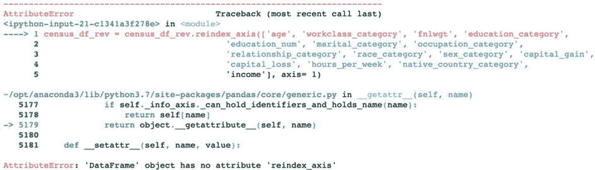

```
census_df_rev = census_df_rev.reindex_axis(['age', 'workclass_category', 'fnlwgt', 'education_category', 'education_num', 'marital_category', 'occupation_category', 'relationship_category', 'race_category', 'sex_category', 'capital_gain', 'capital_loss', 'hours_per_week', 'native_country_category', 'income'], axis= 1) census_df_rev.head(5)
```

该方法已弃用，因此我们会收到如上图所示的错误。因此，让我们使用一个更新的方法，这样就不会出现所示的错误。

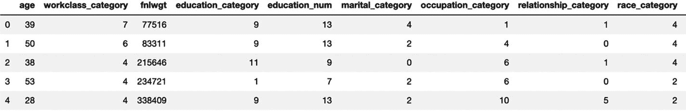

```
census_df_rev = census_df_rev.reindex(['age', 'workclass_category', 'fnlwgt', 'education_category', 'education_num', 'marital_category', 'occupation_category',  'relationship_category', 'race_category', 'sex_category', 'capital_gain',  'capital_loss', 'hours_per_week', 'native_country_category', 'income'], axis= 1)
census_df_rev.head(5)
```

**第 14 步**：现在我们将数据整理为自变量和目标变量：

```
X = census_df_rev.values[:,:14]  ## 这些是输入变量
Y = census_df_rev.values[:,14]  ## 这是目标变量
```

**第 15 步**：现在按照 75:25 的比例将数据拆分为训练集和测试集。

```
X_train, X_test, Y_train, Y_test = train_test_split(X, Y, test_size = 0.25, random_state = 5)
```

**第 16 步**：现在我们将拟合朴素贝叶斯模型。

```
clf = GaussianNB()
clf.fit(X_train, Y_train)
```

**第 17 步**：模型分类器现在已使用训练数据完成训练，并准备好进行预测。我们可以使用 `predict()` 方法，并将测试集特征作为其参数。

```
Y_pred = clf.predict(X_test)
```

**第 18 步**：现在检查模型的准确率。

```
accuracy_score(Y_test, Y_pred, normalize = True)
我们得到的准确率为 0.79032。
```

至此，我们使用真实数据集实现了朴素贝叶斯。建议你理解每一步，并通过复现解决方案来练习。

朴素贝叶斯是一个极好的算法，值得练习和使用。贝叶斯统计正受到广泛关注，其强大功能在研究领域被大量利用。你可能听说过*贝叶斯优化*这个术语。贝叶斯定理的美妙之处在于其简洁性，这在我们的日常生活中非常明显。确实是一种直截了当的方法！

到目前为止，我们已经介绍了逻辑回归和朴素贝叶斯。现在我们将研究另一种非常广泛使用的分类器，称为 *k-近邻算法*。这是一种流行的方法，易于理解和实现——接下来让我们学习 knn。


## k-近邻分类算法

“物以类聚，人以群分。”这句古老的谚语完美诠释了 k-近邻算法。这是最流行的机器学习技术之一，其学习过程基于数据点之间的相似性。knn 是一种*非参数*模型；它不构建“模型”，分类基于邻居的简单多数投票。它适用于属性与目标类别之间关系复杂且难以理解，但同一类别内的项目在属性值上相当同质的情况。但对于不干净的数据集，或者目标类别区分度不高的场景，它可能不是最佳选择。如果目标类别界限不清，那么在多数投票时就会导致明显的混淆。knn 也可用于回归问题，对连续变量进行预测。在回归情况下，最终输出将是邻居值的平均值，该平均值将被分配给目标变量。让我们通过图示来观察：

例如，我们有一些数据点，在向量空间图中用圆圈和加号表示，如图 3-5 所示。此例中明显有两个类别。目标是分类图 3-5(ii)中所示的一个新数据点（用黄色标记），并识别它属于哪个类别。

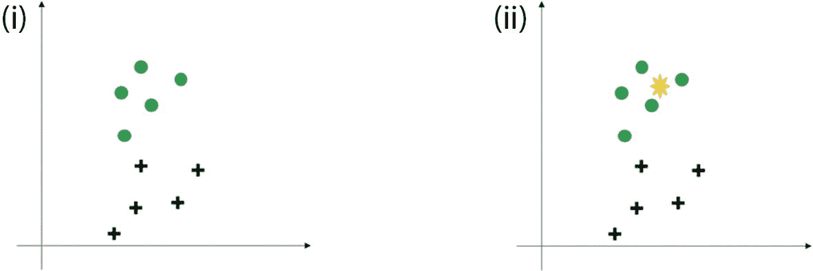

图 3-5

(i) 两个类别（绿色圆圈和黑色加号）的分布。(ii) 右侧显示需要分类的新数据点（用黄色符号表示）。必须使用 k-近邻算法进行分类。

这个黄色点要么是圆圈，要么是加号，没有其他可能。knn 将通过对其邻近的其他数据点进行多数投票来帮助分类。而“k”的值将指导我们考虑多少个数据点进行投票。假设我们取 k=4。那么，我们现在将以黄色点为中心画一个圆。这个圆的大小应刚好能包含四个数据点。如图 3-6(i)所示。

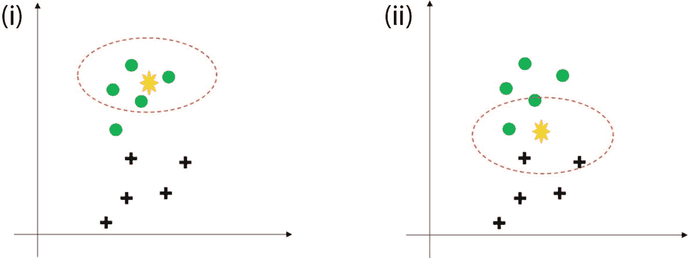

图 3-6

(i) 如果我们选择四个最近邻，新出现的未见数据的情况。这是一个容易做出的决定。(ii) 右侧显示，由于四个邻居混合在一起，新数据点难以分类。

离黄色点最近的四个点都属于圆圈，或者我们可以说未知黄色点的所有*邻居*都是圆圈。因此，我们可以有很高的置信度预测黄色点应属于圆圈类。这里的选择相对简单直接。参考图 3-6(ii)，情况就没那么简单了。因此，k 的选择起着至关重要的作用。

k-近邻算法遵循的步骤如下：

1.  我们接收需要处理的原始未分类数据集。
2.  我们从欧几里得距离、曼哈顿距离或闵可夫斯基距离中选择一个距离矩阵。
3.  然后计算新数据点与已知分类的训练数据点之间的距离。
4.  要考虑的邻居数量由“k”的值定义。
5.  接着，与具有最短距离的类别列表进行比较，并统计每个类别出现的次数。
6.  得票最高的类别获胜。这意味着，出现频率最高、次数最多的类别被分配给未知数据点。

提示

参数模型对输入数据做出一些假设，例如具有正态分布。然而，非参数方法认为数据分布无法通过有限参数集定义，因此不做任何假设。

从讨论的 k-近邻步骤中，我们可以清楚地理解，最终精度取决于所使用的距离矩阵和“k”的值。

常用的距离矩阵有：

1.  **欧几里得距离**：可能是计算两点之间距离最常用、最简单的方法。它是距离平方和的平方根：

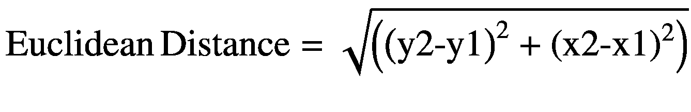

(公式 3-14)  
2.  **曼哈顿距离**：沿直角坐标轴测量的两点之间的距离。有时也称为城市街区距离。在平面上，p1 位于(x1, y1)，p2 位于(x2, y2)，其距离为：

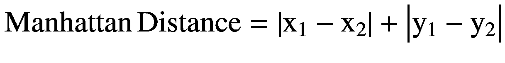

(公式 3-15)  
3.  **闵可夫斯基距离**：这是赋范向量空间中的一种度量。闵可夫斯基距离用于衡量向量的距离相似度。给定两个或多个向量，找出这些向量的距离相似度。主要地，闵可夫斯基距离在机器学习中用于找出距离相似度。它是一种广义距离度量，可以用以下公式表示：

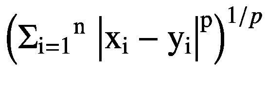

(公式 3-16)

其中，通过使用不同的 p 值，我们可以得到不同的距离值。当 p=1 时，得到曼哈顿距离；当 p=2 时，得到欧几里得距离；当 p=∞时，得到切比雪夫距离。

4.  **余弦相似度**：它是内积空间中两个非零向量之间相似度的度量，衡量它们之间夹角的余弦值。0°的余弦值为 1，对于区间(0,π]弧度内的任何角度，余弦值都小于 1。

各种距离可以如图 3-7 所示进行查看。

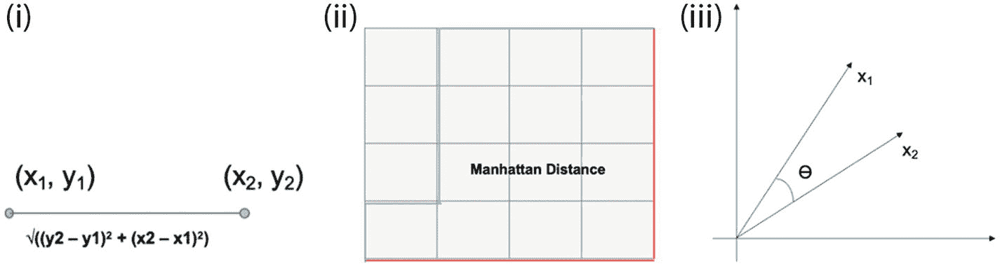

图 3-7

(i) 欧几里得距离；(ii) 曼哈顿距离；(iii) 余弦相似度

提示

在处理 knn 问题时，通常我们从欧几里得距离开始。在大多数业务问题中，它都能满足需求。距离矩阵是无监督聚类方法（如 k-means 聚类）中的一个重要参数。

k-近邻算法的优点

1.  它是一种非参数方法，不对向量空间中各类别的分布做任何假设。
2.  它可用于二分类以及多分类问题。
3.  该方法非常易于理解和实现。
4.  该方法具有鲁棒性，如果 k 值较大，则不受异常值的影响。

k-近邻算法的缺点

1.  精度取决于 k 的值，因此有时找到最优值可能比较困难。
2.  该方法要求类别分布不重叠。
3.  没有特定的模型作为输出，如果 k 值较小，则会受到异常值存在的负面影响。
4.  该方法计算量大，因为它是一种*懒惰学习*算法。需要计算所有点之间的距离，然后进行多数投票。因此，它不是一种快速的方法。

knn 还有其他形式，如下所示：

**半径邻居分类器**


1.  该分类器基于一定数量的邻居实现学习。这些邻居位于每个训练点固定半径 r 的范围内，其中 r 是由用户指定的浮点数值。

2.  当数据采样不均匀时，我们更倾向于使用此方法。但是，当存在多个自变量且数据集稀疏时，该方法会受到*维度灾难*的影响。

提示

当维度数量增加时，空间体积会以非常快的速度增长，导致数据变得非常稀疏。这被称为维度灾难。数据稀疏性使得对任何数据集进行统计分析都成为一项相当具有挑战性的任务。

**KD 树最近邻**

1.  如果数据集很大但自变量数量较少，此方法非常有效。

2.  与其他方法相比，此方法的计算时间更短。

现在是时候使用 k 近邻算法创建一个 Python 解决方案了，我们接下来将执行此操作。

## 案例研究：k-近邻算法

我们提供了一个待审计的数据集，该数据集包含在军事网络环境中模拟的各种入侵行为。它通过模拟典型的美国空军局域网，创建了一个获取网络原始 TCP/IP 转储数据的环境。该局域网像真实环境一样被重点监控，并遭受了多种攻击。一个连接是一系列 TCP 数据包，在某个时间段内开始和结束，在此期间，数据在某种明确定义的协议下从源 IP 地址流向目标 IP 地址。此外，每个连接都被标记为正常或攻击，并且每个攻击都恰好对应一种特定的攻击类型。每个连接记录大约包含 100 个字节。对于每个 TCP/IP 连接，从正常数据和攻击数据中提取了 41 个定量和定性特征（3 个定性特征和 38 个定量特征）。

类变量有两个类别：正常和异常。

### 数据集

该数据集以 `Network_Intrusion.csv` 文件的形式存放在 git 仓库中。代码也可在章节开头分享的 Github 链接中找到。

### 业务目标

我们需要拟合一个 k-近邻算法来检测网络入侵。

**步骤 1**：导入所有必需的库。我们正在导入 `pandas, numpy, matplotlib, seaborn`。

```
import pandas as pd
import numpy as np
import seaborn as sns
import matplotlib.pyplot as plt
%matplotlib inline
```

**步骤 2**：使用 pandas 的 read.csv 方法导入数据集。首先，让我们查看数据的前五行，如下所示：

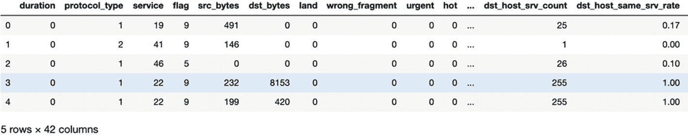

```
network_data= pd.read_csv('Network_Intrusion.csv')
network_data.head()
```

**步骤 3**：现在，我们将使用 info() 和 describe 命令对数据进行常规检查。

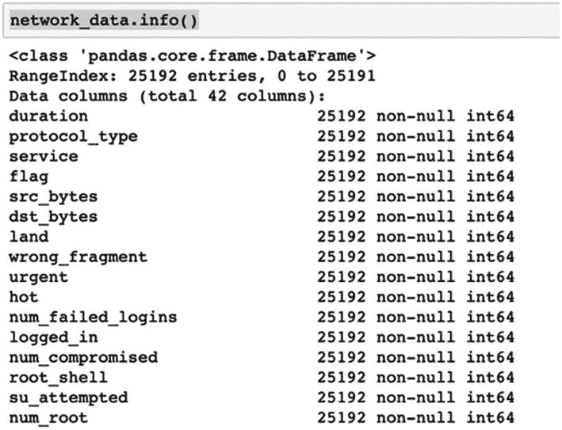

```
network_data.info()
```

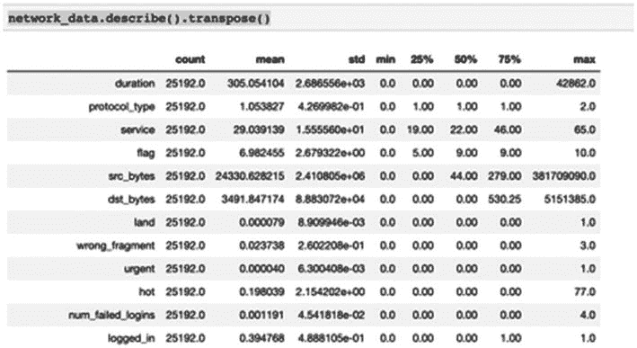

```
network_data.describe().transpose()
```

**步骤 4**：现在检查空值。幸运的是，我们的数据集中没有空值。

```
network_data.isnull().sum()
```

注意

该数据集没有任何空值；我们将在第 5 章详细学习如何处理空值、NA、NaN 等。

**步骤 5**：让我们看一下类别分布。我们也会将其可视化。


```
network_data["class"].value_counts(normalize=True)
```


```
pd.value_counts(network_data["class"]).plot(kind="bar")
```

**步骤 6**：我们的数据集中有一些分类变量。我们必须使用*独热编码*将它们转换为数值变量。

```
from sklearn.preprocessing import LabelEncoder
label_encoder = LabelEncoder()
network_data['class'] = label_encoder.fit_transform(dataset['class'])
network_data['protocol_type'] = label_encoder.fit_transform(dataset['protocol_type'])
network_data['service'] = label_encoder.fit_transform(dataset['service'])
network_data['flag'] = label_encoder.fit_transform(dataset['flag'])
```

**步骤 7**：独热编码增加了数据集中的变量数量。让我们查看添加变量后数据集中的列数：

```
network_data.columns
```

**步骤 8**：接下来，我们将使用 scikit-learn 中的 StandardScaler 来标准化我们的数据集。

```
from sklearn import preprocessing
from sklearn.preprocessing import StandardScaler
X_std = pd.DataFrame(StandardScaler().fit_transform(network_data))
X_std.columns = network_data.columns
```

**步骤 9**：现在是时候将数据拆分为训练集和测试集了。我们按 80:20 的比例划分数据。


```
import numpy as np
from sklearn.cross_validation import train_test_split
X = np.array(network_data.ix[:, 1:5]) #将数据转换为特征
y = np.array(network_data['class']) #将数据转换为目标
X_train, X_test, y_train, y_test = train_test_split(X, y, test_size=0.2, random_state=7)
```

**步骤 10**：sklearn.cross_validation 已被弃用，因此我们收到了此错误。再次尝试使用 sklearn.model_selection 将数据拆分为训练集和测试集。

```
from sklearn.model_selection import train_test_split
# 将数据转换为特征和目标
X = np.array(network_data.ix[:, 1:5])
y = np.array(network_data['class'])
# 拆分为训练集和测试集
X_train, X_test, y_train, y_test = train_test_split(X, y, test_size=0.2, random_state=7)
```

**步骤 11**：通过 print(X_train.shape) 打印数据的形状。


```
print(y_train.shape)
```


**步骤 12**：通过 `print(X_test.shape)` 打印测试数据的形状。


```
print(y_test.shape)
```

**步骤 13**：现在我们将使用训练数据训练模型，并迭代不同的 k 值（3、5、9）。

```
from sklearn.neighbors import KNeighborsClassifier
from sklearn.metrics import accuracy_score
from sklearn.metrics import recall_score
# 实例化学习模型 (k = 3)
knn_model = KNeighborsClassifier(n_neighbors = 3)
拟合模型
knn_model.fit(X_train, y_train)
y_pred = knn_model.predict(X_test) # 预测响应
print(accuracy_score(y_test, y_pred)) # 评估准确率
答案是 0.9902758483826156
knn_model = KNeighborsClassifier(n_neighbors=5) # 使用 k = 5
knn_model.fit(X_train, y_train) # 拟合模型
y_pred = knn_model.predict(X_test) # 预测响应
print(accuracy_score(y_test, y_pred)) # 评估准确率
答案是 0.9882913276443739
使用 k = 9
knn_model = KNeighborsClassifier(n_neighbors=9)
knn_model.fit(X_train, y_train) # 拟合模型
y_pred = knn_model.predict(X_test) # 预测响应
print(accuracy_score(y_test, y_pred)) # 评估准确率
答案是 0.9867037110537805
```

**步骤 14**：我们已经测试了三个 k 值。现在我们将对多个 k 值进行迭代。我们将使用邻居数量为 1、3、5…19 来运行 knn，然后基于最低的分类错误率找到最优的邻居数量。

```
k_list = list(range(1,20)) # 为 KNN 创建奇数列表
k_neighbors = list(filter(lambda x: x % 2 != 0, k_list)) # 仅筛选出奇数
ac_scores = [] # 用于存储准确率分数的空列表
# 对 1,3,5....19 的值执行准确率度量
for k in k_neighbors:
knn_model = KNeighborsClassifier(n_neighbors=k)
knn_model.fit(X_train, y_train)
y_pred = knn_model.predict(X_test)   # 预测响应
scores = accuracy_score(y_test, y_pred)  # 评估准确率
ac_scores.append(scores)
# 转换为分类错误率
MSE = [1 - x for x in ac_scores]
# 确定最佳 k 值
optimal_k = k_neighbors[MSE.index(min(MSE))]
print("最优邻居数量为 %d" % optimal_k)
```

**步骤 15**：让我们打印不同 k 值对分类错误率的影响。


```
import matplotlib.pyplot as plt
# 绘制分类错误率与 k 的关系图
plt.plot(k_neighbors, MSE)
plt.xlabel('邻居数量 K')
plt.ylabel('分类错误率')
plt.show()
```

**步骤 16**：结果表明 k=3 给出了最佳结果。让我们来实现它：

```
# 使用 k=3 作为最终预测模型
knn = KNeighborsClassifier(n_neighbors = 3)
# 拟合模型
knn.fit(X_train, y_train)
# 预测响应
y_pred = knn.predict(X_test)
# 评估准确率
print(accuracy_score(y_test, y_pred))
print(recall_score(y_test, y_pred))
```

准确率和召回率分别为 0.9902758483826156 和 0.9911944869831547。

使用 k = 3，我们获得了非常好的准确率和出色的召回率。该模型可被视为最终使用的模型。

我们使用 knn 开发了一个解决方案，并获得了良好的准确率。k-近邻算法非常易于解释和可视化。由于不涉及繁重的统计学或数学知识，即使对于非数据科学用户来说，该方法也不难理解。这是该方法最重要的特性之一。作为一种非参数方法，它不对数据做任何假设，因此所需的数据准备工作量较少。

我们已经介绍了逻辑回归、朴素贝叶斯和 k-近邻算法。通常，当我们开始任何分类解决方案时，我们会先使用这三种算法来检查其准确率。接下来是基于树的算法：决策树和随机森林。我们已经在第 2 章中讨论了这两者的理论概念。在下一节中，我们将介绍它们的区别，然后在一个数据集上实现它们。


## 基于树的分类算法

回顾第 2 章，我们学习了用于预测连续变量值的决策树。由于决策树既可解决分类问题也可解决回归问题，本章我们将研究使用决策树进行分类的解决方案。决策树的构建模块与图 3-8 所示保持一致。


图 3-8

决策树由根节点、决策节点和终端节点组成。子树称为分支

区别在于分裂过程之后所采用的分类算法，这一点将在下文讨论。

分裂的目标是创建尽可能多的纯节点。如果分裂后得到的某个节点包含的所有数据点都属于同一类别，则该节点被称为*纯节点*或*同质节点*。如果该节点包含属于不同类别的记录，则该节点是*不纯节点*或*异质节点*。目标是创建纯节点。衡量不纯度的主要方法有三种：熵、基尼指数和分类误差。我们现在详细描述它们，并比较各自的过程。假设我们有一个如表 3-3 所示的数据集。

表 3-3

交通方式对性别和收入水平等其他因素的依赖性

| 车辆数量 | 性别 | 费用 | 收入 | 交通方式 |
| --- | --- | --- | --- | --- |
| 1 | 女 | 低 | 中产阶级 | 火车 |
| 0 | 男 | 低 | 低收入 | 公交 |
| 1 | 女 | 高 | 中产阶级 | 火车 |
| 1 | 男 | 低 | 中产阶级 | 公交 |
| 0 | 男 | 中 | 中产阶级 | 火车 |
| 1 | 男 | 低 | 中产阶级 | 公交 |
| 2 | 女 | 高 | 高收入阶层 | 汽车 |
| 0 | 女 | 低 | 低收入 | 公交 |
| 2 | 男 | 高 | 中产阶级 | 汽车 |
| 1 | 女 | 高 | 高收入阶层 | 汽车 |

我们想要训练一个算法来预测交通方式。根据上述示例，我们可以计算出各自的概率为：

```
概率（公交） = 4/10 = 0.4
概率（汽车） = 3/10 = 0.3
概率（火车） = 3/10 = 0.3
```

这三种方法分别是熵、基尼指数和分类误差，现描述如下：

*   **熵**：*熵*和*信息增益*是相辅相成的。一个纯节点需要较少的信息来描述自身，而不纯节点则需要更多信息。这也可以通过熵的形式来理解。（信息增益 = 1 – 熵。）


（公式 3-17）


图 3-9

不同类别数（n）下的最大熵值。概率 p = 1/n。

*   其中 p 和 q 分别代表该节点中成功和失败的概率。这里的对数以 2 为底。

*   在上述示例中，熵 = –0.4 (log 0.4) – 0.3(log 0.3) – 0.3(log 0.3) = 1.571

*   纯节点的熵为 0，如图 3-9 所示。


图 3-10

不同类别数（n）下的最大基尼指数值。概率 p = 1/n。

*   **基尼系数**：基尼指数也可用于衡量不纯度。使用的公式如下：


（公式 3-18）
*   在上述示例中，基尼指数 = 1 – (0.4² + 0.3² + 0.3²) = 0.660

*   只包含单一类别的节点的基尼值为 0，因为其概率为 1。与熵类似，当节点中所有类别的概率相等时，基尼值也达到最大值。基尼值的变化如图 3-10 所示。

*   无论模型中类别数量多少，基尼值始终介于 0 和 1 之间。

*   **分类误差**：衡量不纯度的另一种方法是使用分类误差。其公式如下：


（公式 3-19）

*   其中 i 是类别数量

*   与其他两种方法类似，其值介于 0 和 1 之间。

*   对于上述示例，分类误差指数 = 1 – max(0.4,0.3,0.3) = 0.6

我们可以使用这三种分裂方法中的任何一种进行分类。有一些常见的决策树算法可用于回归和分类问题。既然我们已经学习了回归和分类的概念，现在是时候研究不同类型的决策树算法了，这将是下一节的内容。


## 决策树算法类型

业界使用一些重要的决策树算法。其中一些适用于分类问题，而另一些则是回归解决方案的更好选择。我们将讨论这些算法的各个方面。

主要的算法如下：

1.  **ID3**（迭代二分器 3）是一种决策树算法，它使用贪心搜索在每次迭代中分割数据集。它使用熵或信息增益作为因子来迭代执行分割。对于模型中的每次连续迭代，它使用上一次迭代中未使用的变量，计算这些未使用变量的熵，然后选择熵最低的变量。换句话说，它选择信息增益最高的变量。ID3 可能导致过拟合，并且可能不是最优选择。它在处理分类变量时表现相当不错。但当数据集包含连续变量时，由于节点分割可能基于许多值，其收敛速度会变慢。

2.  **CART**（分类与回归树）是一种灵活的基于树的解决方案。它可以为连续或分类目标变量建模，因此是使用率最高的基于树的算法之一。与常规决策树算法一样，我们选择输入变量并迭代分割节点，直到构建出一个稳健的树。输入变量的选择采用贪心方法，目标是最小化损失。树的构建基于预定义的标准停止，例如每个叶子节点中必须存在的最小观测数。Python 库`scikit-learn`使用了 CART 的优化版本，但目前不支持分类变量。

3.  **C4.5** 是 ID3 的扩展，用于分类问题。与 ID3 类似，它利用熵或信息增益进行分割。它是一个稳健的选择，因为它可以处理分类变量和连续变量。对于连续变量，它会分配一个阈值，并根据该阈值进行分割。值高于阈值的变量在一个桶中，而值小于或等于阈值的变量在另一个桶中。它允许数据中存在缺失变量，因为在计算熵值时不会考虑缺失值。

4.  **CHAID（卡方自动交互检测）** 是市场研究和营销领域的一种流行算法；例如，如果我们想了解某特定客户群体会如何响应新的营销活动。该营销活动可以针对新产品或服务，并且有助于营销团队制定相应的策略。CHAID 主要基于调整后的显著性检验，主要用于我们拥有分类目标变量和分类自变量时。事实证明，它是可视化此类数据集的一种非常方便且便捷的方法。

5.  **MARS（多元自适应回归样条）** 是一种非参数回归技术。它最适用于测量变量之间的非线性关系。它是一种灵活的回归模型，可以处理分类变量和连续变量。它是处理海量数据集的非常稳健的解决方案，并且需要的数据准备工作非常少，因此实现起来相对更快。由于其灵活性和对数据集中非线性关系建模的能力，MARS 通常是解决模型中过拟合问题的不错选择。

前面讨论的基于树的算法各有其独特之处。其中一些更适合分类问题，而另一些则是回归问题的更好选择。CART 可用于分类和回归问题。

现在是时候使用决策树开发一个案例研究了。

代码和数据集可在本章开头分享的 Github 链接中找到。

我们可以使用与逻辑回归问题相同的数据集。在创建了训练数据和测试数据之后，进行实现。

**步骤 1：** 首先导入必要的库。

```
from sklearn.tree import DecisionTreeClassifier
```

**步骤 2：** 现在调用决策树分类器并训练模型。

```
dt_classifier = DecisionTreeClassifier()
dt_classifier.fit(X_train, y_train)
```

**步骤 3：** 使用训练好的模型对测试数据进行预测。

```
y_pred = dt_classifier.predict(X_test)
```

**步骤 4：** 获取混淆矩阵。为了可视化，建议使用逻辑回归方法中使用的方法。


```
print(confusion_matrix(y_test, y_pred))
ax= plt.subplot()
ax.set_ylim(2.0, 0)
annot_kws = {"ha": 'left',"va": 'top'}
sns.heatmap(mat_test, annot=True, ax = ax, fmt= 'g',annot_kws=annot_kws); #annot=True to annotate cells
ax.set_xlabel('Predicted labels');
ax.set_ylabel('True labels');
ax.set_title('Confusion Matrix');
ax.xaxis.set_ticklabels(['Not Approved', 'Approved']);
ax.yaxis.set_ticklabels(['Not Approved', 'Approved']);
```

现在我们将使用随机森林模型对同一个问题进行建模。回顾一下，随机森林是一种基于集成学习的技术，它使用数据子集创建多个较小的树。最终决策基于每棵树的*投票*机制。在上一章中，我们将随机森林用于回归问题；这里我们将随机森林用于分类问题。

**提示**

决策树通常容易过拟合；基于集成学习的随机森林模型是解决过拟合问题的不错选择。

**步骤 1：** 导入库并拟合模型。创建包含 500 棵树的模型。

```
from sklearn.ensemble import RandomForestClassifier
rf_model = RandomForestClassifier(n_estimators=500, bootstrap = True,
max_features = 'sqrt')
现在我们将拟合训练数据
rf_model.fit(X_train, y_train)
```

**步骤 2：** 对测试数据进行预测并绘制混淆矩阵。


```
y_pred = rf_model.predict(X_test)
print(confusion_matrix(y_test, y_pred))
ax= plt.subplot()
ax.set_ylim(2.0, 0)
annot_kws = {"ha": 'left',"va": 'top'}
sns.heatmap(mat_test, annot=True, ax = ax, fmt= 'g',annot_kws=annot_kws); #annot=True to annotate cells
ax.set_xlabel('Predicted labels');
ax.set_ylabel('True labels');
ax.set_title('Confusion Matrix');
ax.xaxis.set_ticklabels(['Not Approved', 'Approved']);
ax.yaxis.set_ticklabels(['Not Approved', 'Approved']);
```

以上就是决策树算法和基于集成学习的随机森林算法的实现。基于树的算法非常易于理解和实现。它们通常是我们实现并测试系统准确性的首批算法之一。如果我们想快速创建一个解决方案，推荐使用基于树的方案，但它们容易过拟合。我们可以使用树剪枝或对树的大小设置约束来克服过拟合。我们将在第 5 章再次讨论这个概念，届时我们将讨论所有克服机器学习模型中过拟合问题的技术。


至此，我们关于基于树的算法的讨论就告一段落了。在本章中，我们学习了分类算法并对其进行了实现。这些算法在业界非常流行，并且功能强大，足以帮助我们构建稳健的机器学习模型。通常，我们会在开始时用这些算法测试数据，然后选择能给出最佳结果的那个。接着，我们会进一步调优，直到获得最理想的输出。最理想的输出可能*不是*最复杂的解决方案，但必定是能够提供所需水平的衡量参数、可复现性、稳健性、灵活性和易于部署的方案。请记住，复杂度与准确性*并不*成正比。更复杂的模型并*不*意味着更高的性能！

## 总结

预测是我们手中强大的工具。利用这些机器学习算法，我们不仅能做出自信的决策，还能确定影响该决策的因素。这些算法广泛应用于银行、零售、制造、保险、航空等领域。其用途包括欺诈检测、质量检验、客户流失预测、贷款违约预测等等。

你应该注意，这些算法并非知识的唯一来源。良好的探索性分析是优秀机器学习算法的先决条件。而最重要的资源是“数据”本身。一个高质量且具有代表性的数据集至关重要。我们在第 1 章中讨论了优质数据集应具备的特性。

同样至关重要的是，从一开始就要构建一个合理的业务问题。目标变量的选择应与手头的业务问题保持一致。用于训练算法的训练数据起着非常关键的作用，因为算法学习的模式依赖于它。需要注意的是，我们确实会使用各种参数（如精确率、召回率、AUC、F1 分数等）来衡量算法的性能。一个在训练集、测试集和验证集上表现良好的算法将是最佳算法。但即便如此，我们还会基于其他一些参数来选择最终可以部署到生产环境中的算法，这些内容我们将在第 5 章中讨论。

在第 1 章中，我们探讨了机器学习、其各种类型、数据及数据质量的属性，以及机器学习流程。在第 2 章中，我们学习了用于对连续变量建模的机器学习算法。在这第三章中，我们通过分类算法补充了知识。这些前几章的内容为你解决数据科学领域中的大多数业务问题奠定了坚实的基础。同时，你现在也已经准备好进入第 4 章，迈出下一步。

在前三章中，我们讨论了基础及中级算法。在下一章中，我们将涵盖更复杂的算法，如支持向量机、梯度提升以及用于回归和分类问题的神经网络。所以请保持专注！

练习题

问题 1：逻辑回归算法如何进行分类预测？

问题 2：精确率和召回率有什么区别？

问题 3：什么是后验概率？

问题 4：朴素贝叶斯算法有哪些假设？

问题 5：在 k-近邻算法中，如何选择 k 的值？

问题 6：分类算法的各种性能衡量参数有哪些？

问题 7：1912 年泰坦尼克号沉没事件确实令人心碎。一些乘客幸存，一些则没有。从 [`https://www.kaggle.com/c/titanic`](https://www.kaggle.com/c/titanic) 下载数据集。利用机器学习，根据乘客的各种属性预测哪些乘客更有可能幸存。

问题 8：使用以下命令加载鸢尾花数据集：

```
from sklearn.datasets import load_iris
iris = load_iris()
```

我们在上一章中已经处理过这个数据集。在这里，你需要使用分类算法对花的种类进行分类，并比较结果。

问题 9：从链接 [`https://archive.ics.uci.edu/ml/datasets/Bank+Marketing`](https://archive.ics.uci.edu/ml/datasets/Bank+Marketing) 下载银行营销数据集。该数据与一家葡萄牙银行机构的直接营销活动（电话呼叫）有关。分类问题的目标是预测客户是否会认购定期存款。创建各种分类模型并比较各自的 KPI。

问题 10：从 [`https://www.kaggle.com/uciml/german-credit`](https://www.kaggle.com/uciml/german-credit) 获取德国信用风险数据。该数据集包含每个从银行贷款的人的属性。目标是根据每个人的属性将其分类为良好或不良信用风险。使用分类算法创建模型并选择最佳模型。

问题 11：阅读关于逻辑回归的研究论文，网址为 [`https://www.ncbi.nlm.nih.gov/pmc/articles/PMC6696525/`](https://www.ncbi.nlm.nih.gov/pmc/articles/PMC6696525/)。

问题 12：阅读关于随机森林的研究论文，网址为 [`https://aip.scitation.org/doi/pdf/10.1063/1.4977376`](https://aip.scitation.org/doi/pdf/10.1063/1.4977376)。在 [`https://aip.scitation.org/doi/10.1063/1.4952607`](https://aip.scitation.org/doi/10.1063/1.4952607) 还有另一篇不错的论文。

问题 13：查阅关于 k-近邻的研究论文，网址为 [`https://pdfs.semanticscholar.org/a196/39771e987588b378879c65300b61b4af86af.pdf`](https://pdfs.semanticscholar.org/a196/39771e987588b378879c65300b61b4af86af.pdf)。

问题 14：学习关于朴素贝叶斯的研究论文，网址为 [`https://www.cc.gatech.edu/~isbell/reading/papers/Rish.pdf`](https://www.cc.gatech.edu/%257Eisbell/reading/papers/Rish.pdf)。

