# 4. 监督学习的高级算法

> *“真正的智慧是一种在不失事物本质的前提下简化复杂事物的艺术。”*
> 
> — 苏米特·辛格

我们的生活是复杂的。我们每天都要应对复杂性——在家里、在工作中、在通勤路上、在家庭内部以及面对我们的职业目标时。通往成功的道路有很多，但成功的定义是主观且复杂的。我们总是努力寻找最佳要素来铺平通往成功的道路。

就像我们的生活一样，数据有时也可能极其复杂。我们需要更高级的算法、更精妙的技术、打破常规的方法和创新的流程来理解它。但任何解决方案、任何算法、任何方法和任何流程的核心，都是解决手头的业务问题。大多数业务问题都涉及如何增加利润和降低成本。利用这些先进的方法论，我们可以理解系统生成的复杂数据集。

在本书的前三章中，我们使用相当多的算法研究了用于回归和分类问题的机器学习。我们探讨了相关概念，并为它们开发了 Python 解决方案。在本章中，我们将研究高级算法。我们将学习这些算法，并为其开发数学概念和编码逻辑。我们不会只处理结构化数据。在本章中，我们还将处理非结构化数据集——文本和图像。

在本章中，我们将探讨诸如提升算法和支持向量机等高级算法。然后，我们将深入文本和图像数据的世界，并利用自然语言处理和图像分析的原理来解决此类挑战。深度学习用于解决复杂问题，因此我们将把深度学习应用于结构化数据和非结构化图像数据集。所有代码文件和数据集都附有逐步的解释。


## 所需技术工具包

本书将使用 Python 3.5 或更高版本。建议你在自己的机器上安装好 Python。我们将使用 Jupyter notebook；执行代码需要安装 Anaconda-Navigator。所有数据集和代码均已上传至 Github 仓库 [`https://github.com/Apress/supervised-learning-w-python/tree/master/Chapter%204`](https://github.com/Apress/supervised-learning-w-python/tree/master/Chapter%25204)，方便下载和执行。

主要使用的库包括 numpy、pandas、matplotlib、seaborn、scikit learn 等。建议你在 Python 环境中安装这些库。本章将使用自然语言处理（NLP），因此会用到 NLTK 库和 RegexpTokenizer。此外，本章还需要 Keras 和 TensorFlow 库。

接下来，让我们深入探讨基于集成的提升算法，并详细研究其概念！

## 提升算法

回顾上一章，我们学习了集成建模技术。我们讨论了装袋算法，并使用随机森林创建了解决方案。本章将继续探讨集成建模技术。下一个算法是提升算法。

正式地说，提升是一种集成方法，它通过弱分类器构建出一个强分类器。我们按顺序创建一个新模型，同时确保从先前模型的错误或误分类中学习，如图 4-1 所示。其核心思想是赋予错误更高的权重，并随后改进建模，最终得到一个非常强大的模型。

最初，从训练数据集中抽取一个子集，所有数据点被赋予相同的权重。我们创建模型的基础版本（称之为 M1），然后根据错误预测计算损失。在下一轮迭代中，被错误分类的数据点被赋予更高的权重，并创建另一个模型（称之为 M2）。其思路是 M2 会比 M1 更好，因为它正在改进并试图纠正 M1 的错误。这个过程持续进行，创建多个模型，每个模型都在改进前一个模型。最终模型是所有先前模型的加权平均值。最终模型充当一个强学习器。

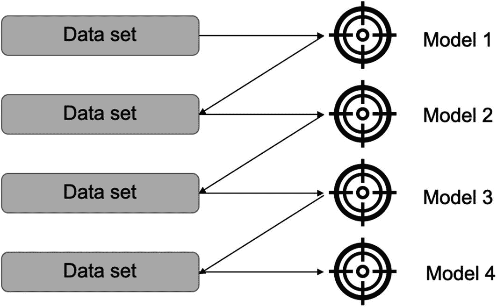

图 4-1

提升算法迭代地工作，在给错误分配更高权重的同时改进先前版本

提升算法有多种类型：

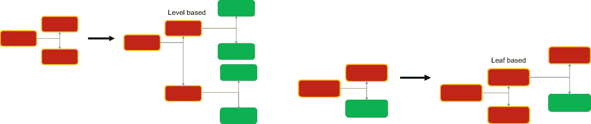

图 4-2

其他提升算法采用基于层级的方法，而基于叶子的方法使得轻量梯度提升非常适合大型数据集

1.  **梯度提升**：梯度提升可用于分类和回归问题。例如，回归树可用作基学习器，后续的每棵树都是对前一棵树的改进。整体学习器会逐步改进那些残差最初较高的观测值。

梯度提升的特性如下：
    1.  通过取完整数据集的一个子集来创建基学习器。

2.  识别困难观测值，或者通过识别前一个模型中残差的值来进行*偏移*。

3.  通过计算出的梯度来识别误分类。这是该算法的核心思想。它创建新的基学习器，这些学习器与损失函数的负梯度具有最大相关性，而负梯度又与完整的集成解决方案相关联。

4.  然后进一步剖析误差成分，以添加更多关于残差的信息。

2.  **AdaBoosting**：AdaBoosting 或自适应提升被视为梯度提升的一种特殊情况，其中通过迭代创建模型来改进前一个模型。最初，使用数据子集创建一个基础模型，并用它对完整数据集进行预测。我们通过计算误差来衡量性能。然后在创建下一个模型时，被错误预测的数据点被赋予更高的权重。权重与误差成正比；也就是说，误差越大，分配的权重越高。因此，创建的下一个模型是对前一个模型的改进，这个过程持续进行。一旦无法进一步降低误差，过程就会停止，我们得出结论：已经达到了最终模型，即最佳模型。

AdaBoost 具有以下特性：
    1.  在 AdaBoost 中，通过给上一步中误分类的观测值分配更高的权重来进行偏移。

2.  误分类通过高权重的观测值来识别。


3.  AdaBoost 中的指数损失函数会为在前一个模型中拟合不佳的样本分配更大的权重值。

3.  **极限梯度提升**：XGB 的极限梯度提升是一种先进的提升算法。它最近变得非常流行，并赢得了许多数据科学和机器学习竞赛。它极其精确，并且实现起来速度相当快。

XGB 的特性如下：
    1.  XGB 是一个相当快速的算法，因为它支持并行处理，因此比标准梯度提升更快。

2.  它通过实施正则化技术来处理过拟合。

3.  它能很好地处理含有缺失值的混乱数据集，因为它内置了处理数据集中缺失值的机制。这是其最大的优势之一，因为我们无需处理数据中存在的缺失值。

4.  它是一个相当灵活的算法，允许我们拥有自定义的优化目标和评估标准。

5.  每次迭代中的交叉验证会产生最佳的提升迭代次数，这使其成为比同类算法更好的选择。

4.  **CatBoost**：如果我们要处理分类变量，CatBoost 是一个极好的解决方案。在典型的机器学习模型中，我们使用独热编码来处理分类变量。例如，如果我们有一个数据集包含分类变量“城市”，我们将其转换为数值变量，如表 4-1 所示。

表 4-1

将分类变量转换为数值变量的独热编码

| 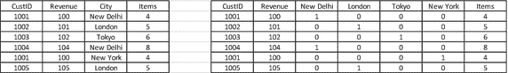 |

但是，如果变量“城市”有 100 个唯一值，独热编码将导致在数据集中增加 100 个额外的维度。此外，生成的数据集将相当*稀疏*。稀疏性意味着对于某一列，只有少数几行是 1；其余的都是 0。例如，在表 4-1 中，东京只有一个值为 1。这意味着矩阵包含的 0 比 1 多。因此，跨列的性能操作将花费很长时间。此外，如果结果维度数量太大，那么我们将需要巨大的内存。

CatBoost 没有这个问题。CatBoost 在内部处理分类变量，我们无需花时间处理它们。

5.  **轻量梯度提升**：顾名思义，轻量梯度提升在计算上比同类算法更经济。如果数据集非常大，它是提升算法的首选。它实现了基于树的算法，并使用基于叶子的方法，而其他算法则使用基于层级的方法，如图 4-2 所示。

我们现在已经讨论了不同类型的提升算法。根据手头的业务问题和可用的数据集，我们会优先选择一种方法而非另一种。最近，极限梯度提升或 XGB 获得了很大的 popularity。它是一种相当稳健的技术，能提供更好的结果，并在内部处理过拟合。

我们现在将使用梯度提升算法在 Python 中实现一个案例。

### 使用梯度提升算法

在本案例研究中，我们将实现多种算法。到目前为止，我们已经学习了多种算法，其中一些是基于集成的先进算法。现在是时候比较它们各自的准确率了。

我们将执行探索性数据分析（EDA），创建训练-测试分割，然后实现决策树、随机森林、装袋、AdaBoost 和梯度提升算法。最后，我们将比较所有算法各自的性能。

数据集和代码可以从本章开头分享的 Github 链接下载。数据用于根据固定酸度、挥发性酸度等参数预测葡萄酒质量。

步骤 1：首先导入所有库：

```
%matplotlib inline
import numpy as np
import pandas as pd
from sklearn.tree import DecisionTreeClassifier
import numpy as np
import pandas as pd
import seaborn as sns
from matplotlib import pyplot as plt
from sklearn.model_selection import train_test_split
from sklearn.tree import DecisionTreeClassifier
from sklearn import metrics
from sklearn.metrics import accuracy_score,f1_score,recall_score,precision_score, confusion_matrix
%matplotlib inline
from sklearn.feature_extraction.text import CountVectorizer
```

步骤 2：导入数据集：

```
wine_quality_data_frame = pd.read_csv('winequality-red-1.csv',sep=';')
```

步骤 3：打印数据中的前五个样本：

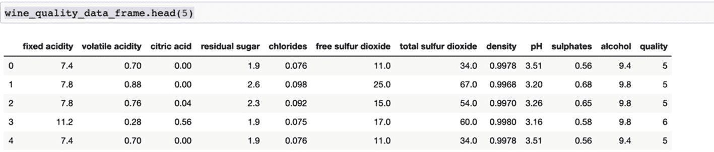

```
wine_quality_data_frame.head(5)
```

步骤 4：获取关于数据类型的信息：

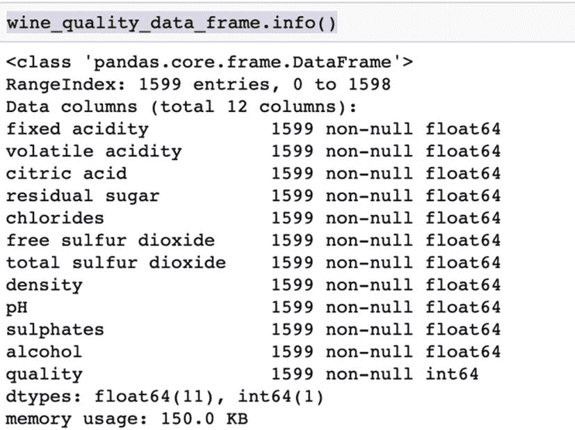

```
wine_quality_data_frame.info()
```

步骤 5：获取数据集中所有数值变量的详细信息：

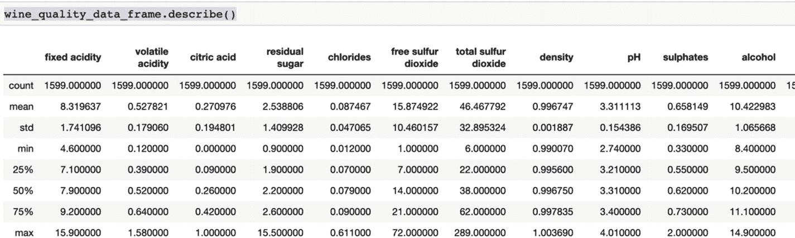

```
wine_quality_data_frame.describe()
```

步骤 6：我们现在将对数据集进行一些分析和可视化：

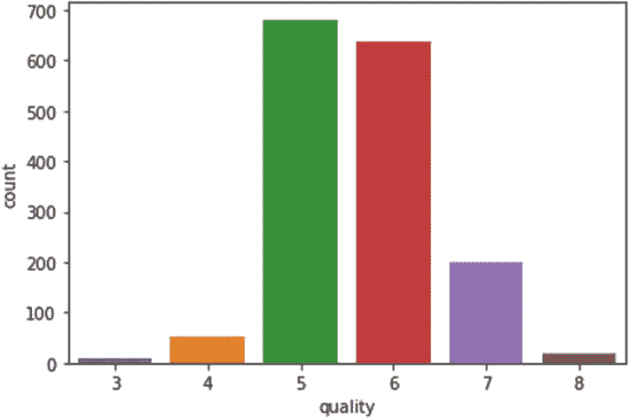

```
import matplotlib.pyplot as plt
import seaborn as sns
sns.countplot(wine_quality_data_frame['quality'])
```

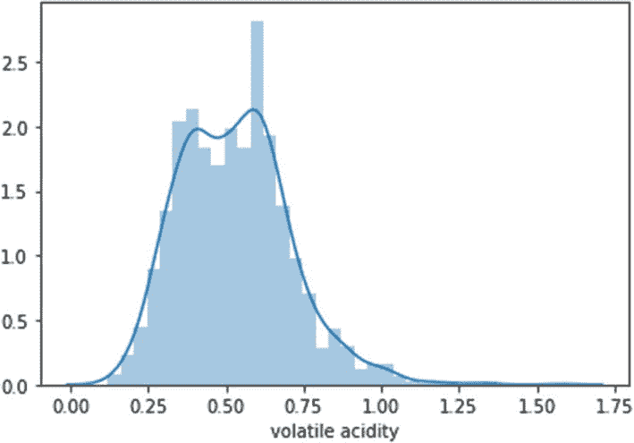

```
sns.distplot(wine_quality_data_frame['volatile acidity'])
```

将创建相关性图以观察变量之间的关系：

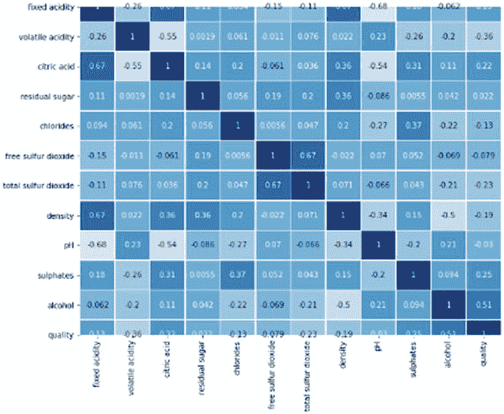

```
plt.figure(figsize=(10,10))
sns.heatmap(wine_quality_data_frame.corr(),
annot=True,
linewidths=.5,
center=0,
cbar=False,
cmap="Blues")
plt.show()
```

步骤 7：我们将分析目标变量的频率。

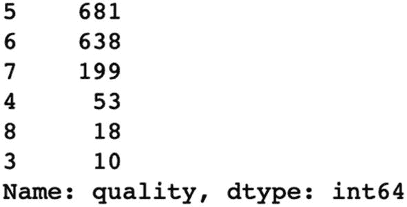

```
wine_quality_data_frame['quality'].value_counts()
```

步骤 8：我们在这里合并几个级别，以便拥有一个平衡的目标变量。正如我们观察到的，级别 3、4 和 8 的值较低，因此与其他级别合并。

```
wine_quality_data_frame['quality'] = wine_quality_data_frame['quality'].replace(8,7)
wine_quality_data_frame['quality'] = wine_quality_data_frame['quality'].replace(3,5)
wine_quality_data_frame['quality'] = wine_quality_data_frame['quality'].replace(4,5)
wine_quality_data_frame['quality'].value_counts()
```

步骤 9：现在分割为训练数据和测试数据：

```
from sklearn.model_selection import train_test_split
X_train, X_test, y_train, y_test =train_test_split(wine_quality_data_frame.drop('quality',axis=1), wine_quality_data_frame['quality'], test_size=.20, random_state=5)
X_train.shape,X_test.shape
```

步骤 10：接下来实现决策树：


```
dt_entropy=DecisionTreeClassifier(criterion='entropy')
dt_entropy.fit(X_train, y_train)
dt_entropy.score(X_train, y_train)
dt_entropy.score(X_test, y_test)
```

训练准确率为 100%，测试准确率为 69%，这意味着模型存在过拟合。因此，我们将树的最大深度修剪为 4。

```
clf_pruned = DecisionTreeClassifier(criterion = "entropy", random_state = 50, max_depth=4, min_samples_leaf=6)
clf_pruned.fit(X_train, y_train)
inde_variables = wine_quality_data_frame.drop('quality', axis=1)
feature_column = inde_variables.columns
prediction_pruned = clf_pruned.predict(X_test)
prediction_pruned_train = clf_pruned.predict(X_train)
print(accuracy_score(y_test,prediction_pruned))
print(accuracy_score(y_train,prediction_pruned_train))
acc_DT = accuracy_score(y_test, prediction_pruned)
```

步骤 11：过拟合问题已得到处理，但准确率并未提升。

现在我们获取数据集中的重要特征。

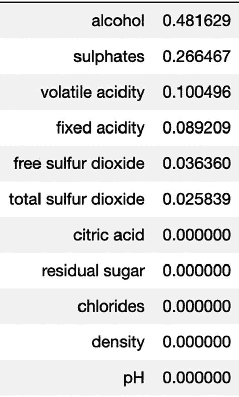

```
feature_importance = clf_pruned.tree_.compute_feature_importances(normalize=False)
feat_imp_dict = dict(zip(feature_column, clf_pruned.feature_importances_))
feat_imp = pd.DataFrame.from_dict(feat_imp_dict, orient="index")
feat_imp.sort_values(by=0, ascending=False)
```

步骤 12：我们可以推断出酒精、硫酸盐、挥发性酸度和总二氧化硫是重要特征。接下来，我们将结果保存到一个数据框中。

```
resultsDf = pd.DataFrame({'Method':['Decision Tree'], 'accuracy': acc_DT})
resultsDf = resultsDf[['Method', 'accuracy']]
resultsDf
```

步骤 13：接下来我们将应用随机森林算法。

```
from sklearn.ensemble import RandomForestClassifier
rf_model = RandomForestClassifier(n_estimators = 50)
rf_model = rf_model.fit(X_train, y_train)
prediction_RF = rf_model.predict(X_test)
accuracy_RF = accuracy_score(y_test, prediction_RF)
tempResultsDf = pd.DataFrame({'Method':['Random Forest'], 'accuracy': [accuracy_RF]})
resultsDf = pd.concat([resultsDf, tempResultsDf])
resultsDf = resultsDf[['Method', 'accuracy']]
resultsDf
```

步骤 14：我们可以比较决策树和随机森林的准确率。

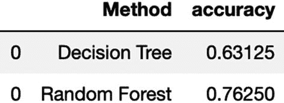

步骤 15：现在我们将实现 AdaBoost 算法。

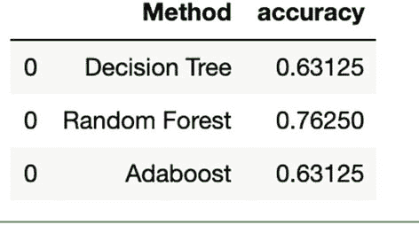

```
from sklearn.ensemble import AdaBoostClassifier
adaboost_classifier = AdaBoostClassifier( n_estimators= 150, learning_rate=0.05, random_state=5)
adaboost_classifier = adaboost_classifier.fit(X_train, y_train)
prediction_adaboost =adaboost_classifier.predict(X_test)
accuracy_AB = accuracy_score(y_test, prediction_adaboost)
tempResultsDf = pd.DataFrame({'Method':['Adaboost'], 'accuracy': [accuracy_AB]})
resultsDf = pd.concat([resultsDf, tempResultsDf])
resultsDf = resultsDf[['Method', 'accuracy']]
resultsDf
```

步骤 16：我们将实现 Bagging 算法并比较准确率。

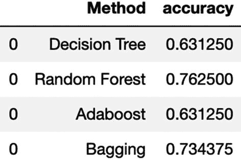

```
from sklearn.ensemble import BaggingClassifier
bagging_classifier = BaggingClassifier(n_estimators=55, max_samples= .5, bootstrap=True, oob_score=True, random_state=5)
bagging_classifier = bagging_classifier.fit(X_train, y_train)
prediction_bagging =bagging_classifier.predict(X_test)
accuracy_bagging = accuracy_score(y_test, prediction_bagging)
tempResultsDf = pd.DataFrame({'Method':['Bagging'], 'accuracy': [accuracy_bagging]})
resultsDf = pd.concat([resultsDf, tempResultsDf])
resultsDf = resultsDf[['Method', 'accuracy']]
resultsDf
```

步骤 17：现在我们将实现梯度提升算法。

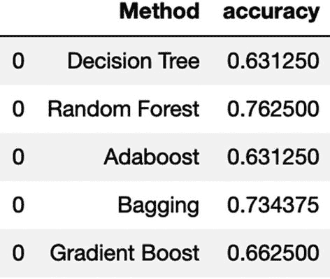

```
from sklearn.ensemble import GradientBoostingClassifier
gradientBoosting_classifier = GradientBoostingClassifier(n_estimators = 60, learning_rate = 0.05, random_state=5)
gradientBoosting_classifier = gradientBoosting_classifier.fit(X_train, y_train)
prediction_gradientBoosting =gradientBoosting_classifier.predict(X_test)
accuracy_gradientBoosting = accuracy_score(y_test, prediction_gradientBoosting)
tempResultsDf = pd.DataFrame({'Method':['Gradient Boost'], 'accuracy': [accuracy_gradientBoosting]})
resultsDf = pd.concat([resultsDf, tempResultsDf])
resultsDf = resultsDf[['Method', 'accuracy']]
resultsDf
```

我们可以推断，与其他算法相比，随机森林为我们提供了最佳的准确率。此解决方案可扩展到任何监督分类问题。

梯度提升是最流行的技术之一。其强大之处在于它专注于错误和误分类。在实现基于机器学习的排序的信息检索系统中，它非常有用。通过其变体（如极限梯度提升），它可以应对过拟合和缺失变量问题；而通过 CatBoost，它克服了分类变量带来的挑战。与 Bagging 技术一起，提升技术正在扩展机器学习算法的预测能力。

注意

建议在解决实际业务问题时测试随机森林和梯度提升，因为它们提供了更高的灵活性和性能。

集成方法相比其他方法更加稳健、准确且成熟。它们通过结合弱预测器来增强能力，并提升整体性能。这就是它们在许多机器学习竞赛中优于其他算法的原因。在商业世界中，随机森林和梯度提升也经常被用于解决业务问题。

现在我们将学习另一种强大的算法，称为*支持向量机*（*SVM*），它通常用于维度较高但规模较小的复杂数据集。这在医学研究等行业是一个常见挑战，这些行业的数据集通常较小，但维度非常高。SVM 很好地满足了这一需求，将在下一节中讨论。


## 支持向量机

在前面的章节中，我们已经学习了经典的机器学习算法，如回归、决策树等。它们完全能够胜任解决各类回归或分类问题，并处理真实数据集。但对于“真正”复杂的数据集，我们需要更强大的能力。支持向量机（SVM）为我们提供了处理这些多维复杂数据源的能力。数据源的复杂性源于我们拥有的多个维度以及数据中存在的不同类型的变量。在这里，SVM 有助于创建稳健的解决方案。

SVM 是处理复杂数据集的绝佳方案，尤其是在训练样本匮乏的情况下。除了用于结构化数据集和较简单的业务问题外，它还被用于文本分析中的文本分类、图像分类、生物信息学领域以及手写识别。

SVM 可用于回归和分类问题。SVM 的基础是支持向量，它本质上就是观测值在向量空间中的表示。

其可视化方式如图 4-3 所示。假设我们有一个包含“n”个属性的数据集。这 n 个特征因此可以表示在一个 n 维空间中，其中每个属性的值对应其坐标。在图 4-3 中，我们仅展示了二维空间。对于 n 维空间，可以进行类似的表示。

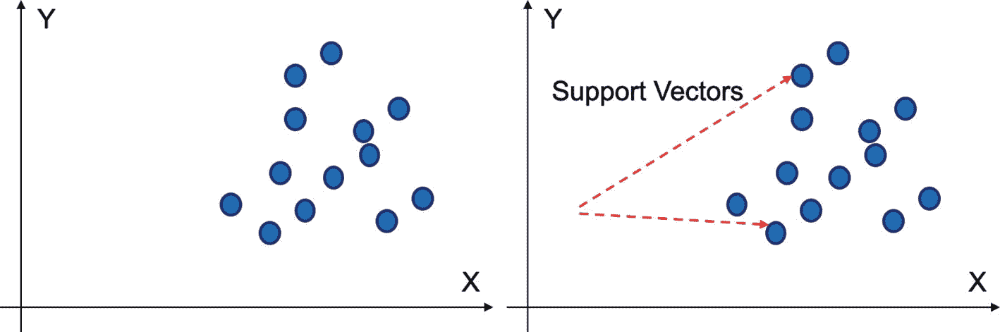

图 4-3

支持向量是数据点在向量空间图中的表示

SVM 基于这些表示或支持向量来建模一个监督学习算法。在图 4-4 中，我们有两个需要区分的类别。SVM 通过创建最适合该决策的超平面来解决这个问题。

如图 4-4 所示，最近的数据点与超平面之间的距离称为*间隔*。在该问题中，SVM 寻找一个具有最大间隔的线性平面，以便清晰地区分各个类别。与线性分类器旨在最小化误差平方和不同，SVM 的目标是找到一个能够区分两个或多个类别，并以最大间隔将它们分开的线性平面。SVM 的实现也可以称为*最大间隔超平面*。

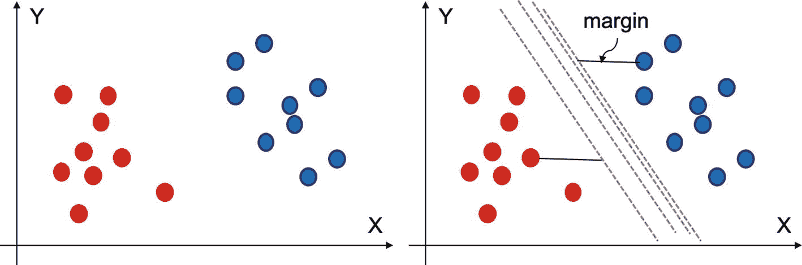

图 4-4

超平面可用于区分两个类别。间隔用于选择最佳超平面

我们已经了解了 SVM 的目的。为了更好理解，我们必须将其在向量空间图中可视化。下一节，我们将在二维空间中可视化 SVM。

### 二维空间中的 SVM

在二维空间中，分隔超平面是一条直线。分类是通过感知机实现的。

感知机是一种用于进行二元分类的算法。简单来说，它在包含两个类别的数据上进行训练，然后输出一条能够清晰分隔这两个类别的直线。在图 4-5 中，我们可以尝试找到一个能够区分这两个类别的超平面或直线。

现在，可能存在多个超平面都能实现正确分类的目的。如图 4-5 所示，第一条直线清晰地分隔了两个类别，但它非常接近这两个类别（本例中为红点和蓝点）。尽管它适用于分类，但如果我们将该模型部署到生产环境中处理新的、未见过的数据集，该模型容易产生较高的*方差*，导致部分观测值被错误分类。第二条直线则不存在此类问题。第二条直线与两个类别同时保持最大距离，因此会被选中。

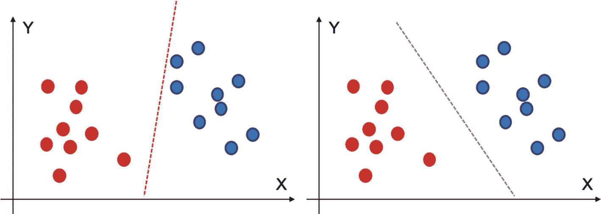

图 4-5

红色的线虽然能够区分两个类别，但存在高方差问题。右侧的黑色分类器优于红色分类器

因此，我们判定第二条直线优于第一条直线。假设该直线的方程为 ax + by = c。那么，分类平面的方程对于红点可以是 ax + by ≥ c，对于蓝点则是 ax + by < c。

但是，a、b 或 c 可以有很多种选择，这引出了下一个问题：如何选择最佳平面。如图 4-6 所示，超平面可能存在多种选择。

在图 4-6 中，对于左上角的图，红色分隔线在区分两个类别方面比黑色实线做得更好。在第二张图中，我们可以看到红色分隔线相比黑色分隔线具有最大间隔，因此它被选中。

第三种情况显示了数据集中存在少量异常值。即便如此，SVM 算法仍然能够创建一个具有最大间隔的分类超平面。即使存在异常值，SVM 也能很好地工作。

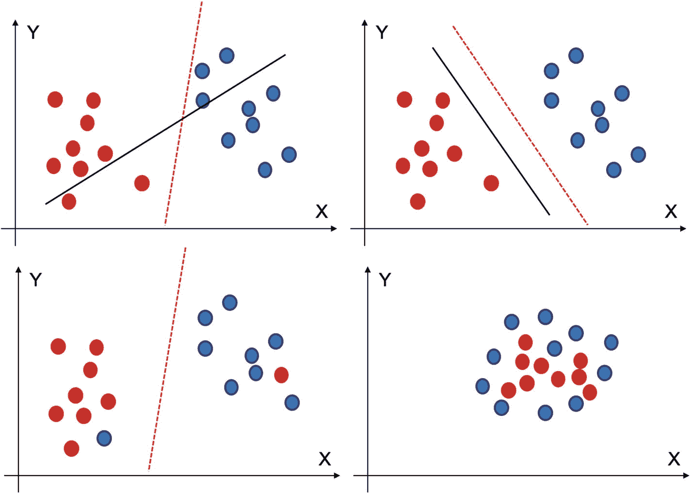

图 4-6

(i) 左上角，红色分类器优于黑色分类器。(ii) 第二张图中，红色更好，因为它具有最大间隔。(iii) 第三张图存在异常值，但 SVM 仍能处理。(iv) 这是一个特殊情况，线性分类器无法区分这两个类别

到目前为止，我们讨论并可视化了二维空间中的实现，但如果要将数学向量空间从二维转换到更高维度，那么我们需要执行此类数学运算。在图 4-6 中，第四张图就是这样一个特殊情况。在所示的情况下，不可能存在线性超平面，在这种情况下，我们将需要一个非线性超平面来为我们进行分类，这可以通过使用*核支持向量机（KSVM）* 来实现，我们接下来将讨论这一点。


### KSVM

如果将二维空间转换为高维空间，解决方案会变得更鲁棒，并且分离数据点的相应概率也会增加。例如，x[1] 和 x[2] 必须转换为更高次的多项式，如 x[1]²、x[2]²、x[3]²、x[4]²、x[5]² 等等。这是通过核函数或 KSVM 实现的。它将数据点带入一个更高阶的数学空间。在这个高维空间中，它们变得线性可分。然后，我们可以通过这些数据点绘制一个平面。如果使用 KSVM 表示前面的例子，相应的表示将如图 4-7 所示。


图 4-7

第四张图展示了实现一个非线性分类器来区分两个类别

KSVM 创建了一个非线性分类器来执行两个类别之间的分类。

以下是 SVM 的一些参数：

1.  **核函数**：当数据在更高维度下表达时可以变得可分时，我们使用核函数。sklearn 中可用的各种核函数包括 rbf、poly、sigmoid、linear、precomputed 等。如果我们使用“linear”核函数，它将使用一个线性超平面，或者在二维数据的情况下使用一条直线。‘rbf’、‘poly’ 用于非线性超平面。

2.  **C**：C 用于表示误分类误差或*代价*参数。如果 C 的值较低，则误分类观测值的惩罚较低，因此准确率会较高。它用于控制训练数据准确分类与决策边界平滑度之间的权衡。

3.  **Gamma**：Gamma 用于定义分类中观测值的影响半径。它主要用于非线性超平面。较高的 gamma 值可以带来更好的准确率，但结果可能会有偏差，反之亦然。

我们必须使用这些参数的不同值进行迭代，并找到最佳解决方案。当 gamma 值较高时，方差会较低，偏差会较高，反之亦然。而当 C 值较大时，方差会较高，偏差会较低，反之亦然。

使用 SVM 既有优点也有一些挑战。

SVM 解决方案的优点：

1.  对于维度数量较大的复杂数据集，它是一种非常有效的解决方案。
2.  当我们拥有更多维度和较少训练数据集时，它是首选方案。
3.  SVM 的分离间隔非常清晰，能提供良好、准确且鲁棒的解决方案。
4.  SVM 易于实现，并且是一种相当节省内存的实现方案。

SVM 的挑战：

1.  对于大样本量，收敛需要时间，因此可能不适用于较大的数据集。
2.  该算法对杂乱数据敏感。如果目标类别没有清晰界定且差异不明显，算法往往表现不佳。
3.  SVM 不直接提供预测的概率。相反，需要单独计算它们。

尽管存在一些挑战，SVM 已反复证明了其价值。当我们需要分析多维度的较小数据集时，它提供了一种鲁棒的解决方案。现在，我们将使用 SVM 在 Python 中解决一个案例研究。

### 使用 SVM 的案例研究

我们正在解决一个癌症检测案例研究。数据集可在本章开头分享的 Github 链接中找到。

步骤 1：首先导入必要的库

```
import pandas as pd
import numpy as np
import seaborn as sns
import matplotlib.pyplot as plt
%matplotlib inline
```

步骤 2：现在导入数据集

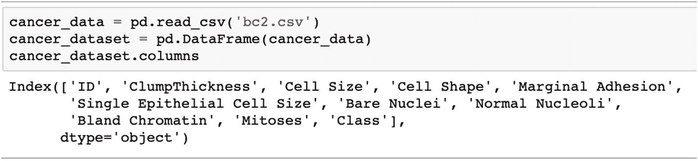

```
cancer_data = pd.read_csv('bc2.csv')
cancer_dataset = pd.DataFrame(cancer_data)
cancer_dataset.columns
```

步骤 3：查看各列

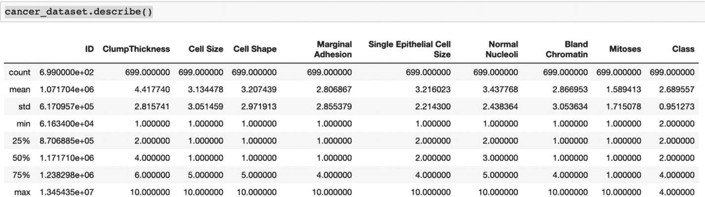

```
cancer_dataset.describe()
```

步骤 4：在下一步中处理缺失值。我们在此用中位数填充它们。

```
cancer_dataset = cancer_dataset.replace('?', np.nan)
cancer_dataset = cancer_dataset.apply(lambda x: x.fillna(x.median()),axis=0)
```

步骤 5：现在我们将 'Bare Nuclei' 列从字符串类型转换为浮点型

```
cancer_dataset['Bare Nuclei'] = cancer_dataset['Bare Nuclei'].astype('float64')
```

步骤 6：检查数据集中是否存在任何 NULL 值

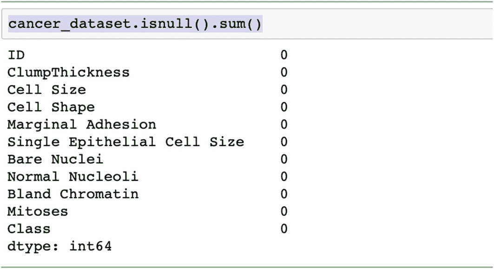

```
cancer_dataset.isnull().sum()
```

步骤 7：现在将数据划分为训练集和测试集。

```
from sklearn.model_selection import train_test_split
# 计算模型的准确率得分
from sklearn.metrics import accuracy_score, confusion_matrix
target_variable = cancer_dataset["Class"]
features = cancer_dataset.drop(["ID","Class"], axis=1)
X_train, X_test, y_train, y_test = train_test_split(features,target_variable, test_size = 0.25, random_state = 5)
```

步骤 8：使用线性核函数训练模型

```
from sklearn.svm import SVC
svc_model = SVC(C= .1, kernel="linear", gamma= 1)
svc_model.fit(X_train, y_train)
svc_prediction = svc_model .predict(X_test)
```

步骤 9：检查准确率

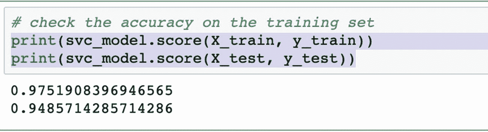

```
print(svc_model.score(X_train, y_train))
print(svc_model.score(X_test, y_test))
```

步骤 10：打印混淆矩阵

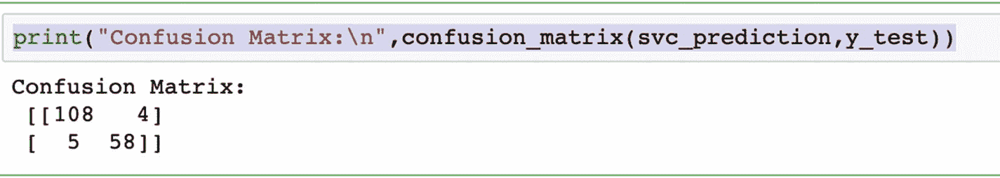

```
print("Confusion Matrix:\n",confusion_matrix(svc_prediction,y_test))
```

步骤 11：在接下来的步骤中，我们将更改核函数并获得不同的准确率

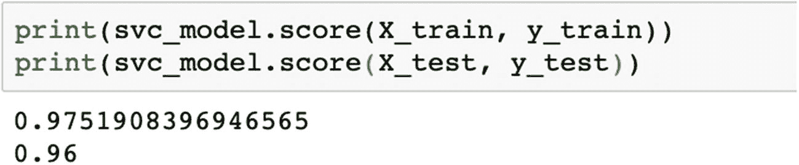

```
svc_model = SVC(kernel='rbf')
svc_model.fit(X_train, y_train)
print(svc_model.score(X_train, y_train))
print(svc_model.score(X_test, y_test))
```

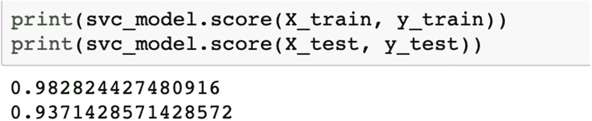

```
svc_model  = SVC(kernel='poly')
svc_model.fit(X_train, y_train)
svc_prediction = svc_model.predict(X_test)
print(svc_model.score(X_train, y_train))
print(svc_model.score(X_test, y_test))
```

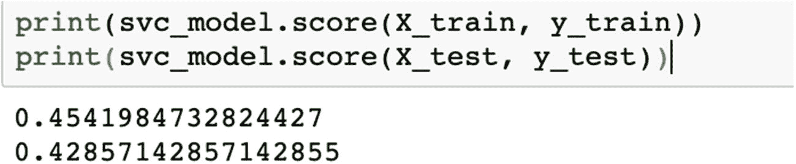

```
svc_model = SVC(kernel='sigmoid')
svc_model.fit(X_train, y_train)
svc_prediction = svc_model.predict(X_test)
print(svc_model.score(X_train, y_train))
print(svc_model.score(X_test, y_test))
```

我们可以比较所有核函数各自的准确率，并选择最佳的一个。理想情况下，准确率不应是唯一的参数；我们还应该使用混淆矩阵比较召回率和精确率。

在前面的例子中，我们可以使用 seaborn 库创建一个可视化。这是一个额外的步骤，如果需要可以执行。

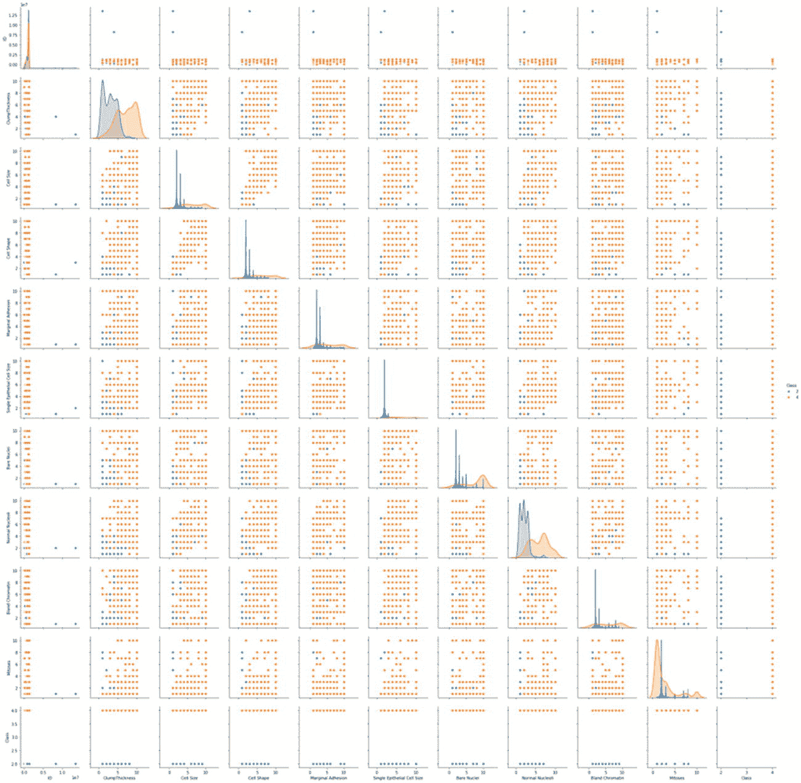

```
sns.pairplot(cancer_dataset, diag_kind = "kde", hue = "Class")
```


在前面的示例中，我们使用 SVM 创建了一个 Python 解决方案。当我们更改核函数时，准确率会发生很大变化。SVM 算法应与其他机器学习模型进行比较，然后选择最佳算法。

注意

理想情况下，我们会用三到四种算法测试任何问题，并比较精确率、召回率和准确率，然后决定哪种算法最适合我们。这些步骤将在第 5 章中再次讨论。

至此，我们已经详细学习了 SVM。作为一种易于实现的解决方案，SVM 是强烈推荐的高级监督学习算法之一。

到目前为止，我们已经学习并创建了针对结构化数据的解决方案。在前几章中，我们从回归、决策树等内容开始，研究了相关概念并用 Python 创建了解决方案。在本章中，我们继续学习了提升算法和 SVM。现在，我们将开始一个更高级的主题——下一节将介绍针对非结构化数据（即文本和图像）的监督学习算法。我们将研究其核心要点、预处理步骤、面临的挑战以及用例。并且一如既往，我们将创建 Python 解决方案来巩固所学知识。

## 非结构化数据的监督算法

如今，我们可以使用摄像头、手机、处理器、录音机、数据管理平台、基于云的基础设施等。因此，我们记录、管理、存储、转换和分析数据的能力也得到了极大的提升。我们不仅能够捕获复杂的数据集，还能对其进行存储和处理。随着基于神经网络的深度学习的出现，数据处理能力得到了显著提升。深度学习本身就是一场革命。神经网络正在推动跨领域和跨业务领域开发出无限的能力。凭借卓越的处理能力以及多核 GPU 和 TPU 等更强大的机器，复杂的深度神经网络能够更快地处理更多信息，这对于结构化和非结构化数据集都是如此。在本节中，我们将处理非结构化数据集，并研究针对非结构化数据集的监督学习算法。

回顾第 1 章，我们讨论了如图 4-8 所示的结构化和非结构化数据集。文本、图像、音频、视频等属于非结构化数据集。

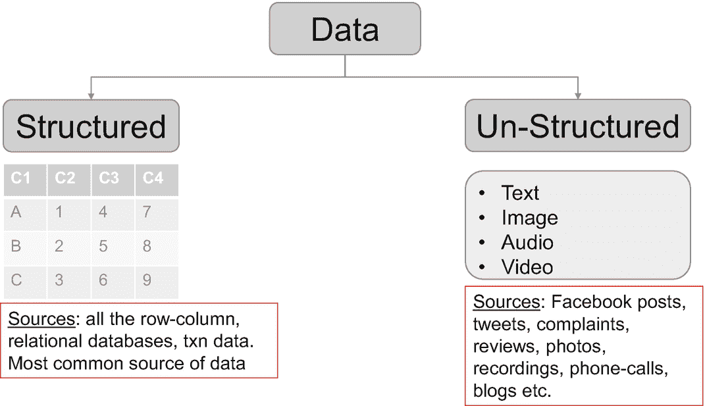

图 4-8

数据可分为结构化数据集和非结构化数据集

我们将开始研究文本数据。我们将探讨清洗文本数据、对其进行预处理、使用 Python 创建监督学习解决方案的所有概念，以及处理文本数据的最佳实践。让我们现在开始吧！

## 文本数据

语言是赠予人类的礼物。它是我们表达自我的最常见媒介。语言存在于我们大多数互动中，例如说话、发消息、写作、倾听。这种文本数据无处不在。我们每天以新闻、Facebook 评论和帖子、客户评价和投诉、推文、博客、文章、文学作品等形式生成文本数据。生成的数据集代表了广泛的情感和表达，这些通常在调查和评分中无法捕捉到。我们确实会以客户给出的在线产品评价的形式看到这一点。给出的评分可能是 5 分（满分 5 分），但实际的评价文本可能会给出不同的印象。因此，对于全球企业来说，关注文本数据变得更为关键。

文本数据更具表现力和直接性。必须分析这些数据，因为它掌握着大量我们可以生成的关于客户、流程、产品和服务、文化、世界以及思想的理解。此外，随着 Alexa、Google Assistant、Apple Siri 和 Cortana 的出现，语音命令正充当着人与机器之间的接口，并为我们生成更多的数据集。庞大且富有表现力，对吧！

与复杂性类似，文本数据是信息和行动的丰富来源。文本数据可用于多种解决方案，我们接下来将讨论这些解决方案。


### 文本数据的使用场景

文本数据非常有用。它用文字表达了我们的真实感受。它是衡量那些通常在调查和问卷中无法捕捉到的思想的强大来源。它是直接来源的数据，因此偏差较小，尽管处理起来可能是一个相当嘈杂的数据集。

文本数据相当丰富，可用于多种使用场景，例如：

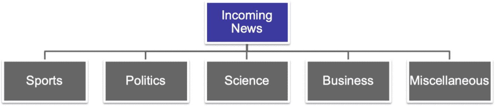

图 4-9

传入的新闻可以有多种类别，如体育、政治、科学、商业等

1.  **新闻分类或文档分类**：我们可能有传入的新闻或文档。我们希望将一条新闻归类为体育、政治、科学、商业或任何其他类别。传入的新闻将根据新闻内容（即实际文本）进行分类。关于商业的新闻将不同于关于体育的新闻文章，如图 4-9 所示。类似地，我们可能希望根据研究领域将一些医学文档归类到各自的类别中。为此，可以使用监督学习分类算法来解决这些问题。

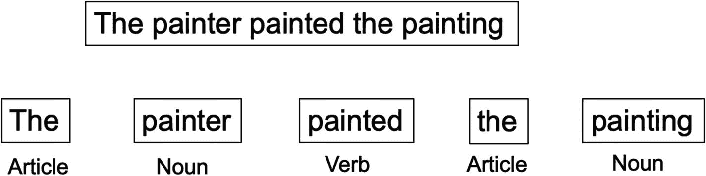

图 4-10

对单词进行词性标注，归入各自类别

1.  **情感分析**：情感分析是衡量文本数据中的正面或负面倾向。这里有两个这样的用例：
    1.  我们收到客户关于产品和服务的评论。这些评论需要进行分析。考虑一个案例。一家电力公司收到客户的投诉、关于供电的评论以及对整体体验的反馈。这些信息流可能涉及注册体验、注册便捷性、支付流程、供电评价、电力评价等方面。我们希望确定评论的总体情感——是正面、负面还是中性。基于这些评论，可以对产品特性或服务水平进行改进。

2.  我们还可能希望将评论分配给特定部门。例如，在上述案例中，传入的评论需要与相关部门共享。使用自然语言处理（NLP），可以完成此任务，将评论共享给财务部门或运营团队，相应的团队可以跟进评论并采取下一步行动。

2.  **语言翻译**：使用 NLP 和深度学习，我们能够进行语言间的翻译（例如，英语和法语之间）。深度神经网络需要学习两种语言的词汇和语法以及多个其他训练数据点。

3.  **垃圾邮件过滤**：可以使用 NLP 和监督式机器学习来构建电子邮件垃圾邮件过滤器。我们可以训练一个算法，该算法可以分析传入的邮件参数，并预测该邮件是否属于垃圾邮件文件夹。更进一步，基于各种参数，如发件人电子邮件 ID、主题行、邮件正文、附件、发送时间等，我们甚至可以判断它是促销邮件、垃圾邮件还是重要邮件。监督学习算法帮助我们做出该决策并自动化整个流程。

4.  **文本摘要**：可以使用 NLP 和深度学习对整个书籍或文章进行摘要。在这种情况下，我们也将使用深度学习和 NLP 来生成整个文档或文章的摘要。这有助于我们创建文本的删节版本。

5.  **词性标注**：词性标注指的是识别单词是名词、代词、形容词、副词、连词等。它是根据单词在句子和更大语境中的用法、定义和上下文，在文本语料库中标记对应于特定词性的单词的过程，如图 4-10 所示。

文本数据可以使用监督学习和无监督学习问题进行分析。本书重点关注监督学习。我们使用 NLP 来解决问题。而深度学习进一步提升了我们的能力。这些工具使我们能够处理如此复杂的数据集。

但是文本数据难以分析。它仍然需要以数字和整数的形式表示；只有这样，才能对其进行分析。我们的计算机和处理器理解数字，算法也只期望数字。我们将在下一节讨论处理文本数据时面临的最常见挑战。

### 文本数据的挑战

文本可能是最难分析和处理的数据。表达同一个问题或想法的排列组合方式有很多。例如，“你多大了”和“你年龄几何”意思相同。我们必须解决这些挑战，并提出一个健壮、完整且具有代表性，同时又不丢失原始上下文的数据集。

我们面临的最常见挑战如下：

1.  语言是无界的。它每天都在变化，每时每刻都有新词被添加到词典中。

2.  语言种类繁多：印地语、英语、法语、西班牙语、德语、意大利语等等。每种语言都遵循自己独特的规则和语法，其用法和模式各不相同。有些从左到右书写；有些可能从右到左，甚至可能是垂直书写！一种语言用十二个单词表达的想法，在另一种语言中可能只用五个单词就能表达。

3.  一个词在不同的语境中可能会改变其含义。例如，“我想读这本书”和“请为我预订酒店。”一个词可以是形容词，也可以是名词，具体取决于上下文。

4.  一种语言中同一个词可能有很多同义词；例如，“好”在不同的场景下可以被“正面”、“精彩”、“极好”和“卓越”替换。类似地，像“学习”、“正在学习”和“学习活动”这样的词都与同一个词根“学习”相关。

5.  单词甚至可能随着用法完全改变其含义。例如，“苹果”是一种水果，而“苹果”是一家生产 Macintosh 的公司。“汤姆”可以是一个名字，但当用作“汤姆软件咨询”时，其用法就完全改变了。

6.  对人类来说非常容易的任务，对机器来说可能非常困难。我们有记忆，而机器往往会遗忘。例如，“约翰来自伦敦，他搬到了澳大利亚，并在那里与艾伦一起工作。他想念远在家乡的家人。”人类可以轻松回忆并理解第二句中的“他”指的是约翰，而不是艾伦。

这些并非唯一的挑战，前面的列表也并不详尽。管理这个庞大的数据集，存储、清理和刷新它，本身就是一项艰巨的任务。但是，通过使用复杂的流程和解决方案，我们能够解决其中的大部分问题，即使不是全部。我们将在下一节关于预处理文本数据和从文本数据中提取特征的部分讨论其中一些技术。

与任何其他机器学习项目一样，文本分析遵循机器学习的原理，尽管流程略有不同。我们现在将在下一节讨论文本分析流程。


### 文本分析建模流程

文本分析之所以复杂，是因为我们处理的数据本身具有复杂性，并且需要进行数据预处理。从宏观层面看，各个流程环节大致相同，但许多子流程是为文本数据专门定制的。这些子流程也取决于我们想要解决的业务问题。典型的文本分析流程如图 4-11 所示。

文本分析流程与其他任何项目类似，都始于对*业务问题*的定义。业务问题可以是我们在上一节讨论过的用例，例如情感分析或文本摘要。

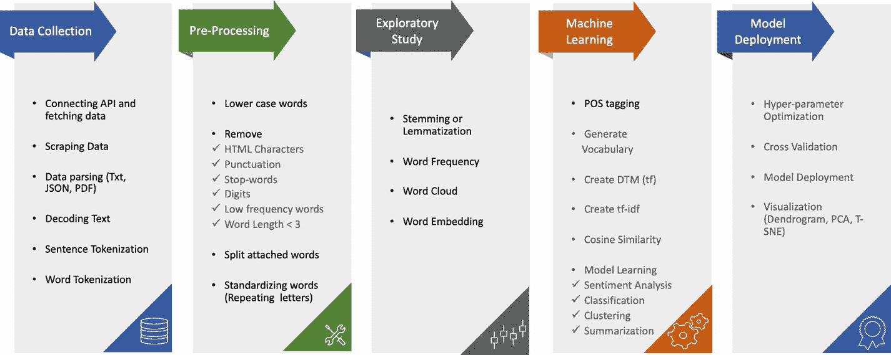

图 4-11

文本分析项目中从数据收集到部署的端到端流程

让我们考虑上一节讨论过的同一个业务问题：为一家电力公司进行情感分析。业务问题可能是：我们通过呼叫中心、电子邮件、电话、短信等多种渠道收到客户关于我们产品和服务的投诉与评价。同时，许多客户在 Facebook 或其他社交媒体平台上发帖。这为我们生成了大量的文本数据。我们希望分析这些文本数据，并生成关于以下方面的发现和洞察：

1.  客户对我们产品和服务的满意度。
2.  主要的痛点和不满之处，是什么推动了客户参与，哪些服务复杂且耗时，哪些服务最受欢迎。
3.  最受欢迎和最不受欢迎的产品与服务，以及任何受欢迎程度的模式。
4.  如何通过仪表盘最好地呈现这些发现。该仪表盘将定期刷新，例如每月或每季度刷新一次。

此业务用例将带来以下业务收益：

1.  应继续提供那些满意度最高、最受欢迎的产品和服务。
2.  那些获得负面评价的产品和服务需要改进，相关挑战必须得到缓解。
3.  可以通知相应的团队，如财务、运营、投诉、客户关系管理等，他们可以各自努力以改善客户体验。
4.  喜欢或不喜欢服务的具体原因将有助于相关团队朝着正确的方向努力。
5.  总体而言，这将为衡量客户群的净推荐值（NPS）提供一个基准。企业可以努力提升整体客户体验。

一个简洁、精确、可衡量且可实现的业务问题是成功的关键。一旦业务问题确定下来，我们将着手获取数据集，这将在下一节讨论。

### 文本数据提取与管理

如上一节所述，客户文本数据可以通过多种来源生成。文本分析中的整个数据集被称为*语料库*。正式地说，语料库代表大量文本数据的集合（通常是有标签的，但也可能是无标签的），用于统计分析和假设检验。

在图 4-12 中，我们描绘了从多个来源（如呼叫中心通话、投诉、评价、博客、推文等）接收文本数据的过程。这些数据点首先被移到一个临时存储区。

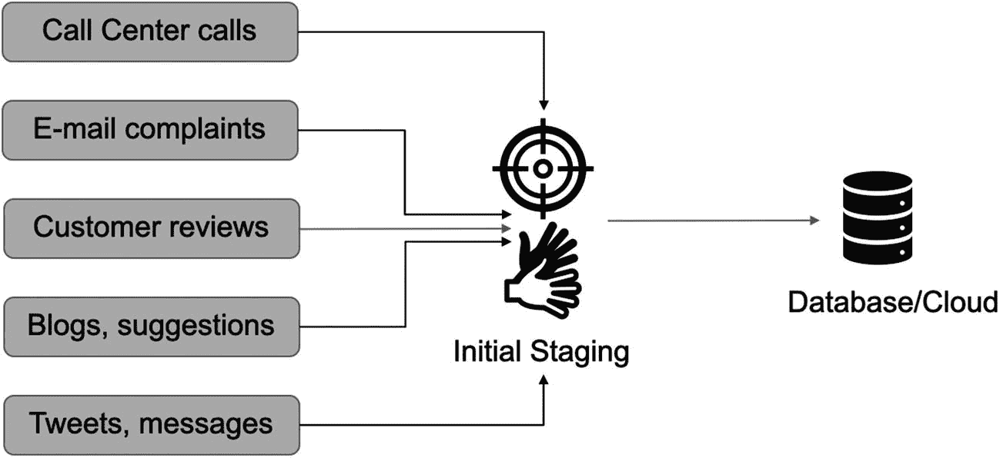

图 4-12

文本数据的数据管理流程，从数据收集到最终存储

需要注意的是，这些不同的数据源可能包含不同类型的数据点，例如 .csv、.xls、.txt、日志、文件或数据库、json 或 .pdf 等。我们甚至可能通过 API 获取数据。在加载到临时存储区期间，所有这些数据点都必须合并和清理。这将涉及创建数据库、表、视图等。在前面分享的案例研究中，数据库表的结构可能类似于表 4-2 所示。

表 4-2

包含客户详细信息（如 ID、日期、产品、城市和实际评论文本）的客户评价

| 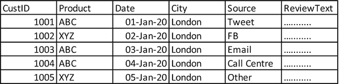 |

这里，我们有唯一的客户 ID、购买的产品、评价日期、城市、来源以及客户的实际评论文本。该表可能包含比我们展示的更多的数据点。并且可能还有其他表包含客户详细信息，例如投诉是否已解决、解决时间等，这些可以作为附加信息用于分析。

所有这些数据点都需要维护和刷新。刷新周期可根据业务需求确定：可以是每月、每季度或每年刷新一次。

还有一个非常重要的数据来源，它极具洞察力，可用于制定更广泛的战略。有许多在线渠道和平台，客户可以在上面评价产品/服务。像亚马逊这样的在线市场也有客户评价的详细信息。这些平台也包含竞争对手品牌的评价。例如，耐克可能对彪马和锐步的客户评价感兴趣。这些在线评价需要被抓取和维护。同样，这些评价可能格式不同，需要进行清理。

在这个数据维护阶段，我们会清理大量文本数据，例如数据中存在的像 *&^# 这样的垃圾字符。这些字符可能是由于加载数据时的格式错误产生的，或者数据本身就可能包含垃圾字符。文本数据会被尽可能彻底地清理，进一步的清理将在下一步的数据预处理中进行。

文本数据是真正难以处理的数据。它存在许多复杂性，而且数据通常很杂乱。我们在上一节讨论了一些挑战。我们将在下一节再次审视其中一些挑战，并研究应对它们的解决方案。我们将从文本数据中提取特征开始，将它们表示在向量空间图中，并使用这些特征创建机器学习模型。

### 文本数据预处理

文本数据与其他任何数据源一样，可能杂乱且充满噪声。我们在数据发现阶段清理其中一部分，在预处理阶段清理大部分。同时，我们必须从数据集中提取特征。这个清理过程是标准化的，可以应用于大多数文本数据集。

我们通过多个流程来完成这些步骤。首先，我们将从清理原始文本开始。


#### 数据清洗

数据质量的重要性毋庸置疑。文本数据越干净，分析效果就越好。同时，缩减文本数据的规模会降低数据维度，从而让机器学习阶段的处理和算法训练变得不那么复杂和耗时。

文本数据需要清洗，因为它包含大量垃圾字符、无关词汇、噪声、标点符号、URL 等。清洗文本数据的主要方法如下：

1.  **停用词移除**：停用词是词汇表中最常见的词，其重要性低于关键词。例如，“是”、“一个”、“这”、“那”、“有”、“了”、“它”等。这能降低数据维度，从而减少复杂性。但在移除停用词时需要格外谨慎。例如，如果我们问“下雨了吗？”，那么回答“是的”本身就是一个完整的答案。

注意

在处理机器翻译等依赖上下文信息的问题时，应避免移除停用词。

1.  **基于库的清洗**：这涉及根据预定义的库来清洗数据。我们可以创建一个不希望出现在文本中的词汇库，并迭代地从文本数据中移除这些词。如果我们不想使用停用词方法，而希望采用自定义方法，则首选此方法。

2.  **垃圾字符**：我们可以从文本中移除 URL、话题标签、数字、标点符号、社交媒体提及、特殊字符等。我们必须小心，因为某些词对一个领域不重要，但对另一个领域可能非常有用。

注意

清洗数据时需要格外谨慎。在移除词汇或缩减数据规模时，我们必须始终牢记业务背景。

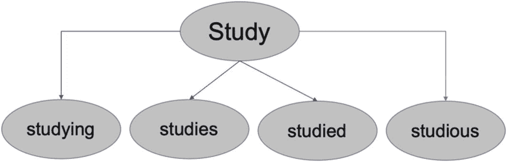

图 4-13

词根是“study”，但它有多种形式，如“studying”和“studies”

1.  **词汇规范化**：根据上下文和用法，同一个词可能以不同形式出现。在词汇规范化过程中，我们清理这类歧义。基本思想是将单词还原为其词根形式。因此，只要核心含义相同，派生自同一词根的单词都可以映射到中心词。

例如，“study”可能表现为 study、studies、studied、studying 等形式，如图 4-13 所示。词根“study”保持不变，但其表现形式不同。

处理这个问题有两种方法，即词干提取和词形还原：

1.  *词干提取*是一种非常基础的基于规则的方法，用于移除单词末尾的“es”、“ing”、“ly”、“ed”等。例如，“studies”会变成“studi”，“studying”会变成“study”。可见，作为一种基于规则的方法，输出的拼写可能并不总是准确的。

2.  与词干提取相反，*词形还原*是一种系统化的方法，它将单词还原为其词典形式。一个单词的*词元*就是它的词典形式或规范形式。例如，“studies”、“studied”和“studying”都有相同的词根“study”。

1.  **标准化**：随着现代通信设备和社交媒体的出现，我们的交流方式发生了变化。随之而来的是，我们的语言也发生了变化。我们有了新的限制和规则，比如一条推文只能有 280 个字符。

因此，词典也必须改变。我们有了新的参考词汇，它们不属于任何标准词典，且不断变化，并且因语言、国家和文化而异。例如，“u”指代“you”，“luv”是“love”等。

我们也必须清洗这类文本。在这种情况下，我们创建一个此类词汇的词典，并用正确的完整形式替换它们。

这些只是清洗文本数据的一部分方法。这些技术应该能解决大部分问题。尽管如此，我们仍然无法获得完全干净的数据。需要商业洞察力来进一步理解数据。

数据清洗完成后，我们必须开始表示数据，以便机器学习算法能够处理——这是我们下一个主题。

### 从文本数据中提取特征

文本数据与其他任何数据源一样，可能杂乱且充满噪声。我们在数据发现阶段和预处理阶段清理了其中一部分。现在数据已经干净，可以准备使用了。下一步是以算法能够理解的格式来表示这些数据。

在最简单的理解中，我们可以对单词执行*独热编码*，并将它们表示在一个矩阵中。可以先将单词转换为小写，然后按字母顺序排序。接着，可以分配一个数字标签。最后，将单词转换为二进制向量。我们将通过一个例子来解释。

例如，文本是“He is going outside.”。我们将执行以下步骤：

1.  将单词转换为小写，得到 – he, is, going, outside。

2.  接下来，按字母顺序排列单词，得到输出 – going, he, is, outside。

3.  现在，我们可以为每个单词赋值：going:0, he:1, is:2, outside:3。

4.  最后，将它们转换为二进制向量：

    [[0\. 1\. 0\. 0.] #he

    [0\. 0\. 1\. 0.] #is

    [1\. 0\. 0\. 0.] #going

    [0\. 0\. 0\. 1.]] #outside

尽管这种方法非常直观且易于理解，但由于语料库和词汇量庞大，实际上并不可行。此外，处理如此多维度的大数据量在计算上会非常昂贵。由此产生的矩阵也会非常稀疏。因此，我们需要寻找其他方式来代表我们的文本数据。

有比独热编码更好的替代方案。这些技术侧重于单词的频率或单词使用的上下文。这种科学的文本表示方法更加准确、稳健且具有解释性。它也能产生更好的结果。

有多种此类技术，如 tf-idf、词袋（BOW）方法等。我们将在接下来的章节中讨论其中几种技术。但首先，我们要探讨一个重要的概念——分词！


#### 分词

文本数据需要进行分析，因此我们可以将单词表示为*标记*。分词是将一段文本或一组文本分解为单个标记的过程。它是自然语言处理的基础构建块。标记通常是单个单词，但这并非必须。我们可以对单词、单词中的子词或字符进行分词。单词级分词如图 4-14 所示。

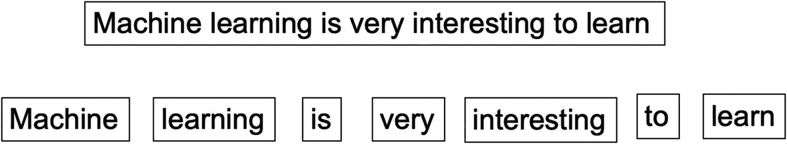

图 4-14

对句子进行分词会为所有单词生成独立的标记

对于子词，同一个句子可以产生像“interest-ing”这样的子词标记。在字符级分词中，它可以表示为 i-n-t-e-r-e-s-t-i-n-g。事实上，在上一节讨论的独热编码方法的第一步中，就是对单词进行了分词。

有多种基于正则表达式的分词方法，用于匹配标记或标记之间的分隔符。*正则表达式*分词使用给定的模式参数来匹配标记或标记之间的分隔符。*空白符*分词将任何空白字符序列视为分隔符。此外，还有*空行*分词，它将一系列空行作为分隔符。而*单词标点*分词则通过匹配字母字符序列以及非字母非空白字符序列来进行分词。

因此，分词使我们能够为每个单词分配唯一的标识符或标记。这些标记在下一阶段的分析中会进一步发挥作用。

现在，我们将探索更多表示文本数据的方法。第一种方法是“词袋模型”。

#### 词袋模型

在词袋模型（BOW）方法中，文本会针对其找到的每个观测值进行分词，然后计算每个标记的相应频率。此过程忽略语法或词序；主要目标是保持简单性。因此，我们将每个文本（句子或文档）表示为其自身单词的*词袋*。

图 4-15 显示，在第一个示例中，每个单词只出现一次，因此频率为 1。在第二个句子中，“is”和“drinking”的频率为 2。这被称为每个标记的词袋。

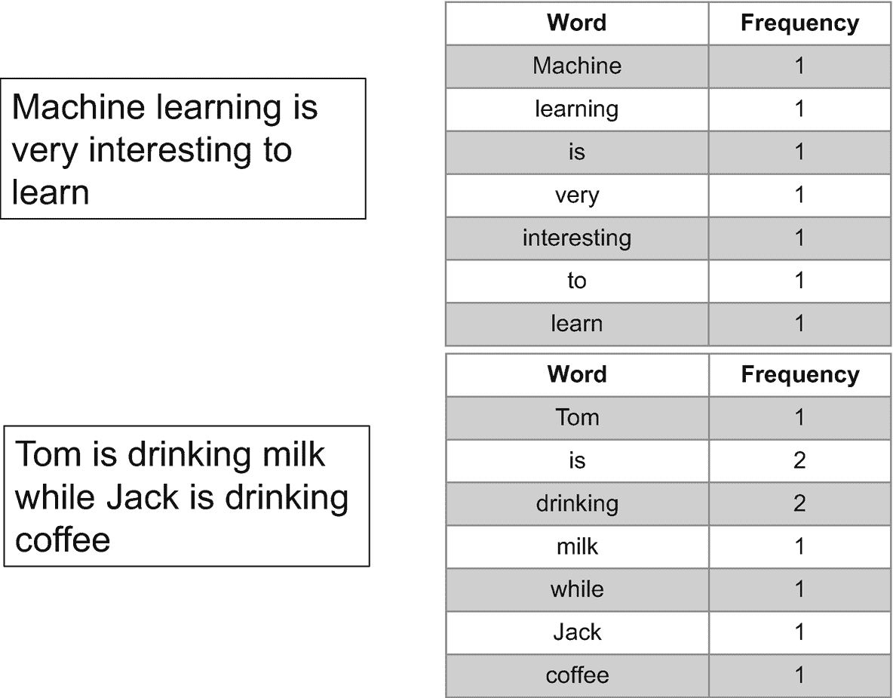

图 4-15

词袋模型方法显示，频率较高的单词被赋予更高的值

在针对整个文档的 BOW 方法中，我们将语料库的词汇表定义为语料库中存在的所有唯一单词。我们还可以设置一个阈值，即频率的上限和下限。然后，每个句子或文档都由一个向量定义，该向量的维度与基础词汇表相同，包含句子中词汇表每个单词的频率。

例如，如果我们假设最后两个句子——“机器学习非常有趣”和“汤姆在吃苹果，而杰克在喝咖啡”——是整个词汇表中仅有的两个句子，那么我们将如图 4-16 所示表示第一个句子。我们应注意，在“机器学习非常有趣”这个句子的向量中，“drinking”和“milk”被赋值为 0。

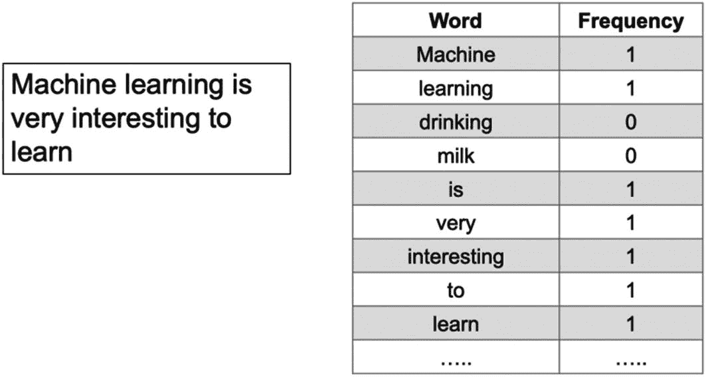

图 4-16

基于整个词汇表的句子词袋表示

BOW 方法没有考虑单词的顺序或上下文。它只关注单词的频率。因此，这是一种非常快速的数据表示方法。由于它基于频率，因此常用于文档分类。同时，由于纯粹基于频率的方法，模型精度可能会受到影响。这就是为什么我们有其他更高级的方法，它们考虑了除频率之外的更多参数。其中一种方法是 tf-idf，即词频-逆文档频率，我们接下来将学习它。

#### 词频-逆文档频率

在词袋模型中，我们只关注单词的频率。在词频-逆文档频率（tf-idf）中，我们考虑单词的相对重要性。tf-idf 由 tf（词频）和 idf（逆文档频率）组成。

词频（tf）是一个词在整个文档中出现的次数。例如，单词“x”在文档“d”中出现的次数。

逆文档频率（idf）是整个语料库中总文档数（N）与包含单词“x”的文档数（df）之比的对数。

因此，tf-idf 公式将给出一个词在整个语料库中的相对重要性。它是 tf 和 idf 的乘积，由下式给出：

    w[i, j] = tf[i, j] × log (N/df[i])    （公式 4-1）

其中 N 是语料库中的文档总数

tf[i,j] 是单词在文档中的频率

df[i] 是语料库中包含该单词的文档数量。

让我们通过一个例子来理解这一点。

假设我们有 100 万份医学文档的集合。在这些文档中，我们想要计算单词“medicine”和“penicillin”的 tf-idf 值。

假设有一份 100 个单词的文档，“medicine”出现了 5 次，“penicillin”只出现了 2 次。因此，“medicine”的 tf 是 5/100 = 0.05，“penicillin”的 tf 是 2/100 = 0.02。

现在，我们假设“medicine”出现在 100 万份文档中的 10 万份中，而“penicillin”只出现在 10 份中。因此，“medicine”的 idf 是 log (1,000,000/100,000) = log (10) = 1。“penicillin”的 idf 将是 log (1,000,000/10) = log (100,000) = 5。

因此，“medicine”和“penicillin”的最终值将分别为 0.05×1 = 0.05 和 0.02×5 = 0.1。

在前面的例子中，我们可以清楚地推断出，使用 tf-idf 可以识别出“penicillin”对于该文档的相对重要性。这正是 tf-idf 的优势所在；它降低了频繁出现的标记的影响。与那些罕见但具有更重要性和权重的单词相比，这些频率较高的标记可能无法提供任何信息。

我们接下来要讨论的下一种表示方法是 n-gram 和语言模型。


#### N-gram 与语言模型

在前几节中，我们学习了词袋模型和 tf-idf。现在，我们将重点放在语言模型上。我们知道，为了分析文本数据，必须将其转换为特征向量。N-gram 模型有助于创建这些特征向量，从而使文本能够以可进一步分析的格式呈现。

语言模型为单词序列分配概率。N-gram 是语言模型中最简单的一种。在 N-gram 模型中，我们根据前 (N–1) 个单词的序列来计算第 N 个单词的概率。这是通过计算该序列在文本语料库中出现的相对频率来实现的。如果项目是单词，N-gram 也可以称为 *shingles*。因此，unigram 是一个单词的序列，两个单词是 bi-gram，三个单词是 tri-gram，以此类推。让我们通过一个例子来学习。

假设我们有一个句子：“Machine learning is very interesting.” 这个句子可以用 N=1、N=2 和 N=3 来表示。你应该注意到，对于不同的 N 值，单词序列及其各自的组合是如何变化的，如图 4-17 所示。

因此，tri-gram 模型将仅通过前两个单词的条件概率来近似给定所有先前单词时某个单词的概率。而 bi-gram 则仅通过考虑前一个单词来做同样的事情。这确实是一个非常强的假设——即一个单词的概率仅取决于前面的单词——这被称为*马尔可夫*假设。

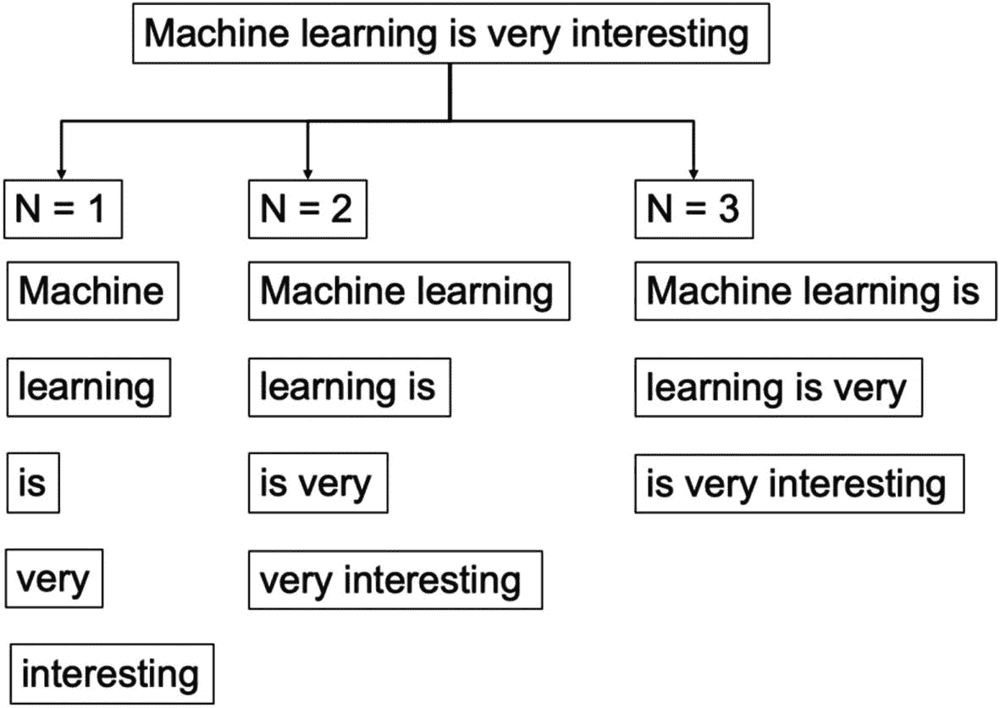

图 4-17

同一句子的 Unigram、bi-gram、tri-gram 表示，展示了不同的结果

通常，N > 1 被认为比 unigram 包含更多信息。但这种方法对 N 的选择非常敏感。它还严重依赖于所使用的训练语料库，这使得概率高度依赖于训练语料库。因此，如果我们使用已知语料库训练了一个 ML 模型，当遇到未知单词时，我们可能会遇到困难。

我们已经学习了清理文本数据、对数据进行分词以及使用多种技术表示数据的概念。现在是我们使用 Python 创建第一个 NLP 解决方案的时候了。

## 案例研究：使用 NLP 进行客户投诉分析

在上一节中，我们研究了如何将文本数据表示为 ML 模型可以使用的特征空间。这是文本数据与我们之前章节中创建的标准 ML 模型之间的唯一区别。

换句话说，预处理和特征提取将清理文本数据并生成特征。然后，生成的特征可以被任何标准的监督学习问题使用。在特征提取步骤之后，可以遵循标准的 ML 方法。现在，我们将解决一个关于文本数据的案例，并创建一个 Python 监督学习算法。

假设我们有一个客户投诉数据集。对于每条客户投诉，我们都有一个与之对应的产品。我们将使用 NLP 和 ML 创建一个监督学习模型，将任何新收到的投诉分配到相应的产品。

数据集和代码已上传到本章开头共享的 Github 链接。

步骤 1：导入所有必要的库并加载数据集。

```
from sklearn.feature_extraction.text import TfidfVectorizer
from sklearn.model_selection import train_test_split
import pandas as pd
complaints_df = pd.read_csv('complaints.csv')
```

步骤 2：让我们查看一条投诉。


```
complaints_df['Consumer complaint narrative'][1]
```

步骤 3：现在，我们将找出投诉对应的类别。

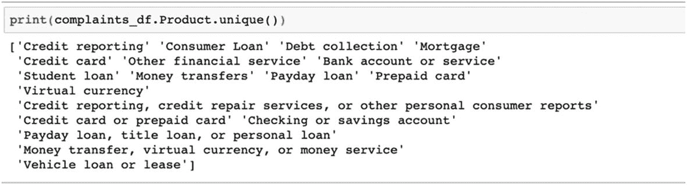

```
print(complaints_df.Product.unique())
```

步骤 4：接下来，将数据划分为训练集和测试集。

```
X_train, X_test, y_train, y_test = train_test_split(
complaints_df['Consumer complaint narrative'].values, complaints_df['Product'].values,
test_size=0.15, random_state=0)
```

步骤 5：接下来，我们计算数据集中每个唯一 token 的 tf-idf 分数。

```
vectorizer = TfidfVectorizer()
vectorizer.fit(X_train)
X_train = vectorizer.transform(X_train)
X_test = vectorizer.transform(X_test)
X_train, X_test
```

步骤 6：现在，我们将选择最重要的特征。

```
from sklearn.feature_selection import SelectKBest, chi2
ch2 = SelectKBest(chi2, k=5000)
X_train = ch2.fit_transform(X_train, y_train)
X_test = ch2.transform(X_test)
X_train, X_test
```

步骤 7：现在拟合一个朴素贝叶斯模型。

```
from sklearn.naive_bayes import MultinomialNB
from sklearn.metrics import accuracy_score
clf = MultinomialNB()
clf.fit(X_train, y_train)
pred = clf.predict(X_test)
```

步骤 8：在下一步中打印预测结果。

```
print(accuracy_score(y_test, pred))
0.7656024029369229
```

模型的准确率为 76.56%。这个标准模型可以应用于文本分析中的任何监督分类问题。这里我们有一个多类模型。它可以缩减为二元分类（通过/失败），或用于创建情感分析模型（如正面、中性、负面）。

到目前为止，我们已经学习了词袋模型、tf-idf 和 N-gram 方法。但在所有这些技术中，单词之间的关系都被忽略了。现在，我们将学习一个重要的概念，它扩展了我们关于单词之间关系的知识——它被称为*词嵌入*。


### 词嵌入

在前几节中，讨论的所有技术都忽略了词语之间的上下文关系。同时，生成的数据维度非常高。词嵌入为这个问题提供了解决方案。它能在保持上下文关系的同时，将高维的词特征转换为低维特征。我们可以通过一个例子来理解其含义。

在图 4-18 的例子中，“man”与“woman”的关系类似于“king”与“queen”的关系；“go”与“going”的关系类似于“run”与“running”的关系；“UK”与“London”的关系类似于“Ireland”与“Dublin”的关系。与前面几节讨论的基于频率的方法相比，这种方法考虑了上下文和词语之间的关系，因此更适合文本分析问题。

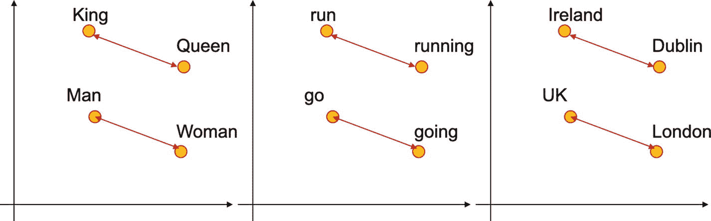

图 4-18

词嵌入有助于发现用于相同上下文的词语之间的上下文关系，从而提升理解能力

在前面的例子中，“man”与“woman”的关系类似于“king”与“queen”的关系；“go”与“going”的关系类似于“run”与“running”的关系；“UK”与“London”的关系类似于“Ireland”与“Dublin”的关系。

有两种流行的词嵌入模型：Word2Vec 和 GloVe。*Word2Vec* 提供能理解“king”和“queen”之间相似性的密集嵌入。*GloVe*（用于词表示的全局向量）是一种无监督算法，用于获取词的表示，其训练基于语料库中聚合的全局词-词共现统计信息。

这两种模型都从共现信息中学习并理解其词语的几何编码，或者说向量表示。共现指的是在大语料库中词语共同出现的频率。主要区别在于，Word2Vec 是一个基于预测的模型，而 GloVe 是基于频率的。Word2Vec 根据给定的词预测上下文，而 GloVe 则通过创建一个共现矩阵来学习上下文，该矩阵记录了一个词在上下文中出现的频率。Word2Vec 和 GloVe 的数学细节超出了本书的范围。

## 案例研究：使用词嵌入进行客户投诉分析

现在，我们将使用 Python 和词嵌入来处理上一节中使用过的同一份投诉数据。

步骤 1：首先导入必要的库。

```
from nltk.tokenize import RegexpTokenizer
import numpy as np
import re
```

步骤 2：加载投诉数据集。

```
import pandas as pd
complaints_dataframe = pd.read_csv('complaints.csv')
```

步骤 3：现在让我们查看数据的前几行。

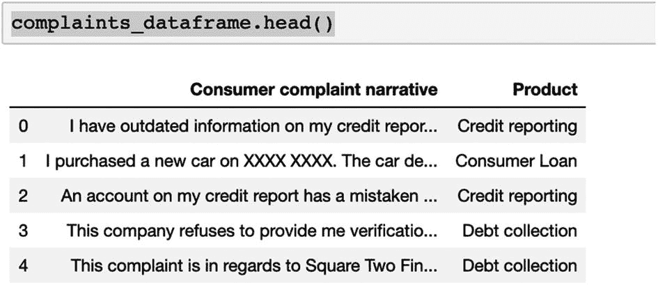

```
complaints_dataframe.head()
```

步骤 4：定义了一个用于分词（tokenize）的函数。

```
def convert_complaint_to_words(comp):
converted_words = RegexpTokenizer('\w+').tokenize(comp)
converted_words = [re.sub(r'([xx]+)|([XX]+)|(\d+)', '', w).lower() for w in converted_words]
converted_words = list(filter(lambda a: a != '', converted_words))
return converted_words
```

步骤 5：现在我们将从数据集中提取所有唯一的词。

```
all_words = list()
for comp in complaints_dataframe['Consumer complaint narrative']:
for w in convert_complaint_to_words(comp):
all_words.append(w)
```

步骤 6：现在我们来查看词汇表的大小。

```
print('Size of the vocabulary is {}'.format(len(set(all_words))))

```

步骤 7：打印投诉内容及其生成的词元（tokens）。

```
print('Complaint is \n', complaints_dataframe['Consumer complaint narrative'][10], '\n')
print('Tokens are\n', convert_complaint_to_words (complaints_dataframe['Consumer complaint narrative'][10]))
```

步骤 8：现在，我们通过为数据集中每个唯一的词分配一个唯一编号来对其进行索引。

```
index_dictionary = dict()
count = 1
index_dictionary[''] = 0
for word in set(all_words):
index_dictionary[word] = count
count += 1
```

步骤 9：下一步，使用索引词来替换原始词，使数据集变为数值型并可供 Keras 读取。

```
embeddings_index = {}
f = open('glove.6B.300d.txt')
for line in f:
values = line.split()
word = values[0]
coefs = np.asarray(values[1:], dtype="float32")
embeddings_index[word] = coefs
f.close()
```

步骤 10：现在，我们对句子中所有词的词嵌入取平均值，以生成句子表示。

```
complaints_list = list()
for comp in complaints_dataframe['Consumer complaint narrative']:
sentence = np.zeros(300)
count = 0
for w in convert_complaint_to_words (comp):
try:
sentence += embeddings_index[w]
count += 1
except KeyError:
continue
complaints_list.append(sentence / count)
```

步骤 11：在这一步，我们将分类变量转换为数值变量，然后对其进行独热编码（one-hot encode）。

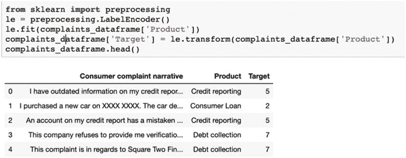

```
from sklearn import preprocessing
le = preprocessing.LabelEncoder()
le.fit(complaints_dataframe['Product'])
complaints_dataframe['Target'] = le.transform(complaints_dataframe['Product'])
complaints_dataframe.head()
```

```
from sklearn.model_selection import train_test_split
X_train, X_test, y_train, y_test = train_test_split(np.array(complaints_list), complaints_dataframe.Target.values,
test_size=0.15, random_state=0)
```

步骤 12：现在训练并测试分类器。

```
from sklearn.naive_bayes import BernoulliNB
from sklearn.metrics import accuracy_score
clf = BernoulliNB()
clf.fit(X_train, y_train)
pred = clf.predict(X_test)
print(accuracy_score(y_test, pred))
```

在前面的例子中，我们使用了词嵌入来创建一个监督分类算法。这是一个非常标准且稳健的过程，可以应用于类似的数据集。对于文本数据的准确性而言，数据预处理是关键；数据越干净，算法效果越好！

文本数据是最有趣的数据集之一。它们不易清洗，并且通常需要投入大量的时间和计算能力来创建模型。但尽管如此，文本数据中蕴含着极具洞察力的模式。我们可以将文本数据用于多种用例，并生成可能无法从标准结构化数据源获得的见解。

至此，我们对文本数据的讨论就结束了。接下来，我们将转向图像，它同样有趣且充满挑战。由于图像通常在使用深度学习时表现更好，我们将学习神经网络的构建模块，以解决图像方面的监督学习案例研究。


## 图像数据

如果说对话能力是一种天赋，那么视觉对我们而言则是一种恩赐。我们观察、记忆、回忆所见的一切。凭借视觉能力，我们创造了一个图像世界。图像无处不在。我们用相机和手机拍照，在社交媒体和在线市场上浏览图片。图像正在改变我们的体验、购物方式、沟通方式，以及企业获取客户的方式。

与测试数据类似，图像可归入非结构化数据类别。图像由像素构成。对于每张彩色图像，每个像素都有 RGB（红、绿、蓝）值，取值范围为 0 到 255。因此，我们可以用像素值（即矩阵形式）来表示每张图像，并对其进行必要的计算。

为了便于说明，图 4-19 展示了一张图像如何用矩阵表示。这些数字仅用于示意，但应能让你了解如何以数据形式表示图像，这些数据将进一步用于分析和模型构建。

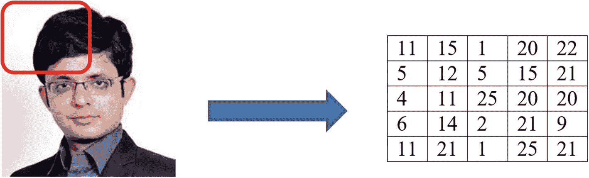

图 4-19

展示图像如何用矩阵表示的示意图；数字仅作为示例，不一定准确

图像是一种非常强大的信息源。图像数据可以被分析并用于多种业务场景，我们接下来将讨论这些场景。

### 图像数据的应用场景

设想一下：你想从咖啡自动售货机买杯咖啡。你走到机器前，机器认出了你，记起你的偏好，并精准地提供了你想要的咖啡。这台咖啡机识别了你的面部，并根据你之前的交易记录，为你提供了心仪的口味。或者，办公室的考勤监控系统使用面部识别系统来记录考勤，而不是刷卡。图像数据分析和计算机视觉正在增强各种能力，并实现流程自动化。

图像分析正在商业的各个领域和流程中掀起波澜。以下是一些应用场景：

1.  **医疗保健**：图像分析使我们能够从 X 光片、核磁共振成像和 CT 扫描中识别肿瘤和疾病。经过训练的机器学习模型可以判断图像是“好”还是“坏”，即是否存在任何疾病迹象？然后，解决方案可以定位问题，医生和医疗专业人员可以利用生成的洞察来专注于问题。偏远地区的患者可以将他们的图像分享给专家，从而获得更快的响应。我们使用图像分割和图像分类技术来识别异常并进行分析。

2.  **零售**行业正在以一种新颖的方式利用图像分析技术。顾客可以上传他们喜欢的产品（如手表、T 恤、眼镜等）的图片，然后从引擎获得推荐。在后台，在线引擎会搜索类似产品并展示给顾客。此外，借助更好的图像检测技术，库存管理变得容易得多。图像分割、分类和计算机视觉技术为我们解决了这个问题。

3.  **制造业**：制造业以多种方式运用图像分析技术：
    1.  **缺陷识别**用于将有缺陷的产品与合格产品区分开来。这可以通过计算机视觉和图像分类来实现。

2.  **预测性维护**通过识别需要维护的工具和系统而得到改进。它利用了图像分类和图像分割技术。

4.  **安防与监控**：计算机视觉允许通过安防摄像头进行直接监控，防止盗窃和犯罪。这些能力有助于人群管理和控制、乘客活动监控等。使用摄像头的实时监控使安保团队能够预防任何事故。面部识别技术使我们能够实现这些效果。

5.  **农业**：农业领域也不例外。它也利用图像识别和分类技术来识别作物中的杂草，或植物上的任何疾病和感染。可以检查土壤质量，并提高谷物品质。计算机视觉正在真正改变人类最古老职业之一的面貌。

6.  **保险**：图像分析通过检查事故现场的照片来帮助保险行业。可以根据事故现场的图像评估损失，并评估索赔。图像分割和图像分类驱动着保险行业的解决方案。

7.  **自动驾驶汽车**是充分利用物体检测能力的一个很好的例子。可以检测到汽车、行人、卡车、标志等，并采取相应的行动。

8.  **社交媒体平台和在线市场**采用复杂的图像识别技术，根据用户的照片识别面部、特征、表情、产品等。这有助于改善消费者体验，提高速度和易用性。

上述应用场景只是众多案例中的一小部分，在这些案例中，图像识别、物体检测、图像跟踪、图像分类等技术正在为我们生成创新的解决方案。这得益于最新的技术栈，如神经网络、卷积神经网络、循环神经网络、强化学习等。由于这些解决方案能够轻松处理大量复杂数据并从中生成洞察，它们不断突破边界。我们能够利用现代计算资源和基于云的基础设施，以更快的速度训练算法。

但我们仍需探索图像的全部潜力；我们必须改进现有能力并提高精度水平。该领域正在进行大量研究，许多组织都在为这一领域的进步做出贡献。

图像是一种复杂的数据集，难以捕获和管理。我们现在将探讨处理图像时面临的常见挑战。


### 图像数据面临的挑战

图像并非易于处理的数据集。它是一种复杂的融合体，且数据点非常庞大。与其他数据集类似，图像数据也杂乱无章，需要彻底清洗。我们在处理图像数据集时面临的一些挑战如下：

1.  **复杂性**：一辆汽车的图像从不同角度看会有所不同。同一个人的正面、左侧面和右侧面可能看起来完全不同，这使得机器识别一个人或物体变得困难。这种复杂性使得图像数据更难分析。

2.  **数据集大小**：图像的大小是我们处理图像数据时面临的另一个挑战。一张图像很容易达到兆字节级别，并且根据生成频率，图像数据集的总体积可能非常巨大。

3.  **图像是多维的**，这与任何结构化数据不同。它还会根据图像的颜色尺度而变化。一张彩色图像会有三个通道（RGB），这会进一步增加维度数量。

4.  **数据不干净**：图像并不总是干净的。在采集数据集本身的过程中，我们就会遇到多个问题。以下是其中几个：
    1.  如果图像失焦，就会产生模糊图像。
    2.  图像上可能存在阴影，使其无法使用。
    3.  图像质量取决于周围光线。如果背景光发生变化，图像的构成也会改变。
    4.  由于多种因素，如相机抖动、画面边缘被裁剪或镜头上有污渍（如指纹），图像会发生畸变。

5.  **人为变异性**：在采集图像数据时，人为产生的差异会导致同一类型的问题产生不同的数据集。例如，如果我们需要从田间采集农作物的图像，不同的人会从不同角度、使用不同的相机模式进行拍摄。

图像是难以存储和处理的数据集。特别是由于其体积，所需的空间量相当大。我们现在讨论图像数据管理过程，该过程侧重于其中的几个方面。

### 图像数据管理流程

我们从多个来源生成图像，因此必须为图像建立一个具体的数据管理流程。一个好的系统应该能够接收传入的图像，存储它们，并使其可供未来分析使用。图像数据管理流程将取决于系统的设计：它是一个实时图像分析项目还是一个批处理项目？各种来源的图像需要经过暂存、清洗，最终存储在一个可以访问的地方，如图 4-20 所示。

对于实时图像监控系统，图像会实时输入算法，并且必须实时做出决策。例如，考虑我们在停车场有一个车牌读取系统。停车场的图像是实时生成的，并且必须非常快速地处理。

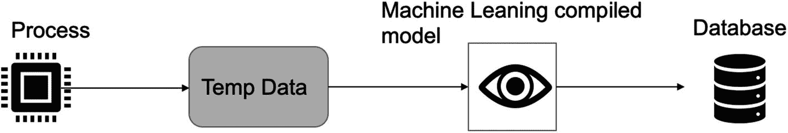

图 4-20

机器学习模型的实时流程与数据管理

在上述流程图中，“流程”一词代表图像数据生成的来源。在前面讨论的车牌读取案例中，它将是摄像头生成的原始图像。这些原始图像在输入到编译好的机器学习模型之前，可能需要临时存储。机器学习模型将生成关于该图像的预测。在前述案例中，预测结果将是汽车的车牌号。预测结果和图像都必须存储到最终的目标数据库中。

对于批处理图像分析系统，流程会发生变化，如图 4-21 所示。例如，在与前例相同的用例中，如果我们想识别一天内有多少辆车进入了停车场，同样的图像处理系统会有所不同。

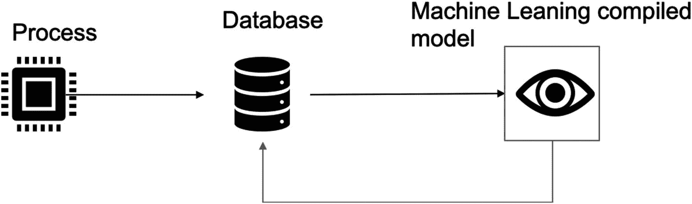

图 4-21

图像数据的批处理可以从数据库接收数据，进行预测，并将结果共享回数据库进行存储

对于批处理图像分析系统，“流程”将生成图像。这些原始图像必须存储在数据库中。然后，它们被输入到机器学习模型，该模型为它们生成预测。在前述案例中，汽车的原始图像将在生成时被存储。然后，它们作为一批数据被输入到图像处理解决方案中，该方案为每辆车生成车牌号。预测结果和原始图像随后被发送回数据库并保存。

一个好的图像数据管理系统应该健壮、灵活且易于访问。图像的大小在设计系统时将发挥重要作用。它也定义了与此类数据库存储库相关的成本。值得注意的是，这样的存储库会很快被消耗殆尽，因此根据业务和领域的关键性质，我们可能不会保存所有图像。也有可能从数据库中删除早于所需频率的数据。

我们现在将开始对图像数据进行机器学习建模过程。为此，我们将在下一节从深度学习的概念开始。

### 图像数据建模过程

图像仍然是一种数据源。我们将图像表示为向量空间图中的特征或度量，然后对数据进行数学建模。但对于图像，我们的经典算法可能无法很好地处理。这是由于以下原因：

1.  与结构化数据相比，图像数据集的维度数量要大得多，这使得处理变得困难。
2.  图像的背景噪声要高得多。图像数据集中可能存在畸变、模糊、多角度拍摄、灰度图像等。
3.  输入数据的大小也大于结构化数据集。

由于上述几个原因，我们更倾向于使用神经网络来为我们创建图像监督学习算法，我们将在下一节讨论这一点。

## 深度学习基础

深度学习正在改变我们感知信息的方式。它正在将数据的力量提升到新的水平。通过使用复杂的神经网络，我们能够处理许多复杂的数据集，这些数据集维度高、规模大。神经网络确实正在改变机器学习和人工智能的格局。

深度学习创造了仅在几年前还只是设想的能力。在图像处理领域，我们正在实现用于图像分类、目标检测、目标跟踪、图像描述、语义分割、人体姿态估计等的神经网络。GPU 和 TPU 正日益使我们能够突破限制，在极短时间内处理海量数据集。

在接下来的部分中，我们将讨论神经网络的构建模块，并将在 Python 中开发一个用例。


### 人工神经网络

人工神经网络（ANN）的灵感可以说源于人脑的运作方式。当我们人类第一次看到某个物体时，我们会在脑海中形成它的图像并记录下来。当同一个物体再次出现在我们面前时，我们就能轻松地识别它。这个对我们来说轻而易举的任务，对于算法来说却很难理解和学习。

注意

深度学习中的“深度”代表神经网络中隐藏层的数量。通常，隐藏层数量越多，准确率就越高。但这只在某种程度上成立，有时即使增加层数，准确率也可能不会提高。

我们训练神经网络的方式与训练任何机器学习算法类似——有输入数据集，我们对其进行处理，算法就会为我们生成输出预测。神经网络可用于回归和分类问题。它既可用于结构化数据源，也可用于非结构化数据源。神经网络所能达到的准确率通常高于经典的机器学习算法，如回归、决策树等。但这并不总是成立。

神经网络最大的优势在于它能够处理像图像和视频这样的复杂数据。回想一下，对于经典的机器学习算法，我们需要选择重要的变量。而在神经网络中，从数据中挑选出最重要的属性是网络自身的责任。

一个典型的神经网络如图 4-22 所示。

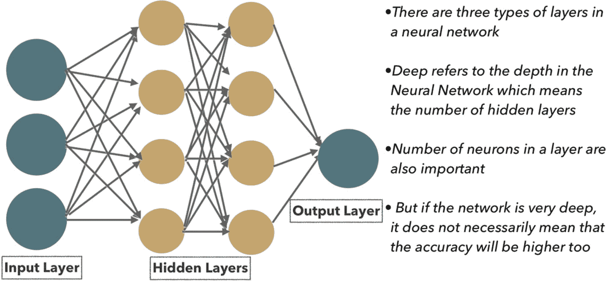

图 4-22

神经网络包含输入层、隐藏层和输出层

在上述网络结构中，有几个重要的构建模块，如下所示：

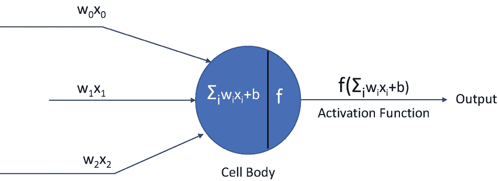

图 4-23

神经元的基本结构，展示了输入、权重、激活函数和输出

1.  **神经元**：神经元是神经网络的基础。所有的计算和复杂处理都在神经元内部进行。它接收像图像这样的输入数据，并生成一个输出。该输出可能被网络中的下一层使用，也可能用于生成最终结果。一个神经元可以如图 4-23 所示。这里，x[0]、x[1] 和 x[2] 代表输入变量，w[0]、w[1] 和 w[2] 是它们各自的权重。“f”是激活函数，“b”是偏置项。

神经元从前面的层接收输入，然后根据设定的条件决定是否应该*激活*。简单来说，一个神经元会接收一个输入，对其执行数学计算，然后根据其内部设定的阈值将值传递给下一个神经元。

在训练机器学习模型或本例中的网络时，权重和偏置项会得到训练，我们从而获得最优化的值。我们将在下一节讨论训练机制和激活项。

1.  **输入层**：顾名思义，输入层负责接收输入数据。数据可以是图像形式（原始或处理过的）。输入层是网络中的第一步。

2.  **隐藏层**：隐藏层是神经网络中最重要的部分。所有复杂的过程和数学计算都在隐藏层中进行。它们接收来自输入层的数据，逐层处理，然后将其馈送到输出层。

3.  **输出层**：输出层是神经网络的最后一层。它负责生成预测，对于回归问题，预测结果可以是一个连续变量；对于监督分类问题，则可以是一个概率分数。

了解了神经网络的这些构建模块后，在下一节中，我们将讨论网络的其他核心元素，即激活函数。


### 激活函数

激活函数在神经网络的训练中扮演着核心角色。其主要职责是决定一个神经元是否应该被激活。它是负责神经元内部计算过程的函数。

激活函数通常具有非线性特性。这一特性使得网络能够学习复杂的行为和模式。

目前有多种可用的激活函数类型，例如：

1.  **Sigmoid 激活函数**：这是一个有界的数学函数，如图 4-24 所示。Sigmoid 函数的取值范围在 0 到 1 之间。该函数呈 S 形，且其导数函数非负。

    数学上，Sigmoid 函数表示为

    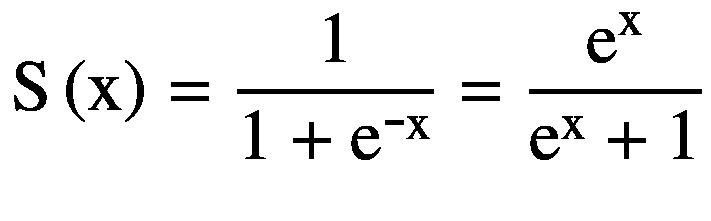

    (公式 4-2)

    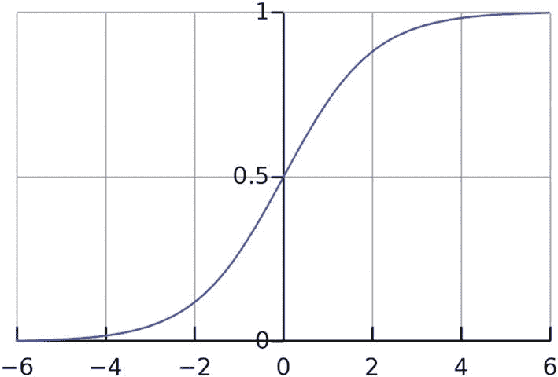

    图 4-24

    Sigmoid 函数具有 S 形形状

    它通常用于二分类问题以及神经网络的最终输出层。但也可以用于网络的隐藏层。

2.  **tanh 激活函数**：双曲正切函数（tanh）是 Sigmoid 函数的一个缩放版本，如图 4-25 所示。与 Sigmoid 函数相比，tanh 是以零为中心的。tanh 函数的取值范围在 -1 到 +1 之间。

    数学上，tanh 函数表示为

    

    (公式 4-3) tanh 激活函数通常用于神经网络的隐藏层。它使均值更接近零，从而让网络的训练变得更容易。

    

    图 4-25

    tanh 函数以零为中心

3.  **ReLU 激活函数**：ReLU 激活函数可能是最流行的激活函数。ReLU 是修正线性单元（Rectified Linear Unit），如图 4-26 所示。

    F(x) = max (x,0) 表示如果 x>0，则输出为 x；否则输出为 0。

    

    图 4-26

    ReLU 函数

    从简单的数学函数可以看出，ReLU 是一个非常易于计算的函数。这使得 ReLU 非常容易计算且训练速度很快。它常用于网络的隐藏层。

4.  **Softmax 函数**：Softmax 函数用于分类问题网络的最后一层。它用于生成网络中的预测结果。该函数为每个目标类别生成概率分数，获得最高概率的类别即为预测类别。例如，如果网络旨在区分猫、狗、马和老虎，那么 softmax 函数将生成四个概率分数。获得最高概率的类别就是预测类别。

激活函数在训练网络中扮演着核心角色。它们定义了训练进程，并负责网络各层中发生的所有计算。一个设计良好的网络将被优化，然后模型的训练将能够做出最终的预测。与经典的机器学习模型类似，神经网络旨在减少预测中的误差，也称为损失函数，我们将在下一节中介绍。

### 神经网络中的损失函数

我们创建机器学习模型是为了对未见过的数据集进行预测。机器学习模型在训练数据集上进行训练，然后我们在测试或验证数据集上衡量其性能。在衡量模型准确率的过程中，我们总是力求将错误率降至最低。这个错误也被称为*损失*。

正式地说，损失是网络预测值与实际值之间的差异。为了拥有一个稳健且准确的网络，我们总是力求将这种损失保持在最低水平。

对于回归和分类问题，我们有不同的损失函数。*交叉熵*是分类问题中最常用的损失函数，而均方误差则更适用于回归问题。不同的损失函数会给出不同的损失值，从而影响网络的最终训练。训练的目标是找到最小损失，因此损失函数也被称为*目标函数*。

注意

`binary_crossentropy` 可用作二分类模型的损失函数。

训练神经网络就是为了最小化这个损失，实现这一目标的过程将在下文讨论。


### 神经网络中的优化

在神经网络训练过程中，我们不断努力降低损失或误差。损失是通过比较实际值与预测值计算得出的。在第一次前向传播产生损失后，需要更新权重以进一步减少误差。权重更新的方向由*优化函数*定义。

正式地说，优化函数使我们能够最小化损失并达到全局最小值。一种可视化的优化方式如下：想象你站在山顶上，必须到达山脚。你可以向任何方向迈步。步子的方向将指向坡度最陡的地方。优化函数使我们能够实现这一点。一步能迈出的距离被称为*学习率*。

我们有许多优化函数可供选择。以下是其中几种：


图 4-27

梯度下降用于优化神经网络的损失

1.  **梯度下降** 是最流行的优化函数之一。它帮助我们实现这种优化。梯度下降优化速度相当快且易于实现。我们可以在图 4-27 中看到梯度下降。

但梯度下降可能会陷入局部最小值，并且执行时需要更多的资源和计算能力。

1.  **随机梯度下降**（SGD）只是梯度下降的一个变体。与其父算法相比，它在每个训练样本之后更新参数，即在每个训练样本计算损失之后。例如，如果数据集包含 5000 个观测值，梯度下降将在所有计算完成后仅更新一次权重，而 SGD 将更新权重 5000 次。虽然这提高了准确性并降低了计算内存需求，但也会导致模型过拟合。

2.  **小批量梯度下降** 是对 SGD 的改进。它结合了梯度下降和 SGD 的优点。在小批量梯度下降中，不是在每个训练样本之后更新参数，而是以批次为单位进行更新。它需要最少的计算内存，并且不易过拟合。

3.  还有其他优化函数，如 Ada、AdaDelta、Adam、Momentum 等可供使用。对这些优化器的讨论超出了本书的范围。

注意

Adam 优化器和 SGD 可用于大多数问题。

优化是神经网络训练中一个非常重要的过程。它使我们能够达到全局最小值并获得最大精度。因此，在选择最佳优化函数时需要格外谨慎。

在进入网络训练之前，还有几个术语你应该了解。

#### 超参数

网络通过分析训练样本自行学习相当多的参数，但仍有少数参数需要预先设定。在神经网络训练开始之前，我们设置这些参数以启动过程。这些变量决定了网络的结构、过程、变量等，这些都将用于最终训练。它们被称为*超参数*。

我们设置许多参数，例如学习率、每层神经元数量、激活函数、隐藏层数量等。我们还设置迭代次数和批次大小。迭代次数表示网络完整分析整个数据集的次数。批次大小是网络在更新模型参数之前分析的样本数量。一个批次可以包含一个或多个样本。

简单来说，如果我们有 10,000 张图像的训练数据，设置批次大小为 10，迭代次数为 50；这意味着整个数据将被分成 10 个批次，每个批次有 1000 张图像。模型的权重将在每 10 个批次之后更新。这也意味着在一个迭代周期内，1000 张图像将被分析 10 次，或者说在每个迭代周期内权重将被更新 10 次。由于迭代次数为 50，整个过程将运行 50 次。

注意

迭代次数和批次大小没有固定值。我们通过迭代、测量损失，然后为解决方案找到最佳值。

但训练神经网络是一个复杂的过程，我们将在接下来讨论。前向传播和反向传播的过程也将在下一节中介绍。


### 神经网络训练过程

神经网络经过训练，以实现创建机器学习模型所要解决的业务问题。这是一个繁琐且需要大量迭代的过程。结合所有层、神经元、激活函数、损失函数等，训练以逐步的方式进行。目标是创建一个损失最小化且经过优化的网络，从而为我们生成最佳预测。

为了设计和创建深度学习解决方案，我们拥有各种库和框架。以下是几种用于深度学习的流行工具：

1.  **TensorFlow**：由谷歌开发，是最流行的框架之一。它可以与 Python、C++、Java、C# 等语言一起使用。

2.  **Keras**：这是一个基于 API 的框架，构建在 TensorFlow 之上。它使用起来非常简单，是最推荐的库之一。

3.  **PyTorch**：PyTorch 是 Facebook 开发的另一个流行库。它是用于原型设计和跨平台解决方案的绝佳工具。

4.  **Sonnet**：这是 DeepMind 的产品，主要用于复杂的神经架构。

还有许多其他解决方案，如 MXNet、Swiftm Gluon、Chainer 等。我们将使用 Keras 在 Python 中解决案例研究。

现在，我们将开始探讨神经网络的学习过程。在网络中，学习或训练指的是在关注损失的同时，找到权重和偏置项的最佳可能值。我们力求在训练整个网络后实现最小损失。

训练神经网络的主要步骤如下：

**步骤 1**：在第一步中，如图 4-28 所示，输入数据被传递到网络的输入层。输入层是第一层。数据以网络可接受的格式输入。例如，如果网络期望输入图像大小为 25×25，那么该图像数据将被调整为该形状，然后输入到输入层。

接下来，数据被传递并馈送到网络的下一层或第一个隐藏层。该隐藏层将根据与该特定层关联的激活函数对数据进行转换。然后，数据被馈送到下一个隐藏层，此过程持续进行。

在图 4-28 所示的示意图中，我们有两个隐藏层，每个层都有一些与之关联的权重。完成相应的转换后，将生成最终预测。回想一下，在上一节中，我们讨论了 softmax 层，它为我们生成预测概率。这些预测将在下一步中进行分析。


图 4-28

神经网络中的步骤 1，显示输入数据经过转换以生成预测

**步骤 2**：现在我们已经从网络获得了预测。我们必须检查这些预测是否准确，以及预测值与实际值相差多远。这一步如图 4-29 所示。

在这里，我们使用损失函数比较实际值和预测值，并在这一步中生成损失值。

以这种前向方式传递信息的过程称为*前向传播步骤*。


图 4-29

通过比较实际值和预测值来计算损失

现在我们已经从网络的第一次迭代中产生了感知到的损失。我们仍然需要优化并最小化这个损失，这将在训练的下一个步骤中完成。

**步骤 3**：在这一步中，一旦计算出损失，该信息就会传回网络。优化函数将改变权重以最小化此损失。相应的权重会在所有神经元上进行更新，然后生成一组新的预测。再次计算损失，信息再次向后传播以进行进一步优化，如图 4-30 所示。

这种为了优化损失而向后传播信息的过程，在神经网络训练过程中被称为*反向传播*。

注意

反向传播有时被称为深度学习中的核心算法。

此过程会迭代进行，直到我们达到无法再优化损失的点。然后我们可以得出结论：我们的网络已经训练好了。


图 4-30

进行优化以最小化损失，从而达成最佳解决方案

这就是网络训练自身并为我们生成编译模型的过程。神经网络的训练也称为网络的*学习*。正式地说，网络的学习指的是为网络的所有层找到最合适的权重值和最佳组合。

最初，所有权重都初始化为一些随机值。网络进行第一次预测，由于显而易见的原因，第一次传递中的损失或误差会相当高。现在，网络遇到新的训练样本，并根据计算出的损失更新权重。反向传播在此充当反馈回路，发挥着核心作用。在训练网络的过程中，这些权重会在每次迭代中更新。迭代的方向由损失函数的梯度定义，它使我们能够朝着最小化损失的方向移动。一旦损失无法再降低，我们就可以说网络现在已经训练好了。

接下来，我们将通过创建两个 Python 用例来学习如何训练神经网络：一个针对结构化数据，另一个针对图像。


## 案例研究 1：在结构化数据上创建分类模型

我们使用的是糖尿病数据集。目标是基于某些诊断测量指标，对患者是否患有糖尿病进行诊断性预测。代码和数据集已上传至 Github。

步骤 1：首先导入库。

```
import numpy as np
import pandas as pd
import seaborn as sns
import matplotlib.pyplot as plt
%matplotlib inline
```

步骤 2：现在加载数据并查看前五行：


```
pima_df = pd.read_csv('pima-indians-diabetes.csv')
pima_df.head()
```

步骤 3：现在生成基本 KPI。


```
pima_df.describe()
```

步骤 4：接下来绘制数据。


```
sns.pairplot(pima_df, hue="class")
```

步骤 5：现在生成相关性图。


```
sns.heatmap(pima_df.corr(), annot=True)
```

步骤 6：现在对数据集进行缩放。

```
X= pima_df.iloc[:,0:8]
y= pima_df.iloc[:,8]
from sklearn.preprocessing import StandardScaler
standard_scaler = StandardScaler()
X = standard_scaler.fit_transform(X)
X
```

步骤 7：接下来将数据拆分为训练集和测试集。

```
from sklearn.model_selection import train_test_split
X_train, X_test, y_train, y_test = train_test_split(X, y, test_size=0.2)
```

步骤 8：导入用于创建神经网络的库。

```
from keras import Sequential
from keras.layers import Dense
```

步骤 9：开始设计网络。

```
diabetes_classifier = Sequential()
```

#网络的第一隐藏层。本例中，激活函数为 ReLU，神经元数量为 5。我们将权重初始化为随机正态分布。

```
diabetes_classifier.add(Dense(5, activation="relu", kernel_initializer="random_normal", input_dim=8))
```

#第二隐藏层。与上一层类似，激活函数为 ReLU，神经元数量为 5。我们将权重初始化为随机正态分布。

```
diabetes_classifier.add(Dense(5, activation="relu", kernel_initializer="random_normal"))
```

#输出层。激活函数为 sigmoid。我们将权重初始化为随机正态分布。

```
diabetes_classifier.add(Dense(1, activation="sigmoid", kernel_initializer="random_normal"))
```

我们使用 adam 优化器，损失函数为交叉熵。需要优化的指标是准确率。

```
diabetes_classifier.compile(optimizer ='adam',loss='binary_crossentropy', metrics =['accuracy'])
```

现在拟合模型。


```
diabetes_classifier.fit(X_train,y_train, batch_size=10, epochs=50)
```

步骤 10：使用混淆矩阵检查模型的准确率。


```
y_pred=diabetes_classifier.predict(X_test)
y_pred =(y_pred>0.5)
from sklearn.metrics import confusion_matrix
cm = confusion_matrix(y_test, y_pred)
print(cm)
```

由此我们可以推断，该模型的准确率为 77.27%。

建议您通过以下方式进行测试和迭代：

1.  通过增加一两个层来提高网络的复杂度。
2.  使用不同的激活函数进行测试。我们使用了 sigmoid；您也可以使用 tanh。
3.  增加训练轮数并检查性能。
4.  更好地预处理数据，然后在修订后的数据集上再次检查性能。

## 案例研究 2：图像分类模型

我们将在 fashion MNIST 数据集上开发一个图像分类模型。该数据集包含 10 个不同类别的 70,000 张灰度图像。该数据集用于图像分类问题，是一个标准数据集。它内置于 Keras 中，可以轻松加载。

步骤 1：首先导入库。

```
import tensorflow as tf
from tensorflow import keras
import numpy as np
import matplotlib.pyplot as plt
```

步骤 2：导入 Keras 自带的 fashion MNIST 数据集，并将其划分为训练图像和测试图像。

```
fashion_df = keras.datasets.fashion_mnist
(x_train, y_train), (x_test, y_test) = fashion_df.load_data()
```

步骤 3：可供我们使用的各类服装如下：

```
apparel_groups = ['T-shirt/top', 'Trouser', 'Pullover', 'Dress', 'Coat', 'Sandal', 'Shirt', 'Sneaker', 'Bag', 'Ankle boot']
```

步骤 4：接下来我们将探索数据。

```
x_train.shape
len(y_train)
```

步骤 5：让我们查看一个数据元素，然后对数据集进行预处理。我们必须通过除以 255 来标准化数据集（像素值范围从 0 到 255；因此我们除以 255 来标准化所有数据集的值）。


```
plt.figure()
plt.imshow(x_train[1])
plt.show()
```

```
x_train = train_images / 255.0
x_test = test_images / 255.0
```

步骤 6：让我们查看一些样本。我们还将检查数据顺序是否正确。

```
plt.figure(figsize=(25,25))
for i in range(10):
plt.subplot(10,10,i+1)
plt.xticks([])
plt.yticks([])
plt.grid(False)
plt.imshow(x_train[i], cmap=plt.cm.binary)
plt.xlabel(apparel_groups[y_train[i]])
plt.show()
```


步骤 7：现在构建神经网络模型。

```
fashion_model = keras.Sequential([
keras.layers.Flatten(input_shape=(28, 28)),
keras.layers.Dense(256, activation="relu"),
keras.layers.Dense(20)
])
```

这里，输入图像的形状是 28,28。展平层将图像的格式转换为 28×28。它只重新格式化数据，没有需要学习的内容。接下来是一个激活函数为 ReLU、包含 256 个神经元的层。最后一层有 20 个神经元，并返回一个 logit 数组，指示图像是否属于我们正在训练的十个类别之一。

步骤 8：现在编译模型。

```
fashion_model.compile(optimizer='adam',
loss=tf.keras.losses.SparseCategoricalCrossentropy(from_logits=True),
metrics=['accuracy'])
```

参数是损失函数，用于衡量模型在训练期间的准确程度。优化器决定了模型如何根据其看到的数据和损失函数进行更新。我们使用准确率来监控训练和测试步骤。

步骤 9：现在训练模型，尝试使用批次大小为 10 和 50 个训练轮数进行拟合。


```
fashion_model = fashion_model.fit(x_train, y_train,
batch_size=10,
epochs=50,
verbose=1,
validation_data=(x_test, y_test))
```

步骤 10：现在绘制训练和验证准确率。


```
import matplotlib.pyplot as plt
f, ax = plt.subplots()
ax.plot([None] + fashion_model.history['accuracy'], 'o-')
ax.plot([None] + fashion_model.history['val_accuracy'], 'x-')
ax.legend(['Train acc', 'Validation acc'], loc = 0)
ax.set_title('Training/Validation acc per Epoch')
ax.set_xlabel('Epoch')
ax.set_ylabel('acc')
```

步骤 11：绘制训练和验证损失。


```
import matplotlib.pyplot as plt
f, ax = plt.subplots()
ax.plot([None] + fashion_model.history['loss'], 'o-')
ax.plot([None] + fashion_model.history['val_loss'], 'x-')
ax.legend(['Train loss', 'Validation loss'], loc = 0)
ax.set_title('Training/Validation loss per Epoch')
ax.set_xlabel('Epoch')
ax.set_ylabel('acc')
```

**步骤 12：** 我们将打印模型得到的测试准确率。

```
test_loss, test_acc = fashion_model.model.evaluate(x_test,  y_test, verbose=2)
print('Test accuracy:', test_acc)
```

模型的测试准确率为 89.03%。与上一个案例研究类似，建议您通过添加层和神经元来改变网络架构，并使用不同的 epoch、batch_size 等值来衡量性能，从而进行迭代。

至此，我们使用深度学习实现了两个用例，分别针对结构化数据和非结构化数据。

深度学习是一种能够进一步提升我们能力的力量。对于非结构化数据集，神经网络正在引领我们找到前所未有的解决方案。像卷积神经网络、循环神经网络、长短期记忆网络（LSTM）、GRU 等高级神经网络在各个领域都创造着奇迹。我们现在可以更好地检测癌症、增强安全系统、提高农业产量、减少购物时间、利用面部特征来允许或限制用户——用例非常丰富。在所有领域，我们都能感受到深度学习带来的涟漪效应。

至此，本书第四章即将结束。现在让我们对本章进行总结。

## 总结

本章相当特别，因为它涉及高级概念。但这些高级概念是建立在我们前几章所创建的基础之上的。这些高级概念和算法是当下的迫切需求。凭借更强的处理能力和增强的系统，我们可以实现更快速的解决方案。十年前还不存在的所需计算能力，如今已经具备。我们现在可以使用 GPU 和 TPU。我们现在可以存储和管理数 TB 或 PB 的数据。我们的数据收集策略已经大大改进。我们可以以更结构化的方式收集实时数据。我们的数据管理工具现在不再局限于独立服务器，而是扩展到了基于云的基础设施。这为我们提供了工具和信心，去实现更先进的基于 ML 的技术，以进一步提升能力。

同时，我们不能低估前几章所研究算法的重要性。线性回归、决策树、KNN、朴素贝叶斯等是机器学习算法的基础。它们仍然是筛选重要变量的首选方法。这些算法设定了性能的基准。然后，Bagging 和 Boosting 的集成技术进一步增强了能力。因此，在开始使用 Boosting 或 Bagging 算法之前，我们应该始终使用基础算法来测试和基准化性能。

随着深度学习的出现，我们能够处理更复杂的数据集。深度学习为性能提供了额外的推动力。但为了处理深度学习算法，我们需要更好的硬件系统。在这种情况下，基于云的基础设施提供了良好的服务。我们可以将代码部署在 Google Colaboratory 中并运行代码，从而利用服务器的处理能力。

至此，我们已经在本书的范围内讨论了监督学习算法。在第 1 章中，我们介绍了机器学习。在第 2 章和第 3 章中，我们研究了回归和分类算法。在第四章中，我们学习了 Boosting、SVM 和深度学习模型等高级算法，并处理了结构化和非结构化数据。在下一章，也就是本书的最后一章，我们将研究模型从创建到维护的端到端生命周期。

现在，您应该能够回答以下问题。

练习题

**问题 1：** 梯度提升有哪些不同的版本？

**问题 2：** SVM 算法如何区分不同类别？

**问题 3：** 文本数据的数据预处理步骤有哪些？

**问题 4：** 神经网络中有哪些不同的层？

**问题 5：** 损失函数和优化函数在神经网络中的作用是什么？

**问题 6：** 使用上一章中用于分类问题的数据集，使用 SVM 和 Boosting 算法测试准确率。

**问题 7：** 从 [`https://www.kaggle.com/uciml/breast-cancer-wisconsin-data`](https://www.kaggle.com/uciml/breast-cancer-wisconsin-data) 下载乳腺癌分类数据。清理数据并比较随机森林和 SVM 算法的性能。

**问题 8：** 从 [`https://www.kaggle.com/bittlingmayer/amazonreviews`](https://www.kaggle.com/bittlingmayer/amazonreviews) 获取亚马逊评论数据集。这里的问题是将亚马逊上的客户评论作为输入文本进行分析，并将输出评分作为输出标签。使用讨论过的技术清理文本数据，并创建一个分类算法来进行预测。

**问题 9：** 从 [`http://ai.stanford.edu/~amaas/data/sentiment/`](http://ai.stanford.edu/%257Eamaas/data/sentiment/) 下载电影评论文本数据集，并创建一个二元情感分类问题。

**问题 10：** 从 [`https://www.kaggle.com/c/dogs-vs-cats`](https://www.kaggle.com/c/dogs-vs-cats) 获取图像，并使用神经网络创建一个二元图像分类解决方案，以区分狗和猫。

**问题 11：** 通过从 [`https://www.cs.toronto.edu/~kriz/cifar.html`](https://www.cs.toronto.edu/%257Ekriz/cifar.html) 下载数据，将上述问题扩展到多类问题。

**问题 12：** 阅读以下研究论文：

1.  [`https://www.sciencedirect.com/science/article/abs/pii/S0893608014002135`](https://www.sciencedirect.com/science/article/abs/pii/S0893608014002135)

2.  [`https://www.sciencedirect.com/science/article/pii/S0893608019303363`](https://www.sciencedirect.com/science/article/pii/S0893608019303363)

3.  [`https://www.aclweb.org/anthology/W02-1011/`](https://www.aclweb.org/anthology/W02-1011/)

4.  [`http://www.jatit.org/volumes/research-papers/Vol12No1/1Vol12No1.pdf`](http://www.jatit.org/volumes/research-papers/Vol12No1/1Vol12No1.pdf)

5.  [`https://ieeexplore.ieee.org/document/7493959`](https://ieeexplore.ieee.org/document/7493959)

