# 5. 端到端模型开发

> *“旅程即是目的地。”*
> 
> — 丹·埃尔登

学习的道路永无止境。它需要耐心、时间、投入和努力。这条路并不容易，但凭借投入，可以取得很多成就。

在这段学习旅程中，你已经迈出了第一步。数据科学和机器学习正在改变世界各地的商业领域。而监督学习解决方案正在所有领域和业务流程中产生影响。

在前四章中，我们涵盖了回归、分类以及 Boosting 和神经网络等高级主题。我们理解了相关概念，并通过各种案例研究开发了 Python 解决方案。这些机器学习模型可用于对收入、需求、价格、客户行为、欺诈等各种业务关键绩效指标进行预测和估算。

但在务实的商业世界中，这些机器学习模型必须部署到生产环境中。在生产环境中，它们被用于基于真实未见数据进行预测。我们将在本书的最后一章讨论这一点。

此外，关于机器学习和数据科学，还有相当多的最佳实践。我们将涵盖所有这些内容。我们还将讨论创建机器学习模型时最常见的问题，如过拟合、空值、数据不平衡、异常值等。


## 所需技术工具包

本章我们将使用 Python 3.5 或更高版本。我们将使用 Jupyter notebook；需要安装 Anaconda-Navigator 来执行代码。所有数据集和代码均已上传至 Github 库 [`https://github.com/Apress/supervised-learning-w-python/tree/master/Chapter%205`](https://github.com/Apress/supervised-learning-w-python/tree/master/Chapter%25205)，方便下载和执行。

## 机器学习模型开发

回顾一下，在第 1 章中，我们简要讨论了模型开发的端到端流程。现在我们将详细讨论每个步骤；我们将深入探讨每个步骤中最常见的问题以及如何应对。最终将进入模型部署阶段。图 5-1 是我们遵循的模型开发流程。

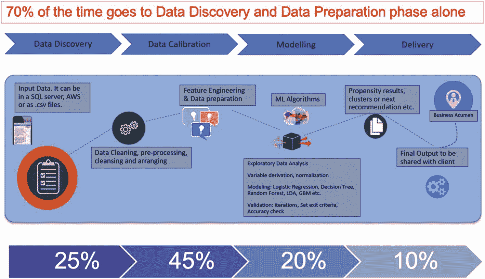

图 5-1

通常遵循的端到端模型开发流程及各阶段耗时

机器学习模型开发的步骤如下：

*   步骤 1：定义业务问题

*   步骤 2：数据发现

*   步骤 3：数据清洗与准备

*   步骤 4：探索性数据分析

*   步骤 5：统计建模

*   步骤 6：模型部署

*   步骤 7：编写规范文档

*   步骤 8：模型部署后，需要持续进行模型刷新和维护。

我们将详细讨论所有步骤、其中常见的难题以及如何解决。整个过程将辅以实际的 Python 代码。

## 步骤 1：定义业务问题

一切始于业务问题。业务问题必须简洁、清晰、可衡量且可实现。它不能含糊不清，例如“增加利润”。它必须精确定义，具有清晰的业务目标以及可衡量的关键绩效指标。

业务问题的常见问题如下：

*   模糊的业务问题难以解决。例如，每个企业都希望增加收入、提高利润和降低成本。应避免像*增加利润*这样不明确、模糊的业务问题。

*   业务目标必须可实现。我们不能期望一个机器学习模型在一夜之间将收入提高 80%，或在一个月内将成本降低一半。因此，目标必须在特定时间范围内可实现。

*   有时，定义的业务目标不是*量化的*。如果业务问题是“提高对客户群的理解”，它就没有可衡量的关键绩效指标。因此，业务问题必须明确定义且可通过关键绩效指标衡量，这一点至关重要。

*   在确定业务问题或开发过程中，有时会出现*范围蔓延*。范围蔓延指的是初始业务目标随时间推移而增加，或目标随时间变化的情况。它还涉及业务目标的变更。例如，假设机器学习模型最初旨在预测客户流失倾向。然而，在项目过程中，目标却变成了预测客户购买特定产品的倾向。这无疑会削弱解决方案的范围，并影响预期输出。不应鼓励此类做法。

一个好的业务问题应该是精确、可实现、可衡量且可重复的，如图 5-2 所示。

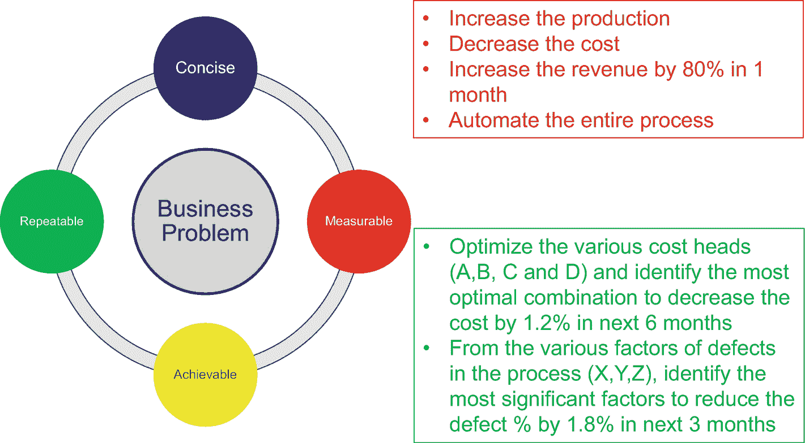

图 5-2

一个好的业务问题应简洁、可衡量、可实现且可重复

简而言之，拥有严格的范围和定义明确的业务问题，为成功创建机器学习模型铺平了道路。

提示

业务利益相关者掌握着项目最终成功的关键。他们应从项目初期就适当参与其中。

现在我们进入下一步，即数据发现阶段。这一步非常重要，它将决定我们是否能够继续进行机器学习模型开发！


## 步骤 2：数据发现阶段

这是项目最关键阶段，因为它决定了项目的未来走向。数据发现阶段包括以下内容：

1.  确定用于分析的数据库。需要申请相应的数据库权限，并记录所有必需的表格。这些表格通常会被迁移到开发环境中。数据库类型可能是 SQL/Oracle/Redshift/NoSQL 等。

2.  有些数据源是 Excel 文件或 .csv/文本文件格式。这些文件需要加载到数据库中，以便我们随时调用。此外，**不**将数据文件保存在个人电脑上是一个好习惯。但随着基于数据架构的兴起，此类数据源可以存储在对象存储中，例如 S3 或 Azure Data Lake Storage。

3.  所使用的数据集必须完整，并且与我们想要解决的业务问题相关。例如，如果我们要构建一个月度销售预估模型，那么至少需要拥有过去两到三年且没有缺失月份的数据。

4.  所使用的数据集必须能够充分代表当前的业务问题。它应该足够完整，以便数据集能够体现业务中的所有随机性。例如，如果一家制造工厂想要实施预测性维护模型，那么数据集应包含所有相关设备的数据。

5.  数据刷新也需要在此阶段进行规划。机器学习模型的构建可能需要一些时间。在此之前，可能需要对数据进行刷新。

数据发现阶段通常遇到的问题如下：

*   数据集不完整，中间有缺失的月份，并且关键信息（如收入、客户数量或产品信息）不可用。例如，假设我们正在构建一个模型来判断客户在未来几个月是否会流失。为此，如果我们没有收入详情（表 5-1），那么模型将无法发现数据中的模式来预测流失倾向。

表 5-1

以流失为目标变量的客户数据示例

| 客户 ID | 收入 | 访问次数 | 商品数量 | 是否流失 (是/否) |
    | --- | --- | --- | --- | --- |
    | 1001 | 100 | 2 | 10 | 是 |
    | 1002 | - | 3 | 11 | 是 |
    | 1003 | 102 | 4 | 9 | 否 |
    | 1004 | ? | 5 | 10 | 否 |

因此，在这种情况下，我们必须拥有这些缺失的数据点，才能对数据做出正确的推断。

为了解决这个问题，如果我们无法获取这一列数据，可以尝试估算缺失的数据点。例如，在上述案例中，可以使用访问次数作为缺失数据点的替代指标。

*   第二个问题可能出现在我们拥有多个数据表，且这些表包含多种类型的信息时。如果缺少关联键或关系键损坏，那么数据整合将变得非常困难。例如，在表 5-2 中，我们有三张表的数据。

表 5-2

表示员工数据的表格（员工人口统计、雇佣详情和薪资）

| -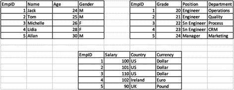 |

在表 5-2 中，员工 ID（EmpID）是三张表的公共键。如果这个公共关系不存在或已损坏，我们就无法连接这些表，从而在所有字段之间建立有意义的关联。如果各个表中的信息之间缺少关联，我们将*无法*获得一个连贯且完整的数据集视图。

不幸的是，如果这个关联键缺失，我们能做的就不多了。我们仍然可以尝试使用部门或国家/地区的替代键来连接表，但这可能无法做到 100% 准确。

*   数据不一致和错误的引用是可能完全颠覆分析和从数据中得出的见解的问题。例如，如果有不同的系统在捕获客户的收入数据，并且它们之间不同步，那么结果将是不正确的。

缓解步骤如下：
    1.  从数据集中创建一份关于主要 KPI 的初始报告：例如收入、客户、交易量、设备数量、保单数量等 KPI。

2.  与业务相关方核实并交叉检查这些 KPI。

3.  找出计算错误的 KPI，并使用准确的业务逻辑进行修正。

4.  重新生成报告，并就修订后的结果获得确认。

*   数据质量是最大的挑战之一。回想一下，在第 1 章中，我们讨论了高质量数据的属性。现在我们将详细回顾这些概念，并讨论如何在下一步中解决我们在数据方面面临的挑战。

*   原始数据中也可能存在其他问题，例如：

表 5-3

数据集中的不当表头

| 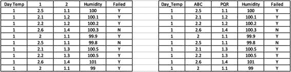 |

1.  有时，一个列可能包含多个变量的信息。这可能在数据捕获阶段或数据转换阶段发生。

2.  表的表头不规范，是数字格式。或者表头名称中包含空格，这会在我们后续尝试引用这些变量时造成麻烦。例如，表 5-3 提供了两个数据集中列表头不当的示例。左侧表格的列标题是数字，并且列标题之间有空格。在第二个表格中，这些问题已得到修正。

在这种情况下，一个明智的做法是用字符串替换数字列标题。同时建议用“_”之类的符号替换空格，或者将它们连接起来。在上面的例子中，“Day Temp”已更改为“Day_Temp”，“1”和“2”已分别更改为“ABC”和“PQR”。在实际应用中，我们应该为 ABC 和 PQR 找到合乎逻辑的名称。

数据发现阶段的结果是确定最终要使用的表和数据集。如果确实遇到数据完全不完整的情况，我们可能会决定不继续，而是先完善数据集。

现在，是时候讨论所有步骤中可能最耗时的环节了，即数据清洗和准备。

## 步骤 3：数据清洗与准备

所有步骤中最耗时的可能就是数据清洗与准备了。它通常与步骤 2 一起占用 60% 到 70% 的时间。

数据发现阶段将产生可用于进一步分析的数据集。但这并不意味着这些数据集是干净且可以直接使用的。我们通过*特征工程*和*预处理*来处理它们。

注意

数据清洗并非一项花哨的工作；它需要耐心、严谨和时间。其本质上是高度迭代的。

我们面临的最常见的数据问题列举如下：

*   数据集中存在重复值

*   存在分类变量，但我们只想使用数值特征

*   数据中存在缺失值、NULL 值或 NAN

*   数据集不平衡

*   数据中存在异常值

*   其他常见问题及所做的转换

让我们从第一个问题开始，即数据集中的重复值。


### 数据集中的重复值

如果数据集中存在完全相同的行，那么这些行就是*重复值*。这意味着每一列中的每个值都完全相同，且顺序也一致。此类问题通常发生在数据采集或数据加载阶段。例如，在填写调查问卷时，同一个人填写了一次，然后又提供了完全相同的详细信息。

重复行的示例如下表 5-4 所示。请注意，第 1 行和第 5 行是重复的。

表 5-4

包含应删除的重复行的示例数据

| -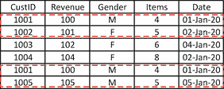 |

如果数据集中存在重复值，我们就无法信任模型的性能。如果重复记录同时成为训练集和测试集的一部分，模型的性能将被错误地提升并产生偏差。我们会得出模型表现良好的结论，而实际上并非如此。

我们可以通过几个简单的命令来识别重复值的存在，然后将其从数据集中删除。

重复行（第 1 行和第 5 行）的示例如表 5-4 所示。现在，我们将在 Python 中加载一个包含重复值的数据集，然后对其进行处理。所使用的数据集是鸢尾花（Iris）数据集，我们在第 2 章和第 3 章的练习部分已经使用过。相关代码可在 Github 链接 [`https://github.com/Apress/supervised-learning-w-python/tree/master/Chapter%205`](https://github.com/Apress/supervised-learning-w-python/tree/master/Chapter%25205) 处获取。

步骤 1：导入库。

```
from pandas import read_csv
```

步骤 2：现在使用 `read_csv` 命令加载数据集。

```
data_frame = read_csv("IRIS.csv", header=None)
```

步骤 3：现在查看数据集中的行数和列数。

```
print(data_frame.shape)
(151,5) 数据集中有 151 行
```

步骤 4：现在检查数据集中是否存在重复值。

```
duplicates = data_frame.duplicated()
```

步骤 5：现在打印重复的行。

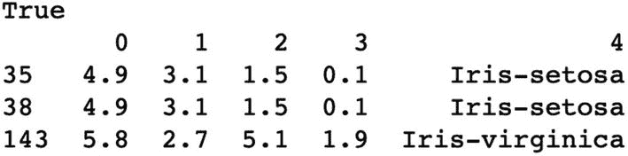

```
print(duplicates.any())
print(data_frame[duplicates])
```

从输出中我们可以看到，有三行是重复的，需要删除。

步骤 6：使用 `drop_duplicates` 命令删除重复行，并再次检查形状。

```
data_frame.drop_duplicates(inplace=True)
print(data_frame.shape)
```

形状现在减少到 148 行。

这就是我们如何检查重复值并通过从数据集中删除来处理它们的方法。

重复值可能会提高机器学习模型的感知准确率，因此必须加以处理。我们现在讨论下一个常见问题：分类变量。

### 数据集中的分类变量处理

分类变量本身并非数据集中的问题。它们是信息和洞察的丰富来源。像性别、邮政编码、城市、类别、情感等变量确实很有洞察力且非常有用。

同时，数据集中存在分类变量可能会带来一些问题，例如：

1.  一个分类变量可能只有非常少量的不同值。例如，如果变量是“城市”，并且某个值在总人口中占有显著比例，那么这个变量的用处就会很小。它不会在数据集中产生任何变化，也不会被证明是有用的。

2.  类似地，像“邮政编码”这样的分类变量可能有非常多的不同值。在这种情况下，它会变成一个难以使用的变量，并且不会为分析增加太多信息。

3.  机器学习算法基于数学概念。像 k 近邻这样的算法会计算数据点之间的距离。如果变量本质上是分类的，那么欧几里得距离或余弦距离等任何距离度量都无法计算距离。一方面，决策树能够处理分类变量；另一方面，像逻辑回归、支持向量机等算法则不倾向于将分类变量作为输入。

4.  许多库（如 scikit-learn）目前仅适用于数值型数据。它们提供了许多稳健的解决方案来处理分类变量，我们接下来将讨论其中一些。

因此，处理数据集中存在的分类变量变得至关重要。处理分类变量的方法有很多种。下面列出其中几种：

1.  将分类值转换为数字。在表 5-5 中，我们用数字替换了分类值。例如，我们用数字替换了城市。

表 5-5

像城市这样的分类变量可以用数字表示

| -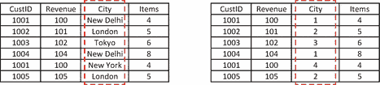 |

在所示的示例中，我们用数字替换了城市。但这种方法存在一个问题。机器学习模型会得出结论，认为伦敦的排名高于东京，或者新德里是纽约的四分之一。这些见解显然具有误导性。

2.  也许最常用的方法是*独热编码*。在独热编码中，每个不同的值都被表示为数据集中的一个单独列。如果该值存在，则在该单元格中分配 1，否则分配 0。这些额外创建的变量被称为*虚拟变量*。例如，在前面的数据集中实施独热编码后，结果将如表 5-6 所示。

表 5-6

独热编码将分类变量转换为数值，导致数据维度增加

| -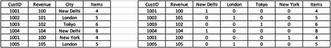 |

与用数字替换相比，这无疑是一种更直观、更稳健的方法。pandas 中有一个名为 `get_dummies` 的方法，它通过添加额外变量将分类变量转换为虚拟变量。`sklearn.preprocessing.OneHotEncoder` 中还有另一种方法可以为我们完成这项工作。我们在本书的前面章节中已经处理过将分类变量转换为数值变量的问题。

但独热编码并非万无一失的方法。想象一下，如果我们正在处理一个包含 1000 个级别的数据集。在这种情况下，额外列的数量将是 1000。此外，数据集将非常稀疏，因为只有一列包含“1”，其余值都是 0。在这种情况下，建议我们先合并和聚类一些分类值，减少不同级别的数量，然后再进行独热编码。

分类变量提供了关于各个级别的丰富洞察。我们必须了解哪些算法能够处理分类变量，哪些不能。并不总是需要将分类变量转换为数值变量！

我们现在将讨论数据集中最常见的缺陷类型：缺失值。


### 数据集中存在的缺失值

大多数真实世界的数据集都存在变量缺失值的情况。数据集中存在 NULL、NAN、0、空白值等。这些缺失值可能在数据采集阶段或数据转换过程中引入，也可能是因为某些时间点数据本身不存在。几乎所有数据集都存在缺失值，无论是分类变量还是数值变量。我们必须处理这些缺失值。

例如，表 5-7 中的缺失值包含 NULL、NAN 和空白值；这些缺失值需要被处理。

表 5-7

数据集中存在的缺失值

| 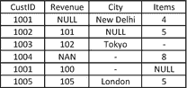 |

缺失值在我们进行分析时会带来很大问题。它会扭曲所有的平均值和中位数，导致我们无法从数据集中得出正确的结论。我们会构建一个有偏的模型，因为各个变量之间的关系会存在偏差。

提示

如果值为零，我们不能断定它就是缺失值。有时，NULL 值也是一个正确的数据点。因此，在处理缺失值之前，应用业务逻辑至关重要。

数据可能因以下原因出现缺失值：

1.  在数据提取阶段，数值未被正确记录。这可能是由于设备故障或记录此类数据的能力不足所致。
2.  很多时候，非必填的数据未被录入。例如，客户在填写表单时可能不想输入地址详情。
3.  可能存在完全随机的缺失值，没有任何模式或原因。
4.  有时（尤其是在调查等场景中），我们发现关于人们某个特定属性的回答未被收到。例如，受访者可能不愿意分享薪资细节。
5.  缺失值也可能遵循某种模式。例如，我们可能缺少某个特定年龄组、性别或地区的数据。这可能是由于该特定年龄组、性别或地区的数据不可用或未被采集。

为了减少缺失值，作为第一步，我们要检查数据是设计上就缺失，还是属于需要处理的问题。例如，传感器可能无法记录超过某个压力范围的任何温度值。在这种情况下，温度值的缺失是正确的。

我们还应该检查缺失值相对于其他自变量以及相对于目标变量是否存在任何模式。例如，查看表 5-8 中的数据集，我们可以推断出，每当温度值为 NULL 时，设备就发生了故障。在这种情况下，温度与故障变量之间的数据存在明显的模式。因此，删除温度或处理温度变量将是错误的步骤。

表 5-8

NULL 值并不总是坏事

| 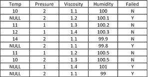 |

如果我们决定需要处理缺失值，那么有几种方法可以实现：

1.  直接**删除**包含缺失值的行。这可以看作是最简单的方法，我们只需删除任何值为缺失的行。最大的优点是实现简单且快速。但这种方法会减少样本量。一刀切地删除所有包含缺失值的行有时会移除非常重要的信息。因此，在使用删除法时需要尽职调查。

2.  **均值、中位数或众数插补**：我们可能希望用均值、中位数或众数值来插补缺失值。均值和众数仅适用于连续变量。众数可用于连续变量和分类变量。

    均值插补或中位数插补不能在对数据进行任何探索性分析的情况下实施。我们应该理解并分析数据中是否存在任何模式，如果使用均值或中位数插补缺失值，这些模式可能会受到影响。例如，在表 5-9 中，用均值插补温度的缺失值将是一个错误的策略，因为有明确迹象表明温度与压力和粘度存在相关性。如果我们用均值插补该值，那么数据集将是有偏的。相反，在这种情况下，我们应该使用一种更好的方法，这将在后面的要点中讨论。

表 5-9

NULL 值并不总是能用均值、中位数和众数插补，需要经过充分分析才能得出结论

| 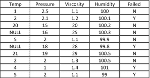 |

我们可以使用以下 Python 代码来插补缺失值。有一个 `SimpleImputer` 类，可用于插补缺失值，如下列代码所示。该代码可在 Github 链接 [`https://github.com/Apress/supervised-learning-w-python/tree/master/Chapter%205`](https://github.com/Apress/supervised-learning-w-python/tree/master/Chapter%25205) 获取。

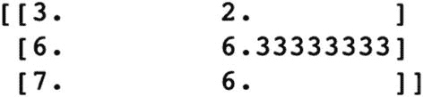

```
    import numpy as np
    from sklearn.impute import SimpleImputer
    Next, impute the missing values.
    impute = SimpleImputer(missing_values=np.nan, strategy="mean")
    impute.fit([[2, 5], [np.nan, 8], [4, 6]])
    SimpleImputer()
    X = [[np.nan, 2], [6, np.nan], [7, 6]]
    print(impute.transform(X))
    ```

该函数的输出结果是用均值插补缺失值，因为在前面的函数中我们使用了 `strategy = 'mean'`。

同样的 `SimpleImputer` 类也可用于稀疏矩阵。

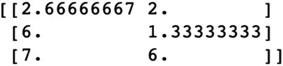

```
    import scipy.sparse as sp
    matrix = sp.csc_matrix([[2, 4], [0, -2], [6, 2]])
    impute = SimpleImputer(missing_values=-1, strategy="mean")
    impute.fit(matrix)
    SimpleImputer(missing_values=-1)
    matrix_test = sp.csc_matrix([[-1, 2], [6, -1], [7, 6]])
    print(impute.transform(matrix_test).toarray())
    ```

`SimpleImputer` 类也可以处理分类变量，其中使用最频繁的值进行插补。

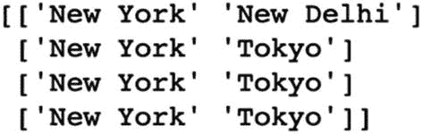

```
    import pandas as pd
    data_frame = pd.DataFrame([["New York", "New Delhi"],[np.nan, "Tokyo"],["New York", np.nan],["New York", "Tokyo"]], dtype="category")
    impute = SimpleImputer(strategy="most_frequent")
    print(impute.fit_transform(data_frame))
    ```

3.  **使用机器学习模型进行预测**：我们可以利用机器学习模型来估计缺失值。其中一个数据集将用于训练，另一个数据集将用于进行预测。然后我们创建模型来进行预测。例如，我们可以使用 k-近邻算法来预测缺失的值。如图 5-3 所示，如果缺失数据点的值用黄色表示，那么使用 knn 插补法我们可以进行缺失值插补。我们在第 4 章中详细讨论了 knn。建议您再次回顾这些概念。

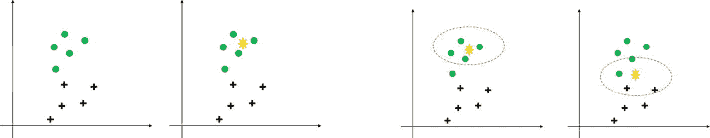

图 5-3

用于对缺失值进行插补的 k-近邻方法


KNN 插补法对定量和定性两种类型的变量都很有用。它考虑了各变量之间的相关性，这是该方法的一大优势。我们无需为每个缺失值创建预测算法，它也能处理存在多个缺失值的情况。但由于该方法需要在整个数据集中搜索相似性，因此会变得相当缓慢且耗时。其弱点之一在于 k 值的选择，该方法对插补所选的 k 值非常敏感。

类似地，我们可以使用随机森林等其他算法来插补缺失值。我们正在编写代码，用于生成一个包含缺失值的样本数据集，然后使用 KNN 进行插补。

**步骤 1：导入必要的库。**

```
    import numpy as np
    import pandas as pd
    ```

**步骤 2：现在我们将整理一个包含缺失值的数据集。我们将创建一个包含五列的数据框，但其中一些值缺失。**

```
    missing_dictionary = {'Variable_A': [200, 190, 90, 149, np.nan],
    'Variable_B': [400, np.nan, 149, 200, 205],
    'Variable_C': [200,149, np.nan, 155, 165],
    'Variable_D': [200, np.nan, 90, 149,100],
    'Variable_E': [200, 190, 90, 149, np.nan],}
    missing_df = pd.DataFrame(missing_dictionary)
    ```

**步骤 3：现在让我们查看一下数据框。我们可以看到数据集中存在一些空值。**

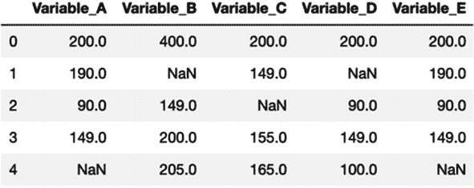

```
    missing_df
    ```

**步骤 4：我们将使用 KNN 来插补缺失值。这可能需要安装`KNNImputer`模块。**

```
    from sklearn.impute import KNNImputer
    missing_imputer = KNNImputer(n_neighbors=2)
    imputed_df = missing_imputer.fit_transform(missing_df)
    ```

**步骤 5：如果我们再次打印数据集，会发现缺失值已被插补。**

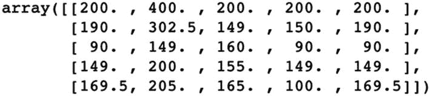

```
    imputed_df
    ```

使用模型预测缺失值是一种不错的方法。但这有一个潜在假设，即缺失值与数据集中的其他属性之间存在某种关系。

缺失值是最常见的挑战之一。你很少会找到一个没有缺失值的数据集。我们必须认识到，缺失并不一定意味着不完整。但一旦我们确定存在缺失值，最好对其进行处理。

现在，我们将转向面临的另一个挑战：不平衡数据集。

## 数据集不平衡

考虑一下这种情况。一家银行向客户提供信用卡。在每天数百万笔交易中，也存在少量欺诈交易。银行希望创建一个机器学习模型，以便能够在真实交易中检测出这些欺诈交易。

现在，欺诈交易的数量将非常少。可能所有交易中只有不到 1%是欺诈性的。因此，我们可用的训练数据集将没有足够的欺诈交易样本。这被称为*不平衡*数据集。

不平衡数据集可能会给预测模型带来严重问题。机器学习模型将无法学习欺诈交易的特征。此外，它还可能导致*准确率悖论*。在前述案例中，如果我们的机器学习模型将所有传入的交易都预测为真实交易，那么模型的整体准确率将达到 99%！令人惊讶，对吧？但该模型将所有传入交易都预测为真实交易，这是不正确的，也违背了机器学习的初衷。

有几种解决方案可以应对不平衡问题：

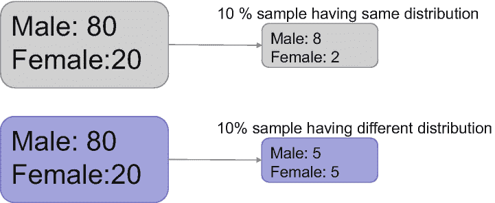

图 5-4

分层意味着我们所关心的变量的分布

1.  收集更多数据并纠正不平衡。这是可以实施和使用的最佳解决方案。当我们拥有更多数据点时，对于二分类模型，我们可以抽取一个包含两个类别平衡混合的数据样本；对于多分类模型，则可以抽取包含所有类别的样本。

2.  过采样和欠采样方法：我们可以对代表性不足的类别进行过采样，或者对代表性过高的类别进行欠采样。这些方法非常易于实现且执行速度快。但这两种方法都存在固有的挑战。当我们使用欠采样或过采样时，训练数据可能会变得有偏。我们在尝试采样时可能会遗漏一些重要的特征或数据点。在进行过采样或欠采样时，可以遵循一些规则：
    1.  如果数据点数量较少，我们倾向于使用过采样。

2.  如果我们拥有大量数据集，我们倾向于使用欠采样。

3.  并不要求所有类别都具有相等的比例。如果目标变量有四个类别，并不要求每个类别都占 25%。我们也可以设定一个较小的比例目标。

4.  在采样时使用分层抽样方法（图 5-4）。随机抽样和分层抽样的区别在于，分层抽样在进行分层时会考虑我们想要使用的所有变量的分布。换句话说，我们在分层样本中得到的变量分布与总体分布相同，而这在随机抽样中可能无法保证。

在总体和样本中，分层保持了相同的比例。例如，如图 5-4 所示，总体中男女比例为 80:20。在总体的 10%样本中，男女比例应保持为 80:20，这通过分层抽样实现，而随机抽样不一定能保证。

提示

过采样/欠采样只能用于训练数据。测试数据不应进行处理。因此，过采样/欠采样只能在创建了数据的训练/测试集划分之后进行，而不能在此之前进行。

1.  我们可以改变衡量模型准确率的方式。在我们之前讨论的欺诈检测案例中，准确率不应成为目标或应达成的参数。相反，我们应该关注召回率，将其作为需要优化和瞄准的参数。


2.  我们可以尝试一系列算法，而不是只关注某一类或某一种算法。这使我们能够检验和评估不同算法的有效性。研究发现，决策树在这种情况下通常表现良好。

3.  我们还可以实现一个 SMOTE 算法，该算法可以为我们生成或合成数据。SMOTE 是一种过采样技术，全称是系统化少数类过采样技术（Systematic Minority Oversampling Technique）。

SMOTE 的工作方式如下：
    1.  它分析目标类的特征空间。

2.  然后检测最近邻，并选择相似的数据样本。通常，会使用距离度量选择两个或更多实例。

3.  接着，在邻居的特征空间内，每次随机改变一个列的值。

4.  最后生成一个合成样本，该样本并非原始数据的精确副本。

我们可以通过一个例子来学习。数据集是关于信用卡欺诈的，并且是不平衡的。我们将对其进行平衡处理。数据集和代码可在以下 Github 链接中找到：[`https://github.com/Apress/supervised-learning-w-python/tree/master/Chapter%205`](https://github.com/Apress/supervised-learning-w-python/tree/master/Chapter%25205)。

步骤 1：导入所有库。SMOTE 模块可能需要安装。

```
    import pandas as pd
    from imblearn.over_sampling import SMOTE
    from imblearn.combine import  SMOTETomek
    ```

步骤 2：读取信用卡数据集。

```
    credit_card_data_set = pd.read_csv('creditcard.csv')
    ```

步骤 3：首先创建 X 和 y 变量，然后使用 SMOTE 方法进行重采样。

```
    X = credit_card_data_set.iloc[:,:-1]
    y = credit_card_data_set.iloc[:,-1].map({1:'Fraud', 0:'No Fraud'})
    X_resampled, y_resampled = SMOTE(sampling_strategy={"Fraud":500}).fit_resample(X, y)
    X_resampled = pd.DataFrame(X_resampled, columns=X.columns)
    ```

步骤 4：现在让我们看看原始数据集中各类别的百分比。

```
    class_0_original = len(credit_card_data_set[credit_card_data_set.Class==0])
    class_1_original = len(credit_card_data_set[credit_card_data_set.Class==1])
    print(class_1_original/(class_0_original+class_1_original))
    ```

我们得到的结果是 0.00172，即 0.172%。

步骤 5：重采样后，让我们分析一下百分比分布。

```
    sampled_0 = len(y_sampled[y_sampled==0])
    sampled_1 = len(y_sampled[y_sampled==1])
    print(sampled_1/(sampled_0+sampled_1))
    ```

我们得到的结果是 50%。因此，数据集已从不平衡（低于 1%）平衡到了 50%。

SMOTE 是处理类别不平衡的一种极好方法。它快速、易于执行，并且对于数值型数据能给出良好结果。但 SMOTE 在处理分类变量时可能会出错。例如，如果我们有一个分类变量“是否下雨”。这个变量只能取二值（即 0 或 1）。SMOTE 可能导致该变量出现小数，如 0.55，这是不可能的。因此，在使用 SMOTE 时要小心！

至此，我们完成了不平衡数据集的处理。这是我们面临的最重大挑战之一：它不仅影响机器学习模型，而且对准确率度量也有持久的影响。我们现在讨论数据集中遇到的异常值问题。

## 数据集中的异常值

考虑一下。某企业日均销售额为 1000 美元。某天，一位顾客消费了 5000 美元。这条信息会使整个数据集发生偏斜。或者在一个天气预报数据集中，某城市的平均降雨量为 100 厘米。但由于干旱季节，该季节没有降雨。这将完全改变我们从该数据中得出的推论。这样的数据点被称为*异常值*。

异常值会对机器学习模型产生不利影响。我们面临的主要异常值问题如下：

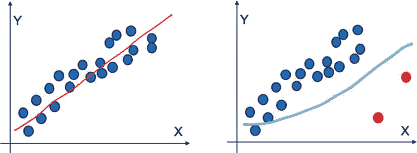

图 5-5

异常值对回归方程的影响使其产生偏差

1.  在存在异常值的情况下，我们的模型方程会受到严重影响，如图 5-5 所示。当存在异常值时，回归方程也会试图拟合它们，因此实际方程将不是最优的。

1.  异常值会使模型的估计产生偏差，并增加误差方差。

2.  如果要进行统计检验，其功效和影响会受到严重影响。

3.  总体而言，从数据分析的角度来看，我们无法信任模型的系数，因此模型得出的所有见解都将是有误的。

但与缺失值类似，异常值不一定都是坏的。我们必须应用业务逻辑来检查被标记为异常值的值是否真的是异常值，或者是一个有效的观测值。例如，在表 5-10 中，温度值看起来像是异常值，但一旦我们仔细观察，就可以推断出每当温度过高或过低时，目标变量“是否失败”的值都是“否”。

表 5-10

温度的异常值不一定都是坏的，因此处理异常值时应谨慎

| -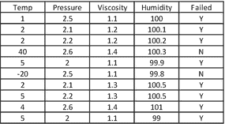 |

因此，我们在处理异常值时应谨慎。不建议一刀切地删除异常值！

检测异常值的方法有很多，包括以下几种：

1.  回想一下我们在第 1 章讨论过的正态分布。如果一个值位于第 5 百分位数和第 95 百分位数之外，或者第 1 百分位数和第 99 百分位数之外，我们可以将其视为异常值。

2.  超出 –1.5 × IQR 和 +1.5 × IQR 范围的值可被视为异常值。这里的 IQR 是四分位距，计算公式为（第 75 百分位数的值）–（第 25 百分位数的值）。

3.  超出均值一个、两个或三个标准差的值可被称为异常值。

4.  业务逻辑也有助于确定任何异常值以检测异常值。

5.  我们可以通过箱线图或箱须图来可视化异常值。我们在前面的章节中创建过箱线图，并将在下一节中再次讨论。

我们可以通过多种方式处理异常值。在确定某个特定值是异常值并需要处理之后，我们可以执行以下操作：

1.  完全删除异常值。这需要在确认可以删除异常值之后进行。

2.  对异常值进行封顶。例如，如果我们决定超出第 5 百分位数和第 95 百分位数的任何值都是异常值，那么超出这些范围的值将分别被限制在第 5 百分位数和第 95 百分位数。

3.  用均值、中位数或众数替换异常值。该方法与我们上一节讨论的缺失值处理方法类似。

4.  有时，对变量取自然对数可以降低异常值的影响。但如果我们决定取自然对数，应再次采取谨慎的方法，因为它会改变实际值。

异常值对我们的数据集构成了巨大挑战。它们会使我们从数据中得出的见解发生偏斜。我们的系数会偏斜，模型也会产生偏差，因此我们应该认识到它们的影响。同时，我们不能忽视业务世界与异常值的关系，并判断该观测值是否是一个严重的异常值。

除了前面讨论的问题之外，现实世界的数据集还面临着其他一些挑战。我们将在下一节中讨论其中的一些挑战。


## 数据集中的其他常见问题

我们已经了解了数据集中最常见的问题，并研究了如何检测这些缺陷以及如何修复它们。但现实世界的数据集往往非常混乱且不干净，还有许多其他因素会影响分析的有效性。

我们在数据集中遇到的其他一些问题如下：

1.  相关变量：如果自变量彼此相关，我们就无法衡量模型的真实能力。它也无法对自变量的预测能力产生正确的洞察。理解共线性的最佳方法是生成一个相关矩阵。这将引导我们找到相关的变量。我们应该测试输入变量的多种组合，如果准确率或伪 R² 没有显著下降，我们可以删除其中一个相关变量。我们在本书的前几章中已经处理过相关变量的问题。

2.  有时整个列中只存在一个值。例如，在表 5-11 中。

表 5-11

温度只有一个值，因此不添加任何信息

| -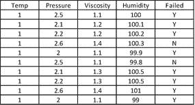 |

温度恒为 1。它不会为我们的模型提供任何有意义的信息，因此删除此变量对我们最有利。

3.  前一点的延伸情况是，某个特定变量只有两三个唯一值。例如，假设上述数据集有 100,000 行。如果温度的唯一值只有 100 和 101，那么它也不会带来太多益处。不过，它可能和一个分类变量差不多。

提示

此类变量不会给模型增加任何东西，反而会不必要地降低伪 R²。

1.  检测此类变量的另一种方法是检查它们的*方差*。第 1 点中讨论的变量方差将为 0，而第 2 点中讨论的变量方差会非常低。因此，我们可以检查变量的方差，如果低于某个阈值，我们可以进一步检查这些变量。

2.  同样重要的是，我们必须确保上一节数据发现阶段讨论的问题都已得到处理。如果没有，我们现在就必须处理它们并进行清理！

以下是一些可以应用于变量的转换方法：

1.  标准化或 z-score：我们按照公式所示对变量进行转换。

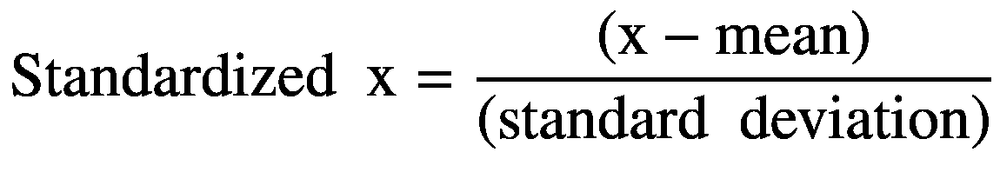

这是最常用的技术。它使均值为 0，标准差为 1。

2.  归一化用于将变量缩放到 0 和 1 之间，同时保留它们之间的比例范围。目标是使每个数据点具有相同的尺度，以便每个变量同等重要，如公式 5-1 所示。


（公式 5-1）  
3.  最小-最大归一化用于将数据缩放到 [0,1] 的范围；这意味着最大值被转换为 1，而最小值被赋值为 0。中间的所有其他值将获得 0 到 1 之间的小数值，如公式 5-2 所示。

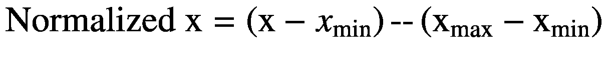

（公式 5-2）

由于最小-最大归一化将数据缩放在 0 和 1 之间，因此如果数据集中存在异常值，它的表现并不理想。例如，如果数据有 100 个观测值，其中 99 个观测值在 0 到 10 之间，而 1 个值为 50。由于 50 现在将被赋值为“1”，这将扭曲整个归一化后的数据集。

4.  对变量进行对数变换是为了改变分布的形状，特别是用于处理数据集中的偏斜度。

5.  分箱用于将数值减少以进行分类。例如，年龄可以分为青年、中年和老年。

这个数据清洗步骤并非易事。它确实是一个繁琐、迭代的过程。它考验耐心，并且需要商业洞察力、对数据集的理解、编码技能和常识。然而，我们进行的分析以及想要构建的机器学习模型的质量，都依赖于这一步。

现在，我们已经到了拥有数据集的阶段。它可能已经在一定程度上被清理干净，即使不是 100% 干净。

我们现在可以进入 EDA 阶段，这是下一个主题。


## 第 4 步：探索性数据分析（EDA）

EDA 是机器学习模型构建过程中最重要的步骤之一。我们检查所有变量，并理解它们的模式、相互依赖性、关系以及趋势。只有在 EDA 阶段，我们才能了解数据预期会如何表现。我们在此阶段从数据中发掘洞察和建议。强大的可视化效果能够完善整个 EDA 过程。

提示

EDA 是成功的关键。有时，恰当的 EDA 就能解决业务问题。

EDA 与数据清洗阶段之间只有一线之隔。显然，数据准备、特征工程、EDA 和数据清洗这些阶段之间存在步骤重叠。

EDA 主要有两个分支：*单变量*分析和*双变量*分析。顾名思义，单变量分析是针对单个变量进行的。双变量分析则用于理解两个变量之间的关系。

现在，我们将使用 Python 完成一个详细的案例。你可以按照以下步骤进行 EDA。为简洁起见，我们在此不粘贴所有结果。数据集和代码可在 Github 链接 [`https://github.com/Apress/supervised-learning-w-python/tree/master/Chapter%205`](https://github.com/Apress/supervised-learning-w-python/tree/master/Chapter%25205) 处获取。

步骤 1：导入必要的库。

```
import pandas as pd
import numpy as np
import matplotlib.pyplot as plt
%matplotlib inline
```

步骤 2：加载数据文件。

```
matches_df = pd.read_csv('matches.csv')
matches_df.head()
```

现在，我们将处理“比赛最佳球员”数据并进行可视化。

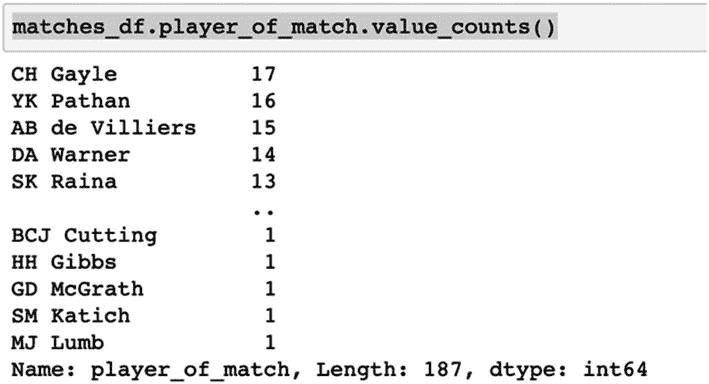

```
matches_df.player_of_match.value_counts()
matches_df.player_of_match.value_counts()[:10].plot('bar')
```

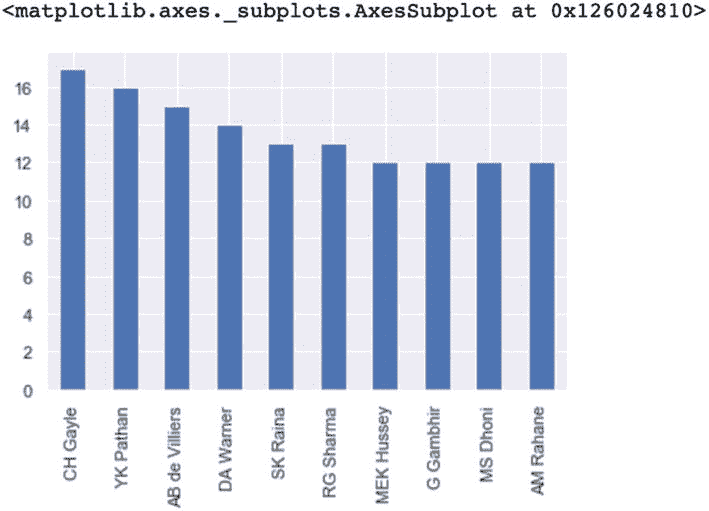

```
matches_df.player_of_match.value_counts()[:10].plot('ba
```

加载 deliveries 数据集；检查前五行数据。

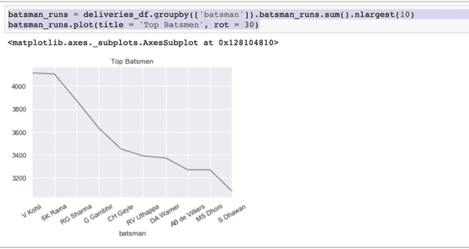

```
deliveries_df = pd.read_csv('deliveries.csv')
deliveries_df.head()
根据击球手的累计得分绘制图表
batsman_runs = deliveries_df.groupby(['batsman']).batsman_runs.sum().nlargest(10)
batsman_runs.plot(title = '最佳击球手', rot = 30)
```

可以使用以下代码创建相同的柱状图。

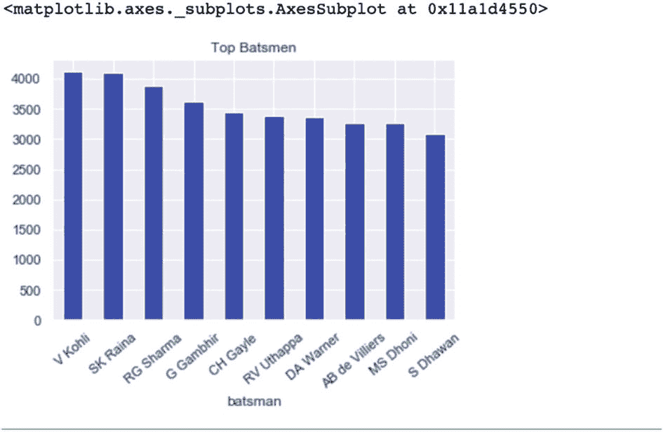

```
deliveries_df.groupby(['batsman']).batsman_runs.sum().nlargest(10)\
.plot(kind = 'bar',title = '最佳击球手', rot = 40, colormap = 'coolwarm')
```

让我们比较一下 2015 年和 2016 年的表现。

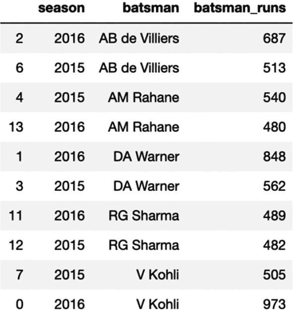

```
ipl = matches_df[['id', 'season']].merge(deliveries_df, left_on = 'id', right_on = 'match_id').drop('match_id', axis = 1)
runs_comparison = ipl[ipl.season.isin([2015, 2016])].groupby(['season', 'batsman']).batsman_runs.sum().nlargest(20).reset_index().sort_values(by='batsman')
vc = runs_comparison.batsman.value_counts()
batsmen_comparison_df = runs_comparison[runs_comparison.batsman.isin(vc[vc == 2].index.tolist())]
batsmen_comparison_df
```

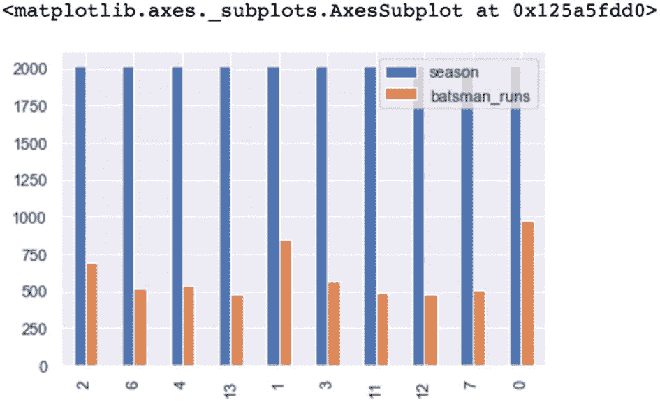

```
batsmen_comparison_df.plot.bar()
```

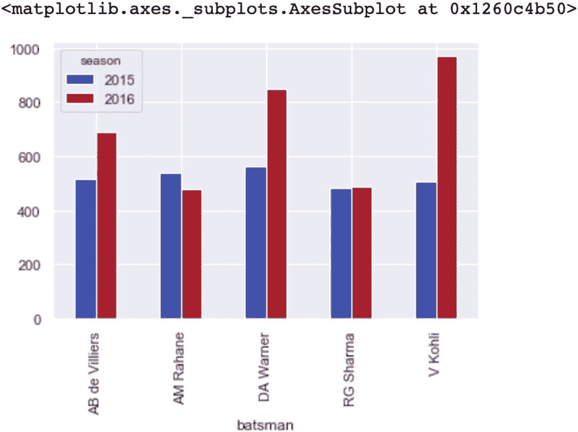

```
batsmen_comparison_df.pivot('batsman', 'season', 'batsman_runs').plot(kind = 'bar', colormap = 'coolwarm')
```

如果我们想检查比赛获胜的百分比并将其可视化为饼图，可以使用以下代码：

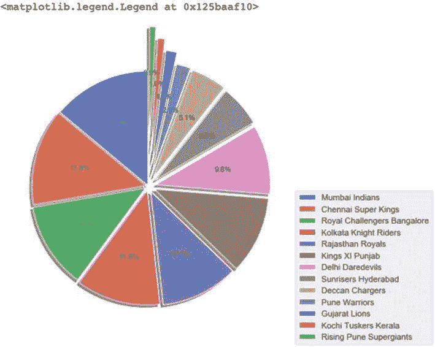

```
match_winners = matches_df.winner.value_counts()
fig, ax = plt.subplots(figsize=(8,7))
explode = (0.01,0.02,0.03,0.04,0.05,0.06,0.07,0.08,0.09,0.1,0.2,0.3,0.4)
ax.pie(match_winners, labels = None, autopct='%1.1f%%', startangle=90, shadow = True, explode = explode)
ax.legend(bbox_to_anchor=(1,0.5), labels=match_winners.index)
```

现在，我们将可视化一个数据集的直方图，该数据集中的胜利是通过“剩余 wickets”而非“剩余 runs”取得的。

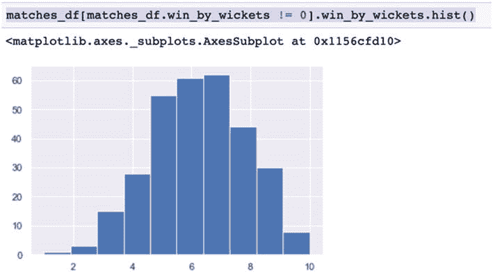

```
matches_df[matches_df.win_by_wickets != 0].win_by_wickets.hist()
```

现在我们将创建箱线图。

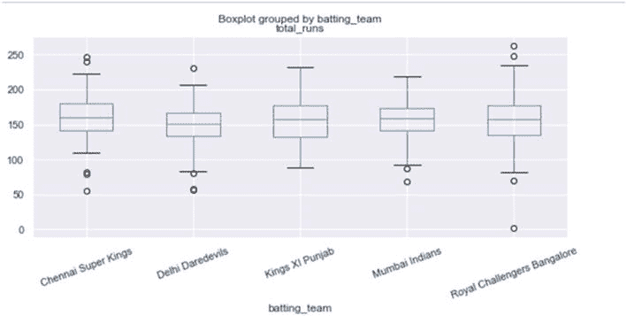

```
team_score = deliveries_df.groupby(['match_id', 'batting_team']).total_runs.sum().reset_index()
top_teams = deliveries_df.groupby('batting_team').total_runs.sum().nlargest(5).reset_index().batting_team.tolist()
top_teams_df = team_score[team_score.batting_team.isin(top_teams)]
top_teams_df.groupby('batting_team').boxplot(column = 'total_runs', layout=(5,1),figsize=(6,20));
top_teams_df.boxplot( column = 'total_runs',by = 'batting_team', rot = 20, figsize = (10,4));
```

我们在本书前面已经介绍了相关性指标。除此之外，还有多种方法可以执行 EDA。散点图、交叉表等都是很好的工具。

EDA 是构建稳健机器学习模型的基础。不幸的是，EDA 经常被忽视，或者投入的时间较少。这是一种危险的方法，可能会导致模型在后期阶段面临挑战。EDA 使我们能够衡量所有变量的分布范围，理解它们的趋势和模式，揭示相互关系，并为分析指明方向。大多数情况下，在 EDA 过程中显得重要的变量，机器学习模型也会发现其显著性。请记住，花在 EDA 上的时间对于项目的成功至关重要。这是一个吸引利益相关者并引起他们关注的有用资源，因为大多数洞察都相当有趣。可视化使洞察更具吸引力。此外，*非*机器学习或统计背景的受众将能够比机器学习模型更好地理解 EDA。因此，对数据进行稳健的 EDA 是明智之举。

现在是时候在下一节讨论机器学习模型构建阶段了。

## 第 5 步：机器学习模型构建

现在我们将讨论在机器学习模型开发阶段遵循的流程。一旦 EDA 完成，我们现在对数据集有了广泛的了解。我们对自己数据集中存在的许多趋势和相关性有了一定程度的清晰认识。现在我们必须进入实际的模型创建阶段。

我们了解在实际模型构建过程中遵循的步骤。我们在前面的章节中已经解决了许多案例研究。但在进行模型构建时，有几点我们应该注意。这些点涉及我们面临的常见问题或常犯的错误。我们将在本节中讨论它们。

我们将从数据的训练集和测试集划分开始。


### 训练/测试数据划分

我们知道，模型在训练数据上进行训练，并在测试/验证数据集上测试其准确性。原始数据被划分为训练/测试集或训练/测试/验证集。有多种常用的划分比例。对于训练/测试划分，我们可以使用 70:30 或 80:20 的比例。对于训练/测试/验证划分，则可以分别使用 60:20:20 或 80:10:10 的比例。

虽然我们了解训练数据和测试数据的用法，但仍需注意以下几点：

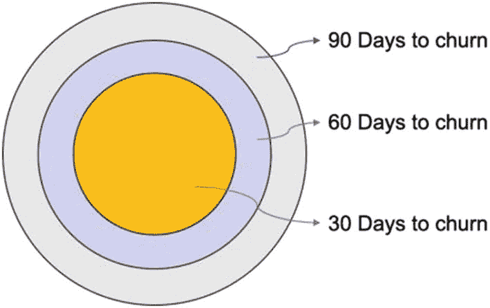

图 5-6

客户数据集彼此之间存在子集关系。例如，将在 30 天内流失的客户是将在 90 天内流失的客户的一个子集。

1.  训练数据应能代表业务问题。例如，如果我们正在处理电信运营商的预付费客户群体，那么训练数据应仅包含预付费客户，而不包含后付费客户，尽管这一点在数据发现阶段可能已经检查过。

2.  在采样训练或测试数据集时不应存在任何偏差。有时，在创建训练或测试数据时，会基于时间或产品引入偏差。必须避免这种情况，因为这样进行的训练将是不正确的。最终输出的模型会对未见过的数据产生错误的预测。

3.  在训练阶段，验证数据集不应暴露给算法。如果我们将数据划分为训练集、测试集和验证集，那么在训练阶段，我们会在训练集和测试集上检查模型的准确性。验证数据集将仅使用一次，并且是在最终阶段，当我们想要检查模型的稳健性时。

4.  所有数据处理操作，如处理异常值、空值等，应仅应用于训练数据，而不应用于测试数据集或验证数据集。

5.  目标变量定义了问题，并掌握着解决方案的关键。例如，零售商希望构建一个模型来预测哪些客户将会流失。在创建数据集时，需要考虑两个方面：
    1.  目标变量的定义，或者说它的标签，将决定数据集的设计。例如，在表 5-12 中，如果目标变量是“流失”，那么模型将预测从系统中流失的倾向。如果是“未流失”，则意味着留在系统中而不流失的倾向。

        表 5-12

        目标变量的定义会改变整个业务问题，进而改变模型

        | -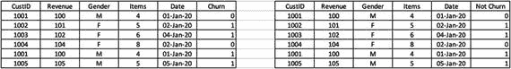 |

    2.  我们感兴趣预测事件的时间跨度。例如，如图 5-6 所示，将在未来 60 天内流失的客户与将在 90 天内流失的客户是不同的。

训练数据和测试数据的创建是进行实际建模之前最关键的一步。如果创建的数据集中存在任何偏差或不完整性，那么输出的机器学习模型也将是有偏差的。

一旦我们获得了训练和测试数据集，我们就进入模型构建的下一步。

#### 模型构建与迭代

现在是构建实际机器学习模型的时候了。根据手头的问题，如果我们正在开发一个监督学习解决方案，我们可以选择回归方法或分类算法。然后，我们将从可用的算法列表中选择一个算法。图 5-7 展示了所有算法的可解释性与准确性之间的关系。

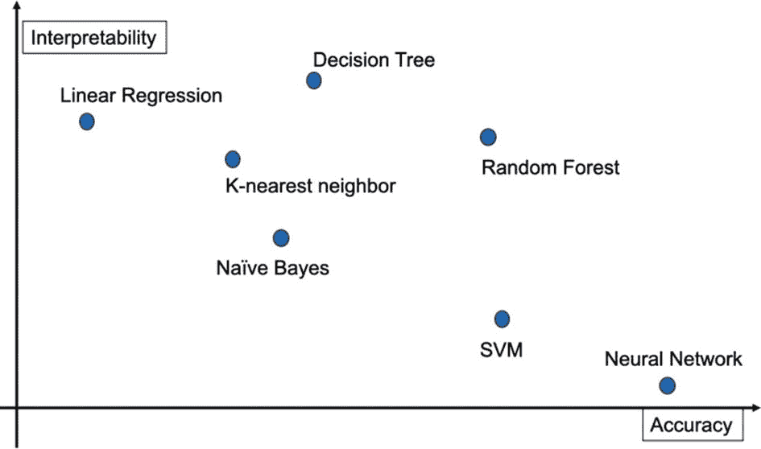

图 5-7

各种算法在准确性和可解释性方面的排列

通常，我们从基础算法开始，例如线性回归、逻辑回归或决策树。这为我们设定了其他算法需要突破的基本基准。

然后，我们继续使用其他分类算法来训练模型。在准确性、训练速度、预测速度、稳健性和易于理解性之间，始终存在一种权衡。这也取决于变量的性质；例如，k-近邻算法需要数值变量，因为它需要计算各个数据点之间的距离。需要采用独热编码将分类变量转换为相应的数值。

在创建训练数据之后，机器学习建模过程可以设想为以下步骤。我们以分类问题为例：

1.  使用逻辑回归或决策树创建算法的初始版本。

2.  在训练数据集上衡量性能。

3.  迭代以提高模型的训练性能。在迭代过程中，我们尝试添加或删除变量、更改超参数等组合。

4.  在测试数据集上衡量性能。

5.  比较训练和测试性能；模型不应过拟合（下一节将详细介绍）。

6.  使用其他算法（如随机森林或支持向量机）进行测试，并对它们执行相同级别的迭代。

7.  根据训练和测试准确性选择最佳模型。

8.  在验证数据集上衡量性能。

9.  在跨时间数据集上衡量性能。

scikit-learn 库提供了一个极好的速查表，网址为 [`https://scikit-learn.org/stable/tutorial/machine_learning_map/index.html`](https://scikit-learn.org/stable/tutorial/machine_learning_map/index.html)。

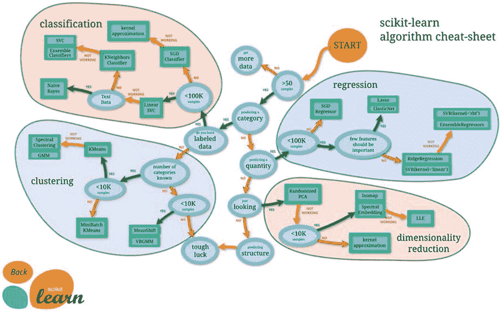

在此步骤结束时，我们将获得各种算法的准确性。我们现在将讨论衡量准确性的最佳实践。


#### 精度测量与验证

我们已经讨论了回归和分类问题中使用的各种精度测量参数。用于精度测量的关键绩效指标（KPI）将取决于具体的业务问题。回想一下之前讨论的欺诈检测案例研究：在该案例中，精度并不是正确的 KPI；相反，召回率才是应该瞄准和优化的 KPI。因此，根据具体目标，精度参数会发生变化。在机器学习模型阶段，比较各种算法是一种良好的实践，如表 5-13 所示。

表 5-13

比较所有算法的性能测量参数以选择最佳算法

| 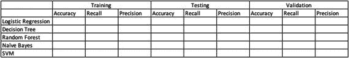 |

然后我们可以做出决定，选择最佳算法。选择算法的决定还将取决于诸如训练所需时间、预测所需时间、部署便捷性、刷新便捷性等参数。

除了精度测量，我们还会检查预测所需时间和模型的稳定性。如果模型用于实时预测，那么预测所需时间就成为一个关键 KPI。

同时，我们还必须验证模型。模型验证是最关键的步骤之一。它检查模型在新的、未见过的数据集上的表现如何。而这正是我们模型的主要目标：在新的、未见过的数据集上做出良好预测！

在时间外数据集上测试模型性能总是一个好习惯。例如，如果模型是在 2017 年 1 月至 2018 年 12 月的数据集上训练的，我们应该在时间外数据（如 2019 年 1 月至 2019 年 4 月）上检查其性能。这确保了模型能够在未见过的、不属于训练集的数据集上表现良好。接下来，我们将研究阈值对算法的影响以及如何在下一节中进行优化。

### 为分类算法寻找最佳阈值

还有一个关于最优阈值的重要概念，它对分类算法很有用。*阈值*指的是一个观测值将属于某个类别的概率分数上限。它在衡量模型性能方面起着重要作用。

例如，假设我们正在构建一个预测模型，用于预测客户是否会流失。假设分类设置的阈值为 0.5。因此，如果模型为某个客户生成的分数为 0.5 或以上，则该客户被预测为会流失；否则不会。这意味着一个概率分数为 0.58 的客户将被归类为“预测会流失”。但如果阈值改为 0.6，那么同一个客户将被归类为“非流失客户”。这就是设置阈值的影响。

默认阈值设置为 0.5，但这通常不适用于不平衡数据集。优化阈值是一项重要任务，因为它会严重影响最终结果。

我们可以使用 ROC 曲线来优化阈值。最佳阈值是真阳性率和（1-假阳性率）相互重叠的点。这种方法在最小化假阳性率的同时最大化真阳性率。然而，建议在不同阈值下测试模型性能，以确定最佳值。最佳阈值还取决于我们试图解决的业务问题。

在模型开发阶段，我们常遇到一个常见问题：过拟合和欠拟合，我们现在就来讨论这个问题。

### 过拟合与欠拟合问题

在模型开发过程中，我们经常面临欠拟合或过拟合的问题。它们也被称为*偏差-方差权衡*。偏差-方差权衡指的是机器学习模型的一种属性，即在测试模型性能时，我们发现模型具有低偏差但高方差，反之亦然，如图 5-8 所示。

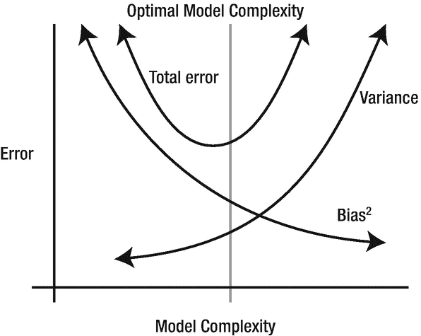

图 5-8

偏差-方差权衡。注意，最佳模型复杂度是偏差和方差都达到平衡的最佳点

模型的欠拟合是指该模型无法做出准确预测。模型是幼稚且非常简单的。由于我们创建了一个非常简单的模型，它无法公正地处理数据集，如图 5-9 所示。

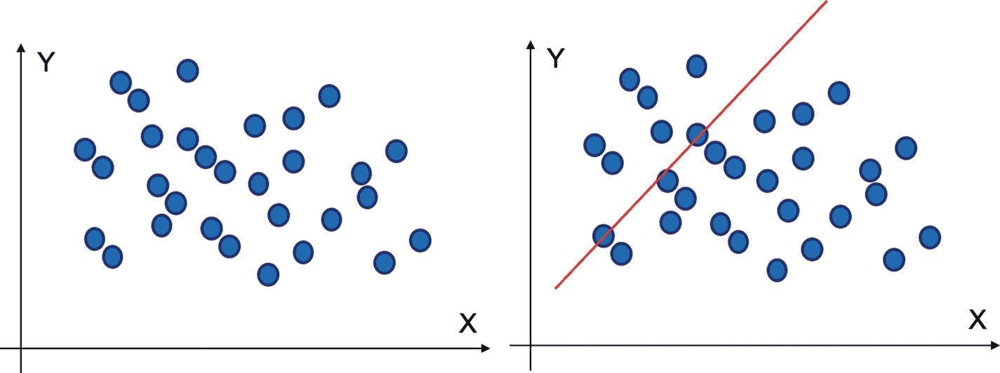

图 5-9

欠拟合，即创建了一个非常简单的模型

另一方面，过拟合则恰恰相反（图 5-10）。如果我们创建了一个训练精度高但测试精度低的模型，这意味着算法非常细致地学习了训练数据集的参数。该模型对训练数据集给出了良好的精度，但对测试数据集则不然。

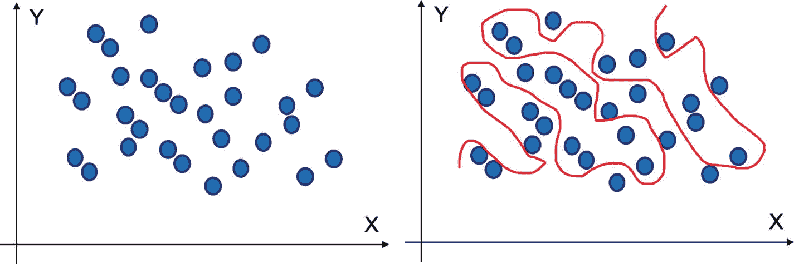

图 5-10

过拟合，即创建了一个非常复杂的模型

欠拟合可以通过增加模型的复杂度来解决。欠拟合意味着我们为机器学习方法选择了一个过于简单的解决方案，而手头的问题需要更高的复杂度。我们可以很容易地识别出欠拟合的模型。模型的训练精度不会很好，因此我们可以得出结论，该模型甚至无法在训练数据上表现良好。为了解决欠拟合，我们可以训练一棵更深的树，或者不拟合线性方程，而是拟合非线性方程。使用像 SVM 这样的高级算法可能会带来改进的结果。

提示

有时数据中根本没有模式。即使使用最复杂的机器学习算法也不会带来好的结果。在这种情况下，进行非常深入的探索性数据分析（EDA）可能会有所帮助。

对于过拟合，我们可以采用以下方法：

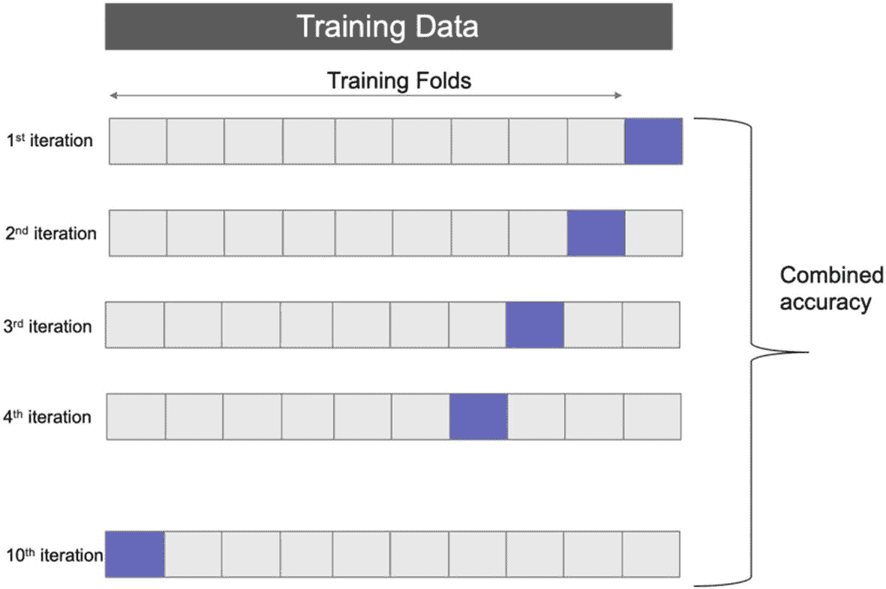

图 5-11

k 折交叉验证是解决过拟合问题的绝佳技术

1.  也许最简单的方法是使用更多数据进行训练。但如果新数据集很混乱，或者新数据集与旧数据集相似且没有增加额外信息，这种方法可能并不总是有效。

2.  k 折交叉验证是应对过拟合的一种强大方法。它允许我们调整各自的超参数，并且在最终选择确定之前，测试集将完全是未见过的。

k 折验证技术如图 5-11 所示。这是一种非常易于实现和理解的方法。在这种技术中，我们迭代地将数据划分为训练“折”和测试“折”。

在 k 折验证中，我们遵循以下步骤：

1.  我们随机打乱数据集，然后将其分成 k 组。

2.  对于每一组，我们将其作为测试集。其余组作为训练集。

3.  通过在每个组上使用训练集进行训练并在测试集（也称为保留集）上进行测试，来拟合机器学习模型。

4.  最终精度是所有精度的汇总。


这意味着每个数据点都有机会同时成为测试集和训练集的一部分。在实验的整个周期中，每个观测值都保持在一个组内并留在该组中。因此，每个观测值被用于测试一次，用于训练 (k–1) 次。

k 折验证代码的 Python 实现已提交至 Github 仓库。

5.  与决策树相比，随机森林等集成方法更容易对抗过拟合。

6.  正则化是对抗过拟合的技术之一。该技术使模型系数收缩至零或接近零。其理念是，如果方程中添加了更多变量，模型将受到惩罚。

有两种正则化方法：Lasso（L1）回归和 Ridge（L2）回归。方程 5-3 可能在前面的章节中已经提到过。

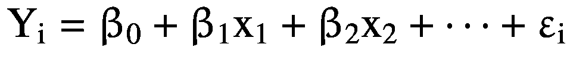

（方程 5-3）

同时，我们有一个损失函数需要优化以获得最佳方程。这就是残差平方和（RSS）。

在 Ridge 回归中，一个收缩量被添加到 RSS 中，如方程 5-4 所示。

因此，修改后的

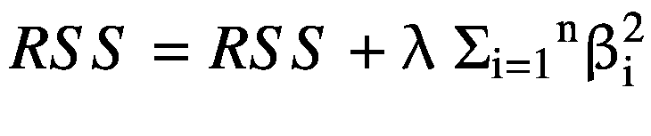

（方程 5-4）

这里的 λ 是调整参数，它将决定我们想要对模型施加多大的惩罚。如果 λ 为零，则没有影响，但当它变大时，系数将开始趋近于零。

在 Lasso 回归中，一个收缩量被添加到 RSS 中，与 Ridge 类似但有所变化。不是平方，而是取绝对值，如方程 5-5 所示。

因此，修改后的


（方程 5-5）

在这两种模型之间，岭回归影响了模型的可解释性。它可以将非常重要变量的系数收缩到接近零。但它们永远不会为零，因此模型将始终包含所有变量。而在 Lasso 中，一些参数可以精确为零，这使得该方法也有助于变量选择和创建稀疏模型。

7.  决策树通常会过拟合。我们可以通过以下两种方法在决策树中对抗过拟合：
    1.  我们可以调整超参数并对树的生长设置约束：例如最大深度、所需的最大样本数、分裂的最大特征数、最大终端节点数等参数。

2.  第二种方法是剪枝。剪枝与构建树相反。基本思想是，一棵非常大的树会过于复杂，无法很好地泛化，从而导致过拟合。回想一下，在第 4 章中，我们使用决策树中的剪枝开发了代码。

决策树遵循贪婪方法，因此决策仅基于当前状态，而不依赖于未来的预期状态。这种方法最终会导致过拟合。剪枝帮助我们解决这个问题。在决策树剪枝中，我们
        1.  让树生长到最大可能的深度。

2.  然后从底部开始，移除那些与顶部相比不提供任何益处的终端节点。

请注意，机器学习解决方案的目标是对未见过的数据集进行预测。模型在历史训练数据上进行训练，以便理解训练数据中的模式，然后利用这些智能对新数据和未见过的数据进行预测。因此，评估模型在测试集和验证集上的性能至关重要。如果选择了过拟合的模型，它将无法处理新的数据点，从而失去创建机器学习模型的业务意义。

模型选择是最关键但也最令人困惑的步骤之一。很多时候，我们倾向于选择更复杂或更先进的算法，而不是更简单的算法。然而，如果简单的逻辑回归算法和先进的 SVM 给出相似的准确率，我们应该选择更简单的那个。更简单的模型更容易理解，对不断变化的业务需求更灵活，部署更直接，并且未来维护和更新也更轻松。一旦我们最终选择了要在生产环境中部署的算法，要替换它就会变得非常困难！

下一步是向关键利益相关者展示模型和见解，以获取他们的建议。

### 关键利益相关者讨论与迭代

与关键业务利益相关者保持密切联系是一个好习惯。有时，在与关键利益相关者讨论后需要进行一些迭代。他们可以利用业务敏锐度和理解力来提供意见。

### 展示最终模型

机器学习模型已经准备好了。我们已经与关键利益相关者进行了初步的讨论轮次。现在是时候向更广泛的受众展示模型，以收集他们的反馈和意见了。

我们必须记住，机器学习模型需要被业务的多个职能部门使用。因此，所有职能部门在见解上保持一致至关重要。

恭喜！您已经拥有一个功能完善、经过验证、测试且（至少部分）获得批准的模型。然后将其呈现给所有利益相关者和团队进行详细讨论。如果一切顺利，该模型就可以部署到生产环境中了。


## 第六步：模型部署

到目前为止，我们已经了解了模型开发的所有阶段。机器学习模型基于历史数据进行训练，它生成了一系列洞察以及一个编译后的模型版本。该模型必须用于对新的、未见过的数据集进行预测。这个模型已经准备好投入生产环境，这被称为*部署*。现在我们将详细审视所有概念。

与传统软件工程相比，机器学习是一种不同类型的软件。对于一个机器学习模型，需要多种力量协同作用才能实现。我们现在必须讨论它们，因为它们是构建稳健且实用解决方案的基石。

关键要素如图 5-12 所示。

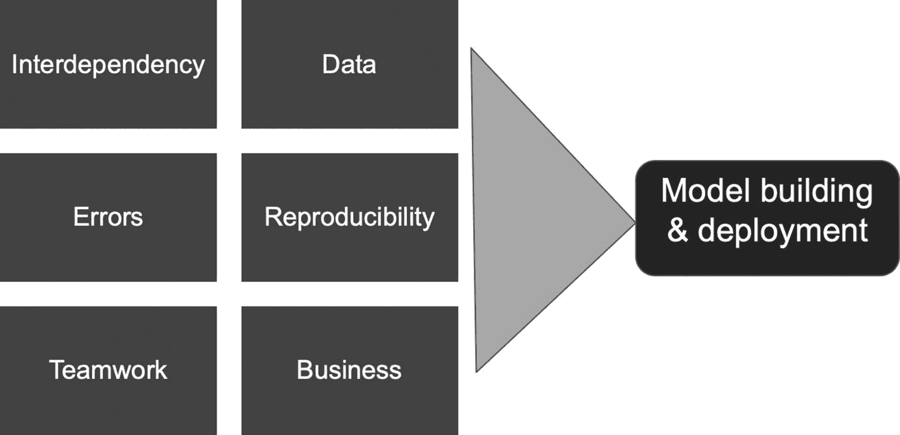

图 5-12

机器学习解决方案的关键要素，它们是解决方案的基础

1.  **相互依赖性**在机器学习解决方案中指的是各个变量之间的关系。如果其中一个变量的值发生变化，就会对其他变量的值产生影响。因此，变量之间是相互依赖的。同时，机器学习模型有时对数据点值的微小变化也相当“敏感”。

2.  **数据**是模型的核心。数据为模型提供动力；数据是原材料，是一切之源。然而，有些数据点非常不稳定，总是处于变化之中。因此，我们在设计系统时必须追踪这些数据变化。模型和数据是协同工作的。

3.  **错误**随时可能发生。我们在部署时计划了很多事情。我们确保部署的是正确版本的算法。通常，这个版本是在最新数据集上训练过并经过验证的。

4.  **可复现性**是机器学习模型所需且期望但难以实现的特性之一。对于在动态数据集上训练的模型，或者像医疗设备或银行这类受协议和规则约束的领域，尤其如此。想象一下，在医疗设备行业，构建了一个图像分类模型来根据图像区分合格与不合格产品。在这种情况下，组织必须遵守协议，并向监管机构提交技术报告。

5.  **团队合作**是整个项目的核心。一个机器学习模型需要数据工程师、数据分析师、数据科学家、功能顾问、业务顾问、利益相关者、开发运维工程师等人的时间和关注。对于部署，我们也需要其中一些职能部门的指导和支持。

6.  **业务**利益相关者和赞助商是成功机器学习解决方案的关键。他们将指导如何消费和使用该解决方案来解决业务问题。

提示

部署并非易事；它需要时间、团队合作和多种技能来处理。

在开始部署机器学习模型之前，我们应该明确几个问题。除了我们在上一段中讨论的关键要素外，我们还应该了解关于机器学习模型的以下几点：

1.  我们必须检查机器学习模型是实时运行还是以批量预测模式运行。例如，检查一笔传入交易是否欺诈是实时检查的一个例子。如果我们预测客户是否会违约，那不是一个实时系统，而是批量预测模式，我们甚至可以等到第二天再进行预测。

2.  我们将要处理的数据量是一个需要回答的大问题。因此，了解传入请求的大小很重要。例如，如果一个在线交易系统预期每秒处理 10 笔交易，而另一个系统预期每秒处理 1000 笔交易，那么负载管理和决策速度将产生巨大差异。

3.  我们还要确保检查模型的性能，包括预测所需时间、稳定性、内存需求以及最终输出的生成方式。

4.  然后，我们还要决定模型是需要开关式训练还是实时训练。
    1.  开关式训练是指我们在历史数据上训练模型，并将其投入生产，直到其性能下降。然后我们将刷新模型。

2.  实时训练允许机器学习模型在实时数据集上进行训练，然后重新训练。它使机器学习模型始终能够适应新的数据集。

5.  需要决定机器学习模型中期望的自动化程度。这将有助于我们更好地规划手动步骤。

一旦我们回答了这些问题，我们就明确了模型的目的和业务逻辑。经过一轮彻底的测试，模型就可以迁移到生产环境了。然后我们应该着手处理以下几点：

1.  一切从拥有一个数据库开始。数据库可以在云端，也可以在传统服务器上。它包含模型将用于消费传入数据的所有表和源，如图 5-13 所示。有时，一个单独的框架会将数据馈送给模型。

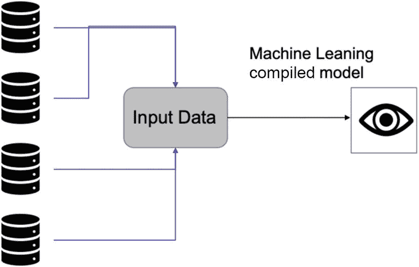

图 5-13

机器学习模型可以从多个来源获取输入数据

2.  如果某个变量不是原始变量，而是派生变量，那么在为数据创建数据源时就应该处理好这一点。例如，考虑一个零售商，传入的原始数据是当天的客户交易详情。我们构建了一个模型来预测客户流失，其中一个重要变量是客户的平均交易价值（总收入/交易次数）；那么这个变量将成为数据提供者表的一部分。

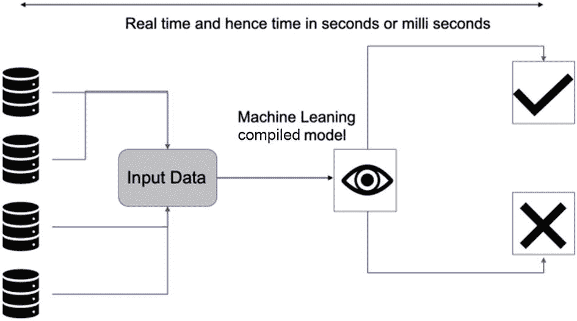

图 5-16

实时预测系统需要几秒或几毫秒来进行预测

1.  这些传入数据对于机器学习模型来说是新的、未见过的。数据包含编译后模型所期望格式的数据。如果数据不是所期望的格式，则会出现运行时错误。因此，彻底检查输入数据至关重要。如果我们有一个使用神经网络的图像分类模型，我们应该检查输入图像的维度是否与网络期望的相同。同样，对于结构化数据，应检查输入数据是否符合预期，并检查变量的名称和类型（整数、字符串、布尔值、数据框等）。

2.  编译后的模型存储为序列化对象，例如 Python 的 `.pkl` 文件、R 语言的 `.R` 文件、MATLAB 的 `.mat` 文件、`.h5` 文件等。这是用于进行预测的编译对象。有几种可用的格式：
    1.  Pickle 格式用于 Python。该对象是一个流式对象，可以加载和共享。也可以在以后使用。

2.  ONNX（开放神经网络交换格式）允许存储预测模型。同样，PMML（预测模型标记语言）是另一种使用的格式。

3.  模型的目标、要进行的预测的性质、传入数据的量、实时预测还是开关式预测等，使我们能够为问题设计出良好的架构。


4.  在模型部署方面，我们有多种选择。我们可以按以下方式部署模型：
    1.  **Web 服务**：机器学习模型可以作为 Web 服务进行部署。这是一个很好的方法，因为它可以处理 Web、移动端和桌面端等多种接口。我们可以设置一个 API 包装器，并将模型部署为 Web 服务。该 API 包装器负责对未见过的数据进行预测。

使用 Web 服务方法时，Web 服务可以接收输入数据，并将其转换为模型所期望的数据集或数据框。然后，它可以使用该数据集（无论是连续变量还是分类变量）进行预测，并返回相应的值。

考虑这样一个场景：一家零售商在线销售专业产品，其大部分业务来自回头客。现在，该零售商推出了一款新产品，并希望针对现有客户群进行营销。

因此，我们希望部署一个机器学习模型，该模型能根据客户最近的历史交易记录，预测其是否会购买这款新产品。我们在图 5-14 中描绘了整个过程。

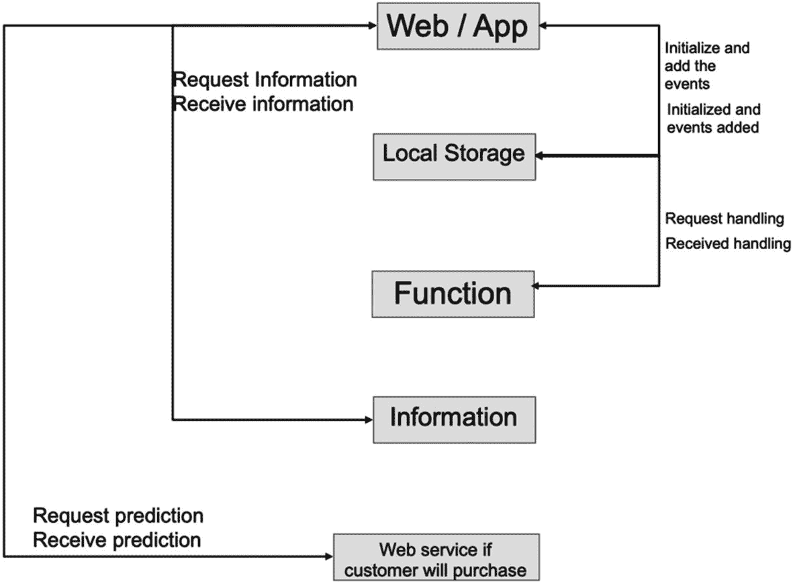

图 5-14

基于 Web 服务的部署流程

需要注意的是，我们已经拥有客户过去行为的历史信息。由于需要对一组新信息进行预测，因此必须将这些信息合并，然后共享给预测服务。

作为第一步，网站或应用程序进行初始化，并向信息模块发出请求。信息模块包含客户历史交易等信息。它将这些客户信息返回给 Web 应用程序。Web 应用在本地初始化客户档案并存储这些信息。同样，在 Web 或应用程序中发生的新事件链或触发器也会被获取。这些数据点（旧客户详情和新数据值）被共享给一个函数或包装函数，该函数根据新的数据点更新接收到的信息。然后，这个更新后的信息被共享给预测 Web 服务，以生成预测并接收返回值。

在这种方法中，我们可以使用 AWS Lambda 函数、Google Cloud 函数或 Microsoft Azure 函数。或者，我们可以使用 Docker 等容器来部署 Flask 或 Django 应用程序。

5.  **与数据库集成**：这可能是最常用的方法。如图 5-15 所示，这种方法比基于 Web 服务的方法更简单，但仅适用于较小的数据库。

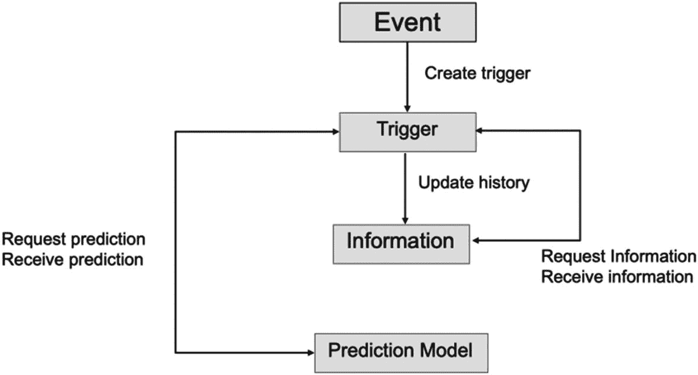

图 5-15

与数据库集成以部署模型

在这种方法中，一旦发生新交易，就会生成一个事件。该事件创建一个触发器。此触发器将信息共享给客户表，数据在其中更新，然后更新后的信息被共享给事件触发器。接着，运行预测模型，生成预测分数，以预测客户是否会购买新推出的产品。最后，根据预测结果再次更新客户数据。

这是一种更简单的方法。我们可以使用 MSSQL、PostGres 等数据库。

我们还可以将模型部署到原生应用程序中，或作为 Web 应用程序部署。预测性机器学习模型可以作为本地服务在外部运行。这种方法使用并不广泛。模型部署后，系统需要消费其产生的预测结果。

6.  接下来需要考虑的步骤是消费机器学习模型所做的预测。
    1.  如果模型进行的是*实时*预测，如图 5-16 所示，那么模型可以返回一个信号，例如通过/失败或是/否。模型也可以返回一个概率分数，然后由传入的请求进行处理。

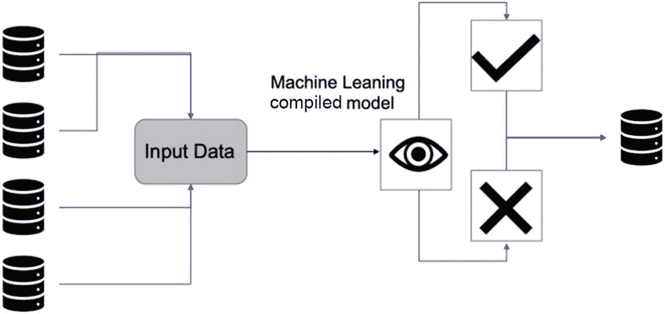

图 5-17

批量预测保存到数据库

1.  如果模型不是实时模型，那么模型可能会生成概率分数，这些分数需要保存到数据库中的一个单独表中。这被称为*批量预测*，如图 5-17 所示。因此，模型生成的分数必须写回数据库。并非必须写回预测结果。我们可以将预测结果写入 .csv 或 .txt 文件，然后上传到数据库。通常，预测结果会附带生成该预测所依据的所有原始输入数据的详细信息。

对于回归问题，生成的预测可以是连续值；对于分类问题，可以是概率分数或类别。根据预测结果，我们可以进行相应的配置。

1.  我们可以使用任何允许我们创建、训练和部署模型的云平台。一些最常见的选项包括：
    1.  AWS SageMaker

2.  Google Cloud AI 平台

3.  Azure Machine Learning Studio（属于 Azure Machine Learning 服务的一部分）

4.  IBM Watson Studio

5.  Salesforce Einstein

6.  MathWorks 提供的 MATLAB

7.  RapidMiner 提供的 RapidMiner AI Cloud

8.  TensorFlow Research Cloud

恭喜！模型已部署到生产环境，并正在对真实且未见过的数据集进行预测。很激动，对吧？

## 第 7 步：文档编写

我们的模型已部署，现在必须确保所有代码都已清理、检入并妥善记录。可以使用 Github 进行版本控制。

模型的文档编写也取决于使用它的组织和领域。在受监管的行业中，妥善记录所有细节是至关重要的。

## 第 8 步：模型刷新与维护

我们现在已经了解了模型开发和部署的所有阶段。但是，一旦模型投入生产，就需要持续监控。我们必须确保模型始终以期望的准确度水平运行。为此，建议设置一个仪表板或监控系统来定期评估模型的性能。如果没有这样的系统，可以对模型进行每月或每季度的检查。

模型刷新可以遵循图 5-18 所示的方法。这里我们展示了完整的逐步方法。


图 5-18

机器学习模型刷新与维护流程

模型部署后，我们可以每月对模型进行随机检查。如果性能不佳，则需要对模型进行刷新。即使模型性能没有下降，定期使用不断生成和保存的新数据点来刷新模型仍然是一个好习惯。

至此，我们完成了设计机器学习系统、从头开始开发、以及部署和维护它的所有步骤。这是一个漫长且相当繁琐的过程，需要团队合作。

至此，我们来到了本书最后一章的结尾。


## 总结

在最后一章中，我们研究了一个模型的生命周期——从零开始到维护。根据业务领域和具体用例，也可能存在其他方法和流程。

至此，本书即将结束。我们以机器学习及其主要类别的介绍开启了本书。在接下来的章节中，我们讨论了回归问题，随后解决了分类问题。接着是更高级的算法，如支持向量机和神经网络。在最后一章中，我们集大成地创建了端到端的模型开发流程。Python 代码和案例研究则辅助了理解。

数据是新的石油、新的电力、新的动力和新的货币。这个领域正在迅速发展，其影响力遍及全球。随着如此迅猛的发展，该领域开辟了新的就业机会，并创造了新的职位头衔。数据分析师、数据工程师、数据科学家、可视化专家、机器学习工程师——这些职位在十年前并不存在。如今，对此类专业人才的需求巨大。但能够满足这些职位描述严格标准的人才却十分匮乏。当务之急是拥有能够将业务目标与分析问题相结合，并构想出解决动态业务问题方案的*数据艺术家*。

数据正在影响所有的业务、运营、决策和政策。每天都有越来越复杂的系统被创造出来。数据及其力量是巨大的：我们可以看到自动驾驶汽车、聊天机器人、欺诈检测系统、面部识别解决方案、物体检测解决方案等例子。我们能够快速生成洞察、扩展解决方案、进行可视化并即时做出决策。医疗行业可以研发更好的药物，银行和金融部门可以降低风险，电信运营商可以提供更好、更稳定的网络覆盖，零售行业可以提供更优惠的价格和更好的客户服务。用例数不胜数，并且仍在不断探索中。

但如何利用这股数据的力量，责任在于我们。我们可以将其用于造福人类，也可以用于毁灭。我们可以用机器学习和人工智能来传播爱或仇恨——这是我们的选择。正如那句老话所说——能力越大，责任越大！

练习题

问题 1：什么是过拟合？我们如何应对它？

问题 2：部署模型有哪些可用的选项？

问题 3：有哪些可用的变量转换类型？

问题 4：L1 和 L2 正则化有什么区别？

问题 5：解决我们在前几章中做过的练习题，并在处理缺失值和相关变量后比较准确率。

问题 6：探索性数据分析有哪些步骤？

问题 7：从以下链接下载 NFL 数据集，并处理其中的缺失值：[`https://www.kaggle.com/maxhorowitz/nflplaybyplay2009to2016`](https://www.kaggle.com/maxhorowitz/nflplaybyplay2009to2016)。

问题 8：我们如何定义一个有效的业务问题？


索引 A AdaBoosting 赤池信息准则（AIC） Anaconda-Navigator 人工神经网络（ANN） B 装袋模型 词袋（BOW）方法 批量预测 贝叶斯信息准则（BIC） 贝叶斯优化 偏差-方差权衡 二项分布 提升算法 AdaBoosting 定义 最终模型 梯度提升 另见梯度提升 SVM 另见支持向量机（SVM） 训练数据集 C CatBoost 卡方自动交互检测（CHAID） 分类算法 准确性评估标准 应用 信用风险 业务背景 业务目标 数据集 基于人口普查数据的收入预测 k-近邻 逻辑回归 朴素贝叶斯 监督分类算法 目标变量与自变量 基于树的算法 聚类分析 混淆矩阵 余弦相似度 交叉熵 D 数据分析 数据爆炸 数据完整性 数据挖掘 数据质量 数据科学 数据有效性 深度学习 双重信息距离（DID） E, F 端到端模型 业务问题 数据清洗与准备 数据发现阶段 数据集 分类变量处理 常见问题 重复值 不平衡 缺失值 存在异常值 机器学习模型部署 文档化 EDA 阶段 关键业务利益相关者 机器学习模型构建 机器学习模型开发 模型刷新与维护 过拟合 *vs.* 欠拟合 问题阈值 分类算法 训练/测试数据分割 欧几里得距离 ExtraTreeClassifier 极端梯度提升 G 基尼系数 Github 链接 Goldfeld-Quandt 检验 梯度提升 CatBoost 基于集成的先进算法 极端梯度提升 轻量梯度提升 属性 梯度下降 H, I 超参数 假设检验 J 垃圾字符 Jupyter notebook K KD 树 最近邻 核 SVM（KSVM） k 折交叉验证 k-近邻 柯尔莫哥洛夫-斯米尔诺夫检验 L 词汇规范化 基于库的清洗 轻量梯度提升 M 机器学习（ML） 银行、金融服务与保险行业 聚类分析 定义 语言与工具 制造业 普及度 准备工作 主成分回归 *vs.* 分类问题 零售 半监督算法 软件工程 统计学/数学 偏差-方差权衡 二项分布 相关性与协方差 描述性 *vs.* 推断性统计 离散 *vs.* 连续变量 集中趋势度量 正态/高斯分布 数值 *vs.* 分类数据 参数 *vs.* 统计量 泊松分布 总体 *vs.* 样本 向量与矩阵 步骤与流程 监督学习 电信行业 无监督学习算法 曼哈顿距离 平均绝对误差（MAE） 均方误差（MSE） 小批量梯度下降 多重共线性 多元线性回归 多元自适应回归样条（MARS） N 非线性回归分析 非参数模型 零假设 O 独热编码 开放神经网络交换格式（ONNX） 普通最小二乘法（OLS） P, Q 词性标注 泊松分布 预测模型标记语言（PMML） 伪 R 平方 p 值 Python 3.5 Python 代码 R 半径最近邻分类器 随机森林 实时预测系统 回归分析 业务求解与决策 连续变量 回归问题有效性 集成方法 特征选择 异方差性 线性回归假设 基准模型 相关性 定义 数学方程 机器学习方程 模型系数 随机误差 目标变量/内生变量 向量空间图 多重共线性 多元线性回归 另见多元线性回归 非线性 非线性回归分析 异常值 简单线性回归 另见简单线性回归 统计算法 基于树的算法 ReLU 激活函数 S 半监督算法 情感分析 Sigmoid 激活函数 简单线性回归 为房价数据集创建 Softmax 函数 垃圾邮件过滤 随机梯度下降 停用词移除 结构化数据 监督算法 激活函数 ANN 分类模型 深度学习 超参数 图像分类模型 图像数据 农业 挑战 医疗保健 保险 管理流程 制造业 数学建模 零售 安全与监控 自动驾驶汽车 社交媒体平台与在线市场 神经网络训练过程 优化函数 结构化与非结构化数据集 文本分析过程 文本数据 词袋方法 挑战 数据清洗 提取与管理 特征提取 语言翻译 机器学习模型 新闻分类/文档分类 N-gram 与语言模型 词性标注 情感分析 垃圾邮件过滤 词频与逆文档频率 文本摘要 分词 词嵌入 监督分类算法 监督学习算法 支持向量机（SVM） 癌症检测案例研究 核 SVM 最大间隔超平面 回归与分类问题 结构化数据集 二维空间 T tanh 激活函数 自上而下的贪心方法 基于树的算法 构建模块 C4.5 CHAID 分类与回归树 分类误差 熵与信息增益 基尼系数 不纯/异质 迭代二分器 3 逻辑回归问题 MARS 纯/同质 分裂 交通方式依赖 U 非结构化数据 无监督学习算法 V 方差膨胀因子（VIF） W, X, Y, Z Web 服务 基于 Web 服务的部署过程 词嵌入
