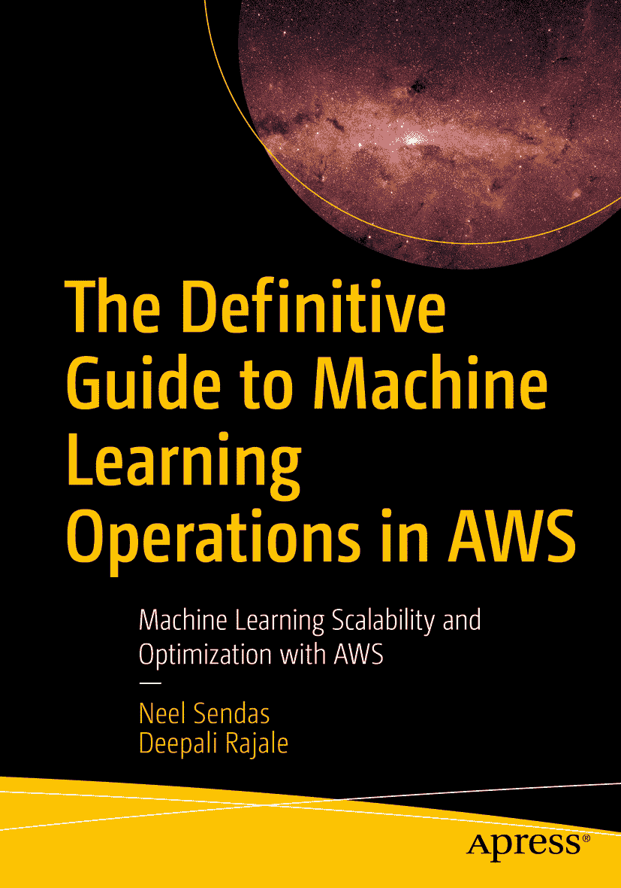

ISBN 979-8-8688-1075-6 e-ISBN 979-8-8688-1076-3 [`doi.org/10.1007/979-8-8688-1076-3`](https://doi.org/10.1007/979-8-8688-1076-3) © Neel Sendas 与 Deepali Rajale 2024 本作品受版权保护。所有权利，无论是整体还是部分材料，均独家授权给出版商，具体包括翻译、重印、重用插图、朗诵、广播、以缩微胶卷或任何其他物理方式复制，以及传输或信息存储与检索、电子改编、计算机软件，或通过目前已知或未来开发的类似或不同方法进行使用。本出版物中使用的一般描述性名称、注册商标名称、商标、服务标志等，即使没有明确声明，也不意味着这些名称不受相关保护性法律和法规的约束，因此可供一般使用。出版商、作者和编辑可以假定，本书中的建议和信息在出版之日是真实和准确的。出版商、作者或编辑均不对本文所含材料或可能存在的任何错误或遗漏提供明示或暗示的保证。出版商对已出版地图中的管辖权主张和机构归属保持中立。

本 Apress 印记由注册公司 APress Media, LLC（Springer Nature 的一部分）出版。

注册公司地址为：1 New York Plaza, New York, NY 10004, U.S.A.

*Neel：这本书献给您，爸爸。您是我最好的朋友和最坚强的后盾。*

*Deepali：献给我的女儿们，Ovi 和 Rewa，你们不断激励我在我所做的每一件事中成长和进步。*

## 前言

在人工智能和机器学习快速发展的格局中，有效地将 AI/ML 模型投入运营的能力，已成为组织在多元化团队中充分利用其数据驱动计划潜力的关键差异化因素。随着我们见证一个以基础模型和生成式 AI 崛起为标志的 AI 新时代，强大的 MLOps 实践的重要性从未如此重要。正是在这种背景下，我很荣幸地介绍 Neel Sendas 和 Deepali Rajale 所著的 *《AWS 上 MLOps 权威指南》*，这是一本全面的资源和指南，有望成为 AI 从业者、数据科学家和 MLOps 工程师在云中驾驭机器学习运营复杂性的宝贵资产。

作为亚马逊的首席数据科学家，我在优化和人工智能领域拥有十多年的经验，我亲眼目睹了良好实施的 MLOps 实践对金融服务、医疗保健与生命科学、媒体、石油天然气以及汽车等多个行业 AI 项目成功所产生的变革性影响。在这些经历中，一个真理始终不变：从创新的 ML 模型到现实世界 *大规模* 影响的路径，只有企业（无论大小）采纳 MLOps 的原则和最佳实践才能实现。

Neel Sendas 和 Deepali Rajale 为这一关键主题带来了丰富的专业知识。Neel 凭借其在 AWS 担任首席技术客户经理的多年经验以及他在物联网和机器学习方面的背景，对 AWS 生态系统及其在解决现实世界 ML 挑战中的应用有着深刻的理解。Deepali 凭借其在产品开发、云计算和人工智能方面的广泛背景，作为生成式 AI 领域的实践者和创新者提供了见解。她作为一家专注于生产环境中 GenAI 的前沿初创公司创始人的经历，为 ML 模型运营化过程中的挑战和机遇提供了独特的视角。

随着组织越来越多地转向像 AWS 这样的云平台来构建、训练和部署其传统 ML 模型以及基础模型，像 *《AWS 上 MLOps 权威指南》* 这样的综合参考书对于提升团队技能至关重要，它为读者提供了一份路线图，以驾驭扩展 ML 运营的复杂性，同时解决弹性、安全性、监控、可观测性和成本优化等关键问题。

作者在深入探讨在 AWS 上实施 MLOps 的具体细节之前，先为 MLOps 原则和最佳实践奠定了坚实的基础。书中对 MLOps 中卓越运营、安全性、可靠性和性能效率支柱的阐述，解释了构建和维护生产级 AI 系统所需的条件。

本书中特别值得注意，也是我个人兴趣所在的是，对 MLOps 中成本优化的强调。在当今效率与投资回报率至关重要的经济格局中，这是一个关键的考量因素。成本优化并不意味着削减成本；而是意味着为你支付给服务提供商的每一分钱榨取出最后一点性能。作者对在 AWS 上合理调整 ML 资源规模以及实施基于使用的成本监控与分析进行了探讨，为希望在创新与财务责任之间取得平衡的组织提供了实用指导。Neel 和 Deepali 在其全职工作中，每天都在为多家大型企业实践这一点。

本书的最终焦点是面向 GenAI 的 MLOps（或“FMOps”），这既及时又具有前瞻性。作者解决了基础模型带来的独特挑战，包括模型选择、适配、评估和部署的细微差别，以及这些先进 AI 系统所特有的数据隐私和技术需求等关键考量，并将其与传统 MLOps 进行了对比。

展望 AI 和机器学习的未来，本书可以作为组织在 AWS 云平台上释放其机器学习计划全部潜力的综合路线图。Neel 和 Deepali 精心打造了这一资源，不仅涵盖了 MLOps 的当前状态，还预见了这个快速发展领域的未来发展趋势。

致本书的读者们，无论你是数据科学家、ML 工程师、云架构师，还是负责 AI 计划的业务领导者，我鼓励你以开放的心态来阅读本指南，并愿意将其见解应用于你自己的项目和挑战中。AI/ML 运营化的旅程是复杂且不断演变的，但凭借本书中分享的知识和最佳实践，你将能够很好地驾驭这一领域，并通过 AI 在你的组织中推动有意义的变革。

Shreyas Subramanian 博士

亚马逊首席数据科学家

## 关于作者 关于技术审校者

