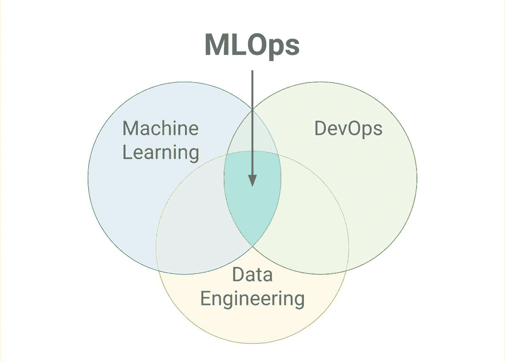
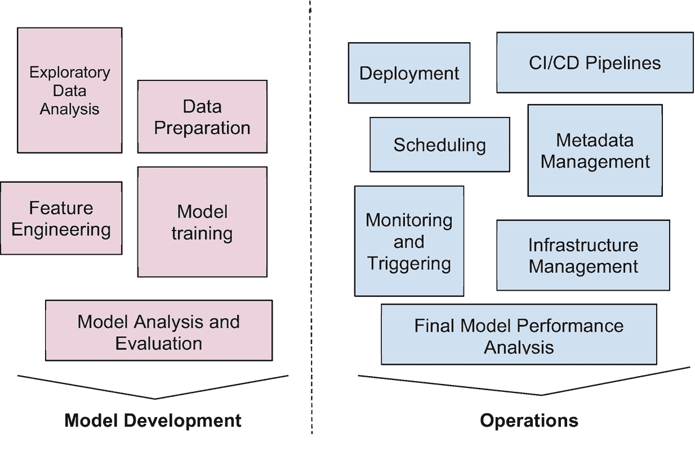
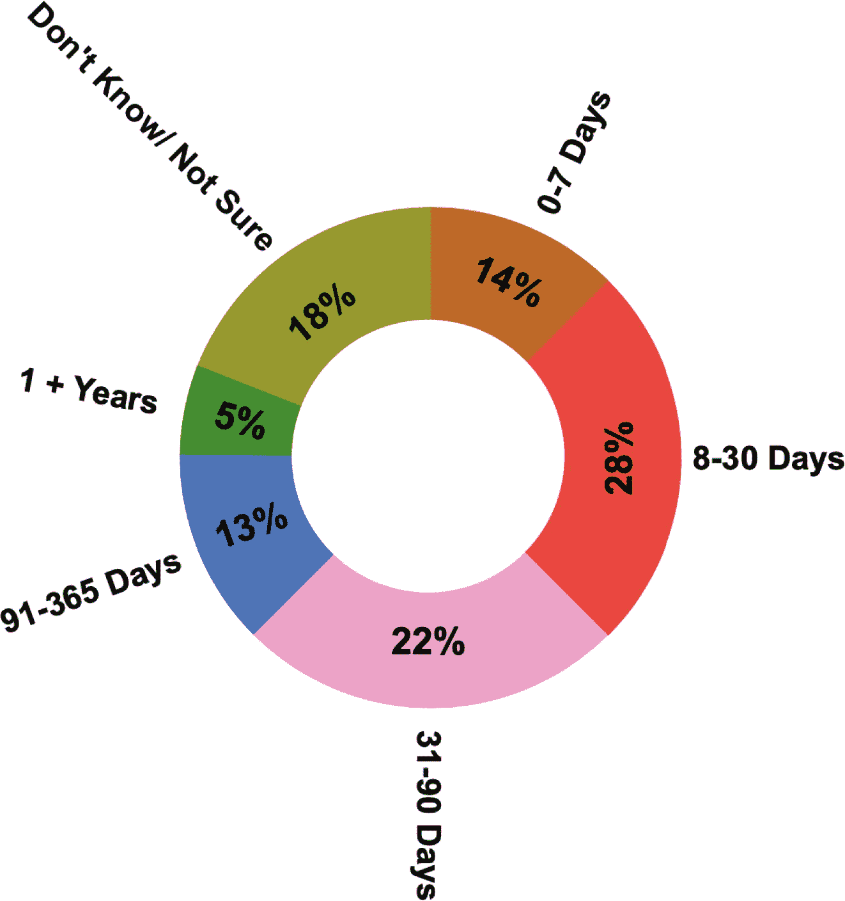
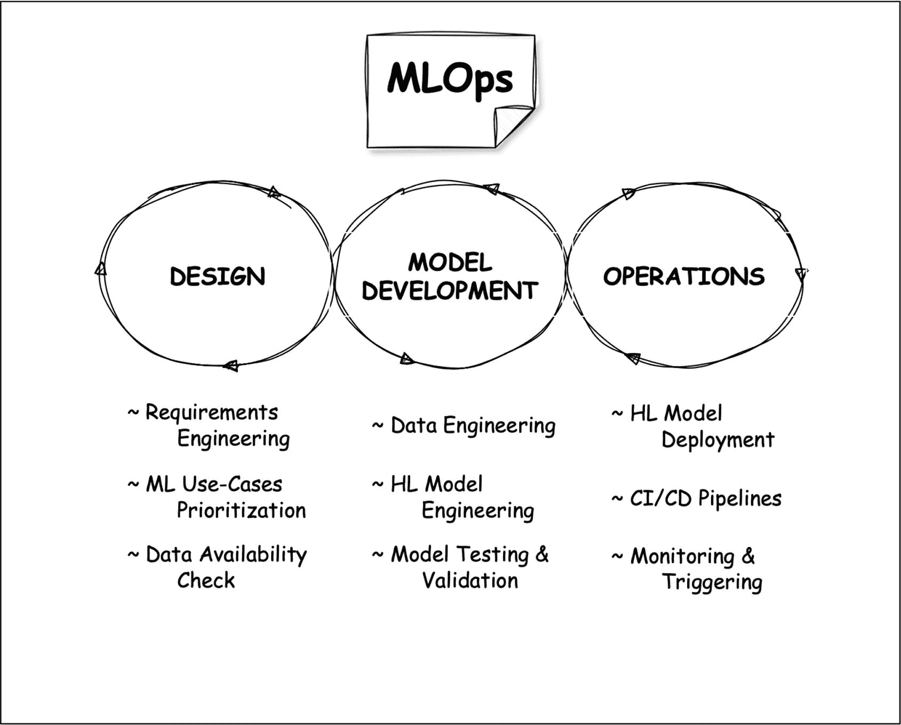
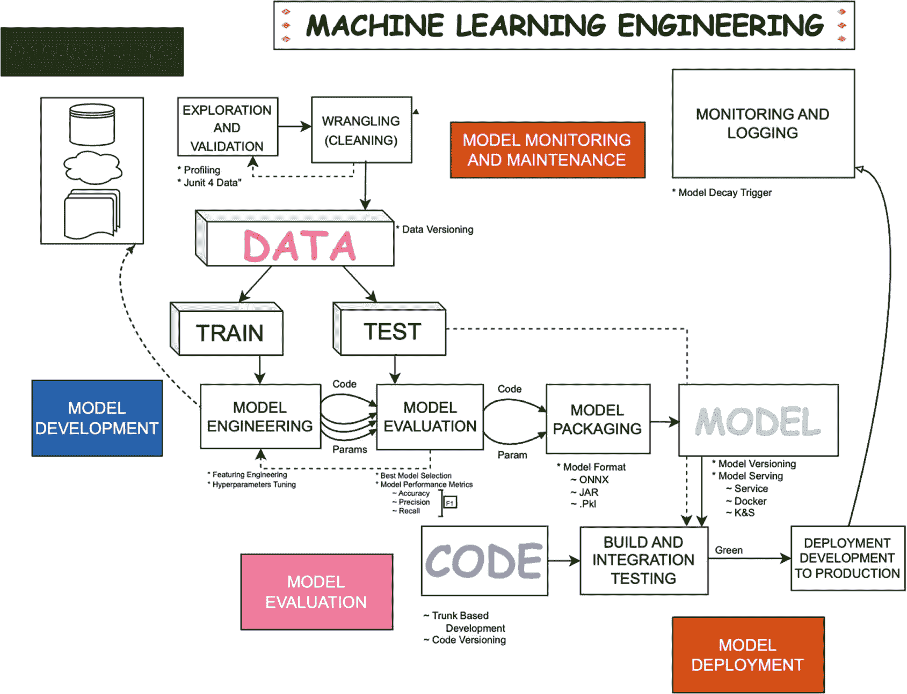
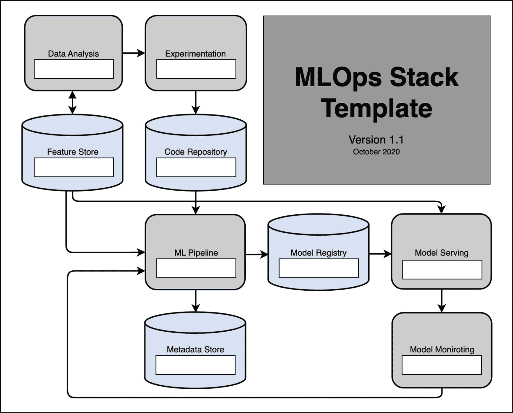

# 1. MLOps 简介

机器学习运维（MLOps）是指将 DevOps 原则应用于机器学习系统。这是一个相对较新的术语，因为如今大多数企业都试图将 AI/ML 系统整合到其产品和平台中。MLOps 是一门工程学科，旨在统一 ML 系统的开发（dev）与部署/运维（ops），以标准化和简化高性能模型在生产环境中的持续交付。MLOps 的目标是以自动化且可重复的方式，在生产环境中提供高质量的机器学习解决方案。

MLOps 包含三个贡献学科：机器学习、DevOps 和数据工程。MLOps 是 DevOps 持续构建、部署代码和测试实践在数据工程（数据）和机器学习（模型）上的延伸，如图 1-1 所示。

图 1-1

机器学习模型可以使用训练数据离线开发；然而，将其部署到生产环境中可能颇具挑战。MLOps 的工作不仅限于部署模型，还包括在 ML 系统的每个步骤中持续进行自动化、监控、管理和更新。随着当今数据量的激增和 ML 应用的广泛普及，在 AI 时代，通过 MLOps 实现自动化已成为必然。

## MLOps 组件

MLOps 组件可分为 ML 开发和运维组件，如图 1-2 所示。

图 1-2

如图所示，所有与数据工程和模型训练相关的组件都属于模型开发范畴。模型开发仅完成了工作的一半。运维则遵循此流程，部署、调度、监控和维护组件属于运维范畴。

## MLOps 的演进

2015 年，随着数据和 Python 库数量的增长，人工智能、机器学习和数据科学达到了顶峰。由于大量算法的可用性，深度学习与神经网络训练的 ML 模型变得易于使用并开始流行。然而，将这些模型大规模部署到生产环境中仍是一个挑战。只有极少数模型能够投入大量精力和时间进入部署阶段。

2018 年至 2019 年，随着容器化的普及，`Docker` 和 `Kubernetes` 被用于部署 ML 模型。那个时代被称为“MLOps 淘金热时代”，因为许多 ML 部署平台，如 `DataRobot`、`ClearML`、`Amazon SageMaker`、`Kubeflow`、`Google Cloud Platform` 等，都是为了覆盖整个 ML 系统迭代而构建的。这些平台通过数据分析、模型创建、部署、维护和监控提供自动化。

## MLOps 的必要性？

根据 Algorithma 的报告，在所有接受调查的公司中，有 18% 的公司需要 90 天到一年的时间才能将一个 ML 模型部署到生产环境。大约 50% 的公司能在 90 天或更短时间内部署一个模型。见图 1-3。

图 1-3

根据 Deeplearning.ai 的报告，只有 22% 使用机器学习的公司成功部署了模型。

现在问题来了：为什么在生产环境中部署模型如此困难，解决方案又是什么？

通过实施结合了 DevOps 中常用的 `CI/CD` 方法的系统性“MLOps”流程，企业可以为解决此问题的每一步创建一个流水线。MLOps 旨在利用自动化、ML 以及对每个模型版本的迭代改进，来简化运行数据科学模型所需的数据、时间、建模和其他资源。

## 理解 MLOps 的广泛阶段

MLOps 的阶段遵循一个迭代增量过程，分为三个广泛阶段：设计 ML 驱动的应用程序、ML 实验与开发，以及 ML 运维。让我们更详细地看一下；见图 1-4。

图 1-4

1. **设计**
    设计的第一阶段致力于业务和数据理解、需求工程、机器学习用例优先级排序以及 ML 驱动的应用程序设计。在此阶段，主要目标是利用任何相关数据来识别业务问题，从而为其潜在用户设计机器学习解决方案。
    在设计阶段，首先定义 ML 用例并确定优先级。然后检查数据以训练模型。ML 模型的所有功能性和非功能性需求都用于设计 ML 应用程序的架构、建立模型服务策略，并为未来的 ML 模型创建测试套件。
    此阶段旨在建立一个强大的基础，以提高机器学习应用程序的交互性和用户的生产力。

2. **模型开发**
    设计阶段之后是“ML 实验与开发”阶段。此阶段的目标是交付一个将在生产环境中运行的稳定、高质量的 ML 模型。在此阶段，会实现 ML 模型的概念验证，以验证 ML 模型对我们问题的适用性。数据工程、ML 模型工程、编码、超参数调优以及模型测试和验证会迭代运行，以识别适合业务问题的 ML 算法。

3. **运维**
    “ML 运维”阶段的主要目标是将先前开发的 ML 模型部署到生产环境中。部署通过使用既定的 DevOps 实践（如测试、版本控制、持续集成与交付）以及定期监控和触发服务来完成。为了对 ML 系统进行监控和维护，在此步骤中会完成持续的模型评估。

所有这三个阶段都是迭代的、增量的、相互影响且相互关联的。设计决策会传播到开发阶段，最终开发的模型会影响最终运维阶段的部署。在部署后的一段时间后，如果模型衰退并出现异常行为，那么我们需要回到流程中，要么收集更多数据，要么重新标记训练数据，这会触发 ML 模型的重新训练。

## MLOps 原则

MLOps 拥有若干原则，用于成功部署可运行的机器学习应用。

1. **自动化**
自动化实现了已训练机器学习模型的持续集成、交付和部署。它确保生产模型始终使用最新的训练版本，并能根据快速变化的业务需求处理动态数据。这降低了错误风险，提高了生产力，实现了无缝更新，并缩短了产品上市时间。自动化针对以下流程执行：
    * 数据转换
    * 特征工程
    * 数据工程流水线
    * 机器学习模型训练流水线
    * 超参数选择
    * 用于机器学习模型部署的 `CI/CD` 流水线
    * 构建应用

2. **版本控制**
版本控制对于确保可复现性和可追溯性至关重要。数据、代码和模型的版本控制是必要的。例如，数据可能发生变化，模型可能随时间衰减，或者环境变化可能需要新数据或新模型，因此维护版本控制非常重要。必须为以下项目维护版本：
    * 数据准备流水线
    * 数据集
    * 特征存储
    * 元数据
    * 机器学习模型训练流水线
    * 超参数
    * 实验
    * 应用代码
    * 配置

3. **测试**
机器学习系统持续进行数据、特征、模型和基础设施测试。特征流水线、数据流水线和机器学习模型性能都需要测试。基础设施测试则通过集成测试和压力测试完成。测试是交付一流机器学习系统输出的必要条件。需要在以下步骤完成测试：
    * 数据验证
    * 特征创建单元测试
    * 机器学习模型训练流水线的集成测试
    * 机器学习模型在投入运营前进行验证
    * 生产环境中机器学习模型的新鲜度测试
    * 模型治理测试
    * 单元测试
    * 端到端流水线的集成测试

4. **部署**
模型部署应基于实验追踪完成，这包括特征存储、机器学习栈的容器化，以及在本地、云端或边缘端运行的能力。部署服务的角色是确保通过编排、日志记录、监控和通知，使机器学习模型、代码和数据保持稳定。部署基于以下特性完成：
    * 在开发和生产环境中使用的特征存储
    * 机器学习栈的容器化
    * `REST API`
    * 本地、云端或边缘环境

5. **监控**
持续监控意味着定期评估数据、代码、模型、基础设施资源以及模型性能指标。它有助于检测数据或环境中的潜在错误或变化，从而带来高质量的产品。为了在不断变化的数据、环境和模型衰减的情况下，维持并保持 MLOps 系统的稳定，持续监控是必要的。持续监控需要持续检查以下流程：
    * 数据分布变化（训练数据和服务数据）
    * 训练和服务特征
    * 机器学习模型衰减
    * 数值稳定性
    * 机器学习模型的计算性能
    * 应用在服务数据上的预测质量

6. **可复现性**
可复现性是指机器学习系统的每个阶段（数据处理、特征工程、模型开发和模型部署）在给定相同输入时，能够复现一个机器学习实验并获得相同结果的能力。一个成功部署的 MLOps 系统必须能够复现以下列出的项目：
    * 备份数据
    * 数据版本控制
    * 提取元数据
    * 特征工程版本控制
    * 开发和生产环境之间的超参数调优保持一致
    * 特征顺序应保持一致
    * 相同的集成学习
    * 记录模型伪代码
    * 开发和生产环境中所有依赖项的版本保持一致
    * 开发和生产环境使用相同的技术工具栈
    * 提供容器镜像或虚拟机以复现结果

## MLOps 生命周期

到目前为止，我们已经了解了机器学习应用开发的高层级工作流程。现在，我们将详细探讨 MLOps 生命周期，它包含六个主要步骤以及若干子步骤（见图 1-5）。

图 1-5

1. **业务理解**

# MLOps 生命周期与基础设施

MLOps 生命周期始于对机器学习应用的范围、成功标准以及数据质量验证的理解。它通过深入了解业务和需求来确保项目的可行性，然后再进行后续步骤。此阶段执行的任务如下：

*   定义业务目标
*   定义机器学习目标
*   从不同来源收集和验证数据
*   评估项目可行性

## 数据工程

数据工程为模型开发阶段准备数据。它负责数据摄取、数据准备、数据预处理、数据探索与验证、数据版本控制、数据监控以及数据拆分。数据工程下执行的任务如下：

*   数据选择
*   数据合并
*   特征选择
*   类别平衡（数据过采样或欠采样）
*   数据预处理（降噪、数据插补）
*   特征工程（数据构建）
*   数据增强（`GANs`）
*   数据标准化
*   数据版本控制
*   数据拆分

## 模型开发

在模型开发阶段，业务目标是将业务目标转化为机器学习模型。模型开发的各个阶段是迭代的，以便能够轻松地融入数据或业务目标的任何变化。在此阶段，会收集模型训练方法的元数据，以便在需要时能够重现。模型开发下执行的各种任务如下：

*   定义模型的质量度量
*   ML 算法选择
*   结合领域知识的模型特化
*   模型训练
*   应用迁移学习（使用预训练模型）
*   模型压缩
*   集成学习
*   超参数调优
*   模型验证
*   记录 ML 模型和实验

## 模型评估

在模型评估阶段，使用模型性能指标在测试数据上评估 ML 模型的性能。这也称为离线测试，用于检查模型的鲁棒性。模型评估下执行的各种任务如下：

*   验证模型性能
*   确定模型鲁棒性
*   做出决策（是否部署模型）
*   评估阶段文档记录

## 模型部署

此阶段旨在将 ML 模型集成到现有的软件系统中。是时候将可工作的 ML 模型成功部署到生产环境中了。模型部署下执行的各种任务如下：

*   根据生产环境评估模型
*   模型合规性与集成
*   模型部署
*   用户验收与可用性测试
*   在线模型测试
*   模型版本控制

## 模型监控与维护

当部署后的模型在未见过的实时数据上运行时，监控和维护模型在实时环境中的性能至关重要。模型性能日志记录、模型性能监控、告警和重训练服务均在模型监控下完成。模型监控与维护下执行的各种任务如下：

*   监控预测模型性能
*   检查是否满足预先指定的成功标准
*   在模型衰退或需求变更时重新训练模型
*   收集并整合新数据
*   对新数据点进行标注
*   重复模型工程和模型评估阶段的任务
*   模型的持续训练、集成和部署

## MLOps 基础设施工具栈

为了操作复杂的 MLOps 生命周期，我们需要一个定义良好的项目结构、流程以及合适的软件工具。这些软件工具被称为 MLOps 基础设施工具栈。MLOps 基础设施栈应包含用于以下任务的工具：

*   数据分析
*   数据、代码和模型版本控制
*   实验管理
*   特征存储
*   代码仓库
*   `ML CI/CD` 流水线
*   元数据存储
*   模型注册中心
*   模型服务
*   生产环境中的模型监控

许多云服务提供商都提供机器学习平台，例如 `AWS` 的 `SageMaker`、`Google Cloud` 的 `AI Platform` 以及 `AzureML`。也可以使用非云系统（如 `MLFlow`、`DVC`、`Sacred` 等）为 MLOps 实现内部解决方案。

`Jupyter Notebooks` 和 `Python` 可用于数据分析和编码。`GitLab` 可用于代码仓库。

请参考 `Valohai` 提供的图 1-6 中所示的 MLOps 栈模板。

图 1-6 MLOps 栈模板

MLOps 栈模板旨在将工作流程和架构简化为更易于管理的抽象层级。这可以指导开发团队了解 MLOps 的构建模块，并帮助识别必要的工具链。该栈包含九个组件，各有不同的需求，具体使用取决于你的特定用例。

## 工具栈组件的作用

让我们来看看 MLOps 栈模板中九个组件的作用：

### 数据分析

第一步是收集数据并理解其可行性，以便能够将业务目标转化为机器学习任务。在此步骤中，定义机器学习特定的评估指标和业务评估指标也很重要。对于数据访问和分析，可以应用各种编程语言，如 `R`、`Python`、`Scala` 或 `SQL`。

### 实验

为了实现数据分析步骤中定义的所有任务，我们必须运行实验并实施概念验证。这有助于将机器学习技术切实应用于业务目标。在此步骤中，使用不同的数据集和超参数进行实验是必要的。

### 特征存储

特征工程是在进一步处理之前，将原始数据转换为适合机器学习算法的特征向量格式的过程。特征存储的作用是在不同机器学习项目和各种数据科学团队之间实现特征的可复现性和重用。这是数据工程阶段和模型工程阶段之间的接口。

### 代码仓库

代码仓库是一个 DevOps 概念，对于稳定的软件交付性能至关重要。维护代码仓库及其版本历史以跟踪代码变更和未来的可复现性非常重要。

### `ML` 流水线

流水线意味着实现一系列操作的构建和执行。模型的持续集成（`CI`）、持续训练（`CT`）和持续部署（`CD`）构成了一个 `ML` 流水线。

### 模型注册表

模型注册表是模型评估阶段的重要组成部分。如果你在生产环境中有多个模型并且需要跟踪它们，那么模型注册表是必需的。同时，模型注册表通过简化回滚到先前构建的模型的过程，确保了向后兼容性。

### 模型服务

模型服务是将机器学习模型应用于新输入数据的过程。模型服务作为分布式服务实现，用于对输入请求进行响应预测。

### 模型监控

`ML` 模型部署后，需要持续监控以确保模型质量和预测的正确性。MLOps 栈画布的这一块确保了 `ML` 系统在生产环境中的成功运行。

### 元数据存储

元数据存储是 MLOps 栈的最后一块。它是一个用于根据组织的监管要求实施 `ML` 模型治理过程的模块。`ML` 治理过程依赖于 `ML` 元数据存储组件。

通过理解栈中不同组件的作用，组织将能够根据自身需求轻松决定其工具栈。

## MLOps 挑战

让我们讨论一下 MLOps 系统面临的一些挑战，这些挑战为未来的改进开辟了空间。

### 不切实际的期望

对业务需求和成功标准的分析不足是 MLOps 实施基础层的主要挑战。机器学习是当今的热门词汇，有时这会导致非技术利益相关者在不考虑实际背景细节的情况下产生不切实际的期望。

### 数据质量

`ML` 系统对数据质量很敏感，因为数据是 `ML` 开发和运营的基础。如果输入数据损坏、不完整或不符合要求，将会影响生产环境中的 `ML` 模型。

### 模型衰减

`ML` 模型的性能会随着时间的推移而衰减。在实时环境中，数据不断变化，这会影响生产环境中模型的性能，而这种变化在训练阶段是无法校准的。

### 地域性

`ML` 模型是针对特定人群特征进行训练的，这些特征可能因不同的业务客户而异。在向新客户部署 `ML` 模型时，必须牢记人群特征以满足质量标准。

### 安全性

机器学习处理不同项目的敏感数据，这些数据可能会暴露给第三方。确保数据、数据管道和机器学习模型的安全对于行业的长期成功至关重要。安全补丁对于成功将 `ML` 模型部署到生产环境至关重要，因为安全性是任何 MLOps 环境中的挑战。

## MLOps 最佳实践

实施这些最佳实践以实现 MLOps 的规模化应用。

### 组织良好的项目结构

组织良好的项目结构在 MLOps 项目中尤为重要。它有助于我们导航、维护、管理和扩展未来的项目。必须为以下内容维护端到端的项目结构：

*   数据和代码文件夹
*   数据和代码版本控制
*   `ML` 模型组织
*   部署文件组织

### 文档

在 `ML` 生命周期的各个步骤中，文档常常被忽略。然而，以一致的风格维护文档以供记录和参考至关重要。以下流程需要文档：

*   数据源记录
*   标注方法
*   实验设计
*   模型选择标准
*   模型伪代码
*   整个部署过程

### 了解你的工具栈

组织用于 MLOps 实施的基础设施工具至关重要。工具取决于需求和组织的选择。了解你的 MLOps 流水线工具栈是必须的。

### 跟踪项目支出

通过 MLOps，我们的目标是尽量减少技术债务，但我们不希望支出过高而变得难以承受。在关注技术债务的同时，也要密切关注财务债务。

## MLOps 中的模型治理

模型治理是 MLOps 中的一个新挑战，对于模型在生产环境中的部署至关重要。模型治理应与 MLOps 一起实施，以在整个组织内构建安全稳定的机器学习系统。

模型治理的实施应基于监管的严格程度和模型的数量。以下是 MLOps 系统每个变体中都需要实施模型治理的一些常见方面：
*   全面的模型文档和指标报告。
*   所有模型的版本控制
*   ML 系统的审计
*   数据文档
*   ML 元数据的管理
*   ML 模型的验证
*   模型指标的持续监控和记录
由于 MLOps 正在扩展到不同的垂直领域，构建一个成功部署的 ML 应用程序是一项具有挑战性的任务。通过将所有的 MLOps 原则、挑战、最佳实践和治理紧密结合，我们可以在不同的人群特征中成功设计、建模并将 ML 模型部署到生产环境中。