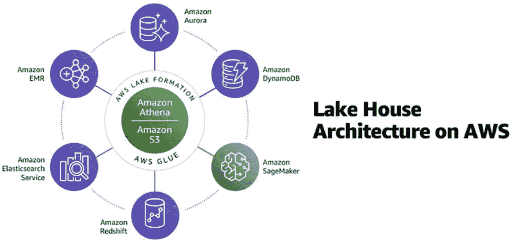
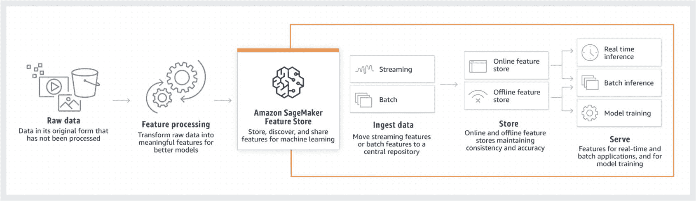
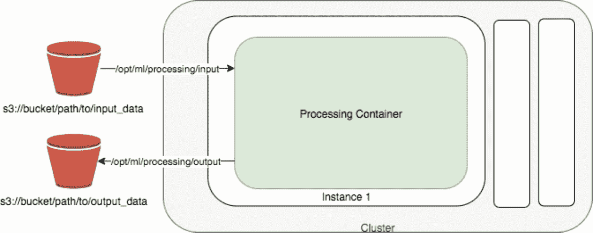
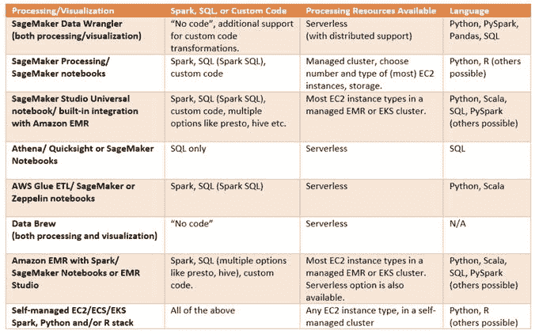
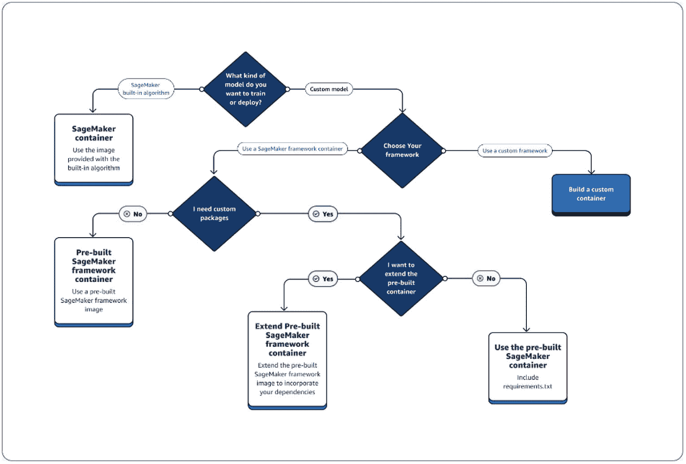
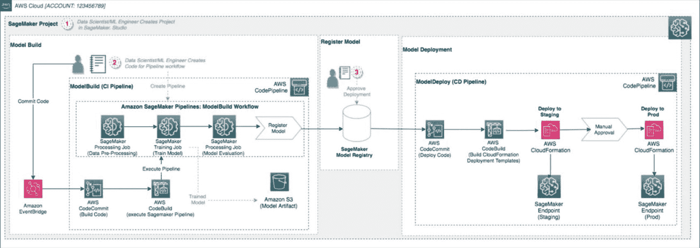
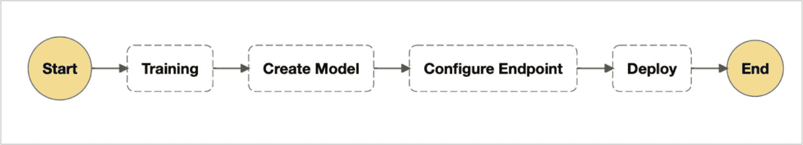
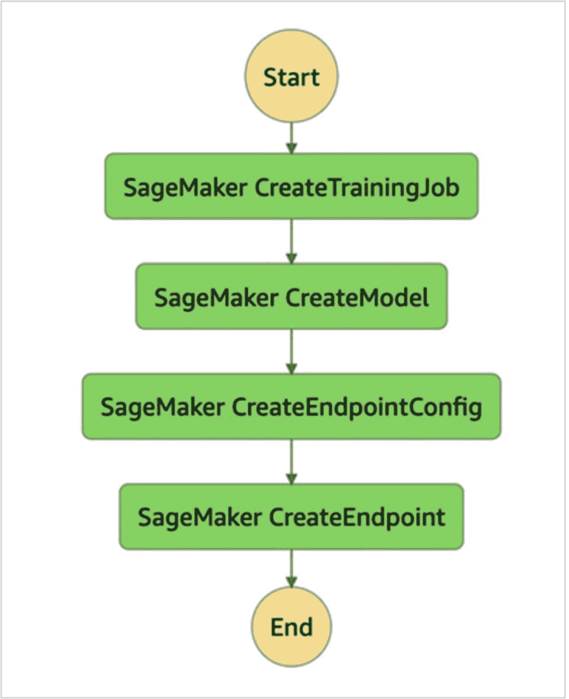

# 2. AWS 上 MLOps 的基础

机器学习已从一个小众领域演变为一项变革性技术，它使企业能够做出数据驱动的决策、实现任务自动化并提升客户体验。随着机器学习不断重新定义技术格局，从构思机器学习模型到将其投入运营的过渡正处于关键阶段。MLOps 融合了促进机器学习系统开发与运维无缝集成的实践和工具，成为这一变革之旅的关键环节。

在云计算领域，亚马逊云科技作为一股开拓性力量，为部署和管理机器学习工作流提供了强大的平台。本章将作为指引灯塔，引导您掌握在这个动态云环境中驾驭复杂 MLOps 格局所必需的基本原则和策略。无论您是经验丰富的从业者还是充满热情的新手，请与我们一起揭示构成 AWS 上 MLOps 基石的核心理念，助您在机器学习领域实现卓越运营。

## 机器学习在云中的演进

机器学习在云中的演进代表着从传统的本地机器学习方法向更动态、可扩展且易于访问的基于云的环境的重大转变。向云的迁移也意味着机器学习模型现在可以比以前更快地训练和部署，具有更高的灵活性和更低的成本。云环境具有处理机器学习工作负载固有的大量数据和复杂计算的优势，而无需在基础设施上进行大量前期投资。

亚马逊云科技在这一转变中发挥了关键作用，它提供了一套广泛的工具和服务，专门满足 MLOps 的多样化需求，促进了从模型开发到部署和持续管理的无缝集成。AWS 的云原生架构提供了无与伦比的可扩展性，确保机器学习工作流能够适应不同的工作负载和不断变化的需求。

此外，AWS 使从业者能够在安全可靠的环境中利用高级分析、数据存储和计算资源。AWS 服务的强大生态系统，加上其对创新的承诺，使其成为寻求高效且有效实施 MLOps 实践的组织的理想选择。

从本质上讲，AWS 上的 MLOps 不仅仅是一种便利的合作关系，更是一种战略对齐，它释放了机器学习的全部潜力，在机器学习工作流的运营化方面提供了无与伦比的灵活性、可扩展性和可靠性。无论您是初创公司还是大型企业，AWS MLOps 解决方案都能满足各种需求。

## AWS 上 MLOps 的关键组件

在 AWS 上实施 MLOps 涉及几个关键组件，以确保机器学习模型和应用程序的高效、可扩展且可靠的部署。

### 数据管理与处理

数据是任何机器学习项目的基石。处理步骤的示例包括将数据转换为机器学习算法期望的输入格式、重新缩放和归一化、清理和标记文本等等。然而，大规模数据处理涉及相当大的运营开销：管理像处理集群这样的复杂基础设施、编写代码将所有移动部件连接起来，以及实施安全性和治理。AWS 提供了一套满足这些需求的服务，确保可扩展性、安全性和效率。

#### 使用 Amazon S3 的可扩展数据湖

在数据分析领域，公司越来越多地将其分散的数据整合到一个统一的存储库中，通常称为*数据湖*，以促进高级分析和机器学习。然而，随着数据量的增长，挑战也随之而来，使得数据移动变得费力。为了解决这个问题，AWS 上引入了一种创新的 Lake House 方法。

与仅仅集成数据湖和数据仓库不同，Lake House 方法涉及将数据湖、数据仓库和专用服务连接成一个连贯的架构。这种方法包括可扩展的数据湖、专用数据服务、无缝数据移动、统一治理，并注重性能和成本效益。

Amazon Simple Storage Service 被认为是构建数据湖的最佳选择，因为它具有无与伦比的持久性、可用性、可扩展性、安全功能、合规性、审计能力、性能以及与合作伙伴的多样化集成选项。

然而，数据湖的建立和管理涉及手动且耗时的任务。AWS 通过 AWS Lake Formation 解决了这一挑战，该解决方案旨在简化在云中构建安全数据湖的过程。Lake Formation 收集和编目数据，将其移动到 Amazon S3 数据湖中，利用机器学习算法清理和分类数据，并确保对敏感信息的安全访问。

此外，S3 灵活的存储管理功能，如存储类别和生命周期策略，有助于实现经济高效的数据存储。与其他 AWS 分析服务的集成增强了直接查询和分析数据湖中数据的能力，从而简化了机器学习数据处理工作流。下图展示了 Lake House 方法，显示了分析服务与内部和外部数据存储之间的数据移动。



图 2-1

AWS 上的 Lake House 架构

以数据湖为架构中心，数据工程团队可以应用自己的工具进行分析工作负载。同时，数据科学团队也可以使用自己独立的工具访问相同的数据以进行机器学习工作负载。由不同团队运行的多个独立处理集群可以访问相同的数据，同时将所有团队的原始数据保留在 Amazon S3 中作为单一事实来源。此外，数据科学团队使用特征存储（例如 Amazon SageMaker Feature Store）来处理转换后的数据，有助于划定与数据工程的边界，并提供特征发现、共享、更新和重用等好处。

#### 使用 Amazon SageMaker 进行数据处理

SageMaker 是一项完全托管的服务，通过汇集一套专为机器学习构建的广泛功能，帮助数据科学家和开发人员快速准备、构建、训练和部署高质量的机器学习模型。对于数据处理和数据准备，有以下功能。

##### SageMaker Data Wrangler

SageMaker Data Wrangler 是 SageMaker 的一项功能，通过 SageMaker Studio 启用，它使数据科学家和机器学习工程师能够轻松地聚合和准备用于机器学习应用程序的数据，使用可视化界面来加速数据清理、探索和可视化。它允许您轻松连接到各种数据源，例如 Amazon S3、Amazon Athena 和 Amazon Redshift。SageMaker Data Wrangler 支持“无代码”工作流，您可以在其中应用内置转换，而无需编写代码。

此外，您还可以选择使用 PySpark、Pandas 或 SQL 编写自定义转换。SageMaker Data Wrangler 还包括与其他 SageMaker 功能的几个便捷集成，例如用于偏差检测的 SageMaker Clarify、SageMaker Feature Store（前面提到过）和 SageMaker Pipelines（专为机器学习构建的 CI/CD）。最后，您可以将整个数据准备工作流导出为可执行的 Python 代码。


##### SageMaker 特征存储

机器学习（ML）开发过程通常始于从数据中提取数据信号（也称为*特征*），以训练机器学习模型。Amazon SageMaker 特征存储让数据科学家、机器学习工程师和普通从业者能够轻松创建、共享和管理用于机器学习开发的特征。特征存储通过减少将原始数据转换为特征以训练机器学习算法所需的重复数据处理和整理工作，加速了这一过程。

此外，数据的处理逻辑只需编写一次，生成的特征即可同时用于训练和推理，从而减少了训练-服务偏差。特征存储是一个集中存储特征及相关元数据的仓库，便于特征的发现和复用。您可以创建在线存储或离线存储。在线存储用于低延迟的实时推理场景，而离线存储则用于训练和批量推理。

图 2-2 展示了如何将特征存储作为机器学习管道的一部分使用。首先，读取原始数据并进行处理。您可以通过流式传输将数据摄取到在线和离线存储中，或通过批量方式直接摄取到离线存储。首先创建一个特征组，并将其配置为在线存储、离线存储或两者兼用。然后，将数据摄取到特征组中并存储在存储中。特征组是一组特征，通过特征存储中的模式定义来描述一条记录。

在线存储主要设计用于支持需要低毫秒级读取延迟和高吞吐量写入的实时预测。离线存储主要用于批量预测和模型训练。离线存储是一个仅追加的存储，可用于存储和访问历史特征数据。离线存储有助于存储和提供用于探索和模型训练的特征。在线存储仅保留最新的特征数据。特征组是可变的，创建后可以演变其模式。



图 2-2

Amazon SageMaker 特征存储

##### SageMaker Processing

SageMaker Processing 让您能够在完全托管的基础设施上轻松运行预处理、后处理和模型评估工作负载。预处理可能包括数据验证、数据转换、分析和特征工程。后处理可能包括生成最终结果的步骤。

图 2-3 展示了 Amazon SageMaker 如何启动一个 SageMaker Processing 作业。Amazon SageMaker 获取您的脚本，从 Amazon Simple Storage Service (Amazon S3) 复制您的数据，然后拉取一个处理容器。处理容器镜像可以是 Amazon SageMaker 内置镜像，也可以是您提供的自定义镜像。SageMaker Processing 作业的底层基础设施完全由 Amazon SageMaker 管理。集群资源在作业运行期间进行配置，并在作业完成时清理。处理作业的输出存储在您指定的 Amazon S3 存储桶中。



图 2-3

Amazon SageMaker Processing 容器

Apache Spark 作为大规模数据处理的统一分析引擎。Amazon SageMaker 提供预构建的 Docker 镜像，其中包含 Apache Spark 和分布式数据处理所需的依赖项。使用 Amazon SageMaker Python SDK，可以通过 Spark 框架无缝应用数据转换和特征提取（特征工程）。

您可以使用 `sagemaker.spark.PySparkProcessor` 或 `sagemaker.spark.SparkJarProcessor` 类在处理作业中运行 Spark 应用程序。请注意，您可以将 MaxRuntimeInSeconds 设置为最长 5 天的运行时间限制。就执行时间和使用的实例数量而言，简单的 Spark 工作负载在实例数量与完成时间之间呈现近似线性关系。

以下代码示例展示了如何运行一个调用 PySpark 脚本 *preprocess.py* 的处理作业：

```
from sagemaker.spark.processing import PySparkProcessor
spark_processor = PySparkProcessor(
base_job_name="spark-preprocessor",
framework_version="2.4",
role=role,
instance_count=2,
instance_type="ml.m5.xlarge",
max_runtime_in_seconds=1200,
)
spark_processor.run(
submit_app="preprocess.py",
arguments=['s3_input_bucket', bucket,
's3_input_key_prefix', input_prefix,
's3_output_bucket', bucket,
's3_output_key_prefix', output_prefix]
)
```

类似地，SageMaker Processing 还支持使用 SageMaker Python SDK 中的 `SKLearnProcessor` 类进行基于 scikit-learn 的数据处理。以下代码示例展示了笔记本如何使用 `SKLearnProcessor`，通过 SageMaker 提供和维护的 Docker 镜像（而非您自己的 Docker 镜像）来运行您自己的 scikit-learn 脚本：

```
from sagemaker.sklearn.processing import SKLearnProcessor
from sagemaker.processing import ProcessingInput, ProcessingOutput
sklearn_processor = SKLearnProcessor(framework_version='0.20.0',
role=role,
instance_type='ml.m5.xlarge',
instance_count=1)
sklearn_processor.run(code='preprocessing.py',
inputs=[ProcessingInput(
source='s3://path/to/my/input-data.csv',
destination='/opt/ml/processing/input')],
outputs=[ProcessingOutput(source='/opt/ml/processing/output/train'),
ProcessingOutput(source='/opt/ml/processing/output/validation'),
ProcessingOutput(source='/opt/ml/processing/output/test')]
)
```

您还可以使用 `FrameworkProcessor` 运行指定机器学习框架的处理作业，为您选择的任何机器学习框架提供 Amazon SageMaker 托管的容器。`FrameworkProcessor` 为以下机器学习框架提供预构建容器：Hugging Face、MXNet、PyTorch、TensorFlow 和 XGBoost。

此外，您可以安装库以在您自己的处理容器中运行脚本，或者在更高级的场景中，您可以构建自己的处理容器，使其满足在 Amazon SageMaker 中运行的契约。

##### 与 Amazon EMR 内置集成的单一通用笔记本

SageMaker Processing 让您能够大规模运行处理脚本并自动化数据准备工作流程，而与 Amazon EMR 的内置集成则使您能够在单一的通用 SageMaker Studio 笔记本中，以 PB 级规模进行交互式数据准备和机器学习。它还使您能够从 SageMaker Studio 笔记本监控和调试在 EMR 上运行的 Apache Spark 作业。此外，您可以直接从 SageMaker Studio 发现、连接、创建、终止和管理 EMR 集群。

您还可以使用 AWS Service Catalog 定义并向选定的数据工作者推出预配置模板，使他们能够直接从 SageMaker Studio 创建 EMR 集群。数据工作者可以直观地浏览一组可供使用的模板，根据其特定工作负载进行自定义，按需创建 EMR 集群，并直接从 SageMaker Studio 中通过几次点击即可终止它们。您可以使用这些功能来简化数据准备工作流程，并更优化地使用 EMR 集群处理来自 SageMaker Studio 的交互式工作负载。


#### ETL 管道的低代码/无代码选项

开发提取、转换、加载（ETL）数据管道是保持数据湖、数据仓库和数据库更新并随时提供业务洞察的最耗时步骤之一。AWS 提供了多种用于 ETL 的低代码（或无代码）服务，这些服务采用无服务器架构，能以最低成本实现更快的成果。

表 2-1

DataBrew 与 SageMaker Data Wrangler 对比

|   | Glue DataBrew | SageMaker Data Wrangler |
| --- | --- | --- |
| 处理资源 | 无服务器 | 无服务器 |
| 内置可视化 | 是 | 是 |
| 内置转换 | 是 | 是 |
| 自定义转换 | 否 | 是 |
| 偏差检测集成 | 否 | 是 (SageMaker Clarify) |
| 特征存储集成 | 否 | 是 (SageMaker Feature Store) |
| CI/CD 集成 | 否 | 是 (SageMaker Pipelines) |

*   **Amazon Athena：** Amazon Athena 是一种无服务器交互式查询服务，可使用标准 SQL 查询转换数据，并结合 Amazon QuickSight（一种提供无代码内置可视化的无服务器 BI 工具）使用。在评估这一强大组合时，请考虑您的数据转换是否可以通过 SQL 完成。在可视化方面，QuickSight 的替代方案是使用 PyAthena 等库在 SageMaker 笔记本中运行 SQL 查询，并使用 Altair 等声明式可视化库在笔记本中可视化结果（这可能被视为“低代码+”，因为它仍然涉及少量代码）。

*   **AWS Glue：** 另一种低代码方案涉及 AWS Glue，这是一种无服务器 ETL 服务，可对您的数据进行编目，提供内置转换，并支持编写自定义 PySpark 代码。对于可视化，除了 QuickSight，您还可以将 SageMaker 或 Zeppelin 笔记本附加到 AWS Glue 开发端点。如果 AWS Glue 内置转换不能完全覆盖所需的数据转换集，则在 Athena 和 AWS Glue 之间进行选择可能取决于团队是倾向于使用标准 SQL 还是 PySpark 代码来实现自定义转换。

*   **AWS Glue DataBrew：** AWS Glue DataBrew 是一种可视化数据准备工具，使用户无需编写任何代码即可清理和标准化数据。您可以从 250 多种现成的转换中进行选择，以自动化数据准备任务，例如过滤异常、将数据转换为标准格式以及纠正无效值。表 2-1 对比了 DataBrew 和 SageMaker Data Wrangler。

AWS Glue 在提取、转换、加载（ETL）过程中扮演着关键角色，这对于为机器学习模型准备数据至关重要。它是一种完全托管的 ETL 服务，简化了为分析准备和转换数据的过程。AWS Glue 自动发现并分类数据，使其在 AWS 环境中可搜索和可查询。

Glue 的无服务器特性允许轻松扩展 ETL 作业，处理不同数据量，而无需手动配置资源。此外，Glue 与 Amazon Redshift 和 Amazon Athena 等其他 AWS 服务的集成，简化了将数据准备和加载到各种分析和数据仓库服务的过程。

#### 使用 Spark、Python 或 R 的自管理堆栈

另一种选择是“自行构建”解决方案，即通过使用 Amazon Elastic Compute Cloud (Amazon EC2) 计算资源，或容器服务 Amazon Elastic Container Service (Amazon ECS) 或 Amazon Elastic Kubernetes Service (Amazon EKS)，在自管理集群中部署 Spark、Dask 等 Python 框架或基于 R 的代码。与 SageMaker 的集成最便捷的方式是使用 Amazon SageMaker Python SDK。任何拥有 SageMaker 的 AWS Identity and Access Management (IAM) 权限的机器都可以使用 SageMaker Python SDK 调用 SageMaker 功能，用于模型构建、训练、调优、部署等。

此选项提供了最大的灵活性，可以混合搭配任何数据处理工具和框架。它还提供了访问最广泛的 EC2 实例类型和存储选项的途径。与 Amazon EMR 一样，您可以使用 Spot 实例来优化此选项的数据处理成本。此外，类似于前面提到的 SageMaker Savings Plans，您还可以使用 Amazon EC2 Instance Savings Plans 或 Compute Savings Plans，这些计划不仅适用于 EC2 资源，还适用于无服务器计算 AWS Lambda 资源和无服务器计算引擎 AWS Fargate 资源。

但是，请记住，对于数据科学家和机器学习工程师的用户友好性而言，此选项要求他们管理底层基础设施，这项任务更适合其他角色。此外，就机器学习特定任务的实用性而言，尽管有许多框架（如 Spark）和工具可以分层在这些服务之上以简化管理并为机器学习工作负载提供特定功能，但此选项的托管程度仍然远低于前面的选项。它需要更多的人员时间来管理、调优、维护基础设施和依赖关系，并编写代码来填补功能空白。因此，从长远来看，此选项也可能被证明是最昂贵的，并导致最多的工作流摩擦。

总之，您为机器学习工作负载选择的数据处理选项通常取决于您的团队对工具（Spark、SQL、Python 等）的偏好以及编写代码和管理基础设施的倾向。表 2-2 总结了几个相关维度的选项。第一列强调处理和相关可视化可能使用单独的服务或功能，第三列指的是用于处理数据而非可视化的资源，可视化往往在较轻量级的资源上运行。

表 2-2

AWS 数据处理选项对比

|  |

工作负载会随着时间的推移而演变，您不必永远局限于一套工具。您可以根据自己的用例进行混合搭配。当您将 Amazon S3 置于数据湖的中心，并使用完全托管的 SageMaker 服务处理核心机器学习工作流步骤时，就可以根据需要或愿望轻松切换工具，以适应最新技术。无论您现在选择哪个选项，AWS 都提供了灵活性，使您的工具链能够不断发展，以最好地满足当时机器学习工作负载的数据处理需求。

#### 使用 Amazon EMR 进行 Spark 处理

组织通常使用 Spark 进行数据处理，并将其作为数据仓库的基础。Amazon EMR 是一种用于 Hadoop 生态系统集群的托管服务，可简化 Spark 集群的设置、调优和维护。数据科学家和机器学习工程师可能会在特定情况下选择在 Amazon EMR 中使用 Spark：

*   **持久集群：** 当 Spark 已用于数据仓库或其他具有持久集群的应用程序时，Amazon EMR 允许创建持久集群，支持分析应用程序。

*   **端到端 Spark 管道：** 如果存在现有的端到端 Spark 管道，并且团队拥有长期运行持久 Spark 集群的专业知识和偏好，那么 Amazon EMR 是一个合适的选择。否则，通常更倾向于使用 SageMaker 和 AWS Glue 选项。

*   **实例类型：** Amazon EMR 提供多种实例类型，包括 AWS Graviton2 处理器和用于成本优化的 Amazon EC2 Spot 实例。

对于使用 Amazon EMR 的可视化，选项包括使用 SageMaker Studio 及其内置的 SparkMagic 内核在 SageMaker 内查询、分析和处理数据。或者，Amazon EMR Studio 提供完全托管的 Jupyter 笔记本，允许通过 AWS 单点登录登录。请注意，EMR Studio 缺少 SageMaker Studio 中存在的一些特定于 SageMaker 的 UI 集成。


### 模型训练与优化

在 AWS 上的机器学习运维（MLOps）领域，高效且有效的模型训练与优化至关重要。本节将探讨 AWS 在提供可扩展训练环境、使用 SageMaker 进行超参数调优以及实现经济高效的模型训练策略方面的能力。

#### AWS 中的可扩展训练环境

可扩展性是机器学习模型训练的关键因素，尤其是在处理大型数据集或复杂算法时。AWS 提供了可扩展的训练环境，能够适应机器学习模型训练的各种需求。Amazon EC2（弹性计算云）和 Amazon SageMaker 等服务提供了多种实例类型，包括针对 GPU 和 CPU 优化的实例，以满足不同的训练要求。

Amazon EC2 实例，特别是配备 GPU 的实例，非常适合深度学习任务，能够提供高性能计算能力。AWS 的自动扩展功能允许这些实例根据需求进行扩展或缩减，确保资源的高效利用。此外，Amazon SageMaker 支持分布式训练，即将训练任务拆分到多个实例上，从而大幅缩短大型模型的训练时间。

#### SageMaker 的框架支持

SageMaker 的关键特性包括内置算法以及对 TensorFlow 和 PyTorch 等主流机器学习框架的支持。SageMaker 能够扩展以处理大型数据集和复杂算法，使其成为各种机器学习应用的理想选择。其自动模型调优功能，即超参数优化（HPO），通过运行多个具有不同超参数组合的训练任务，帮助找到模型的最佳版本。

SageMaker 为其内置算法以及用于训练和推理的受支持深度学习框架提供了预构建的 Docker 镜像。使用容器，您可以快速可靠地训练机器学习算法并以任意规模部署模型。如果您构建或训练自定义模型，并且需要一个没有预构建镜像的自定义框架，则可以构建自定义容器。

以下决策树说明了上述三个列表中的信息：

*   在 SageMaker 中使用预构建 Docker 容器的用例

*   扩展预构建 Docker 容器的用例

*   构建自定义容器的用例

    

    图 2-4

    Amazon SageMaker 框架容器支持

#### 深度学习 AMI

AWS 深度学习 Amazon 机器映像（AMI）提供了预装了 TensorFlow、PyTorch、Apache MXNet 等流行深度学习框架的机器映像。这些 AMI 针对 AWS 上的高性能和可扩展性进行了优化，减少了深度学习环境的设置时间。

这些 AMI 对于需要大量计算能力的复杂模型尤其有益。它们支持多种 GPU 和 CPU 配置，确保资源的高效利用。AMI 还预装了 CUDA 和 cuDNN 库，这对于在 NVIDIA GPU 上执行深度学习任务至关重要。用户还可以自定义并保存自己的 AMI，从而创建可重复用于一致实验的定制环境。

#### 使用 SageMaker 进行超参数调优

超参数调优是优化机器学习模型以获得更好性能的关键步骤。AWS SageMaker 提供了一项自动模型调优功能，即超参数优化（HPO）。HPO 使用贝叶斯优化、随机搜索或网格搜索等过程来找到最佳的超参数组合，从而提高模型准确性。

SageMaker 的 HPO 服务自动化了运行多个训练任务的过程，每个任务使用不同的超参数设置，然后汇总结果以找到最优模型。与手动实验相比，这不仅节省了时间，还确保了模型调优过程更加系统化和科学化。

#### 实验管理

在 MLOps 中，有效管理实验和模型版本对于跟踪和比较不同模型至关重要。AWS SageMaker Experiments 是一个工具，允许用户组织、跟踪、比较和评估机器学习实验及模型版本。

SageMaker Experiments 会自动捕获输入参数、配置和结果，使用户能够重现并追溯其机器学习工作流程中的步骤。这对于理解模型性能并进行迭代改进至关重要。SageMaker 与 AWS CodeCommit、CodeBuild 和 CodePipeline 的集成进一步简化了版本控制和持续集成/持续部署（CI/CD）管道，从而增强了 MLOps 生命周期。

#### 经济高效的模型训练策略

成本优化是 MLOps 生命周期中的一个重要考虑因素，尤其是在资源密集型的模型训练阶段。AWS 提供了多种策略来管理和降低成本。

一种方法是利用 Amazon EC2 中的 Spot 实例，这允许用户以低于按需实例的价格使用未使用的 EC2 容量。这对于可以容忍中断的训练任务尤其有利。

另一种策略是利用合适的实例类型组合。例如，在初始密集型训练阶段使用高性能 GPU 实例，然后在强度较低的任务中切换到成本较低的 CPU 实例。

AWS 还提供了详细的成本管理工具，如 AWS Cost Explorer 和 AWS Budgets，使用户能够有效跟踪和管理其支出。

总之，AWS 的 MLOps 生态系统提供了可扩展性、先进的超参数调优工具和经济高效策略的强大组合。这些能力对于高效且优化地训练机器学习模型至关重要，使组织能够充分发挥其机器学习计划的潜力。

### 自动化模型部署与扩展

有效部署和管理机器学习模型是 AWS 上 MLOps 的一个关键方面。模型部署的关键策略侧重于实时和批量推理、使用 SageMaker Endpoints 和 Elastic Inference，以及管理模型延迟和可扩展性。

为了管理扩展需求，AWS Auto Scaling 会监控您的应用程序，并自动调整容量，以最低成本维持稳定、可预测的性能。这对于需求可能波动的机器学习模型至关重要。


#### 部署策略：实时推理与批量推理

选择实时推理还是批量推理取决于应用的具体需求。实时推理适用于需要即时响应的场景，例如推荐系统或交互式用户界面。AWS 通过 Amazon SageMaker 等服务支持实时推理，允许将模型部署为 HTTPS 端点。这些端点能够以低延迟实时响应预测请求。

另一方面，批量推理适用于即时响应不关键、且需要一次性处理大量数据的非交互式场景。AWS 通过 Amazon SageMaker Batch Transform 等服务提供批量推理能力。该服务能够高效处理大型数据集，无需实时交互，非常适合每日金融风险评估或图像批量处理等场景。

Amazon SageMaker Endpoints 提供了一种直接的方式来部署机器学习模型以进行实时推理。这些端点是完全托管的实例，负责处理模型部署和扩展的繁重工作。SageMaker Endpoints 的主要优势之一是与 AWS Elastic Inference 的集成，允许为 SageMaker 实例附加恰到好处的 GPU 推理加速能力，从而实现经济高效的高性能推理。

Amazon SageMaker 的部署护栏引入了一系列新的部署功能，支持采用复杂的部署策略，以降低在 SageMaker 托管中引入新模型版本时的风险。这些策略针对不同用例量身定制，每种策略都采用独特的方法将推理流量导向一个或多个模型版本。选择特定策略应与机器学习应用的具体需求保持一致。然而，任何策略都应包含监控新模型版本性能的能力，并在需要时自动回滚到先前版本，以最大程度地降低引入存在错误的新模型版本所带来的潜在风险。将这些部署策略整合到 MLOps 框架中，对于建立一致且可靠的模型部署流程至关重要。所选部署方法的实施应集成到自动化部署管道中。部署护栏可与现有的 SageMaker CreateEndpoint 和 UpdateEndpoint API 无缝协作，使您能够轻松修改当前的部署管道设置，以利用这些高级部署功能。

#### Amazon Elastic Kubernetes Service (Amazon EKS)

对于希望在容器中部署机器学习模型的用户，Amazon EKS 提供了一个可扩展且高可用的 Kubernetes 服务。Kubernetes 是用于容器编排的强大工具，而 Amazon EKS 简化了其管理。当您需要在容器化环境中运行机器学习工作负载时，此服务尤其有用。Kubernetes 提供了隔离、自动扩展、负载均衡、灵活性和 GPU 支持。这些功能对于运行计算密集、数据密集且难以并行化的机器学习模型至关重要。Kubernetes 部署描述符的声明式语法使得非运维工程师也能轻松地在 Kubernetes 上训练机器学习模型。

#### 管理模型延迟与可扩展性

模型延迟和可扩展性是部署阶段的关键因素。AWS 提供了多种工具和服务来高效管理这些方面。SageMaker Endpoints 中的自动扩展功能允许根据传入请求量自动调整实例数量，确保即使在重负载下也能保持低延迟。

对于延迟敏感型应用，AWS 提供了 Amazon Elastic Kubernetes Service (EKS) 和 AWS Fargate 等服务，它们能对部署环境进行精细控制，并优化基础设施以实现尽可能低的延迟。此外，优化模型本身（例如减小其大小或复杂度）也有助于降低延迟。

总之，AWS 提供了一套全面的服务与工具，用于在 MLOps 环境中高效部署模型和进行推理。无论是选择实时推理还是批量推理，利用带有 Elastic Inference 的 SageMaker Endpoints 实现经济高效的部署，还是管理延迟和可扩展性，AWS 都提供了强大的解决方案来满足多样化的部署需求。

### 持续集成与持续部署 (CI/CD)

在 MLOps 不断发展的格局中，持续集成 (CI) 和持续部署 (CD) 是简化机器学习模型开发与部署流程的基本实践。AWS 提供了强大的工具来促进这些实践，从而提高机器学习工作流的效率和可靠性。

#### 使用 AWS CodePipeline 自动化 MLOps

AWS CodePipeline 是一项完全托管的持续交付服务，可帮助自动化发布管道，实现快速可靠的更新。在 MLOps 的背景下，CodePipeline 可以自动化机器学习模型开发和部署的各个阶段，从数据预处理、模型训练到部署和监控。它与其他 AWS 服务无缝集成，允许创建适合机器学习项目特定需求的自定义管道。

使用 CodePipeline，数据科学家和机器学习工程师可以定义构建、测试和部署其机器学习模型的工作流。例如，一旦模型经过训练和验证，CodePipeline 可以自动将其部署到生产环境，例如 Amazon SageMaker 端点。这种自动化减少了人工干预，加速了发布流程，并最大限度地减少了出错的可能性。

#### 使用 AWS CodeBuild 构建 CI/CD 管道

AWS CodeBuild 是一项完全托管的构建服务，可编译源代码、运行测试并生成准备部署的软件包。在 MLOps 管道中，CodeBuild 可用于自动化任务，例如对机器学习代码运行单元测试、为模型部署构建 Docker 容器，或执行数据验证脚本。

将 CodeBuild 集成到 MLOps CI/CD 管道中，可确保代码和模型工件在标准化环境中得到一致的测试和构建。这种一致性对于可靠且可重复的模型训练和部署至关重要。此外，CodeBuild 可以自动扩展以满足不同的构建量，并能同时处理多个构建，从而加快开发过程。

#### 使用 AWS CodeCommit 进行版本控制

版本控制是 MLOps 的一个重要方面，可确保对机器学习模型、数据集和代码的所有更改都得到有效跟踪和管理。AWS CodeCommit 是一项托管的源代码控制服务，托管安全的基于 Git 的仓库。它促进了机器学习团队之间的协作，使他们能够高效地跟踪和共享工作。

将 CodeCommit 纳入 MLOps 工作流，使团队能够维护机器学习项目变更的历史记录，在必要时回滚到以前的版本，并管理模型和数据集的不同版本。CodeCommit 还与 CodePipeline 和 CodeBuild 集成，为管理从开发到部署的机器学习模型生命周期提供了无缝体验。

总之，在 MLOps 工作流中利用 AWS CodePipeline、CodeBuild 和 CodeCommit 等服务，使团队能够自动化和简化其 CI/CD 流程。这种自动化不仅加快了模型开发和部署的速度，还确保了机器学习项目更高质量和一致性。


#### 使用 SageMaker Pipelines 编排机器学习工作流

SageMaker Pipelines 是一项专为机器学习（ML）构建、易于使用的持续集成和持续交付（CI/CD）服务。SageMaker Pipelines 与 Amazon SageMaker 直接集成。它提供三个组件来提升机器学习工作流的运营韧性和可复现性：管道、模型注册表和项目。这些工作流自动化组件使您能够轻松扩展能力，在生产环境中构建、训练、测试和部署数百个模型，加快迭代速度，减少因手动编排导致的错误，并构建可重复的机制。

SageMaker 项目引入了 MLOps 模板，可自动配置为您的机器学习开发生命周期启用 CI/CD 能力所需的基础资源。您可以使用多个内置模板，或创建自己的自定义模板。虽然您可以单独使用 SageMaker Pipelines 来自动化工作流，但将其与 SageMaker 项目结合使用，可自动获得额外的 CI/CD 功能。图 2-5 展示了在典型的 SageMaker 项目中，SageMaker Pipelines 的三个主要部分如何协同工作。



图 2-5

Amazon SageMaker 管道

#### 使用 AWS Step Functions 运行机器学习管道

AWS 提供广泛的服务来管理和运行机器学习工作流，使您能够根据自己的技能和应用程序选择合适的解决方案。如果您已在使用 AWS Step Functions 来编排分布式应用的组件，那么您可以使用同一服务来构建和自动化您的机器学习工作流。

AWS Step Functions 允许您将多个 AWS 服务协调到无服务器工作流中。对于 MLOps 而言，这意味着可以轻松编排数据预处理、模型训练和部署。通过在 Step Functions 中定义状态机，您可以创建健壮且易于维护和监控的机器学习管道。

您可以使用工作流来创建机器学习管道。AWS Data Science Workflows SDK 提供了多个 AWS SageMaker 工作流步骤，您可以用它们来构建机器学习管道。您可以创建如下训练和转换步骤：

*   **TrainingStep：** 启动一个 SageMaker 训练任务，并将模型工件输出到 S3。
*   **ModelStep：** 使用来自 S3 的模型工件在 SageMaker 上创建一个模型。
*   **TransformStep：** 启动一个 SageMaker 转换任务。
*   **EndpointConfigStep：** 在 SageMaker 上定义一个端点配置。
*   **EndpointStep：** 将训练好的模型部署到配置好的端点。

    

    图 2-6

    机器学习管道工作流步骤

最后，您可以使用 `pipeline.create()` 和 `pipeline.execute()` 创建并运行工作流。成功运行后，每个状态都会显示为绿色。



图 2-7

机器学习管道工作流成功运行

### 监控、日志记录与模型维护

在机器学习运维领域，持续的维护、监控和日志记录对于确保机器学习模型高效、安全地运行至关重要。本章探讨了 AWS 服务（如 Amazon CloudWatch、AWS CloudTrail）以及模型重新训练和更新的策略方法如何助力构建稳健的 MLOps 实践。

#### 使用 Amazon CloudWatch 监控模型

Amazon CloudWatch 是一项监控与可观测性服务，旨在提供数据和可操作的洞察，以监控应用程序、响应系统范围的性能变化并优化资源利用率。在 MLOps 的背景下，CloudWatch 在监控机器学习模型方面发挥着关键作用。它能够跟踪运营指标和日志、设置告警，并对 AWS 资源的变化做出反应。

对于机器学习模型，CloudWatch 可用于监控关键指标，例如预测延迟、错误率以及每个模型的请求数量。这些指标对于理解模型在生产环境中的性能至关重要。此外，CloudWatch 允许设置告警，当模型性能偏离定义的阈值时，可以通知团队，从而能够及时干预以保持模型的准确性和效率。

#### 使用 AWS CloudTrail 进行日志记录与审计

AWS CloudTrail 是一项服务，可记录用户、角色或 AWS 服务在 AWS 中执行的操作，从而实现对 AWS 账户的治理、合规性、运营审计和风险审计。在 MLOps 中，CloudTrail 可用于记录并持续监控与机器学习工作流相关的账户活动。

对 Amazon SageMaker、AWS Lambda 和 Amazon S3 等服务的 API 调用进行日志记录，可提供对用户活动和资源变更的可见性。这种详细程度对于安全和合规目的至关重要，使团队能够追踪谁在何时、从何处进行了何种更改。此外，CloudTrail 日志可以与 Amazon CloudWatch Logs 集成，用于实时分析，并与其他数据源关联以进行全面审计。

#### 模型重新训练与更新策略

随着时间的推移，保持机器学习模型的准确性和相关性是一项挑战。随着数据的演变，模型可能会变得不那么有效，因此需要重新训练和更新。有效的模型重新训练和更新策略包括：定期根据新数据评估模型性能、实施自动化重新训练管道，以及谨慎管理更新模型的部署。

可以使用 AWS 服务建立自动化重新训练管道，持续评估新数据，并在检测到数据或模型性能发生显著漂移时重新训练模型。此外，可以采用 A/B 测试或金丝雀发布等技术，谨慎地推出更新后的模型，确保它们在实际环境中按预期运行，同时不中断现有服务。


#### 模型血缘追踪

Amazon SageMaker Model Monitor 是机器学习生态系统中不可或缺的工具，用于解决数据漂移和模型漂移等关键问题，这些问题会显著影响机器学习模型随时间推移的性能表现。当模型输入数据的统计特性发生变化，导致训练数据与模型在生产环境中遇到的新数据不匹配时，就会发生数据漂移。同样，当底层数据模式演变导致模型预测性能下降时，就会发生模型漂移。

在此背景下，模型血缘追踪的重要性不言而喻。它涉及详细记录每个模型版本所使用的数据、特征、参数和环境。这种追踪对于诊断和纠正漂移等问题至关重要，因为它提供了模型开发、训练和修改的清晰历史记录。

SageMaker Model Monitor 通过持续评估模型在生产环境中的性能，有效应对这些挑战。它会自动检测数据质量或模型性能的任何偏差并发出警报，帮助识别数据漂移和模型漂移。通过监控输入模型的数据以及模型做出的预测，确保任何漂移都能被迅速发现和处理。此外，SageMaker 与模型血缘追踪工具的集成提供了模型历史的全面视图，有助于快速诊断和解决问题。这种整体方法确保部署在生产环境中的机器学习模型能够随着时间的推移保持可靠和准确的性能，适应数据模式的变化，并维持其相关性和有效性。

总之，使用 Amazon CloudWatch 进行稳健监控、使用 AWS CloudTrail 进行详细日志记录，以及进行策略性的模型重新训练和更新，是在 AWS 上成功实施 MLOps 策略的关键组成部分。这些实践使企业能够在其运营环境中维护高性能、安全且合规的机器学习模型。

### 结论

虽然 AWS 为 MLOps 提供了强大的生态系统，但仍有一些挑战需要克服。这些挑战包括成本管理、模型漂移检测和数据版本控制。此外，选择合适的实例类型和存储选项会显著影响机器学习工作负载的性能和成本效益。

总之，AWS 上的 MLOps 提供了一个强大的平台，用于大规模开发、部署和管理机器学习模型。通过利用 AWS 广泛的服务套件并遵循最佳实践，组织可以简化其机器学习工作流程，缩短上市时间，并释放机器学习的全部潜力。

