# 3. MLOps 中的卓越运营

每个企业、技术和运营部门都力求卓越，以达到各自领域的巅峰水平。一种以最低成本实现持续改进、提升效率、提供顶级质量并让客户满意的方法被称为*卓越运营*。本章旨在实现机器学习运营中的卓越运营。

在本章中，我们将深入探讨 MLOps 中的卓越运营及其详细融合。我们将讨论卓越运营的原则、阶段，以及在 MLOps 中实现卓越运营应遵循的最佳实践。我们将学习云中的卓越运营设计原则，并通过代码片段了解在 AWS 上实现卓越运营的详细过程。


## 什么是卓越运营？

卓越运营最初由`Dr. Joseph M. Juran`在 20 世纪 70 年代初提出，当时他正在教授日本商业领袖如何提高质量。卓越运营是一种企业管理方法，侧重于长期可持续增长、持续改进组织现有流程、提供顶级质量的产品、赋能员工以及超越客户满意度。它常与持续改进混淆，但卓越运营的内涵远不止于此。

### 卓越运营的原则

以下是卓越运营的原则：

*   质量承诺

*   创新产品

*   流程优越性

*   高水平安全

*   领导层参与

*   员工参与

*   战略方向与聚焦

*   超越客户期望

### 卓越运营的阶段

为了持续交付卓越的运营，企业需要掌握图 3-1 所示的卓越运营五个阶段。


图 3-1

卓越运营的阶段

1.  **基础**

    基础是设定标准流程，以一致且可重复的方式交付所有产品和服务。所有流程都必须文档化，并且必须培训员工以成功执行流程。领导层必须关注可接受的费用水平。

2.  **赋能**

    这是有效推动后续所有阶段的关键阶段。理解领导层和员工队伍及其在流程中的参与度，对于推动他们的绩效至关重要。对员工公平且坚定，关注其正确技能发展和高层级个人的领导力发展，以及他们的融合，都在此阶段得到处理。

3.  **有效性**

    在有效性阶段，重点是在承诺的时间范围内，以可接受的质量向客户交付承诺的产品和服务。在正确的时间将正确的资源放在正确的位置，是有效进入下一阶段的关键。

4.  **效率**

    在效率阶段，重点是改进交付给最终客户的产品和服务。为实现此目标，在此阶段需要对技术、质量、员工效率和交付时间缩短进行持续改进和投资。

5.  **执行**

    以正确的服务、正确的人员、正确的技能、准时交付和可控的费用，实现尽可能完美的执行。掌握所有这些方面将带来卓越的执行，从而拥有满意的客户、快乐的员工和不断增长的业务。

## 卓越运营与 MLOps 的融合

持续改进是卓越运营的基础。当卓越运营与 MLOps 相遇时，它会在各个层面带来时间、效率、费用控制和敏捷性的渐进式收益。它强调了弥合开发、部署和运营团队之间差距的重要性，以确保更快、更可靠的产出。

对于 AI 业务的蓬勃发展，仅仅开发机器学习模型是不够的；其无缝部署至关重要，后续的持续监控也同样重要。这是一个完整的循环，需要运营部门让每个齿轮与所有人力及自动化协同顺畅运转。本质上，MLOps 中的卓越运营就是确保机器学习系统的所有组件，从数据摄取到模型再到部署，都能和谐地协同工作。正是机器学习、DevOps、MLOps 和卓越运营的合力，确保了这首交响乐的完美演奏。

## MLOps 中卓越运营的最佳实践

以下是在 MLOps 中实施卓越运营的一些最佳实践。

### 持续集成与持续交付（CI/CD）流水线

持续集成与持续部署（CI/CD）是源自 DevOps 的理念，并在 MLOps 中得以实现，用于自动化机器学习模型的规划、编码、开发、建模、测试、部署和监控流程。它确保对代码或模型的每一次变更都能被无缝地测试、验证、集成和部署，从而减少人工错误并实现快速迭代。

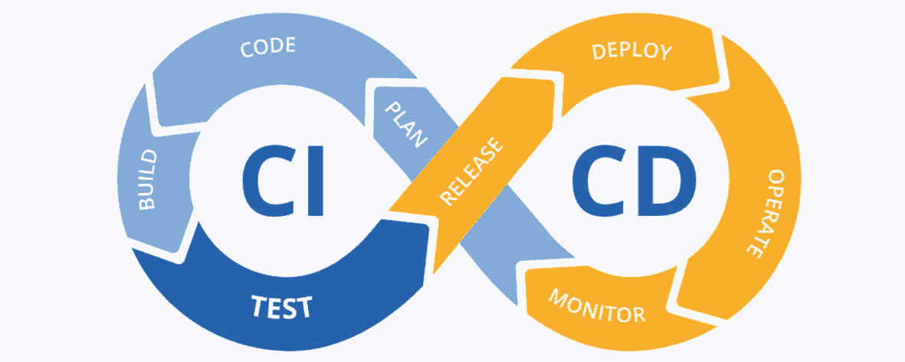

持续集成（CI）指的是机器学习流水线，新代码在一端提交，随后对数据、代码、模型及组件进行测试和验证。每当数据、代码或模型更新时，机器学习流水线会重新运行，以进行版本控制、测试和验证。

持续交付（CD）指的是机器学习流水线中负责交付一个准备就绪、可投入生产的新版本，该版本会自动将另一个机器学习模型部署到生产环境中。

MLOps 通过三个层级来实现基于 CI/CD 流水线的机器学习自动化。

#### 第 0 级：手动流程

MLOps 第 0 级是手动数据科学流程，在机器学习时代初期被采用。该流程是迭代式的，流水线中的每一步，如数据准备、模型训练等，都需手动执行。像 `Jupyter Notebooks` 这样的快速应用工具被用于实现手动流程。见图 3-2。

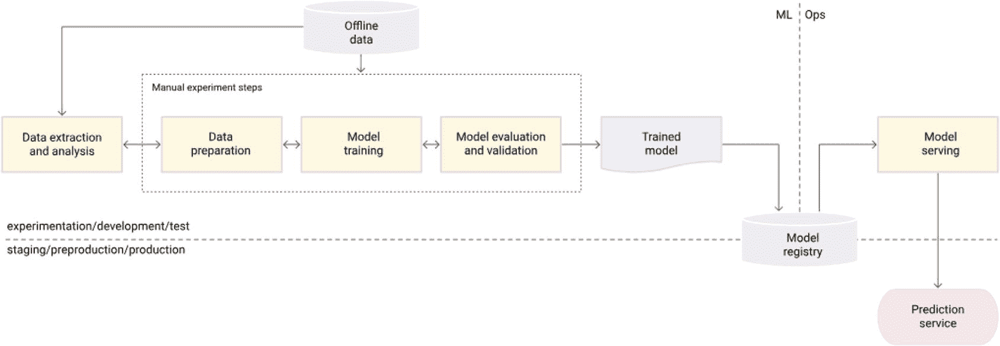

图 3-2

机器学习手动流程

##### 机器学习步骤

在任何机器学习项目中，一旦业务需求及其性能指标确定，将机器学习模型交付到生产环境需遵循以下八个基本步骤：

1.  **数据提取**

    第一步是从不同的数据源中选择并整合相关数据，用于机器学习实施。

2.  **数据分析**

    数据分析对于理解数据至关重要。探索性数据分析（EDA）和特征工程是两种重要的技术。这为决策和理解机器学习模型的行为搭建了平台。

3.  **数据准备**

    为机器学习任务恰当地清洗和准备数据。在此阶段，需要移除不必要的数据、填充缺失值，并将数据拆分为训练集、验证集和测试集。

4.  **模型训练**

    在此阶段，数据科学家在准备好的数据上实施各种机器学习算法来训练模型。超参数调优也在这一步进行，这有助于识别性能最佳的模型。

5.  **模型评估**

    根据项目开始时确定的性能指标对模型进行评估，以衡量模型的质量。

6.  **模型验证**

    对模型进行验证，以判断其是否适合部署。如果其预测性能优于某个基准线，则验证通过。

7.  **模型服务**

    在目标环境中，部署已验证的模型以进行预测。

8.  **模型监控**

    监控模型的预测性能，以便在必要时触发机器学习流程的新一轮迭代。

这些步骤的自动化程度定义了机器学习流程的成熟度级别。在第 0 级，所有机器学习步骤均手动运行，不存在自动化。

##### 第 0 级的挑战

手动流程存在诸多挑战，这催生了对机器学习流水线自动化的需求。

*   生产环境中的倦怠现象

*   机器学习与运维脱节

*   发布迭代频率低

*   缺乏持续集成与持续部署

*   缺少主动监控系统

#### 第 1 级：机器学习流水线自动化

在 MLOps 第 1 级，实现了自动化流水线，这有助于模型的持续训练（CT）。该级别有助于应对不断变化的环境和输入数据。每当新数据可用或到达预定时间时，就会触发模型重新训练的过程。通过持续训练，实现了模型预测服务的持续交付。此级别的自动化还包括数据与模型验证步骤以及元数据管理。见图 3-3。

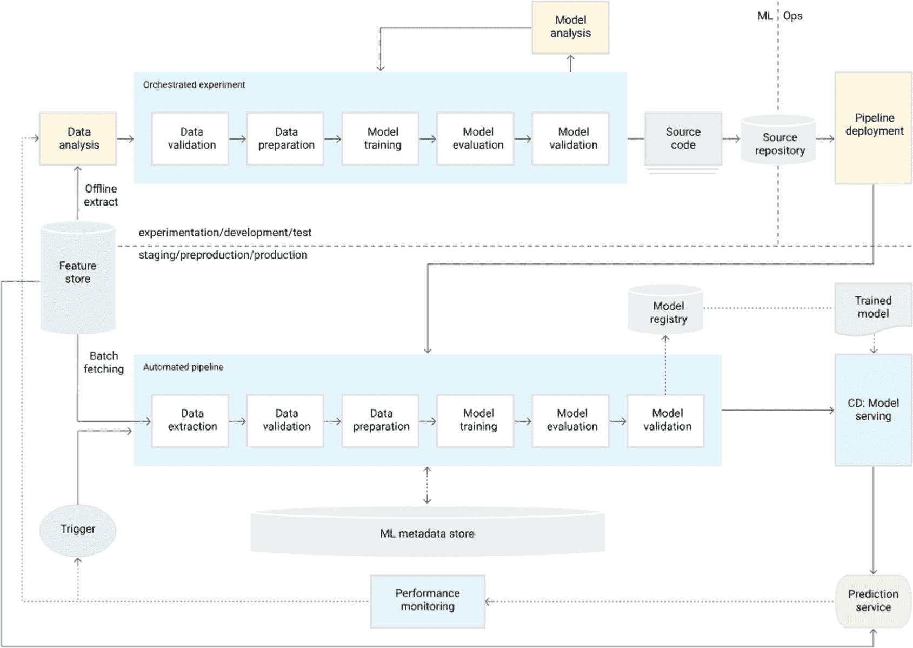

图 3-3

机器学习流水线自动化

##### 第 1 级新增组件

第 1 级新增了以下组件：

*   数据验证

*   模型验证

*   特征存储

*   机器学习元数据存储

*   机器学习流水线触发器

##### 第 1 级的特征

第 1 级克服了第 0 级的挑战。其主要特征如下：

*   在此级别，步骤之间的转换实现了自动化，从而能够快速进行实验并获得适当结果。这种自动化使得整个流水线能够快速有效地投入生产。

*   与第 0 级不同，在此级别，整个流水线会循环自动运行，以将训练好的模型交付部署。

*   当新数据可用时，流水线会触发生产环境中模型的持续训练。

*   在生产环境中，机器学习流水线持续为基于新数据训练和验证的最新模型提供预测服务。

*   代码针对不同组件进行模块化，使其可重用、可组合，并可能跨机器学习流水线共享。

##### 第 1 级的挑战

机器学习流水线自动化存在诸多挑战，这催生了对 CI/CD 流水线自动化的需求。

*   部署频率较低

*   未考虑新的机器学习思路

*   缺乏持续集成

#### 第二级：CI/CD 流水线自动化

MLOps 第二级是 MLOps 的最终阶段，在此阶段实现了自动化的 CI/CD 系统，用于在生产环境中快速、可靠且频繁地更新机器学习模型部署。在此级别，模型构建、测试、部署和监控机器学习系统的所有步骤均已自动化。新的机器学习想法可以通过持续集成流水线轻松整合。不同的技术组织每天在其不同的服务器上重新训练和重新部署模型。当今时代的智能系统离不开端到端的 CI/CD 自动化 MLOps 周期。参见图 3-4。

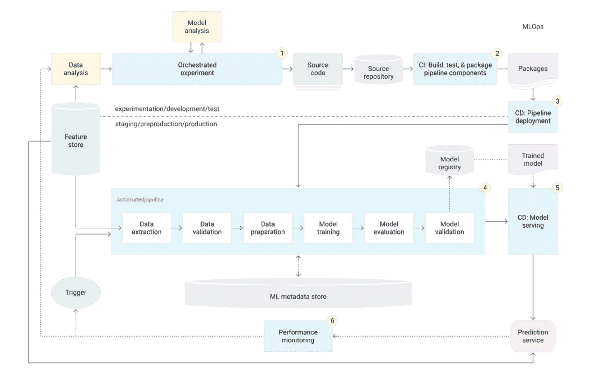

图 3-4

包含 CI/CD 流程的自动化机器学习流水线

##### 第二级的组件

此 MLOps CI/CD 流水线自动化级别包含以下组件：

*   机器学习流水线编排器

*   源代码控制

*   测试与构建服务

*   流水线部署服务

*   模型注册表

*   模型服务

*   特征存储

*   机器学习元数据存储

*   性能监控

# 机器学习 CI/CD 自动化流水线的阶段

让我们看看如图 3-5 所示的机器学习 CI/CD 自动化流水线的各个阶段。

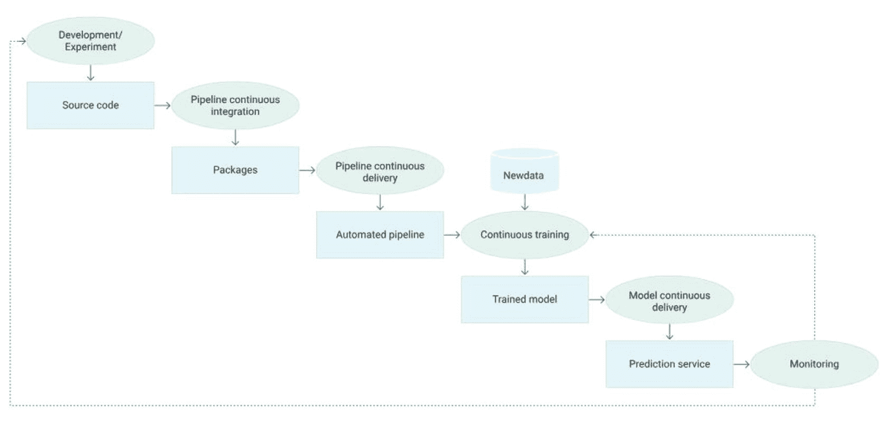

图 3-5 CI/CD 自动化机器学习流水线的阶段

1. **开发与实验**
    在开发与实验阶段，开发新的算法和新的模型，并对其进行实验。其最终输出是机器学习流水线 CI 下一步的输入。

2. **流水线持续集成**
    在此阶段，在构建源代码和进行测试的同时，集成需求的各种变更。诸如包、可执行文件和构件等输出组件被部署到机器学习流水线 CD。

3. **流水线持续交付**
    在持续交付流水线中，构件和可执行文件被部署到目标环境。

4. **持续训练**
    在生产环境中，任何新数据都会自动触发模型训练。这是一个基于计划或响应触发器的持续训练过程。此阶段的输出是新训练的模型，它是模型注册表的输入。

5. **模型持续交付**
    在此阶段，新训练的模型作为预测服务用于预测。此阶段的输出是需要部署的预测模型。

6. **监控**
    监控任何系统都很重要，这样所有付出的辛勤工作才不会白费。在此阶段，基于实时数据收集模型性能的所有统计数据和分分析。此阶段的输出是触发流水线以开始新实验周期的触发器。

数据分析和模型分析步骤对于数据科学家来说，在新实验流水线开始之前仍然是手动过程。借助 CI/CD 系统，新的流水线实现可以自动测试和部署。这些实践可以逐步实施，以帮助改进机器学习系统开发和生产的自动化。

## 第二级的挑战

CI/CD 流水线自动化也存在一些挑战。
* 人类技能集挑战
* 机器学习巨大的基础设施成本
* 运营挑战

# 用于可重现机器学习环境的基础设施即代码

训练和测试机器学习模型需要庞大的基础设施，而手动管理是困难的。MLOps 需要可靠、可扩展、安全且可重现的实践来自动化定义、基础设施配置、部署和管理。为了简化 MLOps，基础设施即代码通过版本控制系统进行实施和管理，这可以显著加速机器学习模型的开发和部署，同时减少错误和成本。

市场上有多种工具可用于为机器学习环境实施 IaC，可以根据组织需求进行选择。一些用于为机器学习环境实施 IaC 的流行工具包括 `Databricks Terraform`、`AWS CloudFormation`、`Kubernetes` 和 `Google Cloud Deployment Manager`。

## 什么是基础设施即代码？

基础设施即代码（IaC）是使用代码而非手动过程来定义、管理和配置基础设施的过程。通过 IaC，开发人员将服务器、网络、数据库和存储等基础设施资源定义为代码。此过程自动化了版本控制、部署和配置管理，从而以最小化的错误实现更快、更一致的结果。图 3-6。

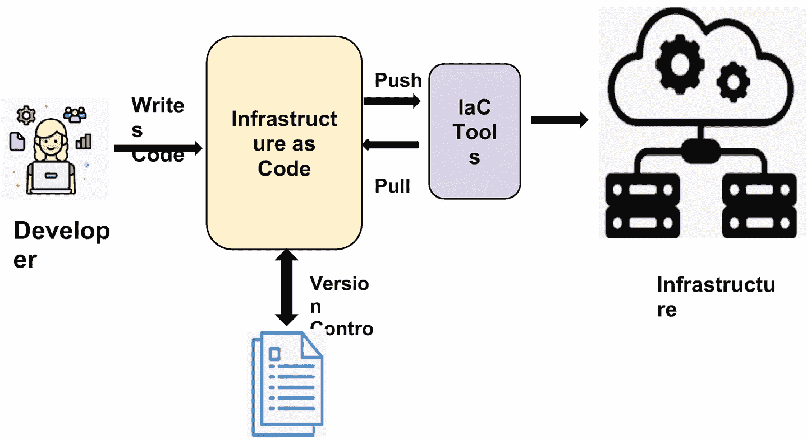

图 3-6 基础设施即代码的工作原理

## 用于 MLOps 的基础设施即代码的主要特性

以下是主要特性：
* **自动化版本控制**
    版本控制指的是跟踪数据、代码、配置和模型中所做的更改。跟踪代码和数据的更改使得在必要时更容易监控、故障排除和轻松恢复数据、代码、配置或模型的先前版本。整个 MLOps 实施需要一个大型团队，在大型团队环境中工作，版本控制是必需的，因为其自动化使其成为一个超快速的过程。
    有许多开源工具可供用户用于 MLOps 中的版本控制，例如来自 `GitHub` 的 `Git LFS`、来自 `Databricks` 的 `MLflow`、来自 `Pachyderm` 的 `Pachyderm` 等等。通过自动化版本控制，您的 MLOps 团队能够更有效地追踪错误、回滚无效的更改，并以更高的透明度和可靠性进行协作。
* **自动化机器学习流水线触发**
    MLOps 生产环境通过自动化机器学习流水线触发实现自动化。机器学习流水线可以手动触发，但自动触发有助于节省大量时间和精力。重新训练模型成本高昂，因此最好精心安排流水线。机器学习流水线可以在以下任何一种或所有情况下自动触发：
    * 基于计划
        数据科学家通常知道数据变化的频率，因此机器学习系统的频率可以按日、周或月来决定。
    * 在有新的训练数据可用时
        当有大量新的训练数据可用时，可以触发流水线。
    * 在模型性能下降时
        如果模型性能下降，可以重新训练模型。
    * 在发生显著的数据漂移时
        数据漂移对于重新训练模型至关重要且是必要的。

## 为机器学习环境使用基础设施即代码的好处

以下是好处：
* 可重现性
* 可扩展性
* 可靠性
* 安全性
* 加速部署
* 优化成本

## 为 MLOps 实施基础设施即代码的最佳实践

本节涵盖了在机器学习环境中实施 IaC 所需的一些最佳实践。这些实践对于机器学习系统的平稳高效运行至关重要。
* **代码质量**
    基础设施即代码完全基于代码来消除手动流程。因此，确保 IaC 代码具有高质量至关重要。这可以通过运行测试并以高精度和最小误差验证代码来实现。
* **模块化**
    模块化是通用的良好编码实践。代码将被分解为小的、可重用的模块，这些模块可以在多种配置中使用。这将降低代码复杂性，从而提高成功率。
* **版本控制系统**
    为 IaC 维护一个版本控制系统始终是一个好习惯，就像我们为开发代码所做的那样，以便跟踪变更和进行简单的回滚。可以使用像 `Git` 和 `DVC` 这样的版本控制工具来跟踪变更、还原变更，并在训练和部署机器学习模型时重现工作流。
* **自动化工具**
    像 `Databricks Terraform`、`AWS CloudFormation`、`Kubernetes` 等自动化工具，非常适合用于通过简化的基础设施配置来加速机器学习流程的自动化。
* **合规性监控**
    为模型验证的合规性监控强制执行策略和法规至关重要。这包括维护元数据和注释策略，并应用质量保证标准来帮助团队监控数据、代码、模型和其他参数。不同类型的组织可能有不同的合规性策略。他们需要确保模型以负责任和合乎道德的方式开发和部署。

# MLOps 中的监控与可观测性

监控和可观测性是 MLOps 系统的两个重要组成部分。MLOps 中监控和可观测性的主要目标是确保模型性能在生产环境中不会下降。一旦模型部署完成，它仍然需要持续监控，因为生产环境或数据漂移随时可能影响性能。任何阶段的性能漂移都应触发警报并通知相关负责人。

每个机器学习系统都实施了监控和警报系统，用于跟踪模型的关键性能指标、数据指标和模型退化。有多种监控工具可用，例如 `OpenShift`、`DataRobot`、`AWS Sage Maker` 等，可以利用这些工具建立全面的监控管道。

## MLOps 中需要监控什么？

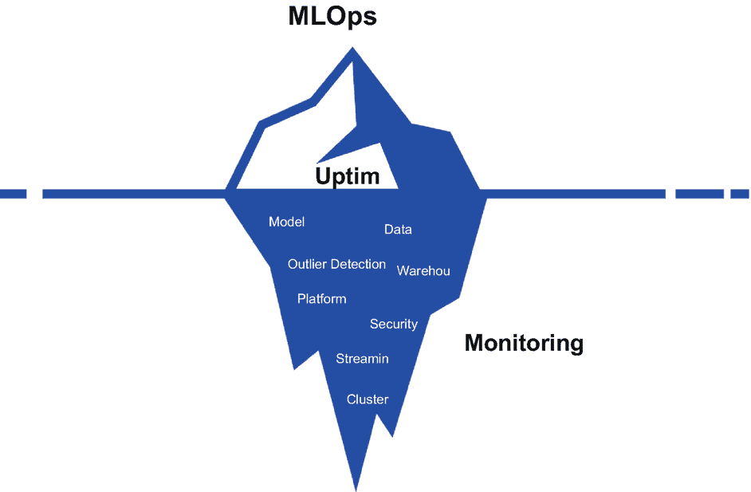

图 3-7 MLOps 健康度

监控为机器学习系统中的潜在问题提供实时的健康检查和警报。许多底层监控服务有助于构建良好、成功运行的 MLOps 系统。这些监控服务如下：

1. **监控模型性能**
    在实时生产环境中，确保高模型性能是监控机器学习模型最重要的方面。性能指标根据各种指标（如输入数据、其标签、模型偏差、正确的性能指标和环境因素）来监控模型性能。这高度依赖于生产系统中实时数据的标签。为了监控模型健康度，会实施用于实时可视化的监控仪表板。

2. **监控输入数据指标**
    用于模型训练的输入数据来源各不相同。此外，数据在用于模型训练之前会经历多次转换。由于如此多的转换和动态变化，数据非常容易出现不一致和错误。在生产环境中使用实时数据时，模型性能会随时间下降。数据、目标变量或转换的任何变化，都会因不可预见的方式导致模型性能随时间漂移。随着时间的推移，模型预测的准确性会降低，需要定期进行监控和警报。

3. **检测异常值**
    并非所有数据都校准良好；只有训练数据校准良好，这可能导致过拟合。检测异常值是标记异常情况的好方法，这些异常情况的模型预测不可信，也不能用于生产。由于现实世界的数据非常嘈杂且处理不当，无监督异常检测的问题将始终存在，并且始终有监控和改进的空间。

4. **平台监控**
    自动化的 MLOps 需要庞大的基础设施和设置来定期监控整个平台，为此会维护日志。

5. **集群监控**
    集群监控对于检查所需数量的集群是否正在运行非常重要。忽视这一点可能导致系统故障或资源浪费。

6. **仓库监控**
    监控仓库对于了解负载概况及其高效管理至关重要。仓库监控可以准确了解所使用的资源及其效率。

7. **流式监控**
    流式监控对于实时数据处理、实时数据分析和执行触发操作至关重要。

8. **安全监控**
    任何 MLOps 系统都承受不起安全漏洞。系统需要得到保护、监控和关注，以实现高效性能。增强安全监控的安全合规性是时代的需求。

## MLOps 可观测性

# 可观测性与 MLOps

可观测性为机器学习系统提供了更高级别的概览和端到端的可见性。它使工程师能够理解系统行为、检测问题并改进模型性能。它超越了监控和解决已知问题。如果你的系统不能完美运行，你应该能够在最终客户遇到任何麻烦之前检测并解决它。可观测性有助于减少事件的平均检测时间（MTTD）和平均解决时间（MTTR）。MLOps 可观测性的目标是持续观察 MLOps 系统中所有应用和基础设施组件的当前状态。

可观测性有助于理解系统的内部行为，这是从外部无法识别的。可观测性结合了指标、事件、日志和追踪，以帮助检测、调查和解决未知问题。通过观察，更容易调试意外行为并避免未来的麻烦。可观测性的基础是收集所有定期记录的、相关的信息，并密切关注任何未知问题。否则，在事件发生后等待调试数据，然后找到解决方案，会严重增加 MTTR。

在 MLOps 系统中，如果内存利用率超过某个阈值或系统实时响应时间增加，许多此类问题会自动触发警报。它使用图形仪表板来显示日志、事件、追踪和指标，并显示系统发出的警报和告警。

### MLOps 可观测性的优势

以下是 MLOps 可观测性的优势：

*   可观测性有助于减少许多 MLOps 内部问题的 MTTD 和 MTTR。
*   如果模型失败，它可以执行根本原因分析。
*   它在机器学习生命周期的所有步骤收集数据，如指标、事件、日志和追踪。
*   提供交互式和实时的可视化。
*   它成为模型改进的指路明灯。

# MLOps 用例

机器学习和人工智能在当今快速发展的数字世界中扮演着至关重要的角色。许多行业已转向机器学习，从而在现实场景的生产中实现了完整的 MLOps。

## NatWest：MLOps 应用案例

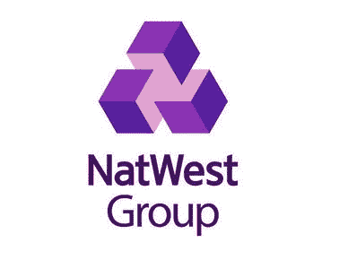

国民西敏寺银行（通常称为 NatWest）是一家领先的零售、银行和金融服务集团，为英国和爱尔兰的 1900 万客户提供服务。NatWest 被视为英国四大清算银行之一，拥有超过 960 家分行的大型网络，并提供网上银行服务。NatWest 每月处理约 7.5 亿笔金融交易。NatWest 坚信要激发潜能，帮助个人、家庭和企业蓬勃发展。

### NatWest 的业务目标

实施 MLOps 的业务目标是缩短 NatWest 集团实现业务价值的时间。NatWest 集团大规模运用分析技术，使其成为一家优化的数据驱动型银行。但其流程缓慢且不一致。快节奏的金融服务行业竞争非常激烈，为其 1900 万客户提供更快捷的服务极具挑战性。NatWest 探索其数据并构建机器学习解决方案，根据客户需求提供定制化体验。

为了通过机器学习加速实现业务价值，NatWest 求助于亚马逊云服务，并采用 Amazon SageMaker 作为其核心机器学习技术。Amazon SageMaker 是一项服务，数据科学家和工程师可以使用它来构建、训练和部署机器学习模型，并拥有完全托管的基础设施、工具和工作流程，几乎适用于任何用例。NatWest 集团将其机器学习流程集中到 AWS 上，将推出新产品和服务所需的时间缩短了数月。同时，这也为其数据科学团队引入了更敏捷的文化。使用 Amazon SageMaker，白板上的一个想法在几个月内就能变成生产中可运行的机器学习解决方案，而此前则需要一年或更长时间。

### 挑战

以下是 NatWest 在实施 MLOps 之前面临的挑战：

1.  人员
    员工缺乏当前的培训和职责界定。这是一项艰巨且耗时的任务。
2.  流程
    手动流程（如手动交接和治理）导致进展缓慢、效率低下，从而造成实现价值的时间过长。
3.  数据
    数据是机器学习运营的首要前提，但获取和发现数据并不容易。
4.  技术
    陈旧的技术和过时的环境导致从开发到部署的时间过长。

### 使用的平台

NatWest 集团与 AWS 专业服务团队合作，使用 Amazon SageMaker 构建了一个可扩展、安全且可持续的 MLOps 平台。图 3-8 中的高级架构图展示了如何在 AWS 上部署 NatWest 业务应用案例以构建机器学习解决方案。

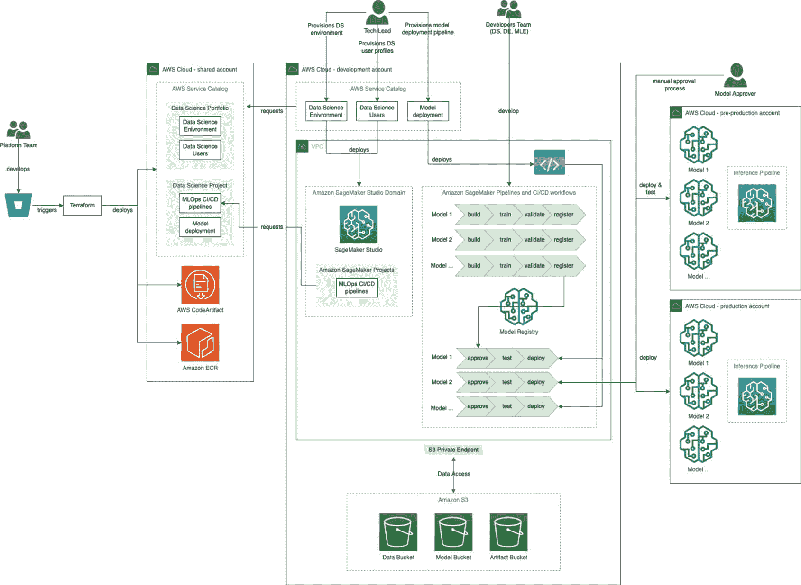

图 3-8 NatWest 的 Amazon SageMaker 高级架构

### 解决方案

以下是 NatWest 实施的各种解决方案：

1.  NatWest 使用 Amazon Simple Storage Service 进行简单的数据存储和访问。借助对数据和资源以及机器学习工具的简单快速访问，构建机器学习用例变得更加容易和快捷。
2.  NatWest 集团使用 AWS Service Catalog 来创建、组织和治理基础设施即代码模板。这将员工的工作流程从两到四周缩短到了几小时。
3.  NatWest 集团拥有 Amazon SageMaker Studio，这是一个基于 Web 的单一可视化界面，可以在其中执行所有机器学习开发步骤。由于其易于使用和配置，因此用户友好、易于学习，并能产生有效的结果。
4.  Amazon SageMaker 集成了 CI/CD 管道工作流程，用于生产就绪的用例开发。它提高了质量，优化了治理和沿袭追踪。
5.  借助 Amazon SageMaker Studio，NatWest 实现了更快实现价值的主要目标。

### 关键成果

图 3-9 展示了关键成果。

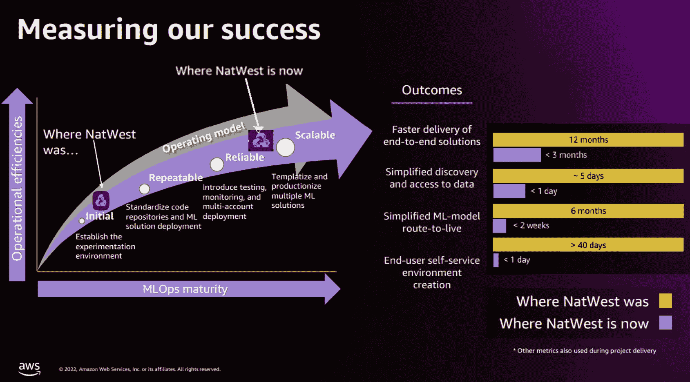

图 3-9 NatWest 集团实施 MLOps 后的成果

以下是 NatWest 集团实施 MLOps 后的主要关键成果：

*   端到端机器学习解决方案的交付速度加快，时间从 12 个月缩短至不到 3 个月。
*   简化了数据的发现和访问，这通常需要五天时间；现在可以在几小时内完成。
*   机器学习模型部署到生产环境曾需要六个多月；现在可以在不到两周内完成。
*   为最终用户创建了自助服务环境，有助于在一天内解决问题。
*   实现业务价值的时间显著缩短，这使 NatWest 处于行业领先地位。

### 总结

使用 DevOps 概念自动化机器学习系统在生产中的部署，催生了 MLOps。卓越运营使 MLOps 能够在现实场景中平稳过渡和执行。尽管模型创建和实时部署之间存在差距，但借助 MLOps 中的卓越运营优势，一切正步入正轨。现在是时候无缝处理数据复杂性、模型构建和系统监控了。目标是通过卓越运营成功地将机器学习模型部署到生产中，以充分享受人工智能技术的全部优势。这可以通过在 MLOps 中实施本文详述的卓越运营最佳实践，并结合所讨论用例中的理念和 MLOps 实施来实现。

# 如何在 AWS 中实施卓越运营

卓越运营侧重于通过监控成功部署和运行系统。卓越运营旨在通过深入了解工作负载，持续改进流程和程序，以交付卓越的业务价值。为了通过持续改进流程来交付业务价值，AWS 中的卓越运营支柱定义了其设计原则、工作领域和最佳实践。让我们详细讨论它们。

### 卓越运营设计原则

云中卓越运营有五个设计原则：

*   将操作流程作为代码执行，并自动响应事件
*   进行小规模、增量、频繁且可逆的变更
*   频繁改进操作流程
*   预测故障并制定缓解措施
*   从所有运营事件和故障中学习

### 云中的卓越运营

云中的卓越运营在四个领域发挥作用：

*   `组织`
    要在任何组织中实现卓越运营，理解组织的优先级、运营模式和组织文化以支持和实现业务成果至关重要。
*   `准备`
    组织必须理解设计遥测、工作负载和预期行为，以优化整个流程并为卓越运营做好准备。需要构建程序并理解运营就绪状态，以降低部署风险。
*   `运营`
    一个组织通过理解其工作负载和运营的健康状况来达到成功的高度。它必须能够识别组织和业务风险，并能够适当地响应这些事件。
*   `演进`
    演进是随着时间的推移持续改进的循环。学习并评估所有运营活动，并实施频繁的小规模增量变更。要随着时间的推移改进运营，必须能够学习、分享和改进。

### 卓越运营最佳实践

卓越运营支柱旨在通过持续改进程序和支撑流程来交付业务价值。卓越运营的关键工作领域包括自动化变更、响应事件以及管理日常运营，同时满足既定标准。本节包含在构建机器学习问题时要考虑的九项最佳实践。

#### 制定模型改进策略

在机器学习模型开发之前，规划模型改进策略至关重要。为了优化模型性能，机器学习实验需要迭代进行。这些实验会用到多种改进技术，例如数据收集、交叉验证、特征工程、深度学习超参数调优以及集成方法。我们先来了解机器学习实验。

##### 理解机器学习实验

完整的机器学习周期是一个迭代过程。你需要尝试数据、特征工程、不同算法和超参数的多种组合，同时观察增量变化对模型准确率的影响。这种迭代实验会随着时间的推移产生数千次模型训练运行和模型版本。经过几次迭代后，很难将当前实验与过去的实验进行比较，以确定进一步改进的增量变化。同时，跟踪所有模型及其性能和输入配置，以便最终得出性能最佳的模型，这一点也很重要。

开发者需要工具来组织、查看、分析和比较迭代的机器学习实验，从而获得比较性洞察并跟踪性能最佳的模型。`Amazon SageMaker Experiments` 是一项托管服务工具，它可以大规模地创建、组织、查看、跟踪、分析和比较你的机器学习实验，并涵盖各种模型改进策略（见图 3-10）。

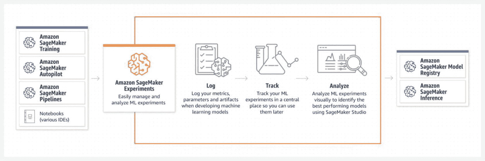

图 3-10
Amazon SageMaker Experiments

## 实施模型改进策略

我们来讨论如何使用 `Amazon SageMaker Experiments` 实施各种改进策略：

### 有效的特征选择

有效的特征选择是构建良好机器学习模型最关键的部分之一。需要利用现有特征迭代地进行特征工程，并移除不重要的特征，以提高模型的准确率和鲁棒性。这不仅关乎添加新的复杂特征，也关乎有效处理现有特征。`Amazon SageMaker Experiments` 可以帮助进行数据清洗和有效的特征选择。

以下示例演示了如何通过构建一个 `sagemaker.sklearn.estimator.sklearn` 评估器来创建用于特征选择的 SageMaker Scikit 评估器。该评估器会执行特征选择训练脚本 `sklearn_feature_selection.py`。

```python
from sagemaker.sklearn.estimator import SKLearn
script_path = "sklearn_feature_selection.py"
model_output_path = os.path.join("s3://", bucket, prefix, "Feature_selection_model/")
sklearn_preprocessor = SKLearn(
    entry_point=script_path,
    role=role,
    output_path=model_output_path,
    instance_type="ml.c4.xlarge",
    sagemaker_session=None,
    framework_version="1.2-1",
    py_version="py3",
)
sklearn_preprocessor.fit({"train": train_input})
```

下面展示了一个示例文件 `sklearn_feature_selection.py`。

```python
from sklearn.feature_selection import f_regression, mutual_info_regression, SelectKBest, RFE
from sagemaker_containers.beta.framework import (
    content_types, encoders, env, modules, transformer, worker)
label_column = 'y'
INPUT_FEATURES_SIZE = 100
y_train = concat_data.iloc[:,number_of_columns_x-1].values
X_train = concat_data.iloc[:,:number_of_columns_x-1].values
'''特征选择管道'''
feature_selection_pipe = Pipeline([
    ('svr', RFE(SVR(kernel="linear"))),# 默认：消除 50%
    ('f_reg',SelectKBest(f_regression, k=30)),
    ('mut_info',SelectKBest(mutual_info_regression, k=10))
])
feature_selection_pipe.fit(X_train,y_train)
joblib.dump(feature_selection_pipe, os.path.join(args.model_dir, "model.joblib"))
print("模型已保存！")
'''保存选定的特征名称'''
feature_names = concat_data.columns[:-1]
feature_names = feature_names[feature_selection_pipe.named_steps['svr'].get_support()]
feature_names = feature_names[feature_selection_pipe.named_steps['f_reg'].get_support()]
feature_names = feature_names[feature_selection_pipe.named_steps['mut_info'].get_support()]
joblib.dump(feature_names, os.path.join(args.model_dir, "selected_feature_names.joblib"))
print("选定的特征为: {}".format(feature_names))
```

`sklearn.feature_selection` 模块中提供了两种特征选择算法。

`feature_selection.RFE` 是一种递归特征消除（RFE）算法，它通过迭代地考虑更少、更小的特征集来选择特征。

对于 RFE，我们使用支持向量回归（`sklearn.svm.SVR`）作为学习评估器。默认情况下，它几乎会消除总特征的 50%。

`feature_selection.SelectKBest` 选择指定指标得分最高的最佳 k 个特征。我们使用 `f_regression` 和 `mutual_info_regression` 作为评分函数，从而得到前 10 个特征。

在上述训练脚本中，使用 `sklearn.feature_selection.RFE`、`sklearn.feature_selection.SelectKBest` 以及结合 `mutual_info_regression` 的 `SelectKBest` 进行的递归特征消除，被实现在管道中用于特征选择算法。这三个特征选择算法被堆叠到一个 `sklearn.pipeline.Pipeline` 中，以获取前 10 个选定的特征，这些特征将用于后续的训练目的。

### 深度学习

深度学习算法通过训练大量训练数据来提高准确性。这种机器学习算法基于我们脑细胞（称为*神经元*）的概念，由此产生了人工神经网络（ANN）。`Amazon SageMaker Experiments` 可以训练从简单经典模型到复杂深度学习模型的各种模型，以改善与业务价值相关的性能指标。

以下部分为示例代码，演示了如何使用 SageMaker Python SDK 通过 TensorFlow 训练深度学习模型。

```python
from sagemaker.tensorflow import TensorFlow
tf_estimator = TensorFlow(
    entry_point="tf-train.py",
    role="SageMakerRole",
    instance_count=1,
    instance_type="ml.p2.xlarge",
    framework_version="2.2",
    py_version="py37",
)
tf_estimator.fit("s3://bucket/path/to/training/data")
```

在上述代码中，创建了一个 `sagemaker.tensorflow.TensorFlow` 评估器实例。名为 `tf-train.py` 的训练脚本通过 SageMaker TensorFlow 评估器执行。该评估器对训练数据进行拟合，这些数据是 Amazon S3 中训练数据的 S3 URL 路径。

### 集成方法

集成方法结合了不同的算法，可以进一步提高准确性。在模型集成中，结合具有不同模型预测和概率的算法非常重要。算法是根据特定的业务用例进行组合的。它通常能提供更好的计算性能，但会带来维护方面的挑战。`Amazon SageMaker Experiments` 可以帮助组织针对不同算法和配置的多次测试，并轻松进行比较。

以下部分为示例代码，演示了如何评估`线性学习器`、`XGBoost`以及`集成模型`在训练、验证和测试数据上的表现。

## 打印组合模型的 AUC

```python
print("训练集 AUC - Xgboost", round(roc_auc_score(train_labels, preds_train_xgb), 5))
print("训练集 AUC - 线性", round(roc_auc_score(train_labels, preds_train_lin), 5))
print("训练集 AUC - 集成", round(roc_auc_score(train_labels, ens_train), 5))
print("=======================================")
print("验证集 AUC - Xgboost", round(roc_auc_score(val_labels, preds_val_xgb), 5))
print("验证集 AUC - 线性", round(roc_auc_score(val_labels, preds_val_lin), 5))
print("验证集 AUC - 集成", round(roc_auc_score(val_labels, ens_val), 5))
print("======================================")
print("测试集 AUC - Xgboost", round(roc_auc_score(test_labels, preds_test_xgb), 5))
print("测试集 AUC - 线性", round(roc_auc_score(test_labels, preds_test_lin), 5))
print("测试集 AUC - 集成", round(roc_auc_score(test_labels, ens_test), 5))
```

作为第一个训练算法，使用 `SageMaker` 的托管式分布式训练框架选择了 `XGBoost` 算法，然后使用`线性学习器`对相同的数据进行训练。最终的建模是在训练、验证和测试数据上对 `XGBoost` 和`线性学习器`进行集成，并使用 `AUC` 性能指标进行评估。

## 超参数优化

控制模型训练和拟合过程的模型参数称为`超参数`。迭代优化`超参数`对于获得一个优秀模型至关重要，以便为性能最佳的模型找到最优参数。可以使用 `Amazon SageMaker` 自动化`超参数`优化过程，通过网格搜索、随机搜索、贝叶斯和 `Hyperband` 等多种技术达到最佳性能。

以下部分为示例代码，演示了如何使用 `SageMaker XGBoost` 管理超参数调优，以及使用随机搜索进行自动模型调优。

```python
from sagemaker.amazon.amazon_estimator import get_image_uri
from sagemaker.image_uris import retrieve

sess = sagemaker.Session()
container = retrieve("xgboost", region, "latest")

xgb = sagemaker.estimator.Estimator(
    container,
    role,
    base_job_name="xgboost-random-search",
    instance_count=1,
    instance_type="ml.m4.xlarge",
    output_path="s3://{}/{}/output".format(bucket, prefix),
    sagemaker_session=sess,
)

xgb.set_hyperparameters(
    eval_metric="auc",
    objective="binary:logistic",
    num_round=10,
    rate_drop=0.3,
    tweedie_variance_power=1.4,
)

objective_metric_name = "validation:auc"
hyperparameter_ranges = {
    "alpha": ContinuousParameter(0.01, 10, scaling_type="Logarithmic"),
    "lambda": ContinuousParameter(0.01, 10, scaling_type="Logarithmic"),
}

tuner_log = HyperparameterTuner(
    xgb,
    objective_metric_name,
    hyperparameter_ranges,
    max_jobs=5,
    max_parallel_jobs=5,
    strategy="Random",
)

tuner_log.fit(
    {"train": s3_input_train, "validation": s3_input_validation},
    include_cls_metadata=False,
    job_name="xgb-randsearch-" + strftime("%Y%m%d-%H-%M-%S", gmtime()),
)
```

在此示例中，我们使用 `SageMaker Python SDK` 来设置和管理超参数调优任务。这里使用了 `XGBoost` 算法，并通过随机搜索进行超参数调优。首先配置用于超参数调优的训练任务，通过启动 `XGBoost` 评估器来发起，然后定义静态超参数和目标。

## AutoML 实现

顾名思义，`AutoML` 自动化了机器学习工作流程，使您可以花更多时间使用机器学习来改善业务成果。它自动化了繁琐、耗时且重复的工作，例如数据采集、数据清洗、特征工程、模型训练、模型调优、模型部署以及持续的模型监控和更新。`Amazon SageMaker Autopilot` 是一种针对表格格式数据的 `AutoML` 解决方案。

以下示例演示了如何使用 `SageMaker Python SDK` 创建 `Amazon SageMaker Experiments`。

```python
class ExperimentCallback(keras.callbacks.Callback):
    """ """
    def __init__(self, run, model, x_test, y_test):
        """在构造函数中保存参数"""
        self.run = run
        self.model = model
        self.x_test = x_test
        self.y_test = y_test

    def on_epoch_end(self, epoch, logs=None):
        """ """
        keys = list(logs.keys())
        for key in keys:
            run.log_metric(name=key, value=logs[key], step=epoch)
            print("Epoch: {}\n{} -> {}".format(epoch, key, logs[key]))
```

接下来，在笔记本环境中训练 `Keras` 模型，该环境按顺序执行任务，将其作为实验进行跟踪，并在最后显示测试数据的准确性。

```
from sagemaker.experiments import Run
# 运行名称是 `run.init()` 的可选参数
with Run(experiment_name = 'my-experiment') as run:
    # 定义要记录的参数值
    run.log_parameter("batch_size", batch_size)
    run.log_parameter("epochs", epochs)
    run.log_parameter("dropout", 0.5)
    # 定义输入工件
    run.log_file('datasets/input_train.npy', is_output = False)
    run.log_file('datasets/input_test.npy', is_output = False)
    run.log_file('datasets/input_train_labels.npy', is_output = False)
    run.log_file('datasets/input_test_labels.npy', is_output = False)
    # 本地训练
    model.fit(
        x_train,
        y_train,
        batch_size=batch_size,
        epochs=epochs,
        validation_split=0.1,
        callbacks = [ExperimentCallback(run, model, x_test, y_test)]
    )
    score = model.evaluate(x_test, y_test, verbose=0)
    print("测试损失:", score[0])
    print("测试准确率:", score[1])
    # 定义要记录的指标
    run.log_metric(name = "最终测试损失", value = score[0])
    run.log_metric(name = "最终测试准确率", value = score[1])
```

### 建立血缘追踪系统

建立血缘追踪系统对于跟踪每次发布中文档、环境、模型、数据、代码和基础设施的变更至关重要。一个流畅的追踪系统允许用户回滚到任何先前的版本。当用户需要复现任何先前版本的结果或其中产生的任何问题时，都可以轻松复现。

#### 实施血缘追踪系统

让我们使用 AWS SageMaker 来实施一个血缘追踪系统。

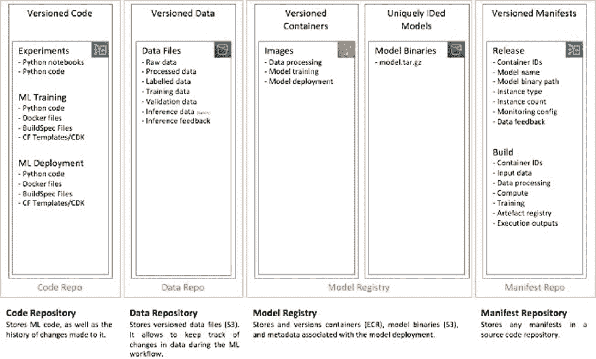

#### 1. 用于追踪的数据和工件血缘

为了复现模型，必须追踪用于生产模型的所有工件，以满足监管和控制要求。图 3-11 展示了必须被追踪和版本化以复现数据处理、模型训练、配置和模型部署过程的不同工件。

以下工件需要被追踪和版本化：

1. 代码版本化
2. 数据集版本化
3. 容器版本化
4. 训练任务版本化
5. 模型版本化
6. 端点元数据版本化

以下部分是示例代码，演示了如何使用 SageMaker Python SDK 创建一个 Amazon SageMaker 工件，该工件是 SageMaker 血缘关系的一部分。

```python
from sagemaker.lineage import artifact
my_artifact = artifact.Artifact.create(
    artifact_name='MyArtifact',
    artifact_type='S3File',
    source_uri='s3://...')
my_artifact.properties["added"] = "property"
my_artifact.save()
for artfct in artifact.Artifact.list():
    print(artfct)
my_artifact.delete()
```

将 `artifact_name`、`artifact_type` 和 `source_uri` 作为输入，用于创建 Amazon SageMaker 工件，并将其保存为 SageMaker 血缘关系的一部分。

#### 2. 使用 SageMaker ML 血缘追踪

对于机器学习，系统遵循从数据准备到模型部署的 ML 工作流。为了创建和存储关于 ML 工作流步骤的信息，使用了 Amazon SageMaker ML 血缘追踪。借助 SageMaker 血缘追踪，可以轻松复现 ML 工作流步骤、数据集血缘关系以及追踪模型。所有这些追踪信息有助于建立模型治理并完美地维护审计标准。

Amazon SageMaker 会自动创建一个端到端的模型训练和部署 ML 工作流，如图 3-12 所示。

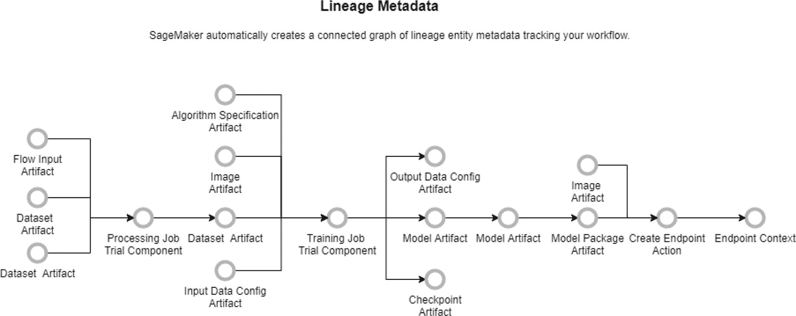

以下是 SageMaker 血缘追踪的特性：

1. 维护模型发现实验的运行历史。
2. 通过追踪模型血缘工件，为审计和合规性验证建立模型治理。

#### 3. 使用 SageMaker Studio Classic

Amazon SageMaker Studio Classic 是一个用于端到端 ML 开发的基于 Web 的界面。它提供了一个用于机器学习的集成开发环境（IDE），用于追踪从上传数据到构建模型再到部署模型的 SageMaker ML 管道的血缘关系。Amazon SageMaker Studio Classic 提供了广泛的专业工具，用于执行所有 ML 开发步骤，从准备数据到构建、训练、调试、部署和管理您的机器学习模型。图 3-13。

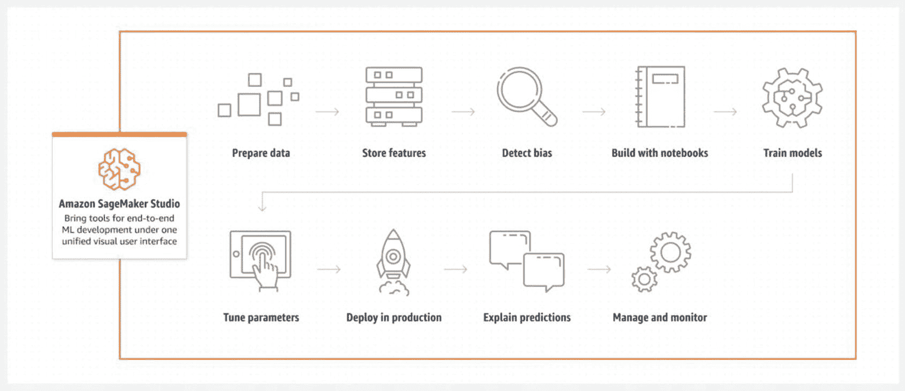

它是一个统一的、可视化的基于 Web 的界面，客户可以在其中执行以下任务：

1. 使用 Jupyter Notebooks 编写和执行代码
2. 为机器学习大规模准备数据
3. 以优化性能构建和训练机器学习模型
4. 部署模型并监控以获得最佳性能和成本
5. 追踪和调试机器学习实验
6. 交付高性能的生产级 ML 模型

#### 4. 使用 SageMaker Feature Store

Amazon SageMaker Feature Store 是一个专门构建的存储库，您可以在其中存储、共享、访问和管理 ML 模型特征，以便在 ML 应用程序和各个团队之间进行训练、组织和重用。借助 SageMaker Feature Store，可以轻松地将输入数据处理和转换为 ML 特征。为了支持 MLOps 实践，它构建了特征管道以加快模型部署时间。

SageMaker Feature Store 提供了一个统一的存储库，用于训练期间的离线特征存储以及用于实时推理和批量推理的在线存储。无需编写额外的代码或创建手动流程来保持特征一致性。

来自任何数据源（包括流式和批处理）的特征，例如应用程序日志、服务日志、点击流、传感器以及来自 AWS 或任何其他第三方数据源的表格数据，都可以通过 Amazon SageMaker Feature Store 轻松摄取。图 3-14。

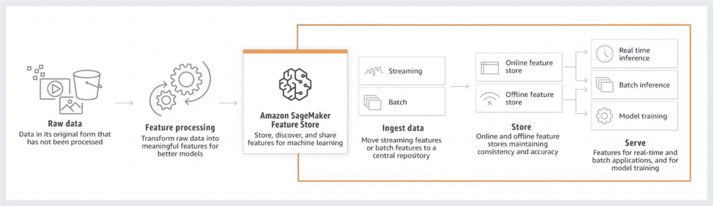

以下是 Amazon SageMaker Feature Store 的主要特性：

1. 在将数据摄取到 ML 特征时进行特征处理，并能够通过单行代码从各种来源摄取大量数据。
2. 通过 Amazon SageMaker Studio 的图形用户界面轻松存储、组织、查找和使用特征。
3. 通过确保离线和在线数据集保持同步来实现特征一致性，这一点至关重要，否则可能会对模型准确性产生负面影响。
4. 血缘追踪，能够在一个环境中将特征追溯回其数据源并查看特征处理代码，从而增强数据科学家的信心。
5. 在需要时检索每个特征的状态。
6. SageMaker Feature Store 管理数据集和特征管道，以加速 MLOps 生命周期任务并消除重复的特征创建。
7. 它实施细粒度的访问控制，以保护特征存储数据，并根据安全和合规角色授予访问权限。

以下部分示例演示了如何使用 SageMaker Python SDK 创建 Amazon SageMaker Feature Store。

```
# Amazon SageMaker 高级文档

```python
from sagemaker.feature_store.feature_store import FeatureStore
feature_store = FeatureStore(sagemaker_session=feature_store_session)
result_df, query = feature_store.create_dataset(
    base=base_feature_group,
    output_path=f"s3://{s3_bucket_name}"
).to_dataframe()
```

通过使用 Feature Store Offline SDK 预处理数据和训练机器学习模型，可以快速简单地创建可供使用的数据集。无需编写任何 SQL 代码，该 SDK 即可轻松地从 SQL 连接、时间点精确连接和事件时间范围创建数据集。在前面的代码中，`result_df` 数据帧是使用 SageMaker Feature Store 创建的。

## 1. 使用 SageMaker Pipelines 进行模型构建

Amazon SageMaker Pipelines 是一个专门构建的工作流编排服务，用于自动化机器学习（ML）管道的所有阶段，从数据预处理到模型监控，通过直观的 UI 和 Python SDK 进行大规模操作。借助管道，您可以追踪输入数据、其来源以及生成的输出的历史记录。

以下是 Amazon SageMaker Pipelines 的主要特性：
*   自动化 ML 开发的所有阶段
*   构建端到端的 LLMOP 系统
*   管理工作负载
*   组合、重用和调度 ML 工作流
*   迁移您的机器学习代码
*   自动模型追踪

以下部分是示例代码，演示了如何使用 SageMaker Python SDK 在 Amazon SageMaker 中创建 Amazon SageMaker 模型构建管道。

```python
from sagemaker.workflow.pipeline_context import PipelineSession
from sagemaker.workflow.pipeline_context import PipelineSession
pytorch_estimator = PyTorch(
    sagemaker_session=PipelineSession(),
    role=sagemaker.get_execution_role(),
    instance_type="ml.c5.xlarge",
    instance_count=1,
    framework_version="1.8.0",
    py_version="py36",
    entry_point="./entry_point.py",
)
step = TrainingStep(
    name="MyTrainingStep",
    # code just like how you trigger a training job before,
    # pipeline session will take care of delaying the start
    # of the training job during pipeline execution.
    step_args=pytorch_estimator.fit(
        inputs=TrainingInput(s3_data="s3://my-bucket/my-data/train"),
    ),
    displayName="MyTrainingStepDisplayName",
    description="This is MyTrainingStep",
    cache_config=CacheConfig(...),
    retry_policies=[...],
    depends_on=[...],
)
pipeline = Pipeline(
    name="MyPipeline",
    steps=[step],
    sagemaker_session=local_pipeline_session
)
pipeline.create(
    role_arn=sagemaker.get_execution_role(),
    description="local pipeline example"
)
# pipeline will execute locally
pipeline.start()
```

前面的示例展示了如何构建一个 Pytorch 估算器，并使用 SageMaker 会话启动一个训练作业。这里我们使用的是 `sagemaker.workflow.pipeline_context.PipelineSession`，它定义了 `sagemaker.workflow.steps.TrainingStep`，该步骤在管道执行期间运行。这就是管道会话 `sagemaker.workflow.pipeline_context.PipelineSession` 介入并执行整个管道的地方。

## 2. 使用 SageMaker 模型注册表

Amazon SageMaker 模型注册表用于编目生产模型、管理模型版本、注册和部署模型，以及将元数据与模型关联。模型注册表支持血缘追踪。

SageMaker 模型注册表模型（包）组用于编目包含不同版本模型的生产模型。创建模型组是为了追踪为解决特定问题而训练的所有模型。然后，每个训练好的模型都会作为新的模型版本注册，并添加到模型组中。最后，通过将模型组组织到 SageMaker 模型注册表集合中，进一步创建不同类别的模型组。图 3-15 展示了 SageMaker 模型注册表的典型工作流程。

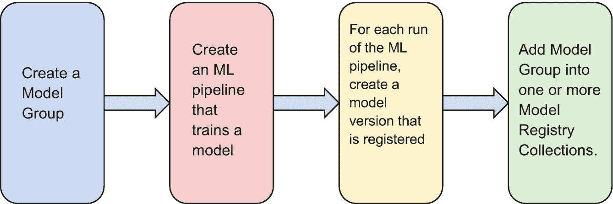

以下是 SageMaker 模型注册表的主要功能：
*   为生产环境编目模型
*   管理模型版本
*   将元数据指标与模型关联
*   管理模型的审批状态
*   将模型部署到生产环境
*   通过 CI/CD 自动化模型部署

### 在机器学习生命周期各阶段建立反馈循环

为了在机器学习生命周期的各个阶段共享成功的开发试验、失败案例以及其他运营活动，建立反馈循环机制至关重要。这有助于在未来的机器学习工作流迭代中实现持续改进。机器学习从业者会在每个阶段分析机器学习实施情况，并随着时间的推移重新审视监控和再训练改进策略。为了达到最优结果，会使用不同的算法、超参数和数据增强方法进行各种模型训练实验。在迭代过程中，记录每个关键的学习成果和流程改进，以供将来参考。

#### 在机器学习生命周期各阶段实施反馈循环

让我们使用 Amazon SageMaker 在机器学习生命周期各阶段实施一个反馈循环。

##### 建立 SageMaker 模型监控

第一步是建立 Amazon SageMaker 模型监控系统。机器学习模型的准确性和性能会随时间衰减，这种现象称为*模型漂移*。许多因素都可能导致模型漂移，例如模型特征以及训练数据和推理数据之间的差异。Amazon SageMaker 模型监控器会持续监控机器学习模型是否存在模型漂移和概念漂移。如果出现任何偏差，SageMaker 模型监控器会通知您，以便您进行必要的修正。

模型监控的不同入口如下所示。

###### 使用 Amazon CloudWatch

配置 Amazon CloudWatch 以响应性能变化。如果观察到模型或概念漂移，系统会自动生成通知。监控任务可以按小时或每天等固定间隔定期运行。它们会根据日志和指标生成可操作的洞察报告，并将其发送到 Amazon CloudWatch 仪表盘和 Amazon S3。

Amazon CloudWatch 收集、分析并可视化在 AWS 上运行的各种应用程序、资源和服务的实时日志、指标和事件数据。所有这些数据都会显示在自动化的 CloudWatch 仪表盘上，以简化应用程序和基础设施的维护工作。如图 3-16 所示。

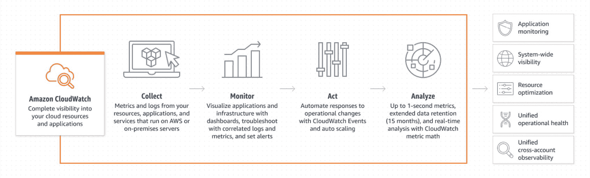

以下示例代码演示了如何使用 Amazon SageMaker Python SDK 创建 Amazon SageMaker CloudWatch 指标，以创建一个 CloudWatch 告警：
```

# 使用 Amazon SageMaker 模型监控与公平性审查

## 使用 Amazon SageMaker 模型仪表盘

```python
alarm_name = "MODEL_QUALITY_F2_SCORE"
alarm_desc = (
    "当 f2 分数偏离基线约束时触发 CloudWatch 告警"
)
mdoel_quality_f2_drift_threshold = (
    0.625  ##有意将此阈值设置得较低，以便快速看到告警。
)
metric_name = "f2"
namespace = "aws/sagemaker/Endpoints/model-metrics"
cw_client.put_metric_alarm(
    AlarmName=alarm_name,
    AlarmDescription=alarm_desc,
    ActionsEnabled=True,
    MetricName=metric_name,
    Namespace=namespace,
    Statistic="Average",
    Dimensions=[
        {"Name": "Endpoint", "Value": endpoint_name},
        {"Name": "MonitoringSchedule", "Value": churn_monitor_schedule_name},
    ],
    Period=600,
    EvaluationPeriods=1,
    DatapointsToAlarm=1,
    Threshold=mdoel_quality_f2_drift_threshold,
    ComparisonOperator="LessThanOrEqualToThreshold",
    TreatMissingData="breaching",
)
```

在上述代码模型中，设置了指标 `f2`，如果指标“f2 分数”偏离基线阈值 `0.625`，则会触发 CloudWatch 告警。通过使用 SageMaker CloudWatch 控制台，一旦 CloudWatch 告警被触发，您可以采取补救措施，例如自动重新训练模型或更新训练数据集。

## 使用 Amazon SageMaker 模型仪表盘

Amazon SageMaker 模型仪表盘从每个模型中提取高级详细信息，并显示其全面的摘要。它是一个用于跟踪、监控和审查模型性能的中央界面，并在出现质量问题时通知您。如果您的模型已部署用于推理，该仪表盘可帮助您实时跟踪模型的性能和端点，如图 3-17 所示。

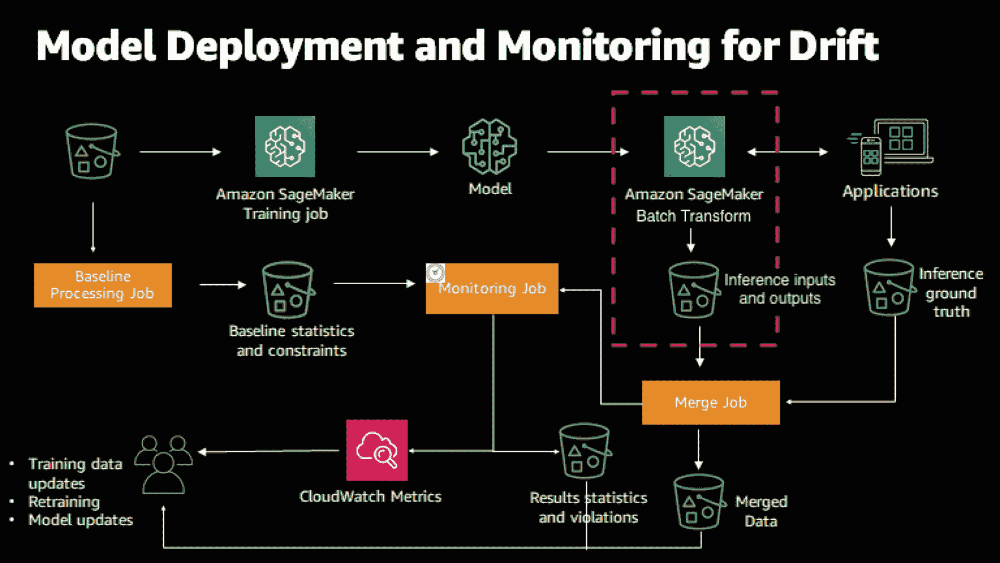

Amazon SageMaker 模型仪表盘通过以下类型的漂移监控来显示模型监控状态值：

*   监控 `数据漂移` 以维护数据质量。

*   监控 `模型漂移` 以获得最佳的模型质量指标，例如准确率。

*   监控生产环境中模型的 `偏差漂移`。

*   监控生产环境中模型的 `特征归因漂移`。

以下示例演示了如何创建 Amazon SageMaker 模型监控器，以从 Amazon SageMaker 端点捕获实时推理数据。

```python
from sagemaker.model_monitor import DataCaptureConfig
data_capture_config = DataCaptureConfig(
    enable_capture=True,
    sampling_percentage=100,
    destination_s3_uri='s3://path/for/data/capture'
)
predictor = model.deploy(
    initial_instance_count=1,
    instance_type='ml.m4.xlarge',
    data_capture_config=data_capture_config
)
```

为了监控模型数据质量，需要捕获数据，这可以通过使用名为 `DataCaptureConfig` 的新捕获选项来完成。通过此设置在交付到端点时，您可以捕获请求负载、响应负载或两者。

这些负载保存在 `DataCaptureConfig` 中指定的 Amazon S3 位置。可以使用 Amazon S3 中的 `S3Downloader` 实用程序查看和下载捕获的数据。

## 自动化重新训练管道

创建一个 CloudWatch 事件规则，该规则对 SageMaker 模型监控系统发出的事件发出告警。该事件规则可以检测漂移或异常，并启动重新训练管道。

## 使用 Amazon Augmented AI (A2I)

Amazon Augmented AI (Amazon A2I) 允许您根据特定要求进行人工审核，以建立机器学习 (ML) 系统的真实基准。A2I 保证了 ML 模型的精度并检查其准确性，模型性能可以与之进行比较。见图 3-18。

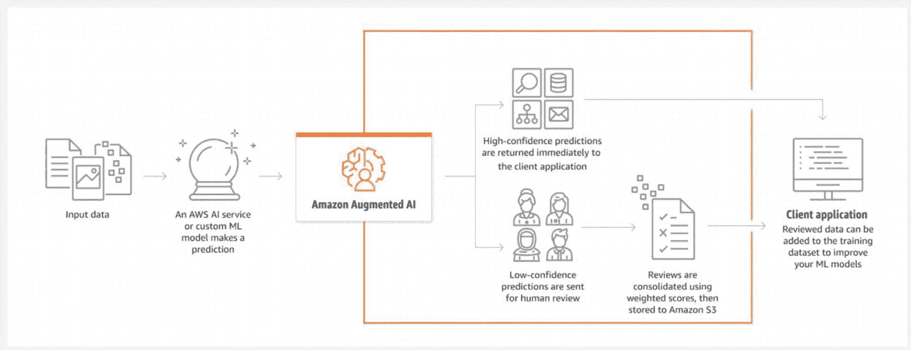

### 审查公平性和可解释性

在 ML 生命周期的每个阶段，金融服务、零售、电子商务、医疗保健、教育和人力资源等领域都期望具备公平性和可解释性。拥有偏见更少、更易于理解的机器学习模型，并满足治理合规性和外部监管要求，这一点非常重要。以下是需要检查以确保公平性和可解释性的法规：

*   目标应该是可解释且更公平的。

*   机器学习算法应该是一个合乎道德的解决方案。

*   检查标签和特征中的偏差。

*   数据应来自多样化的群体，并且易于修改数据以减轻偏差。

*   需要训练不同数量的模型以减轻偏差。

*   需要使用相关的公平性指标来评估模型。

*   模型需要在其需要训练或评估的数据上进行部署。

*   检查 ML 解决方案在不同用户之间是否存在不平等的影响。

#### 实施计划

接下来，我们将介绍一些可用于实施建议的 AWS 服务。

### Amazon SageMaker Clarify

Amazon SageMaker Clarify 提供了专用工具，用于更深入地洞察数据和机器学习模型、调试预测，并为机器学习模型预测添加可解释性。SageMaker Clarify 有助于在机器学习生命周期的每个阶段识别偏差，并改进准确性和鲁棒性等指标，从而提升模型质量。

对于表格数据、计算机视觉和时间序列模型，SageMaker Clarify 提供偏差和可解释性报告，以识别潜在问题，从而有针对性地提高准确性、消除偏差并提升性能。

Amazon SageMaker Clarify 在机器学习工作流生命周期的多个阶段运行处理作业，以计算以下分析类型：

*   训练前偏差指标

*   训练后偏差指标

*   Shapley 值

*   部分依赖图 (PDP)

SageMaker Clarify 处理容器作业与包含输入数据集的 Amazon S3 存储桶以及（可选）部署到 SageMaker 推理端点的客户模型进行交互，如图 3-19 所示。

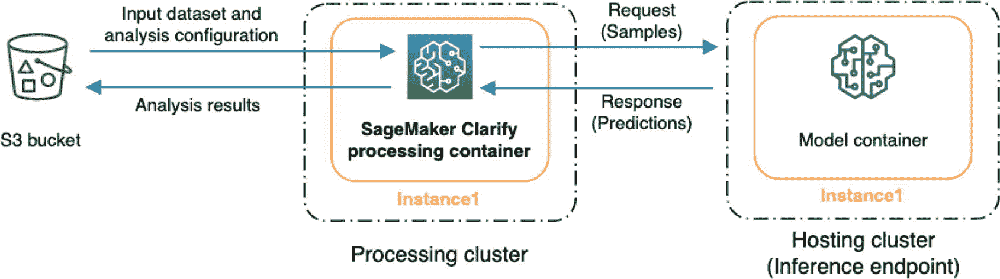

借助 Shapley 加法解释 (SHAP) 的有效实现，SageMaker Clarify 采用了一种与模型无关的特征归因技术，使您能够执行以下操作：

*   识别治理合规性所需的公平性和可解释性要求。

*   帮助识别潜在问题，并在机器学习生命周期的每个阶段（如数据收集、训练前、训练后、模型调优和已部署模型的监控）衡量偏差。

*   确定训练数据在特征、类别或群体段方面是否不平衡。

*   当模型投入生产时，战略性地监控数据中的偏差。

*   对于可解释性，最简单的模型效果最好。模型复杂性和可解释性之间始终需要权衡。

*   生成易于理解且稳健的模型治理报告，面向风险与合规团队以及外部监管机构。

*   基于数据、模型和监控提供预测的解释。

以下示例代码演示了如何使用 `Amazon SageMaker Python SDK` 创建一个用于检测偏差的 Amazon SageMaker Clarify。

```
from sagemaker import clarify
# 初始化一个 `SageMakerClarifyProcessor` 以计算偏差指标和模型解释。
clarify_processor = clarify.SageMakerClarifyProcessor(
role=role, instance_count=1, instance_type="ml.m5.xlarge", sagemaker_session=sagemaker_session
)
bias_config = clarify.BiasConfig(
label_values_or_threshold=[1], facet_name="Sex", facet_values_or_threshold=[0], group_name="Age"
)
clarify_processor.run_bias(
data_config=bias_data_config,
bias_config=bias_config,
model_config=model_config,
model_predicted_label_config=predictions_config,
pre_training_methods="all",
post_training_methods="all",
)
clarify_processor.run_explainability(
data_config=explainability_data_config,
model_config=model_config,
explainability_config=shap_config,
)
```

SageMaker Clarify 帮助您使用 `BiasConfig`、`model_config` 和其他参数检测可能的训练前和训练后偏差。`BiasConfig` 包含使用 Clarify 容器检测偏差的配置值。参数 `pre_training_methods` 设置为 `"all"` 以获取所有训练前偏差，参数 `post_training_methods` 设置为 `"all"` 以获取所有训练后偏差。Clarify 进程运行 `run_explainability` 来执行可解释性预测。所有偏差报告和可解释性报告都可以在 SageMaker Studio 中查看。

### 创建跟踪和版本控制机制

在机器学习模型开发中，需要探索并使用不同的数据、算法和参数组合进行迭代。随着每一次增量更改，都需要观察并跟踪不同配置设置下的模型准确性。有时，过多的实验会导致模型开发和演进过程失去跟踪。Amazon SageMaker 提供多种服务来跟踪、记录、自动化以及对不同的机器学习流程和改进进行版本控制，以便将来参考和重用。

#### 跟踪、版本控制和自动化的实施计划

让我们使用 Amazon SageMaker 来跟踪、版本控制并自动化机器学习模型开发周期。

##### 使用 SageMaker Experiments 跟踪您的机器学习实验

使用 Amazon SageMaker Experiments 可以轻松进行机器学习实验。它有助于创建、管理、分析和比较不同的机器学习实验。SageMaker Experiments 自动将所有输入、参数、配置和不同的迭代（作为运行）及其结果进行跟踪。这些迭代运行可以被分配、分组并组织到 SageMaker Experiments 中。它还提供了一个可视化界面，用于浏览您当前和过去的实验、比较关键性能指标上的运行情况，并识别与 Amazon SageMaker Studio 集成的最佳性能模型。

SageMaker Experiments 旨在简化创建实验、用试验填充实验、添加跟踪和谱系信息，以及跨实验和试验运行分析的过程。Amazon SageMaker Experiments 包含以下组件：

*   实验

*   试验

*   试验组件

*   跟踪器

以下部分是示例代码，演示如何使用 SageMaker Python SDK 运行 SageMaker Experiment。

```
sagemaker.experiments.Run(experiment_name, run_name=None, experiment_display_name=None, run_display_name=None, tags=None, sagemaker_session=None, artifact_bucket=None, artifact_prefix=None)
```

要运行一个实验实例，需要使用各种配置和日志参数初始化 `sagemaker.experiments.Run`，以便在此 `Run` 对象的上下文中调用训练作业。

##### 使用 SageMaker Processing

Amazon SageMaker Processing 用于数据分析、各类数据处理，以及附带机器学习模型评估的文档处理。它还用于数据验证、特征工程和模型解释。Amazon SageMaker Processing 为数据处理工作负载（特征工程、数据验证、模型评估和模型解释）提供了简化且托管的体验。Amazon SageMaker Processing API 既可在实验阶段使用，也可在代码部署到生产环境后用于评估性能。

Amazon SageMaker 会启动一个 Processing 任务，从 Amazon Simple Storage Service (Amazon S3) 复制数据，然后拉取一个处理容器。Amazon SageMaker 完全管理 Processing 任务的底层基础设施。Processing 任务的输出存储在 Amazon S3 存储桶中，如图 3-20 所示。

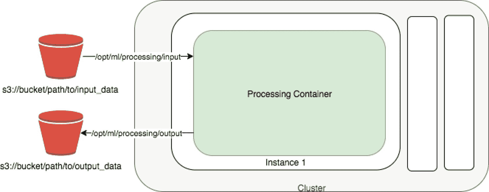

以下示例代码演示了如何使用 SageMaker Python SDK 运行 SageMaker Processing 任务：

```
from sagemaker.spark.processing import PySparkProcessor
# 将原始输入数据集上传到唯一的 S3 位置
timestamp_prefix = strftime("%Y-%m-%d-%H-%M-%S", gmtime())
prefix = "sagemaker/spark-preprocess-demo/{}".format(timestamp_prefix)
input_prefix_abalone = "{}/input/raw/abalone".format(prefix)
input_preprocessed_prefix_abalone = "{}/input/preprocessed/abalone".format(prefix)
sagemaker_session.upload_data(
path="./data/abalone.csv", bucket=bucket, key_prefix=input_prefix_abalone
)
# 运行处理任务
spark_processor = PySparkProcessor(
base_job_name="sm-spark",
framework_version="3.1",
role=role,
instance_count=2,
instance_type="ml.m5.xlarge",
max_runtime_in_seconds=1200,
)
spark_processor.run(
submit_app="./code/preprocess.py",
arguments=[
"--s3_input_bucket",
bucket,
"--s3_input_key_prefix",
input_prefix_abalone,
"--s3_output_bucket",
bucket,
"--s3_output_key_prefix",
input_preprocessed_prefix_abalone,
],
spark_event_logs_s3_uri="s3://{}/{}/spark_event_logs".format(bucket, prefix),
logs=False,
)
```

`PySparkProcessor` 类通过 `sagemaker.spark.processing.PySparkProcessor` 定义。`PySparkProcessor` 类用于定义 Spark 任务并通过 SageMaker Processing 运行它。这是一个通过 `instance_count` 和 `instance_type` 参数指定的多节点任务。`spark_processor` 使用所有输入和输出存储桶参数运行预处理脚本。

##### 将 Notebook 实例与 Git 仓库关联
```

SageMaker Notebook 保存数据处理代码和相关文档。这些 Notebook 实例可以与 Git 仓库关联，以便在源代码控制环境中保存 Notebook。将 SageMaker Notebook 实例保存到 Git 仓库后，即使停止或删除 Notebook 实例，这些 Notebook 也会持久保留。一个 Notebook 实例可以关联一个默认仓库以及最多三个额外的仓库，例如 AWS CodeCommit、GitHub 或任何其他 Git 服务器。

## 将 Notebook 实例与 Git 仓库关联

将 Notebook 实例与 Git 仓库关联，以便在源代码控制环境中实现持久化、学习和协作。Notebook 实例可以通过两种方式与 Git 仓库关联：

*   您可以将 Git 仓库作为资源添加到您的 Amazon SageMaker 账户中。然后，您可以输入一个包含凭据的 `AWS Secrets Manager` 密钥，以获取对该仓库的访问权限。通过这种方式，可以访问需要身份验证的仓库。

*   链接一个公开可访问的 Git 仓库，该仓库不是您账户的资源。如果这样做，您将无法提供登录凭据来访问该仓库。

### 使用 SageMaker Model Registry

Amazon SageMaker Model Registry 用于对模型进行编目、管理和部署。通过创建包含模型不同版本的 SageMaker Model Registry 模型组来对模型进行编目。每次运行机器学习流水线时都会创建一个模型组，不同的模型版本会在该模型组下注册。

所有为解决特定问题而训练的模型都作为模型版本注册到模型组下。这些模型组可以进一步归类到一个或多个 Model Registry 集合中。一个典型的 SageMaker Model Registry 工作流程可能如图 3-21 所示。

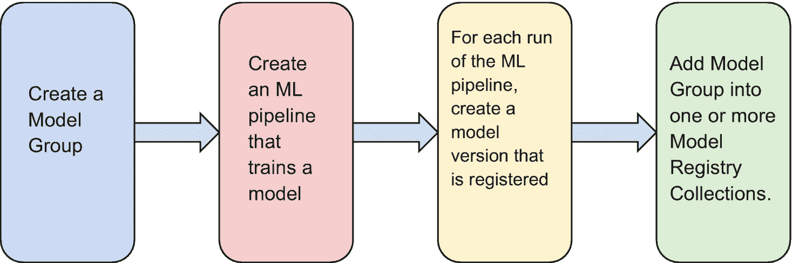

图 3-21 Amazon SageMaker Model Registry 工作流程

以下是 SageMaker Model Registry 的主要功能：

*   为生产环境编目模型。

*   管理模型版本。

*   将训练指标等元数据与模型关联。

*   管理模型的审批状态。

*   将模型部署到生产环境。

*   通过 CI/CD 自动化模型部署。

以下示例代码演示了如何使用 `SageMaker Python SDK` 创建 SageMaker 模型组。

```python
import time
import os
from sagemaker import get_execution_role, session
import boto3

region = boto3.Session().region_name
role = get_execution_role()
sm_client = boto3.client('sagemaker', region_name=region)
model_package_group_name = "scikit-iris-detector-" + str(round(time.time()))
model_package_group_input_dict = {
    "ModelPackageGroupName" : model_package_group_name,
    "ModelPackageGroupDescription" : "Sample model package group"
}
create_model_package_group_response = sm_client.create_model_package_group(**model_package_group_input_dict)
print('ModelPackageGroup Arn : {}'.format(create_model_package_group_response['ModelPackageGroupArn']))
```

设置 SageMaker `boto3` 客户端以调用 `create_model_package_group` API 操作，并指定名称和描述作为参数来创建模型组。`create_model_package_group` 调用的响应是新模型组的 Amazon 资源名称 (ARN)。

### 通过 MLOps 和 CI/CD 自动化运维

为了自动化机器学习工作负载的运维，需要集成适当的 MLOps 机制以及带有 CI/CD 管道的部署。正如我们之前讨论的，自动化机器学习运维使用基础设施即代码 (IaC) 和配置即代码 (CaC)。这种方法确保开发人员将基础设施和配置视为代码，从而在您的预演和生产部署环境中提供一致性。这实现了对托管基础设施和模型可观测性的版本控制。

#### 自动化运维的实施计划

您可以通过两种方式对应用程序进行建模和配置。

##### 使用 AWS CloudFormation

`AWS CloudFormation` 使您能够通过将 IaC 视为代码来创建、建模、配置和管理 AWS 部署。这可以通过使用模板文件来以可预测且可重复的方式将一组资源作为一个单元（堆栈）进行创建和删除。使用 `AWS CloudFormation`，基础设施可以轻松地在全球范围内扩展，并且可以通过单个操作轻松地在多个 AWS 账户和 AWS 区域中配置和管理堆栈。参见图 3-22。

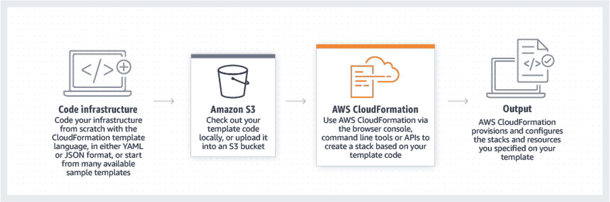

图 3-22 AWS CloudFormation

##### 使用 AWS 云开发工具包 (AWS CDK)

`AWS 云开发工具包 (AWS CDK)` 是一个开源软件开发框架，用于以代码形式指定云基础设施，并通过 `AWS CloudFormation` 进行配置。使用 `AWS CDK`，您可以使用熟悉的编程语言（如 `TypeScript`、`JavaScript`、`Python`、`Java`、`C#/.Net` 和 `Go`）来定义云资源并开发应用程序。

`AWS CDK` 利用通用编程语言强大的表达能力，在云中开发可靠、可扩展且经济高效的应用程序。`AWS CDK` 主要由两部分组成：

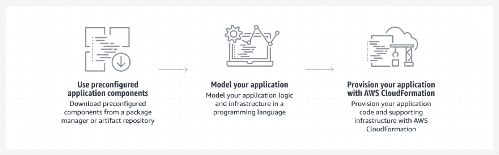

图 3-23 AWS 云开发工具包 (AWS CDK)

*   **AWS CDK 构造库：** 一个包含预编写和可重用模块（称为构造）的集合，用于以简化的方式快速修改、集成和开发您的基础设施。

*   **AWS CDK 工具包：** 一个命令行工具，用于与 CDK 应用程序交互，以创建、管理和部署 `AWS CDK` 项目。参见图 3-23。

可根据您的 ML 工作流程选择多种 MLOps 策略。

##### 使用 SageMaker Pipelines 编排工作流程

使用 `Amazon SageMaker Pipelines`，可以通过 `Python SDK` 创建 ML 工作流程。可以使用 `Amazon SageMaker Studio` 可视化 `SageMaker Pipelines`，并轻松管理端到端的 ML 工作流程。`Amazon SageMaker Pipelines` 会记录 ML 工作流程的每一步，并通过重用工作流程步骤来加快扩展速度。它会为所有模型组件（如训练数据、平台配置、模型参数和学习梯度）创建审计跟踪，以便重新创建模型。

以下示例演示了如何使用 `SageMaker Python SDK` 创建 `SageMaker Pipelines` 来编排您的工作流程。

```python
base_job_prefix = "pipeline-experiment-sample"
model_package_group_name = "pipeline-experiment-model-package"
processing_instance_count = ParameterInteger(
    name="ProcessingInstanceCount", default_value=1
)
training_instance_count = ParameterInteger(
    name="TrainingInstanceCount", default_value=1
)
processing_instance_type = ParameterString(
    name="ProcessingInstanceType", default_value="ml.m5.xlarge"
)
training_instance_type = ParameterString(
    name="TrainingInstanceType", default_value="ml.m5.xlarge"
)
```

在前面的代码中，我们指定了允许您在运行时传递参数的管道。这里定义了用于处理和训练的运行时实例计数和类型，以及预定义的默认值。

##### 使用 AWS Step Functions

Amazon SageMaker 使用一个名为 `AWS Step Functions Data Science SDK` 的开源包来自动化机器学习模型的训练。在 AWS Step Functions 中，定义了生产就绪型 ML 工作流程的所有步骤，并设置了启动流程的警报。它允许您复制该工作流程，试验新选项，然后将优化后的工作流程投入生产。

为了大规模编排 AWS 基础设施，可以使用 Python 语言在 AWS Step Functions 中创建多步骤机器学习工作流程。无需单独配置和集成 AWS 服务。AWS Step Functions Data Science SDK 提供了一个 Python API，可以创建和调用 Step Functions 工作流程。这些工作流程可以直接在 Python 和 Jupyter notebook 中轻松管理和执行。参见图 3-24。

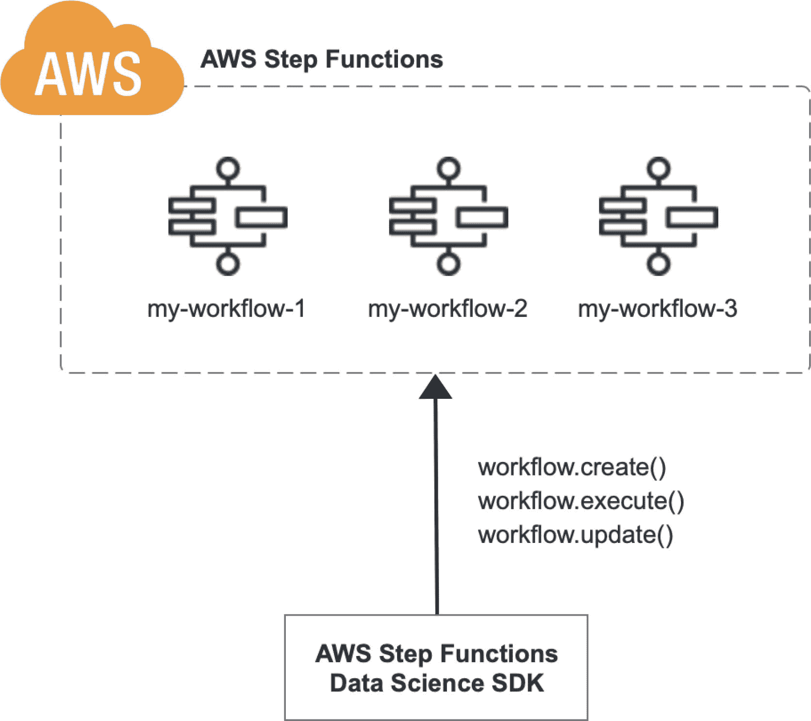

图 3-24

AWS Step Functions

以下是 `AWS Step Functions Data Science SDK` 的主要功能：

*   直接在 Python 中轻松使用 AWS 基础设施构建和运行机器学习工作流程。
*   实例化常见的训练管道。
*   使用模板在 Jupyter Notebook 中创建常见的机器学习工作流程。

以下部分是示例代码，演示了如何在 `AWS Step Functions Data Science SDK` 中创建和执行工作流程。

```
workflow.create()
execution = workflow.execute(inputs={
"IsHelloWorldExample": True
})
```

命令 `workflow.create()` 用于在 AWS Step Functions 中创建工作流程。要执行该工作流程，请在 AWS Step Functions 中执行命令 `workflow.execute()`。

### 使用第三方工具

为了自动化模型训练和开发，可以使用一些与 AWS 服务 API 集成的第三方部署编排工具，例如 Apache Airflow。这个第三方工具，即 `Amazon Managed Workflows for Apache Airflow (Amazon MWAA)`，使用用 Python 编写的有向无环图 (DAG) 来编排您的工作流程。DAG、插件和 Python 依赖项存放在 Amazon Simple Storage Service (S3) 存储桶中。可以从 AWS 管理控制台、Apache Airflow 用户界面 (UI)、命令行界面 (CLI) 或软件开发工具包 (SDK) 运行和监控 DAG。参见图 3-25。

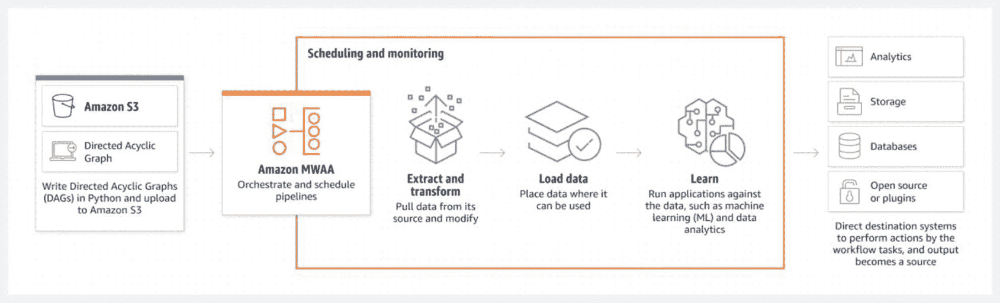

图 3-25

Amazon Managed Workflows for Apache Airflow (Amazon MWAA)

Apache Airflow 部署提供了可扩展性、可用性和安全性，而不会带来管理底层基础设施的操作负担。

### 建立部署环境指标

衡量已部署环境中机器学习操作的性能至关重要。需要测量各种指标，如内存和 CPU/GPU 使用率、磁盘利用率、ML 端点调用次数和延迟，以确定性能。

#### 建立部署环境指标的实施计划

让我们制定一个部署环境指标的实施计划。

##### 记录性能相关指标

第一步是使用 AWS 监控和可观测性服务记录性能相关指标。这些指标包括慢查询、各种数据库事务、I/O 延迟、服务延迟、HTTP 请求吞吐量以及其他关键数据。

##### 在事件或事故发生时分析指标

每当任何事件触发时，使用监控仪表板和报告来详细了解该事件及其影响。使用监控仪表板来理解和诊断已发生事故的影响非常重要。这些仪表板视图可以深入了解工作负载中未按预期运行的部分。

##### 建立关键绩效指标 (KPI)

建立和识别关键绩效指标 (KPI) 非常重要，这些指标可以指示工作负载是否按预期运行。KPI 因行业而异。电子商务网站可能会选择将购买次数作为其 KPI，而基于 API 的工作负载可能会将整体响应延迟作为整体性能的指标。

##### 使用监控生成基于警报的通知

使用针对已定义 KPI 的监控指标来自动生成基于警报的通知。当已定义 KPI 的测量值超出预期范围时，会自动生成这些警报以进行通知。

##### 定期审查指标

定期审查在解决问题和响应不同事件或事故中起关键作用的指标，应成为日常维护的一部分。此外，确定需要添加的任何其他指标也很重要，这些指标有助于识别、解决或预防问题。

##### 主动监控和告警

结合使用 KPI 与告警和监控系统来处理与性能相关的问题。使用警报启动自动操作，以尽可能修复问题。如果无法进行自动响应，则升级警报。使用系统预测预期的 KPI 值，生成警报，并在 KPI 超过预期值时自动停止或回滚部署。

##### 使用 Amazon CloudWatch 指标

`Amazon CloudWatch` 旨在观测和监控 AWS、本地及其他云环境中的资源和应用程序。使用适用于 SageMaker 端点的 `Amazon CloudWatch` 指标来确定内存、CPU 使用率和磁盘利用率。设置 `CloudWatch` 仪表盘以可视化环境指标，并建立 `CloudWatch` 告警，通过 `Amazon SNS` 发起警报通知，以告知运行时环境中发生的事件。更多详情，请参阅“使用 `Amazon CloudWatch`”一节。

可以在 `Amazon CloudWatch` 中创建两种类型的告警：

*   用于监控单个 `CloudWatch` 指标的指标告警。
*   一种复合告警，它会考虑您已创建的其他告警的告警状态。

##### 使用 Amazon EventBridge

`Amazon EventBridge` 是一个跨 AWS 的无服务器事件驱动型应用程序，可帮助您自动接收、过滤、转换、路由、交付和响应事件。当计算环境容量超过定义的阈值时，就会发生这些事件。参见图 3-26。

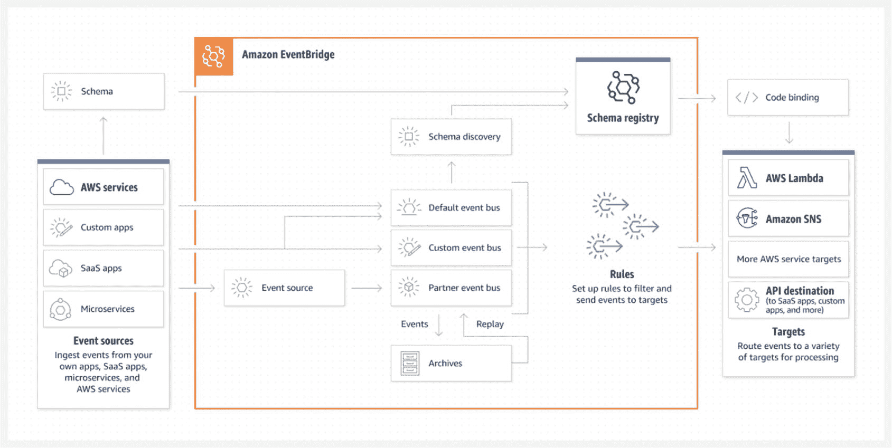

图 3-26

Amazon EventBridge

借助 `Amazon EventBridge Scheduler`，可以从单一来源创建、触发和管理数百万个事件和任务。

##### 使用 AWS Application Cost Profiler

使用 `AWS Application Cost Profiler` 报告多租户应用程序的精细成本洞察以及每个租户（模型/用户）的成本。它使您能够跟踪软件应用程序使用的共享 AWS 资源的消耗情况，并报告跨租户群的精细成本细分。

采用共享基础设施方法，您可以在实现规模经济的同时，直接获取跨多个维度的资源消耗综合数据，这为精确的成本分配模型奠定了基础。参见图 3-27。

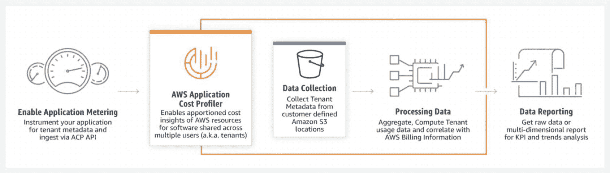

图 3-27

AWS Application Cost Profiler

以下是 `AWS Application Cost Profiler` 的主要功能：

*   成本效益。
*   精确成本分配模型的基础。
*   灵活的数据收集。
*   利润分析。
*   为最终客户定制定价策略。

`AWS Application Cost Profiler` 分析租户元数据，并按日和周生成每个租户的每小时成本细分。您可以按所需频率接收详细数据，并通过编程方式使用这些数据创建自己的仪表盘，以按租户跟踪费用模式和利润率。借助 `Application Cost Profiler`，可以调整产品定价、设计和成本数据，以最大限度地提高采用率和盈利能力。

### 启用模型可观测性与跟踪

启用模型可观测性、监控机制和主动跟踪，以识别和避免推理问题。由于不同的漂移，ML 模型的性能会随时间推移而下降。因此，衡量托管在实时推理端点上的底层计算资源的运行健康状况至关重要。建立血缘关系以追溯 ML 工作流程的所有步骤，并存储所有版本化的输入和模型工件以供分析。

#### 启用模型可观测性与跟踪的实施计划

让我们使用以下资源来启用模型可观测性与跟踪。

##### 使用 Amazon SageMaker Model Monitor

`Amazon SageMaker Model Monitor` 持续跟踪生产环境中 `Amazon SageMaker` ML 模型的质量。它将生产环境中的模型结果与训练结果进行比较，以评估性能。更多详情，请参阅“建立 SageMaker 模型监控”一节。

##### 使用 Amazon CloudWatch

`Amazon SageMaker Model Monitor` 自动将指标发送到 `Amazon CloudWatch`，以便您可以收集和分析 ML 模型的使用统计信息。更多详情，请参阅“使用 `Amazon CloudWatch`”一节。

##### 使用 SageMaker 模型仪表盘

（此部分内容在用户提供的原文末尾似乎不完整，因此保持原样。）

# Amazon SageMaker 模型仪表盘与同步架构

Amazon SageMaker 模型仪表盘从每个模型中提取高级详细信息并显示其全面摘要。它跟踪托管在实时推理端点上的模型性能，并使用`Amazon SageMaker Model Monitor`设置监控。

它可以发现数据质量或模型质量出现退化，或出现任何偏差漂移的模型。更多详情，请参阅“使用 Amazon SageMaker 模型仪表盘”一节。

## 使用 Amazon SageMaker Clarify

当生产环境中出现特征归因或模型偏差漂移时，`Amazon SageMaker Clarify`会检测并跟踪多种类型的推理。`SageMaker Clarify`提供生成模型治理报告的工具，这些报告用于告知合规团队和外部监管机构相关风险。更多详情，请参阅“Amazon SageMaker Clarify”一节。

## 使用 SageMaker ML 血缘跟踪跟踪模型管道

血缘跟踪创建 ML 工作流程的所有步骤，从数据准备到模型部署。它还存储有关所有 ML 工作流程步骤的信息。它保留模型发现实验的历史记录，并跟踪模型血缘工件以进行审计和合规性验证，从而建立模型治理。更多详情，请参阅“建立血缘跟踪系统”一节。

## 使用 SageMaker 模型卡

`Amazon SageMaker`模型卡用于在一个地方收集模型信息，如业务需求、关键决策以及模型开发和评估过程中的观察结果，以实现简化的治理和报告。目录信息包括模型的预期用途和风险评估、训练规范和指标、评估结果和观察结果，以及额外的标注，如注意事项、建议和自定义信息。

以下是`Amazon SageMaker`模型卡的功能：
*   提供关于应如何使用模型的指导
*   支持审计活动并收集模型训练和性能的所有详细描述
*   传达模型如何实现业务目标

## 使用 Amazon SageMaker 的自动验证功能

借助`Amazon SageMaker`的自动验证功能，您可以通过实时使用相同的真实世界推理请求数据，将新模型的性能与生产模型进行比较。`Amazon SageMaker`将生产模型收到的相同推理请求路由到新模型。然后，它会生成关键指标上的性能差异，并实时显示在仪表盘上。

# 同步架构与配置

在开发和部署阶段，所有系统和配置的同步是必要的。否则，系统架构的差异可能导致相同算法产生不同的推理结果。确保模型在开发、预发布和生产环境中获得相同范围的准确性至关重要。检查环境间的偏差是必要且正常的。

## 架构与配置同步实施方案

下一节将介绍一些可用于同步和配置的`AWS`服务。

### 使用 AWS CloudFormation

`AWS CloudFormation`能够快速且一致地预配置一组相关的`AWS`和第三方资源，并通过将其视为基础设施即代码来管理其整个生命周期。`CloudFormation`使用模板将整个堆栈作为单个单元进行创建、更新和删除。`AWS CloudFormation`可以轻松管理和预配置堆栈，并在多个`AWS`环境中同步架构和配置。更多详情，请参阅“使用 AWS CloudFormation”一节。

以下是`AWS CloudFormation`的主要特性：
*   `AWS CloudFormation`标准化了`AWS`资源的创建方法。
*   可以使用现有的`CloudFormation`模板重新创建类似的堆栈，从而轻松复制您的`AWS`架构开发、测试和生产环境。
*   `CloudFormation`提供了多种工具来定义参数、映射和条件，并提供定制化功能以提高模板的可重用性。
*   如果在堆栈创建过程中发生任何错误，`CloudFormation`会自动回滚已创建或更新的资源。
*   `CloudFormation`以快速、安全且可靠的机制处理故障。
*   可以轻松创建`CI/CD`管道，将基础设施代码作为软件项目进行管理，并使用`CloudFormation`自动化部署变更。

### 使用 Amazon SageMaker Model Monitor

`SageMaker Model Monitor`使用`Amazon`持续监控生产环境中机器学习模型的质量。通过`SageMaker Model Monitor`，将生产模型的结果与训练结果进行比较。如果模型出现任何偏差，则会触发质量警报。及时检测结果偏差使工程师能够采取纠正措施，例如重新训练模型、审计上游系统以及修复质量问题，而无需手动监控模型或构建额外的工具。更多详情，请参阅“建立 SageMaker 模型监控”一节。

`Model Monitor`提供以下类型的监控：
*   监控数据质量的漂移
*   监控模型指标的漂移
*   监控生产环境中模型偏差的漂移
*   监控生产环境中模型特征归因的漂移