# 4. AI/ML 中的 MLOps 安全

我们已经学习了如何以卓越的运营能力将机器学习模型部署到生产环境。在实现这一里程碑之后，是时候确保整个 ML 系统的安全性和保障性了。

MLSecOps 是机器学习运维与安全的融合。在本章中，我们将介绍 MLSecOps 的关键方面、其在 ML 生命周期不同层级的重要性，以及 ML 系统可能面临的安全挑战。我们还将研究实施 MLSecOps 所需遵循的最佳实践，以及如何在 AWS 中实现它，并提供代码片段作为参考。

机器学习工程师负责确保 ML 系统的安全，因为系统随着时间的推移在技术上变得越来越先进和智能。ML 系统中的安全至关重要，需要在多个层面实施，以建立安全端到端 ML 系统的基础。在本主题中，我们将了解 ML 系统中的各种安全挑战、MLSecOps 的支柱，以及实现高度安全和可靠的机器学习生态系统的最佳实践。

## MLOps 安全简介

MLOps 中的安全（图 4-1）意味着对 ML 模型、数据和 ML 系统基础设施实施安全措施，以保护它们免受入侵者和漏洞的攻击。ML 模型在训练、调优和部署等不同阶段都容易受到攻击，这可能导致恶意利用、数据泄露或模型结果被篡改。随着 ML 应用在各个领域和行业的增加，应对其独特的安全挑战变得至关重要。

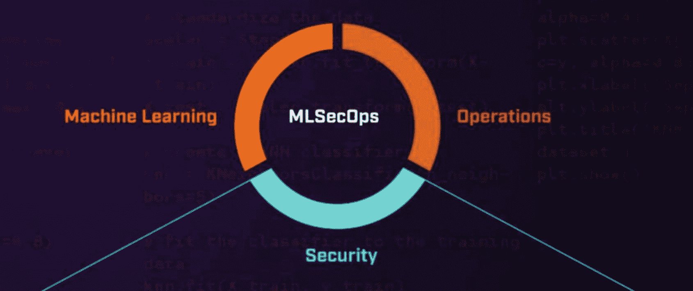

图 4-1

MLSecOps

MLOps（机器学习运维）与安全运维的融合产生了 MLSecOps（机器学习安全运维）。MLSecOps 通过将传统方法与新实践相结合，将安全置于系统的核心。通过将安全最佳实践和概念融入 ML 系统，MLSecOps 旨在降低这些风险。以下是 MLSecOps 涉及的关键方面：

*   **威胁建模**

在威胁建模中，识别出 ML 系统和数据特有的潜在威胁和漏洞。

*   **数据安全**

数据安全确保用于推理和训练的数据是安全且私密的，包括访问控制、加密和适当的数据处理。

*   **安全编码**

编码实践需要通过多层安全控制、输入验证和清理来确保安全，以防止注入攻击，并通过提供信息性消息的错误处理来确保透明度和可解释性。

*   **模型集成**

这是实施措施以检测和防止对 ML 模型进行未经授权的攻击、更改或篡改的过程。

*   **安全部署**

开发的模型应在不损害安全性和完整性的情况下进行部署，通过应用安全配置和访问控制来实现。

*   **持续监控与检测**

对 ML 系统进行持续监控可以检测数据和模型中的异常。持续的监控和检测有助于识别 ML 系统中的潜在攻击或任何未经授权的活动。

*   **协作与事件响应**

对于安全的 ML 系统，安全团队、工程师和数据科学家必须协作，以符合安全要求和 MLSecOps 最佳实践。他们可以共同制定协议，以快速响应安全事件、调查安全漏洞并从攻击中恢复。


## MLSecOps 的重要性

机器学习生命周期的每一步都容易受到安全威胁。我们的机器学习系统虽然高度发达且先进，但并非对安全威胁免疫。机器学习生命周期的每个层面都存在威胁，例如数据泄露、敏感信息泄露、模型操纵、输出操纵以及对抗性攻击。与机器学习安全相关的风险多样、复杂且严重，可能导致财务损失和声誉损害。因此，采取主动姿态对于降低这些风险、通过顶级的机器学习安全来保护组织资产至关重要。

MLSecOps 确保了 MLOps 生命周期中不同步骤的安全性。机器学习工程师需要在不同层面进行检查并采取各种行动，以确保机器学习系统的安全。

1.  **业务理解**

    明确团队成员的职责和角色。
    *   确保数据科学家项目团队所需的合规级别。

    *   确定所需数据的范围。

2.  **数据工程**
    *   避免数据泄露。

    *   持续检查来自不可信来源的数据修改。

    *   持续检查敏感信息。

    *   持续检查对抗性攻击。

3.  **模型开发**
    *   确保用于训练模型的虚拟机或集群的安全性。

    *   避免对机器学习模型的操纵。

    *   检查代码片段中的安全漏洞。

4.  **模型评估**
    *   持续检查模型输出操纵。

    *   持续检查经过修改的数据输入，以确保获得适当的模型输出。

    *   持续检查来自恶意用户的对抗性行为，以防止机器学习系统被欺骗。

5.  **模型部署**
    *   确保模型包保存在安全的位置。

    *   在部署模型前检查运行环境。

    *   保护模型加载/卸载的每一个实例的安全。

6.  **监控与维护**
    *   识别潜在的逆向工程攻击，保护您的业务价值安全。

    *   检查并验证系统中使用的所有工具和技术。

## 机器学习系统中的安全挑战

人工智能/机器学习系统面临五大主要挑战。

1.  **数据投毒**

数据是机器学习系统的基础。机器学习模型的效率和可预测性与其训练所依据的数据质量成正比。干净、无偏且全面的数据只存在于理想世界中。然而，在现实世界中，数据大多不完整、有偏、包含噪声，并且受到外部力量的投毒。我们有方法来处理不完整、有偏和包含噪声的数据，但投毒数据对机器学习系统的安全来说是一个严重问题。当模型接收到错误数据时，它会学到本不该学的东西。由于机器学习模型习得的模式被扭曲，部署后可能会出现不准确的预测和误报。

数据投毒有四种主要的攻击策略：
    1.  **标签修改**

在监督学习中，仅对任意数据点的标签进行修改，从而误导训练模型。

2.  **数据修改**

在这种情况下，入侵者无法访问学习算法，但可以访问训练数据，因此他们可以修改训练数据集，从而导致训练模型被破坏。

3.  **数据增强**

在这种情况下，入侵者无法访问训练数据和学习算法，因此他们无法修改训练数据和算法，但可以向训练数据集中添加新数据。通过数据增强，训练模型很容易被破坏。

4.  **逻辑破坏**

当入侵者可以访问学习模型时，他们可以破坏已实现的逻辑。

2.  **规避攻击**

规避攻击也称为对抗性攻击。在推理过程中，对机器学习模型最常见的一种攻击就是对抗性攻击。它可以通过人眼几乎无法察觉的微小变化轻易地欺骗人类。输入中的这种微小变化可以完全扰乱模型，导致机器学习模型对数据进行错误分类。规避攻击的一个典型例子是图像识别系统，在上传前更改图像的一些像素，导致模型无法准确分类结果。请参见图 4-2。

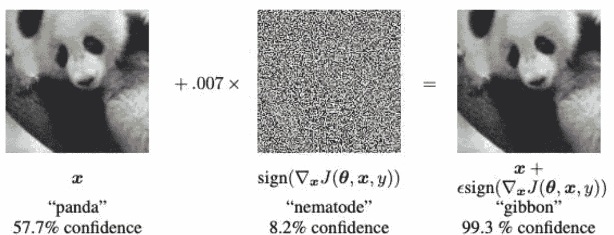

图 4-2

对抗性攻击示例

在这个例子中，输入图像像素的微小变化导致将“熊猫”的输入图像错误分类为“长臂猿”。

通过规避攻击，类别输出预测的置信度水平会受到很大影响。修改后的输入会导致错误的模型训练，从而导致新数据的错误分类。

3.  **系统操纵**

大多数机器学习系统在运行期间都连接到互联网。这使得入侵者能够在训练期间攻击机器学习模型，并为其改变模型行为打开了窗口。这属于网络犯罪的范畴。网络攻击可能导致错误的输入和使用被篡改的参数进行训练，从而导致输出结果与预期不同。随着先进的机器学习系统的发展，网络犯罪也在增加，保护机器学习系统免受网络犯罪分子的侵害是一个实时的挑战。

尽管操纵在线机器学习系统并非那么简单，但它非常隐蔽和微妙，以至于受害者甚至不会意识到有其他人正在利用他们的系统。

4.  **迁移学习攻击**

通常，预训练的机器学习模型被用于训练大量数据，因为对于大型数据集，训练时间呈指数级增长。使用这些预训练模型来训练新问题被称为*迁移学习*。这些预训练模型可以根据业务需求进行微调。由于消费者不知道这些预训练模型是使用哪些数据训练的，这为入侵者渗透并通过篡改训练数据来影响模型性能提供了机会。攻击者可以利用这一点，操纵或用恶意模型替换一个真实的模型。

5.  **数据机密性**

在当今的数字世界中，确保数据的隐私和机密性至关重要。网络攻击者不仅会投毒数据，还会从训练数据集中提取现有数据。这被称为*输入推断*或*模型反转*。在数据即将用于机器学习建模之前提取数据，可能会使整个机器学习系统面临风险。

例如，在医疗领域，维护患者个人和医疗记录的隐私是一项重要要求，并且在许多国家受法律约束。泄露这些医疗记录会导致严重的数据信任问题，并对相关组织提出质疑。


## MLSecOps 的五大支柱

MLSecOps 建立在五大坚实支柱之上（图 4-3）。各类组织通过实施这些 MLSecOps 支柱来建立稳健的安全实践并降低潜在风险。下面我们来详细讨论它们。

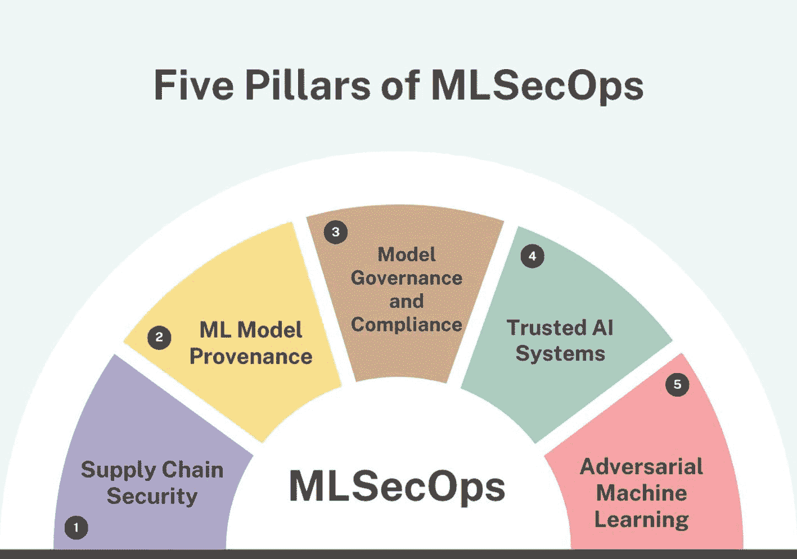

图 4-3

MLSecOps 的五大支柱

1.  **供应链安全**

供应链漏洞涉及与机器学习供应链各组件相关的风险，从数据收集到模型部署及其依赖项。供应链安全的关键方面包括：
    1.  第三方库和依赖项

2.  各种数据源的完整性

3.  存储、传输和部署过程中的模型工件

4.  硬件组件和基础设施

2.  **机器学习模型溯源**

机器学习模型溯源指的是机器学习系统在整个生命周期中的可追溯性、谱系、演化和可复现性。它涉及维护代码、数据、模型工件、基础设施、元数据和环境的记录，以确立模型的真实性和完整性。模型溯源的关键方面包括：
    1.  追踪机器学习模型的版本历史

2.  追踪训练数据、其来源、预处理和转换

3.  记录模型开发步骤，包括特征工程、超参数调优和建模

4.  记录模型部署、环境、配置以及任何后续更新或修改

3.  **模型治理与合规性**

MLOps 与模型治理相互交织，涵盖一系列有助于安全部署机器学习模型的流程和框架。法规的严格程度取决于业务领域、机器学习模型的风险类别以及业务风险。健康与金融行业遵循严格的法规，因为它们面临较高的安全漏洞风险。如果机器学习模型在公司业务概念中扮演重要角色，那么模型治理与合规性需要比机器学习作用不明显的公司更为严格。

模型治理需要从一开始就融入机器学习生命周期的每一个步骤。模型治理涵盖模型的记录、审计、验证、批准和监控。尽管法规的严格程度和模型数量决定了模型治理应如何实施，但所有变体都具有以下共同方面：
    1.  包含机器学习元数据的全面模型文档和报告

2.  通过机器学习系统的自动审计来验证机器学习模型

3.  数据隐私、保护、加密和访问控制

4.  持续监控和记录模型指标

5.  遵守《通用数据保护条例》（GDPR）、《健康保险流通与责任法案》（HIPAA）或行业特定指南的法规要求

6.  潜在风险评估、管理、缓解和事件响应计划制定

7.  通过融入道德规则，在机器学习开发过程中提供公平性、减少偏见、明确责任并保持开放性

4.  **可信赖的人工智能系统**

MLSecOps 专注于构建透明、可靠、负责且可解释的可信赖人工智能系统。它确保机器学习模型在向所有利益相关者保持透明的同时做出无偏见的决策。可信赖人工智能的关键方面包括：
    1.  可解释的模型，以便用户理解其预测背后的原因

2.  整个过程中公平且无偏见的结果

3.  一个稳健且有韧性的人工智能系统，以应对安全挑战

4.  持续模型监控和模型性能评估，以识别任何退化或异常

5.  **对抗性机器学习**

MLSecOps 识别并缓解旨在操纵或欺骗机器学习模型的对抗性攻击。通过实施异常检测和对抗性训练等技术，企业可以提高其机器学习系统的韧性。对抗性机器学习的目标是保护机器学习系统免受入侵以及任何试图篡改或利用它们的行为。对抗性机器学习的关键方面包括：
    1.  能够抵御对抗性攻击的稳健对抗性机器学习模型

2.  数据或模型行为中的异常检测与缓解

3.  对机器学习模型进行对抗性训练，以提高其应对未知攻击的能力和韧性

4.  通过在线学习和动态模型更新，持续学习并适应新威胁


## MLSecOps 最佳实践

在本节中，我们旨在提供最佳实践，以最大程度地降低人工智能中的安全风险，并减轻不期望的漏洞。通过遵循图 4-4 中展示的实践，机器学习系统将能够释放其全部潜力，确保在所有工业领域中合乎道德且负责任地开发人工智能项目。以下是构建安全可靠的机器学习系统所需遵循的最佳实践。

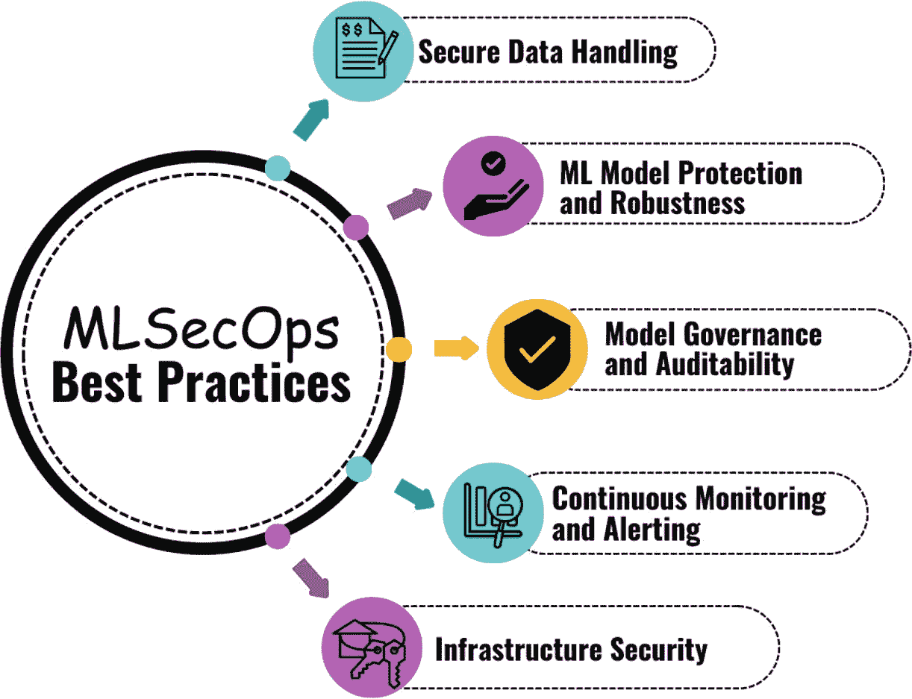

图 4-4

MLSecOps 最佳实践

1.  **安全数据处理**

安全机器学习操作的第一步是安全数据处理。用于训练和推理的数据需要妥善处理，以保护其免受偏见、投毒、漏洞、盗窃和未经授权的访问。为确保数据安全，需要注意以下关键点：
    1.  数据源需要可信，并仅对授权人员设置有限的访问控制。

2.  敏感数据在存储以及整个机器学习生命周期传输过程中都需要进行适当加密。

3.  应定期进行数据访问审计，以检测任何未经授权的活动。

2.  **机器学习模型保护与鲁棒性**

机器学习模型容易受到攻击和操纵，从而导致错误的预测。为了做出无偏见、免受攻击和过拟合影响的正确预测，机器学习模型需要被恰当地设计、训练和保护。确保模型鲁棒性涉及构建能够抵御对抗性攻击、数据投毒和其他威胁的模型。保护机器学习模型并使其鲁棒的关键点如下：
    1.  限制对机器学习模型参数和配置的访问控制，以确保模型完整性。

2.  需要实施版本控制机制来跟踪机器学习模型的变更。

3.  定期运行审计并评估模型性能，以检测任何异常、未经授权的活动或安全漏洞。

3.  **模型治理与可审计性**

模型需要根据模型治理和合规性给出的最佳实践和标准进行开发和维护。为防止法律纠纷并维护利益相关者和客户的信心，必须遵守相关法律法规。模型治理和可审计性的关键方面如下：
    1.  采用机器学习安全最佳实践，以识别潜在的偏见来源和模型性能瓶颈。

2.  确保模型遵守法律和道德准则。

3.  应强制执行诸如 GDPR 或 HIPAA 等监管框架，以保护数据和模型。

4.  **持续监控与告警**

在 MLOps 中，持续监控和告警对于定期评估模型性能、数据输入和输出至关重要。它们有助于检测模型性能的任何变化以及潜在的安全威胁。定期监控有助于识别潜在威胁，并通过发出告警来减轻威胁。以下是持续监控和告警的关键点：
    1.  实施关键监控工具，以持续监控机器学习系统的安全性和功能性。

2.  明确定义事件响应程序，以便及时检测和处理安全漏洞。

3.  需要定期进行渗透测试和安全审计，以发现漏洞并评估安全措施的有效性。

5.  **基础设施安全**

基础设施和硬件组件的安全性对于减轻物理攻击的风险至关重要。对基础设施的物理攻击可能导致供应链受损。以下是确保基础设施安全需要考虑的关键点：
    1.  必须使用安全的执行环境来保护机器学习模型推理过程。

2.  应使用网络分段将机器学习工作负载与其他系统隔离开来，以减少攻击面。

3.  使用最新的安全补丁更新所有软件和基础设施组件。

## 使用 MLSecOps 实现安全的人工智能

我们现在了解了 MLSecOps、其重要性以及 MLSecOps 的支柱和最佳实践，是时候有效实施 MLSecOps 了。让我们学习其逐步流程（图 4-5）。

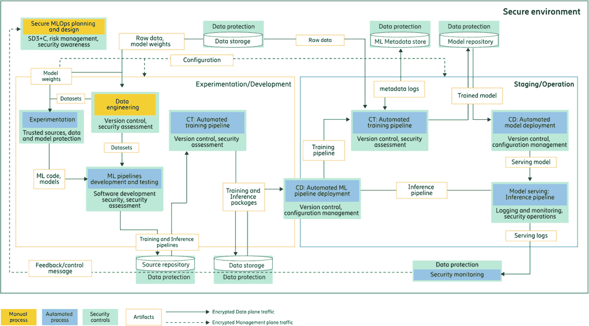

图 4-5

带有安全控制的通用 MLSecOps 架构

### 步骤 1：评估机器学习系统的安全需求

第一步是了解机器学习系统及其安全要求。

1.  识别所使用的所有数据源、机器学习模型和基础设施。

2.  识别潜在风险和威胁。

3.  进行风险评估运行。

4.  为 MLSecOps 实施定义明确的安全和缓解目标。

### 步骤 2：建立跨职能安全团队

现在，建立一个跨职能安全团队来实施安全的机器学习系统。

1.  组建一个由数据科学家、机器学习工程师、IT 专业人员和安全专家组成的团队。

2.  明确所有团队成员的角色和职责，确保其责任到位。

### 步骤 3：为 MLSecOps 定义策略和程序

在定义了成员的角色和职责之后，为 MLSecOps 定义策略和程序。

1.  制定策略以处理数据处理、模型开发、部署、监控、安全以及所有机器学习特定任务。

2.  制定发生安全漏洞时的事件响应程序。

3.  记录所有 MLSecOps 程序并在团队中进行沟通，以确保一致实施。

### 步骤 4：实施 MLSecOps 的核心支柱

调整、接纳并实施 MLSecOps 的五大核心支柱，使其适应您组织的数据、模型、机器学习系统和基础设施。

### 步骤 5：遵循安全开发生命周期

在开发生命周期中整合安全实践，包括数据预处理、模型训练、验证和部署。

1.  教育从业者实施安全编码实践。

2.  实施数据验证和清理，以防止常见漏洞。

3.  通过安全配置和有限的访问控制来确保部署安全。

### 步骤 6：实施安全监控和事件响应

部署后，建立安全监控系统和事件响应计划。

1.  为机器学习系统部署监控工具，以实时检测异常、对抗性攻击和数据漂移。

2.  定义完整的事件响应程序，包括角色、沟通渠道和升级路径，以确保对安全事件做出迅速有效的响应。

### 步骤 7：实施定期审计和评估

需要进行定期的安全审计和评估，以评估您的 MLSecOps 实施的有效性。

1.  定期进行安全审计，以识别漏洞和改进领域。

2.  随时了解未来可能出现的新威胁，并提前规划缓解策略。

### 步骤 8：开展员工培训与意识提升

为了实施 MLSecOps 最佳实践，组织需要培训其员工，并在组织内传播对 MLOps 安全指南的认识。

1.  对所有利益相关者进行教育和培训，使其了解 MLOps 的安全风险、各自的角色和职责，以及如何遵循 MLSecOps 程序。

2.  传播意识，鼓励员工对潜在安全威胁保持警惕，报告任何可疑活动，并遵守 MLSecOps 策略。


## 如何在 AWS 中实现安全

安全是 AWS 良好架构框架的关键支柱之一。事实上，安全是每个组织中最关键的元素之一，确保公司的安全策略和标准得到满足至关重要。

安全控制措施，例如多因素用户认证、敏感数据加密、实时审计、日志记录和监控，旨在保护数据和资源的可用性、机密性和完整性。这些管理和技术屏障用于阻止、识别或减轻威胁行为者利用安全漏洞的能力。

在机器学习的完整生命周期中，存在四种类型的安全控制措施：预防性、主动式、检测性和响应性。本节将讨论所有安全控制措施，并重点介绍它们在 AWS 中的实现。

### 按 ML 生命周期阶段划分的安全最佳实践

机器学习生命周期包含六个阶段（图 4-6）。所有 AWS 安全最佳实践都分布在这些阶段中。让我们详细讨论每一个阶段。

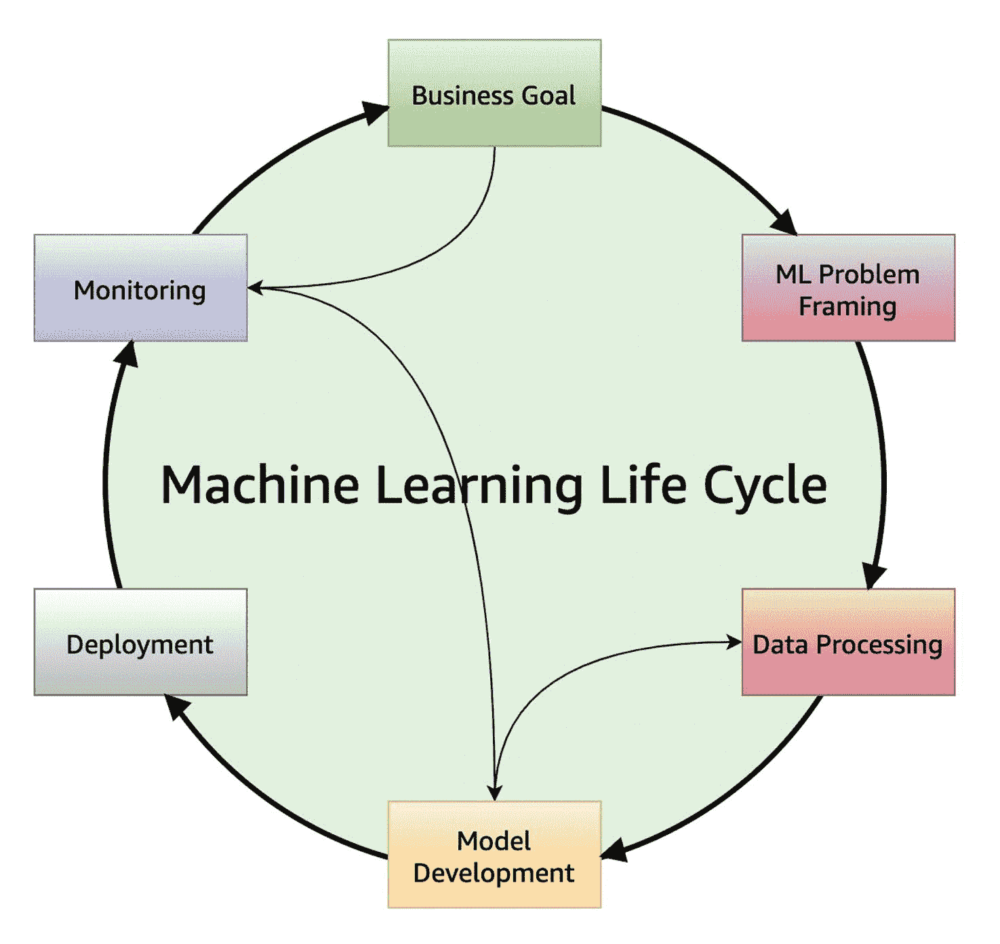

图 4-6

机器学习生命周期

#### 业务目标识别

业务目标识别是 ML 生命周期的第一个也是根本的阶段。在识别业务目标时，牢记安全措施非常重要。正是在这个阶段，您必须定义并确保保护数据、系统隐私、各种权限、软件和许可条款所需的法规。业务目标识别下的最佳实践包括：

*   **实施 ML 数据权限验证、隐私、软件和许可条款**

    此阶段建立一个流程，用于审查整个生命周期中所需的所有软件和 ML 库的隐私和许可协议。这些协议应符合您组织的法律、隐私和安全条款及条件，并且不应给组织的业务计划增加任何限制。其实施计划详述如下：

    **确保并验证 ML 的数据权限**

    确保并验证所有可用于机器学习生命周期的数据相关权限。
    *   验证预期数据的用途。
    *   验证是否需要数据所有者或数据主体提供额外同意。
    *   制定策略来处理那些后来决定不同意其数据被使用的数据主体。
    *   出于合规性考虑，确保数据权限文档是最新的。

    **使用生命周期管理策略引导实例**

    编写一个脚本，用于安装必要的包，并在生命周期配置中引用您的包仓库。创建生命周期管理策略是为了管理 ML 生命周期实例，并自动转换到分层存储。

    **评估包集成**

    在此阶段，为了安全控制，需要对需要外部查找服务的包集成进行评估。

    必要时，根据您的数据隐私要求选择退出数据收集。
    *   应尽量减少通过信任关系导致的数据暴露。
    *   审查任何可能收集数据的 ML 程序的许可协议和隐私政策。

    **使用预构建容器**

    从经过优化、预打包和验证的容器开始，以快速部署 ML 环境。这些预构建的容器支持常用的依赖项，通过优化的模型训练自动提升性能。TensorFlow、PyTorch 和 Apache MXNet 是 AWS 深度学习容器中可用的一些深度学习框架库和工具。参见图 4-7。

    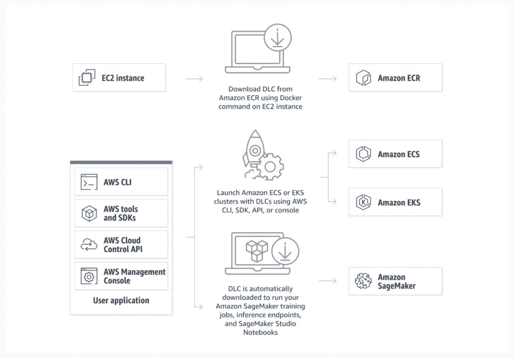

    图 4-7

    AWS 深度学习容器

    AWS 深度学习容器是经过预配置和测试的 Docker 镜像，包含知名深度学习框架的最新迭代版本。借助深度学习容器，您可以快速部署自定义 ML 环境，而无需从头开始进行环境创建和优化。

#### ML 问题框架构建

本节中的主要业务挑战包括制定机器学习问题的最佳实践，其中标签或目标变量是观察到的内容以及应预测的内容。在机器学习中，确定要预测什么以及如何优化性能非常重要。遵循以下阶段将有助于根据业务需求构建 ML 问题，例如：

*   定义项目的成功标准。
*   为项目定义一个可观察且可量化的性能指标，例如准确率、AUC 等。
*   建立性能指标与业务成果（例如销售额）之间的关系。
*   确保业务利益相关者理解并同意已定义的性能指标。
*   为了达到期望的业务成果，通过获取额外数据、微调参数或增加复杂性来迭代模型。
*   根据输入、期望输出、模型目标以及要优化的性能指标来制定 ML 问题。

ML 问题框架构建下的最佳实践详述如下：

*   **实施设计数据加密和混淆**

*   安全支柱包括在利用云计算增强安全性的同时，保护信息、资产和系统的能力。对于安全的机器学习系统，处理个人身份信息、设计数据加密和保护凭证非常重要。其实施计划详述如下：

    **审计需要特殊处理属性的数据**

    需要对数据进行审计，以找出那些需要特殊安全处理的属性。有三种审计数据并提供安全性的方法。

    *PII 数据识别和处理*

    个人身份信息 (PII) 和敏感数据需要通过应用高级转换（如编辑、替换、加密和解密）进行特殊处理。由于数据呈指数级增长，企业正在管理海量的异构数据，包括流入其平台的个人身份信息 (PII)。大规模识别和保护敏感数据已变得更加困难、昂贵和耗时。AWS 提供 Glue DataBrew 用于识别、处理和管理 PII 数据。参见图 4-8。

    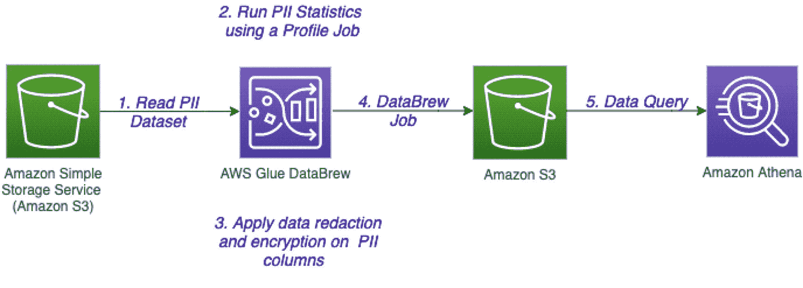

    图 4-8

    AWS Glue DataBrew 架构

    AWS Glue DataBrew 通过添加 PII 数据处理转换来促进数据隐私和保护，这些转换允许您对敏感数据执行操作，例如数据脱敏、加密和解密。DataBrew 已推出 PII 统计功能，当您在数据集上运行分析作业时，该功能会识别 PII 列并提供其数据统计信息。

##### 设计数据加密

实施设计数据加密和数据脱敏是必要的，这是阻止未经授权的用户读取您的数据和模型工件的第一道防线。数据在传输中和静态时都需要进行加密。客户端数据加密在上传到 AWS 之前完成，而服务器端数据加密则由接收数据的应用程序或服务在其目的地完成。参见图 4-9。

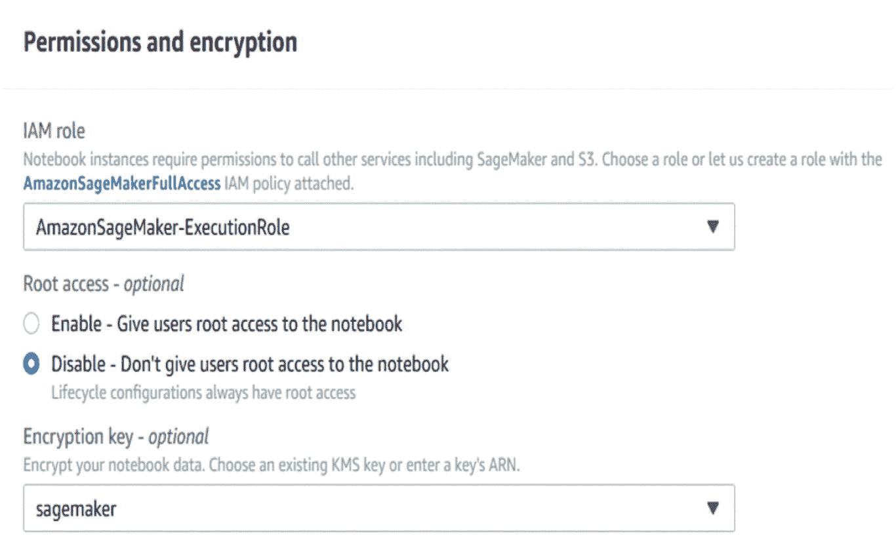

图 4-9

AWS 加密/解密权限快照


##### 保护凭证

在进行推理和训练之前，请确保数据得到正确处理、加密并安全存储。AWS 建议不要将用于访问数据库的凭证嵌入代码中，而是使用 AWS Secrets Manager 来存储凭证，然后授予您的 SageMaker IAM 角色从笔记本访问 Secrets Manager 的权限。请参见图 4-10。

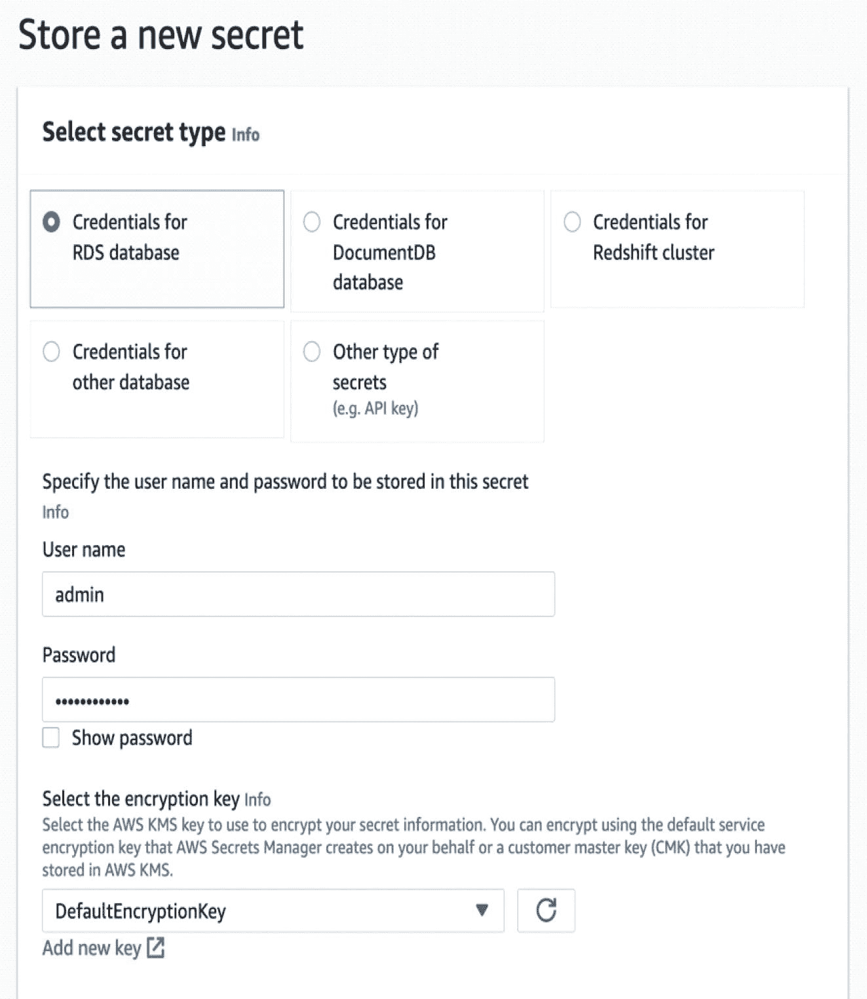

图 4-10

在 AWS Secrets Manager 控制台中存储凭证

使用 AWS Secrets Manager 是一种保护凭证免受第三方侵害的安全方式。密钥管理器必须按照指定的计划轮换凭证，以大幅降低密钥被泄露的可能性。

##### 数据处理

数据处理包括数据收集和数据准备（数据处理与特征工程）。数据处理的第一步是数据收集、聚合、摄取和正确标注。在数据预处理阶段，需要完成数据清洗、特征缩放（归一化或标准化）、数据增强和划分。最后一步是特征工程，包括特征选择、新特征创建、特征变换和提取，以获得更好的结果。为了更好地理解和探索数据，需要创建探索性数据分析（EDA）和可视化图表。

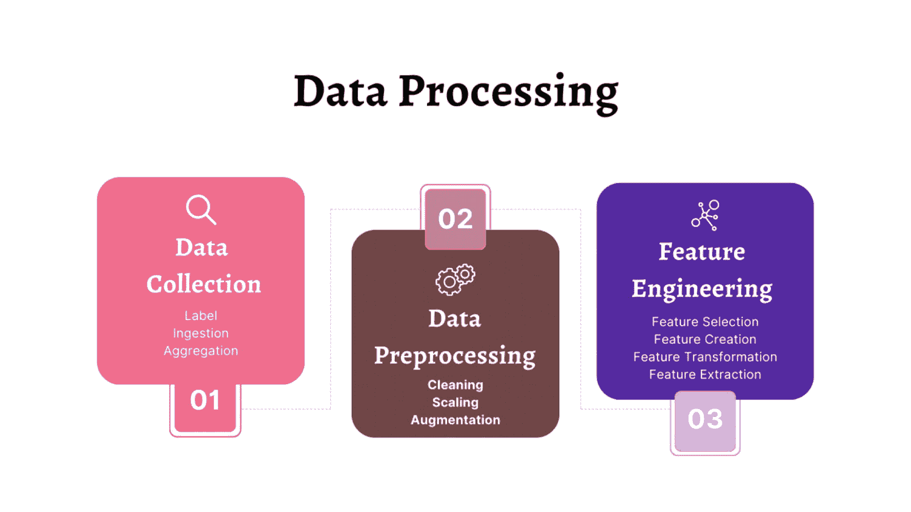

务必牢记，推理请求必须使用与训练数据相同的流程进行处理。数据定位、数据泄露和对抗性攻击都发生在此阶段。数据处理方面的最佳实践详述如下：


##### 实施最小权限访问

首要规则是在机器学习生命周期的所有阶段实施最小权限访问，以保护数据、代码、算法、超参数、训练模型、配置和基础设施等资源。为任何项目的运行分配具有专用资源和服务的独立网络环境。其具体实施计划如下：

基于业务角色对个人进行访问限制

需要根据组织中的业务角色来限制访问权限。

*   识别项目中个人的角色。

*   通过将角色映射到所需的访问权限，实施基于角色的身份验证。

*   根据每个项目的需求，授予对私有信息、资源和服务的最小必要权限。

使用账户分离和 AWS Organizations

了解不同用户类型的工作流程，使用账户分离，并通过多账户设计相应地提供基于角色的访问授权，该设计将工作负载划分到开发、测试和生产环境中，并根据数据敏感性和合规性要求应用适当的治理。AWS Service Catalog 用于快速部署预置环境。它允许您集中管理云资源，以便在基础设施即代码（IaC）模板的规模上实现治理和合规性要求。它有助于为包含敏感工作负载的数据和存储桶建立标签。这些标签用于在细粒度级别授予个人访问权限。参见图 4-11。

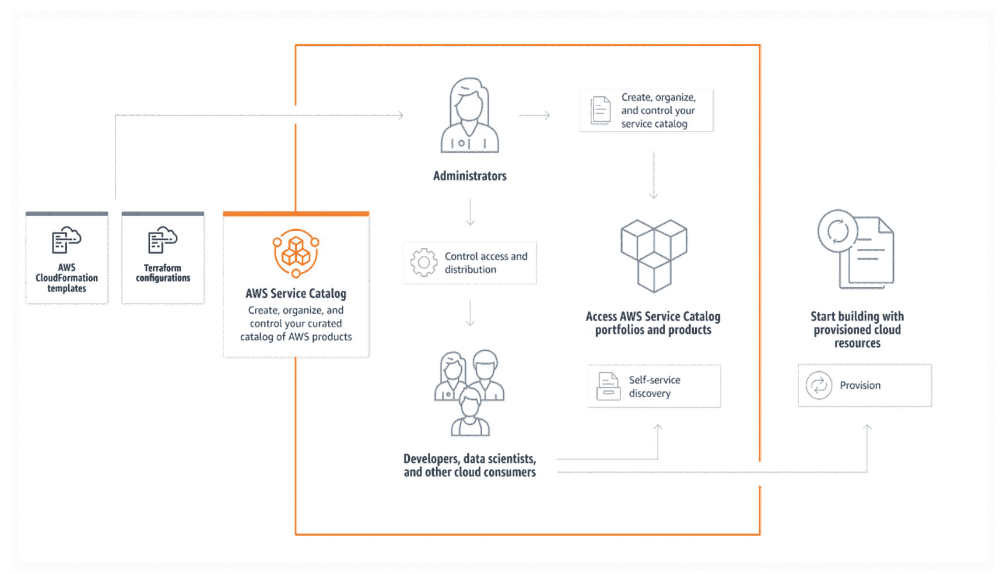

图 4-11

AWS Service Catalog

Service Catalog 具有以下特性：

*   快速查找和部署经批准的、自助式的云资源。
*   在跨多个账户的资源上改进治理和合规性的同时，展现出敏捷性。
*   使用 AWS Service Catalog 的 AppRegistry 获取当前准确的应用定义和相关元数据。

根据访问模式和组织结构分解机器学习工作负载

需要根据组织结构和授权访问来分解机器学习工作负载。

*   分解机器学习工作负载，并根据需要将特定访问权限委派给特定人员，如数据分析师、科学家和管理员。
*   使用防护机制和服务控制策略（SCP）为每种访问类型和用户组强制执行最佳实践。
*   将基础设施访问权限限制给管理员。
*   确保仅使用专门的、隔离的、受限的环境来访问敏感数据。

实施安全的数据和建模环境

现在是时候启用模型开发并保护承载数据的系统了。端到端环境需要是安全的，例如加密训练数据并将其存储在安全的存储库中。在严格安全的云环境中执行数据准备。加密数据从数据存储库移动到严格控制的目标计算实例。其具体实施计划如下：

构建安全的分析环境

在数据准备和特征工程阶段，Amazon AWS 在下面提到的安全环境中提供了许多用于数据分析的服务。

*   Amazon SageMaker 是一个托管笔记本环境。
*   Amazon EMR 是云大数据领域的市场领导者，用于使用 Apache Spark、Apache Hive 和 Presto 等开源框架进行 PB 级数据处理、交互式分析和机器学习。
*   Amazon Athena 提供了一种简化、灵活、无服务器的交互式分析服务，用于就地分析 PB 级数据。
*   AWS Glue 是一种无服务器数据集成服务，通过简化的 ETL 管道开发，用于机器学习和应用程序开发，能够高效地发现、准备、移动和集成数据。它支持各种处理框架和工作负载。参见图 4-12。

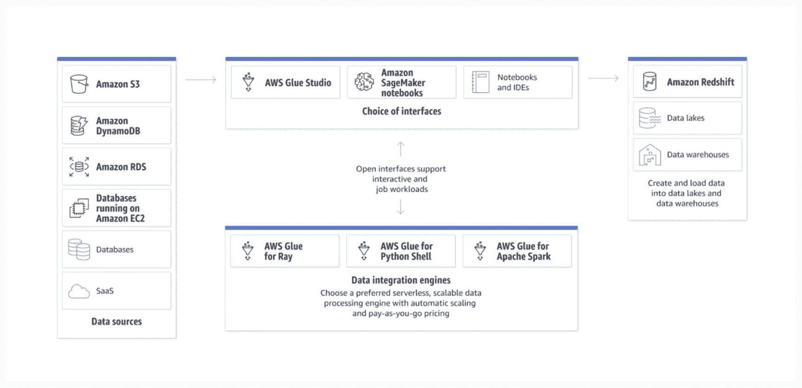

图 4-12

AWS Glue

创建专用的 AWS IAM 和 KMS 资源

这种方法限制了凭证和密钥的影响范围。创建专用的 AWS Identity and Access Management 和 Key Management Service 资源。通过在 Amazon S3 上使用 AWS Lake Formation 实施集中式数据湖，在 AWS 中实现对数据和知识产权的版本管理。通过结合使用细粒度的 AWS 服务（如 AWS IAM 策略、S3 存储桶策略、S3 访问日志、Amazon CloudWatch 和 AWS CloudTrail），可以实现对 Amazon S3 上数据湖的安全保护、访问和监控。参见图 4-13。

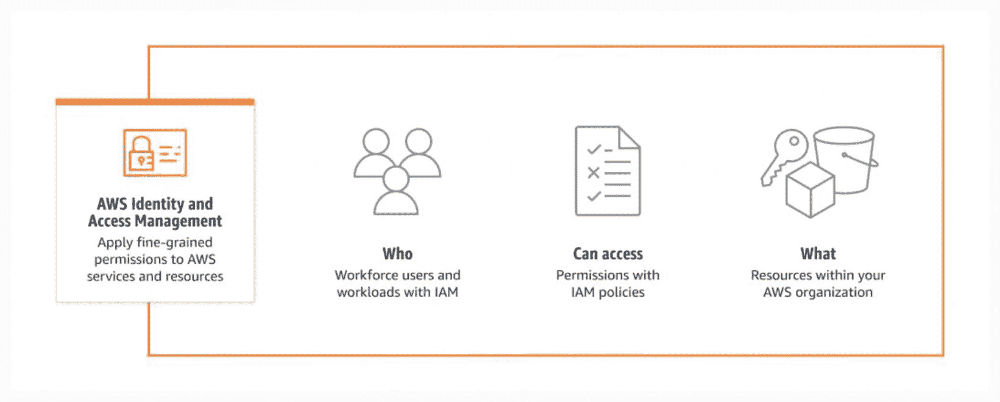

图 4-13

AWS Identity and Access Management

以下是通过 AWS Identity and Access Management 实施的各种策略，用于安全管理对 AWS 服务和资源的身份和访问。

*   基于身份的策略
*   基于资源的策略
*   权限边界
*   组织 SCP
*   访问控制列表（ACL）
*   会话策略

以下示例演示了如何使用适用于 Python (Boto3) 的 AWS 软件开发工具包（SDK）与 AWS Identity and Access Management（IAM）配合使用。通过使用 IAM（一种 Web 服务），可以安全地控制 AWS 服务。使用 IAM，可以在您的 AWS 账户中集中管理权限。以下 Python 代码示例展示了如何使用 `create_key` 函数来使用 `CreateAccessKey`。

```
def create_key(user_name):
"""
:param user_name: 用户的名称。
:return: 创建的访问密钥。
"""
try:
key_pair = iam.User(user_name).create_access_key_pair()
logger.info(
"已为 %s 创建访问密钥对。密钥 ID 是 %s。",
key_pair.user_name,
key_pair.id,
)
except ClientError:
logger.exception("无法为 %s 创建访问密钥对。", user_name)
raise
else:
return key_pair
```

此代码为指定用户创建一个访问密钥。每个用户最多有两个密钥。

使用 Secrets Manager 和 Parameter Store 保护凭证

Secrets Manager 使您能够将代码中的硬编码密钥（例如凭证）替换为 API 调用，以编程方式解密和检索密钥。应用程序配置变量（例如许可证密钥或 AMI ID）可以存储在 Parameter Store 中，该服务旨在用于比密钥或密码更广泛的用例。借助 AWS Secrets Manager 和 Parameter Store，您可以存储凭证，然后授予您的 SageMaker IAM 角色从笔记本访问 Secrets Manager 的权限。参见图 4-14。

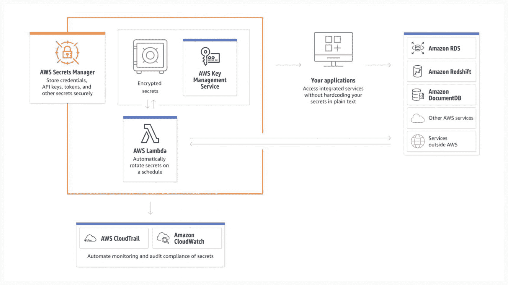

图 4-14

AWS Secrets Manager

以下是 AWS Secrets Manager 的主要特性：

*   使用细粒度策略控制对您的应用、服务和 IT 资源的访问，并安全地保护机密信息。
*   满足您的安全和合规性需求，密钥会自动轮换。
*   安全地加密数据库凭证和 API 密钥。

以下示例演示了如何使用适用于 Python (Boto3) 的 AWS SDK 与 AWS Secrets Manager 配合使用。Secrets Manager 有助于安全地加密、归档和检索数据库及其他服务的登录凭证。以下代码示例展示了 `get_secret` 函数的实现，用于获取密钥值：

```
class GetSecretWrapper:
def __init__(self, secretsmanager_client):
self.client = secretsmanager_client
def get_secret(self, secret_name):
try:
get_secret_value_response = self.client.get_secret_value(
SecretId=secret_name
)
logging.info("密钥检索成功。")
return get_secret_value_response["SecretString"]
except self.client.exceptions.ResourceNotFoundException:
msg = f"请求的密钥 {secret_name} 未找到。"
logger.info(msg)
return msg
except Exception as e:
logger.error(f"发生未知错误：{str(e)}。")
raise
```

在此代码中，实现了 `get_secret_value` API 以从 AWS Secrets Manager 检索单个密钥。这里，传递了参数 `secret_name`，并返回一个密钥字符串作为输出。

自动化管理配置

自动化管理 Jupyter Notebook 实例的所有生命周期配置，这些配置用于安装自定义包、预加载数据集和设置源代码存储库。可以一次性完成更改，然后将更新后的配置应用于多个笔记本实例。这为开发人员、数据科学家和安全团队提供了对系统的灵活性和控制力。AWS Service Catalog 用于简化最终用户的配置。

创建私有、隔离的网络环境

Amazon Virtual Private Cloud（Amazon VPC）根据需求创建并启用与隔离的安全服务和用户的连接。Amazon SageMaker 笔记本实例部署在 Amazon VPC 中，以启用网络级控制来限制与托管笔记本的通信。VPC 流日志捕获进出笔记本实例的网络调用，以便在网络级别实现额外的可见性和控制。VPC 允许查询数据源，例如 Amazon RDS 中的关系数据库或 Amazon Redshift 数据仓库。

以下是 Amazon Virtual Private Cloud（Amazon VPC）的主要特性：

*   在您的虚拟网络中实施安全且受监控的连接、筛选流量以及限制实例访问。
*   节省设置、管理和验证虚拟网络的时间。
*   通过选择 IP 地址范围、创建子网和配置路由表来自定义虚拟网络，从而管理和控制环境。

限制访问

Jupyter Notebook 服务器使得可以通过 Web 访问 EC2 实例上的底层操作系统。这允许您安装额外的软件包或 Jupyter 内核来自定义您的环境。默认情况下，对操作系统具有 root 访问权限或超级用户权限的用户被授予此访问权限，使他们能够完全控制底层的 EC2 实例。应限制此访问，以防止用户获得 root 权限，同时保留对其本地用户环境的控制。

保护机器学习算法安全

模型和算法使用 Amazon SageMaker 通过容器技术进行训练和托管。创建容器后，将其私有托管到 Amazon Elastic Container Repository（Amazon ECR）。参见图 4-15。

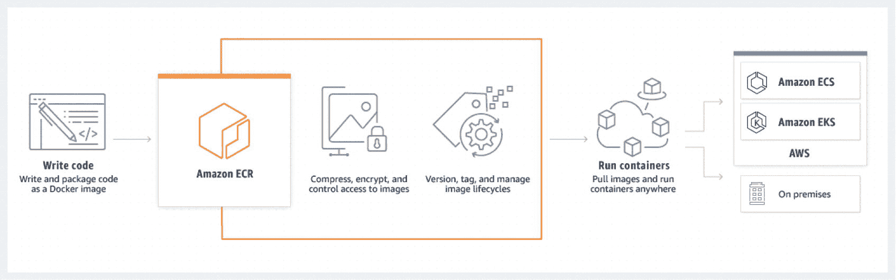

图 4-15

Amazon ECR

Amazon Elastic Container Registry（ECR）可以轻松地存储、共享和部署您的容器软件。

*   容器镜像被推送到 Amazon ECR，无需扩展或安装基础设施。
*   ECR 通过自动加密和基于超文本传输安全协议（HTTPS）的访问控制，帮助安全地下载和共享镜像。

强制执行代码最佳实践

通过使用完全托管的 AWS CodeCommit 存储代码的安全 Git 存储库来强制执行代码最佳实践。参见图 4-16。

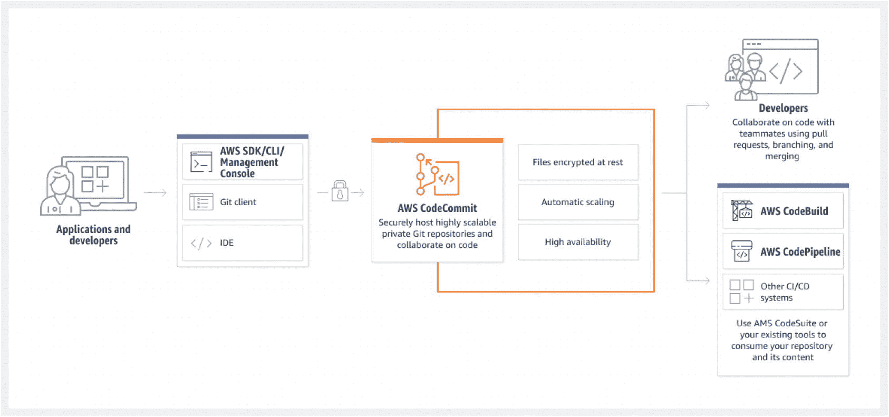

图 4-16

AWS CodeCommit

以下是 AWS CodeCommit 的主要特性：

*   安全地托管高度可扩展的私有 Git 存储库，并在 AWS 上靠近构建、预发布和生产环境的地方协作处理代码。
*   提供可定制的、针对特定用户的 Git 存储库访问权限，并自动加密传输中的文件。
*   无需扩展、备份、托管和操作您的源代码控制服务器。

实施用于使用经批准包的包镜像

在机器学习生命周期中会使用多个机器学习 Python 包，例如 Pandas、PyTorch、Keras、TensorFlow、NumPy 和 Scikit-learn。需要根据确定的标准对这些 Python 包的许可条款进行业务需求评估。设置一个自动化机制，该机制运行脚本从批准的存储库下载必要的包版本，并通过依赖项检查进行安装。下载包后，需要进行验证以确认包的有效性和安全性。

SageMaker 笔记本支持以下两种包安装工具：

*   conda install
*   pip install

以下是它们的示例代码：

```
# 创建一个自定义的 conda 环境
source "$WORKING_DIR/miniconda/bin/activate"
KERNEL_NAME="custom_python"
PYTHON="3.6"
conda create --yes --name "$KERNEL_NAME" python="$PYTHON"
conda activate "$KERNEL_NAME"
pip install --quiet ipykernel
# 这些行可以根据需要安装的包进行自定义
conda install --yes numpy
pip install --quiet boto3
```

在此代码中，numpy 使用 conda 安装，boto3 使用 pip 安装。这些代码行可以根据包安装需求进行自定义。


##### 实施敏感数据隐私保护

在此阶段，敏感数据的识别与分类对于防止意外泄露至关重要。可采用移除、掩码、令牌化、主成分分析（PCA）以及最佳治理实践等策略来保护敏感数据。其实施方案详述如下：

使用自动化机制进行数据分类

Amazon 提供名为 Amazon Macie 的自动化数据分类机制。它能针对您的 S3 存储桶中的敏感数据，提供自动化、持续、智能、经济高效且覆盖整个组织的可见性。以下是 Amazon Macie 的主要功能：

*   检查个人身份信息（PII）、财务数据和 AWS 凭证。

*   构建并持续维护一个交互式数据地图，显示您的敏感数据存储在 Amazon S3 中的位置，并为每个存储桶提供敏感度评分。

*   记录特定的 S3 项目。

*   Macie 还会更新关于您 Amazon S3 数据的统计数据、清单信息及其他信息。

使用标签

标签用于区分需要保护的敏感资源和模型与那些不需要保护的资源，这些资源包含敏感特征。存储可以通过使用对象标签进行分类。每个标签以键值对的形式工作，其中键和值区分大小写。

以下是标签的主要特性：

*   标签可以在上传新对象时添加，也可以添加到现有对象上。

*   一个对象最多可以关联 10 个标签，每个标签必须具有唯一的标签键。

*   标签键和标签值的长度分别最多为 128 和 256 个 Unicode 字符。Amazon S3 对象标签内部使用 UTF-16 编码。

*   对象标签实现了细粒度的权限访问控制。

*   对象标签实现了细粒度的对象生命周期管理，允许您在生命周期规则中除了键名前缀之外，还可以定义基于标签的过滤器。

假设您的 S3 存储桶用于存放项目文件。您可以使用值 `Yellow` 和键 `Project` 来标记这些对象，如下所示：

```
Project=Yellow
```

加密敏感数据

敏感数据可以使用以下服务进行加密：

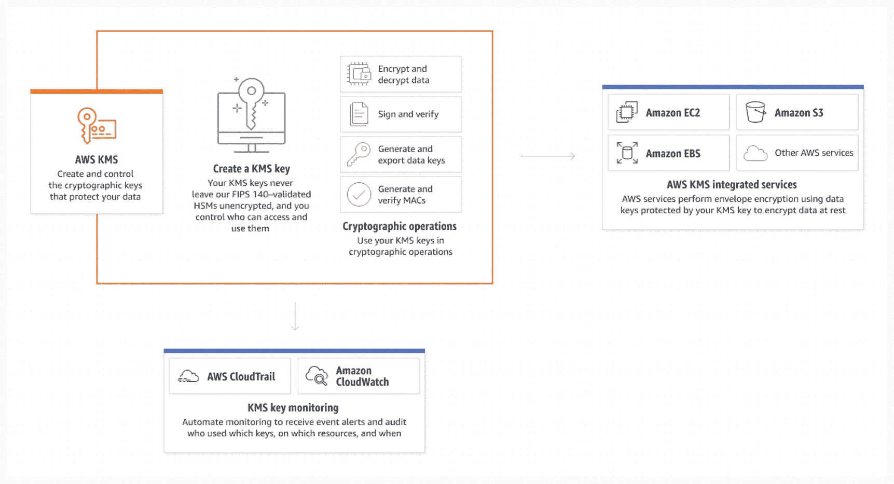

图 4-17

AWS 密钥管理服务

*   客户端加密。

*   **AWS 密钥管理**：AWS 密钥管理服务允许您使用 AWS 加密 SDK，在您的 AWS 工作负载、数字签名、应用程序和 AWS 服务中，通过控制加密密钥来加密数据。参见图 4-17。

以下 AWS SDK for Python (Boto3) 示例代码演示了如何使用指定的密钥通过 AWS KMS 加密文本：

```
class KeyEncrypt:
def __init__(self, kms_client):
self.kms_client = kms_client
def encrypt(self, key_id):
"""
text = input("Enter some text to encrypt: ")
try:
cipher_text = self.kms_client.encrypt(
KeyId=key_id, Plaintext=text.encode()
)["CiphertextBlob"]
except ClientError as err:
logger.error(
"Couldn't encrypt text. Here's why: %s",
err.response["Error"]["Message"],
)
else:
print(f"Your ciphertext is: {cipher_text}")
return cipher_text
```

*   **AWS 加密 SDK：** 要使用 AWS 加密 SDK，可以使用包装密钥或 AWS KMS 配置密钥环或主密钥提供程序。AWS 加密 SDK 需要您选择的编程语言的 AWS SDK 才能与 AWS KMS 交互。为了支持存储在 AWS KMS 中的主密钥，AWS 加密 SDK 客户端库与 AWS SDK 协同工作。

*   此代码接受输入参数 `param key_id`，该参数是用于加密的密钥 ID，并返回文本的加密版本。

降低数据敏感度

确定哪些数据应被匿名化或去标识化，以降低数据敏感度并进行评估。开发无服务器令牌化系统是隐藏敏感数据并降低未经授权访问可能性的最佳方法。将一段数据转换为称为令牌的随机字符串的过程就是*令牌化*。令牌化利用一个通常称为*令牌库*的数据库，该数据库保存令牌与敏感值之间的连接。接下来，库中的数据通常通过加密进行保护。令牌值可以在各种应用程序中替换原始数据。Amazon Cognito 用于客户端身份验证并接收授权令牌。

*   实施强制数据血缘

    数据血缘对于审计、监控和追踪数据来源及其随时间的变化是必要的。必须对训练数据应用完整性检查，以识别因丢失、损坏或篡改而导致的任何意外偏差，从而严格控制数据访问。数据血缘提供了可见性，并有助于追溯数据处理错误的根本原因。其实施方案详述如下：

    追踪任何更新的记录

    Amazon SageMaker ML Lineage Tracker 用于存储从数据准备到模型部署的 ML 工作流步骤信息。

    通过血缘追踪可以提取以下信息：
    *   可以重现工作流步骤，并追踪模型和数据集的来源。

    *   遵循模型血缘工件以验证合规性，并建立模型治理和审计标准。

    *   将原始数据视为最终的真实来源。

    *   维护模型发现实验的运行历史。

    *   摄取、处理和维护从其派生的数据集的映射。从结果迭代回原始数据元素。

    *   不仅将这些概念应用于数据，还应用于代码、模型、管道和基础设施。验证您可以追踪和审计任何与管道操作、数据或机器学习模型相关的活动。

        以下示例代码演示了血缘实体的基础知识，以及如何创建和关联不同的血缘实体来追踪您的工作流。您可以进一步遍历不同血缘实体之间的关联。

        ```
        from datetime import datetime
        from sagemaker.lineage.context import Context
        from sagemaker.lineage.action import Action
        from sagemaker.lineage.association import Association
        from sagemaker.lineage.artifact import Artifact
        unique_id = str(int(datetime.now().replace(microsecond=0).timestamp()))
        print(f"Unique id is {unique_id}")
        # create an example context
        # the name must be unique across all other contexts
        context_name = f"machine-learning-workflow-{unique_id}"
        ml_workflow_context = Context.create(
        context_name=context_name,
        context_type="MLWorkflow",
        source_uri=unique_id,
        # properties services as a method to store metdata on lineage entities in additional to Tags
        properties={"example": "true"},
        )
        ```

    在此代码中，使用 `sagemaker.lineage.context` 创建了 `context` 实体。创建了一个唯一 ID，并为该上下文在所有其他实体中分配了一个唯一名称，并定义了其属性。


##### 实施仅保留相关数据

机器学习系统应设计为在整个生命周期内管理数据。系统需要保留与用例相关的数据，过时的数据应在指定时间自动删除。为降低数据暴露风险，应在不同计算环境（如开发和预发布环境）中保存数据，并实施机制以在整个数据中强制执行生命周期管理流程。其实施计划详述如下：

建立数据生命周期计划

每一条数据都会经历一个数据生命周期，从原始状态到处理后的状态，最终用户利用结果做出更明智的决策。

组织在数据生命周期的每个阶段都使用 AWS 云服务来快速且经济地处理数据。我们需要创建一个数据生命周期计划，以了解运营和调试任务的消费和需求模式；这将最终减少数据蔓延，并从数据中获取更多价值。参见图 4-18。

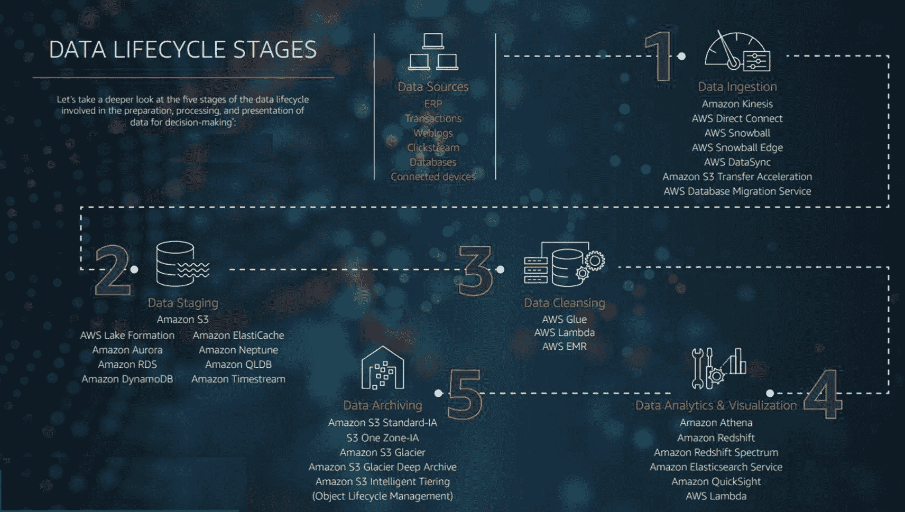

图 4-18

数据生命周期阶段

数据生命周期有五个阶段。

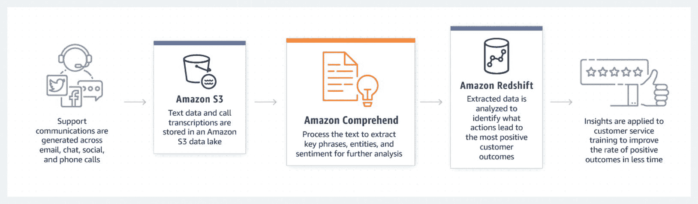

图 4-19

Amazon Comprehend 架构

*   *数据摄取*

    数据摄取从各种经过验证的高价值数据源（如交易文件、ERP、数据库、Web 日志等）获取数据，并将其导入到可以应用数据分析和机器学习的位置。这些数据文件在 AWS 云上安全保存并备份。云以经济、安全、持久且最重要的是对广大用户可用的方式存储数据。此阶段可用的 AWS 服务包括 Amazon Kinesis、AWS Direct Connect、AWS Snowball/Snowball Edge/Snowmobile、AWS DataSync、Amazon S3 Transfer Acceleration、AWS Database Migration Service 和 AWS Storage Gateway。

*   *数据暂存*

    数据暂存涉及在将数据提供给用户之前执行一些内务处理任务。企业以不同方式将数据存储在不同位置，例如数据库、电子表格、文本文件和数据仓库。通过避免不同的存储方法，AWS 简化了在 Amazon S3 等单一位置暂存数据或构建数据湖的过程。数据暂存阶段可用的 AWS 服务包括 Amazon S3、Amazon Aurora、Amazon RDS 和 Amazon DynamoDB。

*   *数据清洗*

    在数据分析之前，需要对缺陷、损坏数据或不准确数据进行数据清洗。数据清洗涉及以下全部或部分过程：
    *   识别损坏或脏数据

    *   为增加分析输出的准确性，添加或编辑脏数据

    *   将语音转换为文本数据

    *   根据要求的输入翻译文件

    *   将音频和图像数据转换为数字格式进行处理，或包含元数据标签以方便分类和搜索

    最后一步是转换数据，使其针对代码（例如，ETL）进行优化。

    可用于数据清洗的 AWS 服务包括 AWS Glue Data Catalog、AWS Glue (ETL)、Amazon EMR 和 Amazon SageMaker Ground Truth。

*   *数据分析与可视化*

    此时，可以发现数据的真正价值。数据工程师和决策者使用分析和可视化工具来预测客户需求、优化运营、修复有缺陷的流程，并进行创新以保持竞争力。当高管和任务负责人能够访问数据时，他们无需依赖昂贵且易出错的猜测。可用于分析和可视化的 AWS 服务包括 Amazon Athena、Amazon Redshift、Amazon QuickSight、Amazon SageMaker、Amazon Comprehend、Amazon Comprehend Medical 和 AWS DeepLens。

*   *数据归档*

    通过简化数据归档，AWS 云释放了 IT 团队的资源，使其能够将更多精力投入到数据生命周期的其他阶段。这些存储解决方案带有内置加密，并拥有许多安全认证和合规标准，可立即实现合规。用于数据归档的 AWS 服务包括 Amazon S3 Glacier、Amazon S3 Glacier Deep Archive 和 AWS Storage Gateway。

*   *隐私设计*

    设计数据时考虑隐私，在保持数据可用性的同时移除不需要的敏感信息。检测个人身份信息（PII）和未来业务问题迭代的特征。AWS 提供使用 Amazon Comprehend 的机器学习能力，从各种来源（包括产品评论、社交媒体、支持问题、客户电子邮件等）检测和编辑 PII。参见图 4-19。

以下是 Amazon Comprehend 的主要功能：

*   从文档、客户支持工单、电子邮件、产品评论等文本中发现有价值的见解

*   通过检测文档中的 PII 实体并从中编辑文本来保护和控制谁有权访问敏感数据

*   通过编辑 PII 实体来保护隐私并遵守当地法规

*   以下示例演示了使用 AWS CLI 上的 Amazon Comprehend 执行实时分析的代码。

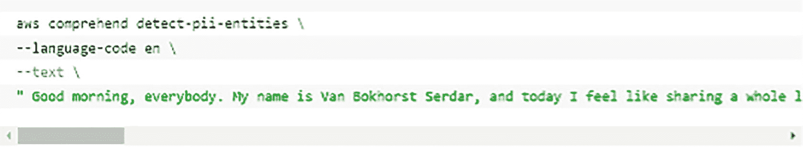

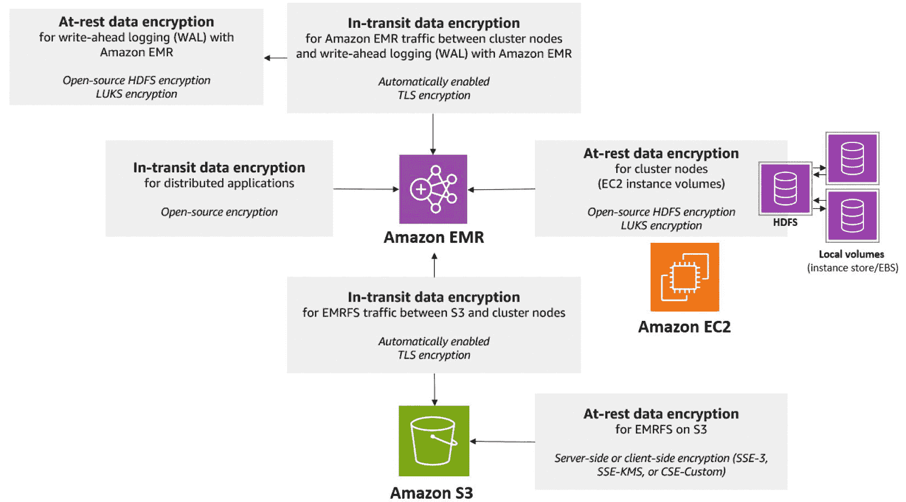

图 4-20

Amazon EMR 数据加密选项

*   **模型开发**

    模型开发阶段包括模型构建、训练、超参数调优和评估。模型开发下的最佳实践详述如下：
    *   **实施安全受控的机器学习环境**

        机器学习开发和运营环境受到检测性和预防性防护措施的保护。开发环境的配置通过为用户提供自助服务配置来进行持续管理和监控。还为安全受控的机器学习环境实施了事件管理和响应。其实施计划详述如下：

        **分解机器学习工作负载**

        根据组织单位的访问模式分解机器学习工作负载。这将使得可以为每个组（如管理员、数据分析师等）分配访问权限。

        **使用防护措施和服务控制策略（SCP）**

        使用检测性和预防性防护措施以及服务控制策略，为每种类型的机器学习环境强制执行最佳实践。为管理员提供有限的基础设施访问权限以确保安全。

        **验证所有敏感数据**

        应对所有敏感数据进行验证，并通过受限和隔离的环境检查访问权限。确保检查专用资源、网络隔离和服务依赖关系。

        **安全实施机器学习算法**

        必须使用安全且受限的开发环境来实施机器学习算法。遵守公司所需的安全程序，以确保模型训练和容器托管的安全。

    *   **实施安全的节点间集群通信**

        对于节点间集群通信，必须共享系数信息。共享数据必须在节点间保持同步，算法才能正常运行。在传输过程中，数据必须加密。其实施计划详述如下：

        **在 Amazon SageMaker 中启用节点间加密**

        在分布式计算环境中，通过 SageMaker 在 Amazon 中启用节点间加密，以自动指示通过横向广域网在节点间传输的数据。为确保训练任务的数据通过加密隧道发送，请加密容器间通信。

        **在 Amazon EMR 中启用传输中加密**

        Hadoop 生态系统中有许多应用程序和执行引擎，提供了各种工具来满足您的机器学习和分析工作负载的需求。Amazon EMR 具有分布式集群能力，也是运行数据处理、交互式分析和机器学习作业（针对存储在集群本地或 Amazon S3 中的数据）的一个选项。参见图 4-20。

*   前面的代码输出是包含检测到的 PII 实体的 JSON 响应对象。该服务为每个实体返回置信度分数指标、PII 类型和其他参数。

以下是 Amazon EMR 的主要功能：

*   Amazon EMR 以不到本地系统一半的成本，更快地运行 PB 级数据分析和大数据应用。

*   使用针对性能优化的开源、可互操作的 Spark、Hive 和 Presto 版本，获得高达两倍更快的洞察时间。

*   它提供了许多快速简便的数据加密选项。

```
aws emr create-security-configuration --name "MyS3EncryptionConfig" --security-configuration '{
"EncryptionConfiguration": {
"EnableInTransitEncryption": false,
"EnableAtRestEncryption": true,
"AtRestEncryptionConfiguration": {
"S3EncryptionConfiguration": {
"EncryptionMode": "SSE-S3"
}
}
}
}'
```

*   以下示例演示了如何使用 Amazon EMR 控制台创建安全配置。它展示了构成加密和配置的各种参数的参考。

*   **实施防范数据投毒威胁**

    污染训练数据集的数据投毒是对数据最常见的威胁，因此有必要防范数据注入和篡改。数据注入可能会添加损坏的训练数据，从而导致模型和输出不准确。数据篡改可能会更改数据中的标签或特征，从而导致预测模型不精确且薄弱。安全方法和异常检测算法可以识别损坏的数据和不准确的模型。确保安装的第三方包不包含危险的恶意软件或勒索软件，以保持数据集的不可变性。其实施计划详述如下：

    **仅使用可信数据源进行数据训练**

    在训练之前，验证训练数据的质量，查找显著的异常值和可能错误的标签。必须定期进行审计控制，以保留对活动以及由谁、何时、何地进行了更改的审查。

    **寻找训练数据模式的潜在变化**

    通过监控数据漂移来确定对预测方差的影响。这些偏差可以为针对训练数据的未授权访问以及潜在的数据漂移提供早期预警。

    **识别对结果产生负面影响的模型更新**

    在将重新训练的模型发送到生产环境之前，检查其结果是否与之前的模型迭代不同，以及是否正在恶化。应将历史测试结果和模型迭代作为基线。

    **制定回滚计划**

    始终准备好回滚计划，以防出现故障场景。遵循版本化的训练数据和版本化的模型，以便轻松回滚到已知的良好工作模型。

    **使用低熵分类案例**

        寻找显著的、意外的、低熵的分类变化。留意大的、意外的发展。建立阈值边界，识别您不希望看到的分类，并在重新训练的模型超过这些边界时发出警报。

*   **模型部署**

    在针对机器学习问题框架、数据处理和模型开发、评估和验证实施了所有安全措施之后，现在是时候将模型部署到生产环境并为其实施安全措施了。针对安全的模型和安全的部署环境进行预测和推理。模型部署下的最佳实践详述如下：
    *   **实施防范对抗性和恶意活动**

        在需要部署的代码内部和外部增强安全性，以识别可能导致不准确预测的恶意输入。通过仔细检查输入并在将其添加回池之前进行修复，自动检测非法修改。其实施计划详述如下：

        **评估算法的鲁棒性**

        分析您的用例，识别不准确的分类或预测。为了确定算法对操纵输入的敏感程度，使用敏感性分析来评估方法对逐步改变的输入的鲁棒性。

        **从一开始就构建鲁棒性**

        选择多种特征来增强算法对异常值的抵抗力。考虑使用集成模型来增强决策点周围的鲁棒性，并增加决策的多样性。

        **识别重复输入**

        Amazon SageMaker Model Monitor 定期运行处理作业，分析推理数据，以检测对模型的重复输入，从而识别对决策边界的潜在威胁。这可以通过一种称为*模型暴力破解*的技术来完成，攻击者反复尝试少量变量，以查看哪些变量影响决策点并评估特征的重要性。

        **血缘追踪**

        在重新训练替代模型之前，确保在任何模型偏差的情况下，都能追溯到数据，并且如果在不可信或未经验证的输入上重新训练，则进行修剪。我们在 AWS 的卓越运营部分详细讨论了血缘追踪。

        **使用安全的推理 API 端点**

        托管模型，以便模型消费者可以安全地使用它进行推理。允许用户监控模型交互，限制对底层模型的访问，并使用 API 建立关系。

*   前面代码的功能是禁用传输中数据加密并启用静态数据加密。此外，它还禁用了本地磁盘加密，并使用“SSE-S3”加密模式激活了 Amazon S3 加密。

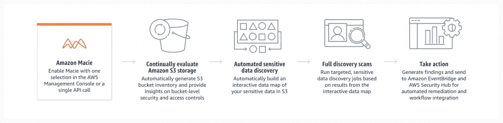

图 4-21

Amazon Macie

*   **模型监控**

    模型监控系统确保持续监控和维护模型，以达到期望的性能水平。模型监控有助于早期检测安全威胁，并允许缓解这些威胁。模型监控下的最佳实践详述如下：
    *   **限制对预期合法消费者的访问**

        在部署的模型端点处，需要使用最小权限原则提供受限访问。通过安全的 API 向工作负载环境外部的消费者提供访问权限。其实施计划详述如下：

        **使用安全的推理 API 端点**

        通过托管模型，为模型消费者提供安全的环境来对模型进行推理。允许用户建立关系，限制对底层模型的访问，并通过 API 提供模型交互监控。

        **安全的推理端点**

        通过仅允许授权人员对机器学习模型进行推理来保护推理点。确保在提供网络限制（例如机器人控制和限制对特定 IP 范围的访问）时遵循 AWS Well-Architected Framework 的指导。这些 API 调用的 HTTPS 请求应进行签名，以便可以验证请求者的身份，并保护传输中的请求数据。

    *   **监控与数据的人类交互以发现异常活动**

        确保您监控与数据的人类交互。持续审计是否存在异常数据访问、来自异常位置的访问以及超过阈值限制的情况。需要维护数据访问和授权的日志。可以使用支持异常活动警报的各种工具，并将其与数据分类结合使用以评估风险。评估使用有助于监控数据访问事件的服务。其实施计划详述如下：

        **启用数据访问日志记录**

        验证您是否已为任何人类 CRUD（创建、读取、更新和删除）操作启用了数据访问日志记录。此日志应包含谁访问了什么、何时、从何处以及他们采取了什么操作的信息。

        **对数据进行分类**

        AWS 的完全托管数据安全解决方案 Amazon Macie 可保护并分类 Amazon S3 中的训练和推理数据。它使用机器学习和模式匹配来自动发现、分类和保护 AWS 中的敏感数据。该服务能够识别敏感数据，包括知识产权和 PII。参见图 4-21。

Amazon Macie 具有以下功能：

*   保护和分类敏感数据

*   在 Amazon S3 中自动、持续且经济高效地大规模发现敏感数据

*   通过可操作的敏感数据报告（在 Amazon S3 中发现）减少分类时间

*   提高对关键业务数据的可见性

**监控与保护**

Amazon GuardDuty 结合了机器学习和来自 AWS 的集成威胁情报，用于监控您的 AWS 账户和工作负载上的恶意和未授权活动。这使得能够通过智能威胁检测来保护 AWS 账户、工作负载以及存储在 Amazon S3 中的数据，并提供可查看和修复的全面安全发现。参见图 4-22。

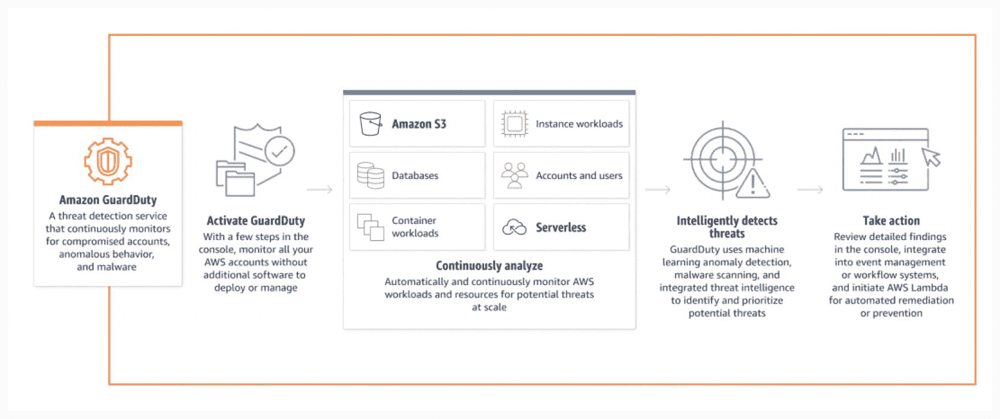

图 4-22

Amazon GuardDuty

Amazon GuardDuty 具有以下功能：

*   在整个 Amazon 环境中密切关注潜在危险

*   使用异常检测、行为建模、机器学习（ML）以及来自 AWS 和信誉良好的第三方的威胁情报源来快速发现威胁

*   准确识别危害并在其成为可能影响您业务的更严重问题之前迅速采取行动

*   对 AWS 计算云（Amazon EC2）工作负载、无服务器工作负载和容器工作负载提供端到端的可见性


## 最终思考

组织正在寻求一个完整的 MLOps 解决方案，以实现端到端安全的机器学习系统。通过整合 MLSecOps 的五大基本支柱并遵循机器学习安全最佳实践，组织可以防范数据投毒、快速注入攻击、机器学习对抗性攻击、模型反转攻击等安全威胁。随着机器学习安全性的发展，持续的监控和预防措施对于大规模安全机器学习变得愈发重要，以加速组织的增长和收入产出。

