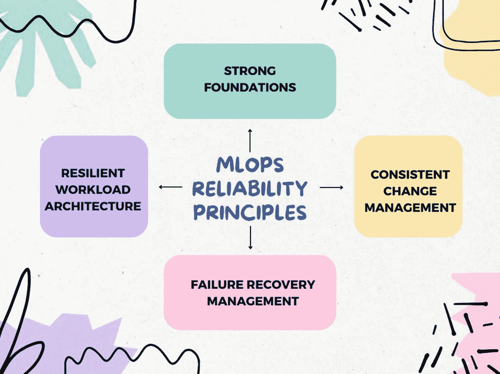
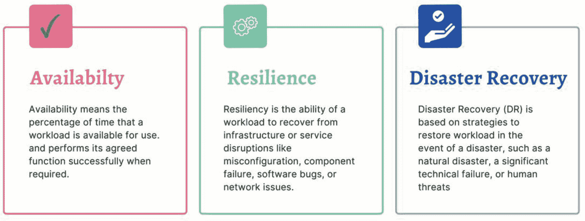
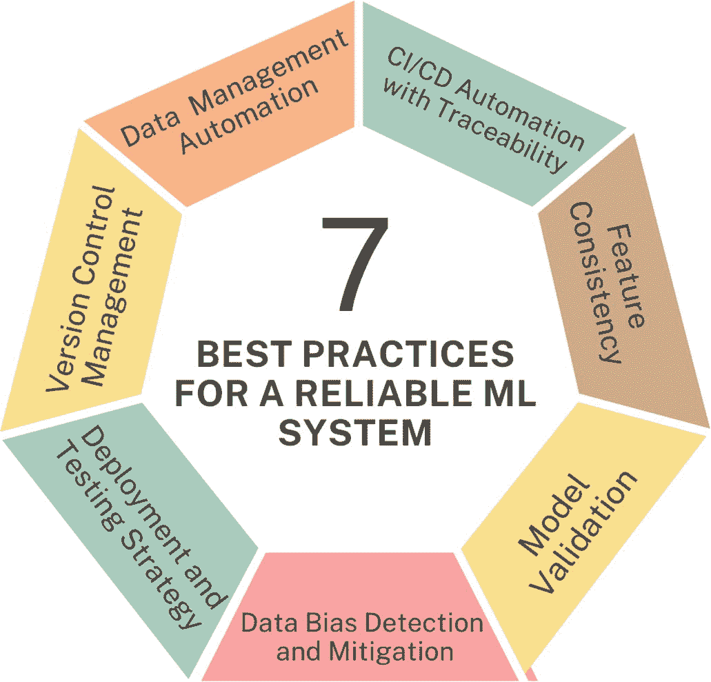
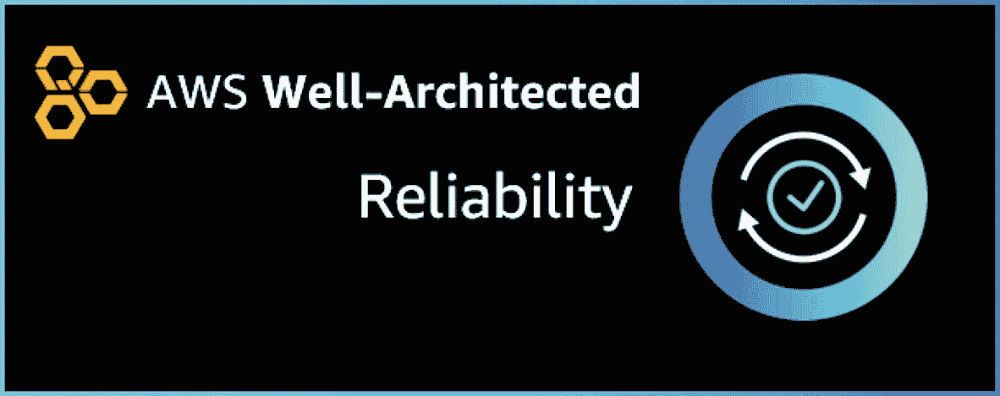
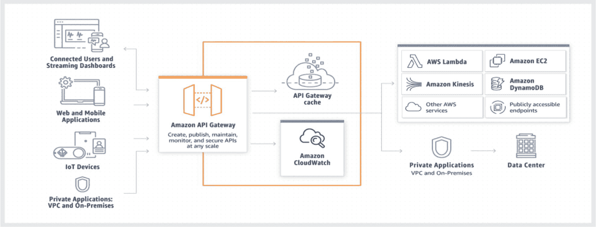
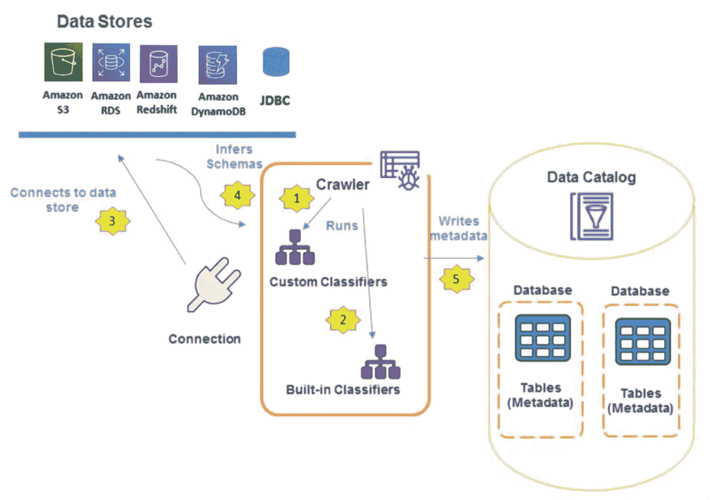
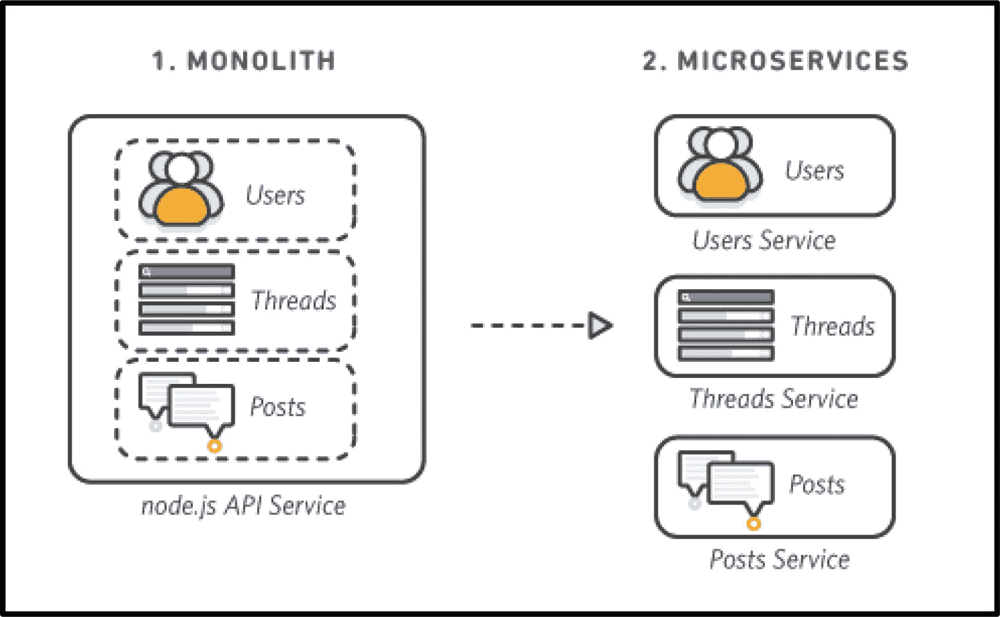
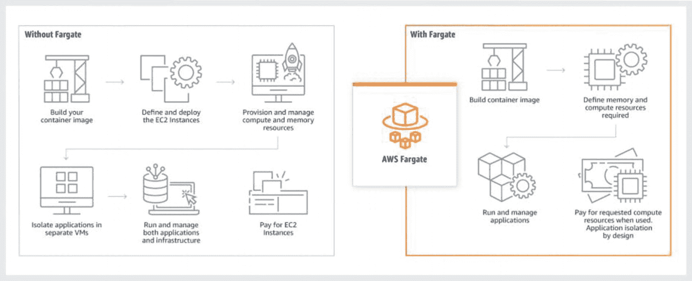
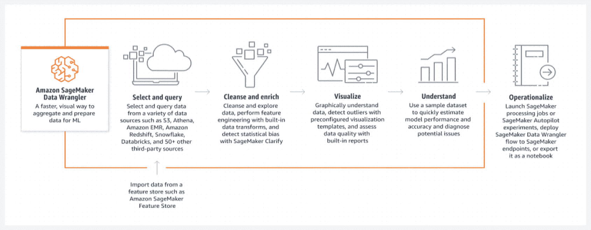

# 5. MLOps 中的 AI/ML 可靠性

可靠性是 MLOps 的第三大支柱。在前面的章节中，我们讨论了 MLOps 中的运营卓越性和安全性。

在本章中，我们将详细讨论 MLOps 中的可靠性、其原则以及可靠性的重要性。我们将涵盖可靠性的三大支柱以及为实现可靠的 MLOps 系统需要实施的最佳实践。我们还将通过代码片段展示它们在 AWS 中的实现，以供参考。


## MLOps 可靠性简介

MLOps 中的可靠性是机器学习架构中最佳、最高效、最具弹性的支柱，有助于识别改进领域。它确保在预期情况下，工作负载能够准确、一致且高质量地执行。它涵盖了工作负载在基础设施或服务出现干扰后恢复运行的能力。MLOps 工程师实施各种实践，以增强整个机器学习运营生命周期（从数据管道到模型开发再到部署）的可靠性。机器学习系统的可靠性保证了它在正常和未知情况下都能按计划运行。

MLOps 可靠性关乎可用性、弹性和灾难恢复。它涵盖了系统在其整个生命周期内的功能和工作负载测试。在传统的本地部署环境中，由于存在单点故障、自动化程度低和弹性不足，实现可靠性非常困难。可靠性使得工作负载能够按需可用。它还能动态地为系统增加处理能力以匹配需求，并减少因设置错误和临时网络问题造成的中断。

## MLOps 可靠性原则



以下是 MLOps 可靠性所基于的四个原则：

*   **坚实基础**

在架构任何可靠的机器学习系统之前，必须有一个坚实的基础。

坚实的基础基础需求并不局限于单个工作负载或项目。一个坚实的基础可以在各种工作负载和项目中实施和使用。

以下是该支柱的关注点：

    *   **服务配额与约束管理**

在设计规划时，应考虑服务配额和集成服务的约束。配额管理可以防止服务滥用，并有助于避免无意中分配超出所需的资源。规划时应留有足够的空间，以便根据预期的负载请求增长进行扩展。

*   **网络拓扑规划**

工作负载通常存在于多个云环境中，因此有必要设计你的网络拓扑。网络规划对于确保网络的高可用性、冗余性和可扩展性是必要的。这包括考虑系统内部和系统间的连接性、公有和私有 IP 地址管理以及域名解析等因素。它应该能够应对潜在的故障，并适应未来的增长以及与其他系统及其网络的集成。

*   **弹性工作负载架构**

在跨多个业务领域创建设计服务时，MLOps 工作负载的架构必须具有弹性。软件和基础设施的工作负载设计决策都需要健壮可靠。它应该包含诸如超时、限流、重试、队列管理和紧急控制杆等功能以防止故障。为了更快地扩展和创新，使用持续改进的方法将你的系统分解为分布式服务。

以下是本节的重点：

    *   **工作负载服务架构设计**

高度可扩展、可靠且具有弹性的工作负载架构是使用面向服务的架构（SOA）或微服务架构设计的。面向服务的架构是通过服务接口使软件组件可重用的实践。SOA 接口使用通用的通信标准，允许它们快速集成到新的工作负载中。

微服务架构更进一步，使组件更小、更简单。它们使你能够区分不同服务所需的可用性级别，从而允许你更精确地将投资集中在需要最高可用性级别的微服务上。

*   **交互式分布式系统设计以防止故障**

分布式系统使用通信网络来连接其众多组件，包括服务器和服务。在这些网络中，数据丢失或延迟不得影响工作负载的可靠性。分布式系统的组件协同工作，而不会相互干扰或影响任务。这些实践增加了平均故障间隔时间并防止了故障。

*   **一致的变更管理**

为了实现可靠的工作负载运行，工作负载或其环境的任何变更都必须在整个 MLOps 生命周期中保持一致。这些变更可能与功能部署、安全补丁或任何按需或业务相关的变更有关。

以下是该支柱的关注点：

    *   **工作负载资源监控**

对各种工作负载资源进行持续监控日志和指标，对于深入了解工作负载的健康状况非常重要。可以配置监控日志和指标，并在超过阈值或发生重大事件时发送警报。监控对于检测故障并自动从中恢复至关重要。

*   **工作负载设计以适应按需变化**

可靠且可扩展的工作负载能够灵活地根据需要添加、修改或移除资源，以适应任何特定时间点的需求变化。这使得工作负载架构能够可靠地高效处理持续的变化。

*   **变更实施**

在成功运行的操作系统、系统工作负载和已修补的软件上部署新功能，需要进行受控的变更。预测这些变更的影响，以及处理因变更失控而产生的问题，是具有挑战性的。

*   **故障恢复管理**

尽管我们已采取所有措施，MLOps 系统仍存在可能影响工作负载的低级和高级故障。因此，为了构建可靠的工作负载，必须采取一些措施来实现一个可从故障中恢复的弹性 ML 系统。

以下是本支柱的关注点：

    *   **数据备份**

数据备份以及应用程序和配置备份对于故障恢复管理至关重要。

*   **为处理组件故障而设计工作负载**

工作负载必须设计为能够承受组件故障，并具有较低的恢复时间，同时应能满足高可用性需求。

*   **可靠性测试**

对于实时部署环境，确保针对可靠性进行工作负载弹性测试至关重要。可靠性测试是确保工作负载按照功能性和非功能性需求进行设计、运行并提供弹性的方法。

*   **灾难恢复 (DR) 规划**

灾难恢复规划至关重要，需要提前采取行动。备份您的数据和工作负载资源，并预先安排完成任何冗余任务。灾难恢复侧重于时间恢复，并根据业务价值控制恢复成本。

## MLOps 中可靠性的重要性

在当今现代，机器学习运维 (MLOps) 是机器学习的一个关键方面。MLOps 涉及在生产环境中开发、部署、管理和监控机器学习模型。每个 MLOps 系统都需要实现一个可靠的机器学习系统。在本文中，我们将讨论可靠性在 MLOps 中的重要性。

*   **持续改进**

    实现可靠的 ML 系统可以构建弹性的工作负载架构，并使灾难恢复成为可能。它为 MLOps 的持续改进奠定了基础。组织可以通过分析历史数据、趋势和模式，并将其转化为机器学习模型的长期性能，来获得宝贵的见解。这些信息可以指导模型重新训练、特征工程和整体系统增强，以持续提高准确性、效率和鲁棒性。

*   **早期故障检测与调试**

    需要持续监控来检测异常活动。通过主动的系统监控，可以在早期阶段检测到故障。如果发生恶意活动，工程师会领导事件响应行动，以减轻影响、缓解问题并防止其再次发生。

    为了实现可靠系统的功能，需要采取主动的方法来预测挑战、解决问题并在瓶颈影响系统之前识别它们。主动监控和调试问题，而不是被动应对，对于确保问题的早期发现至关重要，从而能够实现快速、可靠且高效的解决。

*   **性能优化**

    可靠的机器学习系统通过分析日志、数据、输出和配置参数，为 ML 模型的性能提供宝贵的见解。深入分析有助于识别系统瓶颈并为其提供解决方案。使用最佳配置优化资源利用率可以提高模型的速度和整体效率。这种性能优化对于达成服务级别协议 (SLA) 并保证无缝、可靠且响应迅速的用户体验至关重要。

*   **运营弹性**

    MLOps 系统中的可靠性通过监控关键性能配置、高效资源使用以及维护相关信息日志，有助于提高机器学习模型的运营弹性。在主动异常检测和服务中断预防方面，运营弹性有助于即使在不断变化的环境条件或数据模式下也能保持高系统正常运行时间。

*   **系统健康保障**

    一个可靠的 MLOps 系统的最终责任是保障整个机器学习运维生态系统的健康。通过高效管理工作负载资源、规划灾难恢复以及实时排查问题，一个可靠的 MLOps 系统有助于数据管道、模型和底层基础设施的稳定性、可扩展性和效率。

## MLOps 可靠性的 CAP 定理

我们可以通过理解在分布式 ML 系统中平衡一致性、可用性和分区容错性的 CAP 定理，来设计一个可靠的 MLOps 系统。

MLOps 系统必须在分布式节点和集群之间维护模型一致性和模型可用性。尽管模型部署在多个环境或区域，MLOps 系统也需要确保良好的模型性能。通过在 MLOps 系统中实施 CAP 定理的组件，可以实现高性能且可靠的 MLOps 系统。

在 MLOps 中，为了可靠性，CAP 定理需要遵循三个组件：

1.  强一致性

2.  高可用性

3.  分区容错性

## MLOps 可靠性的支柱



MLOps 可靠性有三个支柱。

1.  **可用性**

    可用性，也称为*服务可用性*，是指工作负载可供使用并成功执行其约定功能的时间百分比。可用性计算为使用时间可用性占总时间（例如一个月或一年）的百分比。在计划内和计划外的中断中，如果应用程序运行不正常，可用性都会降低。可用性定义如下：


1.  **弹性**

    一般而言，弹性是指从意外事故或变化中恢复的能力。在 MLOps 中，弹性意味着工作负载能够通过动态获取计算资源，从基础设施或服务中断（如配置错误、组件故障、软件错误或网络问题）中恢复。

在 MLOps 中，需要一种弹性策略来监控工作负载资源，并考虑所有业务和技术指标要素，例如通知、自动化、分析等。借助弹性，MLOps 可以生成可扩展、敏捷、健壮且可靠的 ML 生产模型。

## 灾难恢复 (DR)

可靠 MLOps 系统的最后一个支柱是灾难恢复策略，用于在发生灾难事件时恢复工作负载。灾难恢复是应对一次性事件（如自然灾害、重大技术故障或人为危害（如错误或攻击））的过程。

灾难恢复与可用性不同，可用性计算的是随时间推移处理软件问题、负载峰值和组件故障的平均弹性。它基于在灾难事件（如自然灾害、重大技术故障或人为威胁）中恢复工作负载的策略。

## 确保机器学习系统可靠性的最佳实践



为确保完整的机器学习/人工智能系统的可靠性，需要实施七项最佳实践。

### 1. 数据管理自动化

在 `MLOps` 生命周期中，数据会以多种方式被管理、处理和转换，以便为机器学习建模做好准备。所有与数据相关的管理都需要自动化，以使系统快速且可靠。

以下是数据管理自动化的关键特性：

*   自动化数据管道
*   自动检查数据模式是否存在概念漂移
*   自动化输入数据处理，将其转换为所需格式
*   自动化输入数据转换
*   特征管道自动化

### 2. 具备可追溯性的 `CI/CD` 自动化

具备可追溯性的 `CI/CD` 管道自动化可确保可靠部署。管道的自动化 `CI/CD` 包括构建、测试和验证数据、模型以及机器学习管道组件的任务，并将模型制品部署到生产环境。

以下是具备可追溯性的 `CI/CD` 管道自动化的关键点：

*   自动化模型训练管道及所有步骤的追踪
*   在部署机器学习模型及相关制品之前运行自动化测试
*   自动维护的集中式模型仓库
*   机器学习模型的自动化测试与部署
*   模型上线前的自动测试
*   缩短开发周期时间

### 3. 特征一致性

需要保持特征一致性以达到期望的模型输出。如果模型在训练和服务时的输入特征不同，会导致训练/服务偏差。为避免特征偏差，需要持续追踪特征的一致性。

以下是特征一致性的关键特性：

*   在训练和推理时检查输入特征。
*   维护训练和服务特征值的日志。
*   对于同一特征，其值在训练和服务过程中应保持一致。
*   检查特征是否存在偏差值。

### 4. 模型验证

在部署任何机器学习模型之前，需要进行模型验证。这能确保模型在未知数据上具有良好的性能。

以下是模型验证的关键特性：

*   通过模型管道自动化进行模型验证。
*   测试数据需要独立于训练数据和验证数据。
*   验证模型在偏差、方差、包容性和公平性方面的性能。
*   在部署前验证模型以进行错误检测。

### 5. 数据偏差检测与缓解

持续检查数据偏差以避免数据漂移。在检测和缓解数据偏差时，达到期望的模型输出至关重要。

以下是数据偏差检测与缓解的关键特性：

*   对机器学习模型性能进行偏差、方差和公平性测试。
*   模型应力求将偏差降至接近零。
*   数据和机器学习模型的每一次变更都应被追踪。
*   在数据收集阶段使用不同策略缓解数据偏差。

### 6. 部署与测试策略

模型开发完成后，需要执行其部署和测试策略，以便用户能够利用机器学习模型带来的优势。

以下是部署与测试策略的关键特性：

*   对关键基础设施进行持续测试。
*   检查系统行为是否存在偏差。
*   检查数据、代码和机器学习模型的稳定性。
*   测试机器学习算法的决策是否符合业务目标。
*   使用 `CI/CD` 自动化管道在生产环境中快速、可靠地部署模型。
*   应测试完整机器学习管道的集成。

### 7. 版本控制管理

版本控制管理对于追踪数据、代码和机器学习模型的版本至关重要。版本控制有助于追踪数据、代码和模型，还能通过快速回滚到先前版本来复现相同的结果。

以下是版本控制管理的关键特性：

*   追踪数据元数据、数据集和特征的不同版本。
*   即使是超参数或配置的微小变化也会被追踪。
*   能够基于先前的特征集轻松满足客户需求。
*   所有涉及机器学习模型的实验都可以被轻松追踪。

## 如何在 `AWS` 中实现可靠性



可靠性是 `AWS` 良好架构框架的第三个关键支柱。对于每个组织来说，可靠性对于运行一个一致且可靠的系统至关重要。在整个机器学习生命周期中，可靠性支柱保证工作负载能够按预期准确、可靠地执行，实现其预期目的。

实现准确执行有五个可靠性设计原则：自动故障恢复、恢复流程测试、水平扩展以提高聚合工作负载可用性、容量管理以及自动化变更管理。

本节将讨论在 `AWS` 中实施可靠性支柱所需遵循的最佳实践。

## 按机器学习生命周期阶段划分的可靠性最佳实践

机器学习生命周期包含六个阶段。`AWS` 的所有可靠性最佳实践都分布在这些阶段中。让我们详细讨论每个最佳实践。

### 1. 业务目标识别

业务目标识别是机器学习生命周期的第一个阶段。在识别业务目标期间，没有需要遵循的可靠性最佳实践。可靠性最佳实践从生命周期的机器学习问题定义阶段开始。

### 2. 机器学习问题定义

在机器学习生命周期的这个阶段，需要定义机器学习问题。在此阶段，需要决定必须观察哪些数据、如何描述目标变量以及需要预测什么。在此阶段定义性能指标，以优化机器学习模型的性能。

机器学习问题定义下的可靠性最佳实践详述如下：

#### 实施 `API` 以跟踪来自模型消费应用的变更

需要跟踪因模型消费而在应用中引入的变更。这些变更通过灵活的 `API` 进行跟踪。主要目标是在对现有工作负载能力造成最小或零中断的情况下引入模型。这种灵活的 `API` 设计有助于最大限度地减少所有下游机器学习应用的变更。其实施计划详述如下：

**采用 `API` 最佳实践**

为了在不干扰上游交互的情况下引入模型变更，请通过 `API` 公开您的机器学习端点。确保调用服务能够快速理解您 `API` 的路由和标志。有必要在公共存储库或文档网站中记录您的 `API` 服务。确保在有任何调用服务或您对 `API` 进行任何更改时，都应通知相关方。

**在 `Amazon SageMaker` 中部署模型**

`Amazon SageMaker` 是一个低成本的、完全托管的基础设施，包含工具（面向数据科学家的 `IDE` 和面向业务分析师的无代码界面），以及经过训练的机器学习 (`ML`) 模型的自动化部署，以获得准确的预测。它还在整个机器学习生命周期中整合人工反馈，以达到高性能的机器学习系统。

`Amazon SageMaker` 提供的功能如下：

*   `SageMaker` 托管服务，用于为持久的实时端点一次获取一个预测
*   `SageMaker` 批量转换，用于获取整个数据集的预测
*   适用于具有冷启动工作负载的无服务器推理
*   在实施机器学习模型时用于资源管理和推理性能优化的工具

**使用 `Amazon API Gateway` 创建 `API`**

`Amazon API Gateway` 是一项完全托管的 `AWS` 服务，用于在任何规模下构建、发布、维护、监控和保护 `API`。可以使用 `API Gateway` 创建 `RESTful API` 和允许实时双向通信应用的 `WebSocket API`。`API Gateway` 支持所有类型的 `Web` 应用以及容器化和无服务器工作负载。

图 5-1 展示了 `API Gateway` 架构，显示了通过 `Amazon API Gateway` 构建的 `API`，它为开发人员提供了构建 `AWS` 无服务器应用程序的集成且一致的开发体验。



图 5-1: `Amazon API Gateway` 架构

`Amazon API Gateway` 提供的功能如下：

*   高效的 `API` 开发，因为它允许快速测试、迭代和版本发布
*   在任何规模下都具有高性能
*   高成本优化
*   简便的监控服务
*   灵活的安全控制

以下 `Python` 代码示例演示了如何使用适用于 `Python` 的 `AWS SDK` 和 `API Gateway` 部署 `API`：

```python
# 示例代码应放置于此处，但原文未提供具体代码。
```

# 数据处理

数据处理是机器学习生命周期的第三个阶段，位于模型开发之前。需要处理数据以使其为模型开发做好准备。它包含多个步骤，例如数据收集、数据准备、数据清洗、缺失数据插补、数据缩放和特征工程。可靠性支柱下的数据处理阶段包含两个最佳实践，详述如下：

## 实施数据目录使用

数据目录是基于 Amazon S3 构建的数据湖的关键组件，用于在数据湖 S3 存储桶中发现、准备、移动、集成和处理跨多个数据源的数据。它支持将 ETL 流程与数据跟踪和版本管理集成，从而提供更高的可靠性和效率。其实施计划详述如下：

### 使用 AWS Glue 数据目录

AWS Glue 数据目录用于跟踪已添加到机器学习任务中的数据资产。此外，数据目录描述了数据在输入到数据仓库和数据湖时所进行的转换。提取、转换、加载 (ETL) 服务完全由 AWS Glue 管理。它使您能够轻松且经济高效地组织数据、清理数据、丰富数据，并在不同的数据源和存储库之间可靠地传输数据。

图 5-4 展示了 AWS Glue 数据目录的构建，它是一个数据库，以表的形式存储元数据，包括数据模式、数据位置和运行时指标。



## 为机器学习实施微服务策略

有时，需要将一个大型复杂的业务问题分解为多个具有松散耦合实现的小问题。这可以通过为机器学习模型实施微服务策略而不是单体架构来实现。这种方法有助于分散开发、增强可扩展性、简化变更管理，并减少单个故障对整个工作负载的影响。其实施计划详述如下：

### 采用微服务策略

为了采用微服务策略，需要实施面向服务的架构 (SOA)，其中应用程序被分解为独立的组件。这些组件通过 API 良好连接，并且可以根据使用情况运行，这与将所有功能包含在单个运行时中的单体应用程序不同。参见图 5-2。



在单体架构中，所有应用程序操作都作为一个单一服务运行，因为它们紧密耦合为一个整体。而在微服务架构中，每个服务都被构建为独立的组件，每个进程独立运行。这些独立服务之间通过轻量级 API 进行通信。每个服务都可以根据应用程序特定功能的需求进行更新、启动和扩展，无需像单体架构那样扩展整个应用程序。

### 使用 AWS 服务开发微服务

AWS 提供了两种用于开发机器学习微服务的服务。

#### AWS Lambda

借助 AWS Lambda，应用程序几乎可以在无需担心服务器或集群的情况下运行。这是一项非常经济高效的服务，因为开发者只需为消耗的计算时间付费。

AWS Lambda 的主要特性如下：

*   它是一种经济高效的无服务器计算服务。
*   它能自动大规模快速处理数据和工作流。
*   无需任何基础设施管理和配置即可轻松运行代码。
*   可以通过 AWS Lambda 优化性能和代码执行时间。

以下 Python 代码示例演示了如何使用 Python 中包含的 AWS SDK 创建 Lambda 函数：

```python
import boto3
import botocore

def lambda_handler(event, context):
    print(f'boto3 version: {boto3.__version__}')
    print(f'botocore version: {botocore.__version__}')
```

上述 Python 代码创建了一个 AWS Lambda，它在包含 Python SDK (`Boto3`) 的环境中运行，以提供处理事件的运行时。

#### AWS Fargate

AWS Fargate 是一种无服务器容器管理服务，无需配置、扩展虚拟机集群即可运行这些容器。AWS Fargate 完全专注于构建应用程序并加速其投入生产的过程。

图 5-3 展示了 AWS Fargate 架构，其中包含一个定义了运行和管理应用程序所需内存及计算资源的镜像。



AWS Fargate 的主要特性如下：

*   它部署和管理的是您的应用程序，而非基础设施。
*   它监控您的应用程序以获取洞察。
*   它通过设计上的工作负载隔离来提高安全性。
*   它通过消除运维开销来优化成本。

## 实施数据管道用法

数据管道用于自动化不同计算和存储服务之间的数据处理、移动、转换、集成和交付过程。因此，数据处理具有高可用性、可重复性和容错性。其实现方案详述如下：

### 使用 Amazon SageMaker Data Wrangler 和 Pipelines

实施自动化数据管道以自动化数据处理和部署需遵循两个步骤。

#### Amazon SageMaker Data Wrangler

SageMaker Data Wrangler 是在将数据导出到 SageMaker Pipelines 之前，进行数据选择、清洗、处理、探索和可视化的最简单直接的方法。它能够通过可视化界面和自然语言界面扩展到处理 PB 级数据。

图 5-5 展示了 Amazon SageMaker Data Wrangler 架构，该架构以可视化方式聚合和准备用于机器学习的数据。



*   自动发现数据并组织数据以构建数据湖。
*   自动提取、转换、准备、清洗和加载数据以进行分析。
*   通过简单的作业调度构建复杂的 ETL 管道。
*   自动构建和扩展数据管道并监控作业。

SageMaker Data Wrangler 的关键特性如下。

```python
class ApiGatewayToService:
    def __init__(self, apig_client):
        self.apig_client = apig_client
        self.api_id = None
        self.root_id = None
        self.stage = None

    def deploy_api(self, stage_name):
        try:
            self.apig_client.create_deployment(
                restApiId=self.api_id, stageName=stage_name
            )
            self.stage = stage_name
            logger.info("Deployed stage %s.", stage_name)
        except ClientError:
            logger.exception("Couldn't deploy stage %s.", stage_name)
            raise
        else:
            return self.api_url()
```

此代码初始化一个 API Gateway 客户端，该客户端部署一个 REST API，可以从任何 REST 客户端（例如 Python Requests 包或 Postman）调用该 API。它接受参数 `stage_name` 作为输入，并返回已部署 REST API 的基 URL。

# 模型开发

数据处理之后进入模型开发阶段，在此阶段构建、训练、微调并评估模型。在模型开发中，所有模型构建、训练以及发布到预发布和生产环境的过程均通过 CI/CD 流水线实现自动化。模型开发下的可靠性最佳实践详述如下：

## 实施具有可追溯性的 CI/CD/CT 自动化

模型开发中实现可靠性的第一个最佳实践是实施具有可追溯性的 CI/CD/CT 自动化，并将其与机器学习工作负载操作相关联。它提供了对机器学习工作负载的源代码、数据和工件的版本控制。这使得回滚到特定版本变得容易。其实施计划详述如下：

### 使用 Amazon SageMaker Pipelines

Amazon SageMaker Pipelines 是首个专为机器学习工作流构建的服务。它包括持续集成（CI）、持续交付（CD）和持续训练（CT）服务，有助于大规模创建、自动化和管理端到端的机器学习工作流。自动化的 SageMaker Pipelines 在成本和时间上进行了优化，并通过在发生故障时回滚到所需版本来提供可重复性。

## 实施训练与推理之间的特征一致性

# 模型开发与部署的可靠性最佳实践

对于模型开发，需要在训练和推理之间拥有可扩展、一致且高可用的特征。这可以通过使用 Amazon SageMaker 特征存储来实现，该存储有助于通过保持训练和推理之间特征的一致性来减少训练-服务偏差。其实施计划详述如下：

## 使用 Amazon SageMaker Feature Store

Amazon SageMaker Feature Store 用于创建、共享和管理机器学习开发的特征。它是一个集中式存储库，存储用于训练和推理的特征及其相关元数据，以便特征易于发现。特征存储的主要特点如下：
- 在线特征存储用于低延迟、实时推理场景。
- 离线特征存储用于训练和批量推理。
- 减少重复的数据处理工作。
- 减少训练-服务偏差。
- 提供特征存储、特征一致性、特征复用、特征目录和特征标准化功能。
- 与支持 MLOps 实践并加快模型部署速度的 Amazon SageMaker Pipelines 集成。

### 实施模型验证保障
在模型开发阶段，还需要使用相关数据对模型进行验证和保障。用于验证的数据必须是真实且具有代表性的。数据需要包含模型投入生产后可能导致失败的所有可能场景和模式。始终检查推理数据以及训练、验证和测试数据是否存在分布差异。其实施计划详述如下：

**使用 Amazon SageMaker Experiments**
Amazon SageMaker Experiments 用于组织、跟踪、比较和评估机器学习实验。它有助于使用模型在生产中可能遇到的所有模式的数据，对基础模型进行高效的实验、测试和验证。此阶段用于验证的数据包括真实数据和工程数据，以避免模型部署到生产环境时出现错误和故障。使用 Amazon SageMaker Experiments，模型可以无缝地从实验阶段过渡到生产阶段而不会出现故障。

**使用 Amazon SageMaker Model Monitor**
Amazon SageMaker Model Monitor 用于定期测试和监控端点，以发现模型性能的任何偏差。它还监控生产环境中机器学习模型的质量。使用 Amazon SageMaker Model Monitor：
- 易于在早期阶段检测偏差，并相应采取纠正措施。
- 在模型质量出现偏差时发出警报。
- 通过实时端点和批量转换作业定期运行进行持续监控。
- 对异步批量转换作业进行按计划监控。

### 实施数据偏差检测与缓解
数据偏差检测与缓解对于避免不准确的模型结果至关重要。必须在模型训练之前很久的数据准备阶段就建立数据偏差检测方法。一旦模型投入生产，就要持续监控、检测和缓解偏差。创建反馈循环以监控随时间推移的漂移，并启动重新训练过程。其实施计划详述如下：

**使用 Amazon SageMaker Clarify**
Amazon SageMaker Clarify 检测潜在偏差以改进机器学习模型，并解释这些模型如何进行预测。SageMaker Clarify 提供的公平性和可解释性功能使您能够构建可信且可理解的 ML 模型。Amazon SageMaker Clarify 有助于完成以下任务：
- 在几分钟内评估基础模型并评估模型预测。
- 评估机器学习生命周期每个阶段可能出现的偏差。数据收集、模型训练、模型调优和模型监控是其中的一些阶段。
- 生成针对潜在风险、合规条款和外部监管机构的模型治理报告。

## 模型部署
一旦模型经过训练、调优、评估和验证，就可以部署到生产环境中。之后，可以针对模型进行结论、预测、预报和推理。模型部署下的可靠性最佳实践详述如下：

### 通过自动化流水线实施端点变更
端点变更可以通过自动化流水线实施，因为手动变更容易出错，且成本和精力高昂。自动化流水线与变更管理跟踪系统集成，以将变更部署到您的模型端点。正如我们之前讨论的，版本化的流水线工件和输入让您可以跟踪修改，并在它们不起作用时立即回滚。其实施计划详述如下：

**使用 Amazon SageMaker Pipelines**
Amazon SageMaker Pipelines 允许您通过易于构建、用户友好的持续集成和持续交付（CI/CD）服务，大规模设计、自动化和监督端到端的机器学习过程。通过 SageMaker Pipelines 部署变更是一种安全的工程方法，具有一致的 MLOps 流程自动化。

### 实施适当的部署与测试策略
实施适当的部署与测试策略至关重要。必须根据业务需求选择部署和测试策略。

使用性能指标来评估模型性能，以确定何时需要回滚或向前滚动。在为每个模型设计回滚或向前滚动时，请考虑以下因素：
- 模型工件存储在哪里？
- 模型工件是否进行了版本控制？
- 每个版本包含哪些变更？
- 对于已部署的端点，部署的是哪个模型版本？

其实施计划详述如下：

**在 Amazon SageMaker 中进行部署/测试**
Amazon SageMaker 提供了两种选项，用于在生产环境和真实场景中测试和部署更新后的模型。

#### 使用 Amazon SageMaker 进行蓝/绿部署
当更新 SageMaker 实时端点时，Amazon SageMaker 会自动采用蓝/绿部署，以最大限度地提高端点的可用性。SageMaker 中蓝/绿部署的主要特点如下：
- 流量转移模式，可更精细地控制蓝绿集群之间的流量转移。
- 烘焙期是一段预设的时间，用于在进入下一个部署阶段之前监控绿色集群。
- 自动回滚会启动至蓝色舰队，以维持可用性，从而将风险降至最低。

#### 使用 Amazon SageMaker 进行金丝雀部署
Amazon SageMaker 提供金丝雀部署选项，允许您将一小部分流量（金丝雀）转移到绿色舰队，并在一个烘焙期内对其进行监控。如果绿色舰队上的金丝雀部署成功，则剩余流量会从蓝色舰队转移到绿色舰队，随后蓝色舰队停止运行。

以下部分是一个 Python 代码示例，演示如何使用名为 `UpdateEndpoint` 的 API 通过金丝雀流量转移来更新端点。
```python
import boto3
client = boto3.client("sagemaker")
response = client.update_endpoint(
    EndpointName="",
    EndpointConfigName="",
    DeploymentConfig={
        "BlueGreenUpdatePolicy": {
            "TrafficRoutingConfiguration": {
                "Type": "CANARY",
                "CanarySize": {
                    "Type": "CAPACITY_PERCENT",
                    "Value": 30
                },
                "WaitIntervalInSeconds": 600
            },
            "TerminationWaitInSeconds": 600,
            "MaximumExecutionTimeoutInSeconds": 1800
        },
        "AutoRollbackConfiguration": {
            "Alarms": [
                {
                    "AlarmName": ""
                }
            ]
        }
    }
)
```

在更新端点时，您无需在此处提供 `DeploymentConfig`，而是可以使用 `RetainDeploymentConfig` 选项来保留创建端点时指定的部署配置。将 `RetainDeploymentConfig` 设置为 `True` 以保留原始端点部署配置。

#### 使用 Amazon SageMaker 进行线性部署
您可以通过线性流量转移，逐步将流量从旧舰队（蓝色舰队）转移到新舰队（绿色舰队）。通过使用多个步骤来转移流量，线性流量转移降低了端点中断的可能性。使用此蓝/绿部署选项，您可以对流量转移进行最精确的控制。

以下 Python 代码示例演示了如何使用名为 `UpdateEndpoint` 的 API 通过线性流量转移来更新端点：
```python
import boto3

client = boto3.client("sagemaker")

response = client.update_endpoint(
    EndpointName="<your-endpoint-name>",
```

`EndpointConfigName="<your-config-name>"`, `DeploymentConfig`={"BlueGreenUpdatePolicy":{"TrafficRoutingConfiguration":{"Type":"LINEAR","CanarySize":{"Type":"CAPACITY_PERCENT","Value":30},"WaitIntervalInSeconds":600},"TerminationWaitInSeconds":600,"MaximumExecutionTimeoutInSeconds":1800},"AutoRollbackConfiguration":{"Alarms":[{"AlarmName":"<your-cw-alarm>"}]}}

将`RetainDeploymentConfig`设置为`True`以在更新时保留原始端点设置。

## 使用 Amazon SageMaker 进行 A/B 测试

新模型验证过程中一个有用的最后步骤是，在生产流量下对新模型和旧模型进行 A/B 测试。A/B 测试需要评估模型的多个版本，并比较每个迭代版本的性能表现。如果较新版本的模型性能优于旧版本，则应在生产环境中用更新版本替换旧版本。

### 3. 模型监控

模型监控是机器学习生命周期的最后一个阶段。模型监控系统通过早期检测和缓解措施，确保模型性能保持在最佳水平。模型监控下的可靠性最佳实践详述如下：

#### 1. 实施模型端点的自动扩缩

在不断变化的工作负载环境中，需要实施能够确保模型端点可靠处理和自动扩缩的能力。结合端点监控来查找添加或移除资源以满足需求的阈值。如果收到扩缩请求，则会部署一个解决方案来扩缩支持该端点的后端资源。其实施计划详述如下：

#### 为 Amazon SageMaker 端点配置自动扩缩

使用`Amazon SageMaker`为您托管的模型配置自动扩缩。自动扩缩可确保您的 SageMaker 端点在应用程序流量增加时保持相同的服务水平。这是云服务中的一项关键功能，可自动配置新资源来处理系统负载或用户需求的增加。在分布式系统中，自动扩缩会在工作负载减少时移除不必要的实例，从而避免客户为未使用的预置实例付费。

#### 使用 Amazon Elastic Inference

借助`Amazon Elastic Inference`，可根据应用程序的整体计算和内存需求选择 AWS 中的 CPU 实例。通过单独配置适当数量的 GPU 驱动推理加速，您可以有效利用资源，并将推理成本降低高达 75%。

`Amazon Elastic Inference`的主要优势如下：

*   推理成本降低 75%。
*   `Amazon Elastic Inference`可根据需求提供万亿次浮点运算每秒（TFLOPS）的推理加速。
*   扩展推理量以满足应用程序需求，而无需过度预置容量。

#### 将 Amazon Elastic Inference 与 EC2 Auto Scaling 结合使用

在`Amazon Elastic Inference`中使用`EC2 Auto Scaling`，可在云中为任何工作负载虚拟创建安全且自动扩缩的计算容量。`Amazon EC2`是 Amazon 提供的一项服务，称为`Amazon Elastic Compute Cloud Web`服务。

`EC2 Auto Scaling`的主要功能如下：

*   可靠、可访问，并可在数分钟内按需扩展。
*   为您的应用程序提供安全计算。
*   其性能可通过灵活的选项进行优化且具有成本效益。

### 2. 实施托管版本控制策略

所有数据、模型、制品、容器镜像、元数据和端点配置都需要进行版本控制。实施托管版本控制策略对于数据监控以及在发生故障时回滚到所需版本至关重要。确保创建托管模型预测的端点所涉及的每个组件以及端点本身，在线索追踪系统中都是完全可恢复、受版本控制且可追溯的。其实施计划详述如下：

#### 使用 Amazon SageMaker Projects 实施 MLOps 最佳实践

使用带有 CI/CD 管道的`Amazon SageMaker Projects`来实施 MLOps 最佳实践。`Amazon SageMaker Projects`使数据科学家和 MLOps 工程师团队能够就机器学习业务问题进行协作。它是一个由`Service Catalog`预置的产品，有助于轻松创建端到端的 ML 解决方案。管道执行、已注册模型、端点、数据集、依赖项管理、构建可重现性和代码仓库是 SageMaker 项目中实体的示例。

每个 SageMaker 项目都被分配了唯一的名称和 ID，它们作为项目中生成的所有 AWS 和 SageMaker 资源的标签。使用名称和 ID，可以查看与项目关联的所有实体，如下所述：

*   `SageMaker Pipelines`
*   已注册模型
*   已部署模型（端点）
*   `Model Registry`
*   数据集
*   `Service Catalog` 产品
*   `CodePipeline` 和 Jenkins 管道
*   `CodeCommit` 和第三方 Git 仓库

#### 使用基础设施即代码（IaC）工具

使用`Amazon CloudFormation`等 IaC 工具来创建和构建您的基础设施，包括您的模型端点。要对您的基础设施代码进行版本控制，请将您的`CloudFormation`代码保存在 Git 仓库（如`AWS CodeCommit`）中。

#### 使用 Amazon Elastic Container Registry (Amazon ECR)

使用`Amazon ECR`（一个 Docker 容器制品仓库）来存储您的容器。当您更改容器时，`Amazon ECR`会自动为其生成一个版本哈希，使您能够回滚到早期版本。

`Amazon ECR`包含以下五个组件：

1.  **Amazon ECR 私有注册表** 提供给每个 AWS 账户，您可以在其中创建一个或多个仓库。
2.  **授权令牌** 用于在推送和拉取镜像之前，对作为 AWS 用户的`Amazon ECR`私有注册表进行身份验证。
3.  **仓库** 包含 Docker 镜像、开放容器倡议（OCI）镜像以及 OCI 兼容的制品。
4.  **仓库策略** 用于控制对仓库及其内容的访问。
5.  **容器镜像** 可以被推送到您的仓库或从您的仓库拉取。

### 1. Amazon SageMaker Pipelines

`Amazon SageMaker Pipelines`是一种自动化方式，用于在您的 ML 工作负载工作流中移动和转换来自`SageMaker Data Wrangler`的已处理数据。它自动化了模型部署和管理的过程。当手动移动和转换数据时，可能会出现不准确和不一致的情况。它有助于减少错误并节省时间。

`SageMaker Pipelines`的主要特性如下：

*   自动化模型开发生命周期。
*   构建并自动化端到端的 MLOps 工作流。
*   根据组织需求轻松大规模管理 ML 工作负载。

### 2. 实施自动化数据变更管理

在数据处理阶段，实施自动化数据变更管理以跟踪训练数据的变化。训练数据的变化通过版本控制技术进行跟踪。在发生故障时，可以回滚到确切的模型版本以重现期望的结果。其实现方案详述如下：

#### AWS 上的 MLOps 工作负载编排器

AWS 上的 MLOps 工作负载编排器提供了一个标准接口，用于管理自动化工具和 ML 管道，以简化机器学习模型的开发和投产。该解决方案的模板允许您上传已训练的模型，通常称为“自带模型”（BYOM）。它设置了管道的编排并监控其运行。它使用`SageMaker Model Registry`跟踪模型版本、制品、谱系和元数据。该解决方案使得能够大规模复制有效流程，从而提高了敏捷性和效率。

*   它在几分钟内为机器学习建模准备好数据。
*   在模型部署前诊断数据异常，确保模型的高精度。
*   它可以在无需或仅需少量代码的情况下工作。

### 总结

总之，MLOps 通过无缝集成智能工作负载可用性、弹性和灾难恢复流程，使机器学习工程师能够构建稳健可靠的模型，并确保持续的性能。

可靠的 MLOps 系统彻底改变了机器学习项目的实施和优化方式，使其性能潜力达到新的高度。如今，组织在保持敏捷性和可靠性的同时，力求提供完全部署的大规模 MLOps 解决方案。