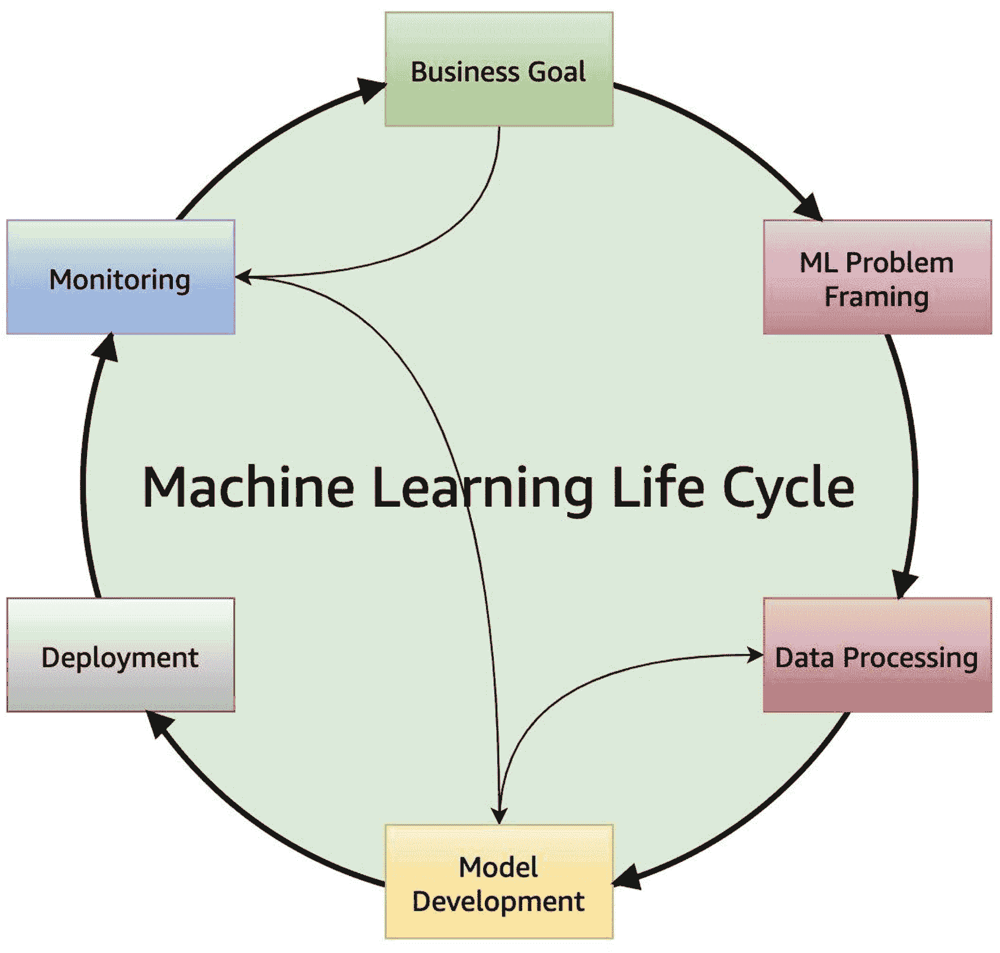
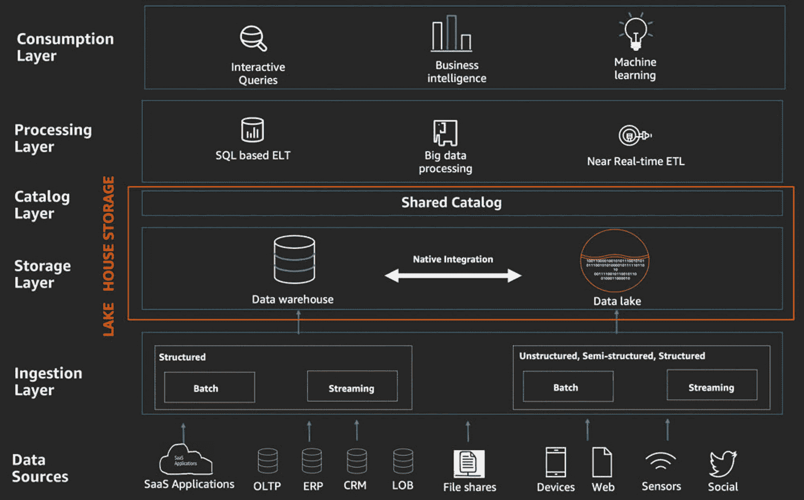
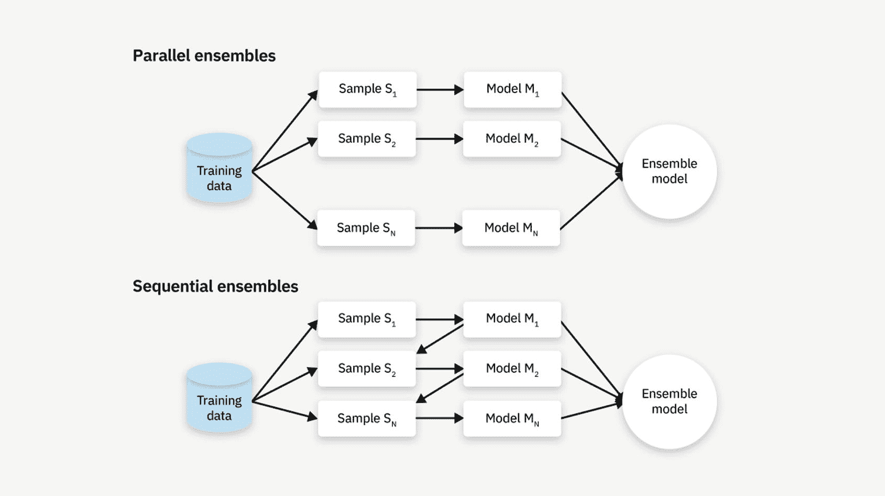
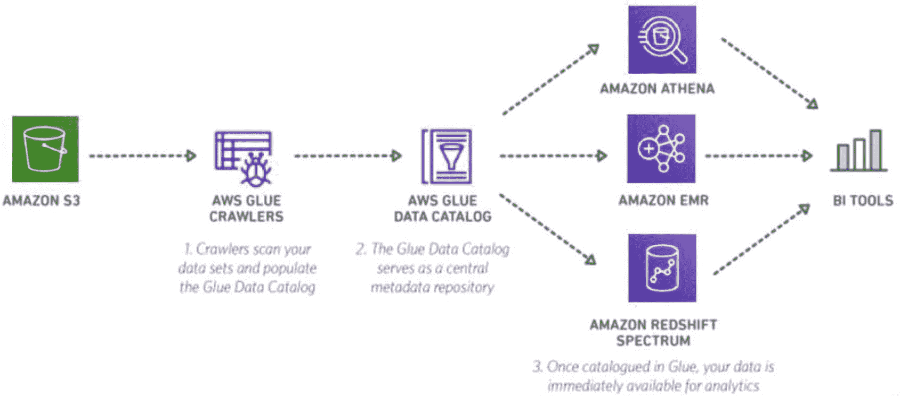
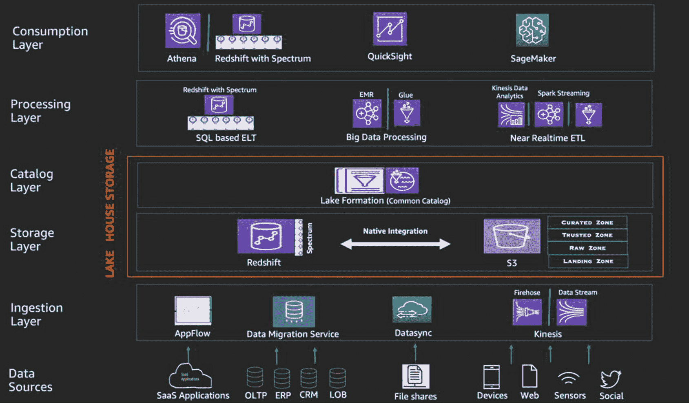
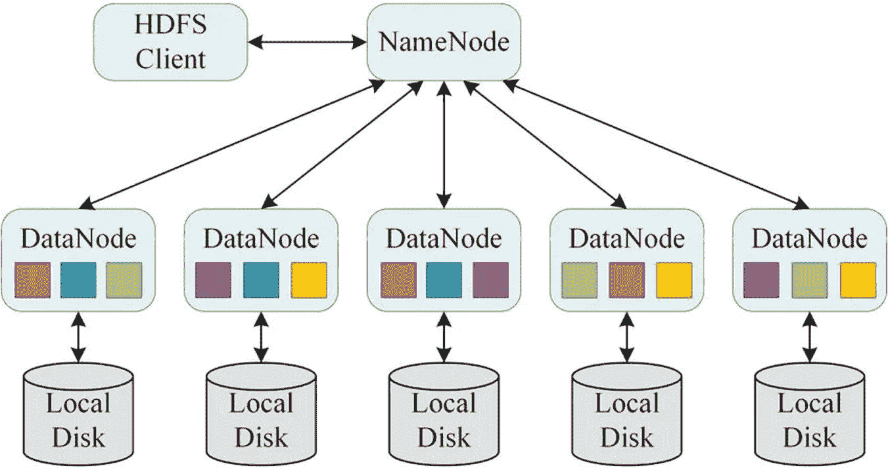
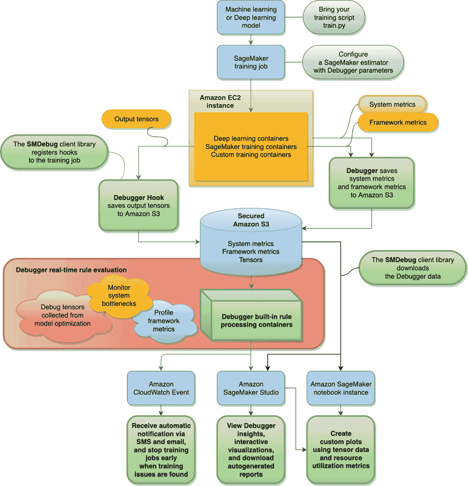
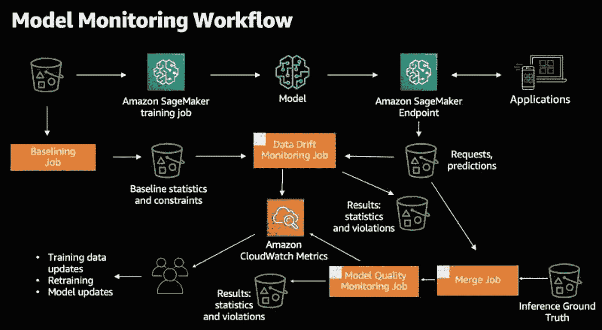

# 6. MLOps 中的性能效率

性能效率是任何架构良好的机器学习运维（MLOps）框架的关键方面。它是 AWS Well-Architected Framework 的基础支柱之一，强调了有效利用计算资源以满足不断变化的需求的重要性。这一原则不仅对于管理当前需求至关重要，对于适应未来的技术进步也同样重要。

性能效率定义为最优地使用计算资源以满足系统需求，确保在需求波动和新技术出现时这些资源得到有效利用。实现性能效率的重点领域包括选择合适的资源、持续审查和监控系统性能，以及做出明智的权衡以平衡性能的各个方面。

在 MLOps 的背景下，性能效率至关重要，原因如下。首先，它确保机器学习模型和管道平稳可靠地运行，提供一致且准确的结果。其次，高效的资源利用有助于降低运营成本，这对于 ML 项目的可扩展性和可持续性至关重要。最后，保持高性能效率对于提供实时预测和洞察至关重要，这可以显著增强决策过程和整体业务价值。

为了有效衡量和管理 MLOps 中的性能效率，跟踪关键性能指标（KPI）非常重要。这些指标提供了对系统性能各个方面的洞察，并有助于确定需要改进的领域。主要指标包括：

*   **吞吐量：** 衡量系统在给定时间内处理的数据量，表明系统处理大量数据的能力。
*   **延迟：** 衡量处理单个数据点或请求所需的时间，突出系统的响应能力。
*   **资源利用率：** 跟踪计算资源（如 `CPU`、`GPU` 和内存）的使用情况，确保资源得到最优利用，避免浪费。
*   **可扩展性：** 评估系统根据需求变化进行扩展或缩减的能力，确保在不同工作负载下性能一致。

本章的目标是提供一份关于提高 MLOps 性能效率的全面指南。它将探讨选择和管理资源的最佳实践、持续监控和性能审查的技术，以及进行有效权衡以平衡性能与其他运营需求的策略。通过本章的学习，读者将全面了解如何增强其 MLOps 工作流的性能效率，确保机器学习运维的稳健性、成本效益和可扩展性。

## 理解 ML 生命周期的性能效率驱动因素

ML 生命周期是一个循环迭代过程，包含在开发 ML 工作负载时在各个定义阶段使用的指令和最佳实践（见图 6-1）。它包括以下阶段：

**图 6-1**

机器学习生命周期 来源：[*https://docs.aws.amazon.com/wellarchitected/latest/machine-learning-lens/well-architected-machine-learning-lifecycle.html*](https://docs.aws.amazon.com/wellarchitected/latest/machine-learning-lens/well-architected-machine-learning-lifecycle.html)

*   业务目标识别
*   ML 问题定义
*   数据处理（数据收集、数据预处理、特征工程）
*   模型开发（训练、调优、评估）
*   模型部署（推理、预测）
*   模型监控

ML 生命周期的每个阶段都有实施最佳实践以优化性能的潜力。

### 定义业务目标与构建机器学习问题

识别业务目标是机器学习生命周期中最关键的阶段。组织必须清晰理解其旨在解决的问题以及期望获得的业务价值。根据具体目标和成功标准来衡量这一价值至关重要。由于技术不断演进的特性，这一步对于机器学习解决方案而言尤其具有挑战性。

在定义成功标准后，需评估组织实现这些目标的能力。目标应切实可行，并为投入生产铺平道路。从一开始就让所有相关利益方参与进来，对于使他们与目标以及该计划产生的任何新业务流程保持一致至关重要。首先评估机器学习是否是实现业务目标的正确方法。考虑所有可用选项，评估每种方案的准确性、成本和可扩展性。要使基于机器学习的解决方案有效，请确保拥有充足、高质量的训练数据。彻底评估数据源，以确认其相关性和可访问性。

#### 来自业务利益相关方的指导

让业务利益相关方参与进来，对于捕获与业务用例直接相关的关键绩效指标（`KPI`）至关重要。通过整合他们的见解，可以确保这些 KPI 与整体业务价值紧密相连，从而为可接受的模型性能提供清晰指导。必须确定这些 KPI 中可接受的最低准确度和最大允许误差。这种方法有助于管理模型结果的变异性，确保机器学习解决方案与业务目标保持一致并有效支持业务目标。

#### 量化业务价值

识别业务目标是机器学习生命周期中最关键的阶段。组织必须清晰理解其旨在解决的问题以及期望获得的业务价值。根据具体目标和成功标准来衡量这一价值至关重要。由于技术不断演进的特性，这一步对于机器学习解决方案而言尤其具有挑战性。请遵循以下最佳实践：

1.  定义成功标准，并评估组织实现这些目标的能力。目标应切实可行，并为投入生产铺平道路。从一开始就让所有相关利益方参与进来，对于使他们与目标以及该计划产生的任何新业务流程保持一致至关重要。
2.  考虑评估机器学习是否是实现业务目标的正确方法。考虑所有可用选项，评估每种方案的准确性、成本和可扩展性。要使基于机器学习的解决方案有效，请确保拥有充足、高质量的训练数据。彻底评估数据源，以确认其相关性和可访问性。

#### 将机器学习问题与业务挑战对齐

组织必须清晰理解其旨在解决的问题以及期望获得的业务价值。根据具体目标和成功标准来衡量这一价值至关重要。在定义成功标准后，需评估组织实现这些目标的能力。目标应切实可行，并为投入生产铺平道路。从一开始就让所有相关利益方参与进来，对于使他们与目标以及该计划产生的任何新业务流程保持一致至关重要。

首先评估机器学习是否是实现业务目标的正确方法。考虑所有可用选项，评估每种方案的准确性、成本和可扩展性。要使基于机器学习的解决方案有效，请确保拥有充足、高质量的训练数据。彻底评估数据源，以确认其相关性和可访问性。

为了有效构建机器学习问题，需清晰定义输入、期望输出以及要优化的关键性能指标。通过使用能够反映业务对误差容忍度的指标，确保模型性能符合业务预期。开发针对特定业务目标定制的自定义指标，并利用精确率、召回率、准确率、`F1` 分数、`RMSE` 和 `MAPE` 等标准指标，全面评估和验证模型性能。

### 数据处理

在机器学习运维（MLOps）不断发展的格局中，数据处理的效率至关重要。现代数据架构旨在通过无缝集成各种数据存储和处理技术，来应对数据的指数级增长。这些架构支持数据在数据湖和专用数据存储（如数据仓库、关系型和非关系型数据库以及大数据处理平台）之间灵活流动。

#### 适用于 MLOps 的现代数据架构

现代数据架构是 MLOps 中有效数据处理的支柱。它提供了一个灵活且可扩展的环境，用于数据的摄取、存储、处理和分析。该架构的关键组件包括以下内容。

##### 集中式数据湖

数据湖作为一个集中式存储库，能够存储海量的结构化、半结构化和非结构化数据。它提供了一个统一的平台，用于跨不同数据结构运行分析和机器学习工作流，使组织能够高效地从分散的数据源中提取有价值的见解。数据湖的灵活性对于 MLOps 至关重要，因为它支持收集和处理模型训练与评估所需的各种数据类型。

图 6-2 展示了一个包含五个逻辑层的湖仓一体架构示例，其中每一层都由多个针对特定需求构建的专用组件组成。

**图 6-2**

数据湖仓一体架构 来源：[`https://aws.amazon.com/blogs/big-data/build-a-lake-house-architecture-on-aws/`](https://aws.amazon.com/blogs/big-data/build-a-lake-house-architecture-on-aws/)

*   **数据源层：** 该层负责从广泛的数据源收集数据，包括结构化数据（例如，ERP、CRM 应用程序）和非结构化数据（例如，Web 应用、物联网设备、社交媒体）。这些数据源根据应用的性质，提供连续的数据流或批量数据。
*   **数据摄取层：** 摄取层管理数据从各种源流入湖仓一体存储的过程。它支持批量处理和实时流处理，确保数据被高效地摄取到系统中以供进一步处理。能够通过多种协议连接到各种数据源，是维持持续可靠数据流的关键。
*   **数据存储层：** 作为湖仓一体架构的核心，存储层将数据湖与数据仓库集成在一起，能够存储结构化、半结构化和非结构化数据。该存储成本效益高且可扩展，可处理从原始数据到经过处理的可信数据集的所有内容。它允许根据数据可供消费的准备程度，将数据组织到不同区域，例如原始数据、可信数据和精选数据。
*   **数据处理层：** 该层通过验证、标准化、转换和丰富化，将原始数据转化为可操作的见解。它综合利用了 `SQL`、大数据处理和实时 `ETL` 工具。处理层旨在处理多种数据格式，并能有效扩展以满足不同的工作负载需求。
*   **数据消费层：** 最后一层为各种用例（包括商业智能（`BI`）、机器学习（`ML`）和分析）提供对已处理数据的访问。它使组织内的数据访问民主化，允许不同的用户角色与数据交互并从中获取见解。该层支持统一接口，确保无缝访问存储在湖仓一体架构中的数据。

这些层共同构成了一个全面的框架，该框架集成了不同的数据源，高效地处理它们，并使它们可用于广泛的分析应用，从而使组织能够获得有意义的见解并推动业务成果。

#### 专用数据存储

现代数据架构包含了针对特定用例定制的专用存储。例如，`数据仓库`针对大规模查询处理进行了优化，使其成为聚合和分析大型数据集的理想选择。`关系型`和`非关系型数据库`分别满足事务处理和实时处理的高性能需求。在 `MLOps` 的背景下，这些专用数据存储允许快速检索和处理机器学习生命周期不同阶段所需的数据，从数据预处理到实时模型推理。

#### 增强数据移动与集成

`MLOps` 中的高效数据处理需要跨各种存储解决方案和处理引擎实现无缝的数据移动与集成。这包括以下内容：

*   **数据管道：** 自动化数据管道对于在数据湖和专用存储之间移动数据至关重要。这些管道确保在正确的时间为模型训练、验证和推理提供正确的数据，从而减少延迟并提高处理性能。
*   **`ETL` 流程：** 提取、转换、加载 (`ETL`) 流程在为机器学习任务准备数据方面发挥着关键作用。通过优化 `ETL` 流程，组织可以减少清理、转换和加载数据到所需格式所需的时间和资源，确保模型在高质量数据上进行训练。

#### 利用实时分析与处理

实时分析在 `MLOps` 中变得越来越重要，特别是对于需要即时洞察和决策的应用。

*   **流式数据处理：** 流式数据处理技术允许组织在数据被摄取时实时处理数据。这对于实时仪表盘、异常检测和日志分析等应用尤其有用，在这些应用中，及时的数据处理至关重要。
*   **内存计算：** 内存计算解决方案通过将数据存储在内存中而非磁盘上来提高数据处理速度。这减少了数据检索和处理所需的时间，从而在 `MLOps` 中实现更快的模型训练和推理。

#### 探索性数据分析 (`EDA`)

有效的数据处理确保原始数据被转换为模型可以高效用于训练和推理的格式。此过程包括探索性数据分析 (`EDA`)、数据准备和特征工程，每一个都在优化数据处理性能方面发挥着关键作用。

`EDA` 是数据处理的基础步骤，数据科学家在此步骤中探索并理解数据集内的结构、模式和关系。`EDA` 的迭代特性允许创建可重现、可编辑和可共享的数据集。通过利用支持可视化和统计分析的工具，数据团队可以识别关键特征、异常值和相关性，这些信息将为机器学习生命周期的后续阶段提供依据。优化 `EDA` 涉及自动化重复性任务、促进团队协作，并确保见解能够随着项目的进展被轻松共享和重新审视。

#### 数据准备与特征工程

数据准备是为机器学习模型清洗、转换和结构化数据的过程。这一步骤通常涉及处理缺失值、标准化数据以及整合来自多个来源的信息。而特征工程则涉及创建新特征或优化现有特征，以提升模型性能。特征在团队间的可见性和可复用性对于效率至关重要；因此，使用集中式特征存储变得不可或缺。这不仅标准化了特征工程实践，还减少了冗余，并确保了跨模型的一致性。

`特征存储`是专门管理特征从创建到消费整个生命周期的系统。它们使团队能够在不同项目间共享和复用特征，确保最佳实践得以维持，并使模型受益于精心设计的特征。`特征存储`还支持版本控制和追踪，允许团队监控特征如何随时间演变以及它们如何影响模型性能。

为了优化数据处理性能，尽可能自动化数据准备和特征工程任务至关重要。这包括使用分布式计算框架处理大型数据集、采用并行处理加速计算，以及缓存中间结果以避免重复计算。此外，采用读取时模式（`schema-on-read`）方法可以在处理多样化数据格式时提供更大的灵活性，而无需预先定义模式。

#### 优化资源利用

`MLOps` 中高效的数据处理还依赖于优化计算资源的利用。相关策略包括：

*   **自动伸缩：** 为数据处理工作负载实施自动伸缩，可确保根据需求动态分配计算资源。这有助于通过按需扩展或缩减资源来优化成本和性能。
*   **无服务器架构：** 无服务器计算为管理数据处理任务提供了一种灵活且经济高效的方法。通过利用无服务器架构，组织可以消除手动基础设施管理的需求，使数据处理工作负载能够自动伸缩。

#### 监控与持续改进

最后，持续监控数据处理工作流对于维持和提升性能至关重要。以下技术非常有益：

*   **性能指标：** 定期监控关键性能指标，如数据吞吐量、处理延迟和资源利用率。这有助于及早发现瓶颈和性能问题。
*   **反馈循环：** 实施反馈循环以捕获数据处理性能的洞察，并利用它们来优化和改进工作流。这种迭代方法可确保数据处理在数据量增长和新技术涌现时保持高效。

提升 `MLOps` 中的数据处理性能是一项多方面的挑战，需要从数据架构、资源管理和实时分析等方面采取战略性方法。通过采用现代数据架构并利用先进技术，组织可以提升其 `MLOps` 管道的效率和可扩展性，最终为其机器学习项目带来更好的成果。

### 模型开发

在机器学习模型开发中优化性能对于确保模型在实际应用中既高效又有效至关重要。这涉及在模型训练、调优和评估过程中精心管理计算资源，以满足特定的性能要求。最佳实践包括选择合适的模型架构、微调超参数，以及使用早停或正则化等技术来防止过拟合。随着技术的演进和需求的变化，保持这种效率是关键，需要持续监控和调整以优化资源利用，同时不牺牲模型准确性。

#### 实例类型选择

用于训练和推理的实例类型会显著影响模型性能。内存密集型模型需要具有高内存容量的实例类型，而计算密集型模型则受益于具有高处理能力的实例，例如 `GPU`。对于实时推理，低延迟和高吞吐量的实例类型至关重要。通常，由于 `GPU` 具有并行处理能力，它们更受青睐用于训练深度学习模型，而 `CPU` 通常足以胜任推理任务，尤其是在模型复杂度较低时。

#### 模型复杂度与推理速度

模型的复杂度直接影响其推理速度。可以使用高计算实例来加速推理，但通过剪枝或简化架构来优化模型复杂度，也可以在不依赖高端硬件的情况下实现更快的推理。平衡模型准确性与计算效率是实现最佳性能的关键。

#### 基准测试与性能评估

基准测试是评估和比较不同机器学习工作负载的关键步骤。它涉及测试各种算法、特征和架构，以找出能提供最佳性能的组合。在基准测试过程中，使用广泛的数据集来提升模型的成功指标至关重要，以确保模型在不同场景下都能表现良好。

#### 特征工程

特征工程是从数据中提取重要信号的过程，这可以显著提升模型性能。通过精心选择和转换特征，模型可以更好地理解底层数据模式，从而提高准确性和效率。

#### 算法选择与超参数调优

选择适合数据特性的正确算法至关重要。有时，使用替代算法或通过集成方法组合多个模型可以带来更好的结果。此外，超参数调优对于校准模型以适应数据、优化其性能也是必要的。

#### 使用集成学习增强模型训练

集成学习是一种强大的机器学习技术，它通过组合多个模型来提高整体预测精度。通过聚合不同的学习器（例如回归模型或神经网络），集成学习利用了每个模型的优势，与依赖单一模型相比，能实现更好的泛化能力并降低错误率。这种方法基于一个原则：一组多样化的模型可以通过相互弥补弱点，从而超越单个模型的表现。

##### 偏差-方差权衡

偏差-方差权衡是机器学习中的一个关键挑战。偏差指的是由于模型过于简单而无法捕捉底层数据模式所导致的误差，这会导致模型在训练数据上表现不佳。另一方面，方差指的是由于模型过于复杂而导致的误差，这会使模型过度拟合训练数据，并在未见过的全新数据上表现糟糕。集成学习通过组合具有不同偏差和方差水平的模型，有助于平衡这种权衡，从而得到一个能更好地泛化到新数据的模型。

##### 多模型的优势

每个机器学习算法都会受到训练数据和超参数等因素的影响，这可能导致产生性能各异的模型。通过组合这些模型，集成学习在保留每个单独模型独特优势的同时，降低了整体错误率。研究表明，集成中模型之间的多样性越大，预测就越准确，这使得集成学习成为解决过拟合等问题而不牺牲模型偏差的有效策略。

##### 集成中的多样性

集成学习的成功很大程度上取决于所用模型的多样性。多样化的模型不太可能犯相同的错误，这使得集成能够覆盖更广泛的数据模式。这种多样性在高维数据场景中尤其有用，因为传统的降维技术可能不足以应对。因此，集成学习可以被视为处理复杂数据集的一种替代方法，确保模型性能的稳健和可靠。

在文献中，机器学习中的集成学习方法通常分为两大类：并行方法和序列方法（图 6-3）。

图 6-3

集成学习技术来源：[`www.ibm.com/topics/ensemble-learning`](https://www.ibm.com/topics/ensemble-learning)

*   **并行方法**：这种方法独立地训练每个基学习器。顾名思义，并行集成同时训练这些基学习器，在训练过程中它们之间没有任何交互。
*   **序列方法**：在这种方法中，训练一个新的基学习器来纠正先前训练模型所犯的错误。序列方法以逐步的方式一个接一个地构建基模型。

总之，集成学习是机器学习中一项有价值的技术，它通过组合多个模型来提高模型的准确性和稳健性。它能够平衡偏差-方差权衡并利用多样化模型的优势，使其成为在各种应用中增强模型训练和部署的重要工具。

### 模型部署

部署机器学习模型可能是一项艰巨的任务，即使对于经验丰富的工程师来说也是如此。从选择合适的部署平台到确保模型针对生产环境进行了优化，有许多挑战需要克服。随着人工智能模型从受控环境转向大规模部署，模型稳健性和推理速度慢等问题开始显现。弥合这些差距对于人工智能模型的有效部署至关重要。

以下是一些优化机器学习模型以进行部署的有效策略。

## 优化神经网络以进行部署

优化神经网络以进行部署涉及几个关键步骤，以确保模型在真实环境中高效运行。此过程包括模型量化等技术，该技术降低模型权重和激活值的精度，以减少内存使用和计算需求；以及模型剪枝，该技术移除不必要的参数以提升推理速度。此外，还可以使用知识蒸馏将知识从大型复杂模型迁移到小型模型，在降低资源需求的同时保持性能。这些优化对于在计算能力有限的设备上或需要低延迟响应的场景中部署神经网络至关重要。

*   使用知识蒸馏进行内存管理

    部署深度学习模型的主要挑战之一是管理内存。知识蒸馏是一种将知识从较大的复杂模型（教师模型）迁移到较小、更高效的模型（学生模型）的技术。这种方法在保持性能的同时减少了模型的内存占用，使其适合在性能较弱的硬件上部署。

*   模型量化以实现更快的推理

    模型量化降低了模型参数的精度，从而在不显著损失精度的情况下实现更快的推理时间。可以采用训练后量化（PTQ）和量化感知训练（QAT）等技术来优化模型，使其适用于实时应用。

*   层融合以提高效率

    层融合是另一种提高模型效率的方法。通过识别并合并神经网络中相似的层，可以减少模型的计算负载，从而实现更快的推理时间。

## 部署策略

高效部署机器学习模型对于其成功集成到实际应用中至关重要。所选的部署策略会显著影响模型在不同环境中的性能、可扩展性和可访问性。本节探讨了优化模型部署的关键策略，包括使用`ONNX`实现跨框架兼容性、根据特定应用需求选择合适的部署模式，以及实施模型剪枝以提高效率（尤其是在资源受限的设备上）。理解这些策略对于确保稳健高效的模型部署至关重要。

*   `ONNX`实现跨框架兼容性：

    开放神经网络交换（`ONNX`）框架旨在转换不同机器学习库之间的模型，促进跨多种平台的无缝部署。这种跨框架兼容性对于确保模型能够在从云端到边缘的不同环境中有效运行至关重要。

*   模型部署模式：

    选择合适的部署策略取决于应用的需求。实时应用受益于单样本推理，它能提供即时响应。另一方面，批处理更适合按计划间隔分析大型数据集。对于要求最低延迟的应用，边缘部署是首选，尽管它可能需要简化模型以适应硬件限制。

*   模型剪枝以提高效率：

    模型剪枝是一种通过消除神经网络中不必要的参数来提高部署效率的技术。这种模型大小的缩减带来了更快的推理时间和更低的计算需求，使其特别适用于在资源有限的设备上部署模型。剪枝是在计算能力和内存受限的环境（如移动设备或物联网设备）中优化模型的关键步骤。

## 选择合适的部署平台

选择合适的部署平台对于满足模型的特定需求至关重要。像`AWS`这样的流行平台提供了针对不同需求定制的各种工具和服务。在选择平台时，需要考虑预算、模型复杂度和部署环境等因素。评估每个平台提供的控制级别，并在成本考量之间取得平衡，以找到最适合您项目的方案。

## 优化模型性能以进行部署

选定部署平台后，下一步关键步骤是优化模型以投入生产。这包括简化模型架构以减少资源消耗并提高部署效率。通过对输入数据进行预处理来确保数据一致性至关重要，这有助于维持高质量的模型性能。此外，微调超参数可以进一步优化模型性能，同时最大限度地缩短部署时间。最后，在类似生产的环境中测试和验证模型对于预先解决任何潜在问题至关重要。

为了实现顺畅高效的模型部署，应遵循一些最佳实践。将模型及其依赖项容器化可确保在不同环境中的一致性。实施版本控制可以跟踪代码和模型的更改，并在必要时轻松回滚。此外，强大的安全措施（包括身份验证和加密）对于保护模型和数据至关重要。持续监控模型在生产环境中的性能有助于识别和解决问题，确保模型随着时间的推移保持可靠和准确。

## 部署后的持续优化

机器学习模型部署后，确保其持续的关联性和准确性至关重要，因为数据模式会随时间变化。对这些模型进行持续优化对于维持其在实际应用中的有效性至关重要。在这一持续过程中，两个关键策略是在线深度学习和联邦学习。

*   用于自适应的在线深度学习：在动态环境中，数据会不断演变，模型必须适应这些变化。在线深度学习通过使模型能够持续从新数据中学习来促进这一点。与传统的批量学习（模型定期更新）不同，在线深度学习在新数据到达时增量式地更新模型。这种持续学习方法确保模型保持准确并与当前数据模式保持一致，从而降低模型随时间退化的风险。

*   用于隐私保护优化的联邦学习：联邦学习为在数据隐私成为问题的场景中优化模型提供了解决方案，特别是在处理跨边缘设备的敏感或分布式数据时。在联邦学习中，模型在边缘设备上进行本地训练，只有模型更新被共享到中央服务器。这种方法允许模型在各种设备上进行优化，而无需传输原始数据，从而保护了隐私。联邦学习在移动设备等数据安全和隐私至关重要的应用中尤其有益。通过采用这种方法，组织可以确保其模型保持最新和相关性，同时解决隐私问题。

## 模型监控

模型监控系统旨在跟踪和分析数据，并将其与原始训练集进行比较，以识别数据质量、模型性能、偏差漂移和特征归因漂移等问题。它利用可解释性来评估模型预测的可靠性。当系统检测到显著的数据或概念漂移（表明数据分布或目标属性发生变化）时，会触发警报。如果警报显示违规，系统会自动启动模型更新流程，包括数据准备、持续集成和用于重新训练的特征管道。以下是可能有助于模型监控性能优化的一些方面。

### 评估模型可解释性

在模型监控阶段，性能效率的一个关键方面是确保模型满足业务和合规性要求所规定的可解释性需求。根据应用场景的不同，模型推理可能需要透明且易于解释。尽早评估这些需求有助于选择合适的模型类型或评估指标，以平衡可解释性与复杂性，确保模型预测背后的原因清晰明了。

### 监控并适应数据漂移

数据漂移（即输入数据的统计属性随时间变化）会显著影响模型性能，导致预测不准确。一个稳健的监控策略对于检测数据漂移至关重要。通过持续评估模型输出并将其与基线指标进行比较，团队可以识别数据漂移何时发生。实施自适应重新训练策略（即在检测到漂移时定期更新或重新训练模型）可确保模型保持准确和相关。

### 持续模型质量监控

由于数据质量下降、模型偏差演变或可解释性需求变化等各种因素，模型性能可能会随时间退化。持续监控对于维持模型质量是必要的。这包括设置实时警报，以便在性能显著下降时通知团队，从而允许快速干预。此外，了解重新训练模型的正确时机和频率至关重要。由特定阈值（如方差或数据可用性）触发的自动重新训练可以减轻性能退化。

### 集成人在回路监控

尽管自动化取得了进步，但人工监督在确保模型性能效率方面仍然很有价值。人在回路（`HITL`）监控涉及将人工标记的数据与模型预测进行比较，以准确估计性能退化。这种方法不仅验证了模型的决策，还识别了模型可能需要重新训练的领域。通过将`HITL`监控集成到工作流程中，团队可以保持高模型准确性，同时确保自动化决策符合人类期望。

### 自动化模型重新训练

自动化在长期维持模型性能方面起着关键作用。通过建立一个自动化模型重新训练的框架，团队可以高效地处理数据和概念漂移等问题。此过程涉及根据预定义的性能指标定期分析模型预测，并在模型方差超过可接受阈值时自动触发重新训练。此外，自动化数据探索和特征工程可确保将新特征纳入模型训练过程，从而进一步优化性能。

### 维护数据和模型完整性

确保数据和模型预测的完整性对于维持性能效率至关重要。应定期进行分析以评估输入数据的质量和模型预测的准确性。通过实施自动化检查和警报，可以快速识别和纠正任何偏离预期性能的情况，从而最大限度地降低性能退化的风险。这种主动方法有助于在整个生命周期内维护模型的可靠性和准确性。

## 使用 `AWS` 实现 `MLOps` 性能效率

在`AWS`上实现机器学习效率需要采用战略性方法来优化云架构的各个方面。通过精心选择正确的架构、计算资源和数据管理实践，组织可以提升其机器学习工作负载的性能和可扩展性。`AWS`提供了一套工具和服务来促进这一过程，从而实现持续监控和优化。定期审查架构决策并利用缓存、压缩和网络优化等高级功能，对于在云中维持和提升机器学习模型性能至关重要。

对于`MLOps`，`AWS`提供了一套全面的工具，特别是通过`Amazon SageMaker`，来支持从数据准备到模型部署的整个机器学习生命周期。通过利用`SageMaker`的自动化管道、实验跟踪和模型注册功能，企业可以提升其`MLOps`成熟度，确保模型不仅训练有素，而且能在完全托管的基础设施内高效部署和维护。

让我们深入探讨机器学习模型开发生命周期的每个阶段，并讨论优化性能的最佳实践。

### 定义业务目标与构建机器学习问题

使用预构建的 AWS 机器学习服务可以通过利用专为比定制解决方案更有效地处理特定任务而设计的预优化组件，显著提升 MLOps 中的性能效率。通过集成像 `Amazon SageMaker` 提供的托管 AI 服务，组织可以减轻与训练和维护机器学习模型相关的大部分复杂性。这使得团队能够专注于为其特定用例微调自定义模型，同时依赖 AWS 提供的强大基础设施来管理数据预处理、模型训练和部署等常规任务。

此外，像 `SageMaker JumpStart` 这样的 AWS 服务提供了对预训练模型和算法的访问，这可以加速开发过程并缩短上市时间。这些预构建组件针对各种问题类型进行了优化，并且可以轻松集成到现有工作流程中。此外，通过利用 `AWS Marketplace` 中的资源，企业可以访问补充其自定义机器学习模型的第三方工具和服务，确保在效率和解决方案特异性之间取得平衡。这种对 AWS 机器学习服务的战略性使用不仅提高了性能，还简化了机器学习工作负载的整体管理。

## 数据处理

在 MLOps 中，AWS 上的数据处理对于构建高效的机器学习工作流程至关重要。数据（包括输入和输出对）在定义系统目标、训练模型以及监控数据漂移方面的性能中起着至关重要的作用。AWS 服务提供了用于数据处理的全面工具，包括收集、预处理和特征工程，确保训练期间应用的相同转换在推理期间也能一致地应用。

AWS 上的数据处理涉及几个关键步骤，从数据收集和准备开始。数据准备（包括预处理和特征工程）对于将原始数据转换为适合模型训练的格式至关重要。AWS 提供了用于交互式分析和可视化的高级数据整理工具，这些工具对于探索性数据分析 (EDA) 特别有用。EDA 允许数据科学家理解数据集、执行完整性检查并验证数据质量，确保模型建立在可靠的数据之上。这种强大的数据处理管道是维持模型性能和准确性的关键，尤其是在数据分布随时间变化的情况下。

正如我们在前面章节中讨论的，为了获得性能效率，必须制定一个策略，通过利用现代数据架构从快速扩展的数据集中获取有价值的见解。这种方法促进了数据在集中式数据湖和专用数据存储（包括数据仓库、关系型和非关系型数据库，以及用于机器学习、大数据处理和分析的平台）之间的无缝移动。数据湖作为一个统一的存储库，用于存储从各种来源收集的不同数据结构，从而实现全面的分析。此架构中的专用分析服务为实时仪表盘和日志分析等专门任务提供了必要的速度和效率。

### 利用 AWS 全面的分析生态系统加速 MLOps

AWS 提供了一套全面的分析服务，旨在从您的数据中提取最大价值。这些服务使组织能够通过直接在数据湖上利用 AI 和 ML 能力来更快地创新。借助使用 `Amazon EMR`、`Amazon Athena` 和 `AWS Glue` 等工具运行复杂分析和机器学习任务的能力，组织可以执行查询、处理非结构化数据并构建预测模型，而无需将数据移动到单独的系统。此外，`AWS Glue` 的集中式数据目录通过允许用户高效地爬取、编目、索引和保护数据，简化了数据管理。这种集中式的数据治理和安全方法确保了组织内不同的用户（如数据科学家、数据开发人员和业务分析师）能够放心地访问和分析数据，从而推动更快的创新和改善客户体验。

### AWS 上的数据湖

AWS 上的数据湖，特别是那些构建在 `Amazon S3` 之上的数据湖，为打破数据孤岛和最大化 MLOps 中的端到端洞察提供了坚实的基础。`Amazon S3` 无与伦比的持久性、可用性、可扩展性和安全性使其成为创建能够处理来自各种来源的海量数据集的数据湖的最佳选择。这些数据湖支持广泛的分析服务，包括大数据处理、机器学习和实时分析，并且都具有成本效益的规模。`AWS Lake Formation` 简化了安全数据湖的创建和管理，使组织能够在数天内（而非数月）构建它们。通过与 `AWS Glue` 集成，实现了数据湖与专用分析服务之间的无缝数据移动，确保所有数据（无论其来源或格式如何）都随时可用于分析。

图 6-4 展示了一个使用 `AWS Glue Data Catalog` 查询 `Amazon S3` 数据湖的示例架构。`AWS Glue` 爬网程序会扫描您的数据湖，并使 `Glue Data Catalog` 与底层数据保持同步，从而允许通过 `Amazon Athena` 或 `Amazon Redshift Spectrum` 进行直接查询。此外，`AWS Glue Data Catalog` 可以作为 `Amazon EMR` 上大数据应用程序的外部 Apache Hive Metastore。

图 6-4

使用 `AWS Glue Data Catalog` 查询 `Amazon S3` 数据湖来源：[`docs.aws.amazon.com/whitepapers/latest/big-data-analytics-options/example-1-queries-against-an-amazon-s3-data-lake.html`](https://docs.aws.amazon.com/whitepapers/latest/big-data-analytics-options/example-1-queries-against-an-amazon-s3-data-lake.html)

### AWS 上的湖仓一体架构

此前，我们讨论了湖仓一体架构的五个逻辑层。图 6-5 展示了 AWS 上的湖仓一体参考架构。

图 6-5

AWS 上湖仓一体架构的五层来源：[`aws.amazon.com/blogs/big-data/build-a-lake-house-architecture-on-aws/`](https://aws.amazon.com/blogs/big-data/build-a-lake-house-architecture-on-aws/)

1.  `数据摄取层`：`数据摄取层`是所有数据进入 AWS 湖仓一体架构的入口点。该层集成了多种 AWS 服务，如 AWS 数据迁移服务 (`DMS`) 和 `Amazon Kinesis Data Firehose`，能够将来自数据库、SaaS 应用程序和流数据等多种来源的数据无缝传输。该层高效管理数据摄取至 `Amazon S3`（用于数据湖）和 `Amazon Redshift`（用于数据仓库），同时处理批量和实时流数据。

2.  `数据存储层`：该层是湖仓一体架构的支柱，统一了 `Amazon S3` 和 `Amazon Redshift`，用于存储结构化、半结构化和非结构化数据。`Amazon S3` 为海量数据提供可扩展、持久的存储，而 `Amazon Redshift` 则为经过精心整理和符合标准的数据提供高性能存储。数据在 `S3` 数据湖内按不同区域组织——着陆区、原始区、可信区和整理区——确保数据在其整个生命周期中得到妥善管理。

3.  `数据处理层`：`数据处理层`负责转换和准备数据以供分析。AWS 服务如 `Amazon EMR`、`AWS Glue` 和 `Redshift Spectrum` 通过 `SQL` 查询、`Spark` 作业及其他处理框架实现数据处理。该层允许无缝访问存储在湖仓一体中的结构化和非结构化数据，确保数据为下游分析和机器学习任务做好准备。

4.  `数据目录与治理层`：该层管理元数据并确保整个湖仓一体架构中的数据治理。`AWS Glue Data Catalog` 在组织、发现和保护湖仓一体中的数据方面发挥着关键作用。通过维护一个集中的元数据存储库，该层实现了高效的数据发现、模式管理和安全策略执行，为各种分析和机器学习用例提供统一的数据视图。

5.  `数据消费层`：`数据消费层`使数据访问民主化，允许组织内的不同角色利用 AWS 服务进行分析、商业智能和机器学习。该层提供 `Amazon Athena` 和 `Amazon Redshift Spectrum` 等工具用于基于 `SQL` 的查询，`Amazon SageMaker` 用于机器学习，以及其他各种 AWS 服务用于实时仪表盘和高级分析。统一的界面确保湖仓一体内的所有数据都可访问和使用，从而促进数据驱动的决策制定。

### 用于数据处理的 AWS 计算选项

在 AWS 中选择合适的计算资源对于在优化成本的同时实现性能效率至关重要。AWS 提供灵活的计算选项，包括实例、容器和函数，每种都针对不同的性能需求而定制。

*   `实例`：

    AWS 实例是虚拟服务器，提供从通用型到专用配置（如 GPU 和 SSD）的一系列功能。这些实例易于扩展，允许您尝试不同类型和大小以匹配工作负载需求。这些虚拟机的灵活性使其适用于广泛的应用，特别是那些需要特定硬件配置或持续性能的应用。

*   `容器`：

    容器提供了一种轻量级的虚拟化方法，使您能够在隔离的环境中运行应用程序及其依赖项。AWS 通过 `AWS Fargate` 为容器提供无服务器计算，该服务抽象了底层基础设施的管理。对于那些需要更多环境控制权的用户，`Amazon EC2` 可以托管容器化应用程序并提供完全自定义功能。像 `Amazon ECS` 和 `Amazon EKS` 这样的编排平台通过自动化容器化应用程序的部署、扩展和管理，进一步提升了性能。

*   `函数`：

对于高度动态的工作负载，AWS Lambda 允许您在不管理服务器的情况下执行代码。这种无服务器计算选项抽象了整个执行环境，非常适合需要根据需求自动扩展的应用程序。通过利用 Lambda，您可以专注于编写代码，而 AWS 负责处理基础设施，确保事件驱动型应用程序的高效性能。

### 性能优化考量

在优化性能时，将您的计算选择与工作负载的具体需求对齐至关重要。无论您选择实例的可配置性、容器的隔离性，还是函数的简洁性，每个选项都可以进行调整以达到性能目标。此外，AWS 的弹性机制使您能够动态扩展资源，确保您的应用程序即使在需求波动时也能保持高性能。最大化效率的关键在于选择合适的计算资源，根据工作负载进行定制，并有效利用 AWS 强大的扩展功能来满足您的性能需求。

### SageMaker 处理作业

随着各组织应对数据生成的激增，对高效数据处理、分析和可视化的需求变得前所未有的关键。Amazon SageMaker Processing 结合 Apache Spark 的强大功能，为管理和优化大数据工作负载提供了稳健的解决方案。在扩展机器学习工作流以及将数据处理嵌入复杂管道时，这种集成尤其有价值。Amazon SageMaker Processing 简化了在托管式机器学习环境中运行数据处理任务的过程。它允许数据科学家和工程师对大型数据集进行数据预处理、评估模型以及执行其他必要任务，而无需管理底层基础设施。该服务与其它 AWS 服务无缝集成，确保处理任务能够高效地自动化、扩展和监控。

#### 用于分布式处理的 Apache Spark

Apache Spark 是一个开源分布式计算系统，旨在高速高效地处理大规模数据。Spark 既能在独立模式下运行，也能在由 Apache Mesos 或 Hadoop YARN 等工具管理的集群上工作，这使其用途广泛。它与 Java、Scala、Python 和 R 等多种编程语言兼容，并支持批处理和实时数据处理，这使得 Spark 成为任何数据处理架构中的关键组件。

#### 使用 HDFS 进行优化

对于管理大型数据集，Hadoop 分布式文件系统（HDFS）提供了一种容错且可扩展的存储解决方案。在 HDFS 中，数据被分成数据块并分布到集群中的各个节点上，确保处理任务可以并行执行，从而提高效率。该系统的架构包括管理元数据的 NameNode 和处理实际数据块的 DataNode，确保了稳健的数据存储和检索，这对于任何大规模数据处理任务都至关重要。

通过将 Apache Spark 与 SageMaker Processing 集成，组织可以构建可扩展且高效的数据管道。这种组合使他们能够利用分布式计算的能力来处理机器学习工作负载，确保数据处理不仅快速，而且可扩展且具有弹性，从而优化整个数据生命周期的性能（见图 6-6）。

图 6-6

HDFS 架构来源：[https://www.researchgate.net/figure/The-overview-of-the-Hadoop-Distributed-File-System-HDFS_fig4_348387085](https://www.researchgate.net/figure/The-overview-of-the-Hadoop-Distributed-File-System-HDFS_fig4_348387085)

在使用 Apache Spark 运行分布式处理作业时，不仅需要编写高效的代码，还需要选择合适的实例类型并正确调整集群规模。Amazon SageMaker 提供了多种实例类型，按内存、计算、加速和通用需求进行分类。通过查阅官方文档，您可以为工作负载选择最合适的实例。选择实例类型和集群规模后，对于大规模作业还需要进一步优化。SageMaker Processing with Spark 提供了预配置的 Spark 设置，可以根据您的实例配置进行自定义，以获得更好的性能。

### 模型开发

Amazon SageMaker 是提升模型训练性能的强大工具，尤其是在处理大规模机器学习工作负载时。它提供了多种实例类型，包括 GPU 以及 AWS Trainium 和 Inferentia 等专用加速器，这些对于内存密集型或计算密集型任务至关重要。通过根据模型类型和数据速率选择合适的实例类型，SageMaker 有助于实现更快的推理速度和更高效的训练过程。

SageMaker 还通过其 HyperPod 功能支持分布式训练，该功能专为大规模分布式训练（包括基础模型）而设计。此功能允许将模型和数据集自动拆分到多个实例上，从而加速训练过程。此外，SageMaker 可以轻松与 DeepSpeed、Horovod 和 Megatron 等第三方库集成，提供了灵活性和可扩展性。借助自动扩展、实时数据集优化和持续监控，SageMaker 不仅减少了训练的时间和成本，还确保了机器学习模型在生产部署期间的稳健性。

#### 使用 Amazon SageMaker Debugger 优化模型训练

Amazon SageMaker Debugger 是一款强大的工具，旨在通过提供对模型行为的实时洞察，来优化和排查机器学习模型训练中的问题。随着模型日益复杂，拥有数百万甚至数十亿个参数，确保训练过程中的稳定收敛变得至关重要。Debugger 允许您在优化过程中访问和分析模型参数、激活值和梯度，从而简化了这一过程。

Debugger 提供了内置规则，用于检测常见的训练问题，例如过拟合、梯度消失和激活函数饱和。这些规则可以与 Amazon CloudWatch Events 和 AWS Lambda 集成，以自动响应检测到的问题，例如触发重新训练或调整超参数。这种主动方法有助于在问题降低模型性能之前加以预防，从而确保更可靠、更高效的训练。

SageMaker Debugger 的关键特性之一是能够注册钩子（hooks），在训练期间提取模型输出张量并将其保存到 Amazon S3。可以实时分析这些张量以识别不收敛的问题，使您能够迅速采取纠正措施。此外，SageMaker Debugger 支持多种流行的机器学习框架，包括 Apache MXNet、PyTorch、TensorFlow 和 XGBoost，使其成为优化各种模型的通用工具。

通过可视化收集到的指标和张量，SageMaker Debugger 不仅有助于识别训练异常的根因，还能提供对模型训练动态的全面理解。这一能力对于优化模型、提升其性能，并最终在复杂的训练场景中实现更快、更稳定的收敛至关重要。

要将 SageMaker Debugger 集成到您的工作流程中，请遵循以下步骤：

1.  如有必要，使用 `sagemaker-debugger` Python SDK 更新您的训练脚本。
2.  使用 SageMaker Estimator API、`CreateTrainingJob` 请求（通过 Boto3 或 CLI）或带有 Debugger 的自定义训练容器来配置 SageMaker 训练任务。
3.  启动训练任务，并使用 Debugger 的内置规则进行实时监控。
4.  设置训练问题的告警，并使用内置操作或通过 CloudWatch Events 和 AWS Lambda 的自定义设置，及时采取行动。
5.  使用 TensorBoard 等工具对任何检测到的问题进行深入分析。
6.  解决问题并迭代您的模型，直到达到预期的性能。

SageMaker Debugger 开发人员指南提供了这些步骤的详细演练。

SageMaker Debugger 包含性能分析功能，可帮助识别计算效率低下的问题，例如系统瓶颈和资源利用不足，从而优化大规模部署中的硬件使用。虽然性能分析方面侧重于性能优化，但 Debugger 的核心功能通过分析阻碍训练收敛的问题（例如，通过梯度下降等优化算法最小化损失函数时出现的问题）来解决模型优化问题。SageMaker Debugger 的架构突出了它为分析和优化训练任务而管理的关键组件。参见图 6-7。

图 6-7

SageMaker Debugger 架构来源：[https://docs.aws.amazon.com/sagemaker/latest/dg/debugger-how-it-works.html](https://docs.aws.amazon.com/sagemaker/latest/dg/debugger-how-it-works.html)

#### 分布式训练提升性能效率

Amazon SageMaker 的分布式训练能力通过利用数据并行和模型并行策略，显著提升了模型训练性能。它结合了软件和硬件技术来改善 GPU 间和节点间的通信。它通过内置选项扩展了 SageMaker 的训练能力，这些选项只需对训练脚本进行少量代码更改。此外，SageMaker 支持跨多个实例进行分布式训练，确保训练复杂模型时的可扩展性。

在分布式训练设置中使用多个实例时，优化这些节点之间的通信和数据访问方式至关重要。实例间高效的网络连接和无缝的数据传输是最大化计算资源利用率和加速训练的关键。关键因素包括确保实例、VPC 子网和数据存储（例如 Amazon S3 或 Amazon FSx for Lustre）都配置在同一个 AWS 区域和可用区中。这种配置可以最大限度地减少通信开销，从而实现更快、更高效的训练性能。

对于分布式训练，虽然理论上可以使用各种实例，但在某些情况下，例如训练大型语言模型（LLM）和扩散模型等大型模型时，专用实例能带来显著优势。SageMaker 建议使用支持 EFA 的 GPU 实例，特别是配备 NVIDIA A100 GPU 的 P4d 和 P4de 实例。这些实例专为实现最佳性能而设计，提供高吞吐量、低延迟存储和更快的节点内通信。此外，建议使用 Amazon FSx for Lustre 来高效存储和检索训练数据集及模型检查点。

Amazon SageMaker 提供两种关键的分布式训练策略：SageMaker 分布式数据并行（SDP）和 SageMaker 分布式模型并行（SMP）。

*   `SageMaker 分布式数据并行（SDP）`：SDP 通过针对 AWS 基础设施和 EC2 实例拓扑优化任务，以最少的代码更改实现近乎线性的扩展，从而增强 SageMaker 的训练能力。它使用自定义的 AllReduce 算法高效地管理跨节点的梯度更新，使其成为通过跨多个实例和 GPU 扩展来缩短大型数据集训练时间的理想选择。

*   `SageMaker 分布式模型并行（SMP）`：SMP 通过自动将模型分区到多个 GPU 和实例上，解决了受 GPU 内存限制而训练大型模型的挑战。这种方法通过高效协调跨分布式资源的训练，允许创建更大、更准确的模型。SMP 与 TensorFlow 和 PyTorch 工作负载无缝集成，只需对现有代码进行最少的调整，并可通过 SageMaker SDK 访问。

这些分布式策略显著提升了训练性能，使得在 AWS 上进行更快、可扩展且高效的深度学习模型训练成为可能。

## 探索性能改进的替代方案

基准测试对于通过评估和比较各种算法、特征和架构选择来提升机器学习模型性能至关重要。通过基准测试，您可以确定能为特定工作负载提供最佳性能的最优组合。此过程涉及多种策略：增加数据量以改善模型指标、应用特征工程以捕获关键数据信号、尝试不同算法、利用集成方法以及调整超参数。

为了有效实施这些策略，您可以使用 Amazon SageMaker Experiments 来跟踪和组织您的实验。从使用简单特征和算法的基本模型开始，建立基线。逐步引入更复杂的算法和特征，测试它们对性能的影响。考虑使用集成方法以获得更高精度，但需权衡效率方面的取舍。最后，使用 Amazon SageMaker 的超参数优化功能自动化超参数调整过程，为您的模型找到最佳设置，确保最佳性能。

## 执行性能权衡分析

在机器学习中，准确性与模型复杂度之间的平衡至关重要。更简单的模型可解释性更强，但可能会牺牲部分准确性。另一方面，像深度学习这样的复杂模型能提供卓越的准确性，但代价是可解释性降低。评估这种权衡有助于选择既符合性能目标又满足业务需求的模型。

## 偏差与公平性权衡

管理机器学习模型中的偏差与公平性至关重要，尤其是在处理存在历史偏见的数据时。业务价值通常与那些在最小化偏差的同时保持公平性的模型相一致，特别是在影响弱势群体的敏感应用中。实施监控和缓解偏差的流程可确保模型提供公平的结果。

### 偏差与方差权衡（监督式机器学习）

平衡偏差与方差是监督式学习的一个关键目标。交叉验证、正则化和早停等技术有助于优化这种权衡，从而生成能够很好地泛化到新数据的模型。目标是在给定数据集上实现尽可能低的偏差和方差。

### 精确率与召回率权衡（监督式机器学习）

在许多应用中，必须仔细分析精确率与召回率之间的权衡。当减少误报是优先事项时，精确率至关重要；而当最小化漏报是重点时，召回率则至关重要。这种权衡应与具体的业务目标以及不同类型错误的后果保持一致。

为了优化业务价值，构建能够有效平衡这些权衡的工作流程非常重要。使用 Amazon SageMaker Experiments 等工具来跟踪和评估不同的模型配置，并使用 SageMaker Clarify 在整个模型生命周期中评估偏差与公平性。对于需要在边缘部署的模型，可以使用 Amazon SageMaker Neo 对其进行优化，以在云和边缘设备上实现性能和效率。这种系统化的方法可确保所选模型既能满足业务所需的性能标准，也能满足道德标准。

## 模型部署

在部署机器学习模型时，评估对近实时推理结果的需求至关重要，尤其是在网络连接受限或不可用的场景中。对于工厂中的预测性维护等应用，通过消除与远程服务器的往返通信来最小化延迟至关重要。这可以通过直接在边缘设备上运行推理来实现，确保对本地事件做出快速响应。

### 优化边缘部署

训练机器学习模型通常需要大量的计算资源，这使得云成为自然之选。然而，一旦训练完成，模型可以针对直接在边缘设备上进行推理进行优化，这些设备需要的计算能力更少，并能提供实时处理能力。这种方法可确保物联网应用快速响应本地事件，满足低延迟结果的业务需求。

Amazon SageMaker Edge 旨在通过将机器学习模型优化、安全地部署到边缘设备来简化此过程。它支持多种框架，例如 TensorFlow、PyTorch 和 XGBoost，并允许跨设备群持续监控模型性能。SageMaker Edge Compiler 通过优化模型以用于边缘部署来进一步提升模型效率，而 SageMaker Edge Agent 则支持在同一设备上执行多个模型，并收集预测数据用于定期重新训练。

### Amazon SageMaker Neo 和 AWS IoT Greengrass

Amazon SageMaker Neo 扩展了此功能，使模型能够训练一次并部署到任何地方，无论是在云端还是边缘。它使用编译过程来针对特定硬件优化模型，确保在不牺牲准确性的前提下实现最大性能。AWS IoT Greengrass 对此进行了补充，它允许使用在云端训练的模型在边缘设备上进行机器学习推理。这些模型可以存储在 Amazon S3 中并部署到边缘设备，从而实现高效且可扩展的边缘 AI 解决方案。

通过利用这些工具，组织可以优化其机器学习模型以用于边缘部署，从而减少延迟并提高性能，这对于在网络连接有限或没有网络连接的环境中需要实时决策的应用至关重要。

### 优化机器学习模型的云端部署

为了在云端部署模型时实现最佳性能效率，必须将部署选项与用例在频率、延迟和运行时方面的特定要求相匹配。

*   `Amazon SageMaker 实时推理` 适用于需要持久端点以实现近乎即时响应的场景。此托管服务支持 HTTPS 端点和自动扩展，确保您的模型始终可用于处理传入请求。

*   `Amazon SageMaker 无服务器推理` 适用于具有不可预测、突发性推理请求的工作负载。此无服务器选项可自动扩展和缩减，无需管理基础设施，非常适合流量不规则且有闲置期的应用。

*   `Amazon SageMaker 异步推理` 专为涉及大型负载（高达 1GB）和长处理时间（长达 15 分钟）的场景而设计。它使用内部排队系统异步处理请求，适用于对延迟和处理时间有较高要求的工作负载。

*   `Amazon SageMaker 批量转换` 最适合不需要实时响应的批量处理需求。该服务通过将工作负载分布到多个实例并自动管理资源以避免内存不足问题，从而高效处理大型数据集。这非常适合可以将数据点分组并按计划批次处理的场景。

通过仔细选择适当的部署选项，您可以优化云端机器学习工作负载的性能和成本效率。

### 使用 Amazon SageMaker 优化模型推理

Amazon SageMaker 提供了一套推理优化技术，旨在提升生成式 AI 模型的性能和成本效益。通过应用`量化`、`推测解码`和`编译`等技术，您可以在控制成本的同时实现更低的延迟和更高的吞吐量。SageMaker 还提供了许多模型的预优化版本，针对不同的性能需求进行了定制，让您无需手动调整即可部署优化后的模型。

*   `推测解码：` 该技术通过使用一个更快的“草稿”模型生成候选令牌，再由较慢的“目标”模型进行验证，从而加速大型语言模型（LLM）的解码过程。此过程能在不牺牲文本质量的前提下改善延迟。SageMaker 提供了一个预构建的草稿模型，但您也可以使用自定义模型。

*   `量化：` 该技术通过对权重和激活值使用更低精度的数据类型，来降低模型的硬件需求。SageMaker 支持针对 GPU 的激活感知权重量化（AWQ），在平衡效率与精度的同时，支持在更经济的硬件上进行部署。虽然量化可能导致轻微的精度下降，但它能显著提升资源利用率。

*   `编译：` 编译技术针对特定硬件（如 AWS Trainium 和 AWS Inferentia）优化模型，确保在不损失精度的情况下实现峰值性能。该技术通过提前编译模型权重，减少了部署时间和自动扩缩容的延迟。

这些技术共同构成了一套强大的工具集，用于优化模型性能，确保您的应用程序能够高效地应对实际需求。

# Amazon SageMaker 的推理优化工具包

Amazon SageMaker 的推理优化工具包显著降低了部署大型语言模型（LLM）的成本和延迟。该工具包简化了推测解码、量化和编译等技术的实现，而这些技术以往需要开发人员投入大量时间和精力。通过提供预构建的优化方案以及高效叠加多种技术的能力，SageMaker 允许用户快速部署性能增强的模型。该平台还支持 Llama 3 和 Mistral 等流行模型，并为其提供了预设的优化推理配置。

## 使用 SageMaker Neo 优化模型性能

Amazon SageMaker Neo 是 SageMaker 中的一项强大功能，它允许机器学习模型训练一次，然后针对包括云实例和边缘设备在内的各种部署环境进行优化。这种灵活性对于希望在多样化硬件上部署模型而无需手动调优的组织尤其有利。

传统上，为不同平台优化机器学习模型需要深入了解硬件特定的细节，例如架构、指令集、内存访问模式和输入数据配置。这种复杂性常常导致一个手动且易出错的试错过程，既耗时又低效。

SageMaker Neo 通过将来自 TensorFlow、PyTorch、MXNet 等流行框架的模型转换为与框架无关的中间表示，来自动化这一优化过程。随后，Neo 会针对特定硬件执行一系列优化，并生成优化的二进制代码，使其能够在各种平台上高效运行。这些平台涵盖从云实例（包括由 AWS Inferentia 芯片驱动的实例）到运行在 ARM、Intel、Nvidia 等处理器上的边缘设备。

### SageMaker Neo 的工作原理

SageMaker Neo 功能的核心在于其编译器和运行时。Neo 编译器读取从各种框架导出的模型，将框架特定的操作转换为中间表示，并应用多种优化来提升性能。之后，它会生成二进制代码并将其存储在共享对象库中，而模型的定义和参数则保存在单独的文件中。然后，在目标平台上使用 Neo 运行时来加载和执行编译后的模型，确保无论部署环境如何，都能获得最佳性能。

通过使用 SageMaker Neo，组织无需为每种硬件配置手动定制模型，即可实现显著的性能提升。通过自动化优化过程，Neo 不仅加速了机器学习模型的部署，还确保它们能在从云端实例到边缘设备的不同环境中高效运行，为现代 AI 应用提供了一个可扩展的解决方案。

## 模型监控

一个稳健的模型监控系统对于确保机器学习模型持续的准确性和可靠性至关重要。该系统持续捕获新数据，将其与训练数据进行比较，并应用预定义的规则来检测任何问题。如果发现异常，例如数据质量偏差、模型性能下降、偏见漂移或特征归因变化，系统会生成警报。

### 模型监控的关键组件

以下是关键组件：

1.  **模型可解释性：** 监控系统评估模型的预测是否合理且可信。这涉及检查模型的输出与预期和业务需求的一致性程度。

2.  **漂移检测：** 系统监控数据漂移和概念漂移，两者都可能导致模型性能退化。数据漂移是指输入数据的统计属性随时间发生变化，而概念漂移则是指输入特征与目标变量之间的关系发生变化。

3.  **模型更新流水线：** 如果检测到重大问题，系统会触发一个自动化的流水线来更新和重新训练模型。此过程涉及刷新数据准备、持续集成/持续部署（`CI/CD`）和特征工程流水线，以维持模型的性能。

这种持续的监控和更新循环对于在动态环境中保持机器学习模型的有效性至关重要。

### 使用 SageMaker Clarify 增强模型可解释性

在部署机器学习模型时，确保其预测结果可解释至关重要，尤其是在合规性或业务目标要求决策过程透明的情况下。为此，评估模型复杂度与可解释性需求之间的权衡非常重要。选择符合这些要求的适当模型和评估指标，有助于阐明预测结果是如何从输入数据中得出的。

SageMaker Clarify 是一个强大的工具，有助于检测潜在偏见并解释机器学习模型如何进行预测。它在训练和生产阶段都能识别偏见，使用特征归因方法来阐明每个输入特征对预测结果的影响。这种透明度不仅提高了公平性，还有助于创建更易于理解的模型。此外，SageMaker Clarify 还提供了生成治理报告的工具，有助于满足监管要求并为风险管理流程提供信息。

### 使用 SageMaker Model Monitor 评估数据漂移

数据漂移会显著影响机器学习模型的准确性，若管理不当，可能导致预测结果不准确。当数据分布随时间发生变化时，就会发生数据漂移，这可能导致模型输出的可靠性降低。为解决此问题，必须实施一种策略，持续监控数据漂移，并通过模型重新训练进行适应。

Amazon SageMaker Model Monitor 在实时检测模型漂移和概念漂移方面发挥着关键作用，通过提醒您需要立即关注的偏差，帮助维护高质量的机器学习模型。它通过分析自变量（特征）和因变量（输出）的变化来追踪模型质量。SageMaker Model Monitor 还与 Amazon SageMaker Clarify 集成，后者有助于识别模型中潜在的偏差，进一步确保预测的可靠性和公平性。定期监控并在检测到漂移时通过重新训练及时调整，有助于长期维持模型性能。

### 监控和管理模型性能退化

模型性能可能因数据质量、模型质量、偏差和可解释性等因素而随时间退化。为防止这种情况，持续监控模型并检测任何性能退化迹象至关重要。通过设置实时监控，您可以确定重新训练和更新模型的正确时机与频率，确保其在生产环境中保持有效。

部署模型后，Amazon SageMaker Model Monitor 能够持续实时监控其质量。您可以设置警报，以便在检测到任何性能漂移时触发操作。这种主动检测使您能够采取纠正措施，例如收集新的训练数据或重新训练模型，而无需手动监控系统。图 6-8 展示了 Model Monitor 的高级工作流程。

图 6-8 SageMaker Model Monitor 工作流程来源：[`​aws.​amazon.​com/​blogs/​machine-learning/​monitoring-in-production-ml-models-at-large-scale-using-amazon-sagemaker-model-monitor/​`](https://aws.amazon.com/blogs/machine-learning/monitoring-in-production-ml-models-at-large-scale-using-amazon-sagemaker-model-monitor/)

该工作流程从监控端点并实时捕获推理数据开始，这些数据存储在 Amazon S3 存储桶中。Model Monitor 捕获输入数据和预测结果，然后生成基线以创建统计规则。您可以定义和安排监控作业，这些作业会自动分析模型预测数据随时间的变化。对于准确性和精确度监控，Model Monitor 将真实标签与预测数据合并，以计算性能指标，从而实时洞察模型的有效性。

Model Monitor 提供四种不同类型的监控功能，用于实时检测和缓解模型漂移。

*   **数据质量：** 帮助检测自变量统计属性的变化，并在检测到漂移时向您发出警报。

*   **模型质量：** 实时监控模型性能特征（如准确性和精确度），并在模型性能下降时向您发出警报。

*   **模型偏差：** 帮助您识别机器学习模型中不期望的偏差，并在检测到偏差时通知您。

*   **模型可解释性：** 当特征归因的相对重要性发生变化时，漂移检测会向您发出警报。

### 监控模型性能

Amazon SageMaker Model Monitor 通过在训练期间建立基线并将其与生产数据进行比较，帮助您追踪模型质量。这使您能够检测数据漂移或模型推理的变化，从而指示何时可能需要重新训练。此外，SageMaker Clarify 可用于识别模型中潜在的偏差。

### 配置警报

使用 Amazon CloudWatch 设置警报，以便在模型性能、偏差或数据质量出现意外变化时通知您。这种主动方法有助于在问题对运营产生重大影响之前启动应对措施。

### 自动扩缩

Amazon SageMaker 支持自动扩缩，可根据需求动态调整计算资源。此功能确保您托管的模型能够处理波动的负载而不影响性能，从而降低运营开销。

### 监控端点指标

SageMaker 提供可监控使用情况和运行状况的端点指标。这些指标可以使用 Amazon OpenSearch Service 进行聚合和分析，该服务支持 Kibana 进行可视化。这种可追溯性使您能够分析输入变化对模型运营性能的影响。

### 使用人工参与监控

为了有效监控模型性能，将人工监督整合到流程中至关重要。在自动化决策时，对模型输出进行人工标注可作为一项强有力的质量检查。通过将这些人工标签与模型预测进行比较，您可以识别性能退化，并确定何时需要重新训练模型。

### 使用 Amazon Augmented AI (A2I) 进行人工审核

设计一个使用 `Amazon A2I` 的质量保证系统，让人工审核员参与进来，特别是针对低置信度预测或随机样本。此方法利用 `IAM`、`SageMaker` 和 `Amazon S3` 来创建和管理人工审核工作流程，确保模型性能长期保持可靠和准确。建立由领域专家组成的团队来审计模型输出，为自动化决策过程提供安全网，并在检测到问题时促进及时干预。

`SageMaker Clarify` 为机器学习开发者提供了对其数据和模型更高的可见性，使他们能够识别潜在偏差并解释预测。`SHAP`（`SHapley Additive exPlanations`）基于合作博弈论领域的 Shapley 值概念，适用于聚合和个体模型解释。`Kernel SHAP` 算法与模型无关，`Clarify` 使用了可扩展且高效的 `Kernel SHAP` 实现。

`Amazon A2I` 使您能够轻松地按所需规模构建人工审核所需的工作流程，并消除了与构建人工审核系统或管理大量人工审核员相关的无差别繁重工作。您可以通过 `Amazon A2I`，将来自 `Clarify` 的模型预测和个体 `SHAP` 值发送给内部合规团队和面向客户的员工进行审核。

`Clarify` 和 `Amazon A2I` 共同完成了从生成个体解释，到通过人工审核验证结果，再到生成反馈以进一步改进的闭环。

## 结论

性能效率在 MLOps 中至关重要，需要在机器学习生命周期的各个阶段精心选择和优化资源。从定义业务目标到模型部署和监控，每个阶段都提供了提升效率的机会。以下是关键要点：

*   **资源优化：** 选择合适的计算资源、优化数据管道以及利用云和边缘解决方案，对于实现性能目标至关重要。

*   **持续监控：** 实施强大的监控和警报机制，可确保模型保持高性能并与业务目标保持一致。

*   **适应性与可扩展性：** 拥抱可扩展性和自动化流程（如模型重新训练和人工参与审核），有助于在不断变化的环境中保持模型的准确性和相关性。

通过应用这些策略，组织可以构建一个架构良好的 MLOps 框架，支持高效、可扩展且稳健的机器学习运营，最终推动更好的业务成果。