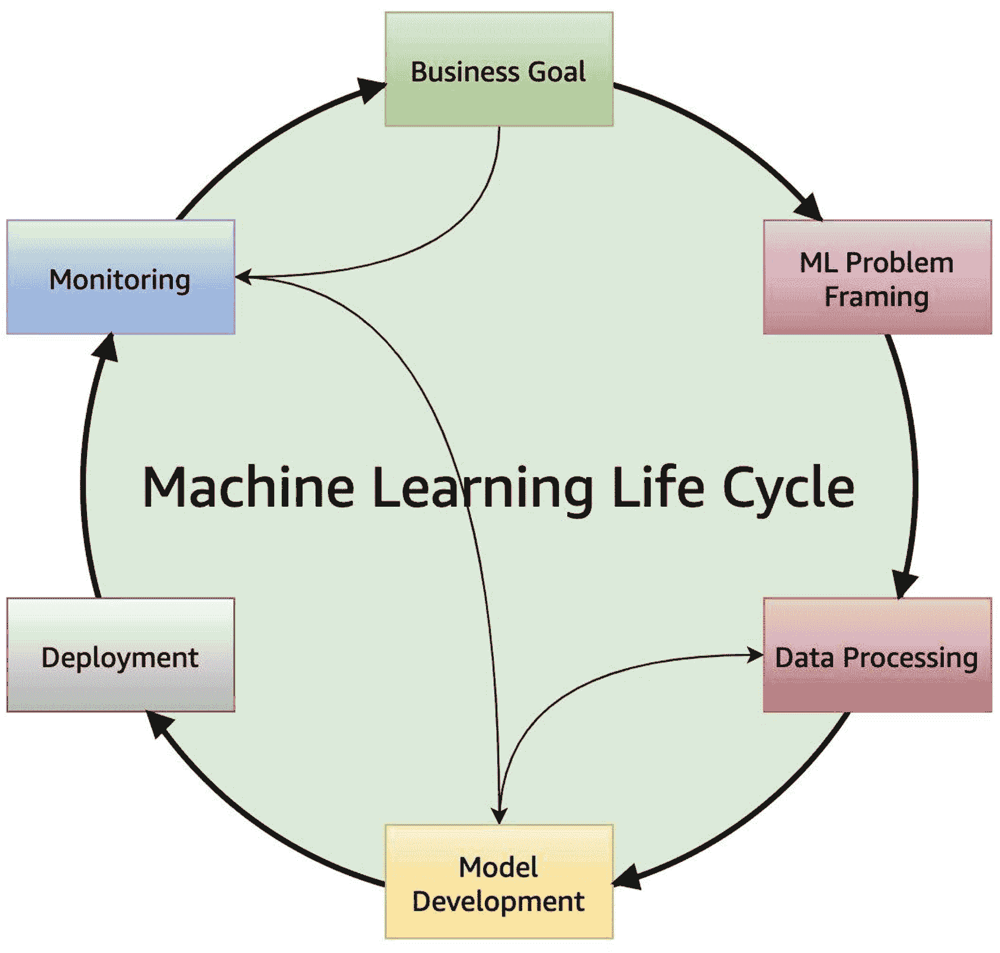
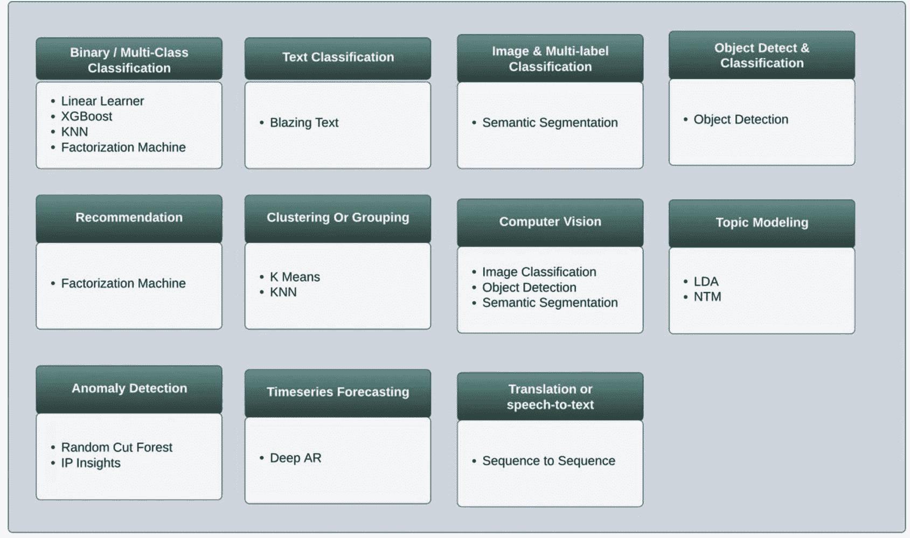
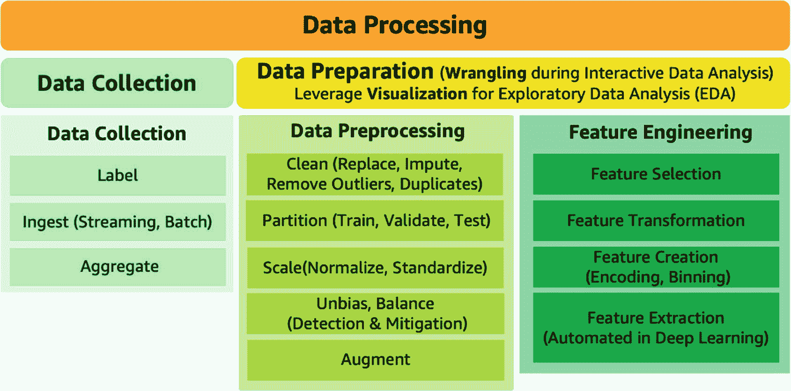
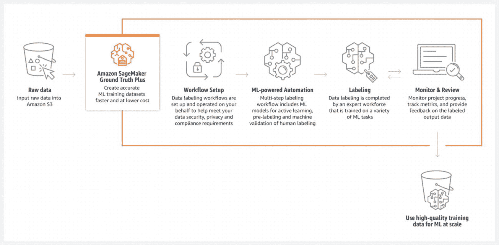
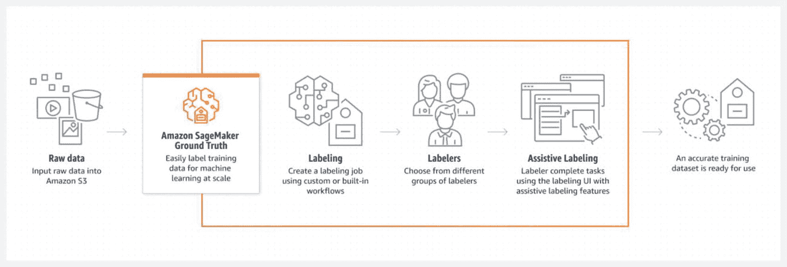
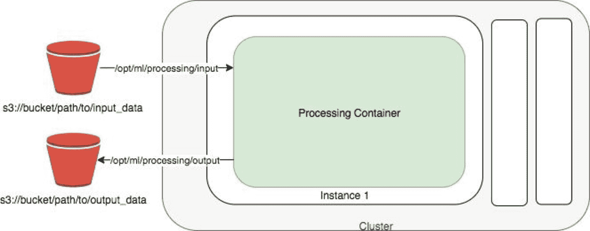
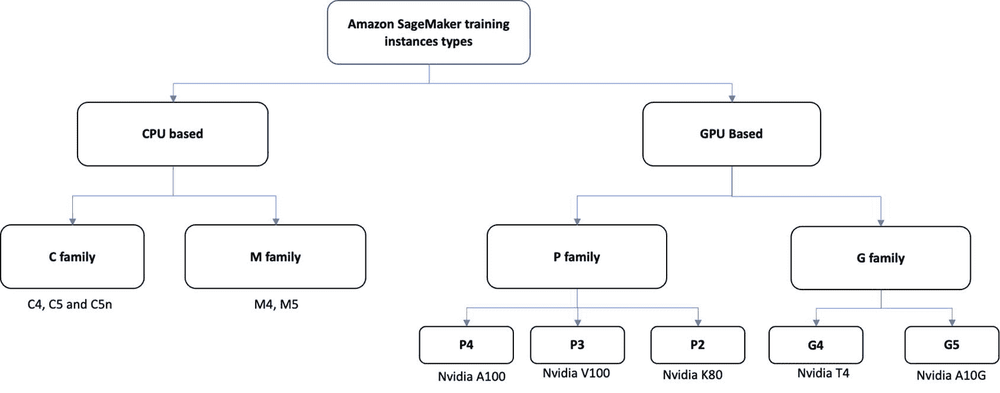
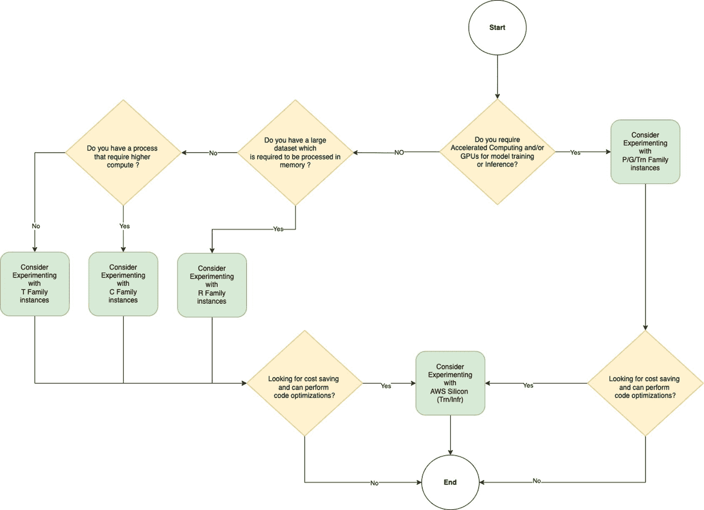
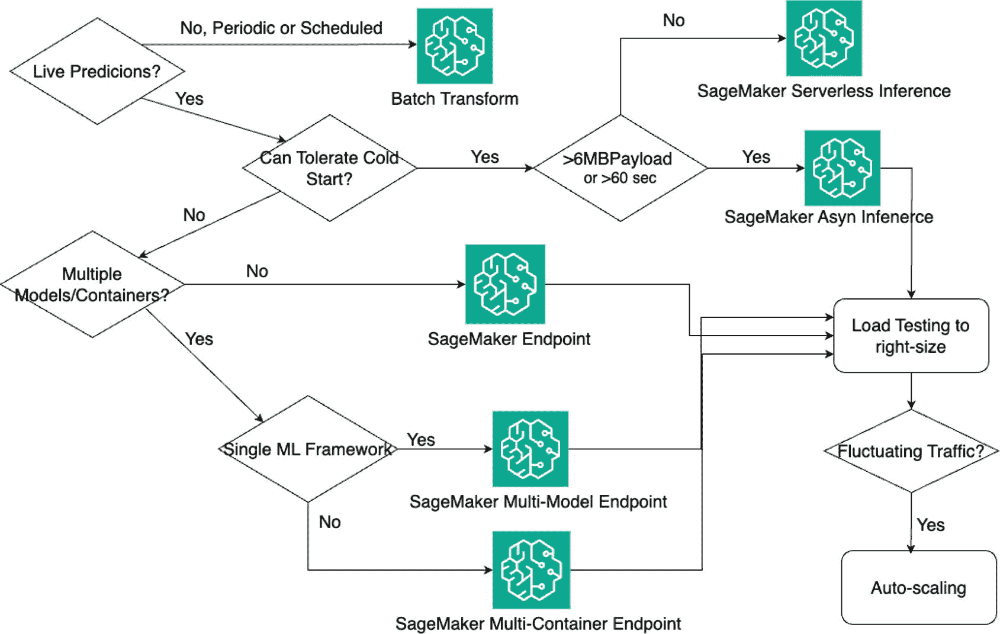
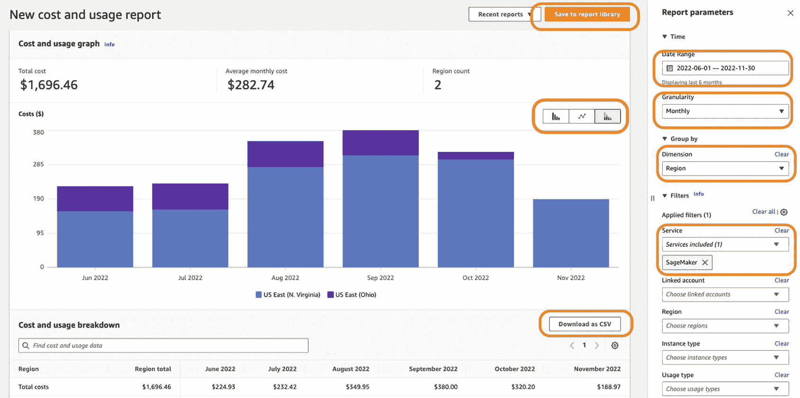

# 7. MLOps 中的成本优化

在机器学习运维（MLOps）快速发展的背景下，成本优化已成为确保可持续性和效率的关键实践。随着组织越来越依赖机器学习模型来驱动业务成果，开发、部署和维护这些模型所产生的财务影响已成为一个重大关切。MLOps 中的有效成本优化不仅能降低运营开支，还能最大化资源利用率、提升模型性能并加速创新。通过实施战略性成本管理实践，企业可以在预算限制与追求前沿机器学习解决方案之间取得平衡。本章将深入探讨成本优化在 MLOps 中的重要作用，介绍相关方法论、工具和最佳实践，使组织能够在保持财务责任的同时，充分发挥机器学习投资的全部潜力。

## 机器学习模型生命周期概述

机器学习生命周期是一个循环迭代的过程，其中包含在开发机器学习工作负载时各定义阶段应遵循的指导原则和最佳实践（见图 7-1）。它包括以下阶段：

图 7-1

机器学习生命周期 ([`​docs.​aws.​amazon.​com/​wellarchitected/​latest/​machine-learning-lens/​well-architected-machine-learning-lifecycle.​html)`](https://docs.aws.amazon.com/wellarchitected/latest/machine-learning-lens/well-architected-machine-learning-lifecycle.html)

*   业务目标确定
*   机器学习问题界定
*   数据处理（数据收集、数据预处理、特征工程）
*   模型开发（训练、调优、评估）
*   模型部署（推理、预测）
*   模型监控

机器学习生命周期的每个阶段都有实施最佳实践以优化成本的潜力。

从最初的概念验证设计到生产工作负载的持续运行，采用这些实践能够帮助您开发和管理成本高效的系统。这种方法有助于在最小化开支的同时实现业务目标，最终最大化企业的投资回报。

## 理解机器学习生命周期的成本驱动因素

理解机器学习生命周期的成本驱动因素对于寻求优化人工智能投资的组织至关重要。从数据收集和预处理到模型训练、部署以及持续维护，机器学习生命周期的每个阶段都会产生成本，这些成本可能对项目的总体预算产生重大影响。识别这些成本驱动因素并理解其影响，有助于企业做出明智决策，确保高效分配资源并实现最佳投资回报。本节将探讨影响机器学习生命周期成本的关键因素，为组织如何在保持机器学习解决方案质量和性能的同时管理开支提供见解。

### 业务目标确定

在设定业务目标时，明确总体投资回报率并考虑机会成本也至关重要。全面评估将机器学习应用于每个用例以解决特定业务问题的潜在收益和弊端。这种全面评估可确保您在长期资源分配方面做出成本有效的决策。

#### 评估机会成本与投资回报率

评估方法如下：

1.  **投资回报率定义**：清晰概述机器学习项目预期的财务和战略回报。这包括直接收入影响、成本节约以及客户满意度提升等无形收益。
2.  **机会成本评估**：权衡实施机器学习解决方案的收益与替代方案的成本和收益。例如，考虑基于规则的系统是否能够以更低的复杂性和成本实现类似结果。
3.  **专业资源**：认识到数据科学家和模型部署时间等资源是最为受限且昂贵的。审慎分配这些资源以最大化其影响力。

#### 确保成本有效的资源分配

请遵循以下步骤：

1.  **全面理解**：深入了解机器学习开发过程，包括数据需求、计算需求以及潜在陷阱。这些知识有助于规划并避免意外开支和延误。
2.  **长期规划**：制定与业务目标一致并确保可持续增长的长期资源分配策略。考虑基础设施的可扩展性以及支持持续机器学习运维的能力。

#### 自动化与优化策略

请遵循以下步骤：

1.  **采用自动化**：利用自动化工具和框架来简化机器学习流水线中的重复性任务，例如数据预处理、模型训练和部署。这能减少人工劳动和错误，从而节省成本并加快上市时间。
2.  **优化技术**：实施优化策略以提升模型性能并降低计算成本。超参数调优、模型剪枝和高效数据处理等技术可带来显著的成本降低。

#### 降低总体拥有成本

请遵循以下步骤：

1.  **成本控制措施**：实施措施以最小化机器学习基础设施的总体拥有成本。这包括优化云资源使用、采用经济高效的存储解决方案以及使用可扩展的计算选项。
2.  **定期审计**：定期审计机器学习运维，以识别在不影响性能或质量的前提下可以降低成本的领域。这种主动方法有助于维护精简高效的机器学习环境。

通过精心规划和执行这些策略，您可以确保机器学习计划既高效又经济，为组织带来巨大价值，同时管理相关成本和风险。

### 机器学习问题界定

在规划机器学习项目时，评估更简单的替代方案（例如基于规则的系统）是否可能更有效非常重要。平衡实施机器学习解决方案的成本与不进行机器学习转型的机会成本，对于做出明智决策至关重要。

#### 评估替代方案

请遵循以下步骤：

1.  **基于规则的系统**：考虑直接的基于规则的方法是否能够以更低的复杂性和成本实现预期结果。对于具有清晰可定义规则的任务，基于规则的系统可能很有效，并且可能提供更快的实施和更简便的维护。
2.  **混合解决方案**：探索将基于规则的系统与机器学习模型相结合的可能性，以利用两种方法的优势。这可以提供更平衡的解决方案，同时优化性能和成本。

#### 平衡成本与收益

请遵循以下步骤：

1.  **机器学习的机会成本**：评估机器学习转型的收益与所涉及的成本。考虑机器学习相比传统方法所能提供的更高准确性、自动化和可扩展性潜力。
2.  **长期收益**：评估采用机器学习的长期收益，例如增强的数据驱动决策能力、竞争优势以及处理复杂且不断变化任务的能力。

#### 专项资源

请遵循以下步骤：

1.  **数据科学家时间**：认识到数据科学家是机器学习项目中最宝贵且最稀缺的资源之一。高效地将他们的时间分配到能最大化其影响力的任务上，对于项目成功至关重要。

2.  **上市时间**：考虑快速开发和部署的重要性。机器学习模型的上市时间可能是保持竞争力的关键因素。延迟可能导致错失良机并增加成本。

#### 硬件与基础设施选择

请遵循以下步骤：

1.  **高性价比硬件**：在选择硬件时，需权衡成本与性能。如果最实惠的选择会阻碍实验并拖慢开发速度，那它可能并非最佳方案。

2.  **可扩展性与灵活性**：选择能够随需求扩展、并支持快速迭代和实验的硬件与基础设施。这能确保开发过程敏捷，并能适应新的需求与挑战。

#### 战略决策

请遵循以下步骤：

1.  **全面评估**：对所有可用选项（包括传统方法和机器学习）进行彻底分析，以做出符合业务目标的明智决策。

2.  **持续评估**：定期审查和评估所选方法的性能与成本效益。如有必要，应准备好调整方向，以确保获得最佳结果。

通过仔细考量这些因素，您可以做出战略决策，平衡采用机器学习的成本与收益，优化专项资源的利用，并为项目选择最合适的硬件与基础设施。这种方法将帮助您在管理成本、保持机器学习项目灵活性的同时，实现业务目标。

### 数据处理

在机器学习工作负载中，数据至关重要。机器学习的过程涉及大量的数据探索、清洗和转换，这很容易导致创建多个冗余的数据副本。这种冗余会造成存储成本的指数级增长。因此，在存储和数据处理层面实施稳健的成本控制策略至关重要。

#### 数据存储管理

请遵循以下步骤：

1.  **去重**：实施数据去重技术，减少冗余副本，节省存储空间。

2.  **压缩**：使用数据压缩方法，最小化大数据集的存储占用。

3.  **分层存储**：利用分层存储解决方案，将不常访问的数据存储在成本更低、性能较低的存储中，而将频繁访问的数据保留在高性能存储上。

4.  **生命周期策略**：应用数据生命周期策略，根据数据的年龄或访问模式自动移动或归档数据。

#### 数据处理优化

请遵循以下步骤：

1.  **高效数据转换**：简化数据转换流程，避免不必要的数据复制和处理。

2.  **批处理**：利用批处理技术，以比实时处理更具成本效益的方式处理大量数据。

3.  **增量更新**：实施增量数据处理，仅处理已更改或新增的数据，从而减少整体计算和存储需求。

4.  **成本感知的数据管道设计**：以成本意识设计数据管道，确保管道中的每一步都在性能和成本效率方面得到优化。

通过解决这些方面的问题，组织可以显著降低机器学习工作负载中与数据存储和处理相关的成本，确保机器学习计划既高效又经济。

### 模型开发

开发、训练、维护和微调机器学习模型的过程是迭代的，并且需要持续改进。识别最佳模型状态涉及对模型参数和数据依赖关系的各种排列组合进行实验。然而，优化机器学习成本不仅仅局限于算法性能和模型调整。它还需要努力将开发出的模型有效地集成到应用程序中，以充分实现其价值。

成功管理与机器学习模型训练相关的成本，需要全面理解构成这些费用的各种因素。优化模型开发成本涉及两个主要策略：选择合适的基础设施和优化训练过程本身。训练实例通常可分为两类：用于深度学习模型的基于 GPU 的加速实例，以及用于标准机器学习框架的基于 CPU 的实例。

以下是部分关键成本驱动因素。

#### 基础设施成本

以下是基础设施成本：

*   **实例类型与大小**：不同的实例类型和大小具有不同的成本结构。优化实例类型的选择（例如，用于 GPU 的 P2、P3，或用于 CPU 的 C5），并根据工作负载需求调整实例大小，有助于管理成本。

*   **可扩展性与弹性**：利用可根据工作负载动态调整的可扩展基础设施，可以防止过度配置并降低成本。像 AWS Auto Scaling 这样的工具可以根据需要自动扩展或缩减资源。

*   **计算资源**：在 CPU 和 GPU 之间的选择会显著影响成本。虽然 GPU 为深度学习任务提供了卓越的性能，但它们也更昂贵。选择适合机器学习任务特定需求的计算资源对于成本优化至关重要。
    1.  **CPU**：非常适合顺序处理复杂计算。它们足以胜任许多机器学习任务，特别是那些涉及较小数据集或计算强度较低的模型的任务。

    2.  **GPU**：擅长并行执行多个简单计算，在高效使用时能提供高性价比。然而，GPU 更昂贵，应仅在必要时选择。对于许多场景，当前一代的 CPU 实例（例如 `ml.m*` 系列）为 Jupyter notebook 和其他机器学习任务提供了足够的计算能力、内存和网络性能。建议从所需的最低实例规格开始，然后逐步扩展，以确定适合该模型的最佳实例类型和系列。

#### 模型训练与优化

以下是该领域的成本：

1.  **算法复杂度**：更复杂的算法和模型通常需要更多的计算能力和时间，从而导致更高的成本。在不牺牲性能的情况下尽可能简化模型可以节省成本。

2.  **超参数调优**：超参数调优的过程可能非常耗费资源。利用自动化的超参数优化工具和技术，可以更有效地找到最佳参数，从而降低成本。

#### 开发与实验

以下是该领域的成本：

1.  **迭代测试与实验**：开发和测试机器学习模型的迭代性质涉及多个训练和评估周期，每个周期都会产生成本。高效地管理和安排这些实验有助于降低总体支出。

2.  **版本管理与实验追踪**：跟踪不同版本的模型和实验，可以最大限度地减少重复工作，从长远来看可以节省成本。

#### 性能监控

持续监控训练任务的性能对于发现并解决效率低下的问题至关重要。通过这样做，您可以优化资源利用率并更有效地管理成本。定期的性能监控使您能够精准定位资源可能利用不足或过度使用的区域，从而能够及时进行调整，提升整体效率。这种主动方法不仅有助于维持预算控制，还能确保您的机器学习模型以最节省资源的方式进行训练。此外，持续的监控还能为训练过程提供宝贵的见解，有助于优化和改进未来的训练策略与工作流程。

#### 许可与软件成本

以下是该领域的成本构成：

*   **软件许可**：部分机器学习工具和框架需要付费许可。理解并管理这些软件成本对于整体成本优化至关重要。

*   **开源替代方案**：在可行的情况下，利用开源工具和框架有助于降低软件成本。

通过全面评估这些因素，您可以有效地优化基础设施和训练流程。这种方法能确保资源得到高效利用，成本得到有效管理，同时仍能实现高性能的训练结果。全面的评估使您能够选择最合适的计算资源，平衡 CPU 和 GPU 的使用，并实施诸如分布式训练等策略来处理大型数据集。此外，通过持续监控性能并基于数据进行调整，您可以消除低效环节，提升整体生产力。这种周密的规划和持续的优化不仅能控制开支，还有助于开发出稳健且可扩展的机器学习模型。

### 模型部署

模型部署是机器学习生命周期中的关键步骤，在此阶段，训练好的模型被部署以生成预测，并集成到应用程序中，以满足功能性和非功能性需求。在此阶段优化成本对于确保部署既高效又可持续至关重要。通过几种策略可以实现有效的成本控制。

#### 使用正确的推理选项

根据您的需求，确定是需要实时、高吞吐量的推理，还是可以按需调度的离线批量推理。对于需要即时预测和响应的应用程序，实时推理是必需的，但它在推理端点活跃的整个期间都会产生持续的计算成本。由于需要持续分配资源以维持端点的可用性和响应能力，这可能会更加昂贵。

相比之下，当实时预测并非必需时，批量推理更具成本效益。批量处理允许您在特定时间（例如非高峰时段）安排推理任务，从而减少对持续资源利用的需求。这种方法可以显著降低成本，因为计算资源仅在计划的推理运行期间使用。通过评估您的具体需求并选择合适的推理策略，您可以优化性能和成本效益。例如，批量推理可能非常适合生成报告或过夜处理大型数据集等场景，而实时推理对于实时聊天机器人或实时推荐系统等应用则至关重要。

#### 选择最优基础设施

驱动人工智能应用的机器学习模型日益复杂，导致底层计算基础设施的成本显著增加。事实上，开发和运行机器学习应用的基础设施支出中，高达 90% 通常归因于推理操作。因此，为在生产环境中部署机器学习应用寻求经济高效的基础设施解决方案至关重要。为您的模型选择合适的计算基础设施，可确保您使用最高效的实例，以尽可能低的成本提供最佳性能。

为了最大化成本效益，必须监控并了解所选基础设施的利用率指标。通过定期检查 CPU、GPU 和其他资源利用率指标，您可以判断实例是否未被充分利用。利用率不足表明您可能为超出必要的资源付费，从而导致不必要的开支。相反，过度利用则可能表明您的基础设施需要扩展以更有效地处理工作负载。

实施基于这些指标进行持续监控和调整的策略，可以帮助您优化资源分配。这包括根据需要向上或向下扩展、切换到更具成本效益的实例类型，甚至探索能够提供动态资源管理的无服务器或基于容器的部署选项。通过保持警惕并主动管理基础设施利用率，组织可以显著降低其机器学习运营成本，同时为其人工智能应用保持高性能和可扩展性。

#### 自动伸缩

除非您的模型流量全天保持一致，否则总会存在不活动期，导致产生多余且未使用的计算容量。这会导致利用率低下和资源浪费，从而推高成本却无相应收益。为了解决这一低效问题，请实施自动伸缩机制来监控您的工作负载并动态调整容量。这种方法可确保稳定且可预测的性能，同时最大限度地降低成本。

借助自动伸缩，系统会根据实时需求自动调整活跃实例的数量。当工作负载增加时，会启动更多实例来处理增加的负载，从而保持最佳性能。相反，当工作负载减少时，自动伸缩会停用不必要的实例，防止计算资源浪费并降低总体成本。

通过利用自动伸缩，您可以优化资源利用率，确保您的基础设施规模恰到好处，能够满足当前需求而无需过度配置。这不仅提高了运营的成本效益，还确保了您的应用程序无论流量如何波动，都能保持响应能力和可靠性。将自动伸缩作为部署策略的一部分，可以让您在尽可能降低计算成本的同时，维持高可用性和高性能。

### 模型监控

有效的机器学习模型监控对于确保生产环境中机器学习模型的准确性、可靠性和公平性至关重要。然而，此过程会产生成本，需要谨慎管理以保持效率。了解机器学习模型监控的成本驱动因素可以帮助组织优化其监控策略并减少不必要的开支。

#### 数据收集与存储

以下是该领域需要考虑的主要成本驱动因素：

*   **数据量**：为监控目的而生成和收集的数据量可能非常庞大。这不仅包括输入到模型中的数据，还包括输出预测、元数据和日志。

*   **存储解决方案**：存储解决方案的选择（例如，本地部署、云存储或混合方案）会影响成本。云存储服务通常根据存储的数据量和访问频率收费，因此高效的数据管理至关重要。

*   **数据保留策略**：数据保留的时间长短会显著影响存储成本。组织需要在为长期分析保留历史数据的需求与随时间存储大量数据的成本之间取得平衡。

#### 计算资源

以下是此领域需考虑的主要成本驱动因素：

*   **处理能力**：监控系统需要持续的计算资源来处理和分析数据。这包括运行比较算法、检测异常以及生成报告。

*   **可扩展性**：根据需求动态调整计算资源的能力对于成本效益至关重要。自动扩展功能可以通过动态分配资源来帮助管理成本。

*   **实时处理与批处理**：实时监控系统能提供即时洞察，但通常比按计划间隔分析数据的批处理系统消耗更多资源。

#### 监控基础设施

以下是此领域需考虑的主要成本驱动因素：

*   **基础设施搭建**：监控基础设施的初始搭建，包括硬件、软件以及与现有系统的集成，可能是一笔可观的初期成本。

*   **维护与升级**：为确保监控系统的有效性并适应不断变化的需求，持续的维护、更新和升级是必要的，这构成了运营成本的一部分。

*   **云服务**：利用基于云的监控服务可以提供灵活性和可扩展性，但也可能因使用模式而产生可变成本。

#### 模型性能与漂移检测

以下是此领域需考虑的主要成本驱动因素：

*   **性能指标**：持续监控模型性能指标（如准确率、精确率、召回率和 F1 分数）需要计算资源。

*   **漂移检测**：检测数据分布变化（数据漂移）、模型性能变化（模型漂移）、偏差漂移以及特征归因漂移涉及复杂的算法和定期计算，这可能会推高成本。

#### 合规性与安全性

以下是此领域需考虑的主要成本驱动因素：

*   **法规遵从**：确保监控系统符合相关法规和标准（例如 GDPR、HIPAA），由于需要安全的数据处理和审计追踪，可能会增加成本。

*   **安全措施**：保护监控基础设施和数据免受未经授权的访问和破坏，需要投资于安全措施和工具。

通过理解这些成本驱动因素，组织可以实施策略来优化其机器学习模型监控流程。这包括选择经济高效的存储解决方案、利用可扩展的云服务、实施高效的数据保留策略，以及在必要时投资于自动化和实时处理。此外，在全面监控的需求与成本考量之间取得平衡，有助于确保在实现机器学习模型监控收益的同时，避免不必要的财务负担。

## AWS 中 MLOps 成本优化策略

在确定了机器学习生命周期各阶段的成本驱动因素后，探索组织可以实施的策略以优化整个机器学习管道的成本至关重要。这些策略旨在确保从数据准备到模型部署和监控的每个阶段都得到高效管理，从而在保持高性能和可扩展性的同时，实现显著的成本节约。

### 业务目标确定

在设定业务目标时，评估整个数据管道、机器学习模型以及生产推理的预期质量非常重要。此评估有助于估算与数据处理、处理和潜在错误相关的成本。识别可能影响项目的潜在风险。评估这些风险，并在整个项目生命周期中实施监控系统进行跟踪。理解风险有助于进行主动管理和缓解，从而减少意外成本。

*   **制定成本效益模型**：创建一个详细的成本效益模型，以了解机器学习项目的财务影响。随着变化的发生（例如外部商业环境的转变或昂贵数据源的集成），持续重新评估此模型。这种持续的重新评估可确保模型保持准确和相关。

*   **估算资源成本**：计算维护生产模型所需资源的成本。这包括数据工程师、数据科学家和其他技术人员的薪资。确保准确的估算有助于预算编制，并防止与资源相关的成本超支。

*   **通过托管服务降低总拥有成本**：通过利用托管服务和按使用量付费模式，可以优化总拥有成本。托管服务使组织能够更高效地运营，所需资源更少，从而降低总体成本。托管服务使组织能够专注于核心业务功能，同时将基础设施的管理和维护外包出去。

*   **Amazon SageMaker 实现经济高效的机器学习**：

Amazon SageMaker 是一项完全托管的机器学习服务，有助于大规模构建、训练和部署模型。与自管理的基于云的机器学习解决方案（如 Amazon Elastic Compute Cloud (EC2) 和 Amazon Elastic Kubernetes Service (EKS)）相比，它提供了显著的成本节约。在三年期间，使用 SageMaker 的总拥有成本要低得多，为大规模机器学习运营提供了一种经济高效的替代方案。

*   **Amazon 托管 AI 服务实现开箱即用的智能**：

AWS 提供了一套预训练的 AI 服务，旨在与应用程序和工作流程无缝集成。这些托管 AI 服务适用于常见用例，例如个性化推荐、现代化联络中心、增强安全性和保障以及提升客户参与度。这些服务完全托管，无需前期承诺，并采用按需付费的定价模式，即使是没有广泛机器学习专业知识的组织也可以使用。

*   **执行定价模型分析**：

对工作负载每个组件的定价模型进行彻底分析。确定组件和资源是否将长期使用，从而有资格享受承诺折扣（如 AWS Savings Plans）。Savings Plans 允许您通过承诺一致的用量来节省 AWS 使用费用。Amazon SageMaker Savings Plans 为实例系列、实例大小、AWS 区域和组件使用提供了灵活的选择，为进一步降低成本提供了机会。

通过利用这些策略，组织可以显著降低其总拥有成本，提高运营效率，并在保持高性能和可扩展性的同时实现可观的成本节约。

### 机器学习问题框架

在确定机器学习是解决问题的合适方案后，必须在自定义构建模型与预训练模型之间进行彻底的成本权衡分析。此分析应考虑各种因素，例如安全性、性能效率和成本，确保它们保持在可接受的阈值内。

#### 自定义模型 vs. 预训练模型

1.  **自定义模型**：
    *   **开发成本**：从头构建自定义模型通常需要在数据收集、预处理和模型训练方面投入大量资源。此过程需要专业资源，包括熟练的数据科学家和工程师，这会推高成本。

    *   **定制化解决方案**：自定义模型的优势在于能够针对业务问题的独特需求进行专门定制，从而可能获得更高的准确性和相关性。

    *   **安全考量**：自定义模型可以按照组织特定需求开发安全措施，从而对数据处理和合规性拥有更强的控制力。

    *   **微调灵活性**：自定义模型的好处在于其灵活性，允许你根据业务用例的具体要求进行微调。相比之下，预训练模型可能难以修改，通常需要你按原样使用。

2.  **预训练模型**：
    *   **较低的初始成本**：预训练模型（例如 AWS AI 服务提供的模型）通过利用已在海量数据集上训练好的模型，显著降低了初始开发成本。

    *   **更快的部署**：这些模型可以快速集成到你的应用程序中，从而加快上市时间，并减少开发和训练所花费的时间。

    *   **可扩展性与维护**：托管的预训练模型通常内置了可扩展性和维护功能，从而降低了持续的运营成本和资源需求。

#### Amazon SageMaker 内置算法

Amazon SageMaker 提供了一套全面的内置算法，旨在帮助数据科学家和机器学习从业者快速开始训练和部署机器学习模型。

AWS Marketplace 提供了即用型预训练 ML 模型，可使用 SageMaker 快速部署，从而显著减少实施 AI 和 ML 解决方案所需的时间和精力。

这使得组织能够以更低的成本更快地交付由 AI 和 ML 驱动的功能。

#### 用于预训练模型的 SageMaker JumpStart

SageMaker JumpStart 提供了大量预训练模型、预构建解决方案模板以及针对各种常见问题类型的示例。这些资源旨在帮助数据科学家和机器学习从业者快速启动机器学习模型的训练和部署。

SageMaker 提供的内置算法可分为以下几类：

*   监督学习

*   无监督学习

*   文本分析

*   图像处理

图 7-2 提供了一个快速参考指南，展示了如何从一个示例问题或用例出发，找到 SageMaker 提供的适用于该问题类型的合适内置算法。

图 7-2

SageMaker 内置算法

在决定开发自定义模型还是使用预训练模型时，评估所涉及的成本至关重要。这包括考虑数据科学家开发自定义模型所需的时间和资源，与在 SageMaker 上部署预训练模型进行推理的便捷性和速度之间的权衡。

做出决策时，请考虑以下几点：

*   **业务需求**：确定业务用例的具体需求是否需要自定义模型，或者预训练模型是否足以满足这些需求。

*   **资源可用性**：评估资源的可用性和成本，包括数据科学家的时间以及训练自定义模型所需的计算能力。

*   **项目时间线**：考虑部署的紧迫性。预训练模型提供更快的集成速度，这对于时间紧迫的项目至关重要。

通过仔细评估这些因素，组织可以就是在 Amazon SageMaker 上开发自定义模型还是利用预训练模型做出明智的决策。这种战略方法可确保所选解决方案与业务目标、资源约束和期望结果保持一致。

### 数据处理

在以数据为中心的 AI 方法中，数据处理至关重要。然而，为机器学习训练和评估准备原始数据可能是一项繁琐且资源密集型的任务，需要大量的计算能力、时间和人力。此过程通常涉及整合来自多个来源的数据，并处理缺失值、噪声数据和异常值等问题。

此外，除了典型的提取、转换和加载（ETL）任务之外，机器学习团队有时还需要更高级的功能。这些功能可能包括创建快速模型来评估数据并生成特征重要性分数，或者作为 MLOps 管道的一部分执行训练后模型评估。

如图 7-3 所示，数据处理包括数据收集和数据准备。

图 7-3

机器学习的预处理

数据收集是机器学习生命周期中的一个关键阶段，它确定所需的数据并评估收集这些数据以训练模型的各种方法。数据收集阶段的关键组成部分包括数据标注、数据摄取和数据聚合。标注数据由带有一个或多个标签的样本组成，如果缺少标签，则必须手动或自动添加。数据收集涉及从多个来源（如时间序列、事件、传感器、物联网设备和社交网络）收集数据，并使用各种技术（如事务型（SQL）数据库、数据湖和数据仓库）进行存储。数据摄取可以通过流式技术实时进行，也可以通过批处理技术以历史模式进行，通常利用 ETL 管道来捕获和存储数据。

数据预处理通过各种策略（包括清洗、平衡、替换、插补、分区、缩放、增强和去偏）来塑造和优化训练数据。特征工程涉及选择和转换变量以创建预测模型，包括特征创建、转换、提取和选择。

#### 用于托管数据标注的 SageMaker GroundTruth

Amazon SageMaker Ground Truth 旨在帮助您为机器学习模型构建高质量的训练数据集。Ground Truth 允许您利用机器学习，并结合来自 Amazon Mechanical Turk、您选择的供应商公司或您内部团队的人工标注员，来创建带标签的数据集。由 Ground Truth 生成的带标签数据集可用于训练您自己的模型，或作为 Amazon SageMaker 模型的训练数据集。

Amazon SageMaker Ground Truth 提供两种选项：自助服务和 AWS 托管服务。

AWS 托管选项，称为 SageMaker Ground Truth Plus，为您处理所有事务。这包括选择和管理合适的标注团队，设计和定制包含详细团队培训和质量保证步骤的端到端工作流程，并提供由 AWS 管理的熟练团队。该团队经过针对您特定任务的培训，并确保满足数据质量、安全性和合规性要求。Ground Truth Plus 是一项高级的交钥匙服务，它利用专业标注团队快速且经济高效地交付高质量的训练数据集，可将成本降低多达 40%。此服务使您能够专注于核心任务，而无需深厚的 ML 专业知识或对工作流程设计和质量管理的广泛了解。您只需提供数据并指定标注要求，Ground Truth Plus 将处理数据标注工作流程并管理流程以满足您的规格要求。

图 7-4 展示了 AWS 托管的 SageMaker GroundTruth Plus 工作流程。

图 7-4

AWS 托管的 SageMaker GroundTruth Plus 工作流程

在自助服务选项中，您的数据标注员、内容创建者和提示工程师团队（无论是内部、供应商管理还是公共众包）都可以利用低代码用户界面来简化人工参与任务并管理自定义工作流程。

图 7-5 展示了自管理的 SageMaker GroundTruth Plus 工作流程。

图 7-5

自管理的 SageMaker GroundTruth Plus 工作流程

作为 AWS 免费套餐的一部分，您可以免费开始使用 SageMaker Ground Truth。

#### 用于托管数据预处理的 SageMaker Processing

通过托管数据处理，您可以利用一个精简的托管环境来执行数据处理任务，包括特征工程、数据验证、模型评估和模型解释。

借助 Amazon SageMaker Processing，您可以在机器学习流水线中为各种数据处理步骤执行处理作业。这些作业从 Amazon S3 获取输入数据，并将输出存储回 Amazon S3。您可以使用 Amazon SageMaker 内置的容器镜像或您为处理容器提供的自定义镜像。Amazon SageMaker 完全管理处理作业的底层基础设施，在作业期间预置集群资源，并在完成后清理它们，从而为您节省计算成本。SageMaker Processing 简化了运行 ML 预处理和后处理任务，支持 scikit-learn、Apache Spark、PyTorch、TensorFlow、Hugging Face、MXNet 和 XGBoost 等流行框架。参见图 7-6。

图 7-6

Amazon SageMaker 处理容器

使用 SageMaker Processing 的好处是，您只需在作业运行时为处理实例付费。因此，您可以利用强大的实例而无需过多担心成本。例如，作为一般性建议，对于中等作业（数据量从兆字节到千兆字节），您可以使用 ml.m5.4xlarge；对于需要大量计算能力的工作负载，使用 ml.c5.18xlarge；当您希望将多个千兆字节的数据加载到内存中进行处理时，使用 ml.r5.8xlarge，并且只需按处理作业的时间付费。有时，您可能会考虑使用更大的实例来更快地完成作业，最终支付的总作业成本反而更低。

#### 用于数据准备的 SageMaker Data Wrangler

借助 SageMaker Data Wrangler，您可以简化数据准备和特征工程，在单个可视化界面中完成数据准备工作流程的每一步——从数据选择和清理到探索、可视化和大规模处理。您可以使用 SQL 高效地从各种来源选择和导入数据。数据质量和洞察报告允许您自动验证数据质量并检测异常，例如重复行和目标泄露。SageMaker Data Wrangler 提供超过 300 种内置数据转换，使您无需编写任何代码即可快速转换数据。其无代码/低代码、自动化和可视化功能有助于提高生产力并降低交互式分析的成本。

#### 用于实现特征可复用的 SageMaker Feature Store

使用 Amazon SageMaker Feature Store 可以通过简化机器学习特征的管理来显著节省成本。它减少了跨团队和项目的重复工作以及重新运行特征工程代码的需求，从而更有效地利用资源。这个完全托管的、专为特定目的构建的存储库允许数据科学家和 ML 工程师轻松创建、共享和管理特征。其在线存储支持用于实时推理的低延迟检索，而其离线存储则维护用于训练和批量评分的特征值历史记录，确保 ML 开发的效率和成本效益。

### 模型开发

模型训练和调优涉及选择适合用例的机器学习模型，然后进行模型的训练和微调。如前所述，优化模型开发成本依赖于两个关键策略：选择正确的基础设施和优化训练过程。

一般性指导原则是合理调整训练实例的大小，以匹配特定的机器学习算法，从而实现最佳效率和成本节约。利用调试工具来确定最适合训练的资源。简单的模型可能无法从更大的实例中受益，因为它们可能无法有效利用额外的计算资源。在某些情况下，由于 GPU 通信开销增加，它们甚至可能训练得更慢。建议从小型实例开始，并根据需要扩展。AWS 提供工具和服务，用于在保持性能的同时实现经济高效的模型开发，如下所述。

#### 合理调整训练实例的规模

使用完全托管的 Amazon SageMaker 训练服务，您可以将训练作业所需的所有组件（如代码、容器和数据）发送到独立的计算基础设施，从而确保训练作业不受 SageMaker 笔记本实例资源的限制。SageMaker 训练 Python SDK 使您能够根据需要启动训练和调优作业。由于机器学习训练通常计算密集且耗时，这些作业会在远程基础设施上异步运行，因此，如果启动训练作业是您当天最后一项任务，您可以关闭笔记本实例以节省成本。

在选择训练实例时，请考虑以下成本优化因素：

*   **实例系列**：确定最适合您训练的实例类型。优化整体训练成本有时可能意味着选择更大的实例，这可以加快训练速度并降低总成本。评估算法是否能够利用 GPU 实例。

*   **实例大小**：确定算法运行训练所需的最低计算和内存容量。评估分布式训练是否可行。

*   **实例数量**：对于分布式训练，决定集群所需的实例类型（CPU 或 GPU）以及所需的实例数量。

在选择实例系列和类型时，请根据工作负载所使用的特定算法或框架来做决定。图 7-7 简要概述了 SageMaker 上可用的实例系列。有关定价和实例大小的更多详细信息，请参阅 Amazon SageMaker 定价。

图 7-7

Amazon SageMaker 训练实例类型

实例类型如下：

*   **基于 CPU 的实例**：
    *   **M 系列**：这些实例提供了计算、内存和网络资源的均衡组合，使其成为大多数基于 CPU 的训练作业的绝佳初始选择。它们提供了均衡的 CPU 和内存比例，并且随着 CPU 核心数量的增加，可用的内存容量也更大。

    *   **C 系列**：针对计算密集型工作负载进行了优化，这些实例以经济高效的单位计算成本提供高性能。它们非常适合需要大量处理能力但内存需求较低的训练作业。

*   **基于 GPU 的实例**：
    *   **P3 系列**：利用 NVIDIA V100 GPU，P3 系列包括性能最高的单 GPU 实例（P3.2xlarge），非常适合不需要多个 GPU 的高内存工作负载。此外，P3 实例还提供 4 个和 8 个 GPU 的配置，适用于训练大型模型。

    *   **P4 系列**：云端最强大的 GPU 实例，基于 NVIDIA A100 GPU，非常适合大型模型和数据集的分布式训练。每个 P4 实例包含 8 个 A100 GPU，每个 GPU 拥有 40 GB 内存，并配备第三代 NVLink 以实现快速的多 GPU 训练。

    *   **G4 系列**：与 P3 和 P4 相比，这些实例性能较低，但对于模型开发和训练而言更具成本效益。G4 实例配备具有 16 GB GPU 内存的 NVIDIA T4 GPU，基于上一代 NVIDIA Turing 架构。如果需要更多的 vCPU 和更高的系统内存，请考虑使用 g4dn.(2/4/8/16)xlarge，尤其是在需要更多预处理或后处理的情况下。

    *   **G5 系列**：作为 P3 和 P4 的低成本替代方案，G5 实例提供单 GPU 和多 GPU 选项，性能比上一代 G4 实例提升三倍。G5 实例配备 NVIDIA 最新的 A10G 处理器，提供 1、4 和 8 个 GPU 的配置。

*   **基于 AWS 芯片的实例**：
    *   **Trainium**：AWS 自研的 Trn1 实例为训练参数超过 1000 亿的大型深度学习模型提供了高性能、高性价比的解决方案。最大的实例 trn1.32xlarge 拥有 16 个 Trainium 加速器，配备 512 GB 加速器内存，可提供高达 3.4 petaflops 的 FP16/BF16 计算能力。这 16 个 Trainium 加速器通过超高速 NeuronLinkv2 连接，有助于实现高效的集体通信。

##### 实例合理调整规模的推荐最佳实践

以下是一些最佳实践：

*   如果您使用 SageMaker 的内置算法，每个算法都附带了关于使用哪种实例类型进行训练的建议。例如，XGBoost 目前仅兼容 CPU，并且是一个内存密集型算法，而非计算密集型。因此，通用计算实例（如 M5）比计算优化实例（如 C4）更合适。相反，对于 SageMaker 图像分类算法，建议使用 GPU 实例，如 P3 或 G5。

*   当您使用脚本模式或自定义容器运行自己的算法时，务必确定该框架或算法是支持 CPU、GPU 还是两者都支持，以便选择合适的实例类型。例如，由于 Scikit-learn 不支持 GPU，使用 G5 或 P3 等 GPU 实例将效率低下且成本高昂，不会带来任何运行时收益。对于基于 GPU 的训练，您应该分析您的作业，以找到实例数量和运行时间之间的最佳平衡点，从而最大限度地降低成本。Amazon SageMaker Debugger 可以帮助实时分析训练作业，通过识别和消除瓶颈来优化资源利用率，缩短训练时间，并降低机器学习模型的成本。

*   建议从少量实例开始，然后根据您的需求逐步增加。SageMaker 支持使用多个实例训练大型模型。

#### 选择合适的训练数据源

到目前为止，我们已经介绍了实例及其合理调整规模。训练过程中另一个关键方面是数据源及其处理方式。SageMaker 支持三种不同的训练数据源：Amazon EFS、Amazon S3 和 Amazon FSx for Lustre。根据您的数据大小及其当前位置，您可以使用图 7-8 中的流程图来确定最适合您训练作业的数据源。

图 7-8

选择合适的训练数据源

#### 使用托管竞价训练

训练的另一个重要考虑因素是在按需实例和竞价实例之间进行选择。按需机器学习实例允许您按使用时间以标准费率支付计算容量费用。但是，对于能够容忍中断且不需要特定启停时间的作业，托管竞价训练是一种经济高效的替代方案。与按需实例相比，SageMaker 可将训练成本降低高达 90%，并为您管理竞价中断。

托管竞价训练利用 Amazon EC2 竞价实例来运行训练作业，而非按需实例。您可以指定哪些训练作业应使用竞价实例，并设置停止条件，以确定 SageMaker 将等待作业使用竞价实例运行多长时间。训练期间生成的指标和日志可在 CloudWatch 中查看。

此外，Amazon SageMaker 自动模型调优（即超参数调优）可以利用托管竞价训练。竞价实例可能会被中断，从而可能延迟作业完成。为了缓解这种情况，您可以配置托管竞价训练作业以使用检查点。SageMaker 会将检查点数据从本地路径复制到 Amazon S3。如果作业被中断，它可以通过从 S3 检索数据，从最后一个检查点恢复，而无需从头开始重新启动。

#### 缩短训练时间

随着深度学习模型日益复杂，优化和训练它们所需的时间也在增加。例如，训练一个像 RoBERTa 这样的 NLP 模型可能需要数千个 GPU 小时。尽管存在可用于减少训练时间的技术和优化方法，但实施这些策略需要大量的时间和专业技能，这可能会阻碍创新和人工智能（AI）的更广泛采用。

主要有三种方法可以加速训练：

*   使用更强大的单台机器来处理计算
*   将计算任务分布到 GPU 实例集群上，以实现并行模型训练
*   通过减少内存和计算使用量来优化模型代码，使其在 GPU 上更高效地运行

优化机器学习（ML）代码具有挑战性、耗时且需要专业知识。为了解决这个问题，SageMaker Training Compiler 可以自动编译你的 Python 训练代码，并生成针对你特定模型定制的 GPU 内核。此过程可减少内存和计算使用量，从而缩短训练时间并降低成本。

### 模型部署

在许多情况下，开发和运行机器学习（ML）应用的基础设施成本中，高达 90% 归因于推理。这是因为构建和训练任务并不频繁，且仅在其持续时间内产生成本，而端点实例必须持续运行（在服务期间）。因此，选择合适的托管方法和实例类型对于最小化 ML 项目的总成本至关重要。

对于模型部署，首先必须理解你的具体用例。请考虑以下问题：

*   预测的频率是多少？
*   你的应用是否会处理实时流量，需要向客户端提供实时响应？
*   在同一个用例中，是否为不同的数据子集训练了多个模型？
*   预测流量是否有显著变化？
*   推理延迟是否是关键问题？

通过解决这些问题，你可以确定为部署 ML 模型制定最有效且最具成本效益的策略。

#### 选择正确的推理选项

推理和实例类型的选择对成本有重大影响。你需要了解延迟要求、同步与异步需求、流量模式以及实时与批处理需求，然后选择满足所有要求的正确推理类型。为你的模型选择合适的实例有助于确保以最低的成本获得性能最佳的实例。

*   **实时推理**：适用于具有可预测流量模式、需要一致延迟和持续可用性的低延迟工作负载。负载大小应小于 6 MB，请求在 60 秒后超时。你按实例使用量付费。
*   **无服务器推理**：适用于具有间歇性或不可预测流量模式、可以容忍 p99 延迟变化的同步工作负载。无服务器推理会根据你的工作负载自动扩展，因此你无需为空闲资源付费，只需按推理请求的持续时间付费。它支持与实时推理相同的模型和容器，允许你根据需要切换模式。负载大小应小于 4 MB，请求在 60 秒后超时。
*   **异步推理**：专为处理大小高达 1 GB（例如，文本语料库、图像、视频和音频）且对延迟不敏感、对成本敏感的异步工作负载而设计。异步推理包含一个内置请求队列，并允许每个请求的处理时间长达 15 分钟。你可以通过使用针对处理速率优化的自动扩缩实例组来控制成本，并可缩减至零以节省额外成本。
*   **批处理推理**：最适合离线处理大型数据集，无需持久化端点。你仅按批处理推理作业的持续时间支付实例使用费。

图 7-9 提供了一个决策树，可帮助你选择合适的部署策略。

图 7-9

选择合适的部署策略

#### 合理调整模型托管实例集群的规模

Amazon SageMaker Inference Recommender 会自动确定用于推理的最佳计算实例类型、实例数量、容器参数和模型优化，旨在提升性能并降低成本。通过 SageMaker Studio、AWS 命令行界面（AWS CLI）或 AWS SDK 即可访问，它能在几分钟内为你的 ML 模型提供部署建议。你可以将模型部署到推荐的实例，或在选定的实例类型上运行完全托管的负载测试，而无需管理测试基础设施。负载测试的结果可以在 SageMaker Studio 中查看，使你能够评估延迟、吞吐量和成本之间的权衡，从而选择最佳的部署配置。

你可以通过 CloudWatch 访问这些建议，也可以在 SageMaker Studio 中查看。请记住，使用 Inference Recommender 需要与 SageMaker 模型注册表集成。

在考虑 CloudWatch 指标时：

*   如果你的首要任务是关注吞吐量的整体性价比，则应关注 `CostPerInference` 指标。
*   如果你需要在延迟和吞吐量之间取得平衡，则应监控 `ModelLatency` 和 `MaxInvocations` 指标。请注意，`MaxInvocations` 表示吞吐量。

##### 实例合理调整的推荐最佳实践

以下是最佳实践：

*   为深度学习应用选择基于 GPU 的实例来管理峰值负载，如果资源未得到充分利用，可能并不划算。相反，可以考虑使用 Elastic Inference，它使你能够为 SageMaker 实例添加低成本的 GPU 加速，从而降低深度学习推理的成本。
*   考虑在 SageMaker 上使用 NVIDIA Triton Inference Server 大规模部署 Transformer 模型。NVIDIA Triton Inference Server 是一款专为推理服务设计的开源软件，提供优化吞吐量和硬件利用率的功能，同时实现超低（个位数毫秒）的推理延迟。
*   SageMaker 包含一个自动扩缩功能，可以监控工作负载并动态调整容量，以确保以最低的成本获得一致的性能。随着工作负载需求增加，自动扩缩会添加更多实例；当需求下降时，它会减少实例数量，从而有助于降低计算成本。SageMaker 会自动将实例分布到多个可用区以实现高可用性。因此，强烈建议为每个生产端点部署多个实例。如果你使用的是 VPC，请在不同可用区中配置至少两个子网，以允许 Amazon SageMaker 有效地分布你的实例。

#### 将多个模型整合到更少的端点

如果您有多个利用率不足的端点实例，请考虑以下托管选项，将使用量整合到更少的端点实例中：

*   **SageMaker 多模型端点**：多模型端点 (MME) 允许您在单个端点上部署数千个机器学习模型，非常适合具有相似大小和延迟要求的模型。由于并非所有模型都同时保存在内存中，MME 是一种经济高效的解决方案，适用于能够处理冷启动的实时推理工作负载。这种可扩展的方法使用共享的托管容器来托管多个模型，与单模型端点相比，提高了端点利用率并降低了托管成本。此外，MME 降低了部署开销，因为 Amazon SageMaker 会根据流量模式管理模型加载和扩展。

*   **SageMaker 多容器端点**：多容器端点 (MCE) 允许您在单个端点上部署多个容器，每个容器可以使用不同的模型或框架。这些容器可以作为推理管道顺序运行，也可以通过直接调用单独访问，从而提高端点利用率并优化成本。使用 MCE，您可以在一个端点上部署多达 15 个不同的容器，每个容器可能使用不同的机器学习框架。与 MME 不同，MCE 将容器保留在内存中，避免了冷启动问题。容器可以直接调用或按顺序调用，提供了部署的灵活性。

#### 探索经济高效的硬件选项

建议寻找经济高效的基础设施解决方案，用于在生产环境中部署机器学习应用。

*   **SageMaker Neo**：SageMaker Neo 通过在 SageMaker 托管中创建优化的推理容器，提升云端推理性能并降低成本。对于边缘推理，它会自动针对指定的操作系统和处理器调整模型，为开发人员节省数月的繁琐工作。SageMaker Neo 通过将机器学习模型编译为可执行文件，为云实例和边缘设备优化模型。然后，可以将优化后的模型部署为 SageMaker 端点或部署到支持的边缘设备上，以实现高效的预测。

*   **Amazon EC2 Inf1 实例**：这些实例以云端最低的成本提供高性能的机器学习推理，与当前基于 GPU 的 Amazon EC2 实例相比，吞吐量最高可提升 2.3 倍，每次推理的成本最高可降低 70%。Inf1 实例专为机器学习推理应用而设计，配备多达 16 个 AWS Inferentia 芯片，这是 AWS 自主研发的高性能推理芯片。这些实例还包含第二代英特尔至强可扩展处理器和高达 100 Gbps 的网络带宽，确保推理任务的高吞吐量。

#### 清理未使用的端点

SageMaker 提供了强大的工具来部署和测试模型，包括使用两个模型变体进行 A/B 测试。您可以将机器学习模型部署为端点，用于实时推理测试。然而，端点有时会无意中保持活动状态，导致不必要的费用。定期审查并在测试完成或没有下游消费者时删除端点至关重要。由于模型工件存储在 Amazon S3 中，并且借助高效的 MLOps 管道，可以在需要时轻松重新创建端点。此外，您可以使用 CloudWatch Events 和 Lambda 函数自动检测和移除空闲端点。例如，您可以设置一个系统，识别在指定时间段（例如过去 24 小时）内未被调用的端点，并自动将其删除。

### 模型监控

深度学习 (DL) 模型的训练过程既昂贵又耗时。数据科学家跟踪模型指标（如训练准确率、训练损失、验证准确率和验证损失）以做出明智的决策至关重要。Amazon SageMaker 通过与 CloudWatch 的无缝集成来促进这一点，CloudWatch 提供关于训练作业实例利用率（包括 CPU、内存和 GPU 使用率）的近实时指标。

对于部署，通过监控端点使用情况和优化实例集群大小，确保在生产环境中运行模型时高效使用计算资源至关重要。为您的托管模型实施自动扩展（autoscaling），以根据工作负载变化动态调整实例数量。

## 自动化与工具

自动化和工具在优化 AWS MLOps 成本方面发挥着关键作用。通过自动化重复性任务，例如数据预处理、模型训练和部署，组织可以显著减少管理这些流程所需的手动工作和时间。AWS SageMaker 等工具提供了用于自动化模型调优、部署和监控的内置功能，确保高效利用计算资源。自动扩展功能可根据工作负载需求动态调整实例数量，防止过度配置并最大限度地减少闲置资源。此外，通过 Amazon CloudWatch 等服务进行的自动化监控和告警有助于识别利用率不足的实例，并优化其大小和数量。通过利用这些自动化工具和技术，组织可以在其机器学习运营中实现显著的成本节约，同时保持高性能和可扩展性。以下是一些推荐的最佳实践。

### 评估自动化的成本优势

自动化机器学习模型的部署消除了通常容易出错的手动工作，提高了数据科学家和机器学习工程师的生产力，并加快了产品上市时间。Amazon SageMaker 提供了一套专为机器学习运营而构建的工具，简化了模型部署过程。当与 AWS CodePipeline 和 AWS CodeDeploy 集成时，这些工具能够创建用于无缝部署端点的持续交付服务。此外，Amazon SageMaker Projects 提供了一个强大的平台，用于编排和管理整个机器学习生命周期，包括模型部署。通过利用这些自动化工具，组织可以简化其机器学习工作流程，确保一致性，降低出错的可能性，并实现更快、更高效的部署，最终实现成本节约和运营效率的提升。

### 利用 AWS 标签增强资源管理和成本跟踪

实施 AWS 标签允许您为 AWS 资源分配标签，帮助您更有效地组织和管理它们。每个标签由一个唯一的键和一个对应的值组成。对于每个资源，标签键必须是唯一的，并且只能有一个关联值。标签在组织资源和利用成本分配标签进行详细的 AWS 支出跟踪方面至关重要。这些标签使 AWS 能够在您的成本分配报告中组织资源成本，从而更容易对您的 AWS 费用进行分类和监控。AWS 提供两种类型的成本分配标签：AWS 生成的标签和用户定义的标签。AWS 生成的标签由 AWS 服务自动创建，而用户定义的标签由您创建，为您标记和跟踪资源提供了灵活性。该系统有助于精确的成本管理，并确保您可以轻松地将成本归因于特定项目、部门或任何其他组织单位，从而改善财务监督和效率。

### 利用 AWS Budgets 实现全面的成本跟踪与管理

AWS Budgets 是监控和管理 Amazon SageMaker 成本的重要工具，涵盖开发、训练和托管等所有方面。通过设置 AWS Budgets，您可以密切跟踪支出，确保其保持在预设限额内。AWS Budgets 的关键功能之一是能够设置提醒，当您的实际或预测支出超出预算金额时，系统会通知您。这种主动方法使您能够在成本失控前采取纠正措施。创建预算后，您可以通过 AWS Budgets 控制台持续跟踪其进度，该控制台提供有关支出模式的详细洞察和可视化信息。此工具不仅有助于维护财务纪律，还能帮助您做出明智决策，以优化机器学习项目中的资源分配和成本效率。通过将 AWS Budgets 集成到您的财务监督流程中，您可以确保 SageMaker 支出与组织目标和预算限制保持一致。

### 利用 AWS Savings Plans

Amazon SageMaker Savings Plans 为 SageMaker 提供了一种灵活的定价模式，作为承诺在一年或三年期限内保持稳定用量（以美元/小时计）的交换。这些计划会自动应用于符合条件的 SageMaker ML 实例使用，包括 Studio 笔记本、SageMaker 按需笔记本、SageMaker Processing、Amazon SageMaker Data Wrangler、SageMaker Training、SageMaker 实时推理和 SageMaker 批量转换，无论实例系列、大小或区域如何。例如，您可以随时将推理工作负载从美国东部（俄亥俄）运行的 CPU ml.c5.xlarge 实例更改为美国西部（俄勒冈）的 ml.Inf1 实例，并自动继续按 Savings Plan 价格付费。

### 使用 AWS Cost Explorer 跟踪用量和支出

AWS Cost Explorer 提供预配置视图，显示有关成本趋势的信息，帮助您快速了解成本历史和趋势。它允许您按 AWS 服务、使用类型、成本分配标签、EC2 实例类型等值进行筛选和分组。如果您使用合并账单，还可以按关联账户进行筛选。此外，您可以设置时间间隔和粒度，并根据历史成本和用量数据预测未来成本。

图 7-10 显示了所选日期范围内按区域分组的每月 SageMaker 成本。

图 7-10

使用 AWS Cost Explorer 分析 Amazon SageMaker 成本

### 监控并提升机器学习模型的投资回报率 (ROI)

一旦机器学习模型部署到生产环境，建立报告机制来跟踪其交付的价值至关重要。例如，如果模型支持客户获取，您应衡量相比没有模型建议的基线，获取了多少新客户及其支出。如果模型预测维护需求，则跟踪优化维护周期所带来的成本节约。

有效的报告使您能够将机器学习模型产生的价值与其持续运营成本进行比较，从而做出明智的决策。如果 ROI 显著为正，请考虑扩展模型以应对类似挑战。如果 ROI 为负，则调查潜在的改进措施，例如通过无服务器推理降低模型延迟，或通过调整模型准确性与复杂性之间的平衡来削减运行时成本。另一种方法是在使用更复杂的模型之前，先使用一个更简单的模型进行分类或过滤案例。

通过持续监控和优化机器学习模型的 ROI，您可以最大化其影响，并确保它们有效促进组织目标的实现。

### 使用全面的日志记录和监控

Amazon CloudWatch 是一项全面的监控和管理服务，为 AWS、本地、混合云以及其他云应用程序和基础设施资源提供数据和可操作洞察。它将日志和指标等性能和运营数据整合到一个单一平台，无需单独监控这些元素（例如服务器、网络或数据库）。CloudWatch 允许您使用告警、日志和事件数据来监督整个技术栈——应用程序、基础设施、网络和服务——从而自动化操作并缩短平均解决时间 (MTTR)。这种效率释放了宝贵的资源，使您能够专注于构建应用程序和增加业务价值。

CloudWatch 提供可操作的洞察，有助于优化应用程序性能、管理资源利用率以及评估系统范围的运营健康状况。它提供高达一秒粒度的指标和日志数据可见性，将指标数据保留 15 个月，并允许进行指标计算。这些功能支持进行历史分析以实现成本优化，并提供实时洞察以增强应用程序和基础设施资源的性能。

### 考虑使用 Spot 实例

降低机器学习训练成本的最简单方法之一是使用 Amazon EC2 Spot 实例。与按需费率相比，这些实例以高达 90% 的显著折扣提供对未使用的 EC2 计算容量的访问。Amazon SageMaker 通过托管 Spot 训练简化了这一过程，使您无需手动设置和管理 Spot 实例即可降低训练成本。SageMaker 会自动为您的训练任务预置 Spot 实例，如果 Spot 实例被回收，它会在容量可用时自动恢复训练，确保持续节省高达 90% 的成本。

## 结论

成本优化对于管理机器学习工作负载至关重要，主要因为它能帮助组织保持在预算限制内，并防止因训练和推理所需的高计算能力而导致超支。通过优化成本，组织可以更高效地扩展其机器学习计划，从而能够处理更大的数据集、更复杂的模型和增加的用户需求，而不会增加开支。高效的资源使用，例如选择合适的实例类型和使用 Spot 实例，可以转化为更低的运营成本和更好的现有基础设施利用率。

此外，成本优化通过降低运营费用提供竞争优势，从而带来更具竞争力的定价和更高的利润率。它通过高效利用资源减少能源消耗和碳足迹，与环境可持续性目标保持一致。有效管理成本还能增强组织的灵活性和敏捷性，使其能够更快地适应不断变化的业务需求。它通过确保支出与交付的价值相匹配来降低财务风险，并通过降低实验和探索新想法的财务障碍来促进创新。总体而言，优化机器学习工作负载成本对于维护财务健康、可扩展性、效率、竞争优势、可持续性、灵活性、风险管理和创新至关重要。

