# 8. MLOps 案例研究

我们已经深入探讨了 MLOps，包括其演变、原则、生命周期以及 AWS 中 MLOps 各个支柱的最佳实践。现在是时候通过一些具体的案例研究来反思 MLOps 在现实场景中的实施了。

在本章中，我们将深入探讨各个组织在实施 MLOps 最佳实践之前所面临的现实挑战案例，并展示他们在实施 MLOps 实践后结果如何得到改善。

## Amazon Music

Amazon Music 提供对其海量歌曲和播客库的无限制访问。他们拥有超过 1 亿首歌曲可供免费流媒体播放，以及数百万个免费播客。每次搜索歌曲、播放列表或播客都充满挑战，尤其是当你不知道确切的标题、艺术家或专辑名称时。

### 业务目标

在流量高峰期，当数百万活跃用户正在搜索他们心仪的音乐或播客时，需要一个智能且响应迅速的搜索功能来提供良好的客户体验。

Amazon Music 的业务目标是实现卓越的搜索栏功能，并即时呈现音乐和播客结果。为实现这一目标，Amazon Music 采用了搭载 `NVIDIA` 的 `Amazon SageMaker` 来优化机器学习训练，并利用了人工智能的力量。

### 挑战

在实施 MLOps 之前，Amazon Music 面临以下挑战：

*   提供相关且快速的实时搜索结果是一项挑战。
*   在流量高峰期，搜索栏的功能，如实时拼写检查和向量搜索，难以实现。
*   人工智能模型的模型训练和推理成本优化是一项挑战。

### 使用的平台

Amazon Music 采用了搭载 `NVIDIA Triton` 推理服务器和 `TensorRT` 的 `Amazon SageMaker` 来优化成本和性能。`Amazon SageMaker` 为机器学习生命周期提供了一整套端到端服务，无需处理任何基础设施问题。Amazon Music 在 AWS 云上以最小的投入构建、训练和部署其机器学习模型。

### 解决方案概述

Amazon Music 实施了以下解决方案：

*   `Amazon SageMaker` 使用 `NVIDIA A10G Tensor Core GPU`、`Triton` 推理服务器容器和 `TensorRT` 模型格式来托管 `G5` 实例，以实现快速且成本优化的结果。它识别出关于批次大小和精度参数的优化领域，以提高训练深度学习模型的速度、效率和准确性。
*   `SageMaker` 为向量搜索或基于嵌入的检索功能实现了实时语义搜索建议。向量搜索是一种机器学习技术，它利用内容的语义来帮助用户找到最相关的内容。
*   Amazon Music 还使用 `BART Transformer` 模型实现了快速准确的搜索功能，用于拼写纠正。`BART` 推理管道的开发通过在 `CPU` 上执行预处理（文本分词）和后处理（将分词转换为文本）阶段，而模型执行步骤则在 `NVIDIA A10G Tensor Core GPU` 上运行。

### 关键成果

以下是 Amazon Music 实施 AWS MLOps 取得的关键成果：

1.  经过 `Amazon SageMaker` 优化后，模型训练的 GPU 利用率提升了 54%。

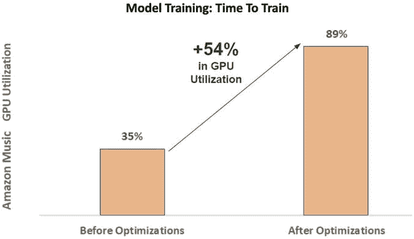

1.  在流量高峰期，使用 `BART` 拼写纠正器后，拼写检查模型的推理延迟减少了 25 毫秒，搜索查询延迟平均降低了 63%。因此，训练时间加快了 12 倍，从而实现了快速且准确的搜索结果。

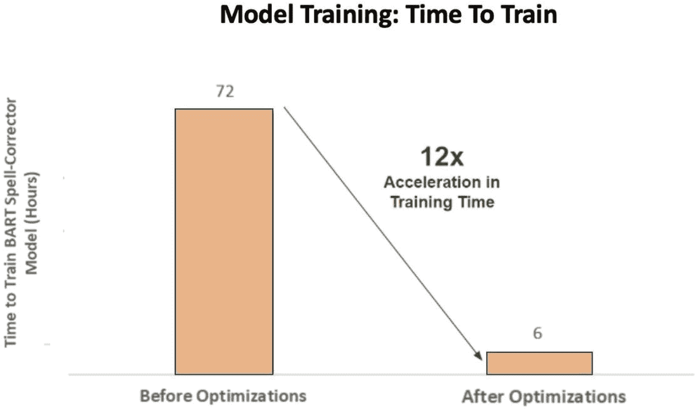

1.  与基于 `CPU` 的基准相比，使用搭载 `NVIDIA A10G GPU` 的 `SageMaker G5` 实例后，Amazon Music 的推理成本降低了 70%。这提升了 Amazon Music 的性能。

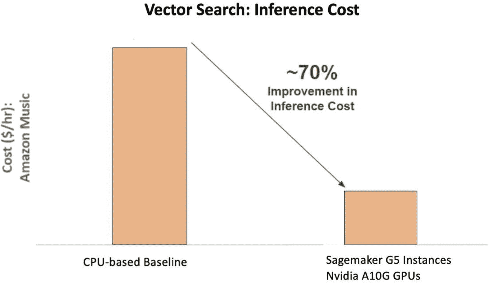

1.  借助深度学习神经网络，Amazon Music 为推理应用提供了低延迟和高吞吐量。

我们可以看到，通过实施搭载 `NVIDIA` 的 `Amazon SageMaker`，Amazon Music 的搜索能力、结果获取时间以及成本优化方面都取得了显著改善。

## Yara

Yara 是全球领先的作物营养公司以及环境和农业解决方案提供商。Yara 专注于生产有益于自然的食品，为客户、股东和社会创造价值，并构建更可持续的食品价值链。Yara 是全球最大的硝酸盐、氨和氮磷钾肥料生产商。

Yara 的愿景是创造一个没有饥饿的世界，实现气候友好型作物营养、低碳环境足迹的肥料、零排放能源解决方案，以及高质量和低生产成本。成为零排放、低成本的“未来工厂”是 Yara 的长期目标。

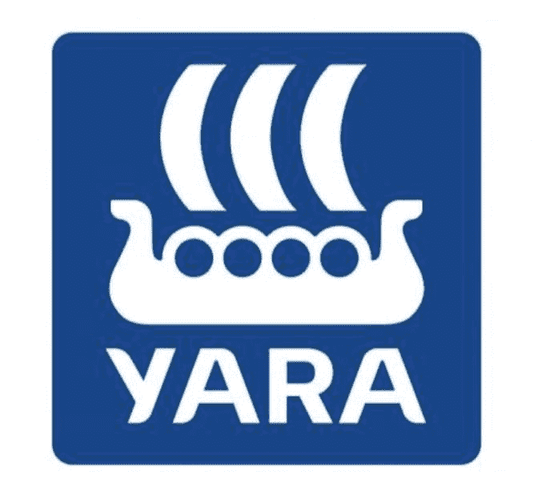

### Yara 的业务目标

Yara 的业务目标包括优化生产、提高产品质量、增加生产现场可靠性、降低排放、提高工人安全性和效率、自动化手动流程等。为实现这一目标，Yara 成立了一个名为“数字生产”的全球数字部门，以利用其运营过程中产生的大量数据。

对于像 Yara 这样的生产工厂，能源消耗是主要的成本组成部分，并对盈利能力产生影响。Yara 实施了 Yara 能源负荷曲线（ELC）解决方案来分析其能源消耗性能。能源负荷曲线（ELC）工具会告知我们当前能源消耗何时偏离历史最佳水平，并向操作员提供建议以引导能源消耗。

现在，主要目标是在全球多个站点实施 ELC 解决方案，并自动化部署和维护流程。

### 挑战

在实施 MLOps 之前，Yara 面临以下挑战：

1.  Yara 的能源负荷曲线（ELC）需要在全球多个站点和矿山实施。
2.  所有部署和维护流程都需要自动化，以实现 Yara 的有效生产。

### 使用的平台

Yara 正在使用 `Amazon SageMaker` 的功能，通过标准化和自动化 MLOps 实践来简化机器学习生命周期。为 Yara 实施了 `Amazon SageMaker` 的多个步骤，包括 `Amazon` 框架容器、模型注册表、模型监控器以及用于数据准备、模型训练、模型评估和注册的 `Amazon SageMaker Pipelines`。

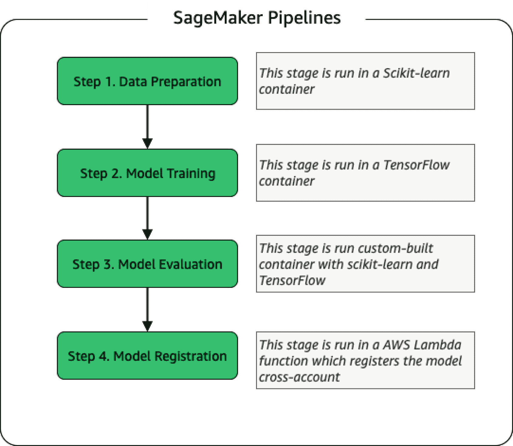

### 解决方案概述

图 8-1 展示了为 Yara 设计的 `Amazon SageMaker` 高级架构。

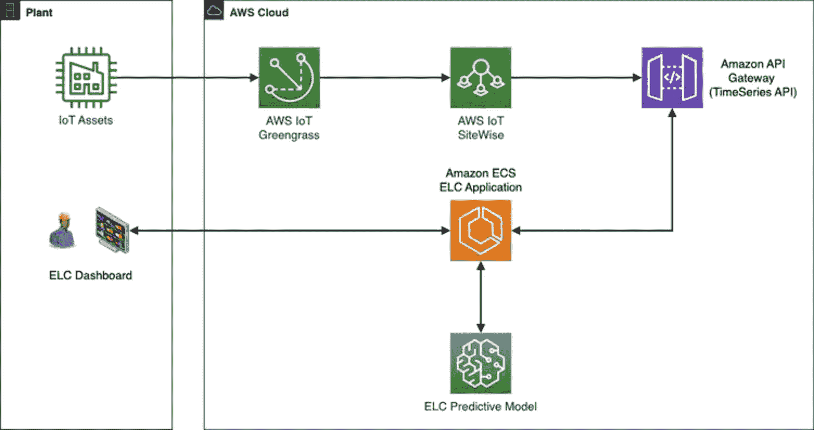

图 8-1

为 Yara 设计的 `Amazon SageMaker` 高级架构

以下是 Yara 实施的解决方案：

*   ELC 使用物联网（IoT）传感器从 Yara 的工厂收集数据，以测量指标并训练能源预测模型。在云端，实施了 `AWS IoT Greengrass` 来从工厂流式传感器传输实时数据。
*   `AWS IoT Greengrass` 与 `AWS IoT Core` 安全地通信，并将 IoT 数据导出到 AWS 云。
*   `AWS IoT SiteWise` 是一项托管服务，可大规模收集、组织、搜索和消费来自工业设备的数据。
*   Yara 使用了 `Amazon API Gateway` 来创建 API，将传感器数据暴露给 ELC 等应用程序。
*   ELC 应用程序后端使用 `Amazon ECS` 交付，并为前端由工厂操作员使用的 ELC 仪表板提供支持。ELC 应用程序负责向工厂操作员提供每小时的能源消耗数据预测。

### 关键成果

在 Yara 实施 MLOps 后，取得了以下主要成果：

*   Yara 的下一代数字生产平台（DPP）是使用 AWS 构建的，用于实现生产系统的数字化。
*   DPP 已在 28 个生产站点和两个矿山实施。
*   AWS 实施的 DPP 作为一个安全的数字核心，用于实现高效、可靠、安全和可持续的生产，以分析并获得新的见解。
*   对于 Yara 而言，使用 AWS 的 MLOps 显著减少了新工厂接入、向 ELC 推出实时流更新以及用于质量保证的模型监控所需的工作量。

## 国民西敏寺银行

国民西敏寺银行（National Westminster Bank，简称 NatWest）是一家领先的零售、银行及金融服务集团，为英国和爱尔兰的 1900 万客户提供服务。`NatWest` 被视为英国四大清算银行之一，拥有超过 960 家分行组成的庞大网络，并提供网上银行服务。`NatWest` 每月处理约 7.5 亿笔金融交易。`NatWest` 坚信要激发潜能，并帮助个人、家庭和企业发展。

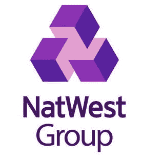

### NatWest 的业务目标

实施 MLOps 的业务目标是缩短 `NatWest` 集团实现业务价值的时间。`NatWest` 集团大规模运用分析技术，使其成为一家优化的数据驱动型银行。然而，他们的流程本可以更快、更一致。快节奏的金融服务行业竞争非常激烈，要为其 1900 万客户提供更快捷的服务需要付出巨大努力。`NatWest` 探索其数据并构建机器学习（ML）解决方案，以确保根据客户需求提供定制化体验。

## NatWest

为了通过 ML 加速实现业务价值，NatWest 转向亚马逊云服务（AWS），并采用 Amazon SageMaker 作为其核心 ML 技术。Amazon SageMaker 是一项服务，数据科学家和工程师可以使用它来构建、训练和部署 ML 模型，该服务为几乎任何用例提供完全托管的基础设施、工具和工作流程。NatWest 集团将其 ML 流程集中在 AWS 上，尽管推出新产品和服务需要数月时间。这也在其数据科学团队中引入了更敏捷的文化。使用 Amazon SageMaker，白板上的一个想法在几个月内就能变成生产环境中可运行的 ML 解决方案，而此前则需要一年或更长时间。

### 挑战

以下是 NatWest 在实施 MLOps 之前面临的挑战：

*   员工缺乏当前的培训和职责。对员工进行适当的培训本身就是一项耗时且具有挑战性的任务。

*   手动流程，如手动交接和治理，导致进展缓慢且迟钝，从而造成实现价值的时间过长。

*   数据是 ML 运营的首要前提，但访问和发现数据却很困难。

*   陈旧的技术和过时的环境导致从开发到部署的时间过长。

### 使用的平台

NatWest 集团与 AWS 专业服务团队合作，利用 Amazon SageMaker 创建了一个可扩展、安全且持久的 MLOps 平台。图 8-2 中的高级架构图展示了 NatWest 业务应用用例如何部署在 AWS 上以构建 ML 解决方案。

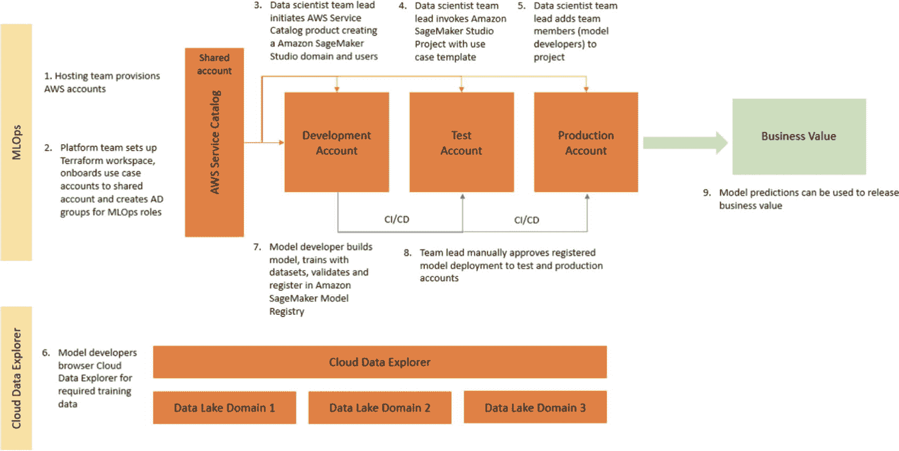

图 8-2

NatWest 的 Amazon SageMaker 高级架构

### 解决方案概述

以下是 NatWest 实施的解决方案：

*   NatWest 使用 Amazon Simple Storage Service (Amazon S3) 进行简单的数据存储和访问。借助对数据和资源的简单快速访问以及 ML 工具，构建 ML 用例变得更加轻松快捷。

*   NatWest 集团使用 AWS Service Catalog 来创建、组织和治理基础设施即代码模板。它将员工的工作流程从两到四周缩短到了几小时。

*   NatWest 集团拥有 Amazon SageMaker Studio，这是一个基于 Web 的单一可视化界面，可以在其中执行所有 ML 开发步骤。由于其易于使用和配置，因此用户友好、易于学习，并能产生有效的结果。

*   Amazon SageMaker 集成了 CI/CD 管道工作流程，用于生产就绪的用例开发。它提高了质量，优化了治理和谱系追踪。

*   借助 Amazon SageMaker Studio，NatWest 实现了更快实现价值的主要目标。

### 关键成果

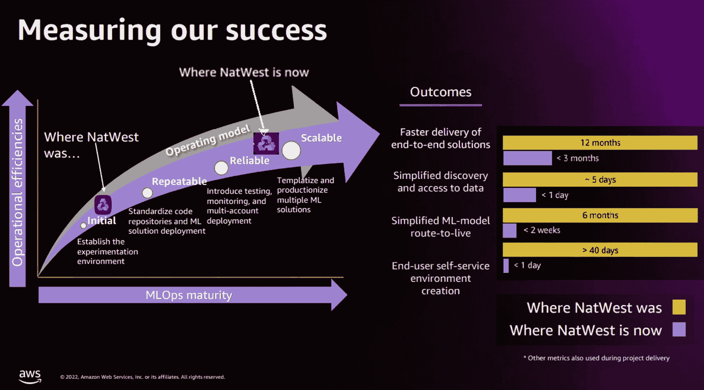

图 8-3

NatWest 集团实施 MLOps 后的成果

以下是 NatWest 集团实施 MLOps 后的关键成果：

*   端到端 ML 解决方案的交付速度加快，从 12 个月缩短到不到 3 个月。

*   通常需要 5 天的数据发现和访问，现在只需几小时即可完成。

*   ML 模型部署到生产环境曾需要 6 个多月，现在不到 2 周即可完成。

*   为最终用户创建了自助服务环境，有助于在一天内解决问题。

*   实现业务价值的时间显著缩短，这使 NatWest 处于行业领先地位。

## 汤森路透

汤森路透于 1992 年发布了其首个 AI 法律相关搜索服务 Westlaw Is Natural (WIN)，并随着更多 AI 产品和服务的发展而持续增长。汤森路透在全球法律、税务、会计、合规和新闻服务等多个领域产生了数十亿条机器学习洞察。

随着 AI 服务的大幅增长，汤森路透需要自动化和标准化重复的、无差异化的工程工作。它还需要根据治理标准，在保障敏感数据安全的前提下，轻松访问可扩展的计算资源。

### 业务目标

汤森路透的业务目标是提升 ML 能力，实施高级 AI 以提取行业洞察，帮助把握当前和未来的成果。汤森路透希望以更高的效率为利益相关者创造更大价值，并通过一流的解决方案预见未来的挑战。

### 挑战

以下是汤森路透面临的挑战：

*   尽管拥有高素质的工程师，但汤森路透的孤立技术未能提供足够的可见性，以对关键决策预测建立治理。

*   业务问题未能通过机器学习能力得到妥善处理。

*   汤森路透的各个团队遵循各自的流程和方法。TR 旨在为其用户提供覆盖整个 ML 生命周期的功能，通过让团队专注于业务目标而非重复无差异化的工程工作，来加速 ML 项目的交付。

*   在数据和 AI 解决方案中维持治理标准颇具挑战性。

### 使用的平台

汤森路透的 AI 平台微服务以 Amazon SageMaker 为核心引擎，使用 AWS 无服务器组件处理工作流程，并使用 AWS DevOps 服务处理 CI/CD 流程。对于实验和训练，实施了 SageMaker Studio，并且在汤森路透的 AI 平台中还实施了其他组件，如 SageMaker 模型注册表、Amazon DynamoDB 表、SageMaker 托管服务、SageMaker Model Monitor 和 SageMaker Clarify。

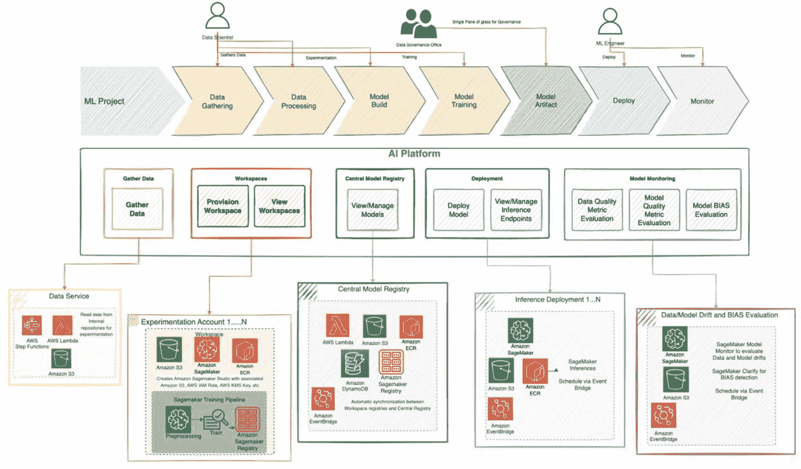

图 8-4

汤森路透实施的 Amazon SageMaker 架构

### 解决方案概述

汤森路透的企业 AI 平台为 ML 生命周期的每个阶段提供简单且标准化的能力。汤森路透 AI 平台的所有需求被模块化为五大类：

*   数据服务用于实现对企业数据资产的便捷、安全访问。

*   实施 SageMaker Studio 以提供实验工作空间，用于实验和训练 ML 模型。

*   实施 SageMaker 中央模型注册表，用于跨不同业务部门构建和注册模型。

*   实施模型部署服务，遵循企业 CI/CD 实践，以自动化各种推理部署选项。

*   已实施 SageMaker Model Monitor 和 SageMaker Clarify，以监控模型偏差、漂移自定义指标计算器以及可解释性等数据监控能力。

### 关键成果

以下是汤森路透通过 Amazon SageMaker 实施 MLOps 后取得的主要成果：

*   利用 AWS 能力，可以轻松安全地处理海量数据。

*   机器学习项目从构思到投产所需的时间已从过去的数月缩短至数周。

*   汤森路透首次能够注册和监控机器学习模型，从而符合其不断发展的模型治理标准。

*   汤森路透使数据科学家和产品团队能够有效运用创造力，解决最复杂的问题。

## Cepsa

Cepsa 是一家全球性能源公司，业务涉及可持续发展和能源转型领域。在邮轮行业，Cepsa 在巴塞罗那港首次直接供应了第二代生物燃料。

Cepsa 希望利用机器学习能力，成为能源转型、可持续出行、绿色分子和第二代生物燃料生产领域的领导者。

Cepsa 已实施机器学习，以解决其所有业务线以及炼油厂各种流程中的复杂挑战。

### 业务目标

Cepsa 的业务目标是利用各种 AWS 关键服务实施 MLOps 架构。MLOps 服务需覆盖完整的机器学习生命周期，并包含工业设备的预测性维护，以监控和优化其炼油厂的石化流程。

### 挑战

以下是 Cepsa 在实施机器学习解决方案时面临的挑战：

*   缺乏可供遵循的机器学习实施参考架构

*   没有模型注册表或版本控制系统

*   未实施模型监控

*   缺乏用于性能评估的正确指标

### 使用的平台

Cepsa 的数据科学家和开发人员实施了 AWS MLOps 系统及其各个组件。使用 AWS Cloud 9 编写、运行和调试用于数据整理和机器学习实验的代码，而 GitHub 则作为 Git 代码仓库。Amazon SageMaker 用于实现从模型训练到在模型注册表中注册输出模型的自动化训练工作流。SageMaker 模型托管功能用于创建推理端点以管理模型部署。

AWS Step Functions 用于开发模型训练和部署流程，因为它提供了一个多功能框架，允许我们为每个项目创建特定的工作流，并轻松编排不同的 AWS 服务和组件。

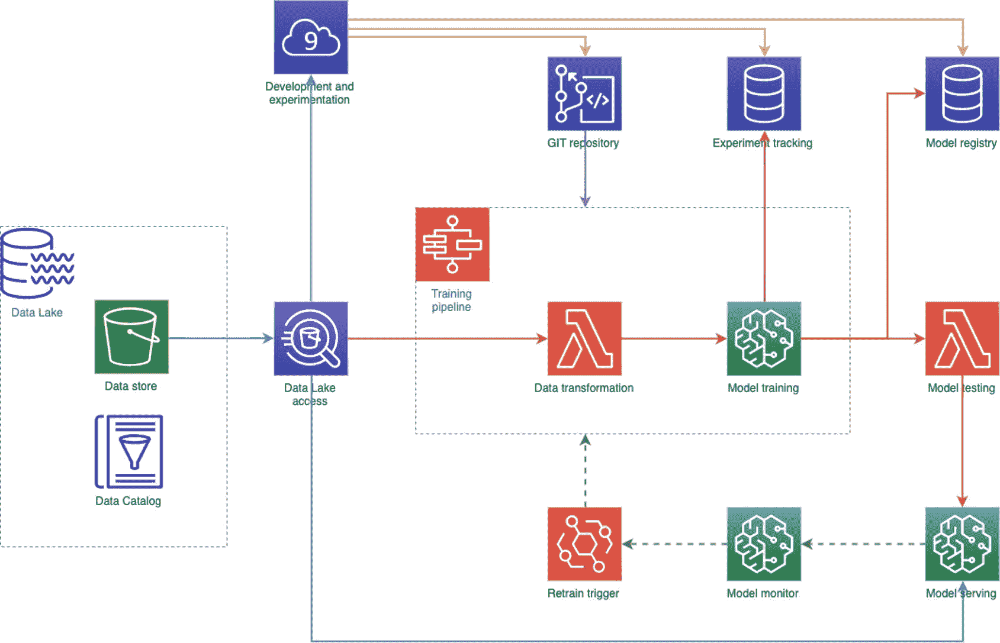

图 8-5

Cepsa 实施的 MLOps 架构

### 解决方案概述

Cepsa 为 MLOps 实施了以下 AWS 服务：

*   使用 Amazon SageMaker 构建、训练和部署机器学习模型。

*   用于训练机器学习模型的数据通过 Amazon API Gateway 从各种数据湖中提取。

*   API 后端通过 Amazon Athena（一种用于典型 SQL 数据分析的交互式查询引擎）访问存储在 Amazon Simple Storage 引擎（Amazon S3）中并在 AWS Glue Data Catalog 中编目的数据。

*   AWS Step Functions 是一种无服务器低代码可视化工作流服务，用于编排和自动化流程。

# Cepsa 基于 AWS 的 MLOps 实施

*   `Amazon EventBridge` 是一种无服务器事件总线。

*   `AWS Lambda` 是一种无服务器计算解决方案，使您无需预置或管理服务器即可执行代码。

*   Cepsa 实施了 `Amazon Elastic Container Registry`（`Amazon ECR`），用于存储、管理、共享和部署模型训练中使用的容器镜像。

*   标准的 `SageMaker Scikit-learn` 已扩展，包含了项目所需的各种环境变量。

*   为了实现模型部署自动化，实施了 `Amazon EventBridge`。

### 关键成果

在实施 `Amazon SageMaker` 和其他 AWS 组件后，Cepsa 在机器学习实施和结果方面显示出巨大改进。

*   目前，六个机器学习模型可以自动训练、部署和跟踪，并且每个生产模型已部署了超过 30 个版本的机器学习模型。

*   当前的 MLOps 架构已扩展到公司内数百个机器学习模型的各个项目。

*   借助自动化流水线和缩短的引导时间，机器学习项目的平均持续时间减少了 25%。

*   快速的机器学习项目带来了产量提升，因此预计每年可节省约 30 万欧元。

*   通过使用 `Amazon SageMaker` 进行 MLOps，实现了整个机器学习模型生命周期的自动化，以确保更好的模型质量，并实现更快、更频繁的生产部署。

## 总结思考

目标是利用 `Amazon` 提供的 `AWS` 服务，无缝地自动化机器学习系统在生产中的部署。需要遵循 `AWS` 支柱的最佳实践，以实现卓越和非凡的性能。

我们已经看到许多大型组织通过将 MLOps 实施到 `AWS` 中来提高性能，这自动化了机器学习生命周期流程。他们的项目能够更快地部署到生产环境，具有更好的性能和效率，上市时间缩短，投资回报率提高。这些是未来技术、理念、业务和组织的几个典范案例研究，可供 MLOps 改进参考。