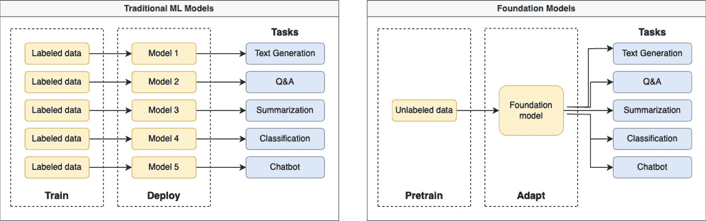
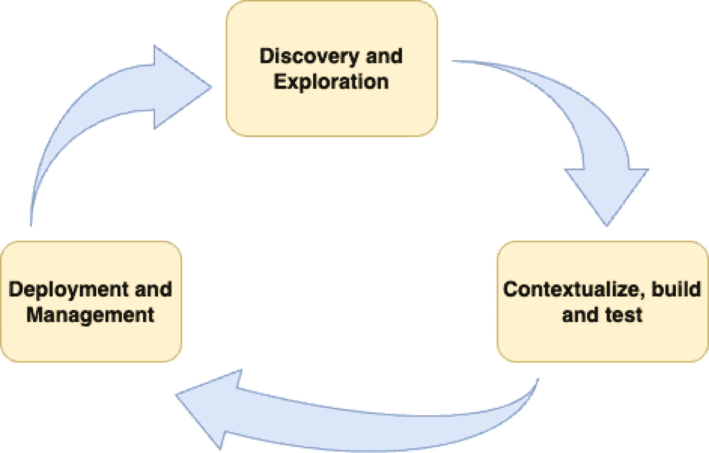
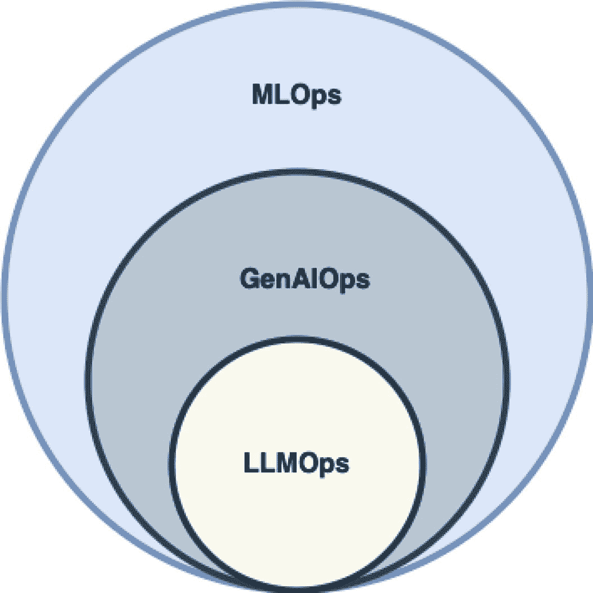
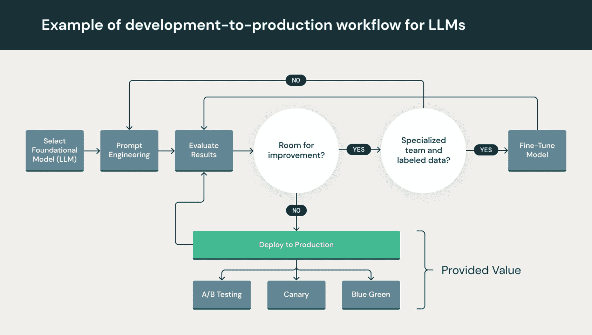
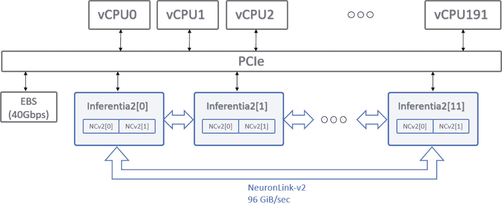
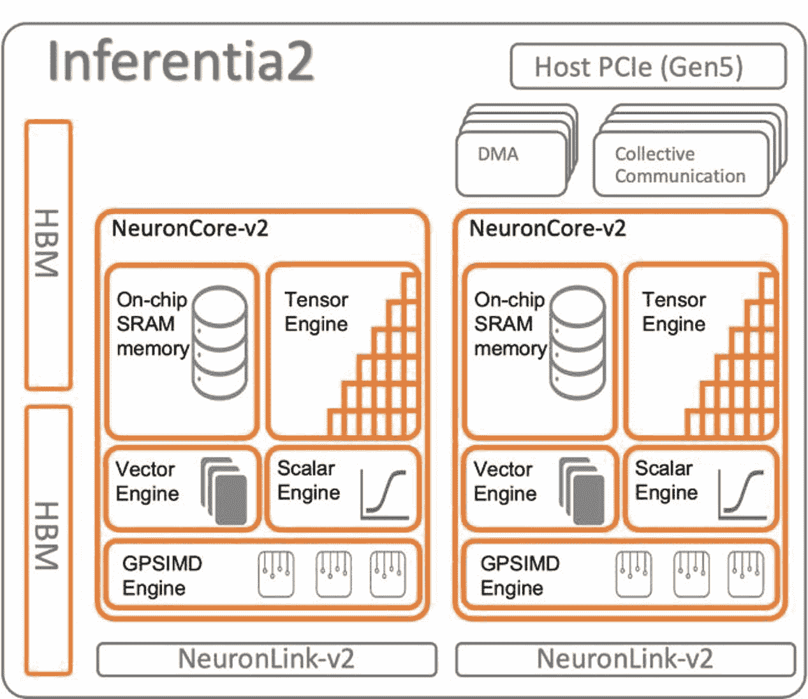
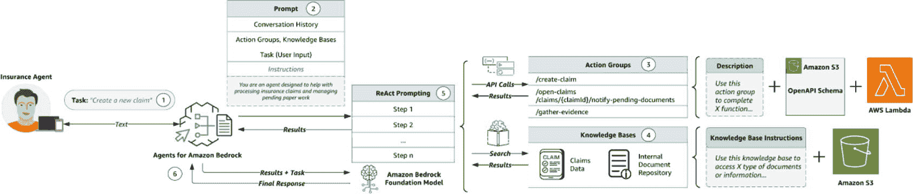
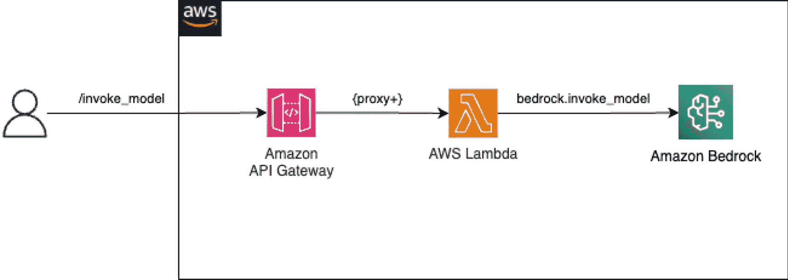

# 9. 面向生成式 AI 的 MLOps

生成式人工智能代表了更广泛人工智能领域中最迷人且发展最快的领域之一。与专注于分类或预测的传统 AI 模型不同，生成式 AI 模型会创建新的数据实例。随着近期生成式 AI 的兴起，我们不得不思考如何将 MLOps 流程适配到这类新型 AI 驱动的应用中。在本章中，我们将重点讨论大型语言模型的生产化以及面向生成式 AI 应用生命周期的 MLOps 实践。

## 理解生成式 AI

生成式 AI 指的是一类能够生成新内容（例如图像、视频、文本甚至音乐）的人工智能系统，这些内容与人类可能产出的内容相似。这类 AI 基于深度学习算法，这些算法在大量数据（如图像或文本）上进行训练，并利用这些数据生成新内容。其动力来源于在大量数据语料库上预训练的大型模型，通常被称为*基础模型*。

这些主要包括大型语言模型和大型视觉模型。生成式 AI 的主要技术包括生成对抗网络、变分自编码器和基于 Transformer 的模型。

*   **生成对抗网络**：

    生成对抗网络由两个神经网络组成：一个生成器和一个判别器，它们相互竞争。生成器创建虚假数据，而判别器评估其真实性。通过这种对抗过程，生成对抗网络能产生高度逼真的输出。

*   **变分自编码器**：

    变分自编码器将输入数据编码到潜在空间，然后解码以重建原始数据。通过在潜在空间中采样，变分自编码器可以生成新的数据实例。

*   **Transformer**：

    基于 Transformer 的模型，例如 GPT（生成式预训练 Transformer），利用注意力机制，通过根据先前项目提供的上下文预测序列中的下一个项目，来生成文本和其他序列数据。

### 为何需要基础模型

基础模型（FM）的规模与通用性使其有别于传统机器学习模型，后者通常执行特定任务，例如分析文本情感、对图像进行分类以及预测趋势。

使用传统机器学习模型时，为完成每个特定任务，客户需要收集带标签的数据、训练模型并部署该模型。而使用基础模型，客户无需为每个模型收集带标签数据并训练多个模型，只需使用同一个预训练的基础模型即可适应各种任务。基础模型还可以进行定制，以执行与其业务不同的特定领域功能，且仅需从头训练模型所需数据量和计算量的一小部分。参见图 9-1。

图 9-1

传统机器学习模型与基础模型对比

基础模型的常见任务包括文本生成、问答、搜索、文本摘要、文本提取、代码生成、图像生成、音频生成、视频生成等。

### 生成式 AI 的重要性

生成式 AI 的重要性在于其能够创建、创新和增强各种形式的数据。这种能力对多个领域的创造力、效率和问题解决具有深远影响。

#### 创造力与创新

生成式 AI 通过生成艺术、音乐、文学和设计领域的原创内容来激发创造力。艺术家和创作者利用这些模型探索新的艺术方向并创作新颖作品。

#### 数据增强

在机器学习中，生成式 AI 通过使用合成样本扩充数据集来克服数据限制，从而改进模型训练和性能。

#### 自动化与效率

生成式 AI 自动化内容创作和设计流程，提升生产力，并减少与人工创作相关的时间和成本。

#### 个性化

这些模型通过生成定制化的内容、推荐和交互，实现高度个性化的用户体验。

### 生成式 AI 在各行业的应用

生成式 AI 通过在自动化、创造力和问题解决方面开辟新的可能性，正在迅速改变各行各业。通过利用先进的机器学习模型，生成式 AI 能够生成曾经仅靠人工干预才能实现的内容、设计和解决方案。这项技术通过提升效率、驱动创新以及开辟定制化和个性化的新途径，正在彻底改变各行业的流程。随着生成式 AI 的持续发展，其应用正日益融入日常业务运营，重塑行业运作方式，并为未来的工作模式奠定基础。

#### 医疗保健

生成式 AI 通过在医学影像、药物发现和个性化医疗方面取得进展，正在彻底改变医疗保健行业。

##### 医学影像

生成对抗网络（GAN）和变分自编码器（VAE）通过生成用于诊断目的的高质量图像来增强医学影像技术。这些模型提高了 MRI 和 CT 扫描的分辨率，并协助创建用于训练目的的合成医学图像。

##### 药物发现

生成模型通过生成新药的潜在分子结构来加速药物发现。这减少了识别可行候选药物所需的时间和成本。

##### 个性化医疗

通过分析患者数据，生成式 AI 可以创建个性化治疗方案并预测个体对治疗的反应，从而改善患者预后。

#### 娱乐与媒体

在娱乐和媒体行业，生成式 AI 正在改变内容创作、动画和虚拟体验。

##### 内容创作

AI 生成的文本、音乐和艺术作品使创作者能够探索新想法并更高效地制作内容。例如，AI 可以生成剧本草稿、创作音乐或创作视觉艺术作品。

##### 动画与视觉效果

生成模型有助于为电影和视频游戏创建逼真的动画和特效。GAN 可以生成栩栩如生的角色、景观和其他视觉元素。

##### 虚拟现实（VR）与增强现实（AR）

生成式 AI 通过创建沉浸式环境和交互元素来增强 VR 和 AR 体验，使虚拟体验更具吸引力和真实感。

#### 金融

金融行业利用生成式 AI 进行欺诈检测、算法交易和金融预测。

##### 欺诈检测

生成模型识别异常模式并生成合成欺诈场景来训练检测系统，从而提高其准确性和鲁棒性。

##### 算法交易

AI 生成的交易策略分析海量市场数据，以识别有利可图的交易机会并优化投资组合。

##### 金融预测

生成式 AI 模型通过分析历史数据和模拟各种场景来预测市场趋势和财务结果，辅助投资者和金融机构的决策。

#### 零售与电子商务

生成式 AI 通过个性化推荐、虚拟试穿和库存管理来增强零售和电子商务领域。

##### 个性化推荐

AI 生成的推荐根据客户的偏好和浏览行为提供量身定制的产品建议，从而提升购物体验。

##### 虚拟试穿

生成模型创建虚拟试衣间，客户可以在其中数字化试穿服装和配饰，从而提高在线购物满意度并减少退货。

##### 库存管理

生成式 AI 预测需求模式并优化库存水平，确保高效的库存管理并减少浪费。

#### 制造业

在制造业中，生成式 AI 优化设计流程、预测性维护和供应链管理。

##### 设计优化

AI 生成的设计创建创新的产品原型，并针对性能、成本和可制造性优化现有设计。

##### 预测性维护

生成模型分析设备数据以预测维护需求并生成维护计划，从而减少停机时间并提高运营效率。

##### 供应链管理

生成式 AI 预测供应链中断，并为库存管理、物流和需求预测生成最优策略。

## 为生成式 AI 构建 MLOps 概念

随着生成式 AI 模型复杂性的提升并成为众多应用的核心，对其从开发到部署再到维护的整个生命周期进行精细化管理变得至关重要。生成式 AI 应用的多方面生命周期带来了重大挑战，需要在各个阶段采用稳健的管理和可扩展的解决方案。

在当今数据驱动的格局中，企业依赖 AI 来推动创新、传递客户价值并保持竞争优势。机器学习（ML）的广泛采用催生了用于可靠、经济高效且大规模管理代码、数据和模型的工具、流程和组织原则的开发。这种综合方法被称为*机器学习运维*（MLOps）。将 MLOps 扩展到生成式 AI 涵盖了 LLMOps 和 GenAIOps，以应对在生产环境中开发和部署生成式 AI 及大语言模型（LLM）驱动应用所面临的挑战。

### 现代生成式 AI 应用的生命周期

现代生成式 AI 应用的开发始于一个基础模型，该模型经过预训练阶段来获取基础知识和涌现能力（见图 9-2）。企业需要一种安全的方法来访问 SaaS 或开源 LLM，以及一种高效的方法，通过全面的提示工程，针对特定用例严格测试这些模型。随后，模型会使用一个由人工生成的提示和响应组成的精选数据集，与人类的偏好、行为和价值观进行对齐，从而提高其遵循指令的精确性。

图 9-2

生成式 AI 应用的生命周期

组织可以选择训练自己的基础模型，或使用预训练好的模型。在定制阶段，基础模型要么通过特定任务的提示进行增强，要么在精选的企业数据集上进行微调。然而，基础模型内嵌的知识仅限于其预训练和微调数据，因此需要持续重新训练以保持时效性——这一过程成本可能很高。定制完成后，模型即可投入实际部署，可以独立运行，也可以作为集成多个基础模型和 API 的链条的一部分，以提供完整的应用逻辑。在此阶段，必须严格测试整个 AI 系统的准确性、性能和漏洞，并实施防护措施，确保模型输出的精确性、安全性和可靠性。随后，反馈循环闭合，用户通过用户界面进行交互，或通过系统检测进行自动化数据收集。这些反馈用于模型的持续更新和 A/B 测试，从而提升其对客户的价值。

企业通常会管理众多针对不同用例、业务功能和工作流程定制的生成式 AI 应用。这个 AI 组合需要持续的监控和风险管理，以确保无缝运行、合乎道德的使用，并能迅速响应事件、偏见或性能退化。

GenAIOps 通过自动化加速了从研究到生产的这一过程，优化了开发和运营成本，提升了模型质量，增强了评估过程的稳健性，并确保持续的大规模运营。

将 AI 想象成一系列嵌套的层次（图 9-3）。在最外层，机器学习（ML）涵盖了智能自动化，其中程序逻辑并非显式编码，而是从数据中推导得出。深入一层，我们会遇到专门的 AI 类型，例如基于大型语言模型（LLM）或检索增强生成（RAG）框架的类型。同样，也存在确保可重复性、可复用性、可扩展性、可靠性和效率的分层概念。

图 9-3

生成式 AI 的 MLOps 层次

*   **MLOps** 是一个总括性概念，涵盖了在生产环境中进行端到端机器学习系统开发和运营的核心工具、流程和最佳实践。

*   **GenAIOps** 扩展了 MLOps，用于开发和运营生成式 AI 解决方案。GenAIOps 的显著特征在于对基础模型的管理和交互。

*   **LLMOps** 是 GenAIOps 的一个特定类型，专注于开发和产品化基于 LLM 的解决方案。

让我们从最底层开始，理解生成式 AI 的全面 MLOps 要素。

### LLMOps

LLM 在商业和媒体领域获得了显著关注，其影响力正 poised 改变众多行业（图 9-4）。

图 9-4

LLM 从开发到生产的工作流程

大型语言模型运维（LLMOps）涵盖了用于在生产环境中运营管理大型语言模型的实践、技术和工具。MLOps 的运营要求通常也适用于 LLMOps，但训练和部署 LLM 所面临的挑战需要一种独特的方法来应对 LLMOps。

为了有效调整 MLOps 实践，我们必须审视随着 LLM 的引入，机器学习（ML）工作流程和要求是如何演变的。关键考量包括：

*   **计算资源**：训练和微调大型语言模型需要在大量数据集上进行显著更多的计算。为了加速这一过程，会使用 GPU 等专用硬件来执行速度更快的数据并行操作。访问这些专用计算资源对于训练和部署大型语言模型都至关重要。此外，推理成本也凸显了模型压缩和蒸馏技术的重要性。

*   **迁移学习**：与通常从头构建或训练的传统 ML 模型不同，许多大型语言模型从一个基础模型开始，随后使用新数据进行微调，以提升在特定领域的性能。这种微调使得在特定应用中能够获得最先进的结果，同时所需的数据和计算资源更少。

*   **人类反馈**：训练大型语言模型的一个重大进步是通过基于人类反馈的强化学习（RLHF）实现的。鉴于 LLM 任务通常具有开放性，最终用户的反馈对于评估 LLM 性能至关重要。将这个反馈循环整合到你的 LLMOps 流程中，不仅能简化评估过程，还能为未来微调你的 LLM 提供宝贵的数据。

*   **超参数调优**：在传统 ML 中，超参数调优主要侧重于提高准确性或其他性能指标。然而，对于 LLM 而言，调优对于最小化训练和推理所需的成本和计算能力也至关重要。调整批量大小和学习率等参数会显著影响训练的速度和费用。因此，虽然经典 ML 模型和 LLM 都能从管理良好的调优过程中受益，但优先级有所不同，LLM 更强调成本和计算效率。

*   **性能指标**：传统 ML 模型有明确定义的性能指标，如准确率、AUC 和 F1 分数，这些指标计算相对简单。然而，评估 LLM 涉及一套不同的标准指标，例如双语评估替补（BLEU）和面向召回率的摘要评估替补（ROUGE）。实施这些指标需要额外的考量。

*   **提示工程**：遵循指令的模型可以处理复杂的提示或指令集。设计这些提示模板对于从 LLM 获得准确可靠的响应至关重要。有效的提示工程可以降低模型幻觉和提示攻击的风险，例如提示注入、敏感数据泄露和越狱。

*   **构建 LLM 链或流水线**：使用 LangChain 或 LlamaIndex 等工具创建的 LLM 流水线，集成了多个 LLM 调用以及与外部系统（如向量数据库或网络搜索）的交互。这些流水线使 LLM 能够执行复杂任务，例如知识库问答或基于一组文档响应用户查询。因此，LLM 应用开发通常侧重于构建这些流水线，而不是从头开发新的 LLM。

#### LLMOps 的优势

尽管大语言模型在原型设计阶段使用起来特别直接，但将其集成到商业产品中会带来重大挑战。LLM 开发生命周期包含众多复杂组件，包括数据摄取、数据准备、提示工程、模型微调、部署和监控。此过程还需要数据工程、数据科学和机器学习工程等多个团队之间的协作和无缝交接。保持运营严谨性对于确保这些流程同步且有效至关重要。LLMOps 涵盖了整个 LLM 开发生命周期中的实验、迭代、部署和持续改进。LLMOps 的主要优势在于提高效率、可扩展性和降低风险。

*   **效率**：LLMOps 使数据团队能够加速模型和管道的开发，生成更高质量的模型，并加快部署到生产环境的速度。

*   **可扩展性**：LLMOps 支持大规模的可扩展性和管理，允许监督、控制、管理和监控数千个模型，以实现持续集成、交付和部署。它确保了 LLM 管道的可重复性，促进了数据团队之间更紧密的协作，最大限度地减少了与 DevOps 和 IT 的冲突，并加快了发布周期。

*   **风险降低**：鉴于 LLM 通常需要监管监督，LLMOps 提高了透明度，并允许对此类请求做出更快速的响应，从而确保更好地遵守组织或行业政策。

#### LLMOps 最佳实践

机器学习项目中 LLMOps 的范围可能因项目需求而有很大差异。在某些情况下，LLMOps 可能涵盖从数据准备到管道生产的整个过程，而在其他情况下，它可能只涉及模型部署过程。以下最佳实践可应用于流程的不同阶段：

*   **探索性数据分析 (EDA)**：通过创建可重现、可编辑和可共享的数据集、表格和可视化，为机器学习生命周期迭代地探索、共享和准备数据。

*   **数据准备和提示工程**：迭代地转换、聚合和去重数据，使其在数据团队之间可访问和共享。迭代地开发提示，以确保对 LLM 的结构化和可靠查询。

*   **模型微调**：利用流行的开源库，如 Hugging Face Transformers、DeepSpeed、PyTorch、TensorFlow 和 JAX，来微调模型并提升其性能。

*   **模型审查与治理**：跟踪模型和管道的谱系和版本，在其整个生命周期中管理这些工件。使用像 MLflow 这样的开源 MLOps 平台来发现、共享和协作 ML 模型。

*   **模型推理与服务**：在测试和质量保证中管理模型刷新频率、推理请求时间以及其他生产特定细节。采用 CI/CD 工具，包括代码仓库和编排器（借鉴 DevOps 原则），来自动化预生产管道。启用带有 GPU 加速的 REST API 模型端点。

*   **带有人工反馈的模型监控**：建立模型和数据监控管道，并针对模型漂移和恶意用户行为设置警报。

### GenAIOps

GenAIOps 整合了最佳实践来管理所有生成式 AI 工作负载，涵盖语言、图像和多模态模型。对于生成式 AI，需要重新思考数据整理、模型训练、定制、评估、优化、部署和风险管理的过程。构建生成式 AI 应用程序涉及多个组件，例如 LLM、数据源、向量存储、提示工程和 RAG。GenAIOps 为构建、测试和部署生成式 AI 应用程序定义了 DataOps、LLMOps 和 DevOps 整体管理的运营最佳实践。

#### GenAIOps 自动化面临的挑战

以下是组织为实现成功的 GenAIOps 管道必须克服的一些挑战：

1.  **访问企业数据**：这涉及创建到各种存储解决方案和数据库的连接器，并考虑不同的摄取格式，如文件、表格数据或 API 响应。与传统的 ETL 不同，提取、清洗、掩码和分块技术需要特别关注，尤其是在处理复杂结构（如 PDF 中的表格）或从网络爬取中移除不需要的 HTML 标签时。

2.  **嵌入算法**：嵌入算法不断演变的特性意味着，试验顶级模型以选择最适合您需求的模型至关重要。否则，可能会对搜索过程产生不利影响。

3.  **查询阶段管理**：此阶段容易受到对抗性行为者的攻击，他们可能试图“越狱”提示或使系统过载，从而影响其他用户并可能导致成本激增。

4.  **分块检索过程**：对于分块检索过程，相似性搜索可能无法检索到足够的信息，或者无法检索到匹配的分块，导致缺乏全面和相关答案所需的上下文。需要高级检索链来用个性化上下文增强提示。（“我的”保险计划有哪些索赔除外？）

5.  **提示效率与提示管理**：开源 LLM 在语言理解方面正在迅速追赶专有 LLM，这在 HuggingFace 上的开放 LLM 排行榜中显而易见 [1]。因此，编写高效的提示对于获得相关且全面的答案非常重要。糟糕的提示可能会混淆 LLM 或导致不充分的响应。

6.  **理解企业领域**：虽然生成式 AI 有效地解决了企业中的许多探究性挑战，但 LLM 通常难以掌握单个企业领域的特定细微差别。LLM 是通过抓取万维网在公开可用的数据集上训练的，但企业数据位于防火墙之后；因此，LLM 可能无法理解企业内部使用的特定术语，从而导致“我不知道”的响应，或给出与维基百科词典中类似术语相关的响应，进而产生幻觉。

7.  **内容安全**：如果没有适当的护栏，LLM 可能会输出有毒或不安全的内容，导致品牌声誉问题。想象一下，为儿童或其他信息不灵通或易受影响的群体构建这些 AI 聊天机器人，他们可能会被错误信息引入歧途。

8.  **用户体验**：大多数生成式 AI 系统不关注最终用户体验。ChatGPT 已经设定了用户体验的标准，但 OpenAI 控制着包括模型在内的端到端管道。缺乏良好的体验，例如流式响应、A/B 测试框架、缺乏详尽的用户反馈机制、足够的种子问题或缺乏后续问题，可能会降低用户参与度。

#### 企业级 GenAIOps 最佳实践

有效的 GenAIOps 运营化需要具备 AI 工程师、安全专家和领域专家等技能。以下是一些最佳实践：

1.  **数据管理**：利用标准存储、数据库和 SaaS 应用接口，以最小化批量分布式数据复制和增量摄取。为使其适配 LLM，需使用分布式运行时进行数据提取、清洗、脱敏和分块。将源元数据的副本维护到向量存储中，确保下游查询系统能将其用于预过滤，以获得更相关的答案。

2.  **模型选择**：根据您的数据集，为您的用例选择最合适的嵌入模型。在实验阶段，至少尝试排名前两位的嵌入模型技术，以基于人工生成的标准问答对来理解搜索相关性。如果您没有人工生成的问答对，可利用 LLM 生成的合成问题。

3.  **查询阶段管理**：为防止有意或无意的有害行为，使用合适的分类模型来拦截问题并提供预设回复。监控有害提示的趋势，并采取适当措施迭代改进分类方法。为防止垃圾攻击，启用基于用户和令牌的限流，以限制攻击向量。

4.  **检索优化**：使用用户元数据进行预过滤，为语义搜索生成更窄的结果集，以实现最佳检索。许多向量数据库（如 OpenSearch、MongoDB 和 Pinecone）都提供混合搜索能力。根据您的源数据集，使用额外的检索链来检索整个或部分文档，为您的 LLM 查询提供充分的上下文。例如，在研发聊天机器人中，如果用户要求总结某篇科学论文，您的检索链必须基于匹配的块来检索整篇论文。

5.  **构建高效的系统提示**：构建系统提示是获得最佳响应的最关键任务。由于缺乏通用的提示框架，请确保遵循基于 LLM 或您的任务（例如对话、总结或分类）最合适的标准。为企业特定用例维护一个最佳实践提示库，以便他人受益。让领域专家参与设计系统提示至关重要，因为他们非常熟悉数据集和预期输出。提供一个提示游乐场，让领域专家可以直观地编写系统提示，包括示例、“禁止”规则和预期的响应格式。提供一个游乐场，以便快速与您企业授权的模型进行比较。维护提示的版本，以便将最佳版本推广到生产环境。

6.  **模型实验**：许多企业从 SaaS 模型提供商（如 Azure OpenAI 或 Amazon Bedrock）开始。开源模型（如 Llama2、Mistral 和 MPT 及其变体）正在迅速追赶。针对至少两到三个领先的 SOTA 模型测试您的应用，以了解响应时间、领域理解和响应质量。典型的企业应用可能不需要多头部 SaaS 模型的复杂功能，因此随着规模扩展，使用开源模型可能同样有效，并提供更好的性价比。为快速测试，构建一个评估脚本，采用“LLM 作为评判者”的方法来比较响应的相关性、全面性和准确性。如果通用模型无法提供相关且全面的响应，则采用领域特定的微调或指令微调技术，并在您的 RAG 中使用微调后的模型。

7.  **内容安全**：为防止有害、有毒的响应，增强系统提示以指示 LLM 从响应中删除有害内容。使用其他分类器采用额外控制措施，完全阻止有害响应，以确保信任和安全。使用一组标准问题进行自动化测试，确保 RAG 经过回归测试，以应对 LLM、系统提示或数据中的任何变化。护栏在对抗性或不受支持的输入到达基础模型之前将其拦截，确保输出准确、相关、安全可靠。它们监控和验证对话状态及活动上下文，检测意图，并在执行内容策略的同时做出决策。这些护栏扩展了模型管理所涵盖的基于规则的 AI 输入/输出预处理/后处理。

8.  **提升用户体验**：最终，用户体验对于提高参与度和吸引新用户至关重要。如果您正在构建对话系统，请添加流式传输，提供适当的反馈选项以便用户对响应进行评分，并自愿提供正确的响应以构建知识库。提供自定义指令、启动对话的引导性问题以及后续问题。生成式 AI 正在快速发展，因此持续监控用户反馈并整合多模态（图像和文本）等附加功能至关重要。

这些最佳实践使企业能够执行快速原型设计、生产部署和持续监控。生成式 AI 应用的可观测性能力、评估和集中性能监控，可实现持续的质量改进和企业治理。

### MLOps

MLOps 为机器学习模型在生产环境中的开发、训练、评估、优化、部署、推理和监控建立了结构化框架。MLOps 的原则和能力同样适用于生成式 AI，包括以下方面：

*   **基础设施管理**：以编程方式请求、配置和配置计算、存储和网络资源，以访问底层硬件。

*   **数据管理**：处理用于训练和评估的数据收集、摄取、存储、处理和标注。实施基于角色的访问控制；促进数据集搜索、浏览和探索；跟踪数据来源；记录数据日志；对数据集进行版本管理；索引元数据；验证数据质量；并利用数据集卡片和仪表板进行数据可视化。

*   **工作流和管道管理**：将数据准备、模型训练、模型评估、模型优化和模型部署步骤集成到端到端的自动化、可扩展工作流中，利用云资源或本地工作站。

*   **模型管理**：训练、评估和优化用于生产的模型，在集中式模型注册表中使用模型卡片存储和版本化管理模型，评估模型风险，并确保符合标准。

*   **实验管理和可观测性**：跟踪和比较各种机器学习模型实验，包括训练数据、模型和超参数的变化。自动探索可能的模型架构和超参数空间，分析推理期间的模型性能，并监控模型输入和输出是否存在概念漂移。

*   **交互式开发**：管理开发环境，与外部版本控制系统、桌面 IDE 和其他独立开发者工具集成，促进团队协作、任务启动和项目原型设计。

从 MLOps 的角度来看，LLM 带来了新的需求，对 MLOps 实践和平台产生了影响。表 9-1 总结了 LLM 的关键特性及其对 MLOps 的影响。

表 9-1

LLM 的关键特性及其对 MLOps 的影响

| LLM 的关键特性 | 对 MLOps 的影响 |
| --- | --- |
| LLM 有多种形式：    • 付费 API 背后的通用专有模型    • 从通用到特定应用的开源模型    • 为特定应用微调的自定义模型 | **开发流程：** 项目通常采用渐进式开发，从现有的、第三方或开源模型起步，最终形成自定义微调模型。 |
| 许多 LLM 以通用自然语言查询和指令作为输入。这些查询可以包含精心设计的“提示词”，以引出期望的响应。 | **开发流程：** 为查询 LLM 设计文本模板通常是开发新 LLM 流水线的重要环节。**打包 ML 制品：** 许多 LLM 流水线会使用现有的 LLM 或 LLM 服务端点；为这些流水线开发的 ML 逻辑可能侧重于提示词模板、代理或“链”，而非模型本身。打包并推送到生产环境的 ML 制品通常可能是这些流水线，而非模型。 |
| 许多 LLM 可以接收带有示例、上下文或额外信息的提示词，以帮助回答查询。 | **服务基础设施：** 在向 LLM 查询补充上下文时，使用向量数据库等以往不常用的工具来搜索相关上下文非常有价值。 |
| LLM 是非常庞大的深度学习模型，大小通常从千兆字节到数百千兆字节不等。 | **服务基础设施：** 许多 LLM 可能需要 GPU 来实现实时模型服务。**成本/性能权衡：** 由于更大的模型需要更多计算资源，服务成本更高，因此可能需要采用减小模型大小和计算量的技术。 |
| LLM 难以通过传统的 ML 指标进行评估，因为通常不存在单一的“正确”答案。 | **人工反馈：** 由于人工反馈对于评估和测试 LLM 至关重要，因此必须将其更直接地整合到 MLOps 流程中，既用于测试和监控，也用于未来的微调。 |

*来源：Databricks MLOps 大百科，第 2 版*

## 面向生成式 AI 的 AWS MLOps

AWS 提供了一个广泛的生态系统，支持生成式 AI 生命周期的每个阶段，从数据准备和模型训练，到生成式 AI 应用的开发、部署和监控。以下是构成 AWS 生成式 AI 格局的关键要素。

### 使用基础模型进行构建

AWS 提供了一条路径，通过新的能力、行业领先的基础模型（FM）的选择以及最具成本效益的基础设施，来加速创新。

#### Amazon Bedrock

Bedrock 是一项完全托管的服务，通过单一 API 提供来自领先 AI 公司（如 AI21 Labs、Anthropic、Cohere、Meta、Mistral AI、Stability AI 和 Amazon）的一系列高性能基础模型（FM）的访问权限。它提供了一套全面的功能来开发生成式 AI 应用，重点关注安全性、隐私性和负责任的 AI。借助 Amazon Bedrock，您可以轻松针对特定用例试验和评估顶级 FM，通过微调和检索增强生成（RAG）等技术使用您的数据私下定制它们，并构建能够使用您的企业系统和数据源执行任务的代理。由于 Amazon Bedrock 是无服务器的，因此无需管理基础设施，您可以使用熟悉的 AWS 服务将生成式 AI 功能安全地集成和部署到您的应用程序中。

##### 模型选择的灵活性

Amazon Bedrock 帮助您快速适应并利用最新的生成式 AI 创新，轻松访问来自领先 AI 公司（如 AI21 Labs、Anthropic、Cohere、Meta、Mistral AI、Stability AI 和 Amazon）的一系列高性能 FM。无论您选择哪种模型，Amazon Bedrock 的单一 API 访问都为您提供了灵活性，可以使用不同的 FM，并以最少的代码更改升级到最新的模型版本。

##### 安全定制

为了针对特定任务定制模型，您只需几个简单步骤，即可使用您的标记数据集私下微调基础模型（FM）。Amazon Bedrock 支持对 Cohere Command、Meta Llama 2、Amazon Titan Text Lite 和 Express、Amazon Titan Multimodal Embeddings 以及 Amazon Titan Image Generator 进行微调。为了将 Amazon Titan Text 模型适配到您的行业和领域，您可以使用未标记数据进行持续预训练。通过微调和持续预训练，Amazon Bedrock 会创建一份仅您可访问的基础 FM 的独立副本，确保您的数据不会用于训练原始基础模型。AWS 允许您通过简单地在 Amazon S3 中指向几个标记示例来私下定制模型，使服务能够仅用 20 个示例就为特定任务微调模型。例如，一家领先时装零售商的内容营销经理需要为新手袋系列制作新颖、有针对性的广告和活动文案，他们可以提供过去活动中表现最佳的标语以及相关产品描述的标记示例。然后，Bedrock 将自动为新手袋生成有效的社交媒体、展示广告和网页文案。

*   **生成式 AI 应用的安全性**：使用 Bedrock，您可以完全控制用于为生成式 AI 应用定制基础模型的数据。您的数据在传输和静态存储时均会加密。此外，您可以通过 AWS Key Management Service (AWS KMS) 创建、管理和控制加密密钥。基于身份的策略提供了额外的控制，允许您管理用户和角色在特定资源上以及在特定条件下可以执行的操作。

*   **数据保护与隐私**：Bedrock 确保您的数据始终在您的控制之下。当您微调基础模型时，它基于一个私有副本，这意味着您的数据不会与模型提供商共享，也不会用于改进基础模型。您可以使用 AWS PrivateLink 从您的 Amazon Virtual Private Cloud (VPC) 到 Amazon Bedrock 建立私有连接，避免将您的 VPC 暴露于互联网流量。此外，Bedrock 符合通用标准，包括 ISO、SOC 和 CSA STAR Level 2，符合 HIPAA 资格，并且可以符合 GDPR 要求使用。

*   **治理与可审计性**：Bedrock 提供广泛的监控和日志记录功能，以满足您的治理和审计需求。您可以利用 Amazon CloudWatch 跟踪使用指标并创建用于审计的自定义仪表板。此外，AWS CloudTrail 可用于监控 API 活动，并在将其他系统集成到您的生成式 AI 应用时排查问题。您还可以选择将元数据、请求和响应存储在您的 Amazon Simple Storage Service (Amazon S3) 存储桶和 Amazon CloudWatch Logs 中。为防止滥用，Amazon Bedrock 集成了自动滥用检测机制。

### 基础模型训练与托管基础设施

构建基础模型（FM）需要构建、维护和优化大型集群，以便在海量数据上训练具有数百亿到数千亿参数的模型。AWS 为生成式 AI 提供了专用加速器。

#### Amazon SageMaker HyperPod

构建基础模型（FM）需要构建、维护和优化大型集群，以便在海量数据上训练拥有数百亿至数千亿参数的模型。Amazon SageMaker HyperPod 简化了为训练基础模型而构建和优化机器学习基础设施这一复杂任务，可将训练时间缩短多达 40%。它预配置了 SageMaker 的分布式训练库，使客户能够自动将训练工作负载分布到数千个加速器上，从而提升模型性能。此外，SageMaker HyperPod 通过定期保存检查点来确保 FM 训练不中断。如果在训练过程中发生硬件故障，它会自动检测问题、修复或替换故障实例，并从上一个检查点恢复训练，无需人工干预，从而实现连续数周或数月的无中断训练。

#### AWS Trainium 和 AWS Inferentia2

训练大规模 LLM 需要在超过 100 个节点上进行分布式训练，而要弹性获取大型高性能计算集群非常困难。即使您成功获得了所需的加速计算能力，管理超过 100 个节点的集群、维持硬件稳定性以及实现模型训练的稳定性和收敛性也极具挑战性。

对于拥有数十亿参数的基础模型的大规模训练，Trainium Trn1 和 Trn1n 实例因其特性而成为理想选择。Trn1 实例由先进的 NeuronCore-v2 技术驱动，提供充足的加速器计算能力和内存。Trn1n 实例提供更高的网络带宽（1,600 Gbps），非常适合注重成本优化的高性能训练。

AWS Inferentia 是 AWS 专门为推理设计的高性能、低成本的机器学习推理加速器。

每个 EC2 Inf2 实例最多可搭载 12 个 Inferentia2 设备，并提供四种实例规格供您选择：Inf2.xlarge、Inf2.8xlarge、Inf2.24xlarge 和 Inf2.48xlarge。参见图 9-5。

图 9-5

AWS Inf2 架构

Amazon EC2 Inf2 支持 NeuronLink v2，这是一种低延迟、高带宽的芯片间互连技术，可实现诸如 AllReduce 和 AllGather 等高性能集合通信操作。这能够高效地将模型分片到多个 AWS Inferentia2 设备上（例如通过张量并行），从而优化延迟和吞吐量。这对于大型语言模型尤其有用。图 9-6 展示了 AWS Inferentia2 设备架构的内部工作原理。

图 9-6

AWS Inf2 设备架构

#### DJLServing

DJLServing 是一个高性能模型服务器，于 2023 年 3 月支持 AWS Inferentia2。AWS 提供了一个适用于 LLM/AIGC 用例的容器镜像。DJL 集成了对 Neuron 的 Rubikon 支持，其中包括 DJLServing 和 transformers-neuronx。这些是容器的核心组件，旨在服务于 transformers 库所支持的 LLM。该容器以及后续的 DLC，能够利用已安装的 AWS Inferentia 驱动程序和工具包，在 Amazon EC2 Inf2 主机内的 AWS Inferentia 芯片上加载模型。

#### SageMaker 深度学习容器 (DLCs)

大型模型通常超出单个加速器的内存容量。例如，BLOOM-176B 模型可能需要超过 350 GB 的内存，这超出了当前硬件加速器的能力。这就需要使用 DeepSpeed 和 Hugging Face Accelerate 等库中的模型并行技术，将模型分布到多个加速器上进行推理。SageMaker 的大型模型推理容器可与这些库一起使用，以提升模型性能。

#### SageMaker Jumpstart

SageMaker Jumpstart 使您能够托管自己的机器学习模型，允许您选择基础设施组件，例如实例规格和部署端点。训练和部署拥有数十亿参数的 LLM 的主要挑战之一是其规模，这使得它们难以装入通常用于深度学习的单个 GPU 中。这些模型的规模需要高性能计算资源，例如具有大容量内存的专用 GPU。此外，这些模型的规模可能导致计算成本高昂，显著增加训练和推理时间。您可以使用 Amazon SageMaker JumpStart 在特定领域的数据集上轻松微调大型语言文本生成模型，其方式与在 Amazon SageMaker 上训练和部署任何模型类似。JumpStart 目前提供两种微调方式：指令微调和领域自适应微调。

### 在 AWS 上实现生成式 AI 的 MLOps 运营

随着组织越来越多地采用生成式 AI 来推动创新和增强决策能力，建立强大的运营框架变得至关重要。通过利用 AWS 全面的工具和服务套件，企业可以无缝地将其生成式 AI 模型投入运营，确保它们在真实应用中提供一致、高质量的输出。

### 使用 Amazon Bedrock 的 LLMOps

Amazon Bedrock 是一项完全托管的服务，通过单一 API 简化了对来自领先 AI 公司的高性能基础模型（FM）的访问。它使开发人员能够构建和扩展生成式 AI 应用程序，而无需管理底层基础设施的复杂性。它提供以下功能：

*   **访问基础模型**：Bedrock 提供来自 Amazon 以及 AI21 Labs、Anthropic 和 Stability AI 等第三方提供商精心挑选的高质量模型，使您能够为特定用例选择最合适的模型，而无需受限于单一提供商。

*   **API 优先方法**：其以 API 为中心的设计确保了与现有工作流和工具的无缝集成，使您能够以最小的干扰将 Bedrock 整合到当前的开发流程中。

*   **微调能力**：Bedrock 使您能够定制模型以满足特定需求，从而提升在特定领域任务上的性能。这对于希望利用专有数据来提升模型性能的组织至关重要。

*   **托管基础设施**：AWS 负责底层基础设施，让您可以专注于模型开发和部署，而无需管理服务器，从而显著降低运行大型语言模型的操作开销。

*   **内置安全与合规性**：Bedrock 包含企业级安全功能，帮助您满足各种监管标准的合规要求。

参考图 9-2 所示的生成式 AI 应用生命周期，以下部分将详细阐述 Amazon Bedrock 如何帮助实现 LLMOps。

#### 选择合适的基础模型

Amazon Bedrock 让您能够访问来自顶尖 AI 公司（如 AI21 Labs、Anthropic、Cohere、Meta、Mistral AI、Stability AI 和 Amazon）的一系列高性能基础模型。凭借其单一 API 访问接口，Bedrock 为您提供了使用各种基础模型的灵活性，并且只需对代码进行最小程度的修改即可升级到最新版本。Amazon Bedrock 提供了一套基础模型，能够生成以下模态的输出：

*   **文本**：根据文本输入生成各种文本类型。示例包括聊天、问答、头脑风暴、摘要、代码生成、表格创建、数据格式化和重写。

*   **图像**：根据文本或输入图像生成或修改图像。示例包括图像生成、编辑和变体。

*   **嵌入**：根据文本、图像或两者生成数值向量。这些向量可以与其他嵌入进行比较，以确定语义或视觉相似性。示例包括文本和图像搜索、查询、分类、推荐、个性化和知识库创建。

#### 自定义基础模型

您可以在 Amazon Bedrock 中使用自己的数据，以私密且安全的方式自定义基础模型，从而开发适合您所在领域、组织和用例的应用程序。自定义模型使您能够创建与公司风格、声音和服务相一致的独特用户体验。

微调允许您通过提供特定任务的有标签训练数据集来提高模型准确性，进一步专业化您的基础模型。持续预训练则允许您在由客户管理密钥的安全托管环境中，使用自己的无标签数据来训练模型。此过程增强了模型的领域特异性，在其原始训练之外构建了更强大的知识和适应性。

Amazon Bedrock 目前提供以下自定义方法：

*   **持续预训练**：使用无标签数据对基础模型进行预训练，使其熟悉特定的输入类型。您可以提供特定主题的数据来增强模型的领域知识。此过程会调整模型的参数，以更好地处理输入数据。例如，您可以使用未公开的内部业务文档等私有数据来训练模型。随着更多无标签数据的出现，您可以通过重新训练来进一步增强模型。

*   **微调**：使用有标签数据来训练模型，并提高其在特定任务上的性能。通过提供包含有标签示例的数据集，模型学会为给定的输入生成适当的输出。此过程会调整模型的参数，从而提高其在训练数据集所代表任务上的性能。

#### 提示工程与测试

提示工程涉及优化向大语言模型输入的文本，以获得期望的响应。它有助于大语言模型执行各种任务，如分类、问答、代码生成、创意写作等。提示的质量会显著影响大语言模型生成的响应。Amazon Bedrock 提供了一个平台，用于使用其支持的模型创建和测试提示。

Amazon Bedrock 上的大语言模型包含各种推理参数，如温度、令牌长度、Top-P、Top-K 以及结束令牌/结束序列。这些参数允许您控制模型的响应。Amazon Bedrock 上的大语言模型在接收到清晰直接的指令时表现最佳，但您也可以尝试不同的提示技巧，例如少样本提示和思维链。Bedrock 还为常见任务和用例提供了提示模板，可帮助您入门提示工程。

#### Bedrock 护栏

Bedrock 护栏允许您根据特定的用例和负责任的人工智能政策，为生成式人工智能应用程序建立安全防护措施。您可以创建针对不同场景的多个护栏，并将其应用于多个基础模型，从而确保一致的用户体验，并标准化跨生成式人工智能应用程序的安全和隐私控制。

护栏还与 Bedrock 知识库集成，并提供一套全面的策略来保护用户免受不良交互的影响。您可以自定义拒绝主题以避免在应用程序上下文中出现，根据预构建的类别（如仇恨、侮辱、性内容、暴力、不当行为和提示攻击）过滤内容，并定义要屏蔽的冒犯性或不当词语。此外，您可以过滤包含敏感信息（如个人身份信息）的用户输入，或在模型响应中编辑机密信息。护栏可应用于发送给模型的输入以及基础模型生成的内容。

#### 赋予基础模型上下文

借助 Amazon Bedrock 的知识库，您可以为基础模型和代理提供来自公司私有数据源的上下文信息，用于检索增强生成，从而提高响应的相关性、准确性和定制化程度。此功能会自动从各种来源检索文档，将其分割成文本块，将文本转换为嵌入，并将其存储在您的向量数据库中。如果您没有现有的向量数据库，Amazon Bedrock 可以为您创建一个 Amazon OpenSearch Serverless 向量存储。或者，您可以指定来自受支持数据库的现有向量存储，包括 Amazon OpenSearch Serverless、Pinecone 和 Redis Enterprise Cloud，并支持 Amazon Aurora 和 MongoDB。

#### 部署 Bedrock 代理

生成式人工智能代理是大型企业通用且强大的资产。它们能提高运营效率、改善客户服务并支持决策，同时降低成本并促进创新。这些代理在自动化各种常规和重复性任务方面特别有效，包括数据录入、客户支持查询和内容创建。此外，它们可以通过将复杂任务分解为更小、可管理的操作，并协调各个步骤来高效执行这些操作，从而管理复杂的多步骤工作流。

Amazon Bedrock 的代理扮演着指挥者的角色，协调基础模型、API 集成、用户对话以及加载了您数据的知识源之间的交互。

Amazon Bedrock 的代理和知识库协同工作，提供以下能力：

*   **任务编排**：代理利用基础模型来解释自然语言查询，并将复杂任务分解为更小、可操作步骤。

*   **交互式数据收集**：代理通过自然对话与用户互动，以收集更多信息。

*   **任务执行**：通过基于 ReAct 提示的一系列推理步骤和操作，代理完成客户请求。

*   **系统集成**：代理通过向集成的公司系统发出 API 调用来执行特定操作。

*   **数据查询**：知识库通过来自客户特定数据源的完全托管式检索增强生成，提高准确性和性能。

*   **来源归属**：代理执行来源归属，通过思维链推理追溯信息或操作的来源。

您可以在 Amazon Bedrock 控制台中或通过向 TSTALIASID 发出 API 调用来测试您的代理。根据需要调整配置。使用追踪功能来分析您的代理在每个编排步骤中的推理过程。

一旦您的代理经过充分修改并准备好部署，请创建一个指向代理版本的别名。配置您的应用程序以向代理别名发出 API 调用，并根据需要通过创建其他版本和别名来持续优化您的代理。参见图 9-7。

图 9-7

使用 Bedrock 代理和知识库的示例解决方案架构

#### 使用 Amazon Bedrock 进行推理

Amazon Bedrock 允许您使用所选的基础模型进行推理。进行推理时，您需要提供以下输入：

*   **提示词**：提供给模型以生成响应的输入
*   **推理参数**：有助于引导或限制模型响应的可调值

您可以通过以下方式进行模型推理：

*   在用户友好的图形界面中使用任意一种游乐场进行推理。
*   使用 Converse 和 ConverseStream API 构建对话式应用程序。
*   发送 `InvokeModel` 或 `InvokeModelWithResponseStream` 请求。
*   准备一个包含所需配置的提示词数据集，并通过 `CreateModelInvocationJob` 请求运行批量推理。

您可以使用基础模型、自定义模型或预置模型进行推理。要对自定义模型进行推理，您需要首先购买预置吞吐量。使用这些方法，通过不同的提示词和推理参数来测试基础模型的响应。在探索了这些方法之后，您可以配置应用程序，通过调用这些 API 来运行模型推理。

图 9-8 展示了一个如何从您的应用程序调用 Bedrock API 的简单示例。

图 9-8

Bedrock API 调用

#### 监控与治理

Amazon Bedrock 提供广泛的监控和日志记录功能，以满足您的治理和审计需求。您可以使用 Amazon CloudWatch 监控使用指标，并创建用于审计的自定义仪表板。AWS CloudTrail 允许您跟踪 API 活动，并在将其他系统集成到您的生成式 AI 应用程序时排查问题。此外，您可以选择将元数据、请求和响应存储在您的 Amazon S3 存储桶和 Amazon CloudWatch Logs 中。

#### 评估与持续改进

AI 领域在不断发展，您的模型、提示词、智能体和应用程序也应如此。Amazon Bedrock 提供以下功能来支持这一点：

*   **模型评估任务**：模型评估在开发的所有阶段都至关重要。Amazon Bedrock 提供了自动评估和人工评估的选项。自动评估使用预定义的指标，如准确性、鲁棒性和毒性。对于主观或自定义指标（例如友好度、风格和品牌语调一致性），您可以轻松设置人工评估工作流。您可以使用自己的数据集并定义自定义评估指标，选择您的内部团队或 AWS 管理的团队作为评审员。这简化了建立和管理人工评估工作流的过程。

*   **提示词优化**：提示词和提示工程是特定于模型的。给不同模型相同的提示词通常会产生不同的结果。同样，提示工程技巧并非普遍适用于所有模型。在某些情况下，许多为特定 NLP 任务微调的大型语言模型可能不需要提示词。相反，非常通用的大型语言模型则能从精心设计的提示词中显著受益。跟踪查询和响应，以便进行比较和迭代以改进提示词。考虑开发提示词模板，特别是对于复杂的提示词。如果您的提示词包含用户输入，请采用技术来防止提示词注入，方法是清晰地区分您的指令和用户输入。

#### 管理成本与性能的权衡

大型语言模型的一个主要运营问题是平衡成本和性能，尤其是在推理和服务期间。拥有数亿参数的“小型”大型语言模型和达到数千亿参数的大型模型，其计算成本可能会变得非常高昂。幸运的是，在部署和服务大型语言模型时，有多种方法可以管理和降低这些成本。

*   **从简开始，逐步扩展**：在创建新的基于大型语言模型的应用程序时，快速开发至关重要，因此使用成本较高的选项（如现有模型的付费 API）是可以接受的。随着进展，收集数据，例如查询和响应。这些数据可用于微调一个更小、更具成本效益且您可以拥有的模型。

*   **评估您的成本**：预估您期望的每秒查询次数、请求是否会突发以及每次查询的成本。这些计算将有助于确定项目的可行性，并指导您何时考虑使用内部开源模型进行微调。

*   **通过调整大型语言模型和查询来降低成本**：利用特定于大型语言模型的各种技术来减少计算量和开支。这包括缩短查询、修改推理设置以及使用更小的模型版本。

*   **人工反馈至关重要**：降低成本很简单，但如果没有最终用户的反馈，就很难理解这些变化如何影响结果。

#### AWS Bedrock 上 LLMOps 的最佳实践

为了优化您在 AWS Bedrock 上使用 LLMOps 的效果，请遵循以下最佳实践：

1.  **从单一用例开始**：从一个特定的应用程序开始，然后逐步扩展。这种方法有助于您的团队掌握 Bedrock 的复杂性，而不会感到不知所措。

2.  **利用版本控制**：维护模型版本、提示词和微调数据集的记录。这对于可重复性、审计和确保合规性至关重要。

3.  **自动化常规任务**：使用 AWS Step Functions 或 Lambda 来自动化重复性任务，最大限度地减少人为错误并提高效率。

4.  **为可扩展性做好准备**：随着您的 LLM 应用程序的扩展，设计您的系统以适应增长。这有助于避免未来出现性能瓶颈和重大的架构变更。

5.  **建立全面的监控**：实施全面的监控和警报系统，以便在问题影响用户之前发现并解决它们。

6.  **强调安全与合规**：从一开始就纳入强有力的安全措施，以保护您的组织免受数据泄露并确保符合法规要求。

### 结论

在一个以数据驱动决策和智能自动化为特征的时代，MLOps 的重要性毋庸置疑。MLOps 为大规模开发、部署和维护 AI 模型提供了关键框架，确保它们保持准确性并持续提供商业价值。LLMOps 的兴起凸显了生成式 AI 的快速进步和专业化需求。然而，从根本上说，LLMOps 是建立在 MLOps 的核心原则之上的。

无论您是在实施传统的机器学习解决方案还是由 LLM 驱动的应用程序，四个核心原则始终不变：

1.  **业务目标**：始终与您的业务目标保持一致。
2.  **以数据为中心**：优先考虑以数据为中心的方法。
3.  **模块化**：以模块化的方式实施解决方案。
4.  **自动化**：尽可能努力实现流程自动化。

通过采用全面的 LLMOps 生命周期，组织可以负责任且高效地利用 AI。这种方法可以建立与用户和利益相关者的信任，确保符合不断变化的法规，并使组织能够将 AI 作为战略资产加以利用，同时管理相关风险。

