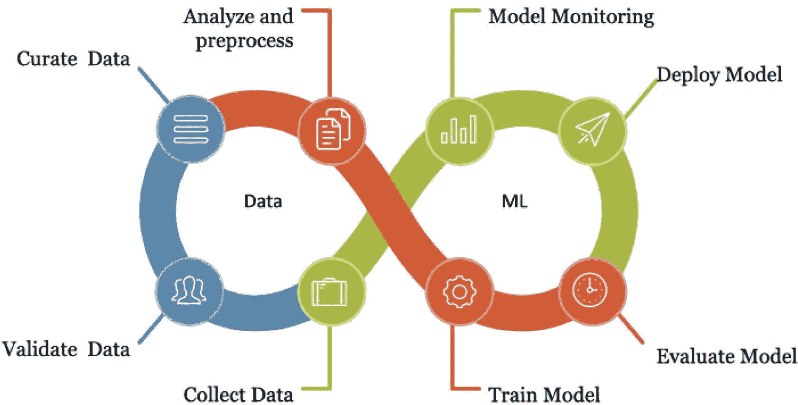
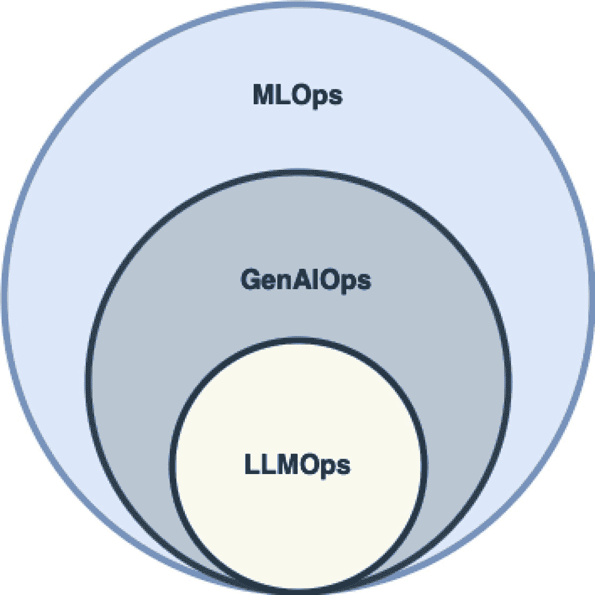
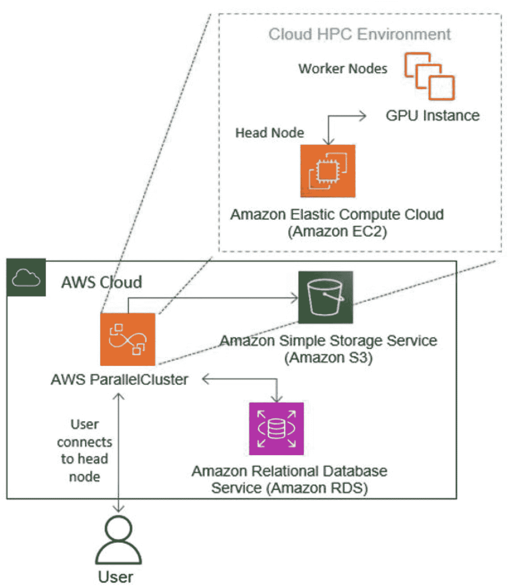
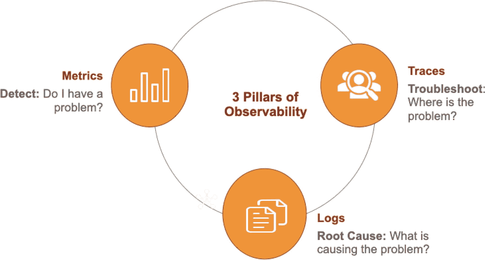
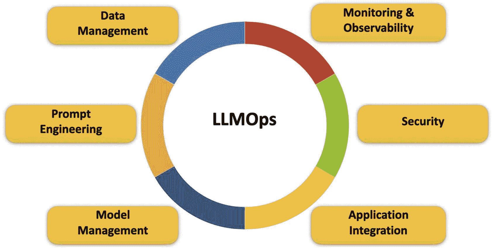

# 10. MLOps 的未来趋势

人工智能时代不仅正在来临，它已经到来，以前所未有的速度重塑着各行各业与社会。随着人工智能的持续演进，其对业务运营、数据管理以及技术基础设施的影响将深远而广泛。在众多变革性技术中，生成式人工智能脱颖而出，成为下一波数据驱动创新的催化剂。它将重新定义企业管理、分析和利用数据的方式，从而推动对先进机器学习运维（MLOps）实践的需求，以跟上这些变化的步伐。见图 10-1。

图 10-1

MLOps 流水线

生成式人工智能将彻底改变未来领先企业的数据战略。通过将数据集中在托管服务平台，企业能够获得有效训练和部署大型语言模型（LLM）及其他人工智能系统所需的安全性、治理能力和统一的数据存储库。这种集中化创建了单一事实来源，简化了运营流程并增强了决策能力。

然而，生成式人工智能的兴起也标志着本地数据存储时代的终结。人工智能工作负载的巨大规模和复杂性正推动企业转向基于云的解决方案，后者提供了本地系统无法比拟的可扩展性和灵活性。然而，向云端的迁移也带来了新的挑战，尤其是在安全性和合规性方面。随着组织采用多云策略，他们常常发现自己需要在不同平台上管理分散的数据和模型，而每个平台的安全和治理能力各不相同。这种碎片化使得维持统一的安全态势和满足合规要求变得越来越困难。

在本章中，我们将探讨进入 2025 年及以后 MLOps 的未来趋势。我们将审视企业如何驾驭不断演变的人工智能格局，生成式人工智能带来的挑战与机遇，以及在一个日益复杂的数字世界中维持性能、安全性和合规性所需的策略。本章将深入探讨 MLOps 在确保组织能够充分利用人工智能潜力，同时降低与这项强大技术相关的风险方面所扮演的关键角色。

## 驾驭生成式人工智能演进的下一波浪潮

随着我们进入生成式人工智能时代，机器学习运维的格局即将迎来变革性的变化。大型语言模型、生成式人工智能和云计算等先进技术的融合，正在重塑组织在生产环境中管理和部署人工智能模型的方式。这种转变不仅需要对生成式人工智能技术有深刻的理解，还需要采用创新的工具和实践来应对现代数据生态系统的复杂性。

MLOps 已从一项小众实践发展成为企业人工智能部署中的关键组成部分。MLOps 与 LLMOps 和 GenAIOps 的融合给现有的 MLOps 范式带来了重大挑战。随着组织越来越多地部署大型语言模型和生成式人工智能模型，在整个生命周期中管理这些模型的复杂性也随之增加。

MLOps 正在开辟自己的道路，以实现大规模人工智能模型管理的自动化和优化。此外，对实时可观测性、健壮数据管道和伦理考量的需求日益增强，这突破了传统 MLOps 框架的边界。这种融合需要新的工具和实践，以适应 LLMOps 和 GenOps 的独特需求，同时确保在不同环境中的可扩展性、可靠性和合规性。

这种融合还使组织能够高效地处理分布式异构基础设施的网络需求和硬件配置。随着人工智能在从太空探索到汽车制造等各个行业的应用加速，管理这些复杂性的能力正变得越来越重要。见图 10-2。

图 10-2

MLOps 与 LLMOps 和 GenAIOps 的融合

### MLOps 与生成式人工智能的融合

生成式人工智能与 MLOps 的融合代表了人工智能模型开发、部署和维护方式的变革性转变。这种融合使得复杂流程的自动化成为可能，从而以前所未有的速度创建和扩展生成式模型。通过整合 MLOps 实践，组织可以处理训练生成式人工智能模型所需的海量数据集，确保在分布式系统中进行高效管理和部署。这种集成不仅加速了人工智能开发生命周期，还增强了人工智能应用的可靠性和可扩展性。

此外，这种融合通过在 MLOps 框架内嵌入严格的可靠性检查和伦理指南，解决了与生成式人工智能相关的伦理挑战。这确保了人工智能系统不仅有效，而且符合伦理标准，降低了生成有偏见或误导性内容的风险。因此，组织可以更有信心地构建和部署生成式人工智能模型，因为他们知道自己在维护伦理诚信并培养公众信任。生成式人工智能与 MLOps 之间的这种协同作用，为下一代既强大又负责任的人工智能技术奠定了基础，在推动创新的同时防范潜在风险。

MLOps 与生成式人工智能的这种融合对于高效管理人工智能工作负载至关重要，尤其是在那些快速采用基于人工智能解决方案的行业，例如太空探索、电力与能源、媒体与娱乐以及医疗健康与生命科学。随着人工智能继续渗透到这些行业，对更复杂编排框架的需求正在增长。这些框架专门设计用于处理机器学习生命周期的各个阶段，包括重新训练、重新部署、监控和版本控制。

### 新兴技术在 MLOps 中的作用

随着技术的发展，新兴技术将重新定义 MLOps，推动人工智能运营中的创新、可扩展性和效率。那些战略性地将这些进步整合到其 MLOps 实践中的组织，将引领下一阶段人工智能驱动的转型，在性能和能力方面树立新的标准。

#### 高性能计算（HPC）的进步

随着人工智能模型变得越来越复杂，对支持大规模机器学习运营的高性能计算的需求比以往任何时候都更加关键。配备先进 GPU、TPU 和人工智能加速器的高性能计算系统，提供了高效训练和优化海量模型所需的计算能力。高性能计算的这种演进正在推动 MLOps 进入一个新时代，实现更快的模型开发、更准确的预测，以及以前所未有的速度和精度处理不断增长的数据集的能力。

#### 用高速网络革新 MLOps

5G 的出现和 6G 网络的发展将通过提供实时人工智能处理所需的高带宽和低延迟来改变 MLOps。这些下一代网络使得能够无缝访问部署在分布式环境（包括云、边缘和本地系统）中的人工智能模型。这些网络更高的速度和可靠性对于需要即时决策的应用（如自动驾驶汽车、智慧城市和物联网）至关重要。MLOps 框架必须不断发展以充分利用这些能力，确保模型能够在边缘和云端有效运行。

#### 在 MLOps 中驾驭 LLM 与大数据的威力

大型语言模型正在彻底改变我们处理和分析非结构化数据的方式。LLM 的兴起需要强大的 MLOps 框架，这些框架能够管理大规模训练、部署和维护这些模型的复杂性。高效且有效地处理海量数据是最大化 LLM 潜力的关键，这催生了 MLOps 领域内的新工具和方法论。能够将 LLM 无缝集成到其运营中的组织，将在处理大数据并从中获取洞察方面获得竞争优势。

#### 边缘计算：MLOps 创新的前沿

边缘计算正迅速成为 MLOps 的基石，它使得 AI 模型能够部署在更靠近数据源的位置，从而减少延迟并提高效率。随着生成海量数据的物联网设备和传感器的激增，在边缘处理信息的能力变得至关重要。MLOps 框架正在不断发展，以支持在去中心化环境中部署和管理模型，确保即使在资源受限的环境中也能保持稳健的性能。边缘计算与 MLOps 的集成正在为联邦学习和分布式 AI 的进步铺平道路。

#### 云服务演进及其对 MLOps 的影响

云技术的持续演进在 MLOps 的发展中扮演着关键角色。诸如无服务器计算之类的创新简化了基础设施管理，使开发人员能够专注于部署和优化 AI 模型，而无需承担管理硬件的负担。云提供商正在提供越来越多的专业化 AI 服务，从托管模型托管到自动调优，这些服务简化了 MLOps 流程。随着云服务的不断发展，它们将在跨行业高效且有效地扩展 AI 计划方面变得越来越不可或缺。

### 数据管理中的挑战与机遇

数据管理是任何成功 AI 项目的支柱，随着数据量和复杂性的不断增长，与管理这些数据相关的挑战也变得更加突出。当组织集成大数据生态系统、管理非结构化数据并适应新兴技术时，他们必须应对几个关键挑战。以下是 MLOps 框架内数据管理方面最关键的挑战：

*   **处理大数据生态系统：** 大数据生态系统的特点是其体量、速度和多样性。管理如此海量的数据需要强大的基础设施和复杂的数据管理策略。挑战在于高效地收集、处理和存储这些数据，以便它们能够有效地用于 AI 模型。组织需要实施可扩展的数据管道，以处理来自各种来源的数据流入，同时确保数据的完整性和可访问性。

*   **使用 LLM 和生成式 AI 管理非结构化数据：** 转向使用大型语言模型和生成式 AI 给数据管理带来了新的复杂性。与结构化数据不同，文本、图像和音频等非结构化数据需要不同的处理技术才能为 AI 模型做好准备。预处理这些数据以提取有意义的特征并确保与 LLM 的兼容性是一个重大挑战。此外，非结构化数据的异质性增加了另一层复杂性，需要创新的数据集成和标准化解决方案。

*   **数据质量与完整性：** 确保数据的质量和完整性对于训练准确可靠的 AI 模型至关重要。低质量的数据可能导致有偏见或不准确的模型，这可能会在现实世界的应用中产生严重后果。数据管理策略必须包括严格的数据验证、清理和规范化流程，以确保用于训练和推理的数据具有最高质量。此外，在分布式系统和数据传输过程中维护数据完整性对于防止数据损坏和确保一致性至关重要。

*   **数据管道的可扩展性：** 随着 AI 模型在复杂性和规模上的增长，为其提供数据的数据管道也必须随之增长。需要可扩展的数据管理解决方案来处理更大数据集和更复杂模型日益增长的需求。这包括优化数据存储、检索和处理技术，以确保数据管道能够适应增长而不会成为瓶颈。组织还必须考虑其基础设施的可扩展性，确保其能够支持 AI 工作负载日益增长的计算需求。

*   **数据安全与合规性：** 随着数据隐私法规的兴起和数据安全重要性的日益增加，管理敏感数据已成为 MLOps 中的一个关键挑战。组织必须实施强大的安全措施来保护数据免受未经授权的访问，并确保符合监管标准。这包括加密静态和传输中的数据、实施访问控制以及进行定期安全审计。此外，组织必须应对数据治理的复杂性，确保数据的使用符合道德和法律要求。

*   **实时数据处理：** 对实时数据处理的需求在 AI 应用中变得越来越重要，尤其是在自动驾驶系统和预测分析等用例中。管理实时数据流需要能够处理高吞吐量、低延迟数据处理的高级数据管理技术。这包括实施分布式处理框架、优化数据摄取管道，以及确保数据被实时处理并可供 AI 模型使用。

总之，有效的数据管理是成功实施 MLOps 的关键组成部分。随着组织继续拥抱大数据、非结构化数据和新兴技术，他们必须克服数据处理、处理和安全方面的重大挑战。通过应对这些挑战，组织可以确保其 AI 模型在高质量数据上进行训练，并能够提供准确、可靠且可扩展的解决方案。

### MLOps 的未来发展方向

展望未来，MLOps 的未来将由人工智能技术的持续演进所塑造，尤其是在大型语言模型、AIOps 和下一代网络领域。随着这些技术不断成熟，它们将在人工智能工作负载的管理中实现更高水平的自动化、可扩展性和效率。然而，这也要求组织采用更先进的数据管理、模型版本控制和监控方法，以确保其人工智能系统在日益复杂的环境中保持高性能和可靠性。

*   **增强的模型生命周期管理：** 生成式人工智能模型，特别是大型语言模型和生成对抗网络，远比传统机器学习模型复杂。管理其生命周期——涵盖训练、部署、监控和重新训练等阶段——需要更复杂的工具和流程。MLOps 的未来将见证先进框架的发展，这些框架旨在处理生成式人工智能的复杂性，例如持续模型更新、实时推理以及由性能指标或数据漂移触发的自动重新训练。

*   **可扩展性与资源优化：** 生成式人工智能模型在训练和推理过程中都需要大量的计算资源。随着这些模型变得更加普遍，MLOps 实践必须适应以优化资源分配并确保可扩展性。这包括实施高性能计算环境、分布式训练框架以及能够处理生成模型所需海量数据的高效数据管理策略。此外，云和边缘计算将在提供必要基础设施以支持大规模部署生成式人工智能方面发挥关键作用。

*   **与自动化机器学习（AutoML）的集成：** 生成式人工智能模型的复杂性需要使用自动化工具来简化开发过程。AutoML 可以自动化模型选择、超参数调优和特征工程等任务，它将日益与 MLOps 实践相集成。这种集成将使组织能够快速迭代生成模型，减少将新的人工智能解决方案推向市场所需的时间和专业知识。此外，AutoML 可以通过自动化生命周期中的部分环节（从数据预处理到部署）来帮助管理生成模型日益增长的复杂性。

*   **伦理人工智能与治理：** 随着生成式人工智能得到更广泛的应用，围绕伦理、公平性和透明度的担忧将会加剧。MLOps 需要纳入强大的治理框架，以确保生成模型的开发和部署方式符合伦理标准。这包括在 MLOps 管道中实施用于偏差检测、可解释性和问责制的工具。此外，法规遵从性将成为一个关键考量因素，尤其是在政府和行业机构为人工智能的伦理使用引入新标准的情况下。

*   **高级监控与可观测性：** 生成式人工智能模型的动态特性需要持续的监控和可观测性，以确保它们在生产环境中按预期运行。未来的 MLOps 平台需要提供高级功能，用于实时跟踪模型性能、识别异常和诊断问题。这包括监控数据漂移、模型漂移以及生成输出对下游应用的影响。增强的可观测性工具将提供可操作的见解，从而能够快速响应潜在问题，确保生成式人工智能部署的可靠性和稳健性。

*   **协作与跨学科整合：** 生成式人工智能模型的开发和部署通常需要数据科学家、工程师、领域专家和业务利益相关者之间的协作。MLOps 将越来越侧重于通过提供促进沟通、知识共享和目标对齐的平台和工具，来促进这些学科之间的协作。这种跨学科整合对于确保生成式人工智能模型在遵守技术和伦理标准的同时实现业务目标至关重要。

*   **人工智能模型的个性化与定制：** 生成式人工智能最有前景的应用之一是为用户创造个性化体验。随着生成模型变得越来越复杂，MLOps 将在实现这些模型的定制化以满足特定用户需求方面发挥关键作用。这包括开发能够基于用户数据、偏好和交互来处理模型个性化的管道。此外，MLOps 需要确保个性化模型在维护用户隐私和数据安全的同时，保持高性能和准确性。

*   **针对生成式人工智能的专业化 MLOps 工具的出现：** 随着生成式人工智能的持续发展，对针对这些模型独特需求量身定制的专业化 MLOps 工具的需求将日益增长。这些工具将侧重于模型可解释性、交互式调试以及复杂生成工作流的编排等方面。MLOps 的未来很可能会出现专门为解决生成式人工智能带来的挑战而设计的新平台和解决方案，使组织能够充分利用其潜力。

总之，生成式人工智能的兴起必将深刻影响 MLOps 的未来。通过适应这些先进模型的特定需求，MLOps 实践将不断发展，以确保生成式人工智能在广泛的应用中实现高效、可扩展且合乎伦理的部署。随着我们向前迈进，生成式人工智能与 MLOps 的融合将为创新开辟新的途径，推动开发能够改变行业并改善我们与技术互动方式的尖端人工智能解决方案。

## MLOps 中的开放问题与挑战

在机器学习和人工智能领域，MLOps 已成为一门关键学科，它将机器学习与传统的软件开发和运维实践相结合，以简化机器学习模型的部署、监控和治理。然而，尽管其重要性日益增长，MLOps 仍然是一个相对年轻的领域，这种年轻化伴随着一系列开放问题和挑战，组织必须应对这些挑战，才能成功地将他们的人工智能驱动计划投入运营。

### 跨学科挑战

MLOps 的主要挑战之一源于在生产环境中成功部署和管理机器学习模型所需工作的跨学科性质。MLOps 项目需要结合数据科学、软件工程和运维领域的技能——这种组合在大多数组织中并不常见。数据科学家通常缺乏软件工程实践的必要知识，例如版本控制、模块化和可扩展性，而这些对于维护和发展 AI 解决方案至关重要。另一方面，软件工程师可能难以应对机器学习的复杂性，包括特征工程、参数调优和模型选择。同时，运维工程师必须管理支持这些模型所需的复杂基础设施，这项任务要求对应用程序及其运行平台都有深刻理解。

这种专业知识的分散常常导致组织内部形成孤岛，数据科学家、软件工程师和运维团队各自为政，导致目标和优先级不一致。因此，MLOps 项目的成功取决于培养一种协作文化，鼓励跨职能团队共同努力，利用彼此的优势来克服在生产环境中部署机器学习模型所带来的挑战。

### ML/AI 工程中的挑战

新兴技术与 MLOps 的融合带来了重大挑战，需要重新思考传统的 ML 工程方法。为了驾驭这一不断演变的格局，MLOps 必须采用更系统化、模块化和可扩展的策略，以适应 AI 应用日益增长的复杂性和需求。

*   **系统化生命周期管理**：AI 应用，尤其是那些利用先进技术的应用，需要更结构化、更高效的生命周期管理方法。传统的软件开发实践往往无法满足 AI 模型开发、部署和监控的动态和迭代特性。MLOps 必须适应并支持能够处理模型频繁更新、管理版本控制并确保实时稳健监控模型性能的持续集成和持续部署（CI/CD）管道。复杂 AI 模型（尤其是大语言模型）的出现进一步复杂化了这一过程，因为这些模型在其整个生命周期中都需要大量的计算资源和数据管理策略。

*   **AI 设计的复杂性**：AI 系统的设计已变得日益复杂，尤其是随着多模态模型、深度学习架构和分布式系统的兴起。这些设计本质上更难以模块化和维护，这使得 AI 生命周期的开发和运维阶段都变得更加复杂。例如，将多个各自专精于不同任务（如文本处理、图像识别）的 AI 模型集成到一个统一的系统中，需要组件之间进行精心编排和无缝通信。MLOps 必须提供支持 AI 系统模块化的框架和工具，从而实现更轻松的维护、更新和扩展。

*   **处理新兴技术**：随着高性能计算、边缘计算和高速网络的兴起，MLOps 还必须应对在多样化和分布式环境中部署和管理 AI 模型的挑战。高性能计算能够训练大型模型，但也要求可扩展且高效的资源管理。同样，在边缘设备上部署 AI 模型会引入限制，例如有限的计算能力和对低延迟处理的需求。MLOps 框架必须能够通过提供高效资源分配、模型优化以及跨云、边缘和本地系统无缝集成的解决方案来应对这些挑战。

*   **保持一致性和可靠性**：AI 创新的快速步伐，加上 AI 设计日益复杂，使得 MLOps 必须保持模型性能的一致性和可靠性。这包括确保模型在更新、扩展和部署到不同环境时仍能准确运行。MLOps 必须实施稳健的监控和反馈机制，以检测并解决数据漂移、模型退化及性能瓶颈等问题。此外，随着 AI 系统在关键业务运营中变得愈发不可或缺，MLOps 必须确保模型遵守道德准则和监管要求，这为原本已十分复杂的 AI 生命周期管理任务又增加了一层责任。

### 数据管理挑战

数据管理是 MLOps 和 LLMOps 的基石，其重要性怎么强调都不为过。有效的数据管理涵盖多个方面，包括数据质量、访问、准备、标注、验证和集成。这些活动常常被忽视，但却可能消耗项目大量的时间和预算。此外，机器学习模型与其相关数据之间的紧密依赖关系，为基于机器学习的场景中的数据管理增加了另一层复杂性。

大数据时代的到来进一步加剧了 MLOps 中的数据管理难题。在大数据环境中，任务分发、数据移动和批处理等问题变得尤为突出，需要工业界和学术界共同努力来开发解决方案。管理海量数据的复杂性，加上对准确高效处理的需求，使得数据管理成为 MLOps 中最重大的挑战之一。

*   **处理海量、多样、高速数据的复杂性：** 将大数据集成到 MLOps 框架中，由于数据的海量、多样和高速特性，带来了巨大挑战。管理大型数据集，尤其是那些包含多种数据类型和格式的数据集，需要能够处理高吞吐量并确保数据完整性的健壮架构。此外，数据的快速涌入要求具备实时处理能力，因此实施可扩展的解决方案至关重要，这些方案能够在不影响性能的情况下高效处理和分析数据。

为了应对这些挑战，一个有效的策略是将大数据工作负载分解成更小、更易于管理的子集。通过对数据集进行特征化和分段，组织可以独立地在这些子集上训练模型，从而简化大数据工作负载的复杂性。这种方法不仅使训练过程更高效，还允许并行处理，从而加速整个机器学习流水线。

*   **管理数据集和模型版本的策略：** 在 MLOps 中管理大数据的另一个关键方面是有效处理数据集和模型版本。专门的工具和架构对于跟踪和管理不同版本的数据集和模型至关重要，以确保机器学习生命周期中的一致性和可重复性。专为机器学习设计的版本控制系统，例如 DVC（数据版本控制），帮助团队保持结构化的数据集管理方法，使他们能够在需要时回退到以前的版本，并确保模型在正确的数据上进行训练。

*   **大数据环境中 ML 解决方案的编排：** 将大数据与机器学习和 AI 解决方案集成的复杂性，提高了对高级编排工具的需求。这些工具有助于管理训练和推理过程，确保模型在生产环境中高效部署。像 Kubernetes 和 Apache Airflow 这样的编排框架正被越来越多地采用，以简化这些操作，使开发人员能够专注于模型开发，而基础设施则处理扩展和部署的复杂性。

*   **自动化数据标注与处理已标注数据集：** 除了管理大数据，MLOps 还必须应对已标注数据集的挑战，这对于监督学习模型至关重要。标注数据的稀缺常常阻碍训练过程，导致模型性能欠佳。为了缓解这一问题，正在开发自动化数据标注的新方法，以减少对人工和专家干预的依赖。例如，自动化日志消息的标注可以显著加快已标注数据集的创建，从而实现更快的迭代和模型准确性的提升。

总而言之，在 MLOps 框架内管理大数据是一项复杂但至关重要的任务，需要专门的策略和工具。通过分解工作负载、实施健壮的版本控制以及利用先进的编排框架，组织可以克服与大数据相关的挑战，并确保机器学习模型在生产环境中成功部署。随着 MLOps 领域的不断发展，这些策略在利用大数据潜力驱动 AI 解决方案方面将变得越来越重要。

### 编排机器学习生命周期

随着生成式 AI、边缘计算以及云计算进步等新兴技术的融合，机器学习生命周期的编排变得充满挑战。当组织努力在分布式环境中高效管理数据和计算资源时，他们面临着一系列需要创新解决方案的新挑战。本节探讨了编排机器学习生命周期的主要挑战以及应对这些挑战所需的策略。

#### 分布式与并行化工作流

随着云和边缘计算的出现，机器学习工作流不再局限于集中式数据中心。相反，它们分布在多个环境中，每个环境都有其独特的计算资源、存储能力和延迟限制。挑战在于如何在这些环境中高效地分发和并行化任务，同时最大限度地减少流量开销、带宽限制和延迟。确保数据在云和边缘设备之间一致且安全地传输，对于维护机器学习模型的完整性和性能至关重要。

#### 边缘计算中的资源约束

边缘计算因其设备运行的受限环境而带来了额外的挑战。这些设备通常计算能力、存储和能源资源有限，使得有效部署和管理机器学习模型变得困难。此外，在边缘环境中保护已部署模型的知识产权和完整性是一个重大问题，因为这些模型可能容易受到篡改或窃取。确保边缘节点与资源更丰富的基础设施设备之间可靠、安全的通信，对于在这些环境中成功开展机器学习项目至关重要。

#### 容器化与依赖管理

容器化已成为在多样化环境中交付机器学习解决方案的流行方法。然而，它也带来了与依赖和文件系统管理相关的挑战。必须仔细管理容器化环境，以确保所有依赖项都正确配置，并且文件系统针对机器学习模型的特定要求进行了优化。此外，在分布式环境中部署容器化的机器学习工作流需要强大的编排工具，这些工具能够处理管理多个容器（每个容器都有其依赖项和配置）的复杂性。

#### 自动化与 AutoML

自动化是在生产环境中部署的机器学习模型实现成熟度和效率的关键因素。诸如 AutoML（自动化机器学习）之类的技术可以自动化机器学习过程的许多方面，包括特征工程、模型选择和超参数调优。然而，在分布式环境中自动化这些过程带来了新的挑战，例如确保为跨不同架构的部署选择性能最佳的模型。平衡高计算资源与更适度架构之间的权衡，对于 MLOps 项目的成功至关重要。

#### 跨复杂环境编排 AI 工作负载

在云端和边缘环境中编排 AI 工作负载，需要能够管理从数据准备到模型部署与监控的整个机器学习生命周期的复杂工具和框架。这些工具必须能够应对分布式机器学习工作流的独特挑战，例如确保数据处理的一致性、优化计算资源以及长期维持模型性能。随着 AI 应用日益复杂，对能够无缝集成现有 MLOps 实践的强大编排工具的需求只会不断增长。

#### 确保安全性与合规性

现代机器学习工作流的分布式特性带来了额外的安全与合规挑战。对于在云端和边缘环境部署机器学习模型的组织而言，保护敏感数据、确保模型完整性以及遵守监管要求是关键的考量因素。MLOps 团队必须实施能够应对这些问题的安全措施，同时保持支持新兴技术所需的灵活性和可扩展性。

总之，在新兴技术背景下编排机器学习生命周期面临着诸多挑战，需要创新的解决方案。随着组织持续采用云计算、边缘计算和物联网技术，他们必须投资于能够管理分布式机器学习工作流复杂性的强大编排工具和框架。通过应对这些挑战，MLOps 团队可以确保 AI 模型在不同环境中的成功部署与管理，最终推动 AI 应用在现实世界中的进步。

### 硬件与架构挑战

将新兴技术整合到机器学习运维中，会带来一系列硬件与架构方面的挑战，需要创新的解决方案和审慎的考量。随着 MLOps 不断发展以适应更复杂的模型、分布式环境和多样化的用例，与硬件平台和架构设计相关的复杂性也随之增加。以下是其中一些关键的挑战与考量。

#### 硬件平台的异构性

MLOps 现在涉及多种多样的硬件平台，从 GPU 和 TPU 到专门的 AI 加速器和边缘设备。每个平台都有其独特的特性、能力和局限性，这使得确保机器学习生命周期不同阶段的兼容性和最佳性能变得颇具挑战。例如，深度神经网络（DNN）可能在一种硬件上表现极佳，但要在另一种硬件上高效运行则可能需要大量的优化。管理和优化跨此类异构环境的机器学习工作流，对 MLOps 从业者来说是一项重大挑战。

#### 机器学习库的不兼容性

机器学习库与底层硬件之间的不兼容性，进一步加剧了硬件平台的多样性问题。许多机器学习库和框架在设计时都针对特定的硬件架构，这可能导致在尝试跨不同环境部署模型时遇到困难。在涉及同时使用云端资源和边缘设备的场景中，这一挑战尤为突出，因为每种环境都需要不同的配置和优化。要确保跨这些平台的无缝集成和性能，需要对所涉及的软件和硬件都有深入的理解。

#### 架构设计的复杂性

随着机器学习模型日益复杂，支撑它们的架构设计也变得愈发复杂。部署先进的 AI 解决方案通常涉及整合多个组件的复杂架构，例如数据管道、模型训练环境、推理引擎和监控系统。这些组件必须精心编排，以确保整个系统高效可靠地运行。然而，不同机器学习框架在架构设计上的差异又增加了一层复杂性，使得标准化流程和确保性能一致性变得困难。

#### 机器学习工作流中的安全性与隔离性

现代机器学习工作流的分布式特性，尤其是那些跨越云端和边缘环境的工作流，带来了重大的安全挑战。确保敏感数据和知识产权的隔离与保护至关重要，尤其是在机器学习管道的不同组件分布在多个硬件平台上的环境中。这需要强大的安全措施来防止未经授权的访问和篡改，同时维护所使用数据和模型的完整性。此外，必须仔细评估机器学习管道不同组件之间的隔离程度，以防止潜在的安全漏洞并确保可靠运行。

#### 优化资源分配

有效的资源分配对于管理现代机器学习工作流的计算需求至关重要。随着边缘计算的兴起和 AI 模型复杂性的增加，MLOps 必须适应在分布式环境中动态分配资源。这不仅涉及优化 GPU 和其他加速器的使用，还要确保存储、内存和网络带宽得到高效利用。挑战在于如何在机器学习生命周期的不同阶段（从数据摄取和预处理到模型训练和推理）之间平衡这些资源，同时不损害性能或可扩展性。

#### 架构设计的可扩展性与灵活性

支持机器学习工作流的架构设计必须具有足够的可扩展性和灵活性，以适应 AI 应用日益增长的需求。随着模型变得更大、更复杂，基础设施必须能够扩展以处理增加的工作负载，同时保持性能和效率。这需要周密的规划，并利用容器化和无服务器计算等先进技术，确保基础设施能够适应不断变化的需求。此外，架构必须足够灵活，以支持新兴技术和框架的集成，确保机器学习工作流保持最新状态，并能利用该领域的最新进展。

#### 高性能计算（HPC）集成

随着机器学习（ML）工作负载日益复杂，管理底层基础设施带来了巨大挑战。高性能计算（HPC）成为应对这些挑战的有力解决方案，它提供了处理大规模机器学习任务（尤其是涉及深度学习和大型语言模型（LLM）的任务）所需的计算能力。然而，利用 HPC 环境并非没有困难，特别是对于那些可能不熟悉 HPC 环境独特要求和特性的数据科学家而言，这些特性包括专门的硬件配置、并行处理技术以及跨分布式系统管理大型数据集。此外，HPC 系统中计算资源的可扩展性必须谨慎管理，以避免瓶颈并确保资源的有效利用。参见图 10-3。

图 10-3

使用 HPC 的机器学习应用示例架构 [1]

以下是使用 HPC 的关键方面：

*   **可扩展性与容器化：** 将 HPC 用于机器学习工作负载的关键方面之一是计算资源的可扩展性。随着机器学习模型规模和复杂性的增长，有效扩展资源的能力变得至关重要。容器化已被证明在这方面是一种有前景的解决方案，它能够更高效地在 HPC 系统上部署 AI 模型。通过将应用程序及其依赖项封装到容器中，这种方法简化了资源扩展和基础设施管理的过程。

*   **云计算与多租户隔离：** 虽然 HPC 提供了强大的能力，但云计算提供了一种兼具可扩展性和灵活性的替代方案。云资源可用于补充 HPC 基础设施，使组织能够更动态地管理机器学习工作负载。然而，云资源的使用也带来了多租户隔离等挑战，确保不同工作负载互不干扰至关重要。应对这些挑战需要仔细考虑云架构和资源分配策略。

*   **HPC 与 MLOps 的交汇：** 将 HPC 与 MLOps 实践相结合是有效管理复杂机器学习工作负载的关键。MLOps 专注于机器学习模型的持续集成和部署，它受益于 HPC 提供的计算能力和可扩展性。然而，这种集成需要对机器学习工作流和 HPC 环境都有深入的理解。通过将 HPC 的优势与 MLOps 的自动化和效率相结合，组织可以构建能够处理最苛刻机器学习任务的稳健流水线。

#### 边缘计算与无服务器架构

除了 HPC 和云计算，边缘计算对于机器学习工作负载也变得越来越重要。通过在边缘设备上部署机器学习任务，组织可以减少延迟并提高实时处理能力。这对于需要即时响应的应用（例如物联网（IoT）生态系统中的应用）尤其重要。然而，边缘设备通常资源有限，因此有必要优化模型以实现低功耗和有限内存下的运行。

无服务器计算在简化基础设施管理方面也发挥着重要作用。通过抽象底层硬件，无服务器架构允许开发者专注于编写代码，而无需担心扩展或资源管理问题。这种方法不仅减少了运营开销，还确保了资源的高效利用，进一步优化了机器学习工作负载的成本和性能。

#### 有效资源管理的框架与工具

为了应对管理机器学习工作负载基础设施的复杂性，专门的框架和工具至关重要。这些解决方案有助于自动化机器学习模型的部署、扩展和监控，确保基础设施能够适应工作负载不断变化的需求。例如，TensorFlow Lite 和 Core ML 等框架专为在移动和边缘设备上运行机器学习模型而设计，使开发者能够在资源受限的环境中利用 AI 的力量。

类似地，诸如遗传算法之类的高级算法正在被探索用于优化边缘部署的模型配置。这些算法有助于在模型大小和准确性之间找到平衡，确保机器学习模型能够在低功耗设备上高效运行而不牺牲性能。

管理复杂机器学习工作负载的基础设施是一项多方面的挑战，需要结合 HPC、云计算、边缘计算和无服务器架构。通过利用这些技术并采用合适的框架和工具，组织可以克服扩展、资源管理和延迟方面的挑战，最终实现更高效、更有效的机器学习运维。随着 MLOps 领域的持续发展，HPC 和其他先进基础设施解决方案在推动 AI 创新和性能方面的作用将变得越来越重要。

### 监控与维护

持续监控对于检测机器学习模型在运行时的性能偏差至关重要。然而，训练后模型的静态特性使其在动态变化的环境中容易退化。这需要定期更新和维护，以确保模型能够对数据变化、组件磨损和偏差做出响应。

监控生产环境对于检测概念漂移等问题至关重要，概念漂移是指输入数据的统计属性随时间变化，导致模型性能下降。然而，为监控定义合适的性能指标是一项挑战，因为这些指标通常针对特定问题，需要仔细考虑以确保它们准确反映业务对误差的容忍度。

持续监控和反馈循环对于长期维持模型性能至关重要。模型一旦部署，就需要监控其性能退化、概念漂移以及其他可能影响其准确性和可靠性的问题。实施自动化监控系统并建立反馈循环，可以及时更新和重新训练模型，确保它们在条件变化时持续交付价值。

大型语言模型融入 AI 工作流极大地重塑了 MLOps 的格局，为模型和性能监控带来了新的机遇和挑战。随着 LLM 的复杂性和使用量不断增长，传统的监控实践必须演进，以确保这些模型保持高效、可靠，并符合道德标准。在接下来的章节中，我们将探讨在 LLM 兴起的背景下，MLOps 模型与性能监控的关键方面。

#### 模型监控复杂性的增加

拥有数十亿参数的 LLM 引入了远超传统机器学习模型的复杂性。监控这些模型需要能够跟踪广泛性能指标（包括准确性、延迟、吞吐量和资源利用率）的高级工具和技术。挑战在于开发能够提供实时洞察，同时管理 LLM 产生的海量数据的监控系统。未来的 MLOps 平台很可能会集成更复杂的 AI 驱动监控解决方案，这些方案能够自动检测和诊断性能问题，从而减少人工干预的需求。

#### 公平性、透明度与可解释性

随着大语言模型成为决策过程中的核心组成部分，围绕公平性、透明度与可解释性的担忧日益凸显。MLOps 现在必须纳入相应机制，以确保这些模型不会延续偏见或产生不公平的结果。这不仅涉及监控大语言模型的输出，还需要理解其底层的决策过程。可解释人工智能（XAI）技术在此背景下至关重要，它能揭示大语言模型如何得出其结论。MLOps 团队需要将 XAI 工具集成到工作流程中，以确保模型既透明又负责。

#### 合乎道德且负责任的人工智能部署

大语言模型的兴起也凸显了人工智能部署中的伦理问题，尤其是在心理健康等敏感领域。在生成式人工智能应用中使用大语言模型引发了人们对人工智能生成内容可能造成潜在危害的担忧。MLOps 必须纳入稳健的伦理框架，以指导大语言模型的开发、部署和监控。这包括设置自动化检查以防止有害输出，确保符合伦理准则，并建立反馈循环以持续评估大语言模型对用户的影响。

#### 实时性能监控

鉴于大语言模型的动态特性，实时性能监控对于保持模型的准确性和可靠性至关重要。当这些模型部署在生产环境中时，它们会与不断变化的数据流交互，这可能导致性能随时间推移而下降。MLOps 平台必须提供实时监控能力，以跟踪关键性能指标（KPI）并在出现任何异常时向团队发出警报。这对于部署在需要及时响应的关键应用中的大语言模型尤为重要。

#### 人在回路监控

虽然自动化是现代 MLOps 的一个关键方面，但大语言模型的兴起需要一种更加以人为中心的监控方法。人在回路（HITL）系统允许人类操作员持续参与监控过程，使他们能够在必要时进行干预，并确保大语言模型在可接受的伦理和性能边界内运行。这种方法在人工智能决策后果可能产生重大影响的应用中尤为重要，例如医疗保健或金融领域。

#### 可扩展性挑战

随着大语言模型在组织内进行规模化部署，确保一致且可靠的监控变得越来越具有挑战性。MLOps 必须解决与监控系统可扩展性相关的问题，特别是在大语言模型可能部署在多个云端和边缘位置的分布式环境中。可扩展的监控解决方案必须能够聚合来自不同来源的数据，并提供模型性能的统一视图。此外，这些解决方案必须能够抵御网络故障，并能够在资源受限的环境中运行。

#### 主动监控与预测性分析

为了提前应对潜在问题，MLOps 必须转向利用预测性分析的主动监控策略。通过分析历史性能数据，预测模型可以预测潜在的退化或故障，从而使团队能够采取预防措施。这种方法对大语言模型尤其有利，因为及早发现问题可以防止重大的下游影响。预测性分析将成为 MLOps 的基石，使组织能够在人工智能部署中保持高水平的性能和可靠性。

#### 大语言模型可观测性面临的挑战

在大语言模型运维（LLMOps）中，模型可观测性——即监控和理解大语言模型行为的实践——由于这些模型固有的复杂性、规模性和动态性而面临诸多挑战。以下是对这些挑战的详细阐述：

*   **复杂性与规模：**
    *   **模型规模：** 拥有数十亿参数的大语言模型本身就非常复杂，这使得追踪模型或数据的变化如何影响其整体行为变得困难。这种复杂性会模糊理解并拖慢调试过程。

*   **数据量：** 大语言模型处理并生成海量数据。监控这些操作需要能够处理大规模数据摄取和分析的系统，这通常会在数据管理和解释方面带来重大挑战。

*   **可解释性：**
    *   **黑箱特性：** 大语言模型如同“黑箱”运作，意味着其决策过程不易理解。这种不透明性使得难以追溯特定输出或行为的成因，阻碍了解释或调整模型推理过程的努力。

*   **归因：** 在模型输出中识别问题或行为的确切来源具有挑战性。这会使模型优化过程复杂化，因为很难确定是模型的哪个部分或哪部分数据导致了次优结果。

*   **动态环境：**
    *   **数据漂移：** 随着时间的推移，模型遇到的数据可能会发生变化，如果模型不随之更新，就会导致性能下降。这种现象称为数据漂移，需要对模型进行持续监控并可能重新训练。

*   **模型漂移：** 与数据漂移类似，模型漂移是指由于输入模式演变而导致模型性能发生变化。当模型遇到初始训练时不存在的新数据类型时，就可能发生这种情况，需要持续进行调整。

*   **监控粒度：**
    *   **细粒度监控：** 确定合适的监控粒度具有挑战性。粒度过粗，可能会遗漏关键问题；粒度过细，则可能用过多数据淹没操作员，使其难以提取可操作的见解。

*   **性能指标：**
    *   **选择指标：** 选择合适的监控指标并非易事。不同的应用可能优先考虑不同的方面，例如准确性、延迟或资源利用率，因此根据具体用例定制指标至关重要。

*   **指标解读：** 即使选择了正确的指标，在大语言模型的背景下解读它们也可能很复杂。理解这些指标如何相互作用以及它们揭示了模型性能的哪些信息，需要深厚的专业知识。

*   **资源约束：**
    *   **计算资源：** 大规模监控大语言模型需要大量的计算资源，这既昂贵又在后勤上难以管理。确保监控不会成为瓶颈是一个重要问题。

*   **存储资源：** 存储大语言模型生成的海量数据以实现有效的可观测性可能既昂贵又复杂，特别是随着对日志和指标长期存储需求的增长。

*   **实时可观测性：**
    *   **延迟：** 由于处理大规模数据固有的延迟，实现实时可观测性颇具挑战。快速检测和响应问题至关重要，但延迟会阻碍这些努力。

*   **流式数据：** 持续监控流式数据以评估模型性能，需要能够管理持续信息流而不会出现延迟或数据丢失的稳健基础设施。

*   **安全与隐私****:**
    *   **敏感数据：** 确保可观测性实践不会危及敏感数据至关重要。大语言模型通常处理敏感信息，可观测性工具的设计必须保护这些数据。

*   **合规性：** 在监控模型行为的同时遵守监管要求，增加了另一层复杂性，尤其是在数据安全和隐私受到严格监管的行业。

*   **工具与集成****:**
    *   **缺乏标准化：** 目前缺乏专门为 LLMOps 设计的标准化工具，这使得将可观测性集成到现有工作流程中颇具挑战。

*   **集成复杂性：** 将可观测性工具与其他系统和流程集成可能很困难，尤其是在已经使用多种工具和平台的环境中。

*   **人为因素****:**
    *   **需要专业知识：** 理解可观测性工具的输出通常需要深厚的机器学习和领域知识，这对经验不足的团队来说可能是一个障碍。

*   **认知过载：** 可观测性工具生成的海量数据和指标可能会让操作员不堪重负，难以聚焦最关键的问题。

应对这些挑战需要结合先进的工具、全面的方法论和深厚的专业知识。克服这些障碍，组织才能确保其大语言模型在其整个生命周期中保持可靠、透明并维持高性能。

## MLOps 的蓬勃发展领域：现状与未来

将机器学习运维和大语言模型集成到各行各业，正在改变企业和研究机构利用人工智能技术的方式。随着这些方法论的演进，它们不仅重塑了传统行业，还催生了新的创新形式和运营效率。本章探讨了 MLOps 和 LLMOps 正在产生重大影响的当前繁荣领域，以及这些实践预期将发展的新兴领域。

### 当前繁荣领域

MLOps 是一个新兴领域，已在多个领域取得了显著增长。以下是 MLOps 中的一些关键领域：

*   **自动化机器学习 (AutoML)****:** AutoML 工具通过自动化特征工程、模型选择和超参数调优等任务，简化了模型开发流程。这使得数据科学家能够专注于更高级别的任务，并加速机器学习模型的部署。AutoML 在金融、医疗和零售等行业中的应用日益广泛，在这些行业中，快速部署精确模型可以提供竞争优势。

*   **模型监控与管理：** 随着越来越多的机器学习模型投入生产，对强大的监控和管理解决方案的需求也随之增加。这些工具跟踪模型性能、检测异常并管理版本，确保模型随着时间的推移保持准确和可靠。

在大语言模型时代，对生产环境中的大语言模型进行持续监控以确保其按预期运行至关重要。这包括跟踪性能指标、识别模型漂移，并确保模型的输出符合预期行为。先进的观测性工具正在开发中，以提供对模型行为的洞察，帮助团队随着时间的推移维护和提高模型可靠性。

*   **数据管道自动化：** 高效的数据管道对于成功的机器学习部署至关重要。自动化提取、转换和加载（ETL）流程的工具变得不可或缺，它们能够实现从数据源到模型训练环境的持续数据流。用于训练大语言模型的数据质量对其性能至关重要。LLMOps 涉及复杂的数据工程实践，包括数据预处理、数据增强以及创建稳健的数据管道。管理庞大且多样化的数据集，确保其干净、相关且最新，是 LLMOps 中的一个繁荣领域。

*   **可扩展基础设施与云集成****:** 随着云计算的兴起，MLOps 平台正在与云服务集成，为训练和部署模型提供可扩展、灵活的基础设施。这包括使用 Kubernetes 进行容器编排，以及使用 TensorFlow Extended (TFX)等工具构建端到端的机器学习管道。

在生产环境中高效地服务大语言模型是一个关键关注领域。这包括开发降低延迟、管理资源分配以及确保模型高可用性的方法。模型压缩、量化和蒸馏方面的创新正在帮助大语言模型更易于访问并适用于实时应用。

*   **可解释人工智能与公平性：** 对于能够解释模型决策并确保人工智能系统公平性的工具的需求日益增长。这推动了 MLOps 工具的发展，这些工具能够洞察模型如何做出决策，并帮助识别和减轻偏见。

*   **LLMOps：** 随着大语言模型复杂性的增加，高效训练和微调的需求变得至关重要。组织正专注于优化训练流程、降低计算成本，并确保模型能够在不同环境中进行扩展。分布式训练、混合精度训练以及使用高级优化器等技术在这一领域至关重要。

*   **安全与合规****:** 随着机器学习模型处理日益敏感的数据，对安全 MLOps 实践的需求变得至关重要。这包括加密、访问控制以及遵守 GDPR 等法规。对于 LLMOps 而言，随着大语言模型越来越多地用于敏感领域，确保其安全性和符合监管标准是一个不断发展的领域。这包括保护模型免受对抗性攻击、确保数据隐私以及在决策过程中保持透明度。

MLOps 中这些蓬勃发展的领域突显了该学科的持续创新和扩展，因为组织正寻求高效且安全地扩展其机器学习计划。

#### 行业与研究

MLOps 和人工智能已在传统行业中获得显著发展，这些行业对人工智能驱动解决方案的需求正在上升。在制造业等领域，预测性维护系统正被部署以最大限度地减少意外设备故障，从而减少停机时间和维护成本。

建筑和施工行业也在拥抱人工智能解决方案，尽管它们在大型项目中的应用仍然具有挑战性。在风电等创新行业中，无线传感器网络对于监控发电系统至关重要。同样，汽车行业正利用 MLOps，通过将训练任务部署到云和边缘资源上，同时满足严格的网络和隐私要求，来改进自动驾驶应用。

在太空探索领域，人工智能解决方案正被用于增强监控、诊断、预测和图像分析。然而，由于计算和网络资源有限，在航天器上集成人工智能仍然是一个挑战。在医疗保健领域，移动技术的最新进展使得能够在移动设备上开发基于机器学习的患者监控系统，尽管该领域需要进一步研究以应对相关挑战。

物理学等学术领域越来越依赖 MLOps 来处理实验产生的大量数据。例如，引力波物理学和高能物理学正在利用机器学习技术和高性能计算来满足数据存储、传输和计算的需求。

#### 信息技术

信息技术（IT）行业正站在利用机器学习运维（MLOps）简化 AI 模型部署、管理和监控的最前沿。MLOps 实践已成为 IT 开发周期中不可或缺的一部分，使得 AI 模型能够无缝集成到现有软件和系统中。这些实践确保了机器学习（ML）模型在生产环境中的可扩展性、可靠性和可维护性，鉴于 IT 基础设施复杂且动态的特性，这一点至关重要。

生成式 AI 正在迅速改变 IT 行业的各个方面。从自动化代码生成和软件测试，到创建新的数字内容和个性化用户体验，生成式 AI 正在帮助 IT 专业人员提高生产力和创造力。通过利用生成式 AI，组织可以减少软件开发、测试和内容创建所需的时间和资源，从而带来更高效、更具创新性的 IT 解决方案。

在软件开发中，MLOps 和生成式 AI 正被用于自动化和优化开发生命周期的各个阶段。例如，MLOps 框架有助于管理软件应用中 AI 驱动功能的部署和持续集成/持续部署（CI/CD）。同时，生成式 AI 可以根据高级规范自动生成代码片段、用户界面，甚至整个应用程序，从而加快开发过程并减少人为错误。

### 未来蓬勃发展的领域

随着 MLOps 的持续演进，一些新兴领域和趋势预计将塑造机器学习运维的未来。以下是未来展望的概览：

*   **联邦学习与边缘 AI：** 随着对数据隐私需求的增长以及物联网设备的普及，联邦学习和边缘 AI 将成为 MLOps 的核心。联邦学习允许模型在不共享数据的情况下跨去中心化设备进行训练，在确保隐私的同时实现边缘端的实时处理。这将需要强大的 MLOps 框架来管理和监控跨异构环境的去中心化模型训练与部署。

*   **混合云与多云环境下的 MLOps：** 随着组织采用多云和混合云策略，MLOps 解决方案需要演进，以管理跨不同云环境的模型部署、监控和扩展。能够提供不同云提供商之间无缝集成和互操作性的工具将变得至关重要，使组织能够优化其 ML 工作负载的成本、性能和合规性。

*   **AI 治理与伦理：** MLOps 的未来将高度关注治理和伦理 AI。随着机器学习模型变得越来越普遍，对确保透明度、公平性和问责制的框架的需求将会增长。MLOps 平台需要整合用于偏差检测、可解释性以及遵守 GDPR 和 CCPA 等法规的工具，帮助组织构建和维护值得信赖的 AI 系统。

*   **自动化 MLOps 流水线：** MLOps 流水线的自动化将持续进步，实现从开发到生产更快速、更高效的模型部署。这包括自动化特征工程、超参数调优以及针对 ML 模型的持续集成/持续部署（CI/CD）。这些进步将减少所需的手动工作，并加快 AI 解决方案的上市时间。

*   **AI 赋能 MLOps（AIOps）：** 将 AI 集成到 MLOps 流程中，即 AIOps，将变得更加普遍。AIOps 将利用机器学习来优化 ML 流水线的运维，包括自动化异常检测、基础设施预测性维护和智能资源分配。这将带来更具弹性和自愈能力的 MLOps 环境，减少停机时间和运营成本。

*   **量子机器学习（QML）：** 随着量子计算的成熟，其与 MLOps 的整合预计将成为一个新的前沿领域。量子机器学习（QML）有潜力解决当前经典计算机难以处理的复杂问题。MLOps 框架需要适应管理量子算法、混合量子-经典模型以及量子计算独特的底层基础设施需求。

*   **实时与自适应 MLOps：** 对实时分析和决策的需求将推动自适应 MLOps 框架的发展。这些系统将能够基于流式数据动态调整模型，实现实时预测和自动化响应。这在金融、医疗保健和自动驾驶系统等行业尤为重要，因为在这些领域，及时准确的决策至关重要。

*   **MLOps 的可持续性：** 随着环境问题日益突出，可持续性将在 MLOps 的未来中扮演重要角色。组织将专注于优化其 ML 工作负载的能耗，采用模型压缩、高效数据处理和绿色计算实践等技术。MLOps 平台将整合工具来监控和减少 AI 运营的碳足迹。

*   **协作与开源 MLOps：** MLOps 的未来将见证组织与开源社区之间更多的合作。开源 MLOps 工具和框架将继续受到欢迎，为组织提供经济高效且可定制的解决方案。这一趋势还将鼓励最佳实践和创新的分享，加速 MLOps 的整体进步。

*   **大语言模型（LLM）的可观测性：** 在 LLM 时代，对生产环境中的模型进行持续监控至关重要。先进的观测工具正在开发中，用于跟踪性能指标、识别模型漂移，并确保输出符合预期行为。LLM 可观测性在客户服务、内容生成和教育等领域尤为关键，因为这些领域的模型输出直接与最终用户交互。

*   **人在回路（HITL）MLOps：** 尽管自动化取得了进步，但人工监督在 MLOps 流程中仍然至关重要。人在回路（HITL）MLOps 将专注于将人类专业知识整合到 ML 流水线的关键阶段，例如数据标注、模型验证和伦理决策。这种方法将确保 AI 系统与人类的价值观和期望保持一致。

这些未来的领域和趋势凸显了 MLOps 的动态特性及其在成功实现 ML 流水线运营化中的关键作用。随着该领域的持续发展，对于希望充分利用 ML 和 AI 潜力的组织而言，紧跟这些趋势至关重要。以下是一些对 MLOps 和 AI 未来前景广阔的行业。

#### AI 在太空探索中的扩展

AI 在太空探索中的未来前景广阔，预计机载 AI 能力将取得进步。随着计算和网络资源变得更加强大，AI 将在自主太空任务、实时数据分析以及为深空探测开发智能系统方面发挥关键作用。

#### AI 在医疗保健领域的增长

医疗保健行业在 AI 应用方面有望实现显著增长，尤其是在患者监护、诊断和个性化医疗领域。基于 ML 的系统在移动设备上的部署将变得更加普遍，提供实时健康监测并改善患者预后。将大型语言模型集成到医疗数据管理工作流程中，将进一步提高医疗记录和患者护理的效率和准确性。

#### 创意产业中的生成式人工智能

生成式人工智能正开始对艺术、音乐和设计等创意领域产生深远影响。MLOps 实践对于管理大规模训练和部署生成模型所涉及的复杂工作流程至关重要。生成式人工智能的兴起可能会催生专门针对创意产业独特需求的 MLOps 框架。

#### 人工智能驱动的自主系统

MLOps 在开发和维护人工智能驱动的自主系统（如自动驾驶汽车和无人机）中正变得越来越重要。这些系统需要实时数据处理和决策能力，这离不开强大的 MLOps 流水线。随着自主系统日益普及，对能够处理实时、边缘端人工智能复杂性的 MLOps 解决方案的需求也将不断增长。

#### 与边缘计算的集成

MLOps 与边缘计算的集成是另一个新兴趋势。边缘计算允许将人工智能模型部署在更靠近数据源的位置，从而减少延迟并改善实时决策。制造业、物流和智慧城市等行业将越来越依赖支持边缘部署的 MLOps 框架，以实现更快、更高效的人工智能驱动流程。

## MLOps 的机遇与未来趋势

将机器学习运维整合到现代数据科学实践中，不仅是一个新兴趋势，更是该领域的一次必要演进。随着组织不断扩大其人工智能计划，MLOps 提供了一种结构化的方法来管理机器学习模型的复杂生命周期，涵盖从开发、部署到监控和迭代的各个环节。

以下是一些将在未来几年塑造人工智能和数据科学格局的 MLOps 机遇与未来趋势。

### 行业影响与业务整合

MLOps 因其能够驱动显著商业价值而日益受到认可。然而，要使人工智能解决方案真正产生影响，它们必须无缝集成到更广泛的业务战略中。这需要领导层、高管以及组织中各利益相关者的积极参与。MLOps 与业务目标的对齐对于确保人工智能计划不仅在技术上可靠，而且在战略上具有相关性至关重要。随着 MLOps 变得更加普遍，组织内部将越来越需要教育和培训，以弥合数据科学团队与业务领导者之间的差距。这将促成一种更具凝聚力的 AI 采用方法，使 AI 解决方案的影响能够得到准确衡量，并与业务目标保持一致。

### 人工智能生命周期的进步

人工智能生命周期涵盖了从数据收集、模型开发到部署和监控的所有环节，是任何机器学习项目成功的关键。MLOps 的一个主要趋势是持续优化这一生命周期，以提高效率和效果。在 MLOps 中采用持续交付实践对于自动化和简化机器学习工作流程的各个阶段至关重要。此外，将大型语言模型集成到 MLOps 生命周期中，为创新带来了新的机遇，尤其是在数据管理和自动化领域。为了充分发挥人工智能的潜力，组织需要专注于在整个 AI 生命周期中改善数据的可用性、标准化和集成。

### 云连续体与边缘计算

云连续体（包括从集中式云数据中心到分散式边缘计算设备的一切）是 MLOps 的一个主要关注领域。随着数据科学项目变得越来越复杂，对能够为 AI 工作负载提供所需计算能力和能效的先进硬件能力的需求也在增长。特别是边缘计算，作为一种将机器学习模型部署到更靠近数据源的方法，正获得越来越多的关注，从而减少延迟并提高可靠性。现场可编程门阵列（FPGA）和其他专用硬件的使用也变得越来越普遍，使得在边缘端能够更高效地处理 AI 工作负载。随着这些技术的发展，它们将通过支持在多样化环境中进行更具可扩展性和效率的机器学习模型部署，在 MLOps 的未来中发挥关键作用。

### 网络与基础设施

网络是 MLOps 预计将取得显著进展的另一个领域。现代网络技术的复杂性（由依赖连接性的设备和服务的数量不断增加所驱动）为应用基于 AI 的解决方案提供了巨大机遇。跨异构硬件和软件架构部署机器学习模型，需要能够支持 AI 算法持续监控和重新部署的强大网络解决方案。函数即服务（FaaS）技术正成为实现 MLOps 模式的关键推动力，允许部署能够根据需求动态扩展的事件驱动型 AI 解决方案。此外，针对机器学习模型和数据集的独特需求，开发更复杂的版本控制系统的需求也日益明显。随着 MLOps 的成熟，将越来越强调开发能够支持 AI 驱动项目复杂网络和基础设施需求的工具和框架。例如，AlOps 或 LLMOps 可以利用图论来优化网络寿命，利用边缘设备和软件定义网络（SDN）控制器的能力。通过应用遗传算法，它可以进一步最小化网络延迟，从而增强网络基础设施的整体性能和可靠性。

### 数据管理中的机遇

有效的数据管理是成功 AI 计划的基石。随着组织不断积累海量数据，高效管理这些数据的能力变得越来越重要。MLOps 提供了多种改善数据管理实践的机会，包括数据可用性、标准化和集成。通过利用 MLOps，组织可以确保其数据不仅易于访问，而且质量高，从而能够构建更准确、更可靠的机器学习模型。此外，使用 MLOps 可以帮助组织克服与数据收集、清理和分析相关的挑战，从而实现更有效的决策和创新。

### 自动化在 MLOps 中的作用

自动化是 MLOps 效率提升的关键驱动力。通过自动化重复且耗时的任务，组织可以显著减少开发、部署和维护机器学习模型所需的时间和资源。在自动化的支持下，AI 解决方案的持续交付允许更快的模型迭代和部署，使组织能够更迅速地响应不断变化的业务需求。此外，自动化有助于降低错误风险，并提高 AI 解决方案的整体质量。随着 MLOps 的持续发展，自动化在推动效率和创新方面的作用将变得更加突出。

### 新兴框架在 MLOps 中的作用

让我们回顾一下即将到来的框架和架构将如何塑造 AI 与 ML 运营的未来。MLOps 的未来将受到新兴框架和架构的显著影响，这些框架和架构旨在简化和优化机器学习生命周期。这些新兴框架将专注于应对 AI 模型日益增长的复杂性、对可扩展性的需求，以及边缘计算、无服务器架构和混合云环境等先进技术的集成。

*   **可扩展性与效率：** 随着机器学习模型变得愈发复杂，数据集持续增长，可扩展性成为关键问题。即将推出的框架将强调计算资源的高效利用，实现在分布式环境中的无缝扩展。这将涉及利用容器化、微服务和无服务器计算，以确保无论底层基础设施如何，模型都能被有效部署和管理。

*   **自动化与集成：** 未来的 MLOps 框架可能会融入更多自动化功能，减少管理端到端机器学习流水线所需的人工工作量。这包括自动化的数据预处理、模型训练、超参数调优和部署。与 AIOps（人工智能运维）的集成将变得更加普遍，从而在 ML 系统中实现更智能的监控、错误检测和自动修复。

*   **互操作性与灵活性：** 随着组织采用多云和混合云策略，跨不同平台的互操作性需求将变得更加突出。新兴的 MLOps 框架将专注于提供灵活性，以便在各种云环境中部署和管理模型，确保组织能够根据自身特定需求选择最佳工具和资源，而不会被单一供应商锁定。

*   **安全性与合规性：** 随着 AI 在敏感和受监管行业中的使用日益增多，安全性和合规性将成为新 MLOps 框架设计中的关键考量因素。这些框架需要融入强大的安全特性，例如加密、访问控制和审计日志记录，同时确保符合行业标准和法规。

*   **边缘与物联网集成：** 边缘计算和物联网的兴起将推动支持在边缘设备上部署 AI 模型的框架的发展。这些框架需要应对边缘环境的独特挑战，例如有限的计算资源、延迟要求以及实时决策的需求。这将为自动驾驶汽车、智慧城市和工业自动化等领域的 AI 应用开辟新的可能性。

## 前进之路：2025 年及以后

随着机器学习不断发展，围绕它的运营框架（统称为 MLOps）也在快速演进。随着组织越来越多地将机器学习和人工智能作为其业务战略的核心组成部分，对高效、可扩展且自动化的 MLOps 实践的需求变得愈发关键。展望 2025 年及以后，几大趋势将重塑 MLOps 格局，推动技术创新和运营效率的提升。

### 自动化与 AI 驱动运营的增强

自动化将在 MLOps 的未来中扮演核心角色。目前由数据科学家和 ML 工程师执行的许多手动任务——例如模型重新训练、超参数调优和异常检测——预计将实现高度自动化。AI 驱动的运营将实现自愈系统，能够在无需人工干预的情况下识别并纠正问题。这不仅会减轻团队的运营负担，还能确保 ML 模型长期保持准确性和可靠性。

在 2025 年及以后，我们很可能会看到能够管理整个 ML 生命周期（从数据摄取到模型部署和监控）的自主 MLOps 平台的兴起。这些平台将利用 AI 做出实时决策，优化资源分配并提升整体系统性能。

### 与边缘计算的集成

随着边缘计算日益普及，MLOps 需要适应并管理部署在边缘设备上的 ML 模型。MLOps 与边缘计算的集成将有助于在更接近数据生成源的位置进行实时数据处理和决策。这对于自动驾驶汽车、医疗保健和物联网等行业尤为重要，因为这些领域对低延迟和即时洞察的要求极为关键。

未来，MLOps 平台将扩展其能力以支持分布式的、基于边缘的 ML 模型。这将包括用于管理模型更新、监控性能以及确保跨去中心化设备网络合规性的工具。

### 强调模型可解释性与伦理

随着决策过程对 AI 的依赖日益加深，模型的可解释性和伦理将受到更多重视。组织需要确保其 ML 模型不仅准确，而且透明且公平。MLOps 将演进以融入能够审计模型偏见、解释其预测并确保符合伦理标准的框架和工具。

可以预见，MLOps 的未来创新将包括内置的持续伦理评估能力，确保模型符合监管要求和社会价值观。这对于维持对 AI 系统的信任至关重要，尤其是在金融、医疗和法律等领域。

### 可扩展性与超自动化

随着已部署的机器学习模型数量不断增长，MLOps 系统的可扩展性将成为一个重要关注点。结合了人工智能、机器学习和自动化工具的超自动化，将是管理这种规模的关键。未来的 MLOps 平台需要支持在多样化环境中无缝部署、监控和管理数千个模型。

可扩展性还将延伸到支持 MLOps 的基础设施。云原生架构、容器化和无服务器计算将在帮助组织高效且经济地扩展其机器学习运营方面发挥重要作用。

随着组织越来越多地采用人工智能驱动的解决方案，对可扩展和自动化流程的需求变得愈发迫切。

*   **大语言模型的可扩展性**：部署需要巨大计算能力和资源的大语言模型，推动了 MLOps 中可扩展性的边界。组织需要确保其基础设施能够处理这些模型日益增长的需求，包括大规模数据处理、分布式训练和实时推理。这不仅需要强大的基于云的解决方案，还需要能够根据工作负载需求无缝地扩展或缩减资源。

*   **超自动化**：超自动化指的是广泛使用人工智能、机器学习和机器人流程自动化等自动化技术来简化流程并消除人工干预。在 MLOps 的背景下，超自动化涉及自动化机器学习生命周期的每个方面——从数据摄取和预处理到模型训练、部署、监控和再训练。对于大语言模型而言，超自动化变得更加关键，因为这些模型可以在海量数据集上进行训练，并在无需人工监督的情况下持续优化。

*   **自动化模型管理**：作为超自动化的一部分，模型版本管理、实验跟踪和部署流水线可以完全自动化，确保性能最佳的模型始终处于生产状态。这减少了管理模型所需的时间和精力，并允许数据科学家和工程师专注于更具战略性的任务。

*   **实时推理与决策**：可扩展性和超自动化实现了实时推理和决策，这是许多人工智能驱动应用的关键要求。借助大语言模型，实时处理和响应数据的能力可以显著增强人工智能系统的有效性，尤其是在金融服务、医疗保健和自主系统等需要及时决策的场景中。

*   **资源优化**：随着大语言模型在规模和复杂性上持续增长，高效的资源利用变得至关重要。超自动化可以帮助优化计算资源的使用，确保以最具成本效益的方式训练和部署模型。这包括根据模型的特定需求自动分配资源，例如在训练时利用 GPU 集群，在需求低迷期间进行缩减。

*   **持续学习与适应**：超自动化还支持大语言模型的持续学习和适应。通过自动化再训练过程并集成反馈循环，模型可以不断用新数据进行更新，从而随着时间的推移提高其性能。这在数据模式频繁变化的动态环境中尤为重要，模型需要快速适应以保持准确性。

*   **跨云与多云部署**：MLOps 中的可扩展性还涉及跨不同云环境部署模型的能力，利用每个平台的优势。超自动化可以促进跨云和多云部署，确保模型不仅具有可扩展性，而且具有高可用性和弹性。

总之，MLOps 的未来与可扩展性和超自动化的概念紧密相连，尤其是在集成大语言模型的情况下。这些趋势将推动开发更高效、更可靠、更具适应性的人工智能系统，以满足日益由人工智能驱动的世界的需求。拥抱这些趋势的组织将能够更好地利用人工智能的全部潜力，并在市场中保持竞争优势。

### 联邦学习与隐私保护技术的采用

数据隐私问题正促使组织转向联邦学习和其他隐私保护技术。联邦学习允许在无需共享敏感数据的情况下，跨分散的数据源训练模型。这种方法不仅保护了隐私，还使得能够使用更大、更多样化的数据集。

MLOps 平台需要不断发展以支持联邦学习工作流，提供用于协调分布式训练、聚合模型和确保数据隐私的工具。差分隐私技术的集成将进一步提升在不损害个人数据安全的情况下训练稳健模型的能力。

随着围绕人工智能和机器学习的法规日益增多，确保模型符合法律和行业标准将成为大语言模型运维中的一个重要焦点。未来的可观测性工具可能会包含维护详细审计追踪、生成模型决策解释以及确保模型行为的各个方面透明且可问责的功能。MLOps 平台将集成这些功能，为管理整个机器学习生命周期的合规性提供全面的解决方案。

### 高级监控与可观测性

随着机器学习模型日趋复杂并部署于关键应用，高级监控与可观测性将变得至关重要。未来的 MLOps 工具将提供对模型性能的实时洞察，包括模型漂移、数据质量和资源利用率的详细指标。这些工具将支持对机器学习模型进行主动管理，确保它们在条件变化时仍能满足性能要求。见图 10-4。

图 10-4

可观测性的三大支柱

模型可观测性在 LLMOps 领域正变得日益关键，因为它在确保生产环境中语言模型的最佳性能、可靠性和可信度方面发挥着重要作用。随着大语言模型（LLM）日益复杂并部署于更关键的应用，需要先进的可观测性机制来持续监控、分析和优化其行为。

*   **确保模型性能**

持续监控和基准测试 LLM 性能指标对于确保模型按预期运行至关重要。高级可观测性允许实时跟踪关键性能指标（KPI），并有助于识别随时间推移的性能下降。这确保了模型即使在面对新数据或运行环境时，也能提供一致、高质量的结果。

*   **识别与调试问题**

高级可观测性的主要优势之一是能够进行详细的错误分析和根本原因定位。当 LLM 产生不正确或次优的输出时，可观测性工具可以精确定位问题发生的具体实例，并促进有针对性的调试。这对于维护模型的准确性和可靠性至关重要，尤其是在错误可能造成重大后果的应用中。

*   **维护信任与可靠性**

高级可观测性促进了 LLM 决策过程的透明度，这对于建立最终用户的信任至关重要。通过提供模型如何得出其预测的洞察，可观测性确保利益相关者能够理解和验证输出。此外，在关键应用中，可观测性确保操作员能够对模型的决策负责，这对于维护信任和可靠性至关重要。

*   **适应变化**

可观测性是检测数据漂移和概念漂移的关键，当输入数据分布发生变化或模型的预测不再符合现实世界的概念时，就会发生漂移。高级可观测性允许及时识别这些漂移，从而能够重新训练或微调模型以适应新条件。这种适应性对于长期保持 LLM 的相关性和准确性至关重要。

*   **法规遵从**

在具有严格监管要求的行业中，高级可观测性通过提供审计追踪和促进可解释性来支持合规性。审计需要模型预测和行为的详细日志，而可解释性功能有助于生成模型决策所需的解释，确保 LLM 在法律和道德边界内运行。

*   **优化资源**

可观测性在优化计算资源使用方面也发挥着作用。通过突出性能瓶颈和低效环节，组织可以就如何更有效地分配资源做出明智的决策。这不仅提高了 LLM 运营的效率，还有助于管理与模型部署和维护相关的成本。

LLM 可观测性对于在生产中维护语言模型的性能、可靠性和可信度至关重要。随着 LLM 的不断发展和其应用的扩展，强大的可观测性机制将变得越来越重要，以确保这些模型满足现代 AI 驱动应用所需的高标准。

随着人工智能领域的发展，可观测性还将扩展到整个机器学习管道，为数据流、模型训练流程和部署管道提供端到端的可见性。这种全局视角对于识别瓶颈、优化性能和维持系统可靠性至关重要。

### 展望 LLMOps 的演进

图 10-5

LLMOps 的组成部分

随着我们接近 2025 年，大语言模型运维（LLMOps）的格局预计将迅速演变。随着企业越来越多地采用生成式 AI 和大语言模型，几个关键趋势预计将塑造 LLMOps 的未来。这些趋势包括数据货币化日益重要、向基于消费的定价模式转变，以及集成外部数据源以增强 AI 能力。本章深入探讨这些新兴趋势，探索它们在未来几年将如何影响 LLM 的运营化。

#### 数据货币化与 LLM

随着 LLM 的兴起，LLMOps 中最显著的趋势之一是 LLM 和生成式 AI 有潜力为数据货币化带来新的机遇。随着组织积累大量敏感和专有数据，有效管理和利用这些数据的需求日益增长。企业可能会开发内部 LLM，而不是依赖像 ChatGPT 这样的公共工具，以保护其数据的隐私和安全。例如，一家航运公司可能会从 OpenAI 这样的提供商处购买基础模型，然后用其专有数据进行训练，以创建专门的 AI 解决方案。然而，对数据的需求并不仅限于内部数据集。

企业领导者越来越认识到获取包含外部数据源的更广泛视角的重要性。为了做出明智的决策，组织必须了解影响其市场的区域趋势、行业基准和其他外部因素。这种对情境信息的需求为企业提供了重大机遇，它们不仅可以消费数据，还可以成为数据提供商。随着对高质量、行业特定数据的需求增长，企业可以通过向渴望洞察的市场出售其数据产品来利用这一趋势。像 ADP 这样的公司，提供分析不同人群薪资增长情况的数据产品，就是这一趋势的例证。

#### 按用量计费模式的兴起

LLMOps 领域的另一个新兴趋势是向按用量计费模式转变。传统的软件定价模式，即一次性购买软件包然后每隔几年升级一次，已经演变为订阅模式。如今，随着人工智能和大语言模型的兴起，按用量计费模式正日益受到推崇。在这种模式下，用户根据其访问的数据量或消耗的计算能力付费，使成本与实际使用情况更加紧密地挂钩。

这种转变对于依赖使用多种数据源训练的模型的人工智能服务和应用程序尤为重要。当组织将这些模型整合到其运营中时，数据所有者可以根据其数据被使用的频率获得补偿。这种方法不仅确保了公平性，还鼓励采用基于使用量的模式，这种模式可能比传统的订阅模式更高效、更具成本效益。

然而，对于习惯于固定成本模式的组织来说，向按用量计费模式过渡也带来了挑战。要成功实施这种方法，企业需要了解其使用模式、具备设定预算的能力，以及监控和控制支出的工具。这种转变还将推动创新，因为公司可以快速构建人工智能解决方案的原型，而无需承担大额前期合同的财务承诺。虽然订阅模式在高使用量场景下可能仍然适用，但基于使用量的定价为实验和规模化提供了一个灵活的切入点。

#### 内部大语言模型与外部数据的整合

随着企业越来越多地开发自己的大语言模型，整合外部数据源以增强人工智能能力将日益受到重视。虽然内部大语言模型允许组织根据其特定需求定制人工智能模型，但外部数据为明智决策提供了必要的更广泛背景。例如，一家公司可以用内部销售数据训练其大语言模型，但同时整合外部经济指标以更准确地预测市场趋势。

这一趋势凸显了数据多样性在人工智能中的重要性。通过结合内部和外部数据，组织可以开发出更强大的人工智能模型，从而提供更深入的洞察和更准确的预测。因此，对高质量、特定行业的外部数据的需求将持续增长，为数据提供商创造将其资产变现的机会。

随着 LLMOps 格局的演变，组织必须适应新的运营模式和技术。向数据货币化、按用量计费模式以及整合外部数据源的转变，将要求企业重新思考其人工智能战略。能够有效管理和利用其数据、采用灵活的定价模式并整合多样化数据源的公司，将能够在 LLMOps 这个新时代中蓬勃发展。

### 在 MLOps 中大规模部署人工智能的伦理考量

随着人工智能持续颠覆各行各业，在机器学习运维环境中大规模部署人工智能带来了重大的伦理挑战。随着人工智能在从医疗保健到金融、电子商务等各个领域变得无处不在，解决伦理问题变得日益关键。人工智能能力的快速发展引发了关于偏见、隐私和法规遵从的复杂问题。MLOps 能够以结构化和自动化的方式将机器学习投入运营，在确保大规模伦理化部署人工智能方面发挥着关键作用。

#### 通过 MLOps 解决人工智能算法中的偏见问题

围绕人工智能最紧迫的伦理问题之一是算法偏见。基于有偏见数据训练的人工智能模型可能会延续甚至加剧社会不平等。例如，面部识别技术已被发现对某些人群的误报率更高，而信用评分模型如果历史偏见被嵌入数据中，可能会不公平地使少数群体处于不利地位。

MLOps 可以通过持续监控、自动重新训练和模型透明度提供缓解偏见的解决方案。通过在 MLOps 流程中嵌入偏见检测机制，组织可以确保定期评估模型的公平性。例如，Amazon SageMaker Clarify 或 IBM AI Fairness 360 等工具可以检测数据集和模型中的偏见，提供关于不公平结果的见解。MLOps 框架还可以支持包含多样化和代表性数据的自动重新训练过程，有助于解决不断演变的偏见，并确保模型反映当前现实。

另一个重要方面是可解释性。人工智能模型，特别是像深度学习网络这样复杂的模型，通常像黑箱一样运作，使得理解决策过程变得困难。MLOps 可以帮助集成诸如局部可解释模型无关解释（LIME）或沙普利加性解释（SHAP）等可解释性工具，使利益相关者能够理解并信任人工智能的预测。这对于医疗保健等行业至关重要，因为这些行业决策过程的透明度直接影响结果。

#### 大规模人工智能部署中的隐私问题

数据隐私是另一个关键的伦理考量，尤其是在人工智能系统越来越多地处理大量敏感数据的情况下。基于个人或敏感数据（如医疗记录、财务信息或社交媒体互动）训练的人工智能模型，如果数据处理不安全，或者模型在推理过程中无意中泄露个人信息，可能会引发隐私风险。

MLOps 框架提供了几种解决隐私问题的策略。联邦学习是一种新兴技术，它允许人工智能模型在多个去中心化的设备或服务器上进行训练，同时将数据保留在本地。这确保了敏感数据永远不会离开其原始环境，从而降低了隐私风险。此外，差分隐私等技术会向数据中添加噪声，使得难以逆向工程出单个数据点，同时仍能保持模型准确性。

数据治理是 MLOps 可以发挥关键作用的另一个重要领域。MLOps 流程可以强制执行严格的数据管理协议，确保仅使用经过匿名化、加密或适当同意的数据进行模型训练。通过自动化合规性检查，MLOps 框架还可以帮助组织遵守严格的隐私法律，如《通用数据保护条例》（GDPR）和《加州消费者隐私法案》（CCPA）。

#### 人工智能部署中的监管挑战

随着人工智能技术变得越来越普及，监管审查也在加强。世界各地的政府和监管机构正在努力解决如何建立确保问责制、公平性和透明度的人工智能治理框架。对于大规模部署人工智能的组织来说，一个重大挑战是确保其模型符合不断演变的区域性和全球性法规。

MLOps 可以通过在整个模型开发生命周期中整合监管检查来促进合规性。自动化的合规性验证，例如确保模型满足数据保护要求或不会参与歧视性行为，可以嵌入到 MLOps 流程中。此外，通过维护模型及其训练数据集的版本控制，MLOps 确保了完全的可追溯性——允许组织审计模型的开发历史，并在需要时证明合规性。

此外，许多行业——例如金融和医疗保健——都受到特定法规的约束，这些法规要求在自动化决策系统中实现公平性、透明度和可解释性。MLOps 可以通过在模型部署到生产环境之前，根据预定义的伦理和监管标准自动进行模型验证，来帮助将这些法规付诸实践。

#### 大规模人工智能的伦理影响：一种整体性方法

大规模部署人工智能会带来独特的伦理挑战，需要制定全面的缓解策略。仅仅孤立地解决偏见或隐私问题是不够的；组织需要一种整体性方法，将伦理考量纳入 MLOps 生命周期的每个阶段——从数据收集到模型部署和监控。

MLOps 的未来在于其创建系统的能力，这些系统不仅能优化模型性能，还能确保人工智能的部署符合社会价值观和监管标准。持续监控已部署的模型、整合人工参与流程来审查模型输出，以及为伦理违规行为设置主动预警机制，都是 MLOps 为实现这一目标可以做出的贡献。

此外，随着人工智能伦理领域的发展，MLOps 需要整合更新的标准和最佳实践——例如算法问责制，它要求对人工智能系统进行定期审计和评估，以确保其得到负责任的使用。技术专家、伦理学家和监管机构之间的合作，对于塑造人工智能部署的未来，使其既能促进创新又能承担伦理责任至关重要。

## 结论

MLOps 的未来特征在于人工智能技术的持续演进，以及对管理人工智能工作负载的更复杂方法日益增长的需求。随着组织不断扩大其人工智能运营规模，他们将需要投资于先进的工具和策略，以确保其人工智能系统在日益复杂的环境中保持高性能、可靠性和安全性。通过拥抱本章概述的趋势和机遇，组织可以为自己在人工智能驱动的未来中取得成功做好准备，释放创新、效率和商业价值的新高度。通过关注这些伦理考量，MLOps 可以确保人工智能技术成为对社会产生积极影响的工具，同时防范意外伤害。

本章探讨了 MLOps 的未来趋势，重点介绍了 MLOps 与 AIOps 融合、大型语言模型的兴起以及云和边缘计算的持续演进所带来的挑战与机遇。展望 2025 年及以后，很明显，MLOps 将继续在帮助组织充分利用人工智能潜力、在日益激烈的竞争格局中推动创新和增长方面发挥关键作用。

## 来源

[`https://aws.amazon.com/blogs/hpc/guided-multi-objective-generative-ai-for-drug-design/`](https://aws.amazon.com/blogs/hpc/guided-multi-objective-generative-ai-for-drug-design/)

[`https://mlops.community/llmops-why-does-it-matter/`](https://mlops.community/llmops-why-does-it-matter/)

[`https://dl.acm.org/doi/full/10.1145/3625289`](https://dl.acm.org/doi/full/10.1145/3625289)

索引 A 激活感知权重量化 (AWQ) Amazon Augmented AI (A2I) Amazon 机器镜像 (AMIs) Amazon Music BART 变换器模型 业务目标 挑战 深度学习 G5 实例 GPU 利用率 推理延迟 成果 平台解决方案 Amazon Simple Storage Service (Amazon S3) Amazon Web Services (AWS) 自动化运维 CI/CD 组件 成本优化 数据管理/处理 湖仓一体架构 低代码（无代码）服务 SageMaker 自管理集群 Spark 流程 可视化 部署 Kubernetes 服务 延迟/可扩展性 实时 *与* 批量推理 Fargate 的演进 生成式 AI Lambda 血缘追踪 模型日志记录/审计 微服务 监控/可观测性 服务 NatWest 运维卓越 性能效率 可靠性 重新训练/更新策略 安全运维 (MLSecOps) 同步 训练/优化 成本优化 决策树 深度学习 AMIs 实验/模型版本 框架 超参数调优 管理工具 可扩展环境 应用程序编程接口 (API) 人工智能 (AI) 成本优化 GenAI MLOps Augmented AI (Amazon A2I) 自动机器学习 (AutoML) B Bedrock 全面性 灵活性 护栏 运维框架 安全定制 C 中央处理器 (CPU) Cepsa 架构 实施 业务目标 挑战 组件 实施 平台解决方案 概述 巨大改进 Cloud Development Kit (AWS CDK) 命令行界面 (CLI) 配置即代码 (CaC) 持续集成与持续部署 (CI/CD) 自动化运维 自动化各种操作 (CodePipeline) 构建过程 (CodeBuild) 定义 实施 手动数据科学流程 挑战 提取/分析 监控过程 准备 快速工具 步骤 训练/评估 验证/服务 ML 流水线自动化 挑战 特性 组件 持续训练 (CT) 流水线自动化 挑战 组件 数据分析/模型分析 步骤 开发/实验 智能系统 监控例程 可靠性阶段 步骤函数 版本控制 工作流自动化 组件 持续训练 (CT) 服务 成本优化 自动化/工具化 优势 预算 全面监控/管理服务 成本浏览器 EC2 Spot 实例 资源管理/成本追踪 投资回报率 (ROI) 节省计划 AWS 策略 合适的数据源 合适的部署策略 异步工作负载 批量推理 内置算法 业务目标识别 计算优化实例 成本效益模型 成本效益基础设施 自定义模型 部署端点 托管选项 推理/实例类型 实例大小调整 开箱即用的智能 预训练模型 定价模型 问题框架 处理数据 实时推理 通过 CloudWatch 的建议 减少训练时间 自助服务选项 无服务器推理 基于硅的实例 竞价训练 训练实例类型 训练过程 业务目标识别 自动化工具/框架 成本效益资源分配 长期资源 机会评估 优化策略 投资回报率 (ROI) 总拥有成本 (TCO) 成本驱动因素 循环迭代过程 数据处理优化 存储管理 部署 自动扩缩 批量处理 最优基础设施 实时推理 开发过程 算法/模型 计算资源 CPU/GPU 实验 超参数调优 基础设施成本 实例类型/大小 迭代测试 性能监控 可扩展性/弹性 软件许可/成本 策略 生命周期 监控策略 收集/存储 计算资源 漂移检测 基础设施性能指标 实时 *与* 批量处理 法规遵从性 安全措施 NVIDIA Triton 推理服务器 问题框架 平衡成本 数据科学家 硬件/基础设施 混合解决方案 长期收益 基于规则的方法 战略决策 上市时间 D 数据库迁移服务 (DMS) 深度学习容器 (DLCs) 深度学习 (DL) 成本优化 改进策略 性能效率 安全控制 深度神经网络 (DNNs) DevOps (系统开发 (dev)/部署/运维 (ops)) 有向无环图 (DAGs) E Elastic Compute Cloud (Amazon EC2) Elastic Container Registry (Amazon ECR) Elastic Container Repository (Amazon ECR) Elastic Container Service (Amazon ECS) Elastic Kubernetes Service (Amazon EKS) Elastic MapReduce (Amazon EMR) 单一通用笔记本 Spark 流程 能量负荷曲线 (ELC) 可解释 AI (XAI) 技术 探索性数据分析 (EDA) 提取、转换、加载 (ETL) F 现场可编程门阵列 (FPGAs) 基础模型 (FMs) 代理/知识库 Bedrock 上下文信息 定制方法 深度学习容器 (DLCs) 定义 DJLServing 推理 Jumpstart 运维框架 传统 ML 模型 训练/托管基础设施 HyperPod Inf2 设备架构 Inferentia Trainium Trn1 函数即服务 (FaaS) G GenAIOps 构建系统 挑战 内容安全 数据管理 定义 实验 集成 模型选择 查询阶段管理 检索 优化 用户体验 通用数据保护条例 (GDPR) 生成对抗网络 (GANs) 生成式人工智能 (AI) AWS 概念化 融合 定制阶段 娱乐/媒体行业 动画/视觉效果 增强现实 (AR) 内容创作 虚拟现实 (VR) 金融行业 欺诈检测 市场趋势/财务结果 交易策略 基础模型 (FMs) GenAIOps 医疗保健 药物发现 医学影像技术 个性化治疗 关键要素 层级 LLMOps 生命周期 制造业 设计优化 预测性维护 供应链管理 运维框架 代理与知识库 平衡成本/性能 Bedrock 最佳实践 思维链 (CoT) 上下文信息 定制 评估/持续改进 微调 护栏 推理 调用方式 监控与日志功能 提示工程 选择 零售/电商行业 库存水平 推荐 虚拟试穿 增强数据集的重要性 自动化/效率 创造力/创新 个性化 解决方案/应用 变革行业 生成式预训练变换器 (GPT) 图形处理器 (GPU) H Hadoop 分布式文件系统 (HDFS) 健康保险可携性与责任法案 (HIPAA) 高性能计算 (HPC) 人在回路中 (HITL) 超参数优化 (HPO) 超文本传输安全协议 (HTTPS) I, J 身份与访问管理 (IAM) 信息技术 (IT) 行业 基础设施即代码 (IaC) 自动化运维 自动化工具 优势 合规监控 定义 环境 特性 实现 模块化/代码质量 流水线触发 版本控制 集成开发环境 (IDE) 物联网 (IoT) K 密钥管理服务 (KMS) 关键绩效指标 (KPIs) L 大语言模型运维 (LLMOps) 优势 算法偏差 Bedrock 优势 最佳实践 组件 计算资源 基于消费的定价模型 关键考量 数据货币化 定义 开发到生产工作流 效率/可扩展性/风险降低 伦理问题 外部数据源 金融与医疗 政府/监管机构 整体方法 人类反馈 超参数调优 集成 LangChain/LlamaIndex 大规模部署 性能指标 隐私问题 提示工程 迁移学习 大语言模型 (LLMs) 属性/影响 大型视觉模型 (LVMs) M 机器学习运维 (MLOps) Amazon Music 自动化 自动化/AI 驱动运维 AWS 广泛阶段 Cepsa 挑战 协作 组件 综合方法 一致性/可靠性 持续监控 贡献学科 成本优化 数据管理 数据策略 文档 边缘计算 新兴技术 大数据 云技术 边缘计算 高性能计算 高速网络 工程 伦理 AI/治理 演进 联邦学习 碎片化 基本原则/策略 生成式 AI 模型 治理 处理新兴技术 硬件/架构挑战 架构设计 云计算 边缘计算 有效资源分配 框架/工具 异构环境 HPC 集成 不兼容性 交叉点 多租户隔离 可扩展性/容器化 可扩展/灵活 安全/隔离 无服务器计算 超自动化 基础设施工具栈 跨学科 可解释性与伦理 问题/挑战 生命周期 业务/需求 数据工程 部署 高级工作流 模型开发 监控/维护 模型部署时间线 监控/维护 复杂性 动态环境 伦理框架 公平性/透明度/可解释性 反馈循环 人为因素 人在回路中 (HITL) 系统 集成 可解释性 监控粒度 可观测性 性能指标 主动/预测性分析 实时可观测性 实时性能 资源约束 可扩展性 安全/隐私 工具化/集成 监控系统 National Westminster Bank 可观测性 适应性 计算资源 调试问题 维护信任与可靠性 性能指标 监管要求 运维卓越 机会/趋势 进步 自动化 业务集成 云连续体/边缘计算 数据管理 边缘计算与物联网 框架/架构 互操作性与灵活性 网络/基础设施 可扩展性/效率 安全与合规 编排 自动化 云与边缘环境 容器化 依赖/文件系统管理 分布式/并行化工作流 边缘计算 安全与合规挑战 性能效率 个性化/定制 流水线 原则 隐私保护技术 可靠性 可复现性 可扩展性/自动化流程 可扩展性/灵活性 可扩展性/资源优化 安全 栈 模板 系统化生命周期管理 测试过程 Thomson Reuters 蓬勃发展的领域 AI 驱动的自主系统 AutoML 工具 协作 创意领域 公平性 联邦学习与边缘 治理/伦理 医疗保健 人在回路中 (HITL) 信息技术 集成 监控/管理 多云环境 可观测性 概述 流水线自动化 流水线 量子机器学习 (QML) 实时分析 可扩展基础设施/云集成 安全/合规 太空探索 可持续性 传统行业 跟踪项目支出 维恩图 版本控制 数据 组织良好的项目结构 Yara 平均检测时间 (MTTD) 平均解决时间 (MTTR) 多容器端点 (MCEs) 多模型端点 (MMEs) N National Westminster Bank (NatWest) 业务目标 挑战 高级架构 关键成果 成果 解决方案 实施 实现业务价值的时间 O Open Container Initiative (OCI) Open Neural Network Exchange (ONNX) 运维卓越 Amazon Web Services 自动化运维 Apache Airflow 部署 Cloud Development Kit (AWS CDK) 流水线 日志 步骤函数 第三方工具 自动化运维 CloudFormation 业务管理方法 云工作 持续集成/持续部署 (CI/CD) 部署环境 指标 基于告警的通知 告警与监控系统 应用成本分析器 CloudWatch 指标 EventBridge 事件触发器 实施计划 关键绩效指标 (KPIs) 监控指标 记录性能相关指标 审查指标 设计原则 DevOps 概念 效能阶段 效率阶段 赋能 执行 公平性/可解释性 预训练与后训练偏差 法规 SageMaker Clarify 反馈循环 Augmented AI (Amazon A2I) CloudWatch 仪表盘 实施 生命周期阶段 模型漂移 监控系统 重新训练流水线 基础设施即代码 集成 血缘追踪系统 工件 特征存储 实施 模型注册表 流水线 SageMaker Studio Classic 模型改进策略 AutoML 自动化 深度学习算法 有效特征选择 集成方法 实验 超参数优化 实施 迭代过程 监控服务 告警系统 集群监控 检测异常值 高模型性能 传入数据 指标 平台 流式/安全 数据仓库 NatWest 可观测性 自动化验证 卡片 澄清 CloudWatch 仪表盘 血缘追踪 监控阶段 原则 扩散 同步 CloudFormation 模型监控 追踪/版本控制 组件 实验 Git 仓库 实施 模型注册表 笔记本实例 处理作业 P 性能效率 AWS 优化 自动扩缩 平衡偏差/方差 基准测试 偏差/公平性 业务目标/框架 目录/治理层 云优化 编译模型 组件 全面分析生态系统 计算选项 消费层 容器 数据漂移 数据湖 数据处理 调试器 解码过程 部署 开发 分布式计算系统 边缘优化 端点指标 可解释性 Glue Data Catalog 硬件特定细节 HDFS 优化 人工标注 推理技术 摄取层 实例 湖仓一体架构 监控系统 Neo/IoT Greengrass 性能优化 精确率/召回率 处理层 量化 SageMaker 处理作业 存储层 权衡分析 业务目标/框架 挑战 关键阶段 利益相关者 价值 数量 循环迭代过程 定义 部署 合适平台 持续优化 神经网络优化 性能模型 隐私保护优化策略 开发 解决问题 算法选择 基准测试 偏差-方差权衡 复杂度/推理速度 多样化模型 集成学习 特征工程 超参数调优 实例类型选择 并行/串行方法 生命周期 监控系统 自动模型重新训练 持续模型 数据漂移 可解释性要求 HITL 监控 完整性 目标 机会 主要指标 处理数据 自动扩缩 集中式数据湖 服务 消费层 持续监控 EDA 模型 摄取层 内存计算 现代数据架构 移动/集成 准备/特征工程 处理层 专用存储 实时分析 资源利用率 无服务器计算 存储层 流技术 个人身份信息 (PII) 主成分分析 (PCA) Q 量子机器学习 (QML) R 基于人类反馈的强化学习 (RLHF) 可靠性 AWS 实施 业务目标识别 CAP 定理 变更管理 持续改进 数据处理 变更管理 数据目录 Glue Data Catalog 流水线 工作负载编排器 定义 部署 A/B 测试 合适/测试策略 自动化流水线 蓝绿部署 金丝雀部署 线性流量转移 灾难恢复 (DR) 规划 分布式系统 故障恢复管理 故障检测/调试 健康保障 生命周期阶段 ML 系统 CI/CD 流水线 数据偏差检测/缓解 数据管理自动化 部署/测试策略 特征一致性 模型验证 版本控制管理 模型开发 CI/CD/CT 自动化 数据偏差检测/缓解 训练/推理验证 保障 监控系统 自动扩缩 EC2 Auto Scaling 弹性推理 版本控制策略 运维弹性 性能优化 支柱 灾难恢复 (DR) 策略 韧性 服务可用性 原则 问题框架 API Gateway 架构 API 服务 微服务 模型消费 模型部署 单体应用 单体架构 Python 代码 弹性工作负载架构 坚实基础 版本控制策略 ECR IaC 工具 项目 检索增强生成 (RAG) 投资回报率 (ROI) S SageMaker 工件 内置算法 澄清 成本优化 数据整理器 特征存储 GroundTruth Plus 工作流 处理数据 数据处理 内置集成 Data Wrangler Feature Store 框架 超参数调优 处理容器 数据整理器 部署 端点 实验 特征存储 反馈循环 JumpStart ML 血缘追踪 模型监控 模型注册表 NatWest Neo 自动化 可观测性/追踪 性能效率 流水线 可靠性 生命周期 节省计划 Studio Classic 同步 追踪/版本控制 版本控制策略 SageMaker 分布式数据并行 (SDP) SageMaker 分布式模型并行 (SMP) 安全运维 (MLSecOps) AWS 安全控制 访问日志记录 账户分离 对抗/恶意活动 算法实现 分析/可视化工具 归档 自动化生命周期配置 业务目标识别 业务角色 分类 案例 清理/暂存 CodeCommit 理解架构 数据分类 数据生命周期计划 数据血缘实施 数据处理 数据相关权限 深度学习容器 设计数据加密 开发阶段 加密/解密权限 加密选项 加密敏感数据 Glue Data Brew 架构 GuardDuty 人工交互 IAM/KMS 策略 识别/保护 身份/访问管理 实施计划 摄取 知识产权 (IP) 节点间集群通信 最小权限访问 生命周期管理策略 生命周期阶段 血缘追踪 Macie 模型暴力破解 模型监控系统 模型/算法 运维环境 组织结构/访问模式 包安装工具 包集成 评估 投毒威胁 预构建容器 隐私 问题框架 处理/开发 处理框架/工作负载 保护 Python 包 鲁棒性 密钥管理器 安全环境 安全推理点 敏感数据 服务目录 服务控制策略 存储凭证 标记化 追踪记录 训练数据质量 验证 Virtual Private Cloud (Amazon VPC) 基于 Web 的访问 工作负载 最佳实践 持续监控/告警 治理/可审计性 基础设施/硬件组件 保护/鲁棒性 安全数据处理 挑战 编码实践 协作/事件响应 部署 开发 不同层级 工程 评估 规避攻击 实施 输入 推理/模型反演 集成/部署 监控/检测 监控/维护 支柱 对抗性攻击 治理/合规 来源 供应链安全 可信 AI 系统 投毒 隐私/机密性 角色/责任 安全实施 审计/评估 核心支柱 跨职能安全团队 开发生命周期 员工/普及意识 监控系统/事件响应 策略/程序 安全控制 安全要求 分步流程 系统操纵 威胁建模/安全威胁 迁移学习 服务控制策略 (SCPs) 服务等级协议 (SLAs) 面向服务的架构 (SOA) Shapley 加法解释 (SHAP) 软件定义网络 (SDN) 软件开发工具包 (SDK) T, U TensorFlow Extended (TFX) Thomson Reuters 业务目标 类别 挑战 治理标准 成果 平台微服务 总拥有成本 (TCO) 万亿次浮点运算每秒 (TFLOPS) V, W, X 变分自编码器 (VAEs) Virtual Private Cloud (Amazon VPC) Y, Z Yara 业务目标 挑战 高级架构 流水线
