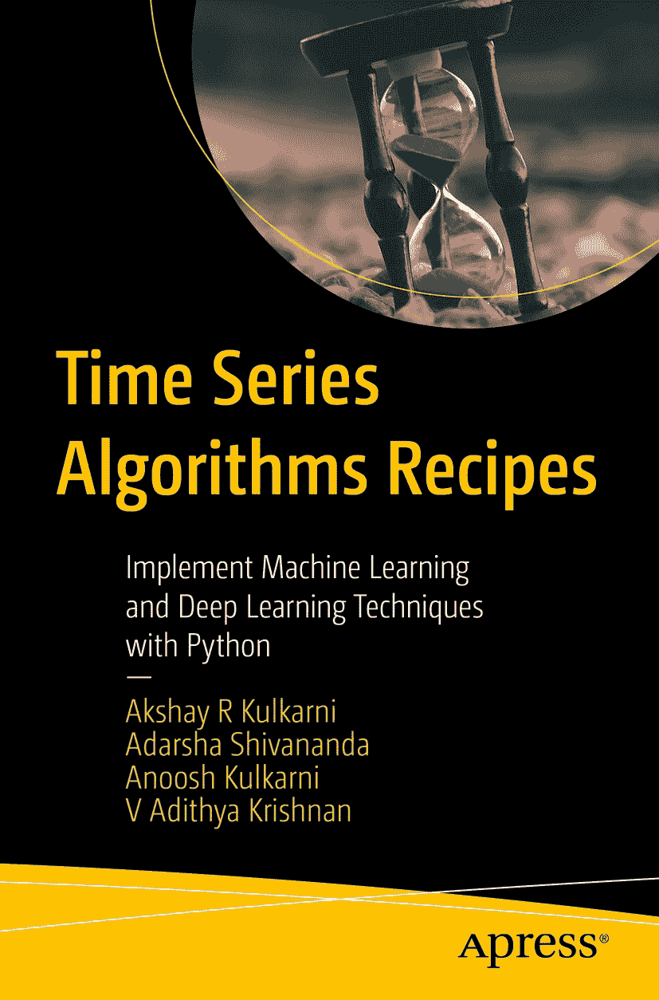

ISBN 978-1-4842-8977-8 e-ISBN 978-1-4842-8978-5 [`doi.org/10.1007/978-1-4842-8978-5`](https://doi.org/10.1007/978-1-4842-8978-5) © Akshay R Kulkarni, Adarsha Shivananda, Anoosh Kulkarni, V Adithya Krishnan 2023 Apress Standard 本出版物中使用的通用描述性名称、注册商标名称、商标、服务标记等，即使未作特别声明，也不意味着这些名称不受相关保护性法律和法规的约束，因此可供一般使用。出版商、作者和编辑可以假定，本书中的建议和信息在出版之日是真实和准确的。出版商、作者或编辑均不对本书所含材料或可能存在的任何错误或遗漏提供明示或暗示的担保。出版商对已出版地图中的管辖权主张和机构归属保持中立。

本 Apress 印记由注册公司 APress Media, LLC（Springer Nature 的一部分）出版。

注册公司地址为：1 New York Plaza, New York, NY 10004, U.S.A.

*献给我们家人*

## 前言

在阅读本书之前，您应具备统计学、机器学习和 Python 编程的基础知识。如果您想学习如何构建从基础到高级的时间序列预测模型，那么本书将通过提供 Python 实现方法为您提供帮助。在本书结束时，您将掌握时间序列中所有不同类型建模方法的实用知识。

渴望了解未知并预测未来，长期以来一直是人类文化的一部分。这种渴望驱使人类走向预测的学科。时间序列预测基于数据先前（过去）观察到的模式来预测未知的未来数据点。它不仅可能依赖于先前的目标点和时间（单变量），还可能依赖于其他独立变量（多变量）。本书是一本包含各种处理时间序列预测方法的食谱书。

刚开始一个新的时间序列项目但缺乏该领域经验的数据科学家，可以轻松利用本书中各种与领域无关的方法，来启动并简化他们的开发过程。

本书分为五个章节。第 1 章涵盖了读取和处理时间序列数据以及基本探索性数据分析（EDA）的方法。接下来的三章涵盖了单变量和多变量数据集的各种预测建模技术。第 2 章包含多种统计单变量预测方法，更高级的技术在第 3 章中继续介绍。第 3 章还涵盖了统计多变量方法。第 4 章介绍了使用机器学习（基于回归）进行时间序列预测。第 5 章是关于使用深度学习的高级时间序列建模方法。

每章中所有实现的代码以及所需的数据集均可从`github.com/apress/time-series-algorithm-recipes`下载。

## 关于作者 关于技术审校者