# 1. 时间序列入门

`时间序列`是一系列依赖于时间的数据点。例如，电子商务网站上某产品的需求（或销售额）可以在时间序列中按时间进行度量，其中需求（或销售额）按时间排序。然后可以分析这些数据以发现关键的时间洞察并预测未来值，这有助于企业进行规划并增加收入。

时间序列数据用于每个需要实时分析的领域。分析这些数据并预测其未来值已成为这些领域的关键。

时间序列分析/预测以前被认为是一个纯粹的统计问题。现在，它被用于许多基于机器学习和深度学习的解决方案中，这些解决方案的表现同样出色，甚至优于大多数其他解决方案。本书使用各种方法和途径来分析和预测时间序列。

本章使用方法来读取/写入时间序列数据，并执行简单的预处理和探索性数据分析（`EDA`）。

以下是本章探讨的方法列表。

*   方法 1-1. 读取时间序列对象
*   方法 1-2. 保存时间序列对象
*   方法 1-3. 探索时间序列数据类型
*   方法 1-4. 时间序列组件
*   方法 1-5. 时间序列分解
*   方法 1-6. 季节性可视化

## 方法 1-1A. 读取时间序列对象（航空旅客数据）

### 问题

您想要读取时间序列数据并将其加载到数据框中。

### 解决方案

`Pandas` 将数据加载到数据框结构中。

### 工作原理

以下步骤用于读取数据。

#### 步骤 1A-1. 导入所需的库。

```python
import pandas as pd
import matplotlib.pyplot as plt
```

#### 步骤 1A-2. 为日期时间列编写解析函数。

在读取数据之前，我们先编写一个解析函数。

```python
date_parser_fn = lambda dates: pd.datetime.strptime(dates, '%Y-%m')
```

#### 步骤 1A-3. 读取数据。

读取航空旅客数据。

```python
data = pd.read_csv('./data/AirPassenger.csv', parse_dates = ['Month'], index_col = 'Month', date_parser = date_parser_fn)
plt.plot(data)
plt.show()
```

图 1-1 显示了时间序列图输出。

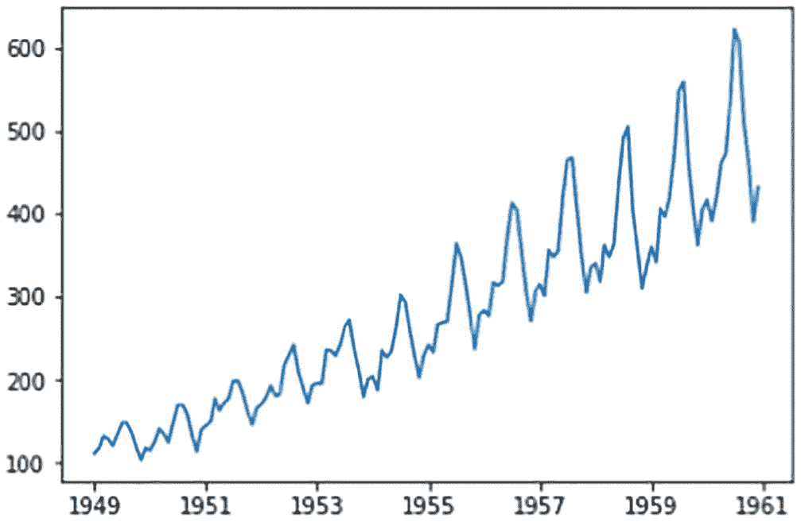

图 1-1

输出

以下是 `read_csv` 的一些重要输入参数。

*   `parse_dates` 指定数据集中需要解析的日期时间列。
*   `index_col` 指定作为 `pandas` 数据框唯一标识符的列。在大多数时间序列用例中，它是日期时间列。
*   `date_parser` 是一个用于解析日期的函数（即，将输入字符串转换为日期时间格式/类型）。`pandas` 以 `YYYY-MM-DD HH:MM:SS` 格式读取数据。使用解析器函数时，请转换为这种格式。

## 方法 1-1B. 读取时间序列对象（印度 GDP 数据）

### 问题

您想要将加载的时间序列数据框保存到文件中。

### 解决方案

将数据框保存为逗号分隔（`CSV`）文件。

### 工作原理

以下步骤用于读取数据。

#### 步骤 1B-1. 导入所需的库。

```python
import pandas as pd
import matplotlib.pyplot as plt
import pickle
```

#### 步骤 1B-2. 读取印度的 `GDP` 时间序列数据。

```python
indian_gdp_data = pd.read_csv('./data/GDPIndia.csv', header=0)
date_range = pd.date_range(start='1/1/1960', end='31/12/2017', freq='A')
indian_gdp_data ['TimeIndex'] = pd.DataFrame(date_range, columns=['Year'])
indian_gdp_data.head(5).T
```

#### 步骤 1B-3. 绘制时间序列图。

```python
plt.plot(indian_gdp_data.TimeIndex, indian_gdp_data.GDPpercapita)
plt.legend(loc='best')
plt.show()
```

图 1-2 显示了输出的时间序列。

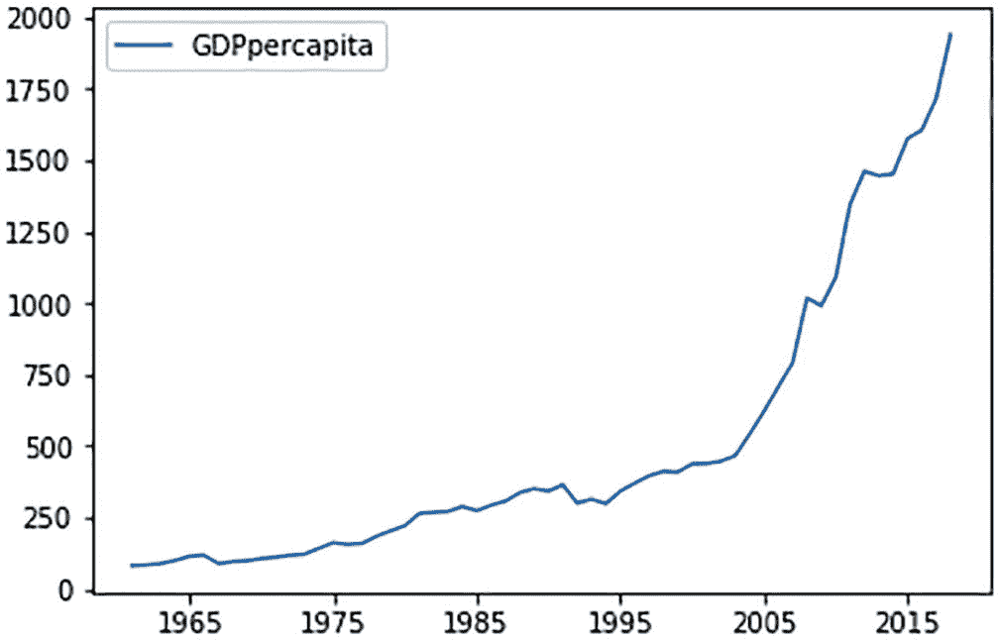

图 1-2

输出

#### 步骤 1B-4. 存储并检索为 `pickle` 文件。

```python
### 存储为 pickle 对象
import pickle
with open('gdp_india.obj', 'wb') as fp:
pickle.dump(IndiaGDP, fp)
### 检索 pickle 对象
with open('gdp_india.obj', 'rb') as fp:
indian_gdp_data1 = pickle.load(fp)
indian_gdp_data1.head(5).T
```

图 1-3 显示了检索到的转置后的时间序列对象。

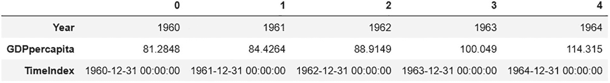

图 1-3

输出

## 方法 1-2. 保存时间序列对象

### 问题

您想要将加载的时间序列数据框保存到文件中。

### 解决方案

将数据框保存为 `CSV` 文件。

### 工作原理

以下步骤用于存储数据。

#### 步骤 2-1. 保存先前加载的时间序列对象。

```python
### 将 TS 对象保存为 CSV 文件
data.to_csv('ts_data.csv', index = True, sep = ',')
### 检查存储的对象
data1 = data.from_csv('ts_data.csv', header = 0)
### 检查
print(data1.head(2).T)
```

输出结果如下。

```
1981-01-01
1981-01-02    17.9
1981-01-03    18.8
Name: 20.7, dtype: float64
```

## 配方 1-3A. 探索时间序列数据类型：单变量

### 问题

您希望加载并探索单变量时间序列数据。

### 解决方案

`单变量时间序列`是指仅包含一个随时间变化变量的数据。

让我们来看一个示例数据集，该数据集记录了 1981 年至 1990 年南半球每月的最低气温。其中，气温是随时间变化的目标变量。

### 工作原理

以下步骤用于读取并绘制单变量数据。

#### 步骤 3A-1. 导入所需的库。

```python
import pandas as pd
import matplotlib.pyplot as plt
```

#### 步骤 3A-2. 读取时间序列数据。

```python
data = pd.read_csv('./data/daily-minimum-temperatures.csv', header = 0, index_col = 0, parse_dates = True, squeeze = True)
print(data.head())
```

输出结果如下。

```
Date
1981-01-01    20.7
1981-01-02    17.9
1981-01-03    18.8
1981-01-04    14.6
1981-01-05    15.8
Name: Temp, dtype: float64
```

#### 步骤 3A-3. 绘制时间序列图。

现在，让我们绘制时间序列数据以检测模式。

```python
data.plot()
plt.ylabel('最低气温')
plt.title('1981 年至 1990 年南半球最低气温')
plt.show()
```

图 1-4 显示了输出的时间序列图。

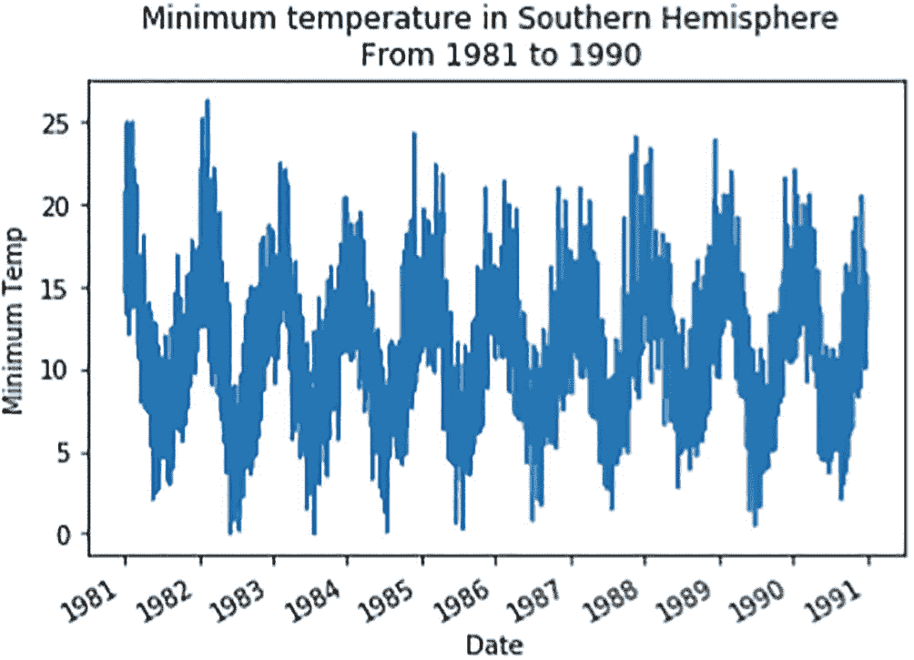

图 1-4

时间序列图

这被称为`单变量时间序列分析`，因为只使用了一个变量，即气温（过去 19 年的温度）。

## 配方 1-3B. 探索时间序列数据类型：多变量

### 问题

您希望加载并探索多变量时间序列数据。

### 解决方案

`多变量时间序列`是一种时间序列数据类型，其目标变量依赖更多的特征，这些特征也随时间变化；也就是说，目标变量不仅依赖于其过去的值。这种关系用于预测目标值。

让我们加载并探索一个北京污染数据集，该数据集是多变量的。

### 工作原理

以下步骤用于读取并绘制多变量数据。

#### 步骤 3B-1. 导入所需的库。

```python
import pandas as pd
from datetime import datetime
import matplotlib.pyplot as plt
```

#### 步骤 3B-2. 编写解析函数。

在加载原始数据集并将日期时间信息解析为 `pandas` 数据框索引之前，我们先编写一个解析函数。

```
def parse(x):
    return datetime.strptime(x, '%Y %m %d %H')
```

### 步骤 3B-3. 加载数据集。

```
data1 = pd.read_csv('./data/raw.csv',  parse_dates = [['year', 'month', 'day', 'hour']],
index_col=0, date_parser=parse)
```

### 步骤 3B-4. 进行基本预处理。

删除“No”列。

```
data1.drop('No', axis=1, inplace=True)
```

手动指定每一列的名称。

```
data1.columns = ['污染', '露点', '气温', '气压', '风向', '风速', '降雪', '降雨']
data1.index.name = '日期'
```

将所有缺失值标记为 0。

```
data1['污染'].fillna(0, inplace=True)
```

删除前 24 小时的数据。

```
data1 = data1[24:]
```

汇总前五行数据。

```
print(data1.head(5))
```

输出结果如下。

```
污染  露点  气温   气压 风向  风速  降雪  降雨
日期
2010-01-02 00:00:00      129.0  -16  -4.0  1020.0      SE     1.79     0     0
2010-01-02 01:00:00      148.0  -15  -4.0  1020.0      SE     2.68     0     0
2010-01-02 02:00:00      159.0  -11  -5.0  1021.0      SE     3.57     0     0
2010-01-02 03:00:00      181.0   -7  -5.0  1022.0      SE     5.36     1     0
2010-01-02 04:00:00      138.0   -7  -5.0  1022.0      SE     6.25     2     0
```

这些信息来自一个关于北京污染和天气状况的数据集。记录的时间粒度为每小时一次，持续测量了五年。数据包括日期时间列、污染指标（即 PM2.5 浓度）以及一些关键的天气信息，包括气温、气压和风速。

### 步骤 3B-5. 绘制每个序列的图表。

现在，让我们将每个序列绘制为单独的子图，但风向除外，因为它是分类变量。

```
vals = data1.values
# 指定要绘制的列
group_list = [0, 1, 2, 3, 5, 6, 7]
i = 1
# 绘制每一列
plt.figure()
for group in group_list:
    plt.subplot(len(group_list), 1, i)
    plt.plot(vals[:, group])
    plt.title(data1.columns[group], y=0.5, loc='right')
    i += 1
plt.show()
```

图 1-5 显示了所有变量随时间变化的图表。

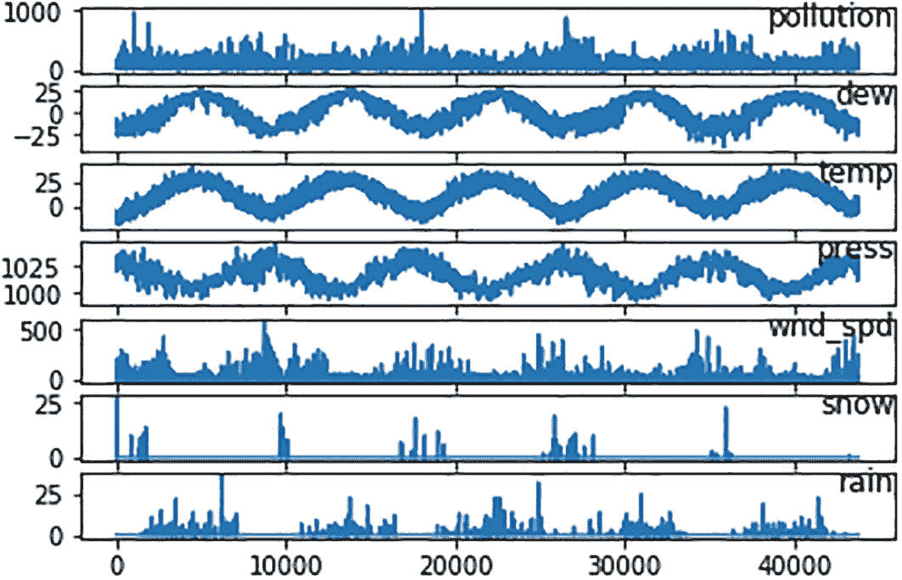

图 1-5 所有变量随时间变化的图表

## 配方 1-4A. 时间序列成分：趋势

### 问题

您希望从趋势开始，找出时间序列的成分。

### 解决方案

*趋势*是指数据在特定方向上的整体运动，即数值在一段时间内上升（增加）或下降（减少）。

让我们使用一个洗发水销售数据集，该数据集包含三年内每月的销售数量。

### 工作原理

以下步骤用于读取并绘制数据。

#### 步骤 4A-1. 导入所需的库。

```
import pandas as pd
import matplotlib.pyplot as plt
```

#### 步骤 4A-2. 编写解析函数。

```
def parsing_fn(x):
    return datetime.strptime('190'+x, '%Y-%m')
```

#### 步骤 4A-3. 加载数据集。

```
data = pd.read_csv('./data/shampoo-sales.csv', header=0, parse_dates=[0], index_col=0, squeeze=True, date_parser= parsing_fn)
```

#### 步骤 4A-4. 绘制时间序列图。

```
data.plot()
plt.show()
```

图 1-6 显示了时间序列图。

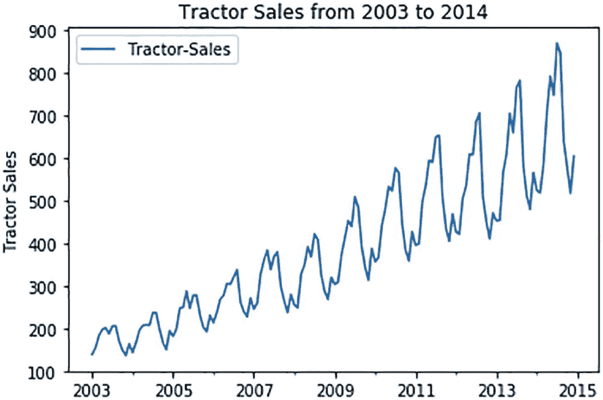

图 1-6 输出结果

如图 1-6 所示，该数据呈现上升趋势。输出的时间序列图显示，平均而言，数值随时间增加。

## 配方 1-4B. 时间序列成分：季节性

### 问题

您希望基于季节性找出时间序列数据的成分。

### 解决方案

*季节性*是指时间序列数据中特定模式或变化的重复出现。

让我们使用一个 1981 年至 1990 年澳大利亚墨尔本每日最低气温数据集。重点在于季节性。

### 工作原理

以下步骤将读取并绘制数据。

#### 步骤 4B-1. 导入所需的库。

```
import pandas as pd
import matplotlib.pyplot as plt
```

#### 步骤 4B-2. 读取数据。

```
data = pd.read_csv('./data/daily-minimum-temperatures.csv', header = 0, index_col = 0, parse_dates = True, squeeze = True)
```

#### 步骤 4B-3. 绘制时间序列图。

```
data.plot()
plt.ylabel('Minimum Temp')
plt.title('Min temp in Southern Hemisphere from 1981 to 1990')
plt.show()
```

图 1-7 展示了该时间序列图。

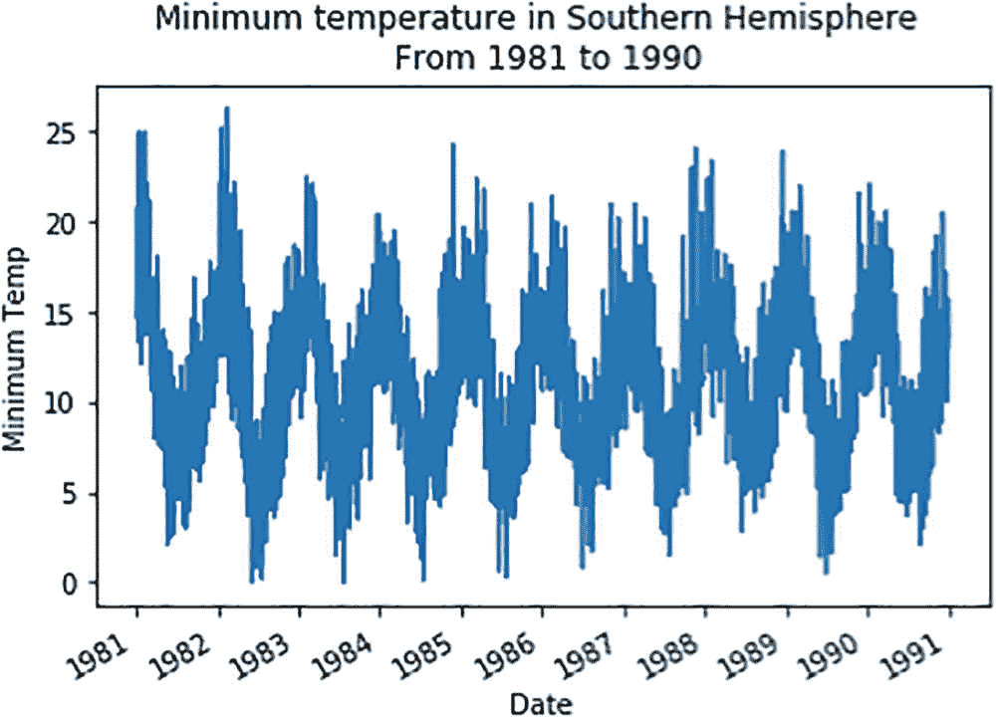

图 1-7 输出结果

图 1-7 显示该数据具有强烈的季节性成分（即数据随时间呈现重复模式）。

#### 步骤 4B-4. 按月绘制箱线图。

让我们通过箱线图来检查 1990 年的月度变化。

```
month_df = DataFrame()
one_year_ser = data['1990']
grouped_df = one_year_ser.groupby(Grouper(freq='M'))
month_df = pd.concat([pd.DataFrame(x[1].values) for x in grouped_df], axis=1)
month_df = pd.DataFrame(month_df)
month_df.columns = range(1,13)
month_df.boxplot()
plt.show()
```

图 1-8 展示了按月输出的箱线图。

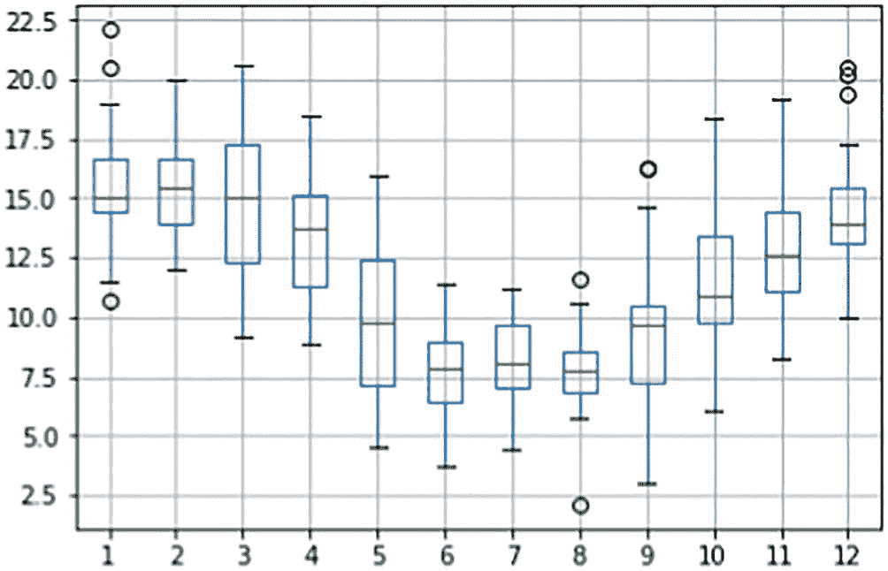

图 1-8 月度箱线图输出

箱线图（图 1-8）展示了每个月最低温度的分布情况。每年似乎都有一个季节性成分，呈现出从夏季到冬季的波动。这表明存在月度季节性。

#### 步骤 4B-5. 按年绘制箱线图。

让我们按年份分组，观察不同年份间的分布变化。这样，你可以检查每个时间聚合层级上的季节性。

```
grouped_ser = data.groupby(Grouper(freq='A'))
year_df  = pd.DataFrame()
for name, group in grouped_ser:
    year_df[name.year] = group.values
year_df.boxplot()
plt.show()
```

图 1-9 展示了按年输出的箱线图。

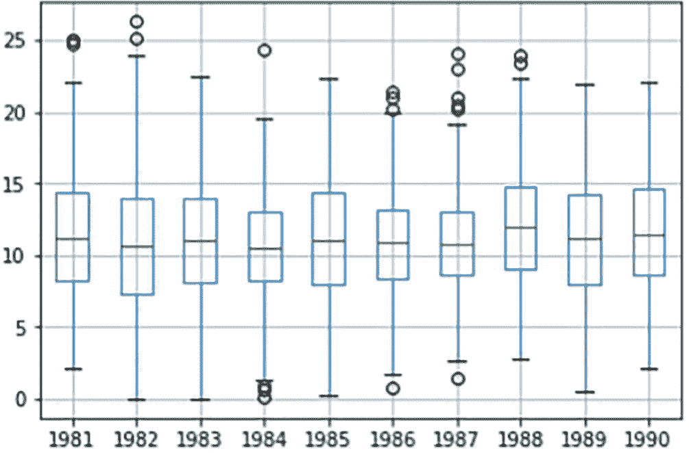

图 1-9 年度箱线图

图 1-9 显示，在箱线图输出中，年度季节性变化或趋势并不明显。

## 配方 1-4C. 时间序列成分：季节性（续）

### 问题

你想通过另一个季节性示例来寻找时间序列成分。

### 解决方案

让我们探索拖拉机销售数据以理解季节性。

### 工作原理

以下步骤将读取并绘制数据。

#### 步骤 4C-1. 导入所需的库。

```
import pandas as pd
import matplotlib.pyplot as plt
```

#### 步骤 4C-2. 读取拖拉机销售数据。
```

# 时间序列分析

## 配方 1-4C：时间序列可视化

### 步骤 4C-1. 加载数据。

```python
tractor_sales_data = pd.read_csv("./data/tractor_salesSales.csv")
tractor_sales_data.head(5)
```

### 步骤 4C-2. （原文未提供，此处为占位）

### 步骤 4C-3. 设置用作索引的日期时间序列。

```python
date_ser = pd.date_range(start='2003-01-01', freq='MS', periods=len(Tractor))
```

### 步骤 4C-4. 格式化数据。

```python
tractor_sales_data.rename(columns={'Number of Tractor Sold':'Tractor-Sales'}, inplace=True)
tractor_sales_data.set_index(dates, inplace=True)
tractor_sales_data = tractor_sales_data[['Tractor-Sales']]
tractor_sales_data.head(5)
```

### 步骤 4C-5. 绘制时间序列图。

```python
tractor_sales_data.plot()
plt.ylabel('Tractor Sales')
plt.title("Tractor Sales from 2003 to 2014")
plt.show()
```

图 1-10 展示了该时间序列图的输出。

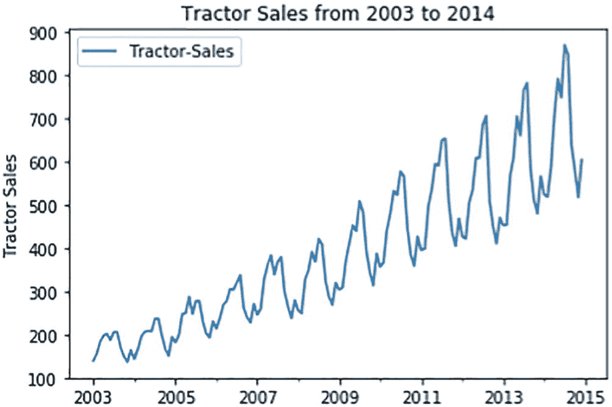

`图 1-10`

输出结果

从时间序列图（图 1-10）可以看出，该数据具有强烈的季节性，并伴随上升趋势。

### 步骤 4C-6. 按月绘制箱线图。

让我们按月检查箱线图，以更好地理解季节性。

```python
month_df = pd.DataFrame()
one_year_ser = tractor_sales_data['2011']
grouped_ser = one_year_ser.groupby(Grouper(freq='M'))
month_df = pd.concat([pd.DataFrame(x[1].values) for x in grouped_ser], axis=1)
month_df = pd.DataFrame(month_df)
month_df.columns = range(1,13)
month_df.boxplot()
plt.show()
```

图 1-11 展示了按月输出的箱线图。

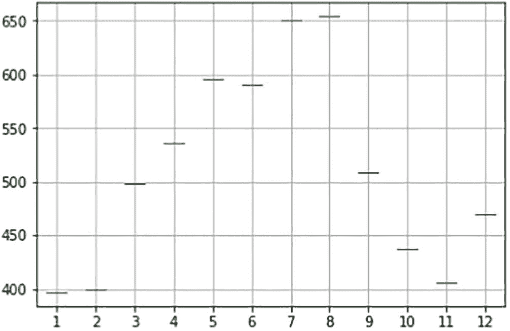

`图 1-11`

月度箱线图

箱线图显示每年都有一个季节性成分，其中从五月到八月存在波动。

## 配方 1-5A. 时间序列分解：加法模型

### 问题

你想学习如何使用加法模型分解时间序列。

### 解决方案

*   加法模型表明各成分是相加的。

*   它是线性的，随时间的变化量是恒定的。

*   季节性应具有相同的频率和振幅。频率是周期之间的宽度，振幅是每个周期的高度。

`statsmodels` 库提供了经典分解方法的实现，但用户必须指定模型是加法还是乘法。该函数名为 `seasonal_decompose`。

### 工作原理

以下步骤将加载并分解时间序列。

#### 步骤 5A-1. 加载所需的库。

```python
### Load required libraries
import pandas as pd
import matplotlib.pyplot as plt
from statsmodels.tsa.seasonal import seasonal_decompose
import statsmodels.api as sm
```

#### 步骤 5A-2. 读取并处理零售营业额数据。

```python
turn_over_data = pd.read_csv('./data/RetailTurnover.csv')
date_range = pd.date_range(start='1/7/1982', end='31/3/1992', freq='Q')
turn_over_data['TimeIndex'] = pd.DataFrame(date_range, columns=['Quarter'])
```

#### 步骤 5A-3. 绘制时间序列图。

```python
plt.plot(turn_over_data.TimeIndex, turn_over_data.Turnover)
plt.legend(loc='best')
plt.show()
```

图 1-12 展示了该时间序列图的输出。

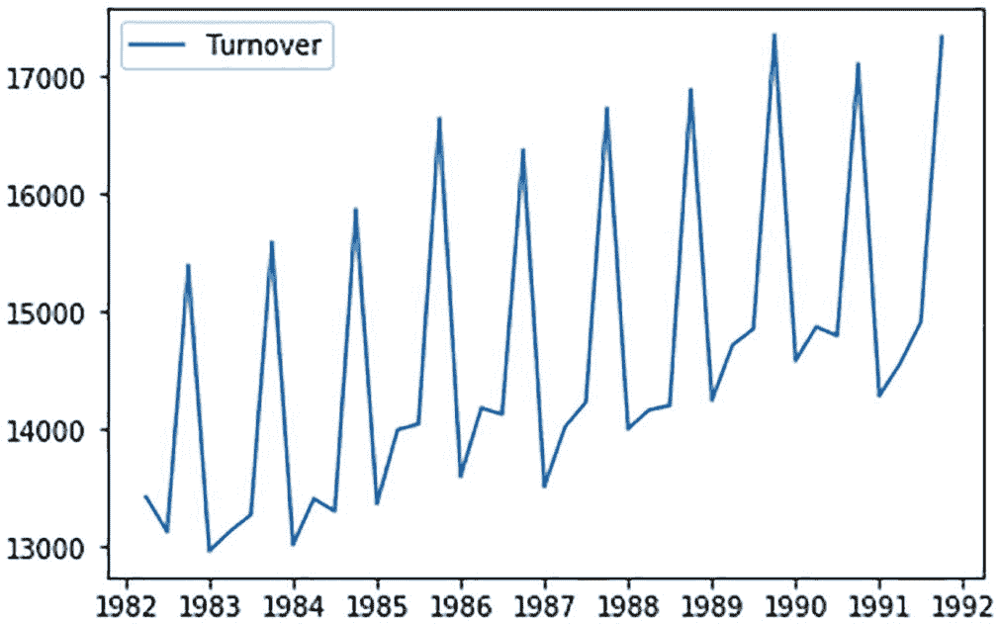

`图 1-12`

时间序列图输出

图 1-12 显示趋势呈线性增长，并且存在恒定的线性季节性。

#### 步骤 5A-4. 分解时间序列。

让我们将时间序列分解为趋势、季节性和残差。

```python
decomp_turn_over = sm.tsa.seasonal_decompose(turn_over_data.Turnover, model="additive", freq=4)
decomp_turn_over.plot()
plt.show()
```

图 1-13 展示了时间序列分解的输出。

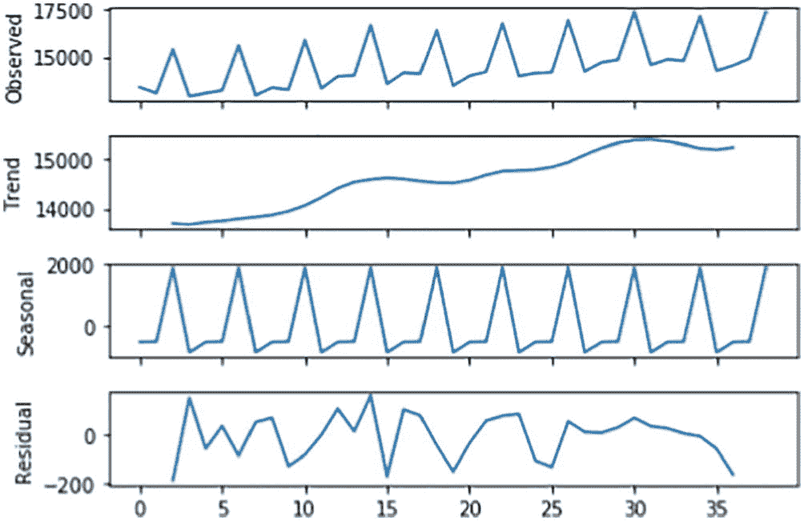

`图 1-13`

时间序列分解输出

#### 步骤 5A-5. 分离各成分。

你可以通过以下方式将趋势、季节性和残差作为单独的序列获取。

```python
trend = decomp_turn_over.trend
seasonal = decomp_turn_over.seasonal
residual = decomp_turn_over.resid
```

## 配方 1-5B. 时间序列分解：乘法模型

### 问题

你想学习如何使用乘法模型分解时间序列。

### 解决方案

*   乘法模型表明各成分是相乘的。

*   它是非线性的，例如二次或指数形式，这意味着变化量会随时间增加或减少。

*   季节性的频率和/或振幅呈增加或减少趋势。

### 工作原理

以下步骤将加载并分解时间序列。

#### 步骤 5B-1：加载所需的库。

```python
### 加载所需的库
import pandas as pd
import matplotlib.pyplot as plt
from statsmodels.tsa.seasonal import seasonal_decompose
import statsmodels.api as sm
```

#### 步骤 5B-2：加载航空旅客数据。

```python
air_passengers_data = pd.read_csv('./data/AirPax.csv')
```

#### 步骤 5B-3：处理数据。

```python
date_range = pd.date_range(start='1/1/1949', end='31/12/1960', freq='M')
air_passengers_data ['TimeIndex'] = pd.DataFrame(date_range, columns=['Month'])
print(air_passengers_data.head())
```

输出结果如下。

```
Year Month  Pax  TimeIndex
0  1949   Jan  112 1949-01-31
1  1949   Feb  118 1949-02-28
2  1949   Mar  132 1949-03-31
3  1949   Apr  129 1949-04-30
4  1949   May  121 1949-05-31
```

图 1-14 展示了时间序列输出图。

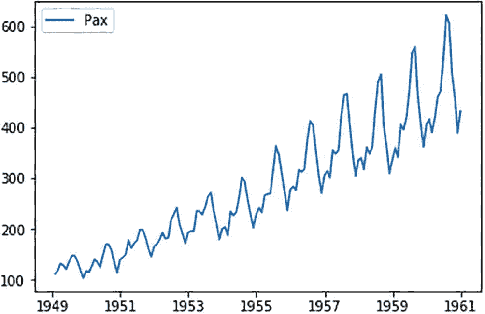

`图 1-14`

时间序列输出图

#### 步骤 5B-4：分解时间序列。

```python
decomp_air_passengers_data = sm.tsa.seasonal_decompose(air_passengers_data.Pax, model="multiplicative", freq=12)
decomp_air_passengers_data.plot()
plt.show()
```

图 1-15 展示了时间序列分解输出。

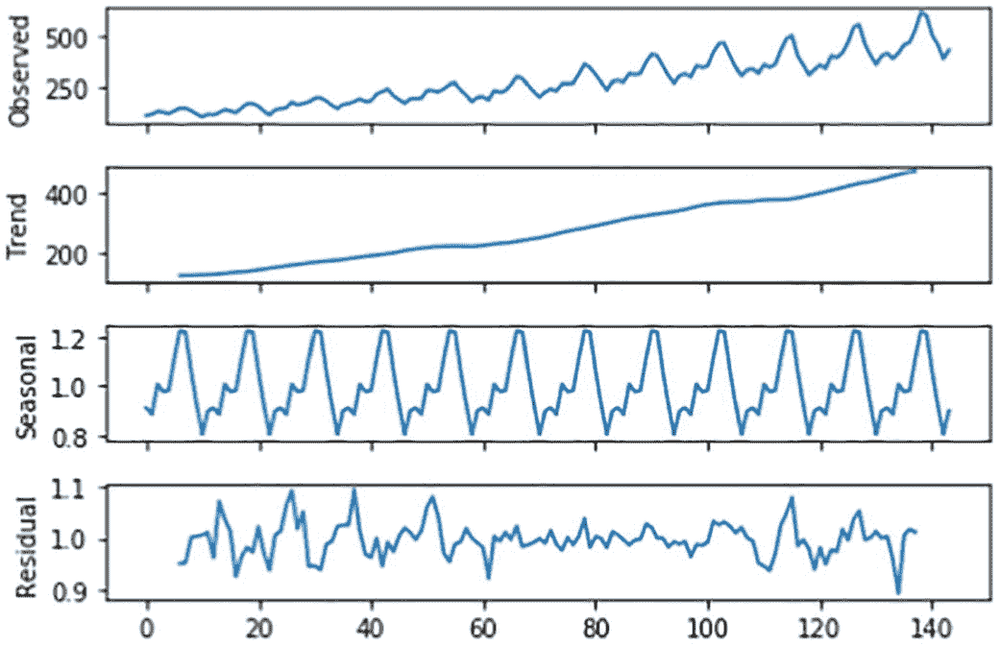

`图 1-15`

时间序列分解输出

#### 步骤 5B-5：获取季节性成分。

```python
Seasonal_comp = decomp_air_passengers_data.seasonal
Seasonal_comp.head(4)
```

输出结果如下。

```
0    0.910230
1    0.883625
2    1.007366
3    0.975906
Name: Pax, dtype: float64
```

## 配方 1-6：季节性可视化

## 问题

您希望学习如何可视化季节性成分。

## 解决方案

让我们看看几种用于可视化和检测季节性的额外方法。零售营业额数据展示了每个季度的季节性成分。

## 工作原理

以下步骤将加载并可视化时间序列（即季节性成分）。

### 步骤 6-1：导入所需的库。

```
import pandas as pd
import matplotlib.pyplot as plt
```

### 步骤 6-2：加载数据。

```
turn_over_data = pd.read_csv('./data/RetailTurnover.csv')
```

### 步骤 6-3：处理数据。

```
date_range = pd.date_range(start='1/7/1982', end='31/3/1992', freq='Q')
turn_over_data['TimeIndex'] = pd.DataFrame(date_range, columns=['Quarter'])
```

### 步骤 6-4：数据透视。

现在让我们对表格进行数据透视，使得季度信息位于列中，年份信息位于行中，数值由营业额信息构成。

```
quarterly_turn_over_data = pd.pivot_table(turn_over_data, values = "Turnover", columns = "Quarter", index = "Year")
quarterly_turn_over_data
```

图 1-16 展示了按季度划分的营业额输出。

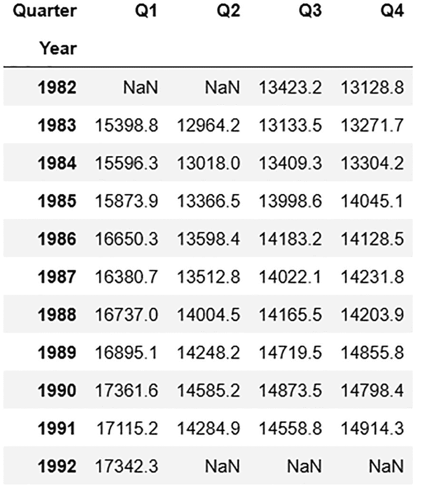

图 1-16

季度营业额输出

### 步骤 6-5：绘制折线图。

让我们为四个季度绘制折线图。

```
quarterly_turn_over_data.plot()
plt.show()
```

图 1-17 展示了季度级别的折线图。

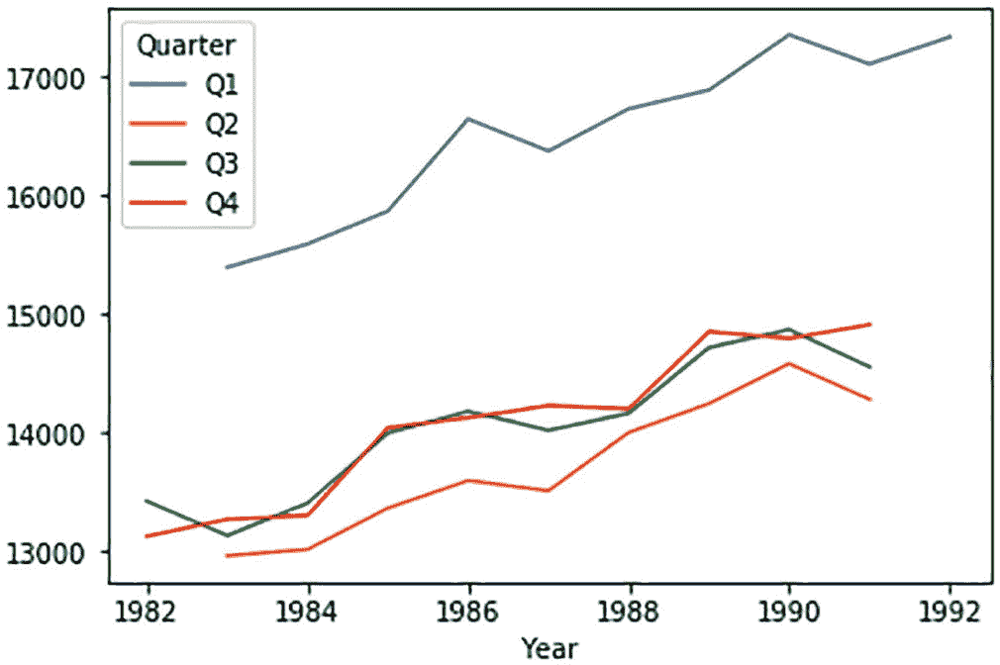

图 1-17

季度营业额折线图

### 步骤 6-6：绘制箱线图。

让我们也在季度级别绘制箱线图。

```
quarterly_turn_over_data.boxplot()
plt.show()
```

图 1-18 展示了按季度划分的箱线图输出。

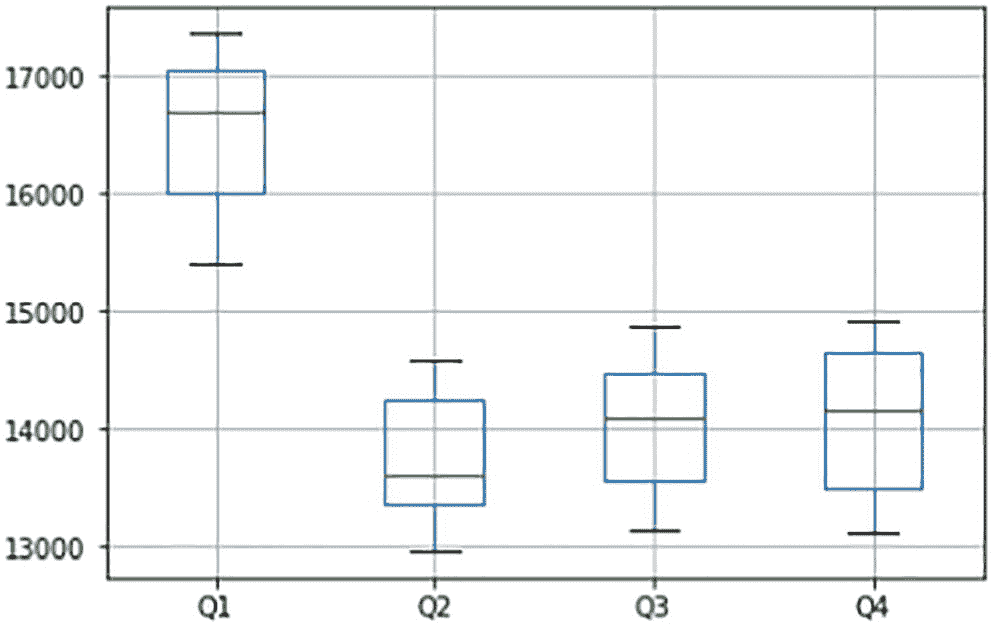

图 1-18

季度级别箱线图

通过观察箱线图和折线图，您可以得出结论：第一季度的年营业额显著较高，而第二季度则相当低。