# 2. 统计单变量建模

单变量时间序列数据分析是最常见的时间数据类型，其中单个数值观测值在相等的时间间隔内按顺序记录。在此分析中，仅考虑观测到的变量及其与时间的关系。

通过单变量建模来预测该单变量数据的未来值。在这种情况下，预测仅依赖于历史值。可以通过多种统计方法进行预测。本章将介绍几种重要的方法。

以下是执行单变量统计建模的配方。

*   配方 2-1：移动平均（MA）预测
*   配方 2-2：自回归（AR）模型
*   配方 2-3：自回归移动平均（ARMA）模型
*   配方 2-4：差分自回归移动平均（ARIMA）模型
*   配方 2-5：差分自回归移动平均（ARIMA）模型的网格搜索超参数调优
*   配方 2-6：季节性差分自回归移动平均（SARIMA）模型
*   配方 2-7：简单指数平滑（SES）模型
*   配方 2-8：霍尔特-温特斯（HW）模型

## 配方 2-1：移动平均（MA）预测

### 问题

您希望加载时间序列数据并使用`移动平均`进行预测。

### 解决方案

移动平均是一种捕捉指标随时间平均变化的方法。对于特定的窗口长度（即一个较短的时间段/范围），您计算目标值的均值，然后将此窗口从数据起始到结束在整个时间段上移动。它通常用于平滑数据并消除任何随机波动。

让我们使用 pandas 的滚动均值函数来获取移动平均。

### 工作原理

以下步骤将读取数据并使用移动平均法进行预测。

#### 步骤 1-1. 导入所需的库。

```
from pandas import read_csv, Grouper, DataFrame, concat
import matplotlib.pyplot as plt
from datetime import datetime
```

#### 步骤 1-2. 读取数据。

美国 GDP 数据是一个时间序列数据集，显示了 1929 年至 1991 年美国年度国内生产总值（GDP）数值（以美元计）。

以下代码读取美国 GDP 数据。

```
us_gdp_data = pd.read_csv('./data/GDPUS.csv', header=0)
```

#### 步骤 1-3. 预处理数据。

```
date_rng = pd.date_range(start='1/1/1929', end='31/12/1991', freq='A')
print(date_rng)
us_gdp_data['TimeIndex'] = pd.DataFrame(date_rng, columns=['Year'])
```

输出如下。

```
DatetimeIndex(['1929-12-31', '1930-12-31', '1931-12-31', '1932-12-31',
'1933-12-31', '1934-12-31', '1935-12-31', '1936-12-31',
'1937-12-31', '1938-12-31', '1939-12-31', '1940-12-31',
'1941-12-31', '1942-12-31', '1943-12-31', '1944-12-31',
'1945-12-31', '1946-12-31', '1947-12-31', '1948-12-31',
'1949-12-31', '1950-12-31', '1951-12-31', '1952-12-31',
'1953-12-31', '1954-12-31', '1955-12-31', '1956-12-31',
'1957-12-31', '1958-12-31', '1959-12-31', '1960-12-31',
'1961-12-31', '1962-12-31', '1963-12-31', '1964-12-31',
'1965-12-31', '1966-12-31', '1967-12-31', '1968-12-31',
'1969-12-31', '1970-12-31', '1971-12-31', '1972-12-31',
'1973-12-31', '1974-12-31', '1975-12-31', '1976-12-31',
'1977-12-31', '1978-12-31', '1979-12-31', '1980-12-31',
'1981-12-31', '1982-12-31', '1983-12-31', '1984-12-31',
'1985-12-31', '1986-12-31', '1987-12-31', '1988-12-31',
'1989-12-31', '1990-12-31', '1991-12-31'],
dtype='datetime64[ns]', freq='A-DEC')
```

#### 步骤 1-4. 绘制时间序列图。

```
plt.plot(us_gdp_data.TimeIndex, us_gdp_data.GDP)
plt.legend(loc='best')
plt.show()
```

图 2-1 显示了输出的时间序列图。

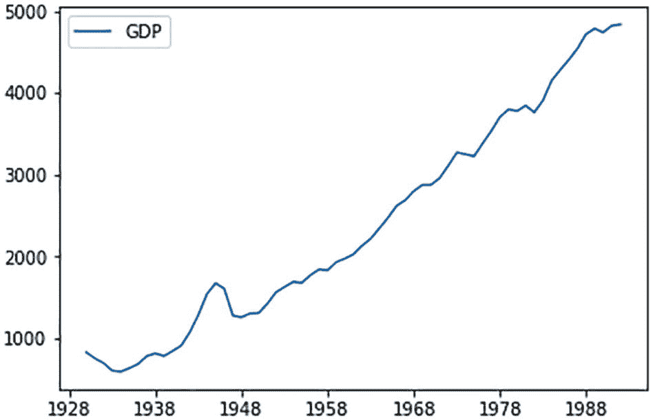

图 2-1

输出

#### 步骤 1-5. 使用滚动均值计算移动平均。

本例中使用的窗口大小为 5。

```
mvg_avg_us_gdp = us_gdp_data.copy()
#计算滚动均值 - 窗口大小为 5
mvg_avg_us_gdp['moving_avg_forecast'] = us_gdp_data['GDP'].rolling(5).mean()
```

#### 步骤 1-6. 绘制预测值与实际值对比图。

```
plt.plot(us_gdp_data['GDP'], label='美国 GDP')
plt.plot(mvg_avg_us_gdp['moving_avg_forecast'], label='美国 GDP MA(5)')
plt.legend(loc='best')
plt.show()
```

图 2-2 显示了移动平均（MA）预测值与实际值的对比。

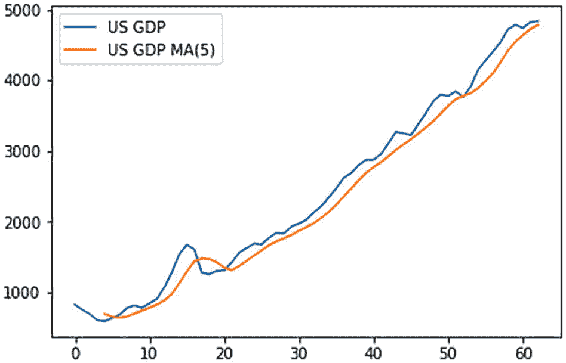

图 2-2

MA 预测值与实际值对比

## 配方 2-2. 自回归（AR）模型

### 问题

您希望加载时间序列数据，并使用`自回归模型`进行预测。

### 解决方案

自回归模型使用滞后值（即某个数据点的历史值）来预测未来值。预测结果是这些滞后值的线性组合。

我们使用 `statsmodels.tsa` 中的 `AutoReg` 函数进行建模。

### 工作原理

以下步骤将加载数据并使用 AR 模型进行预测。

#### 步骤 2-1. 导入所需的库。

```
import pandas as pd
import numpy as np
import matplotlib.pyplot as plt
from statsmodels.tsa.stattools import adfuller
from statsmodels.tsa.ar_model import AutoReg
from statsmodels.graphics.tsaplots import plot_pacf
```

#### 步骤 2-2. 加载并绘制数据集。

```
url='opsd_germany_daily.csv'
data = pd.read_csv(url,sep=",")
data['Consumption'].plot()
```

图 2-3 显示了时间序列数据的图。

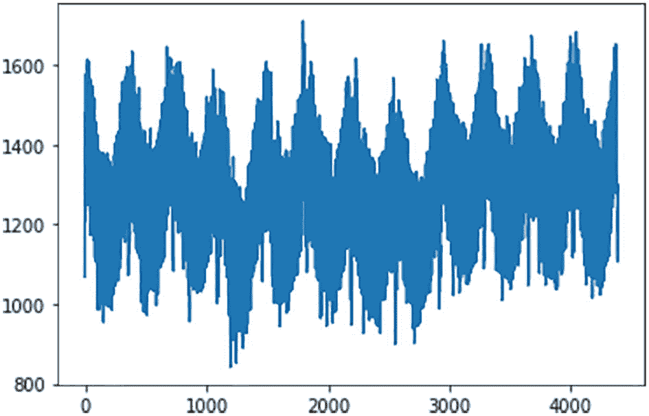

图 2-3

输出

#### 步骤 2-3. 检查时间序列数据的平稳性。

让我们查看 Augmented Dickey-Fuller 检验输出中的 p 值。如果 p 值小于 0.05，则时间序列是平稳的。

```
data_stationarity_test = adfuller(data['Consumption'], autolag='AIC')
print("P-value: ", data_stationarity_test[1])
```

输出如下。

```
P-value:  4.7440549018424435e-08
```

#### 步骤 2-4. 确定要训练的 AR 模型的阶数。

让我们绘制偏自相关函数（PACF）图，以评估过去数据（滞后值）对未来数据的直接影响。

```
pacf = plot_pacf(data['Consumption'], lags=25)
```

图 2-4 显示了偏自相关函数图的输出。

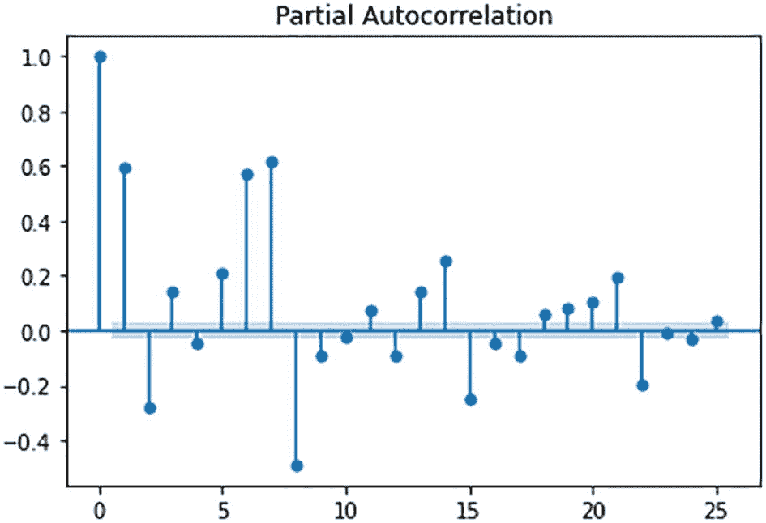

图 2-4

偏自相关函数图

图 2-4 显示了偏自相关函数的输出，以及在 AR 模型阶数上存在显著偏相关之前的滞后数量。在本例中，该数量为 8。

#### 步骤 2-5. 创建训练数据和测试数据。

# 配方 2-3. 自回归移动平均（ARMA）模型

### 问题

您希望加载时间序列数据，并使用*自回归移动平均*（ARMA）模型进行预测。

### 解决方案

ARMA 模型结合了自回归和移动平均的概念，构建了一个更稳健的模型。它有两个超参数（`p` 和 `q`），分别用于调整自回归和移动平均部分。

我们使用 `statsmodels.tsa` 中的 `ARIMA` 函数进行建模。

### 工作原理

以下步骤将加载数据并使用 ARMA 模型进行预测。

#### 步骤 3-1. 导入所需的库。

```python
import pandas_datareader.data as web
import datetime
import pandas as pd
import numpy as np
from sklearn.metrics import mean_squared_error
import matplotlib.pyplot as plt
import seaborn as sns
from statsmodels.tsa.arima.model import ARIMA
from statsmodels.tsa.statespace.sarimax import SARIMAX
from statsmodels.tsa.api import SimpleExpSmoothing
from statsmodels.tsa.holtwinters import ExponentialSmoothing
import warnings
```

#### 步骤 3-2. 加载数据。

我们使用 2017 年 12 月 31 日至 2018 年 1 月 4 日的比特币价格（以美元计）数据。

```python
btc_data = pd.read_csv("btc.csv")
print(btc_data.head())
```

输出如下。

```
Date       BTC-USD
0  2017-12-31  14156.400391
1  2018-01-01  13657.200195
2  2018-01-02  14982.099609
3  2018-01-03  15201.000000
4  2018-01-04  15599.200195
```

#### 步骤 3-3. 预处理数据。

```python
btc_data.index = pd.to_datetime(btc_data['Date'], format='%Y-%m-%d')
del btc_data['Date']
```

#### 步骤 3-4. 绘制时间序列图。

```python
plt.ylabel('价格-比特币')
plt.xlabel('日期')
plt.xticks(rotation=45)
plt.plot(btc_data.index, btc_data['BTC-USD'], )
```

图 2-7 显示了比特币价格数据的时间序列图。

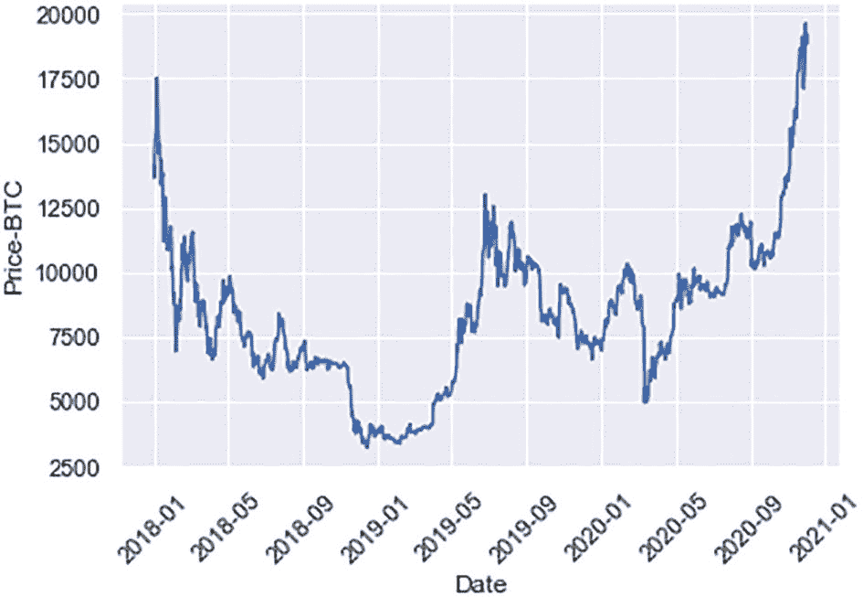

#### 步骤 3-5. 进行训练-测试集划分。

```python
train_data = btc_data[btc_data.index < pd.to_datetime("2020-11-01", format='%Y-%m-%d')]
test_data = btc_data[btc_data.index >= pd.to_datetime("2020-11-01", format='%Y-%m-%d')]
print(train_data.shape)
print(test_data.shape)
```

输出如下。

```
(1036, 1)
(31, 1)
```

#### 步骤 3-6. 绘制训练-测试集划分后的时间序列图。

```python
plt.plot(train_data, color = "black", label = 'Train')
plt.plot(test_data, color = "green", label = 'Test')
plt.ylabel('Price-BTC')
plt.xlabel('Date')
plt.xticks(rotation=35)
plt.title("Train/Test split")
plt.show()
```

图 2-8 展示了训练-测试集划分后的时间序列图。

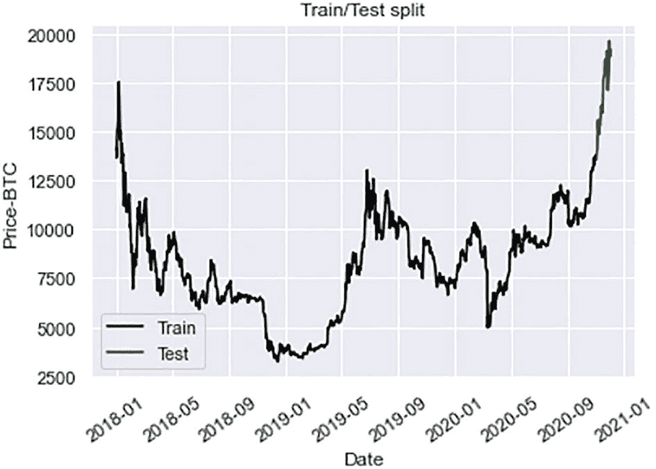

#### 步骤 3-7. 从训练集中定义实际值。

```python
actuals = train_data['BTC-USD']
```

#### 步骤 3-8. 初始化并拟合 ARMA 模型。

```python
ARMA_model = ARIMA(actuals, order = (1, 0, 1))
ARMA_model = ARMA_model.fit()
```

#### 步骤 3-9. 获取测试集预测值。

```python
predictions = ARMA_model.get_forecast(len(test_data.index))
predictions_df = predictions.conf_int(alpha = 0.05)
predictions_df["Predictions"] = ARMA_model.predict(start = predictions_df.index[0], end = predictions_df.index[-1])
predictions_df.index = test_data.index
predictions_arma = predictions_df["Predictions"]
```

#### 步骤 3-10. 将训练集、测试集和预测值绘制为折线图。

```python
plt.plot(train_data, color = "black", label = 'Train')
plt.plot(test_data, color = "green", label = 'Test')
plt.ylabel('Price-BTC')
plt.xlabel('Date')
plt.xticks(rotation=35)
plt.title("ARMA model predictions")
plt.plot(predictions_arma, color="red", label = 'Predictions')
plt.legend()
plt.show()
```

图 2-9 展示了 ARMA 模型的预测值与实际值对比。

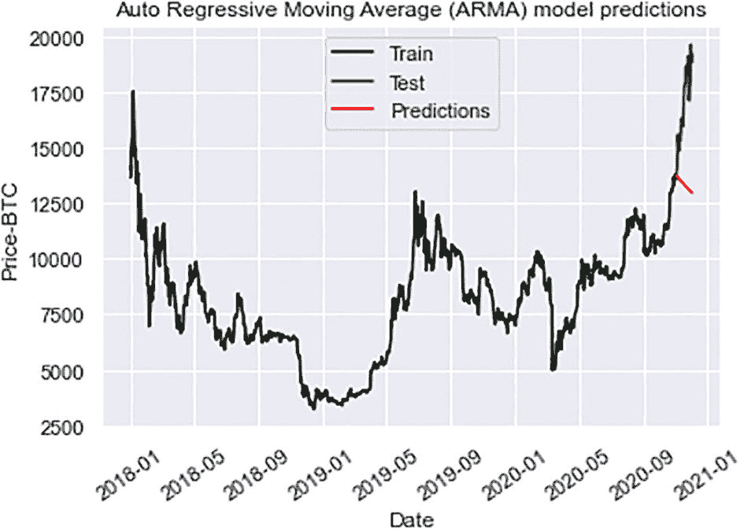

#### 步骤 3-11. 计算模型的 RMSE 分数。

```python
rmse_arma = np.sqrt(mean_squared_error(test_data["BTC-USD"].values, predictions_df["Predictions"]))
print("RMSE: ",rmse_arma)
```

输出如下。

```
RMSE:  4017.145069637629
```

RMSE（均方根误差）非常高，因为数据集不是平稳的。你需要使其平稳，或者使用自回归积分滑动平均（ARIMA）模型以获得更好的性能。

# 配方 2-4. 自回归积分滑动平均（ARIMA）模型

### 问题

你想加载时间序列数据，并使用*自回归积分滑动平均*（ARIMA）模型进行预测。

### 解决方案

ARIMA 模型在 ARMA 模型的基础上进行了改进，因为它还包含第三个参数 `d`，该参数负责对数据进行差分处理，使其达到平稳状态，从而获得更好的预测效果。

让我们使用 `statsmodels.tsa` 中的 `ARIMA` 函数进行建模。

## 工作原理

以下步骤使用 ARIMA 模型加载数据并进行预测。

本配方也使用了配方 2-3 中的步骤 3-1 至 3-7。

### 步骤 4-1. 通过差分使数据平稳。

```python
# 差分
ts_diff = actuals - actuals.shift(periods=4)
ts_diff.dropna(inplace=True)
```

### 步骤 4-2. 检查 ADF（增广迪基-富勒）检验的平稳性。

```python
# 检查平稳性
from statsmodels.tsa.stattools import adfuller
result = adfuller(ts_diff)
pval = result[1]
print('ADF Statistic: %f' % result[0])
print('p-value: %f' % result[1])
```

输出如下。

```
ADF Statistic: -6.124168
p-value: 0.000000
```

### 步骤 4-3. 获取自相关函数和偏自相关函数的值。

```python
from statsmodels.tsa.stattools import adfuller
lag_acf = acf(ts_diff, nlags=20)
lag_pacf = pacf(ts_diff, nlags=20, method='ols')
```

### 步骤 4-4. 绘制 ACF 和 PACF 图以获取 p 值和 q 值。

分别绘制 ACF 和 PACF 图以获取 q 值和 p 值。

```python
# 绘制 ACF 图：
plt.figure(figsize = (15,5))
plt.subplot(121)
plt.stem(lag_acf)
plt.axhline(y = 0, linestyle='--',color='black')
plt.axhline(y = -1.96/np.sqrt(len(ts_diff)),linestyle='--',color='gray')
plt.axhline(y = 1.96/np.sqrt(len(ts_diff)),linestyle='--',color='gray')
plt.xticks(range(0,22,1))
plt.xlabel('Lag')
plt.ylabel('ACF')
plt.title('Autocorrelation Function')
# 绘制 PACF 图：
plt.subplot(122)
plt.stem(lag_pacf)
plt.axhline(y = 0, linestyle = '--', color = 'black')
plt.axhline(y =-1.96/np.sqrt(len(actuals)), linestyle = '--', color = 'gray')
plt.axhline(y = 1.96/np.sqrt(len(actuals)),linestyle = '--', color = 'gray')
plt.xlabel('Lag')
plt.xticks(range(0,22,1))
plt.ylabel('PACF')
plt.title('Partial Autocorrelation Function')
plt.tight_layout()
plt.show()
```

图 2-10 展示了 ACF 和 PACF 图的输出。

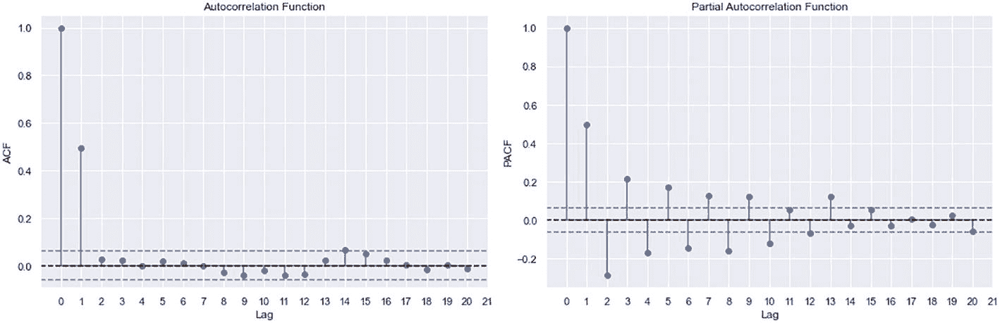

根据 ACF 图，截断点为 1，因此 `q` 值为 1。根据 PACF 图，截断点为 10，因此 `p` 值为 10。

### 步骤 4-5. 初始化并拟合 ARIMA 模型。

使用推导出的 `p`、`d` 和 `q` 值。

```python
ARIMA_model = ARIMA(actuals, order = (10, 4, 1))
ARIMA_model = ARIMA_model.fit()
```

### 步骤 4-6. 获取测试集预测值。

```python
predictions = ARIMA_model.get_forecast(len(test_data.index))
predictions_df = predictions.conf_int(alpha = 0.05)
predictions_df["Predictions"] = ARIMA_model.predict(start = predictions_df.index[0], end = predictions_df.index[-1])
predictions_df.index = test_data.index
predictions_arima = predictions_df["Predictions"]
```

### 步骤 4-7. 将训练集、测试集和预测值绘制为折线图。

```python
plt.plot(train_data, color = "black", label = 'Train')
plt.plot(test_data, color = "green", label = 'Test')
plt.ylabel('Price-BTC')
plt.xlabel('Date')
plt.xticks(rotation=35)
plt.title("ARIMA model predictions")
plt.plot(predictions_arima, color="red", label = 'Predictions')
plt.legend()
plt.show()
```

图 2-11 展示了 ARIMA 模型的预测值与实际值对比。

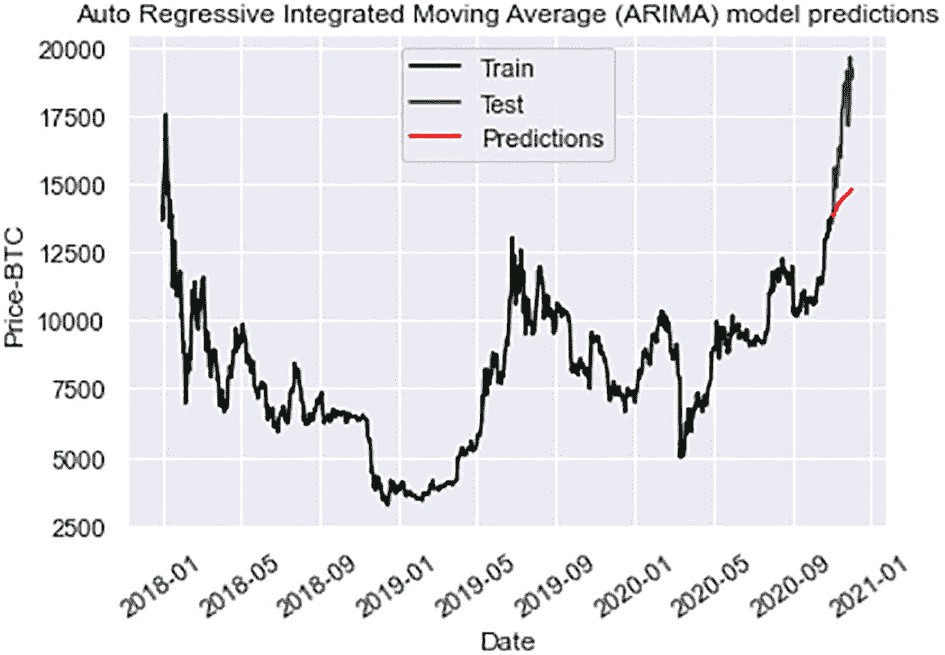

### 步骤 4-8. 计算模型的 RMSE 分数。

```python
rmse_arima = np.sqrt(mean_squared_error(test_data["BTC-USD"].values, predictions_df["Predictions"]))
print("RMSE: ",rmse_arima)
```

输出如下。

```
RMSE:  2895.312718157126
```

由于进行了差分处理并找到了合适的 `p`、`d` 和 `q` 值，该模型的性能优于 ARMA 模型。但由于模型并非完美调优，其 RMSE 仍然较高。

## 配方 2-5. ARIMA 模型的网格搜索超参数调优

### 问题

你想使用具有最佳超参数的 ARIMA 模型进行预测。

### 解决方案

让我们使用网格搜索方法来调整模型的超参数。ARIMA 模型有三个参数（`p`、`d` 和 `q`），可以使用经典的网格搜索方法进行调优。遍历各种组合并评估每个模型，以找到最佳配置。

### 工作原理

以下步骤在使用 ARIMA 模型进行预测之前，加载数据并调整超参数。

本配方也使用了配方 2-3 中的步骤 3-1 至 3-7。

#### 步骤 5-1. 编写一个函数来评估 ARIMA 模型。

该函数返回特定 ARIMA 阶数（输入）的 RMSE 分数。它执行与配方 2-3 中步骤 3-8 和 3-9 相同的任务。

```python
def arima_model_evaluate(train_actuals, test_data, order):
    # Model initalize and fit
    ARIMA_model = ARIMA(actuals, order = order)
    ARIMA_model = ARIMA_model.fit()
    # Getting the predictions
    predictions = ARIMA_model.get_forecast(len(test_data.index))
    predictions_df = predictions.conf_int(alpha = 0.05)
    predictions_df["Predictions"] = ARIMA_model.predict(start = predictions_df.index[0], end = predictions_df.index[-1])
    predictions_df.index = test_data.index
    predictions_arima = predictions_df["Predictions"]
    # calculate RMSE score
    rmse_score = np.sqrt(mean_squared_error(test_data["BTC-USD"].values, predictions_df["Predictions"]))
    return rmse_score
```

#### 步骤 5-2. 编写一个函数，通过网格搜索超参数调优来评估多个模型。

该函数使用步骤 5-8 中定义的 `arima_model_evaluate` 函数来计算多个 ARIMA 模型的 RMSE 分数，并返回最佳模型/配置。它接收需要测试/实验的 `p`、`d`、`q` 值列表作为输入。

```python
def evaluate_models(train_actuals, test_data, list_p_values, list_d_values, list_q_values):
    best_rmse, best_config = float("inf"), None
    for p in list_p_values:
        for d in list_d_values:
            for q in list_q_values:
                arima_order = (p,d,q)
                rmse = arima_model_evaluate(train_actuals, test_data, arima_order)
                if rmse < best_rmse:
                    best_rmse, best_config = rmse, arima_order
                print('ARIMA%s RMSE=%.3f' % (arima_order,rmse))
    print('Best Configuration: ARIMA%s , RMSE=%.3f' % (best_config, best_rmse))
    return best_config
```

### 步骤 5-3. 通过调用已定义的函数执行网格搜索超参数调优。

```python
p_values = range(0, 4)
d_values = range(0, 4)
q_values = range(0, 4)
warnings.filterwarnings("ignore")
best_config = evaluate_models(actuals, test_data, p_values, d_values, q_values)
```

输出如下。

```
ARIMA(0, 0, 0) RMSE=8973.268
ARIMA(0, 0, 1) RMSE=8927.094
ARIMA(0, 0, 2) RMSE=8895.924
ARIMA(0, 0, 3) RMSE=8861.499
ARIMA(0, 1, 0) RMSE=3527.133
ARIMA(0, 1, 1) RMSE=3537.297
ARIMA(0, 1, 2) RMSE=3519.475
ARIMA(0, 1, 3) RMSE=3514.476
ARIMA(0, 2, 0) RMSE=1112.565
ARIMA(0, 2, 1) RMSE=3455.709
ARIMA(0, 2, 2) RMSE=3315.249
ARIMA(0, 2, 3) RMSE=3337.231
ARIMA(0, 3, 0) RMSE=30160.941
ARIMA(0, 3, 1) RMSE=887.423
ARIMA(0, 3, 2) RMSE=3209.141
ARIMA(0, 3, 3) RMSE=2970.229
ARIMA(1, 0, 0) RMSE=4079.516
ARIMA(1, 0, 1) RMSE=4017.145
ARIMA(1, 0, 2) RMSE=4065.809
ARIMA(1, 0, 3) RMSE=4087.934
ARIMA(1, 1, 0) RMSE=3537.539
ARIMA(1, 1, 1) RMSE=3535.791
ARIMA(1, 1, 2) RMSE=3537.341
ARIMA(1, 1, 3) RMSE=3504.703
ARIMA(1, 2, 0) RMSE=725.218
ARIMA(1, 2, 1) RMSE=3318.935
ARIMA(1, 2, 2) RMSE=3507.106
ARIMA(1, 2, 3) RMSE=3314.726
ARIMA(1, 3, 0) RMSE=12360.360
ARIMA(1, 3, 1) RMSE=727.351
ARIMA(1, 3, 2) RMSE=2968.820
ARIMA(1, 3, 3) RMSE=3019.434
ARIMA(2, 0, 0) RMSE=4014.318
ARIMA(2, 0, 1) RMSE=4022.540
ARIMA(2, 0, 2) RMSE=4062.346
ARIMA(2, 0, 3) RMSE=4088.628
ARIMA(2, 1, 0) RMSE=3522.798
ARIMA(2, 1, 1) RMSE=3509.829
ARIMA(2, 1, 2) RMSE=3523.407
ARIMA(2, 1, 3) RMSE=3517.972
ARIMA(2, 2, 0) RMSE=748.267
ARIMA(2, 2, 1) RMSE=3498.685
ARIMA(2, 2, 2) RMSE=3514.870
ARIMA(2, 2, 3) RMSE=3310.798
ARIMA(2, 3, 0) RMSE=33486.993
ARIMA(2, 3, 1) RMSE=797.942
ARIMA(2, 3, 2) RMSE=2979.751
ARIMA(2, 3, 3) RMSE=2965.450
ARIMA(3, 0, 0) RMSE=4060.745
ARIMA(3, 0, 1) RMSE=4114.216
ARIMA(3, 0, 2) RMSE=4060.737
ARIMA(3, 0, 3) RMSE=3810.374
ARIMA(3, 1, 0) RMSE=3509.046
ARIMA(3, 1, 1) RMSE=3499.516
ARIMA(3, 1, 2) RMSE=3520.499
ARIMA(3, 1, 3) RMSE=3521.356
ARIMA(3, 2, 0) RMSE=1333.102
ARIMA(3, 2, 1) RMSE=3482.502
ARIMA(3, 2, 2) RMSE=3451.985
ARIMA(3, 2, 3) RMSE=3285.008
ARIMA(3, 3, 0) RMSE=14358.749
ARIMA(3, 3, 1) RMSE=1477.509
ARIMA(3, 3, 2) RMSE=3142.936
ARIMA(3, 3, 3) RMSE=2957.573
最佳配置: ARIMA(1, 2, 0) , RMSE=725.218
```

### 步骤 5-4. 使用最佳配置初始化并拟合 ARIMA 模型。

```python
ARIMA_model = ARIMA(actuals, order = best_config)
ARIMA_model = ARIMA_model.fit()
```

### 步骤 5-5. 获取测试预测结果。

```python
predictions = ARIMA_model.get_forecast(len(test_data.index))
predictions_df = predictions.conf_int(alpha = 0.05)
predictions_df["Predictions"] = ARIMA_model.predict(start = predictions_df.index[0], end = predictions_df.index[-1])
predictions_df.index = test_data.index
predictions_arima = predictions_df["Predictions"]
```

### 步骤 5-6. 将训练集、测试集和预测结果绘制成折线图。

```python
plt.plot(train_data, color = "black", label = 'Train')
plt.plot(test_data, color = "green", label = 'Test')
plt.ylabel('Price-BTC')
plt.xlabel('Date')
plt.xticks(rotation=35)
plt.title("ARIMA model predictions")
plt.plot(predictions_arima, color="red", label = 'Predictions')
plt.legend()
plt.show()
```

图 2-12 展示了 ARIMA 模型的预测值与实际值对比。

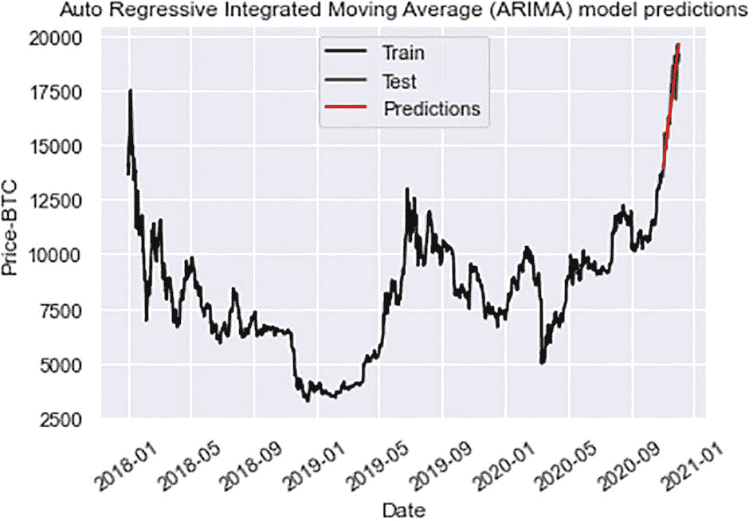

图 2-12 预测值与实际值输出

### 步骤 5-7. 计算模型的 RMSE 分数。

```python
rmse_arima = np.sqrt(mean_squared_error(test_data["BTC-USD"].values, predictions_df["Predictions"]))
print("RMSE: ",rmse_arima)
```

输出如下。

```
RMSE:  725.2180143501593
```

这是迄今为止最佳的 RMSE，因为模型经过了调优并且拟合良好。

## 配方 2-6. 季节性自回归积分滑动平均 (SARIMA) 模型

### 问题

# 时间序列预测模型

您希望加载时间序列数据，并使用季节性自回归积分滑动平均 (SARIMA) 模型进行预测。

## 解决方案

SARIMA 模型是 ARIMA 模型的扩展。它也能对数据的季节性成分进行建模。它使用季节性的 p、d 和 q 分量作为超参数输入。

让我们使用 `statsmodels.tsa` 中的 `SARIMAX` 函数进行建模。

## 工作原理

以下步骤使用 SARIMA 模型加载数据并进行预测。

本配方也使用了配方 2-3 中的步骤 3-1 到 3-7。

### 步骤 6-1. 初始化并拟合 SARIMA 模型。

```
SARIMA_model = SARIMAX(actuals, order = (1, 2, 0), seasonal_order=(2,2,2,12))
SARIMA_model = SARIMA_model.fit()
```

### 步骤 6-2. 获取测试预测结果。

```
predictions = SARIMA_model.get_forecast(len(test_data.index))
predictions_df = predictions.conf_int(alpha = 0.05)
predictions_df["Predictions"] = SARIMA_model.predict(start = predictions_df.index[0], end = predictions_df.index[-1])
predictions_df.index = test_data.index
predictions_sarima = predictions_df["Predictions"]
```

### 步骤 6-3. 将训练集、测试集和预测结果绘制成折线图。

```
plt.plot(train_data, color = "black", label = 'Train')
plt.plot(test_data, color = "green", label = 'Test')
plt.ylabel('Price-BTC')
plt.xlabel('Date')
plt.xticks(rotation=35)
plt.title("SARIMA model predictions")
plt.plot(predictions_sarima, color="red", label = 'Predictions')
plt.legend()
plt.show()
```

图 2-13 展示了季节性 ARIMA 模型的预测值与实际值对比。

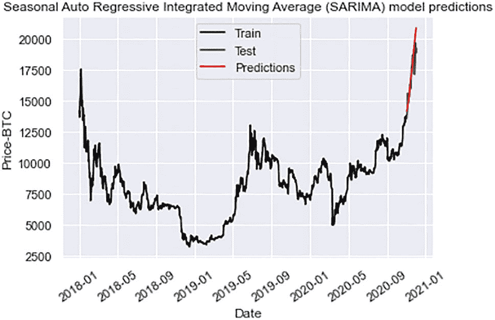

图 2-13 预测值与实际值输出

### 步骤 6-4. 计算模型的 RMSE 分数。

```
rmse_sarima = np.sqrt(mean_squared_error(test_data["BTC-USD"].values, predictions_df["Predictions"]))
print("RMSE: ",rmse_sarima)
```

输出如下。

```
RMSE:  1050.157033576061
```

您可以进一步调整季节性成分以获得更好的 RMSE 分数。可以使用相同的网格搜索方法进行调整。

## 配方 2-7. 简单指数平滑 (SES) 模型

### 问题

您希望加载时间序列数据，并使用简单指数平滑 (SES) 模型进行预测。

### 解决方案

简单指数平滑是一种使用指数窗口函数的平滑方法（类似于移动平均线）。

让我们使用 `statsmodels.tsa` 中的 `SimpleExpSmoothing` 函数进行建模。

### 工作原理

以下步骤使用 SES 模型加载数据并进行预测。

本配方同样使用了配方 2-3 中的步骤 3-1 至 3-7。

#### 步骤 7-1. 初始化并拟合 SES 模型。

```
SES_model = SimpleExpSmoothing(actuals)
SES_model = SES_model.fit(smoothing_level=0.8,optimized=False)
```

#### 步骤 7-2. 获取测试集预测结果。

```
predictions_ses = SES_model.forecast(len(test_data.index))
```

#### 步骤 7-3. 将训练集、测试集和预测结果绘制为折线图。

```
plt.plot(train_data, color = "black", label = 'Train')
plt.plot(test_data, color = "green", label = 'Test')
plt.ylabel('Price-BTC')
plt.xlabel('Date')
plt.xticks(rotation=35)
plt.title("SImple Exponential Smoothing (SES) model predictions")
plt.plot(predictions_ses, color='red', label = 'Predictions')
plt.legend()
plt.show()
```

图 2-14 展示了 SES 模型的预测值与实际值的对比。

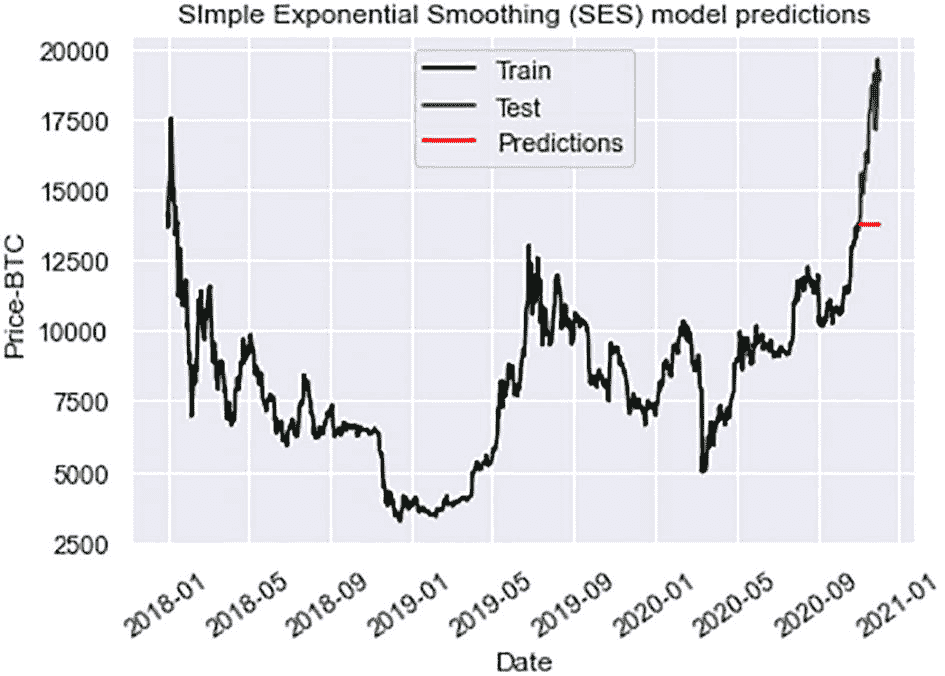

图 2-14 预测值与实际值输出

#### 步骤 7-4. 计算模型的 RMSE 分数。

```
rmse_ses = np.sqrt(mean_squared_error(test_data["BTC-USD"].values, predictions_ses))
print("RMSE: ",rmse_ses)
```

输出结果如下。

```
RMSE:  3536.5763879303104
```

正如预期，RMSE 值非常高，因为它是一个简单的平滑函数，只有在数据没有趋势时表现最佳。

## 配方 2-8. Holt-Winters (HW) 模型

### 问题

您希望加载时间序列数据，并使用 Holt-Winters (HW) 模型进行预测。

### 解决方案

Holt-Winters 也是一种平滑函数。它使用指数加权移动平均。它编码过去的历史值来预测当前和未来的值。

对于建模，我们使用 `statsmodels.tsa.holtwinters` 中的 `ExponentialSmoothing` 函数。

### 工作原理

以下步骤使用 HW 模型加载数据并进行预测。

本配方同样使用了配方 2-3 中的步骤 3-1 至 3-7。

#### 步骤 8-1. 初始化并拟合 HW 模型。

```
HW_model = ExponentialSmoothing(actuals, trend='add')
HW_model = HW_model.fit()
```

#### 步骤 8-2. 获取测试集预测结果。

```
predictions_hw = HW_model.forecast(len(test_data.index))
```

#### 步骤 8-3. 将训练集、测试集和预测结果绘制为折线图。

```
plt.plot(train_data, color = "black", label = 'Train')
plt.plot(test_data, color = "green", label = 'Test')
plt.ylabel('Price-BTC')
plt.xlabel('Date')
plt.xticks(rotation=35)
plt.title("HW model predictions")
plt.plot(predictions_hw, color='red', label = 'Predictions')
plt.legend()
plt.show()
```

图 2-15 展示了 HW 模型的预测值与实际值的对比。

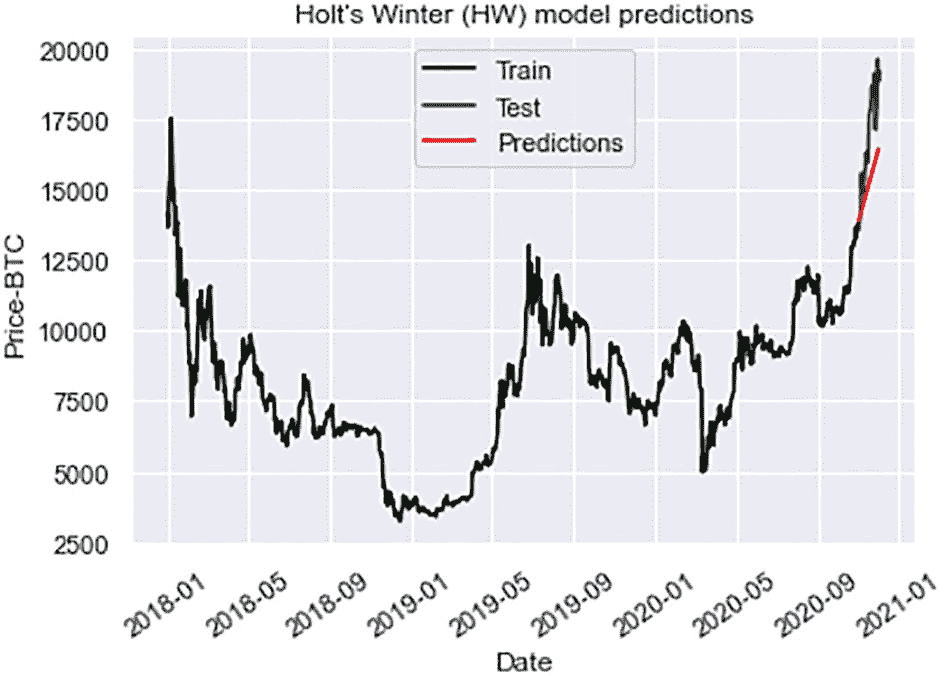

图 2-15 预测值与实际值输出

#### 步骤 8-4. 计算模型的 RMSE 分数。

```
rmse_hw = np.sqrt(mean_squared_error(test_data["BTC-USD"].values, predictions_hw))
print("RMSE: ",rmse_hw)
```

输出结果如下。

```
RMSE:  2024.6833967531811
```

RMSE 值略高，但对于此数据集，加法模型的表现优于乘法模型。对于乘法模型，请将 `ExponentialSmoothing` 函数中的 `trend` 参数改为 `'mul'`。