# 3. 高级单变量与统计多变量建模

第 2 章探讨了在 Python 中实现单变量统计建模的各种配方。本章将探讨一些更高级的技术，以及对另一种时间数据类型——多变量时间序列的建模。多变量时间序列除了日期和时间之外，还包含影响目标变量的其他时间相关特征。本章将探讨在 Python 中实现多变量建模的各种统计方法和配方。

本章涵盖以下用于执行高级单变量和统计多变量建模的配方。

*   配方 3-1\. FBProphet 单变量时间序列建模
*   配方 3-2\. 通过控制变点进行 FBProphet 建模
*   配方 3-3\. 通过调整趋势进行 FBProphet 建模
*   配方 3-4\. 结合节假日进行 FBProphet 建模
*   配方 3-5\. 使用添加回归量进行 FBProphet 建模
*   配方 3-6\. 使用 Auto-ARIMA 进行时间序列预测
*   配方 3-7\. 使用 VAR 模型进行多变量时间序列预测

## 配方 3-1\. FBProphet 单变量时间序列建模

### 问题

您希望加载时间序列数据，并使用 Facebook Prophet 模型进行预测。

### 解决方案

Facebook 的 Prophet 算法于 2017 年发布。它已成为单变量时间序列建模领域的变革者。该算法在具有加法趋势和多重季节性的数据上表现非常出色。它已被广泛应用于各个领域的准确预测。

### 工作原理

以下步骤使用 FBProphet 读取数据并进行预测。

#### 步骤 1-1\. 导入所需的库。

```
import numpy as np
import pandas as pd
from fbprophet import Prophet
from fbprophet.plot import plot_plotly, add_changepoints_to_plot
from sklearn.model_selection import train_test_split
import plotly.offline as py
import matplotlib.pyplot as plt
py.init_notebook_mode()
%matplotlib inline
```

#### 步骤 1-2\. 读取数据。

以下代码读取鳄梨数据集。

```
df = pd.read_csv("avocado.csv").drop(columns=["Unnamed: 0"])
df.head()
```

图 3-1 展示了鳄梨数据集的前几行。

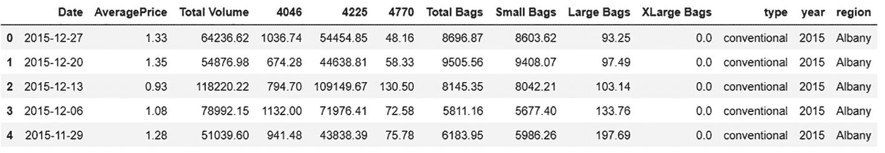

图 3-1

鳄梨数据集头部

#### 步骤 1-3\. 创建训练数据集。

```
train_df = pd.DataFrame()
train_df['ds'] = pd.to_datetime(df["Date"])
train_df['y'] = df.iloc[:,1]
train_df.head()
```

图 3-2 展示了训练数据框的前几行。

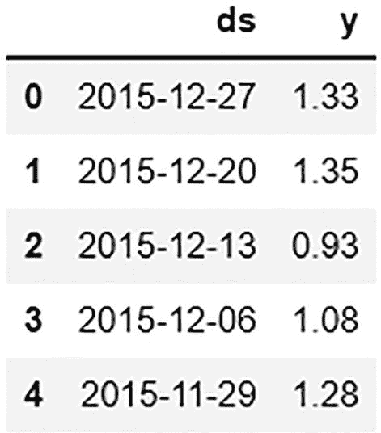

图 3-2

训练数据框头部

#### 步骤 1-4\. 初始化一个基础的 Facebook Prophet 模型。

```
# Initializing basic prophet model:
basic_prophet_model = Prophet()
basic_prophet_model.fit(train_df)
```

#### 步骤 1-5\. 创建用于预测的未来数据框。

```
future_df = basic_prophet_model.make_future_dataframe(periods=300)
future_df.tail()
```

图 3-3 展示了未来数据框的尾部。

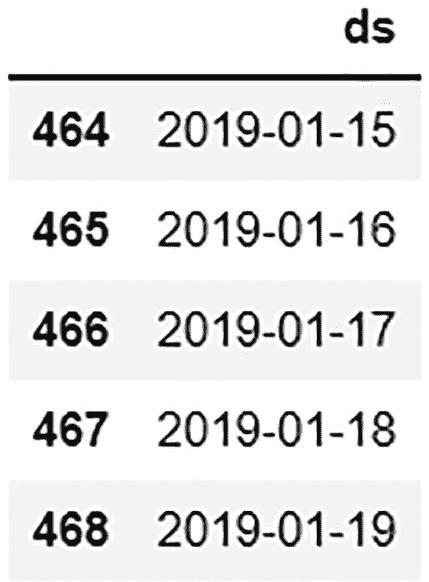

图 3-3

未来数据框尾部

#### 步骤 1-6\. 获取预测结果。

```
# Getting the forecast
forecast_df = basic_prophet_model.predict(future_df)
```

#### 步骤 1-7\. 绘制预测结果图。

```
plot1 = basic_prophet_model.plot(forecast_df)
```

图 3-4 展示了预测输出。

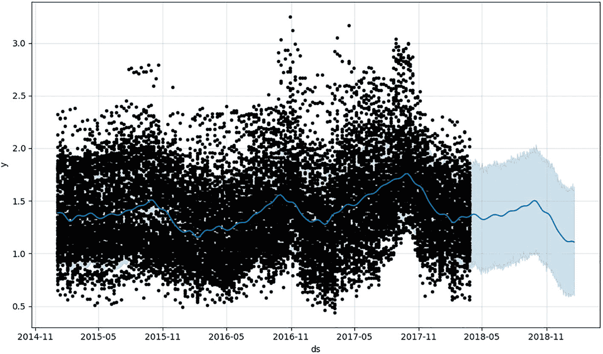

图 3-4

预测输出

图 3-4 中的蓝色线条即为预测值。

#### 步骤 1-8\. 绘制预测成分图。

```
# to view the forecast components
plot2 = basic_prophet_model.plot_components(forecast_df)
```

图 3-5 展示了趋势和季节性成分。

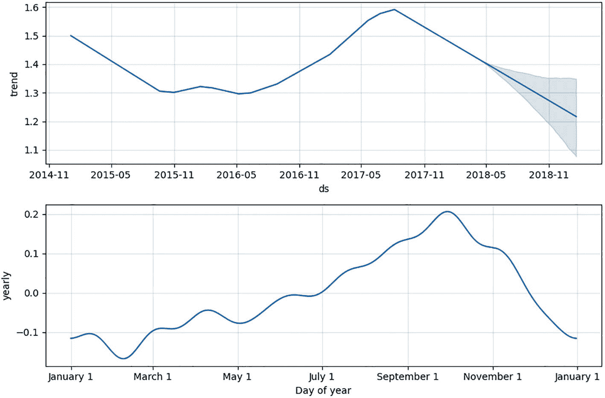

图 3-5

成分输出

## 配方 3-2\. 通过控制变点进行 FBProphet 建模

### 问题

您希望使用 Facebook Prophet 模型进行预测，并调整变点。

### 解决方案

变点是时间序列中检测到突变的确切点。默认情况下，在时间序列的前 80% 中，变点数量设置为 25。让我们通过调整 `n_change_points` 和 `changepoint_range` 参数来调整这些默认值，以控制预测输出。

### 工作原理

以下步骤使用 FBProphet 进行预测并调整变点。

本配方同样使用了配方 3-1 中的步骤 1-1 至 1-6。


#### 步骤 2-1\. 绘制变化点。

让我们在预测图中绘制基础 Prophet 模型的变化点。

```
plot3 = basic_prophet_model.plot(forecast_df)
adding_changepoints = add_changepoints_to_plot(plot3.gca(), basic_prophet_model, forecast_df)
```

图 3-6 展示了绘制在预测图上的变化点。

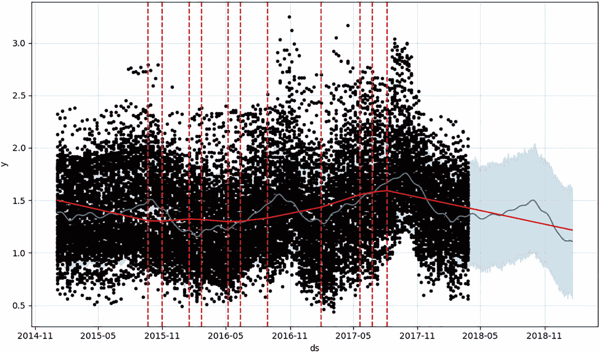

图 3-6

带有变化点的预测图

在图 3-6 中，红色虚线代表由 FBProphet 检测到的变化点。

#### 步骤 2-2\. 打印变化点。

```
basic_prophet_model.changepoints
```

输出如下。

```
584     2015-02-08
1168    2015-03-15
1752    2015-04-26
2336    2015-05-31
2920    2015-07-12
3504    2015-08-16
4087    2015-09-20
4671    2015-11-01
5255    2015-12-06
5839    2016-01-17
6423    2016-02-21
7007    2016-03-27
7591    2016-05-08
8175    2016-06-12
8759    2016-07-24
9343    2016-08-28
9927    2016-10-02
10511   2016-11-13
11094   2016-12-18
11678   2017-01-29
12262   2017-03-05
12846   2017-04-09
13430   2017-05-21
14014   2017-06-25
14598   2017-08-06
名称: ds, 数据类型: datetime64[ns]
```

#### 步骤 2-3\. 检查每个变化点的幅度。

```
deltas = basic_prophet_model.params['delta'].mean(0)
plot4 = plt.figure(facecolor='w')
ax = plot4.add_subplot(111)
ax.bar(range(len(deltas)), deltas)
ax.grid(True, which='major', c='gray', ls='-', lw=1, alpha=0.2)
ax.set_ylabel('速率变化')
ax.set_xlabel('潜在变化点')
plot4.tight_layout()
```

图 3-7 展示了每个变化点的幅度。

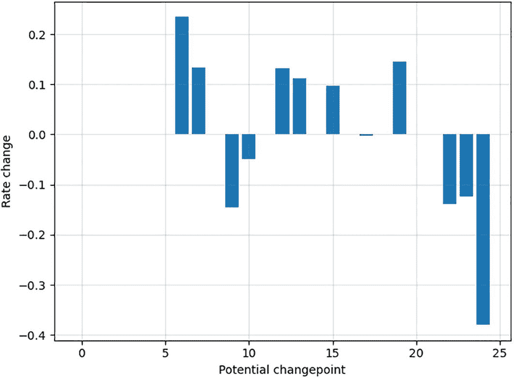

图 3-7

变化点幅度

#### 步骤 2-4\. 调整 n_changepoints 超参数并进行预测。

```
# 将 n_changepoints 设置为超参数：
prophet_model_changepoint = Prophet(n_changepoints=20, yearly_seasonality=True)
# 获取预测结果
forecast_df_changepoint = prophet_model_changepoint.fit(train_df).predict(future_df)
# 绘制带有变化点的预测图
plot5 = prophet_model_changepoint.plot(forecast_df_changepoint)
adding_changepoints = add_changepoints_to_plot(plot5.gca(), prophet_model_changepoint, forecast_df_changepoint)
```

图 3-8 展示了预测输出。

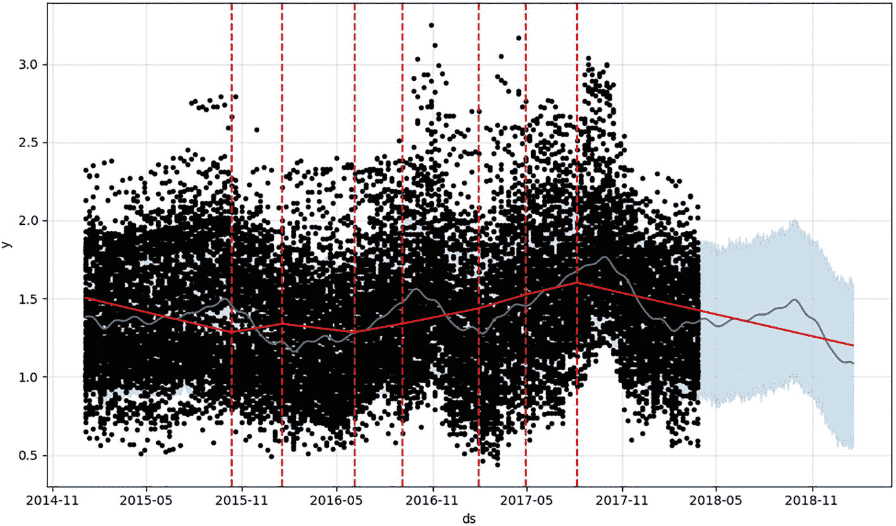

图 3-8

预测输出

可以控制变化点的数量（增加或减少），并相应地调整预测输出。大幅增加变化点可能导致过拟合，而大幅减少则会导致欠拟合。

#### 步骤 2-5\. 调整 changepoint_range 超参数并进行预测。

```
# 将 changepoint_range 设置为超参数：
prophet_model_changepoint2 = Prophet(changepoint_range=0.9, yearly_seasonality=True)
# 获取预测结果
forecast_df_changepoint2 = prophet_model_changepoint2.fit(train_df).predict(future_df)
# 绘制带有变化点的预测图
plot6 = prophet_model_changepoint2.plot(forecast_df_changepoint2)
adding_changepoints = add_changepoints_to_plot(plot5.gca(), prophet_model_changepoint2, forecast_df_changepoint2)
```

图 3-9 展示了预测输出。

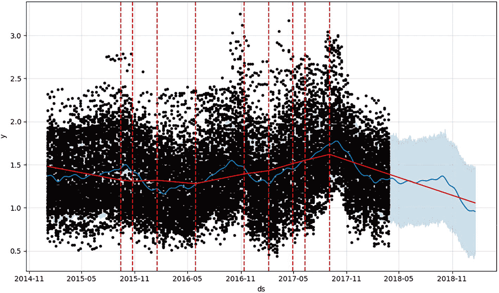

图 3-9

预测输出

通过调整 `changepoint_range` 参数，可以控制变化点在时间序列中的分布范围。它是一个百分比值，表示变化点所在的时间序列（从起点开始）的比例。

## 配方 3-3\. 通过调整趋势进行 FBProphet 建模

### 问题

您希望使用 Facebook Prophet 模型进行预测，并调整趋势组件。

### 解决方案

`changepoint_prior_scale` 可以解决模型的过拟合或欠拟合问题。通过调整其值，趋势的复杂度会发生变化。增大该值会增加复杂度，减小则会降低复杂度。

### 工作原理

以下步骤使用 FBProphet 进行预测，并调整与趋势相关的参数（即 `changepoint_prior_scale`）。

本配方也使用了配方 3-1 中的步骤 1-1 至 1-3。

#### 步骤 3-1\. 增加 changepoint_prior_scale 超参数。

```
prophet_model_trend = Prophet(n_changepoints=20, yearly_seasonality=True, changepoint_prior_scale=0.08)
```

#### 步骤 3-2\. 预测并绘制输出。

```
# 获取预测结果
forecast_df_trend = prophet_model_trend.fit(train_df).predict(future_df)
# 绘制带有变化点的预测图
plot7 = prophet_model_trend.plot(forecast_df_trend)
adding_changepoints = add_changepoints_to_plot(plot7.gca(), prophet_model_trend, forecast_df_trend)
```

图 3-10 展示了预测输出。

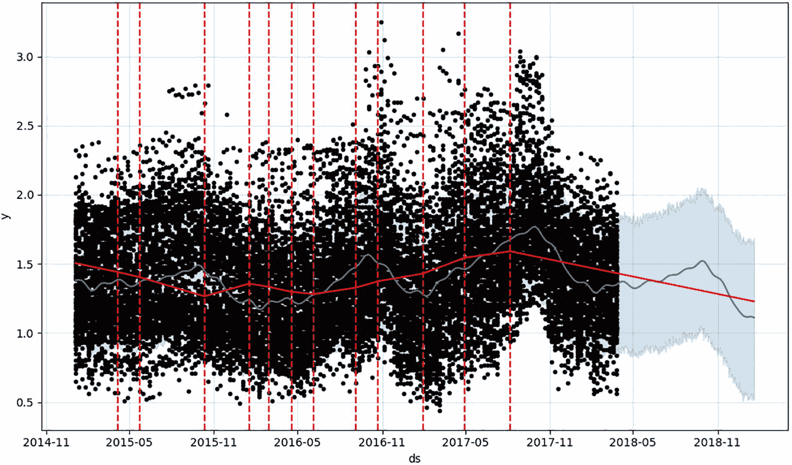

图 3-10

预测输出

图 3-10 说明增加 `changepoint_prior_scale` 会增加趋势的复杂度。然而，过度增加可能导致过拟合。

#### 步骤 3-3\. 减小 changepoint_prior_scale 超参数。

```
prophet_model_trend2 = Prophet(n_changepoints=20, yearly_seasonality=True, changepoint_prior_scale=0.001)
```

#### 步骤 3-4\. 预测并绘制输出。

```
# 获取预测结果
forecast_df_trend2 = prophet_model_trend2.fit(train_df).predict(future_df)
# 绘制带有变化点的预测图
plot8 = prophet_model_trend2.plot(forecast_df_trend2)
adding_changepoints = add_changepoints_to_plot(plot8.gca(), prophet_model_trend2, forecast_df_trend2)
```

图 3-11 展示了预测输出。

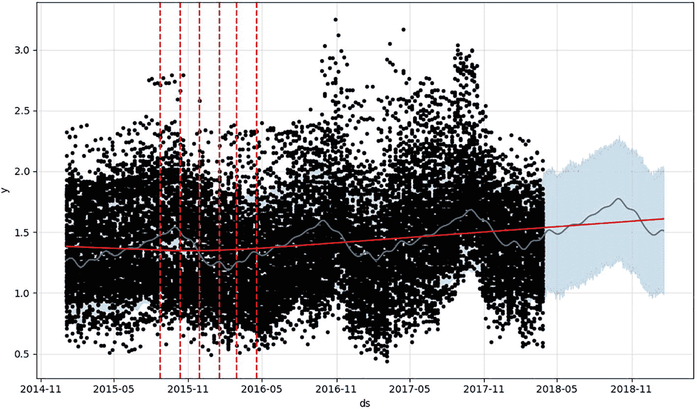

图 3-11

预测输出

图 3-11 显示减小 `changepoint_prior_scale` 会降低趋势的复杂度。不过，过度减小可能导致欠拟合。

## 配方 3-4\. 考虑节假日的 FBProphet 建模

### 问题

您希望在使用 Facebook Prophet 模型进行预测时考虑节假日数据。

### 解决方案

节假日信息是另一个可以添加到 Prophet 模型的输入参数，模型在考虑时间序列变化时会使用此信息。在节假日期间，预计时间序列会发生显著变化；因此，模型不会学习这种模式。

在节假日数据框中，包含一系列作为节假日的日期。还可以提供上、下窗口，表示节假日前后受影响天数的扩展。


### 工作原理

以下步骤使用 FBProphet 进行预测，并添加了节假日组件。

本配方同样使用了配方 3-1 中的步骤 1-1 至 1-3。

#### 步骤 4-1\. 创建自定义节假日数据框。

```
holidays_df = pd.DataFrame({
'holiday': 'avocado season',
'ds': pd.to_datetime(['2014-07-31', '2014-09-16',
'2015-07-31', '2015-09-16',
'2016-07-31', '2016-09-16',
'2017-07-31', '2017-09-16',
'2018-07-31', '2018-09-16',
'2019-07-31', '2019-09-16']),
'lower_window': -1,
'upper_window': 0,
})
```

#### 步骤 4-2\. 使用节假日数据框初始化并拟合 Prophet 模型。

```
prophet_model_holiday = Prophet(holidays=holidays_df)
prophet_model_holiday.fit(train_df)
```

#### 步骤 4-3\. 为预测创建未来数据框。

```
future_df = prophet_model_holiday.make_future_dataframe(periods=12, freq = 'm')
```

#### 步骤 4-4\. 获取预测结果。

```
forecast_df = prophet_model_holiday.predict(future_df)
prophet_model_holiday.plot(forecast_df)
```

图 3-12 显示了预测输出。

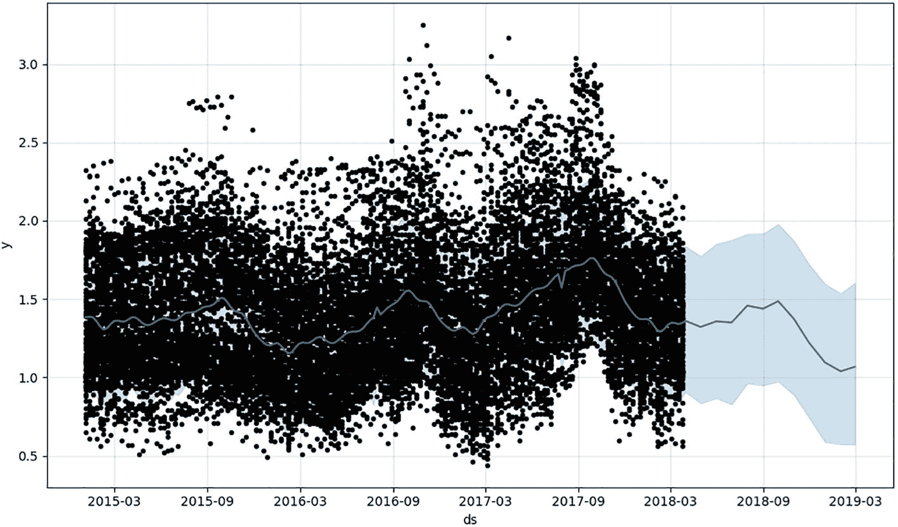

图 3-12

预测输出

## 配方 3-5\. 使用添加回归变量的 FBProphet 建模

### 问题

您希望使用添加了回归变量的 Facebook Prophet 模型进行预测。

### 解决方案

可以通过使用 `add_regressor` 功能向模型添加额外的回归变量。

### 工作原理

以下步骤使用添加了回归变量的 FBProphet 进行预测。

本配方同样使用了配方 3-1 中的步骤 1-1 和 1-2。

#### 步骤 5-1\. 对类型列进行标签编码。

```
# Label encoding type column
from sklearn.preprocessing import LabelEncoder
le = LabelEncoder()
df.iloc[:,10] = le.fit_transform(df.iloc[:,10])
df.head(2)
```

图 3-13 显示了输出数据框。

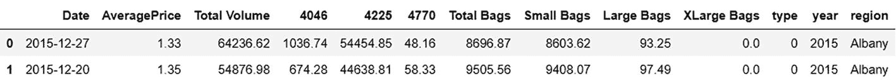

图 3-13

输出数据框

#### 步骤 5-2\. 获取所需格式的数据。

```
data = df[['Date', 'Total Volume', '4046', '4225', '4770', 'Small Bags', 'type']]
data.rename(columns={'Date':'ds'},inplace=True)
data['y'] = df.iloc[:,1]
```

#### 步骤 5-3\. 进行训练-测试集划分。

```
train_df = data[:18000]
test_df = data[18000:]
```

#### 步骤 5-4\. 初始化 Prophet 模型并添加回归变量。

```
prophet_model_regressor = Prophet()
prophet_model_regressor.add_regressor('type')
prophet_model_regressor.add_regressor('Total Volume')
prophet_model_regressor.add_regressor('4046')
prophet_model_regressor.add_regressor('4225')
prophet_model_regressor.add_regressor('4770')
prophet_model_regressor.add_regressor('Small Bags')
```

#### 步骤 5-5\. 拟合数据。

```
prophet_model_regressor.fit(train_df)
future_df = prophet_model_regressor.make_future_dataframe(periods=249)
```

#### 步骤 5-6\. 预测测试集中的数据。

```
forecast_df = prophet_model_regressor.predict(test_df)
prophet_model_regressor.plot(forecast_df)
```

图 3-14 显示了预测输出。

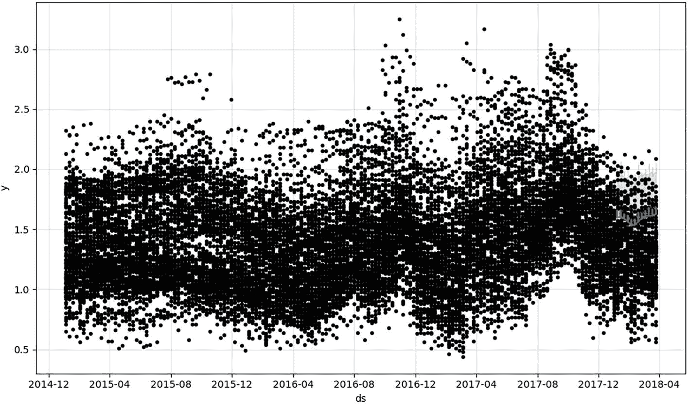

图 3-14

预测输出

图 3-14 显示蓝色区域为预测数据。

## 配方 3-6\. 使用 Auto-ARIMA 进行时间序列预测

### 问题

您希望加载时间序列数据并使用 Auto-ARIMA 进行预测。

### 解决方案

使用 stats model 中定义的内置方法可以轻松实现。

### 工作原理

以下步骤读取数据并使用 Auto-ARIMA 进行预测。

#### 步骤 6-1\. 导入所需库。

```
#import all the required libraries
import pandas as pd
from pmdarima.arima import auto_arima
from pmdarima.arima import ADFTest
from matplotlib import pyplot as plt
from sklearn.metrics import r2_score
```

#### 步骤 6-2\. 读取数据。

从 Git 链接下载数据。

以下代码用于读取数据。

```
#read data
auto_arima_data = pd.read_csv('auto_arima_data.txt')
auto_arima_data.head()
```

图 3-15 显示了输出数据框。

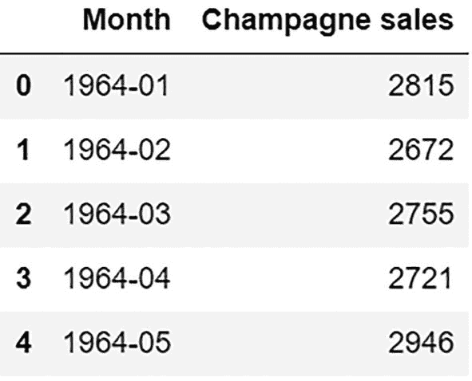

图 3-15

输出数据框

读取数据后，让我们确保数据中不存在空值。并检查每列的数据类型。

#### 步骤 6-3\. 预处理数据。

```
#check missing values
auto_arima_data.isnull().sum()
```

输出如下。

```
Month              0
Champagne sales    0
dtype: int64
```

不存在空值。让我们检查每列的数据类型。

```
#check datatype
auto_arima_data.info()
```

输出如下。

```
RangeIndex: 105 entries, 0 to 104
Data columns (total 2 columns):
#   Column           Non-Null Count  Dtype
---  ------           --------------  -----
0   Month            105 non-null    object
1   Champagne sales  105 non-null    int64
dtypes: int64(1), object(1)
memory usage: 1.8+ KB
```

现在，让我们将 'Month' 变量的数据类型从字符串更改为日期时间。同时，使用 `set_index` 方法将数据框索引设置为该变量。

```
#convert object to datatime and set index
auto_arima_data['Month'] = pd.to_datetime(auto_arima_data['Month'])
auto_arima_data.set_index('Month',inplace=True)
auto_arima_data.head()
```

图 3-16 显示了输出数据框。

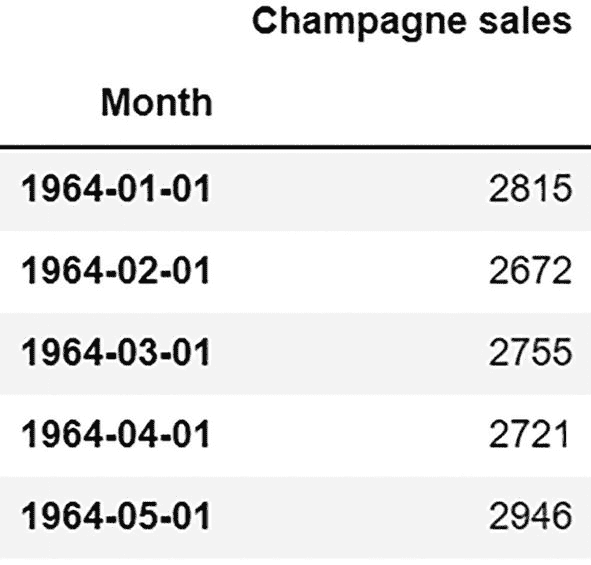

图 3-16

输出数据框

#### 步骤 6-4\. 分析数据模式。

您可以使用 `.plot()` 方法简单地绘制折线图来分析基本的时间序列成分。

```
#line plot to understand the pattern
auto_arima_data.plot()
```

图 3-17 显示了时间序列图输出。

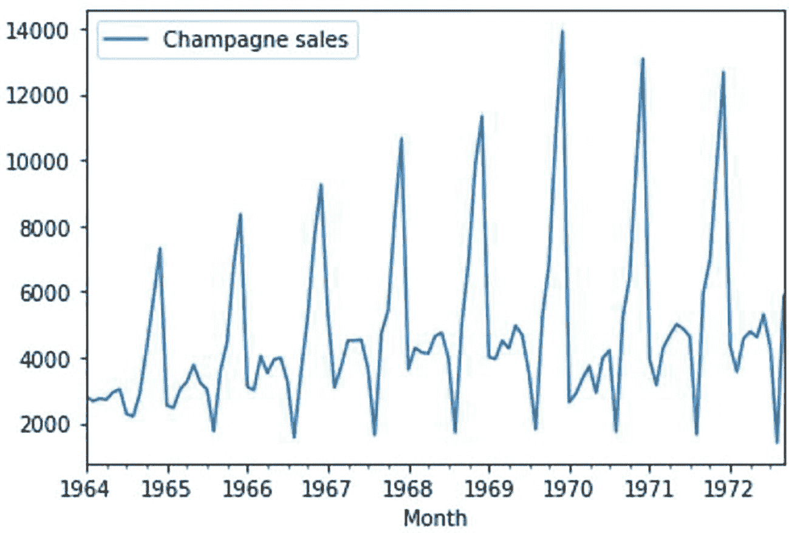

图 3-17

输出

图表显示目标列存在季节性。每年销售额都会出现一个峰值。

#### 步骤 6-5\. 检验平稳性。

如果您使用任何统计模型方法，平稳性检验是时间序列用例中的一个重要步骤。让我们使用增强迪基-富勒（ADF）检验来检查数据的平稳性。

```
#Stationarity check
stationary_test = ADFTest(alpha= 0.05)
stationary_test.should_diff(auto_arima_data)
```

输出如下。

```
(0.01, False)
```

输出显示数据是非平稳的。因此，在构建 Auto-ARIMA 模型时，我们需要使数据平稳。这里使用了由 'd' 值表示的积分（I）概念。

#### 步骤 6-6\. 将数据集拆分为训练集和测试集。

让我们将数据集分为两部分：训练集和测试集。使用训练集构建或训练模型，并使用测试集预测数据。

```
#train test split and plot
train_data = auto_arima_data[:85]
test_data = auto_arima_data[-20:]
plt.plot(train_data)
plt.plot(test_data)
```

图 3-18 显示了训练-测试集划分输出。

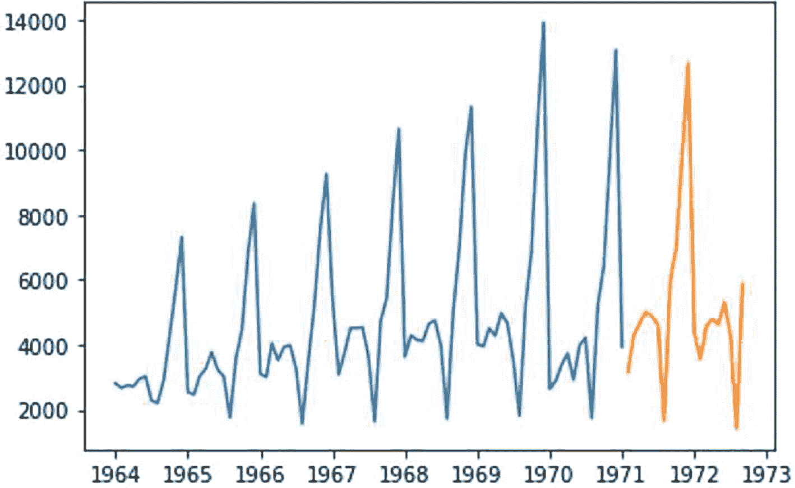

图 3-18

训练-测试集划分输出

在图 3-18 中，蓝色线条代表训练集，橙色线条代表测试集。


#### 步骤 6-7\. 构建 Auto-ARIMA 模型。

在 Auto-ARIMA 模型中，小写的 p、d、q 值表示非季节性成分。大写的 P、D、Q 值表示季节性成分。它的工作原理类似于超参数调优技术，通过不同的组合来寻找 p、d、q 的最优值。最终值根据所考虑的较低 AIC 和 BIC 参数来确定。

让我们尝试 p、d、q 值从 0 到 5 的范围，以从模型中获得最佳值。

```
#model building with parameters
auto_arima_model = auto_arima(train_data, start_p = 0, d=1, start_q = 0, max_p = 5, max_d = 5,
max_q= 5, start_P = 0, D=1, start_Q = 0, max_P = 5, max_D = 5,
max_Q= 5, m=12, seasonal = True, error_action = 'warn', trace = True, supress_warnings= True,
stepwise = True, random_state =20, n_fits = 50)
```

图 3-19 展示了 Auto-ARIMA 的输出。

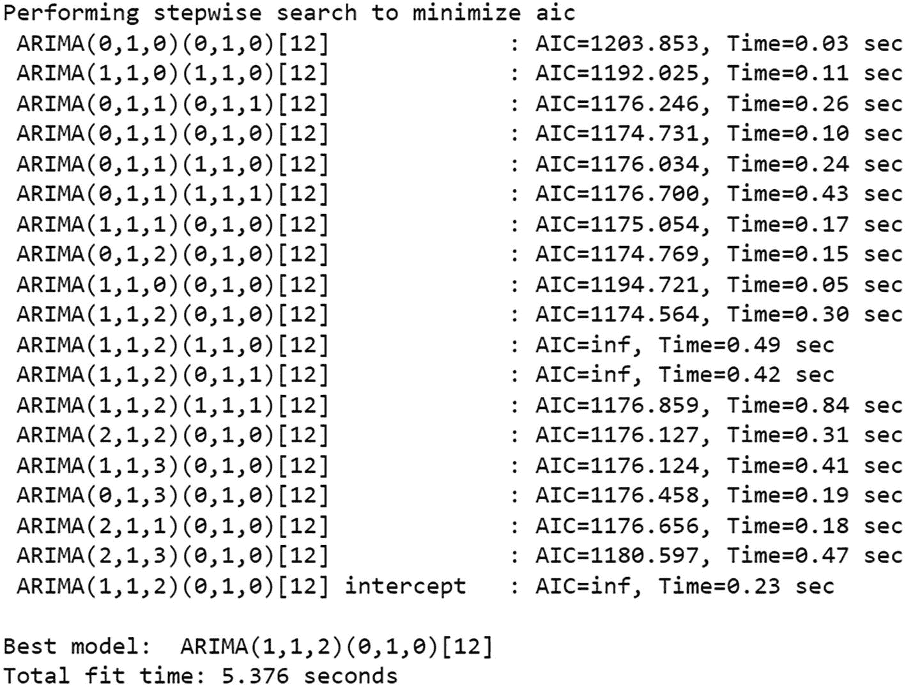

图 3-19

Auto-ARIMA 输出

以下是模型的摘要。

```
#model summary
auto_arima_model.summary()
```

图 3-20 展示了 Auto-ARIMA 模型的摘要。

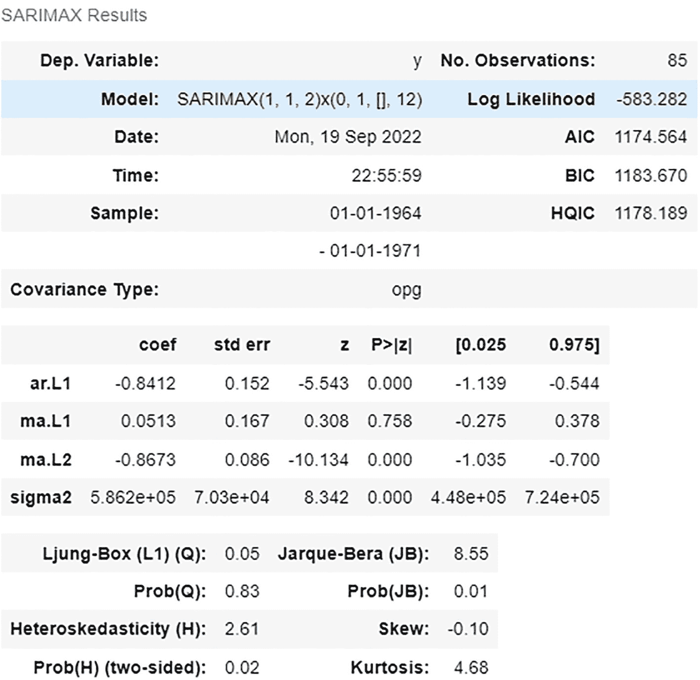

图 3-20

Auto-ARIMA 模型摘要

#### 步骤 6-8\. 使用测试数据进行预测。

让我们使用测试集进行预测。

```
#forecasting on test set
pred = pd.DataFrame(auto_arima_model.predict(n_periods = 20), index = test_data.index)
pred.columns= ['pred_sales']
#plot
plt.figure(figsize=(8,5))
plt.plot(train_data, label = "Training data")
plt.plot(test_data, label = "Test data")
plt.plot(pred, label = "Predicted data")
plt.legend()
plt.show()
```

图 3-21 展示了预测输出。

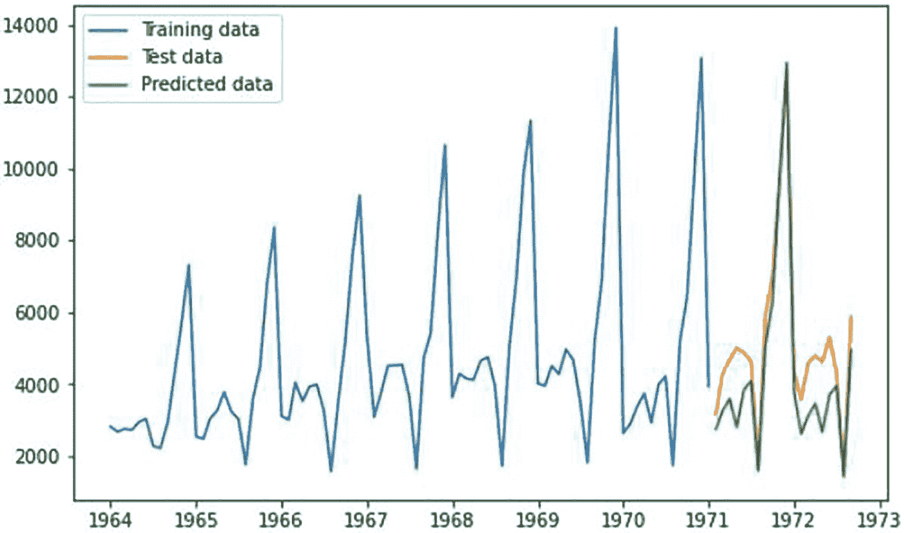

图 3-21

预测输出

#### 步骤 6-9\. 评估模型。

让我们使用测试集的预测来评估模型。

```
#Evaluating using r square score
test_data['prediction'] = pred
r2_score(test_data['Champagne sales'],test_data['prediction'])
```

输出如下。

```
0.811477383636726
```

## 配方 3-7\. 使用 VAR 模型进行多元时间序列预测

### 问题

您想要加载时间序列数据并使用多个特征进行预测。

### 解决方案

使用 statsmodels 中定义的向量自回归（VAR）模型可以轻松实现。

### 工作原理

以下步骤读取数据并使用 VAR 模型进行预测。

#### 步骤 7-1\. 导入所需的库。

```
#import all the required libraries
import pandas as pd
from math import sqrt
from sklearn.metrics import mean_squared_error
from statsmodels.tsa.vector_ar.vecm import coint_johansen
from statsmodels.tsa.vector_ar.var_model import VAR
```

#### 步骤 7-2\. 读取数据。

从 Git 链接下载数据。

以下代码读取数据。

```
#read data
var_data = pd.read_excel('AirQualityUCI.xlsx', parse_dates=[['Date', 'Time']])
var_data.head()
```

在读取数据时，让我们解析日期时间列。

图 3-22 展示了输出的数据框。

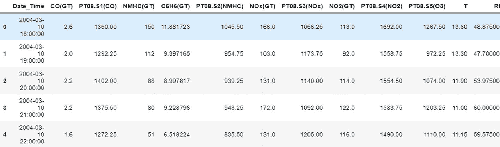

图 3-22

输出数据框

读取数据后，让我们确保没有空值。

#### 步骤 7-3\. 预处理数据。

```
#check missing values
var_data.isnull().sum()
```

输出如下。

```
Date_Time        0
CO(GT)           0
PT08.S1(CO)      0
NMHC(GT)         0
C6H6(GT)         0
PT08.S2(NMHC)    0
NOx(GT)          0
PT08.S3(NOx)     0
NO2(GT)          0
PT08.S4(NO2)     0
PT08.S5(O3)      0
T                0
RH               0
AH               0
dtype: int64
```

现在，让我们将 Date_Time 变量的数据类型从字符串更改为日期时间。同时，使用 `set_index` 方法将数据框的索引设置为此变量。

```
var_data['Date_Time'] = pd.to_datetime(var_data.Date_Time , format = '%d/%m/%Y %H.%M.%S')
var_data1 = var_data.drop(['Date_Time'], axis=1)
var_data1.index = var_data.Date_Time
var_data1.head()
```

图 3-23 展示了输出的数据框。

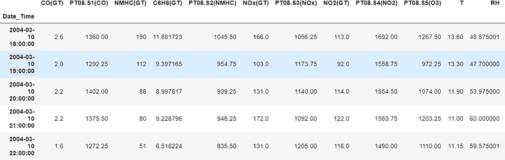

图 3-23

输出数据框

目前，数据集中没有缺失值。为了安全起见，让我们准备一段代码，以防数据集中出现任何空值。

```
#missing value treatment
cols = var_data1.columns
for j in cols:
for i in range(0,len(var_data1)):
if var_data1[j][i] == -200:
var_data1[j][i] = var_data1[j][i-1]
```

#### 步骤 7-4\. 检查平稳性。

让我们使用 ADF 检验来检查数据的平稳性。该检验最多适用于 12 个变量，因此由于有 13 个变量，我们随机删除一个。

```
#checking stationarity
from statsmodels.tsa.vector_ar.vecm import coint_johansen
#since the test works for only 12 variables, I have randomly dropped
#in the next iteration, I would drop another and check the eigenvalues
test = var_data1.drop([ 'CO(GT)'], axis=1)
coint_johansen(test,-1,1).eig
```

输出如下。

```
array([1.75628733e-01, 1.52399674e-01, 1.15090998e-01, 1.04309966e-01,
9.29562919e-02, 6.90255307e-02, 5.76654697e-02, 3.43596700e-02,
3.06350634e-02, 1.18801270e-02, 2.46819409e-03, 7.09473977e-05])
```

#### 步骤 7-5\. 将数据集拆分为训练集和测试集。

让我们拆分数据集。

```
#creating the train and validation set
train_data = var_data1[:int(0.8*(len(var_data1)))]
valid_data = var_data1[int(0.8*(len(var_data1))):]
```

#### 步骤 7-6\. 构建 VAR 模型并在测试集上进行预测。

```
##fit the model
from statsmodels.tsa.vector_ar.var_model import VAR
var_model = VAR(endog=train_data)
var_model_fit = var_model.fit()
# make prediction on validation
pred = var_model_fit.forecast(var_model_fit.endog, steps=len(valid_data))
pred
```

图 3-24 展示了预测输出。

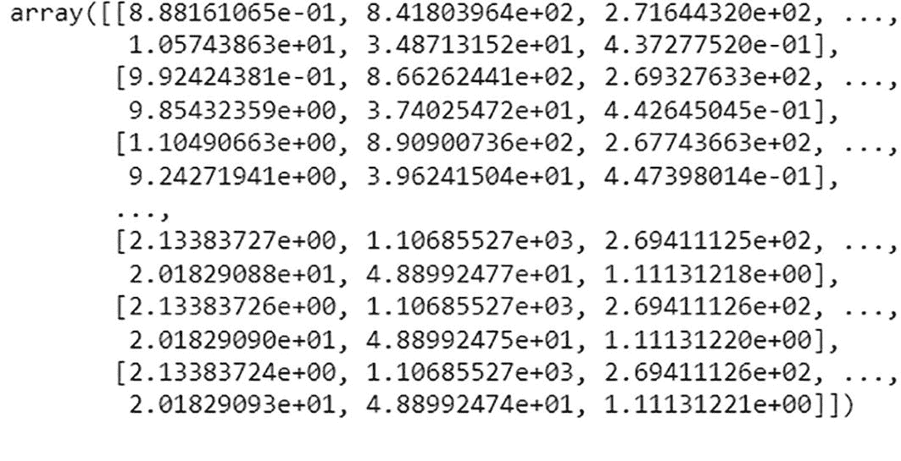

图 3-24

预测输出

预测结果以数组形式呈现，其中每个列表代表一行的预测值。让我们将其转换为更易读的格式。

```
##converting predictions to dataframe
pred1 = pd.DataFrame(index=range(0,len(pred)),columns=[cols])
for j in range(0,13):
for i in range(0, len(pred1)):
pred1.iloc[i][j] = pred[i][j]
pred1
```

图 3-25 展示了输出的数据框。

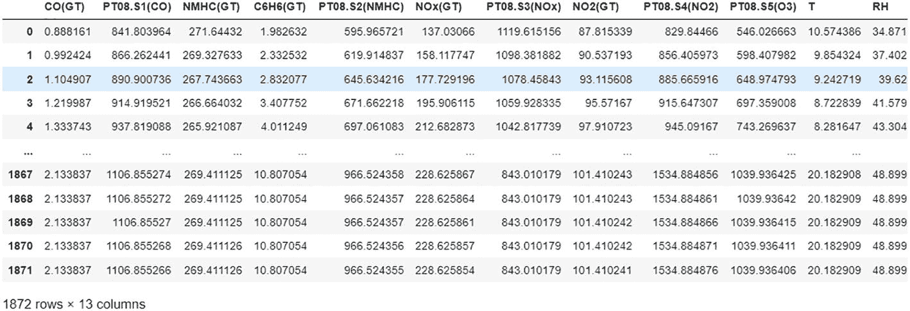

图 3-25

输出数据框

#### 步骤 7-7\. 评估模型。

让我们获取每个变量的 RMSE（均方根误差）评估指标。

```
##check rmse
for i in cols:
print('rmse value for', i, 'is : ', sqrt(mean_squared_error(pred1[i], valid_data[i])))
```

输出如下。

```
rmse value for CO(GT) is :  1.4086965424457896
rmse value for PT08.S1(CO) is :  205.91037633777376
rmse value for NMHC(GT) is :  6.670741427642936
rmse value for C6H6(GT) is :  7.130304477786223
rmse value for PT08.S2(NMHC) is :  277.8562837309765
rmse value for NOx(GT) is :  214.7579379769933
rmse value for PT08.S3(NOx) is :  244.9612992895686
rmse value for NO2(GT) is :  66.65226538131333
rmse value for PT08.S4(NO2) is :  490.052866528993
rmse value for PT08.S5(O3) is :  446.50499189012726
rmse value for T is :  10.722429361274823
rmse value for RH is :  17.114848634832306
rmse value for AH is :  0.5216105887695865
```


