# 4. 基于机器学习回归的预测

前几章介绍了如何使用时间序列算法预测未来值。同样，在时间序列建模中，有两种类型的时间序列：单变量和多变量。更多信息请参考第 2 章和第 3 章。

本章旨在构建用于时间序列预测的经典机器学习回归算法。基于机器学习的预测之所以强大，是因为它能够利用其他因素/特征来预测数值。

本章重点介绍如何构建用于预测的回归模型。

*   方法 4-1. 为时间序列预测构建回归模型
*   方法 4-2. 实现 XGBoost 模型
*   方法 4-3. 实现 LightGBM 模型
*   方法 4-4. 实现随机森林模型
*   方法 4-5. 选择最佳模型

## 方法 4-1. 为时间序列预测构建回归模型

### 问题

您希望为时间序列预测构建回归模型。

### 解决方案

以下是基于机器学习回归的预测的基本步骤。

1.  数据收集
2.  数据清洗与预处理
3.  特征选择
4.  训练-测试-验证集划分
5.  模型构建
6.  评估
7.  预测

图 4-1 展示了构建基于机器学习回归的预测的步骤。

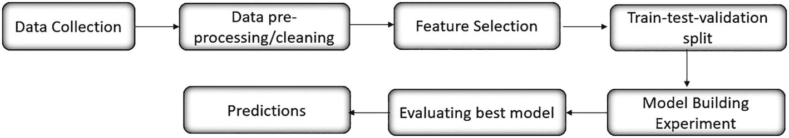

图 4-1

输出

### 工作原理

以下步骤用于构建回归模型。

#### 步骤 1-1. 安装并导入所需的库。

让我们导入所有必需的库。

```python
#import libraries
import pandas as pd
import numpy as np
import glob
import time
from sklearn.feature_selection import SelectKBest
from sklearn.feature_selection import f_regression
import xgboost as xgb
from lightgbm import LGBMRegressor
from sklearn.ensemble import RandomForestRegressor
from sklearn.metrics import mean_squared_error
from plotly.offline import init_notebook_mode, iplot
import plotly.graph_objs as go
from plotly import tools
init_notebook_mode(connected=True)
from sklearn.metrics import mean_squared_error
```

#### 步骤 1-2. 收集数据。

本章使用电力消耗数据。请从 GitHub 上获取该数据集。

以下代码用于读取数据。

```python
df = pd.read_csv('train_6BJx641.csv')
df.head()
```

图 4-2 显示了数据的前五行。

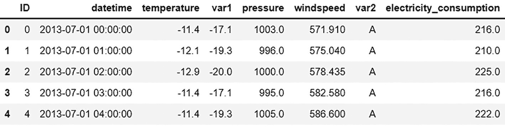

图 4-2

输出

#### 步骤 1-3. 预处理数据并创建特征（特征工程）。

在构建任何模型之前，必须检查数据质量并根据模型要求进行预处理。

那么，让我们看看需要哪些清洗和预处理步骤。

数据集中包含一个 `ID` 列，该列不能直接输入模型，因此我们先删除 `ID` 列。

```python
del df['ID']
```

让我们检查缺失值。

```python
df.isnull().sum()
```

图 4-3 显示了缺失值的输出结果。

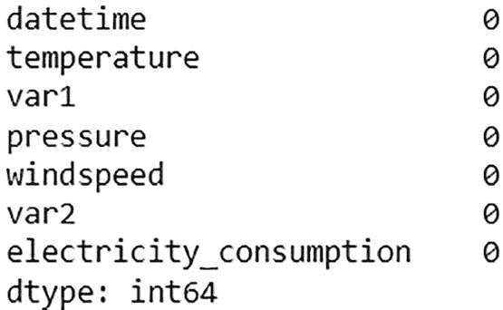

图 4-3

输出

输出结果如下。

所有列中均不存在缺失值，因此无需处理。

现在，让我们检查每列的数据类型。

```python
df.info()
```

图 4-4 显示了每列数据类型的输出结果。

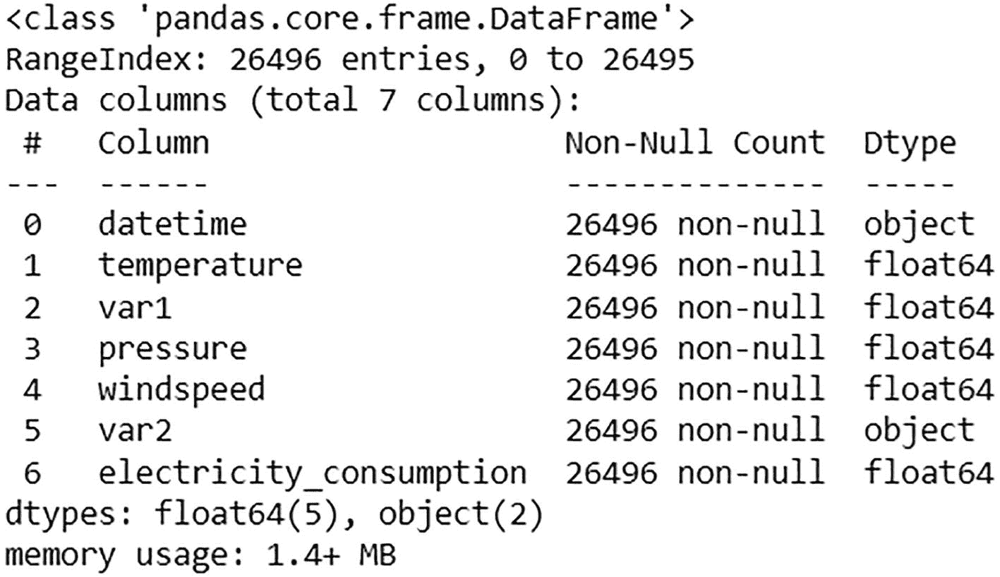

图 4-4

输出

让我们将日期列转换为 `pandas` 的 `datetime` 格式，并创建特征（即所谓的特征工程）。

```python
#Creating datetime features to use in the model to capture seasonality
df['time'] = pd.to_datetime(df['datetime'])
df['year'] = df.time.dt.year
df['month'] = df.time.dt.month
df['day'] = df.time.dt.day
df['hour'] = df.time.dt.hour
df.drop('time', axis=1, inplace=True)
df.head()
```

图 4-5 显示了创建 `datetime` 特征后前五行的输出结果。

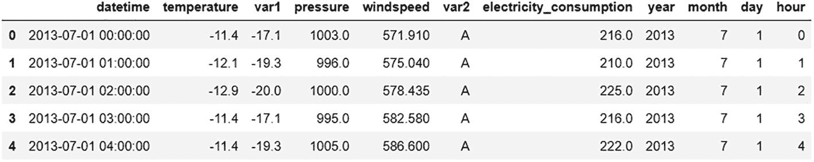

图 4-5

输出

让我们使用 `datetime` 列对数据框进行排序，然后将其删除，因为它不参与模型构建。

```python
#sorting
df=df.sort_values(by='datetime')
#Deleting the column
del df['datetime']
```

图 4-6 显示了排序并删除 `datetime` 列后前五行的输出结果。

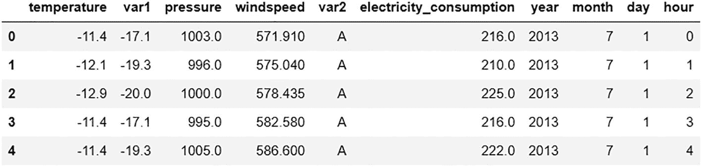

图 4-6

输出

`year`、`month`、`day`、`hour` 列是通过 `datetime` 列创建的，并将它们用于构建模型以捕捉趋势和季节性。同样，您也可以添加目标变量的滞后特征作为特征。

*创建滞后特征的代码片段：`df['lag1']=df['col name'].shift(1)`*

数据集中包含一个分类特征，因此我们使用独热编码方法进行编码。

```python
#convering all categorical columns to numerical.
df1=pd.get_dummies(df)
```

图 4-7 显示了编码后前五行的输出结果。

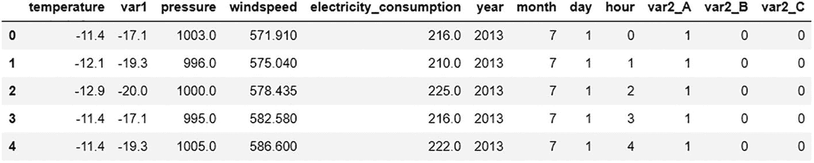

图 4-7

输出

这里使用了 `get_dummies` 方法。该方法在 `pandas` 中定义，用于将所有分类列编码为数值列。该数据集中只有一列分类数据。

所需的清洗和预处理已完成。接下来，我们关注特征选择。

#### 步骤 1-4. 选择特征。

为了构建监督式机器学习模型，您需要考虑那些对目标特征有显著影响的特征。

为了获取构建模型所需的显著特征，您可以执行高级统计检验，如方差分析、卡方检验和相关性分析，或者使用 `sklearn` 中定义的内置函数 `SelectKBest`，它通过为每列提供评分来帮助您选择特征。

在使用 `SelectKBest` 之前，让我们为所有自变量和目标特征创建单独的对象。

```python
#creating target and features objects
x = df1.drop(columns=['electricity_consumption'])
y = df1.iloc[:,4]
```

现在，让我们拟合 `SelectKBest`。

```python
#implementing selectKbest
st=time.time()
bestfeatures = SelectKBest(score_func=f_regression)
fit = bestfeatures.fit(x,y)
et=time.time()-st
print(et)
dfscores = pd.DataFrame(fit.scores_)
dfcolumns = pd.DataFrame(x.columns)
featureScores = pd.concat([dfcolumns,dfscores],axis=1)
featureScores.columns = ['Featuress','Score']
best_features=featureScores.nlargest(5,'Score')
best_features
```

图 4-8 显示了前五个特征的输出结果。

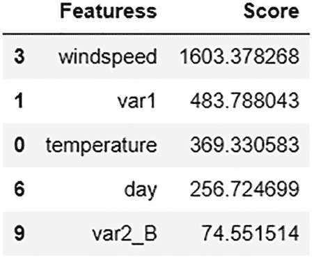

图 4-8

输出

`n` 值为 5，因此显示了五个带有评分的特征。

#### 步骤 1-5：处理训练集、测试集和验证集的划分。

特征选择部分已完成。现在，我们来划分数据集以进行模型构建。你可以使用内置函数来分割数据。但由于这是一个预测问题，我们不希望随机分割。最新的日期记录应归入验证集，最早的记录应归入训练集，中间的记录则归入测试集。

让我们使用基本的 `pandas` 方法来分割数据。

```python
# 训练集-测试集-验证集划分
test=df1.tail(7940)
#测试集
test1=test.head(7440)
#训练集
train=df1.head(18556)
#验证集
pred=test.tail(500)
```

数据已准备就绪且格式正确，现在开始建模过程。

让我们尝试多种模型，然后选择性能最佳的一个。

请注意，在构建模型时，无论特征选择的结果如何，都会考虑所有特征。

在拟合模型之前，再次为所有自变量和目标特征创建单独的对象。

```
#创建目标和特征对象
#用于训练集
y_train=train.iloc[:,4]
X_train=train.drop(columns=['electricity_consumption'])
#用于测试集
y_test=test1.iloc[:,4]
X_test=test1.drop(columns=['electricity_consumption'])
#用于验证集
y_pred=pred.iloc[:,4]
X_pred=pred.drop(columns=['electricity_consumption'])
```

## 方案 4-2：实现 XGBoost 模型

### 问题

你想使用 XGBoost 模型。

### 解决方案

最简单的构建方法是使用 `sklearn` 库。

### 工作原理

让我们按照步骤进行。

#### 步骤 2-1：构建 XGBoost 模型。

预处理后的训练数据（来自方案 4-1）已准备好用于构建模型。让我们构建 XGBoost 模型。

```
# Xgboost 模型
xg_reg = xgb.XGBRegressor(objective ='reg:linear', colsample_bytree = 0.3, learning_rate = 0.1,
max_depth = 100, alpha = 10, n_estimators = 140)
xg_reg.fit(X_train,y_train)
```

#### 步骤 2-2：在测试集上评估 XGBoost 模型。

```
# 在测试数据上评估模型
predictions = xg_reg.predict(X_test)
errors = abs(predictions - y_test)
mape = 100 * np.mean(errors / y_test)
mse=mean_squared_error(y_test,predictions)
RMSE=np.sqrt(mse)
print("XGBOOST 模型")
print("测试集的 mape 值",mape)
print("测试集的 mse 值",mse)
print("测试集的 RMSE 值",RMSE)
```

输出如下。

```
XGBOOST 模型
测试集的 mape 值 20.395743624282215
测试集的 mse 值 9949.946409810507
测试集的 RMSE 值 99.74941809259093
```

#### 步骤 2-3：在验证集上评估 XGBoost 模型。

```
# 在测试数据上评估模型
predictions = xg_reg.predict(X_pred)
errors = abs(predictions - y_pred)
mape = 100 * np.mean(errors / y_pred)
mse=mean_squared_error(y_pred,predictions)
RMSE=np.sqrt(mse)
print("XGBOOST 模型")
print("验证集的 mape 值",mape)
print("验证集的 mse 值",mse)
print("验证集的 RMSE 值",RMSE)
```

输出如下。

```
XGBOOST 模型
验证集的 mape 值 18.31413324392246
验证集的 mse 值 6692.219349248934
验证集的 RMSE 值 81.80598602332799
```

## 方案 4-3：实现 LightGBM 模型

### 问题

你想使用 LightGBM 模型。

### 解决方案

最简单的构建方法是使用 `sklearn` 库。

### 工作原理

让我们按照步骤进行。

#### 步骤 3-1：构建 LightGBM 模型。

使用相同的预处理训练数据（来自方案 4-1）来构建 LightGBM 模型。

```
# LightGBM 模型
lgb_reg = LGBMRegressor(n_estimators=100, random_state=42)
lgb_reg.fit(X_train, y_train)
```

#### 步骤 3-2：在测试集上评估 LightGBM 模型。

```
# 在测试数据上评估模型
predictions = lgb_reg.predict(X_test)
errors = abs(predictions - y_test)
mape = 100 * np.mean(errors / y_test)
mse=mean_squared_error(y_test,predictions)
RMSE=np.sqrt(mse)
print("LIGHTGBM 模型")
print("测试集的 mape 值",mape)
print("测试集的 mse 值",mse)
print("测试集的 RMSE 值",RMSE)
```

输出如下。

```
LIGHTGBM 模型
测试集的 mape 值 17.8086387209238
测试集的 mse 值 7448.058075387331
测试集的 RMSE 值 86.30213250776212
```

#### 步骤 3-3：在验证集上评估 LightGBM 模型。

```
# 在测试数据上评估模型
predictions = lgb_reg.predict(X_pred)
errors = abs(predictions - y_pred)
mape = 100 * np.mean(errors / y_pred)
mse=mean_squared_error(y_pred,predictions)
RMSE=np.sqrt(mse)
print("LIGHTGBM 模型")
print("验证集的 mape 值",mape)
print("验证集的 mse 值",mse)
print("验证集的 RMSE 值",RMSE)
```

输出如下。

```
LIGHTGBM 模型
验证集的 mape 值 14.524462046915062
验证集的 mse 值 4610.576774339071
验证集的 RMSE 值 67.90122807681074
```

## 方案 4-4：实现随机森林模型

### 问题

你想使用随机森林模型。

### 解决方案

最简单的构建方法是使用 `sklearn` 库。

### 工作原理

让我们按照步骤进行。

#### 步骤 4-1：构建随机森林模型。

使用相同的预处理训练数据（来自方案 4-1）来构建随机森林模型。

```
# 随机森林模型
regr = RandomForestRegressor(n_estimators=100, random_state=42)
regr.fit(X_train, y_train)
```

#### 步骤 4-2：在测试集上评估随机森林模型。

```
# 在测试数据上评估模型
predictions = regr.predict(X_test)
errors = abs(predictions - y_test)
mape = 100 * np.mean(errors / y_test)
mse=mean_squared_error(y_test,predictions)
RMSE=np.sqrt(mse)
print("随机森林模型")
print("测试集的 mape 值",mape)
print("测试集的 mse 值",mse)
print("测试集的 RMSE 值",RMSE)
```

输出如下。

```
随机森林模型
测试集的 mape 值 18.341864621229462
测试集的 mse 值 7642.701889959678
测试集的 RMSE 值 87.42254794936875
```

#### 步骤 4-3：在验证集上评估随机森林模型。

```
# 在测试数据上评估模型
predictions = regr.predict(X_pred)
errors = abs(predictions - y_pred)
mape = 100 * np.mean(errors / y_pred)
mse=mean_squared_error(y_pred,predictions)
RMSE=np.sqrt(mse)
print("随机森林模型")
print("验证集的 mape 值",mape)
print("验证集的 mse 值",mse)
print("验证集的 RMSE 值",RMSE)
```

输出如下。

```
随机森林模型
验证集的 mape 值 16.41982254170068
验证集的 mse 值 5138.454886199999
验证集的 RMSE 值 71.68301672083841
```

## 方案 4-5：选择最佳模型

### 问题

你想从所有已实现的模型中选择性能最佳的模型。

### 解决方案

以下是使用的一些评估指标。

*   **MAE**（平均绝对误差）计算为绝对误差项的均值，其中误差是实际值与预测值之间的差值。

*   `MSE`（均方误差）是平方误差项的均值，其中误差是实际值与预测值之间的差值。
*   `RMSE`（均方根误差）是均方误差的平方根。
*   `MAPE`（平均绝对百分比误差）是绝对百分比误差的均值，其中百分比误差是误差与实际值的比率。
*   `准确率` 在时间序列和回归中，通过 1 减去平均绝对百分比误差来计算。

所有三个回归模型都已训练完成。与其查看每个模型在每次训练时的评估指标，不如使用一段代码来提供最佳预测模型，并将预测值与实际值绘制成图。

## 工作原理

以下步骤用于选择性能最佳的模型。

### 步骤 5-1. 评估方法。

让我们编写一个函数来评估这些模型。

```python
#function to evaluate the model.
def evaluate(model, test_features, test_labels):
    predictions = model.predict(test_features)
    errors = abs(predictions - test_labels)
    mape = 100 * np.mean(errors / test_labels)
    accuracy = 100 - mape
    mse=mean_squared_error(test_labels,predictions)
    RMSE=np.sqrt(mse)
    print('Model Performance')
    print('Average Error: {:0.4f} degrees.'.format(np.mean(errors)))
    print('Accuracy = {:0.2f}%.'.format(accuracy))
    print('RMSE = {:0.2f}'.format(RMSE))
    return accuracy,predictions,RMSE
```

### 步骤 5-2. 在测试集中比较性能。

让我们调用评估函数来获取性能最佳的模型，该函数将返回最佳模型名称、模型对象和预测结果。

让我们检查测试集中性能最佳的模型。

```python
models=[xg_reg,lgb_reg,regr]
model_name=['XGBoost','LightGBM','RandomForest']
model_RMSE=[]
model_predictions=[]
for item in models:
    base_accuracy,predictions,RMSE=evaluate(item,X_test,y_test)
    model_RMSE.append(RMSE)
    model_predictions.append(predictions)
r=model_RMSE.index(min(model_RMSE))
best_model_predictions=model_predictions[r]
best_model_name=model_name[r]
best_model=models[r]
```

输出如下。

```
Model Performance
Average Error: 67.7595 degrees.
Accuracy = 79.60%.
RMSE = 99.75
Model Performance
Average Error: 58.4586 degrees.
Accuracy = 82.19%.
RMSE = 86.30
Model Performance
Average Error: 59.3871 degrees.
Accuracy = 81.66%.
RMSE = 87.42
```

```python
print('Best Model:')
print(best_model_name)
print('Model Object:')
print(best_model)
print('Predictions:')
print(best_model_predictions)
```

图 4-9 展示了测试集的最佳模型、模型对象和预测结果。

输出如下。

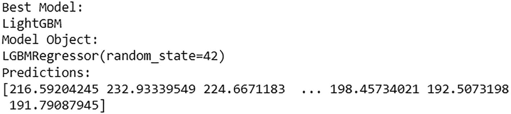

图 4-9 输出

在这三个回归模型中，`LightGBM` 在两个测试集上表现最佳，其 `RMSE` 最低（86）。

让我们使用 `LightGBM` 模型的预测结果。

### 步骤 5-3. 绘制测试集中 `LightGBM` 模型预测值与实际值的对比图。

让我们使用 `Plotly` 为测试集绘制预测值与实际值的对比图。

```python
#Plot timeseries
y_test=pd.DataFrame(y_test)
y_test['predictions']=best_model_predictions
X_test['datetime']=pd.to_datetime(X_test[['year','month','day','hour']])
y_test['datetime']=X_test['datetime']
y_test=y_test.sort_values(by='datetime')
trace0 = go.Scatter(x=y_test['datetime'].astype(str), y=y_test['electricity_consumption'].values, opacity = 0.8, name='actual_value')
trace1 = go.Scatter(x=y_test['datetime'].astype(str), y=y_test['predictions'].values, opacity = 0.8, name='prediction')
layout = dict(
    title= "Prediction vs actual:",
    xaxis=dict(
        rangeselector=dict(
            buttons=list([
                dict(count=1, label='1m', step='month', stepmode='backward'),
                dict(count=6, label='6m', step='month', stepmode='backward'),
                dict(count=12, label='12m', step='month', stepmode='backward'),
                dict(step='all')
            ])
        ),
        rangeslider=dict(visible = True),
        type='date'
    )
)
fig = dict(data= [trace0,trace1], layout=layout)
iplot(fig)
```

图 4-10 展示了测试集的预测值与实际值对比图。

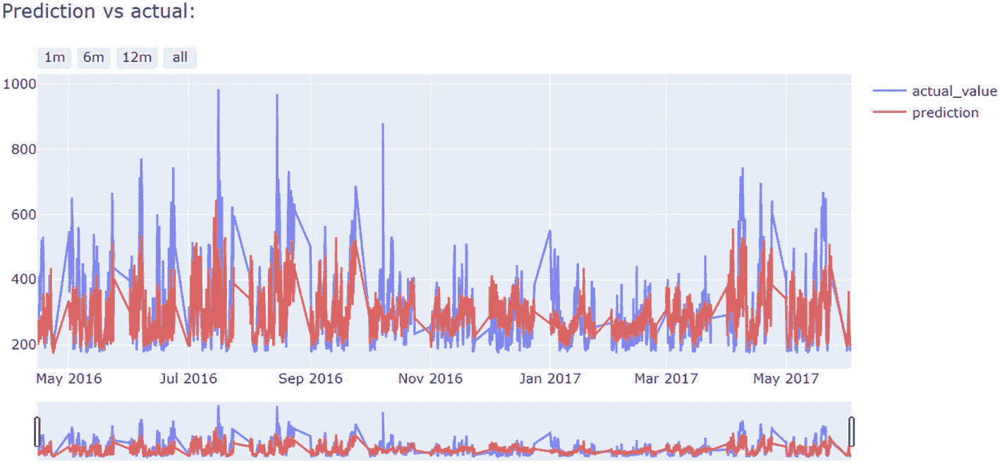

图 4-10 输出

### 步骤 5-4. 在验证集中比较性能。

让我们检查验证集中性能最佳的模型。

```python
models=[xg_reg,lgb_reg,regr]
model_name=['XGBoost','LightGBM','RandomForest']
model_RMSE=[]
model_predictions=[]
for item in models:
    base_accuracy,predictions,RMSE=evaluate(item,X_pred,y_pred)
    model_RMSE.append(RMSE)
    model_predictions.append(predictions)
r=model_RMSE.index(min(model_RMSE))
best_model_predictions=model_predictions[r]
best_model_name=model_name[r]
best_model=models[r]
```

输出如下。

```
Model Performance
Average Error: 54.9496 degrees.
Accuracy = 81.69%.
RMSE = 81.81
Model Performance
Average Error: 43.6196 degrees.
Accuracy = 85.48%.
RMSE = 67.90
Model Performance
Average Error: 46.8309 degrees.
Accuracy = 83.58%.
RMSE = 71.68
```

```python
print('Best Model:')
print(best_model_name)
print('Model Object:')
print(best_model)
print('Predictions:')
print(best_model_predictions)
```

图 4-11 展示了验证集的最佳模型、模型对象和预测结果。

输出如下。

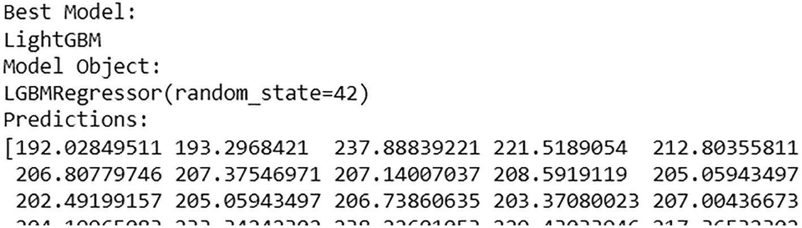

图 4-11 输出

在这三个回归模型中，`LightGBM` 在两个测试集上表现最佳，其 `RMSE` 最低（67）。

让我们使用 `LightGBM` 模型的预测结果。

#### 步骤 5-5：绘制验证集中 `LightGBM` 模型预测值与实际值的对比图。

让我们使用 `Plotly` 为验证集绘制预测值与实际值的对比图。

```python
#Plot timeseries
y_pred=pd.DataFrame(y_pred)
y_pred['predictions']=best_model_predictions
X_pred['datetime']=pd.to_datetime(X_pred[['year','month','day','hour']])
y_pred['datetime']=X_pred['datetime']
y_pred=y_pred.sort_values(by='datetime')
trace0 = go.Scatter(x=y_pred['datetime'].astype(str), y=y_pred['electricity_consumption'].values, opacity = 0.8, name='actual_value')
trace1 = go.Scatter(x=y_pred['datetime'].astype(str), y=y_pred['predictions'].values, opacity = 0.8, name='prediction')
layout = dict(
title= "Prediction vs actual:",
xaxis=dict(
rangeselector=dict(
buttons=list([
dict(count=1, label='1m', step='month', stepmode='backward'),
dict(count=6, label='6m', step='month', stepmode='backward'),
dict(count=12, label='12m', step='month', stepmode='backward'),
dict(step='all')
])
),
rangeslider=dict(visible = True),
type='date'
)
)
fig = dict(data= [trace0,trace1], layout=layout)
iplot(fig)
```

图 4-12 展示了验证集的预测值与实际值对比图。

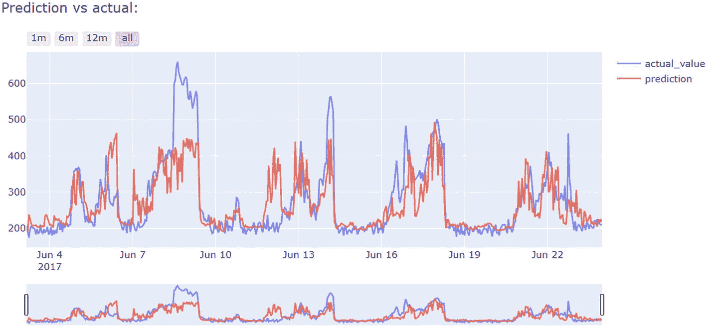

图 4-12

输出

从两张图表来看，`LightGBM` 模型的预测效果相当不错。