# 5. 基于深度学习的时间序列预测

深度学习方法为时间序列预测带来了巨大前景，例如自动学习时间依赖性以及自动处理趋势和季节性等时间结构。

近年来，随着数据和计算能力的日益普及，深度学习已成为新一代时间序列预测模型的重要组成部分，并取得了卓越的成果。

在经典的机器学习模型（如自回归模型（AR）或指数平滑法）中，特征工程是手动完成的，并且通常会结合领域知识来优化某些参数。而深度学习模型则仅直接从数据中学习特征和动态。得益于此，它们加快了数据准备过程，并能全面学习更复杂的数据模式。

本章包含以下主题。

*   方案 5-1\. 使用 LSTM 进行时间序列预测

*   方案 5-2\. 使用 GRU 模型进行多变量时间序列预测

*   方案 5-3\. 使用 NeuralProphet 进行时间序列预测

*   方案 5-4\. 使用 RNN 进行时间序列预测

## 方案 5-1\. 使用 LSTM 进行时间序列预测

### 问题

您希望加载时间序列数据并使用 LSTM 进行预测。

### 解决方案

通过使用 Keras 中定义的内置方法，可以轻松实现。

### 工作原理

以下步骤使用 LSTM 读取数据并进行预测。

#### 步骤 1-1\. 导入所需的库。

```
import numpy as np
import pandas as pd
import matplotlib.pyplot as plt
import tensorflow as tf
import sklearn.preprocessing
from sklearn.metrics import r2_score
from keras.layers import Dense,Dropout,SimpleRNN,LSTM
from keras.models import Sequential
```


#### 步骤 1-2\. 使用 DOM_hourly.csv 数据进行分析。

让我们使用 DOM_hourly 数据（即 Dominion Energy (DOM) 的时间序列数据）来测量以兆瓦 (MW) 为单位的预估能耗。

```
file_path ='./data/DOM_hourly.csv'
```

#### 步骤 1-3\. 读取数据。

```
data = pd.read_csv(file_path, index_col='Datetime', parse_dates=['Datetime'])
data.head()
```

图 5-1 显示了数据框的前几行。

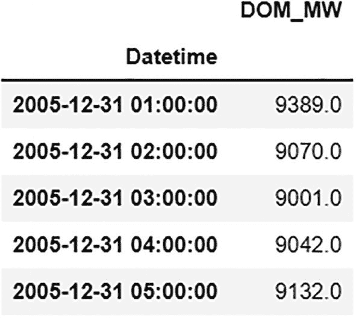

图 5-1

输出

#### 步骤 1-4\. 检查缺失数据。

```
data.isna().sum()
```

输出如下。

```
DOM_MW    0
dtype: int64
```

#### 步骤 1-5\. 绘制时间序列数据。

```
data.plot(figsize=(16,4),legend=True)
plt.title('DOM hourly power consumption data - BEFORE NORMALIZATION')
plt.show()
```

图 5-2 显示了时间序列图。

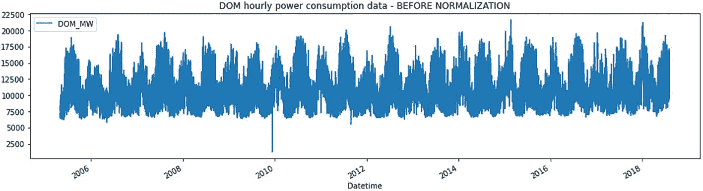

图 5-2

输出

#### 步骤 1-6\. 编写一个函数来归一化数据。

```
def normalize_fn(data):
scaler_object = sklearn.preprocessing.MinMaxScaler()
data['DOM_MW']=scaler_object.fit_transform(data['DOM_MW'].values.reshape(-1,1))
return data
```

#### 步骤 1-7\. 调用 normalize_fn 函数。

```
data_norm = normalize_fn(data)
data_norm.head()
```

图 5-3 显示了输出的数据框。

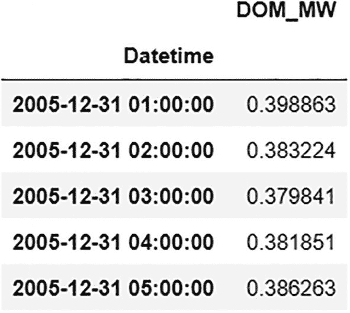

图 5-3

输出

#### 步骤 1-7\. 绘制归一化后的数据。

```
data_norm.plot(figsize=(16,4),legend=True)
plt.title('DOM hourly power consumption data - AFTER NORMALIZATION')
```

```
plt.show()
```

#### 步骤 1-8\. 创建一个函数来执行数据准备和训练-测试分割。

```
def data_prep(data, length):
X = []
```

```
y = []
for i in range(length, len(data)):
X.append(data.iloc[i - length: i, 0])
y.append(data.iloc[i, 0])
# train-test split
# training contains first 110000 days and test contains the remaining 6189 days
train_X = X[:110000]
train_y = y[:110000]
test_X = X[110000:]
test_y = y[110000:]
# converting to numpy array
train_X = np.array(train_X)
train_y = np.array(train_y)
test_X = np.array(test_X)
test_y = np.array(test_y)
# reshaping data to required format to input to RNN, LSTM models
train_X = np.reshape(train_X, (110000, length, 1))
test_X = np.reshape(test_X, (test_X.shape[0], length, 1))
return [train_X, train_y, test_X, test_y]
```

#### 步骤 1-9\. 调用 data_prep 函数。

```
sequence_length = 20
train_X, train_y, test_X, test_y = data_prep(data, sequence_length)
print('train_X.shape = ',train_X.shape)
print('train_y.shape = ', train_y.shape)
print('test_X.shape = ', test_X.shape)
print('test_y.shape = ',test_y.shape)
```

#### 步骤 1-10\. 初始化 LSTM 模型。

```
model = Sequential()
model.add(LSTM(40,activation="tanh",return_sequences=True, input_shape=(train_X.shape[1],1)))
model.add(Dropout(0.15))
model.add(LSTM(40,activation="tanh",return_sequences=True))
model.add(Dropout(0.15))
model.add(LSTM(40,activation="tanh",return_sequences=False))
model.add(Dropout(0.15))
model.add(Dense(1))
```

#### 步骤 1-11\. 创建模型摘要。

```
model.summary()
```

图 5-4 显示了模型摘要。

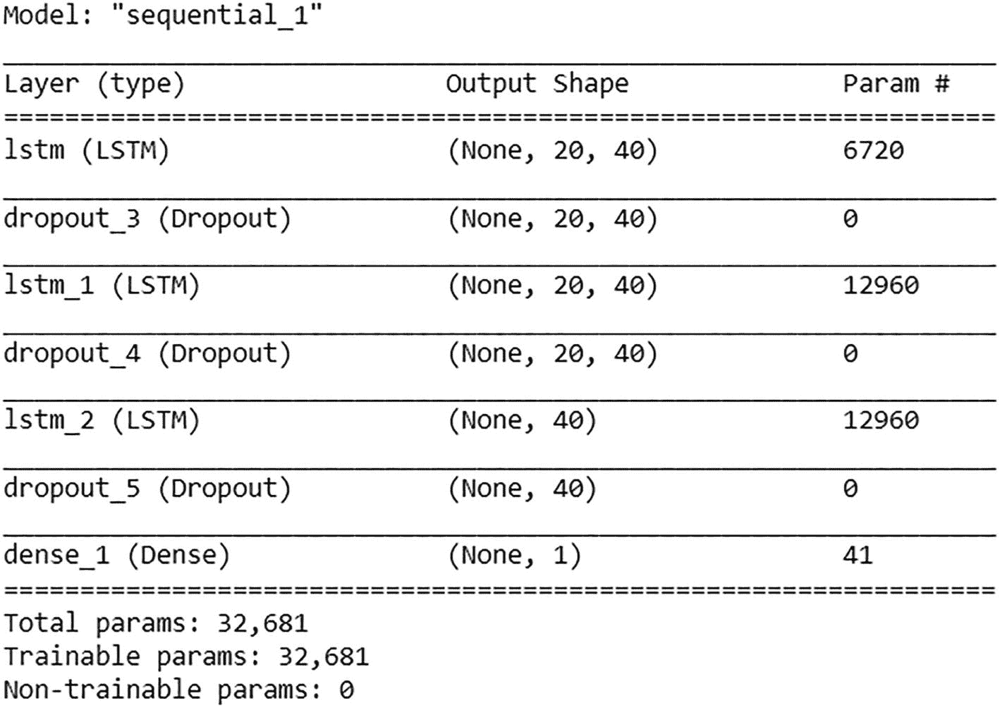

图 5-4

输出

#### 步骤 1-12\. 拟合模型。

```
model.compile(optimizer="adam",loss="MSE")
model.fit(train_X, train_y, epochs=10, batch_size=1000)
```

图 5-5 显示了第 1 到第 10 个周期。

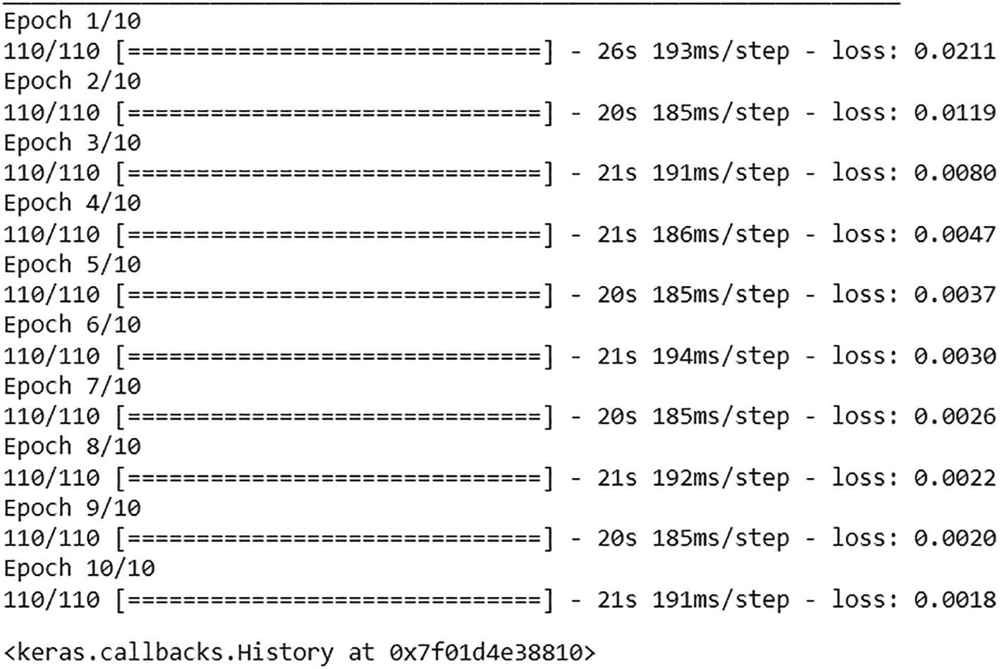

图 5-5

输出

#### 步骤 1-13\. 进行模型预测并打印评分。

```
predictions = model.predict(test_X)
score = r2_score(test_y,predictions)
print("R-Squared Score of LSTM model",score)
```

输出如下。

```
R-Squared Score of LSTM model =  0.94996673239313
```

#### 步骤 1-14\. 编写一个函数来绘制预测结果。

```
def plotting_actual_vs_pred(y_test, y_pred, title):
plt.figure(figsize=(16, 4))
plt.plot(y_test, color='blue', label='Actual power consumption data')
plt.plot(y_pred, alpha=0.7, color='orange', label='Predicted power consumption data')
plt.title(title)
plt.xlabel('Time')
plt.ylabel('Normalized power consumption scale')
plt.legend()
plt.show()
```

#### 步骤 1-15\. 调用 plotting_actual_vs_pred 函数。

```
plotting_actual_vs_pred(test_y, predictions, "Predictions made by LSTM model")
```

图 5-6 显示了实际值与预测值的对比图。

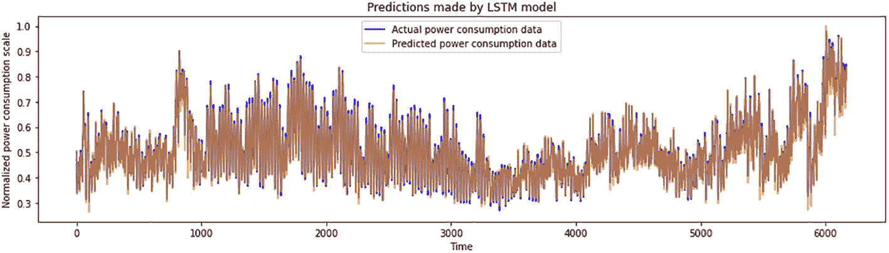

图 5-6

输出

## 配方 5-2\. 使用 GRU 模型进行多变量时间序列预测

### 问题

您想要加载具有多个目标的时间序列数据，并使用 GRU 对其进行预测。

### 解决方案

使用 Keras 中定义的内置方法可以轻松实现。

### 工作原理

以下步骤使用 GRU 读取数据并进行预测。

#### 步骤 2-1\. 导入所需的库。

```
#import all the required libraries
import tensorflow as tf
from tensorflow import keras
import numpy as np
import pandas as pd
import matplotlib.pyplot as plt
import seaborn as sns
```

#### 步骤 2-2\. 读取数据。

从 Git 链接下载数据。

以下代码读取数据。

```
#read data
train_data = pd.read_csv("../input/daily-climate-time-series-data/DailyDelhiClimateTrain.csv",index_col=0)
# Display dimensions of dataframe
print(train_data.shape)
print(train_data.info())
```

图 5-7 显示了输出。

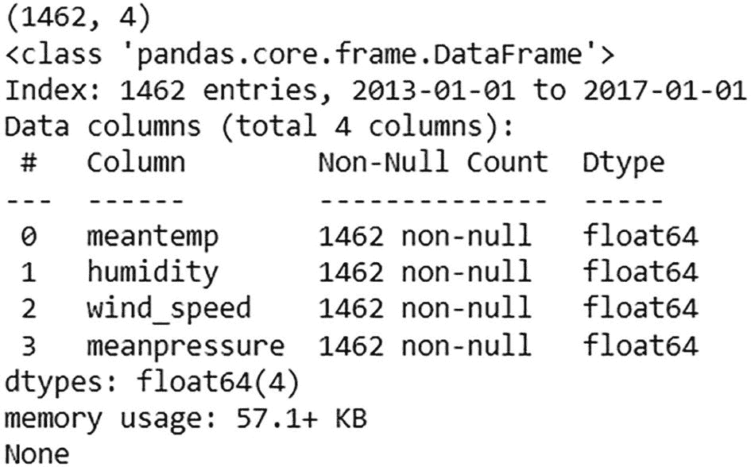

图 5-7

输出

除了日期列之外，需要预测的其他四个特征是平均温度、湿度、风速和平均气压。

#### 步骤 2-3\. 分析数据。

让我们检查数据集的随机样本记录，并执行单变量分析以查看每列的基本统计信息。

```
# sample records
print("-----")
print("Original dataset  : \n",train_data.sample(10))
# Univariate analysis
print("------
-------")
# Display statistics for numeric columns
print(train_data.describe())
```

图 5-8 显示了样本并描述了数据框。

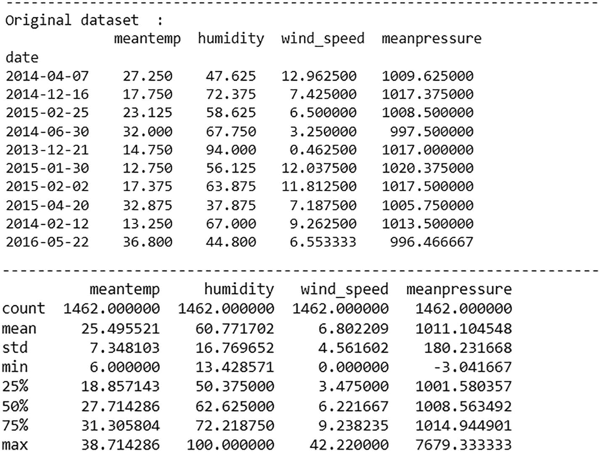

图 5-8

输出

数据集包含四列数据（对应日期），因此让我们绘制它们并尝试理解趋势。

```
#line plots to understand the trend
print("------------------------------------------")
train_data.plot(figsize=(12,8),subplots=True)
```

图 5-9 显示了所有四个变量的趋势。

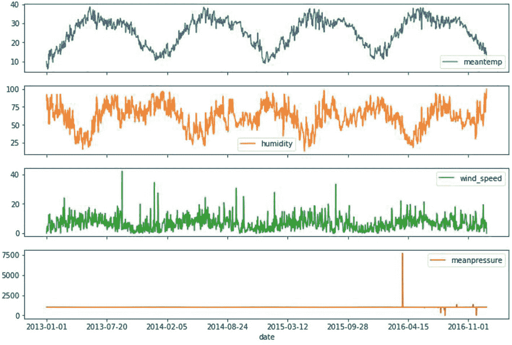

图 5-9

输出

让我们使用直方图绘制所有变量以分析其分布。

```
#line plots to understand the trend
print("-------------")
train_data.plot(figsize=(12,8),subplots=True)
```

图 5-10 显示了所有四个变量的分布。

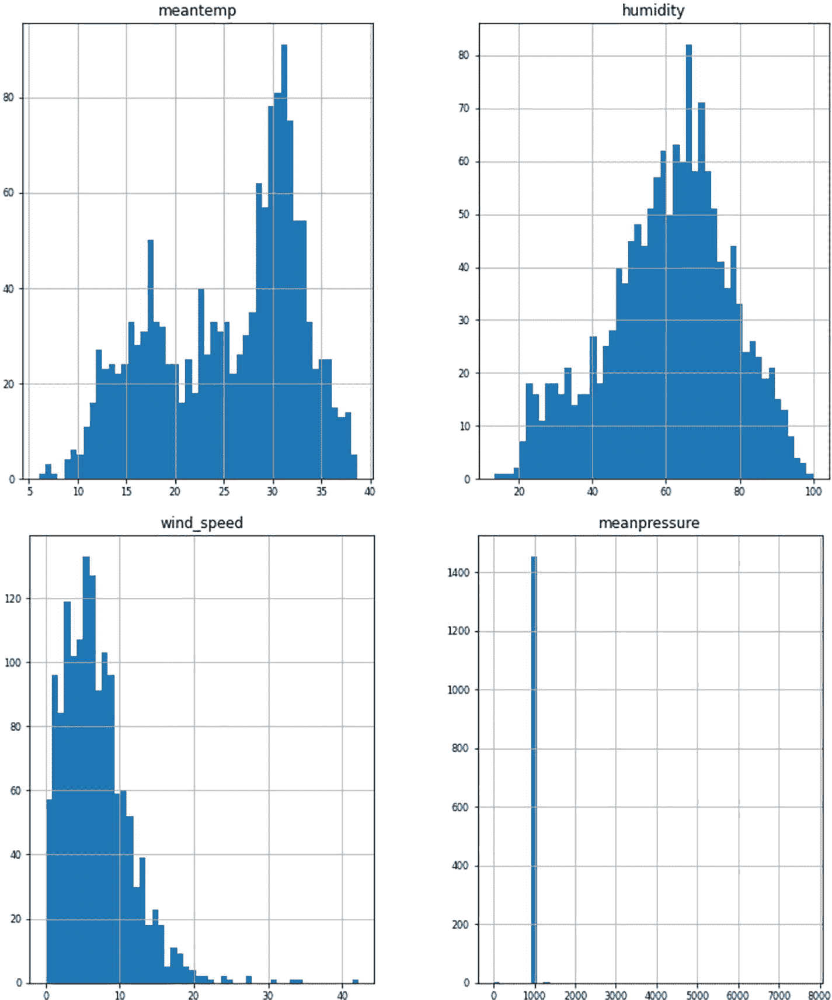

图 5-10

输出


#### 步骤 2-4\. 数据预处理。

分析数据后，让我们确保数据中不存在空值。

```
#检查缺失值
print("空值数量：\n",train_data.isnull().sum())
sns.heatmap(train_data.isnull(), cbar=False, yticklabels=False, cmap="viridis")
```

图 5-11 展示了“检查缺失值”的输出结果。

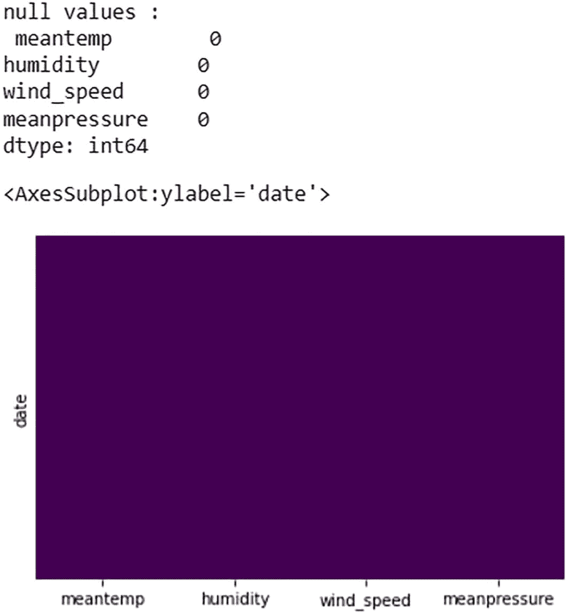

**图 5-11**

**输出**

输出结果如下。

数据中不存在空值。接下来，我们选择特征，并确保所有列的数据类型均为浮点型。

```
# 我们选择一个特定的特征（特征集）。在此示例中，
my_dataset = train_data[["meantemp",'humidity','wind_speed','meanpressure']]
print("我们的新数据集：\n",my_dataset.sample(5))
# 更改数据类型
print("-------------")
# 确保所有数据均为浮点型
my_dataset = my_dataset.astype("float32")
values     = my_dataset.values
print("数值：\n",values)
```

图 5-12 展示了样本数据集。

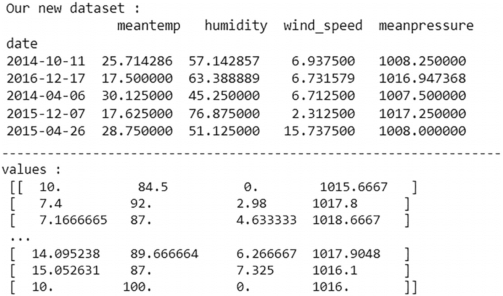

**图 5-12**

**输出**

现在，我们使用 MinMaxScaler 对特征进行归一化。

```
# # 归一化特征
from sklearn.preprocessing import MinMaxScaler
scaler = MinMaxScaler(feature_range=(0, 1))
scaled = scaler.fit_transform(values)
print("缩放后数据：\n",scaled)print("原始数值：\n",values)
```

输出结果如下。

```
scaled :
[[0.12227073 0.8209571  0\.         0.1326033 ]
[0.04279476 0.9075908  0.07058267 0.13288099]
[0.03566229 0.849835   0.10974261 0.1329938 ]
...
[0.24745268 0.88063806 0.14842887 0.13289464]
[0.276718   0.849835   0.17349596 0.1326597 ]
[0.12227073 1.0000001  0\.         0.1326467 ]]
```

现在，我们将序列转换为监督学习格式。

```
## 将序列转换为监督学习格式
def series_to_supervised(data, n_in=1, n_out=1, dropnan=True):
n_vars = 1 if type(data) is list else data.shape[1]
df = pd.DataFrame(data)
cols, names = list(), list()
# 输入序列 (t-n, ... t-1)
for i in range(n_in, 0, -1):
cols.append(df.shift(i))
names += [("var%d(t-%d)" % (j+1, i)) for j in range(n_vars)]
# 预测序列 (t, t+1, ... t+n)
for i in range(0, n_out):
cols.append(df.shift(-i))
if i == 0:
names += [("var%d(t)" % (j+1)) for j in range(n_vars)]
else:
names += [("var%d(t+%d)" % (j+1, i)) for j in range(n_vars)]
# 合并所有列
agg = pd.concat(cols, axis=1)
agg.columns = names
# 删除包含 NaN 值的行
if dropnan:
agg.dropna(inplace=True)
return agg
# 调用函数
# 构建监督学习框架
# 重塑为 X=t 和 Y=t+1
i_in  = 100 # 过去观测值数量
n_out = 1 # 未来观测值数量
reframed = series_to_supervised(scaled, i_in, n_out)
print("将数据集表示为监督学习问题：\n",reframed.head(10))
```

输出结果如下。

```
将数据集表示为监督学习问题：
var1(t-100)  var2(t-100)  var3(t-100)  var4(t-100)  var1(t-99) \
100     0.122271     0.820957     0.000000     0.132603    0.042795
101     0.042795     0.907591     0.070583     0.132881    0.035662
102     0.035662     0.849835     0.109743     0.132994    0.081514
103     0.081514     0.668867     0.029212     0.132799    0.000000
104     0.000000     0.847910     0.087636     0.132712    0.030568
105     0.030568     0.801320     0.035054     0.132907    0.030568
106     0.030568     0.752805     0.149218     0.133167    0.087336
107     0.087336     0.580858     0.169182     0.133000    0.244541
108     0.244541     0.436881     0.296068     0.132777    0.152838
109     0.152838     0.561056     0.175272     0.132603    0.296943
var2(t-99)  var3(t-99)  var4(t-99)  var1(t-98)  var2(t-98)  ... \
100    0.907591    0.070583    0.132881    0.035662    0.849835  ...
101    0.849835    0.109743    0.132994    0.081514    0.668867  ...
102    0.668867    0.029212    0.132799    0.000000    0.847910  ...
103    0.847910    0.087636    0.132712    0.030568    0.801320  ...
104    0.801320    0.035054    0.132907    0.030568    0.752805  ...
105    0.752805    0.149218    0.133167    0.087336    0.580858  ...
106    0.580858    0.169182    0.133000    0.244541    0.436881  ...
107    0.436881    0.296068    0.132777    0.152838    0.561056  ...
108    0.561056    0.175272    0.132603    0.296943    0.437294  ...
109    0.437294    0.250389    0.132665    0.244541    0.699670  ...
var3(t-2)   var4(t-2)  var1(t-1)  var2(t-1)  var3(t-1)  var4(t-1) \
100   0.204879   0.131258   0.733624   0.168317   0.144481   0.131438
101   0.144481   0.131438   0.733624   0.124422   0.184273   0.131397
102   0.184273   0.131397   0.698690   0.221122   0.150233   0.131550
103   0.150233   0.131550   0.739738   0.182178   0.236855   0.131657
104   0.236855   0.131657   0.680131   0.299711   0.153659   0.131475
105   0.153659   0.131475   0.680131   0.322814   0.148034   0.131068
106   0.148034   0.131068   0.798581   0.129332   0.246921   0.130564
107   0.246921   0.130564   0.709170   0.124422   0.157745   0.130850
108   0.157745   0.130850   0.742358   0.194719   0.112675   0.130936
109   0.112675   0.130936   0.681223   0.206271   0.094065   0.130899
var1(t)   var2(t)   var3(t)   var4(t)
100  0.733624  0.124422  0.184273  0.131397
101  0.698690  0.221122  0.150233  0.131550
102  0.739738  0.182178  0.236855  0.131657
103  0.680131  0.299711  0.153659  0.131475
104  0.680131  0.322814  0.148034  0.131068
105  0.798581  0.129332  0.246921  0.130564
106  0.709170  0.124422  0.157745  0.130850
107  0.742358  0.194719  0.112675  0.130936
108  0.681223  0.206271  0.094065  0.130899
109  0.752729  0.179868  0.180898  0.131003
[10 rows x 404 columns]
```

#### 步骤 2-5\. 划分训练集和测试集。

我们将数据划分为训练集和测试集，并使用测试集来验证模型。

```
# # 划分训练集和测试集
# 将数值数组转换为数据集矩阵
values_spl = reframed.values
train_size = int(len(values_spl) * 0.80)
test_size  = len(values_spl) - train_size
train, test = values_spl[0:train_size,:], values_spl[train_size:len(values_spl),:]
print("训练集和测试集长度：",len(train), "  ", len(test))
print("-------------")
# 划分输入和输出
X_train, y_train = train[:, :-4], train[:, -4:]
X_test, y_test   = test[:, :-4],  test[:, -4:]
print("X_train 形状：",X_train.shape," y_train 形状：",y_train.shape)
print("X_test 形状：",X_test.shape, " y_test 形状：",y_test.shape)
print("-------------")
# 将输入重塑为 3D 格式 [样本数, 时间步长, 特征数]
# LSTM 网络期望输入数据 (X) 以特定的数组结构提供，
# 格式为：[样本数, 时间步长, 特征数]。
# 目前，我们的数据格式为：[样本数, 特征数]
X_train = X_train.reshape((X_train.shape[0], 1, X_train.shape[1]))
X_test  = X_test.reshape((X_test.shape[0], 1, X_test.shape[1]))
print("X_train 3D 形状：",X_train.shape," y_train 形状：",y_train.shape)
print("X_test 3D 形状：",X_test.shape, " y_test 形状：",y_test.shape)
```

输出结果如下。

```
训练集和测试集长度： 1089     273
```

```

X_train 形状： (1089, 400)  y_train 形状： (1089, 4)
X_test 形状： (273, 400)  y_test 形状： (273, 4)
```

```

X_train 3D 形状： (1089, 1, 400)  y_train 形状： (1089, 4)
X_test 3D 形状： (273, 1, 400)  y_test 形状： (273, 4)
```


#### 步骤 2-6\. 构建模型。

让我们构建在 Keras 中定义的 GRU 模型。

首先，导入并定义所有层。

```
# #导入并定义各层
model = keras.models.Sequential()
model.add(keras.layers.GRU(64, return_sequences=True, activation="relu",
kernel_initializer="he_normal", recurrent_initializer="he_normal",
dropout=0.15, recurrent_dropout=0.15,
input_shape=(X_train.shape[1], X_train.shape[2]) ))
model.add(keras.layers.GRU(32,return_sequences=True, activation="relu", kernel_initializer="he_normal",
recurrent_initializer="he_normal", dropout=0.15, recurrent_dropout=0.15 ))
model.add(keras.layers.GRU(8, activation="relu", kernel_initializer="he_normal",
recurrent_initializer="he_normal", dropout=0.15, recurrent_dropout=0.15 ))
model.add(keras.layers.Dense(4, activation="relu"))
print(model.summary())
```

输出如下。

```
Model: "sequential_2"
______________________________________________________________
Layer (type)                 Output Shape              Param #
==============================================================
gru_6 (GRU)                  (None, 1, 64)             89472
______________________________________________________________
gru_7 (GRU)                  (None, 1, 32)             9408
______________________________________________________________
gru_8 (GRU)                  (None, 8)                 1008
______________________________________________________________
dense_2 (Dense)              (None, 4)                 36
==============================================================
Total params: 99,924
Trainable params: 99,924
Non-trainable params: 0
______________________________________________________________
None
```

让我们绘制并检查。

```
# #绘制模型
from tensorflow.keras.utils import plot_model
plot_model(model, show_shapes=True)
```

图 5-13 展示了模型图。

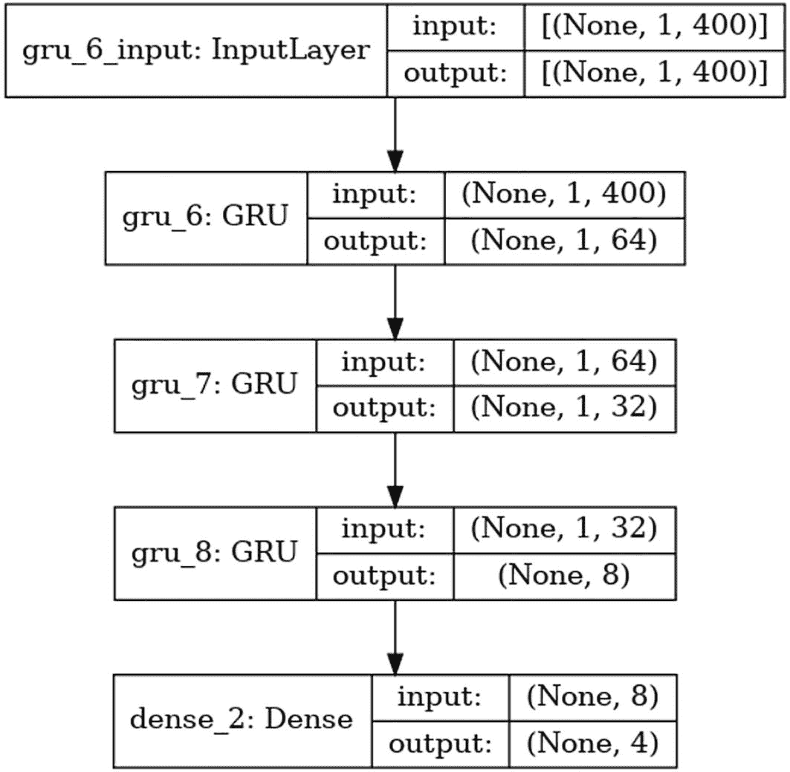

图 5-13

输出

让我们编译并拟合模型。

```
## 编译模型
optimizer = keras.optimizers.Adam(learning_rate=0.01, beta_1=0.9, beta_2=0.999)
model.compile(loss="mean_squared_error", optimizer=optimizer, metrics=["mse","mae"])
# 学习率调度
lr_scheduler = keras.callbacks.ReduceLROnPlateau(factor=0.00001, patience=3, monitor="val_loss", min_lr=0.00000001)
# 训练与评估模型
history = model.fit(X_train, y_train, epochs=100, batch_size=64, validation_split=0.2,
callbacks=[lr_scheduler])
```

输出如下。

```
Epoch 1/100
14/14 [==============================] - 10s 88ms/step - loss: 0.1164 - mse: 0.1164 - mae: 0.2643 - val_loss: 0.0367 - val_mse: 0.0367 - val_mae: 0.1475
Epoch 2/100
14/14 [==============================] - 0s 14ms/step - loss: 0.0437 - mse: 0.0437 - mae: 0.1532 - val_loss: 0.0142 - val_mse: 0.0142 - val_mae: 0.0913
Epoch 3/100
14/14 [==============================] - 0s 15ms/step - loss: 0.0236 - mse: 0.0236 - mae: 0.1087 - val_loss: 0.0135 - val_mse: 0.0135 - val_mae: 0.0789
Epoch 4/100
14/14 [==============================] - 0s 14ms/step - loss: 0.0192 - mse: 0.0192 - mae: 0.0962 - val_loss: 0.0121 - val_mse: 0.0121 - val_mae: 0.0789
Epoch 5/100
14/14 [==============================] - 0s 14ms/step - loss: 0.0170 - mse: 0.0170 - mae: 0.0906 - val_loss: 0.0102 - val_mse: 0.0102 - val_mae: 0.0691
Epoch 6/100
14/14 [==============================] - 0s 14ms/step - loss: 0.0153 - mse: 0.0153 - mae: 0.0850 - val_loss: 0.0087 - val_mse: 0.0087 - val_mae: 0.0640
```


#### 步骤 2-7\. 评估并预测模型。

让我们绘制 MSE 和 MAE 等评估指标（定义请参考第 4 章）。

```
# # 绘制学习曲线
pd.DataFrame(history.history).plot(figsize=(8, 5))
plt.grid(True)
plt.gca().set_ylim(0, 1) # 设置垂直范围为 [0-1]
plt.show()
```

图 5-14 展示了模型评估指标图。

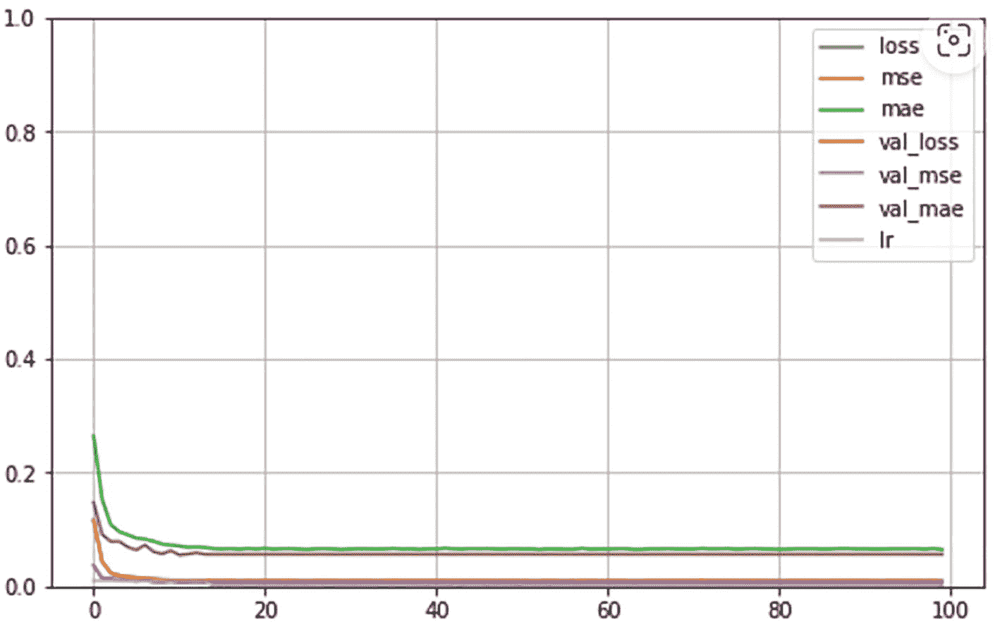

图 5-14

输出

```
print("-------------")
# 评估模型
model_evaluate = model.evaluate(X_test, y_test)
print("损失                   : ",model_evaluate[0])
print("均方误差               : ",model_evaluate[1])
print("平均绝对误差           : ",model_evaluate[2])
# 进行预测
trainPredict = model.predict(X_train)
testPredict  = model.predict(X_test)
print("trainPredict : ",trainPredict.shape)
print("testPredict  : ",testPredict.shape)
print(trainPredict)
testPredict = scaler.inverse_transform(testPredict)
print(testPredict.shape)
print(y_test.shape)
y_test=scaler.inverse_transform(y_test)
```

输出如下。

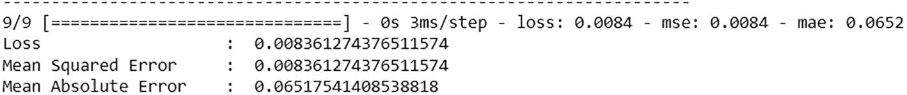

```
trainPredict :  (1089, 4)
testPredict  :  (273, 4)
array([[0.794252  , 0.29386416, 0.16390276, 0.13381857],
[0.80810547, 0.28626317, 0.16907552, 0.1337166 ],
[0.8088531 , 0.28755552, 0.1696803 , 0.13367665],
...,
[0.67830986, 0.43075496, 0.139501  , 0.13334922],
[0.69778967, 0.4183182 , 0.14170927, 0.13308588],
[0.7168243 , 0.40688953, 0.14848372, 0.13296095]], dtype=float32)
(273, 4)
(273, 4)
```

现在我们已经得到了所有四个特征的预测值，让我们绘制它们与实际值的折线图。

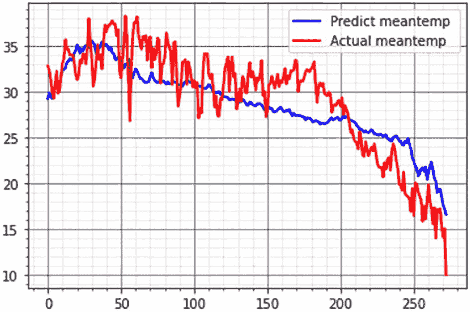

图 5-15

输出

1.  绘制平均温度。

    ```
    ## 绘制平均温度
    plt.plot(testPredict[:,0], color="blue",
    label="预测平均温度", linewidth=2)
    plt.plot(y_test[:,0], color="red",
    label="实际平均温度", linewidth=2)
    plt.legend()
    # 使用深灰色线条显示主网格线
    plt.grid(visible=True, which="major", color="#666666", linestyle="-")
    # 使用非常淡且几乎透明的灰色线条显示次网格线
    plt.minorticks_on()
    plt.grid(visible=True, which="minor", color="#999999", linestyle="-", alpha=0.2)
    plt.show()
    ```

    图 5-15 展示了平均温度列的预测值与实际值对比图。

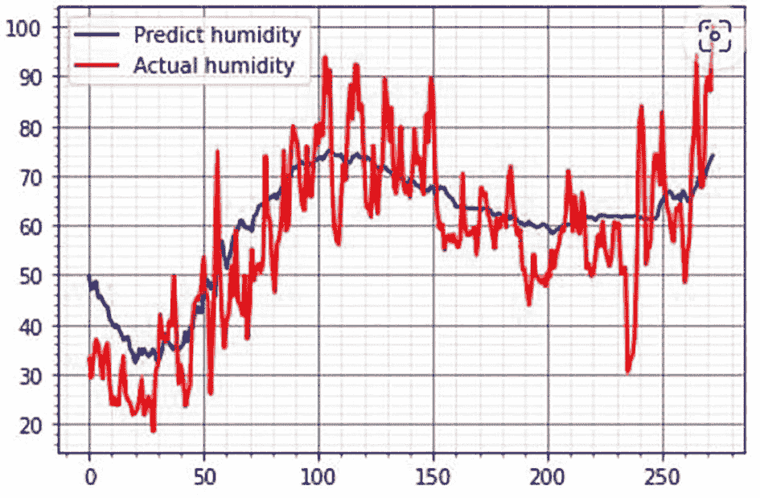

图 5-16

输出

1.  绘制湿度。

    ```
    ## # 绘制湿度
    plt.plot(testPredict[:,1], color="blue",
    label="预测湿度", linewidth=2)
    plt.plot(y_test[:,1], color="red",
    label="实际湿度", linewidth=2)
    plt.legend()
    # 使用深灰色线条显示主网格线
    plt.grid(visible=True, which="major", color="#666666", linestyle="-")
    # 使用非常淡且几乎透明的灰色线条显示次网格线
    plt.minorticks_on()
    plt.grid(visible=True, which="minor", color="#999999", linestyle="-", alpha=0.2)
    plt.show()
    ```

    图 5-16 展示了湿度列的预测值与实际值对比图。

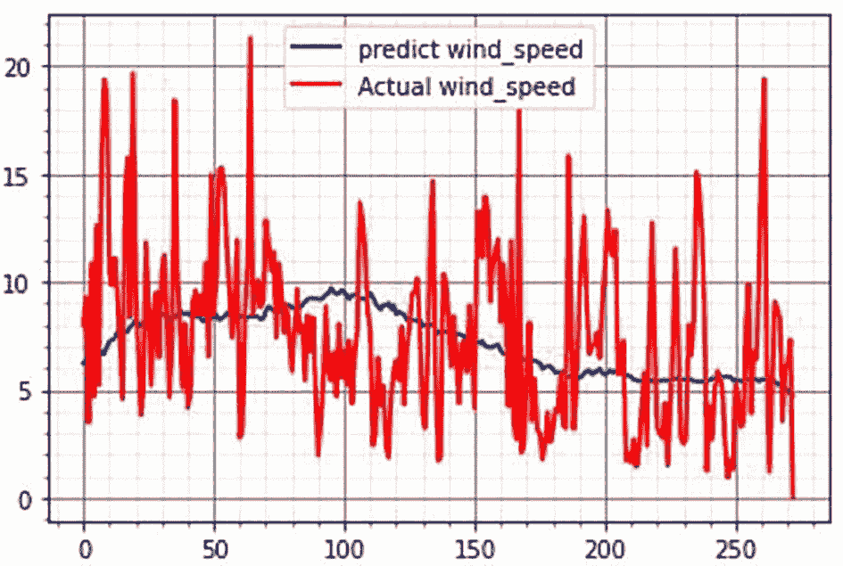

图 5-17

输出

1.  绘制风速。

    ```
    # # 绘制风速
    plt.plot(testPredict[:,2], color="blue",
    label="预测风速", linewidth=2)
    plt.plot(y_test[:,2], color="red",
    label="实际风速", linewidth=2)
    plt.legend()
    # 使用深灰色线条显示主网格线
    plt.grid(visible=True, which="major", color="#666666", linestyle="-")
    # 使用非常淡且几乎透明的灰色线条显示次网格线
    plt.minorticks_on()
    plt.grid(visible=True, which="minor", color="#999999", linestyle="-", alpha=0.2)
    plt.show()
    ```

    图 5-17 展示了风速列的预测值与实际值对比图。

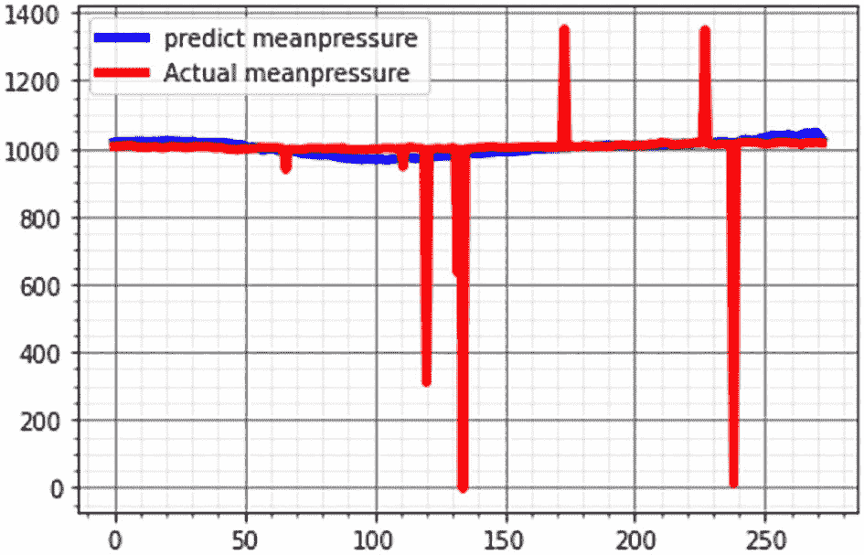

图 5-18

输出

1.  绘制平均气压。

    ```
    # 绘制平均气压
    plt.plot(testPredict[:,3], color="blue",
    label="预测平均气压", linewidth=4)
    plt.plot(y_test[:,3], color="red",
    label="实际平均气压", linewidth=4)
    plt.legend()
    # 使用深灰色线条显示主网格线
    plt.grid(visible=True, which="major", color="#666666", linestyle="-")
    # 使用非常淡且几乎透明的灰色线条显示次网格线
    plt.minorticks_on()
    plt.grid(visible=True, which="minor", color="#999999", linestyle="-", alpha=0.2)
    plt.show()
    ```

    图 5-18 展示了平均气压列的预测值与实际值对比图。

## 技巧 5-3\. 使用 NeuralProphet 进行时间序列预测

### 问题

您希望加载单变量时间序列数据，并使用 NeuralProphet 进行预测。

### 解决方案

通过使用内置包可以轻松实现。


### 工作原理

以下步骤使用 NeuralProphet 读取数据并进行预测。

#### 步骤 3-1. 导入所需的库。

```
#import all the required libraries
import pandas as pd
from neuralprophet import NeuralProphet
import matplotlib.pyplot as plt
```

#### 步骤 3-2. 读取数据。

从 Git 链接下载数据。

以下代码用于读取数据。在读取数据时，我们解析日期列。

```
#read data
df_np = pd.read_csv("./DailyDelhiClimateTrain.csv",
parse_dates=["date"])
```

#### 步骤 3-3. 预处理数据。

我们根据 NeuralProphet 的要求对数据进行预处理。

由于是单变量预测，我们只选择一个特征与日期列一起进行预测。

此外，NeuralProphet 要求日期列命名为 "ds"，目标列命名为 "y"。

```
#Data pre-process
df_np = df_np[["date", "meantemp"]]
df_np.rename(columns={"date": "ds", "meantemp": "y"}, inplace=True)
```

#### 步骤 3-4. 构建模型并进行预测。

我们初始化 NeuralProphet 模型，并定义所有参数，包括附加信息。如果你打算使用默认变量，请使用 `model = NeuralProphet()`。

```
# model = NeuralProphet() if you're using default variables below.
model = NeuralProphet(
growth="linear",  # 确定趋势类型：'linear', 'discontinuous', 'off'
changepoints=None, # 可能包含变化点的日期列表（None -> 自动）
n_changepoints=5,
changepoints_range=0.8,
trend_reg=0,
trend_reg_threshold=False,
yearly_seasonality="auto",
weekly_seasonality="auto",
daily_seasonality="auto",
seasonality_mode="additive",
seasonality_reg=0,
n_forecasts=1,
n_lags=0,
num_hidden_layers=0,
d_hidden=None,     # AR-Net 隐藏层的维度
learning_rate=None,
epochs=40,
loss_func="Huber",
normalize="auto",  # 归一化类型 ('minmax', 'standardize', 'soft', 'off')
impute_missing=True,
)
```

模型初始化后，我们拟合模型并进行预测。

```
#make predictions
metrics = model.fit(df_np, freq="D")
future = model.make_future_dataframe(df_np, periods=365, n_historic_predictions=len(df_np))
forecast = model.predict(future)
```

图 5-19 显示了模型的输出。

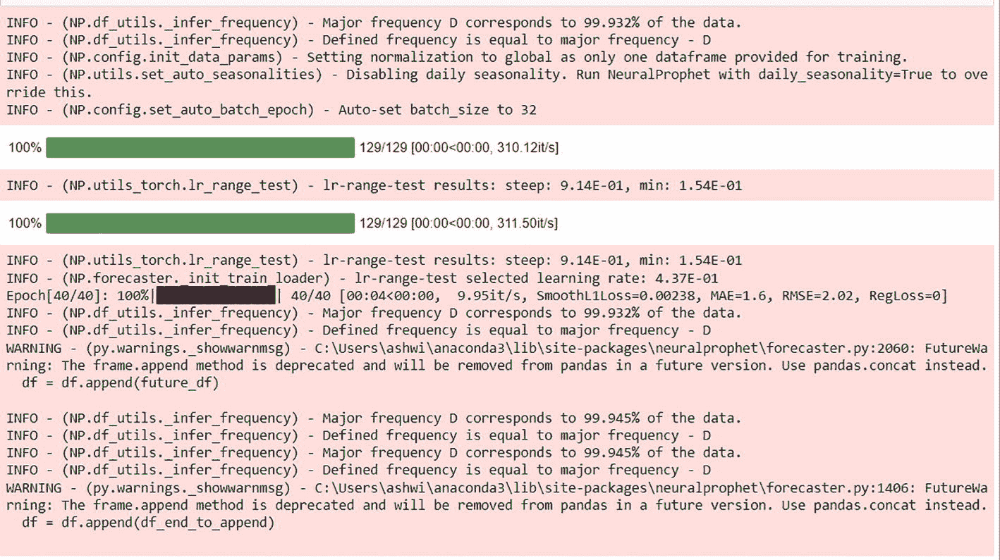

图 5-19

输出

现在，我们绘制图表以查看预测值。

```
##forecast plot
fig, ax = plt.subplots(figsize=(14, 10))
model.plot(forecast, xlabel="Date", ylabel="Temp", ax=ax)
ax.set_title("Mean Temperature in Delhi", fontsize=28, fontweight="bold")
```

图 5-20 显示了预测值与实际值的对比图。

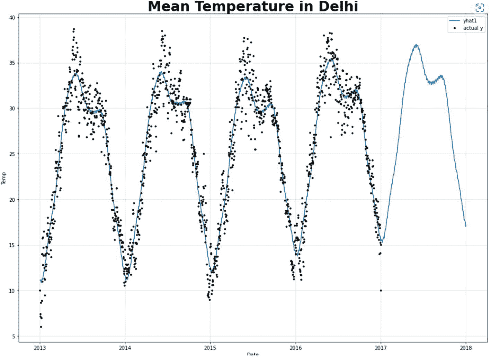

图 5-20

输出

显示了最近一年的预测图。预测值的时间范围为 2017 年至 2018 年。预测值与历史值相似，这意味着模型已经捕捉到了季节性和线性趋势。

你还可以绘制模型参数。

```
##plotting model parameters
model.plot_parameters()
```

图 5-21 显示了模型参数图。

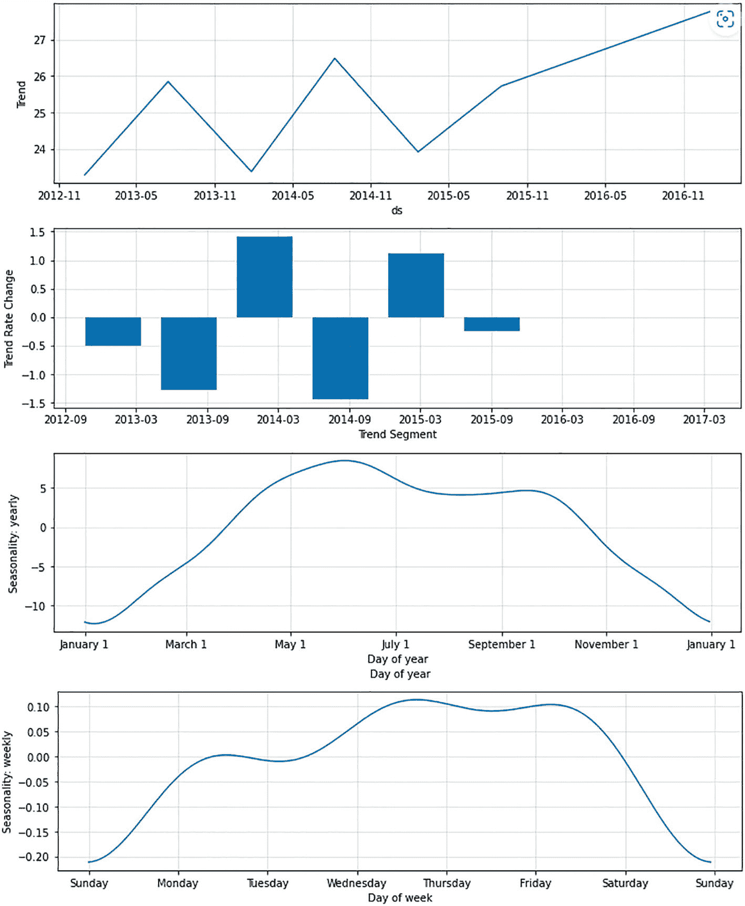

图 5-21

输出

使用平均绝对误差（MAE）绘制的模型损失如下所示。你也可以使用平滑 L1 损失函数。

```
###ploting Evaluation
fig, ax = plt.subplots(figsize=(14, 10))
ax.plot(metrics["MAE"], 'ob', linewidth=6)
ax.plot(metrics["RMSE"], '-r', linewidth=2)
```

图 5-22 显示了模型评估图。

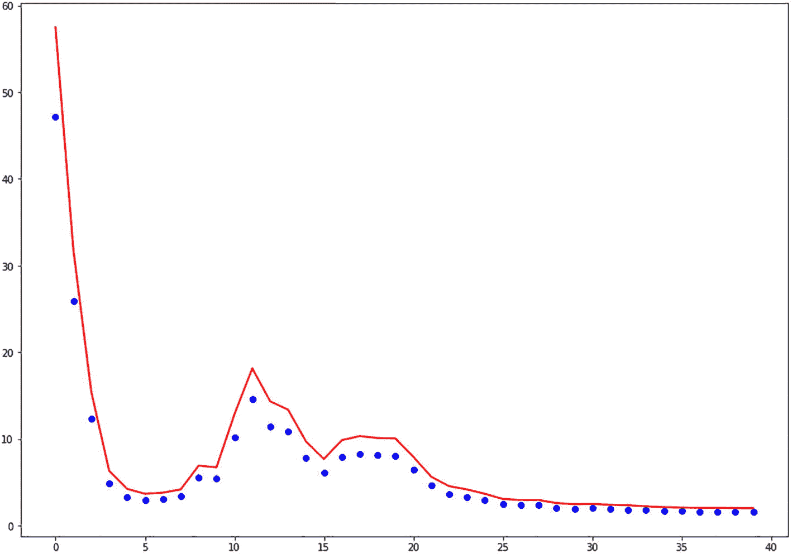

图 5-22

输出

## 方法 5-4. 使用 RNN 进行时间序列预测

### 问题

你想要加载时间序列数据，并使用*循环神经网络*（RNN）进行预测。

### 解决方案

通过使用 Keras 中定义的内置方法可以轻松实现。

### 工作原理

以下步骤使用 RNN 读取数据并进行预测。

方法 5-1 中的步骤 1-1 到 1-9 也适用于本方法。

#### 步骤 4-1. 初始化 RNN 模型。

```
model = Sequential()
model.add(LSTM(40,activation="tanh",return_sequences=True, input_shape=(train_X.shape[1],1)))
model.add(Dropout(0.15))
model.add(LSTM(40,activation="tanh",return_sequences=True))
model.add(Dropout(0.15))
model.add(LSTM(40,activation="tanh",return_sequences=False))
model.add(Dropout(0.15))
model.add(Dense(1))
```

#### 步骤 4-2. 创建模型摘要。

```
model.summary()
```

图 5-23 显示了模型摘要。

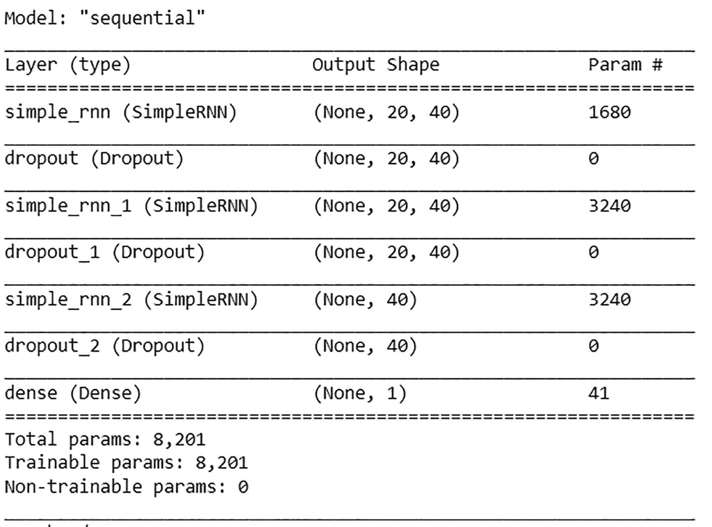

图 5-23

输出

#### 步骤 4-3. 拟合模型。

```
model.compile(optimizer="adam",loss="MSE")
model.fit(train_X, train_y, epochs=10, batch_size=1000)
```

图 5-24 显示了第 1 到第 10 个训练周期。

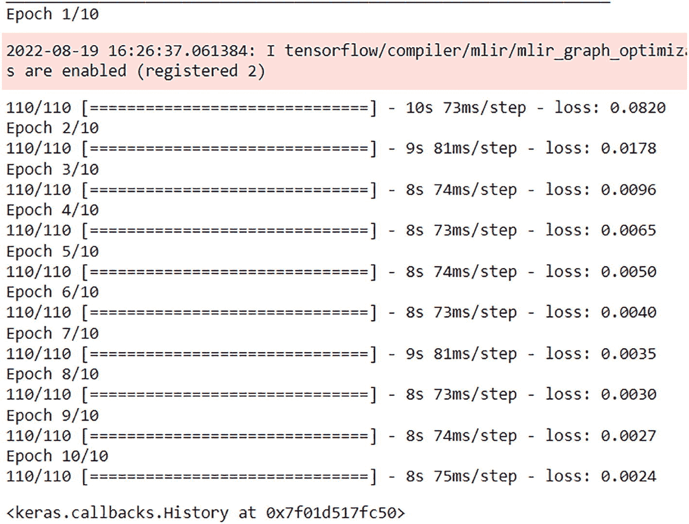

图 5-24

输出

#### 步骤 4-4. 进行模型预测并打印评分。

```
predictions = model.predict(test_X)
score = r2_score(test_y,predictions)
print("R-Squared Score of RNN model = ",score)
```

输出如下。

```
R-Squared Score of RNN model =  0.9466957722475382
```

#### 步骤 4-5 与方法 5-1 中的步骤 1-14 相同。


#### 步骤 4-6\. 调用 `plotting_actual_vs_pred` 函数。

```
plotting_actual_vs_pred(test_y, predictions, "Predictions made by simple RNN model")
```

图 5-25 展示了实际值与预测值的对比图。

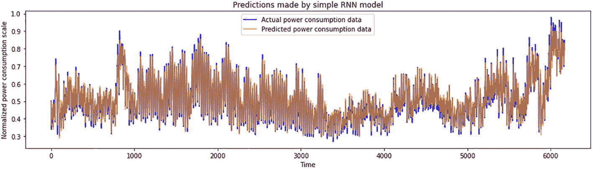

图 5-25

输出

索引 A 加法模型分解 添加组件 更改组件 组件分离 库，加载 绘图 季节性 statsmodels 库 时间序列 营业额数据 增强迪基-富勒检验 自回归模型 实际值 *与* 预测值对比 自相关函数 AutoReg 函数 调用/拟合 预测 滞后值 库，导入 绘图 预测 平稳性 摘要 训练/测试数据 自回归积分滑动平均模型 自相关函数/偏自相关函数值 ADF 检验与 ARMA 模型 数据平稳化 初始化/拟合 绘图 预测值 *与* 实际值对比 RMSE 分数 测试预测 自回归模型 自回归滑动平均模型 实际值 ARIMA 函数 比特币价格数据 概念 初始化/拟合 库，导入 加载数据 绘图 预测值 *与* 实际值对比 预处理 RMSE 分数 测试预测 训练-测试分割 B 最佳模型 评估图 预测 测试集 验证集 C 逗号分隔文件 D 深度学习方法 另请参见 GRU 模型；LSTM E 指数平滑法 F Facebook Prophet 模型 添加回归量 数据拟合 数据预测 数据初始化 标签与编码 训练-测试分割 调整趋势 changepoint_prior_scale 绘制输出 变点 超参数 幅度 绘图 打印 节假日 自定义 未来数据框 初始化数据框 单变量时间序列数据框 用于预测 导入库 初始化 绘图预测 绘制预测组件 读取数据 训练数据集 G get_dummies 方法 网格搜索 超参数 ARIMA 模型 评估 初始化/拟合 预测值 *与* 实际值对比 RMSE 分数 arima_model_evaluate 函数 绘图 测试预测 调优 GRU 模型 分析数据 构建 评估 导入库 预处理数据 读取数据 训练-测试分割 H, I, J, K 霍尔特-温特斯模型 ExponentialSmoothing 函数 初始化/拟合 绘图 预测值 *与* 实际值对比 RMSE 分数 测试预测 L LightGBM 模型 构建 评估 验证集 LSTM data_prep 函数 拟合模型 导入库 初始化 缺失数据 模型预测 模型摘要 归一化 归一化数据 normalize_fn 函数 绘制预测 plotting_actual_vs_pred 函数 读取数据 时间序列数据 训练-测试分割 M 机器学习回归算法 收集数据 导入库 预处理数据 选择特征 时间序列 验证分割 平均绝对误差 平均绝对百分比误差 均方误差 移动平均 定义 库，导入 绘图 预测值 *与* 实际时间序列对比 预处理 读取数据 滚动均值 乘法模型分解 航空乘客数据 组件 数据处理 库，加载 绘图 二次/指数 季节性成分 季节性 时间序列 多元时间序列数据 北京污染数据集 定义 库，导入 加载数据集 加载/探索 解析函数 绘图 PM2.5 浓度 预处理 关系 多元时间序列，VAR 模型 构建 评估模型 导入库 预处理数据 读取数据 分割数据集 平稳性 N, O, P, Q NeuralProphet 构建模型 导入库 预处理数据 读取数据 R 随机森林模型 构建 评估 验证集 循环神经网络 拟合模型 初始化 模型摘要 plotting_actual_vs_pred 函数 预测 均方根误差 S 季节性自回归积分滑动平均模型 初始化/拟合 绘图 预测值 *与* 实际值对比 RMSE 分数 SARIMAX 函数 测试预测 季节性 定义 库，导入 绘图 日期 *与* 温度对比 月度箱线图 年度箱线图 读取数据 温度数据集 拖拉机销售数据 日期时间序列 格式化数据 库，导入 月度箱线图 绘图 读取数据 可视化 添加方法 箱线图 数据处理 库，导入 折线图 加载数据 输出 数据透视表 SelectKBest 简单指数平滑法模型 定义 初始化/拟合 绘图 预测值 *与* 实际值对比 RMSE 分数 SimpleExpSmoothing 函数 测试预测 T 时间序列分析/预测 需求/销售，产品配方 用途 时间序列，Auto-ARIMA 分析数据模式 构建 评估模型 导入库 输出 预处理数据 读取数据 平稳性 摘要 测试数据 训练与测试 时间序列对象 航空乘客数据框 库，导入 Pandas 解析函数 绘图输出 read_csv 读取数据 印度 GDP 数据 CSV 文件 数据框 库，导入 绘图输出 读取数据 检索对象 存储/检索，pickle 保存 趋势 定义 库，导入 加载数据集 解析函数 绘图 洗发水销售数据集 U, V, W 单变量统计建模 单变量时间序列分析 单变量时间序列数据 定义 预测 库，导入 加载/探索 绘图 读取数据 温度数据集 X, Y, Z XGBoost 模型 构建 评估 验证集
