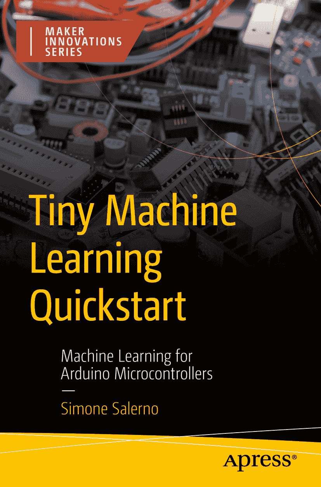

# 前言

在日新月异的技术格局中，我们发现自己正处在一个迷人的交汇点——机器学习和嵌入式系统的世界在此融合。这种融合催生了微型机器学习（通常简称为 TinyML®，EdgeAI 基金会的商标）——一个将人工智能的力量带到最小、资源最受限的计算设备上的领域。Tiny ML 无需昂贵的云基础设施或强大的计算机，就能让复杂的算法直接在微控制器上运行，从而催生新一代智能设备，这些设备能够在本地做出决策，功耗极低，且无需互联网连接。

对于 Arduino 爱好者来说，TinyML 既是一个激动人心的机遇，也是一项重大的挑战。Arduino 平台长期以来因其易用性而备受喜爱，它允许编程经验最少的个人也能快速创建交互式电子项目。现在，借助 TinyML，这个易用的平台获得了实现复杂机器学习能力的能力，这在以前是遥不可及的。

然而，进入 TinyML 领域可能会令人望而生畏，尤其是对于那些没有数据科学或机器学习背景的人来说。许多教程和资源都假设读者具备机器学习原理的先验知识，或者需要大量的数学理解，这构成了一个巨大的入门障碍。此外，微控制器环境的限制又增加了另一层复杂性。与拥有几乎无限资源的基于云的机器学习系统不同，TinyML 开发需要仔细优化，以适应严格的内存限制、有限的处理能力和严苛的能耗预算。为这些环境转换和优化机器学习模型需要专门的知识，这些知识弥合了传统机器学习与嵌入式系统编程之间的鸿沟。

这正是本书存在的原因。*《Tiny Machine Learning 快速入门》* 采用了一种根本不同的方法来教授 TinyML。我们没有过多深入数据科学的理论和数学基础，而是从第一章开始就提供你可以立即实施的可行解决方案和实用代码。虽然理解机器学习的基本原理无疑很有价值，但许多 Arduino 爱好者只是想为他们的项目添加智能功能，而不想成为机器学习专家。本书尊重这种需求，提供了即用型代码片段、完整的工作流程和实用的技术，首先交付成果，仅在必要时引入理论以支持实践理解。

## 关于本书

在本书的各个章节中，你将找到一系列精心编写、可直接复制粘贴的解决方案，用于解决常见的 TinyML 挑战。需要构建手势识别系统？这里有对应的代码片段。想要实现关键词唤醒以响应语音指令？你会找到可直接适配到你项目中的工作代码。对通过摄像头图像进行物体检测感兴趣？我们为你提供了立即可用的实现方案。当你阅读这些章节时，你将培养出动手实践能力，使你能够：

*   在 Arduino 开发板上实现机器学习模型，而无需理解每个算法的数学细节。

*   遵循简洁的工作流程，从想法到功能原型一气呵成，避免陷入理论上的弯路。

*   根据你具体的项目需求，改编经过验证的代码模式，在坚实的基础上进行构建，而不是从零开始。

*   使用实用技巧而非抽象概念，优化你的 TinyML 实现，提升性能、能效和可靠性。

*   利用经过测试的解决方案，排查在受限设备上部署机器学习时遇到的常见现实问题。

本书刻意避免试图将你培养成机器学习研究者的陷阱。相反，它将 TinyML 视为你 Arduino 工具箱中的另一个强大工具——一个恰好能为你的创作带来智能的工具。就像你无需理解半导体物理就能使用 Arduino 一样，你也无需掌握神经网络设计的每一个细微差别就能实现有效的 TinyML 解决方案。

无论你是一位爱好者，希望为自己的周末项目增添智能；还是一位教育工作者，寻求向学生介绍 AI 概念的易懂方式；或者是一位专业人士，希望快速原型化智能设备，本书都提供了一条务实的道路。在一个通常以复杂性和理论深度为特征的领域里，《Tiny Machine Learning 快速入门》邀请你直接开始构建——并通过创造的乐趣而非学习的辛劳来学习。

所以，启动你的 Arduino，准备好你的开发环境，准备踏上动手实践的 TinyML 世界之旅吧。智能嵌入式系统的未来正在等待着你，而且它比你想象的更容易触及。

## 你需要具备的知识

本书面向 Arduino 程序员，因此你应该已经熟悉 Arduino 编程、程序上传和调试。就本书中的项目而言，即使是初学者水平的经验也足够了。

机器学习部分使用 `Python` 编写：尽管大多数示例旨在让你直接复制粘贴并运行，但至少对该语言有基本了解，知道如何安装包以及如何运行脚本，将会大有裨益。

## 献词

献给我亲爱的妻子 Alessia，让我心充盈的女儿 Adelia，以及我的整个家庭。是他们造就了今天幸福的我。

关于作者 关于技术审校者

---

<!--

Maker 创新系列

通过 Apress 的 Maker 创新系列，开启你的探索之旅！从基础的电学和元器件知识，到机器人技术和机器学习领域最前沿的选择，你将逐步学会打造精巧的硬件，并用尖端的软件对其进行控制。在此过程中，你将掌握常用工具集的新技能与经验，这些技能和经验可用于新项目，甚至开启全新的职业生涯。

Apress 的 Maker 创新系列提供基于项目的学习，同时始终将理论和最佳实践置于核心位置。因此，你不仅能获得动手实践经验，还能学习行业术语，以及企业家、发明家和工程师在构思和执行硬件项目时的思维方式。你将学会设计电路、编写 AI 程序、为家庭甚至城市创建物联网系统，以及更多精彩内容！

无论你是初出茅庐的爱好者，还是在自家地下室或车库里工作的经验丰富的创业者，你都将提升自己的技能，成为硬件设计和工程方面的专家。并且，通常使用的是低成本的开源软件，例如 Raspberry Pi、Arduino、PIC 微控制器和机器人操作系统（ROS）。程序员和软件工程师也有很好的学习机会，因为许多项目和开发环境都基于流行的编程语言和操作系统，如 Python 和 Linux。

如果你想制造一个机器人、搭建一个智能家居、尝试组装一个气象监测系统，或者使用面包板和电路设计软件创建一个全新的电路，这个系列都能满足你的需求！该系列由富有创造力且经验丰富的创客编写，每本书都探讨了经过验证的和前沿的方法与技术，助你将愿景和项目变为现实。

关于本系列的更多信息，请访问 [`https://link.springer.com/bookseries/17311`](https://link.springer.com/bookseries/17311)。

ISSN 2948-2542 e-ISSN 2948-2550 Maker 创新系列 ISBN 979-8-8688-1293-4 e-ISBN 979-8-8688-1294-1 [`doi.org/10.1007/979-8-8688-1294-1`](https://doi.org/10.1007/979-8-8688-1294-1) © Simone Salerno 2025 本作品受版权保护。所有权利，无论是全部还是部分材料，均独家授权给出版商，具体包括翻译、重印、重用插图、朗诵、广播、以缩微胶卷或任何其他物理方式复制，以及信息存储与检索的传输、电子改编、计算机软件，或现在已知或以后开发的任何类似或不同方法的权利。在本出版物中使用通用描述性名称、注册商标名称、商标、服务标志等，即使没有明确声明，也不意味着这些名称不受相关保护性法律和法规的约束，因此可供普遍使用。出版商、作者和编辑可以假定，本书中的建议和信息在出版之日是真实和准确的。出版商、作者或编辑均不对本文所含材料或可能存在的任何错误或遗漏提供明示或暗示的保证。出版商对已出版地图中的管辖权主张和机构归属保持中立。

本 Apress 印记由注册公司 APress Media, LLC（Springer Nature 的一部分）出版。

注册公司地址为：1 New York Plaza, New York, NY 10004, U.S.A.
-->