# 1. Tiny 机器学习

你的旅程开始了！本章探讨了机器学习的基础知识以及 `tiny` 机器学习的含义。你将了解它如何通过允许 AI 模型在微控制器、传感器和其他物联网（IoT）设备等微型设备上运行，从而改变许多行业。我们将深入探讨这项前沿技术带来的挑战和机遇，并讨论它如何影响行业和个人。本章的第二部分分解了理解机器学习所需的关键概念和术语。它从基础开始，涵盖了监督学习和无监督学习、分类和回归等基本术语，以及如何衡量模型的性能。

如果你对这个主题不熟悉，请不要担心——本章会循序渐进地讲解基础知识，到本章结束时，你将扎实掌握基本概念。如果你已经熟悉机器学习，可以跳过本章，但至少浏览一下标题，以确保你没有遗漏任何关键概念。

理解本章对于掌握本书其余内容是必需的，所以请花些时间，吸收所有信息。

## 什么是机器学习？

> *机器学习是一个研究领域，它使计算机能够无需明确编程就能学习。*
>
> ——阿瑟·塞缪尔，1959 年

这个定义（关于该主题的众多定义之一——也许是最直接传达要点的定义）与传统的计算机编程方法形成对比。在传统编程中，你向计算机提供指令，然后计算机执行这些指令（见图 1-1）。

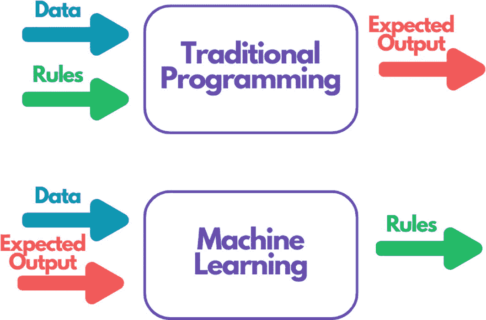

图 1-1 传统编程 vs. 机器学习

在许多情况下，在软件开发中想出精确的指令来实现特定目标是具有挑战性的。例如，考虑一个检测垃圾邮件的程序。如果你要手动编写这样一个检测器，你可能会寻找通常与垃圾邮件相关的词语，例如 `免费`、`惊人` 或 `你中奖了`。然而，这种方法需要列举所有可能的垃圾词语，并开发一个垃圾邮件评分公式。这项任务可能非常耗时，并且可能无法达到令人满意的准确度。

当不清楚如何对信息进行分类或从现有数据中提取新知识时，机器学习是一种相关的方法。它系统地分析数据，以识别那些可能不易被人眼察觉的模式。在模型针对其任务进行训练后，它可以用来进行 `推理`（根据输入数据预测结果）。

计算机有数百种不同的方法可以从数据中检测和提取模式；由于这不是一本关于机器学习理论的书，我仅在需要时简要提及其中几种。除了一次性检测数据中隐藏的模式外，机器学习还可以定期运行而无需人工干预，确保其决策能力保持最新，这是一个巨大的优势。

从历史上看，机器学习算法的能力随着时间的推移而增强，这主要是由于模型规模和复杂性的增长。这导致了对资源（如 RAM 和 CPU/GPU）的需求不断增加，这在处理嵌入式或基于微控制器的系统时可能具有挑战性。然而，这并不意味着机器学习不能在微型硬件上运行。

## 什么是微型机器学习？

如果你正在阅读这本书，而不是一本关于 `传统` 机器学习的书，这意味着你从事的是嵌入式领域的工作。我所说的 `嵌入式`，是指专注于单一任务的硬件（与旨在运行各种不同用途软件的台式电脑相反），并且能够通过传感器和执行器与周围环境交互。由于尺寸、效率、功耗和成本的限制，嵌入式硬件具有资源有限（CPU、程序空间和 RAM）的特点。尽管 `嵌入式` 一词可以涵盖多种设备，但在本书中，它特指微控制器硬件（又称 MCU）。

也就是说，`微型机器学习`，也称为 TinyML（EDGE AI FOUNDATION 的商标），是机器学习的一个专门领域，专注于优化模型以使其能在我们的嵌入式设备上运行。这种优化可以采取两种形式。

*   创建旨在尽可能小的自定义模型
*   通过压缩适配现有模型，使其符合硬件限制

正如你所料，并非所有模型都能被压缩到在如此有限的资源上运行，但你将会惊讶于仍有如此多的可能性可供选择。本书将探讨这些选项。

TinyML 的基本促成因素是机器学习过程中的一种不对称性：执行模型（输入数据并请求输出—— `推理`）所需的资源通常比训练模型（输入数据并请求发现模式—— `训练`）所需的资源少几个数量级。我们可以利用这种不对称性，在资源密集型的硬件（如台式电脑）上训练模型，然后将其转换为适合我们嵌入式硬件限制的轻量级格式。

虽然存在在特定约束下让训练在资源有限的设备上工作的可能性（设备端学习和联邦学习），但本书侧重于非对称工作流，因为它在模型选择上给了我们更多自由，允许更大的训练数据量，并通过利用经过充分测试的软件和工具简化了整体开发（设备端学习和联邦学习仍处于起步阶段）。

每章的第一部分在你资源充足的强大 PC 上执行。你进行实验、做出修改并迭代，直到获得满足质量要求的结果。每章的第二部分向你展示如何生成在微控制器上运行且仅执行推理的 C++ 代码。

### 什么可以被认为是“微型”？

多年来，TinyML 的定义经历了重大变化。我最初接触 TinyML 是通过 `TensorFlow` 网站上的一篇博文，标题是“如何开始在 `Arduino` 上进行机器学习”。该博文展示了在 `Arduino Nano BLE Sense` 上运行的几个机器学习项目，该设备搭载 `ARM Cortex-M4` CPU、1 MB 闪存和 256 KB RAM。自那以后，发生了两个显著的发展。

TinyML 已成为 `TensorFlow for Microcontrollers` 的同义词，后者是专为嵌入式硬件设计的 `TensorFlow` 特定版本。这很大程度上归功于 `TensorFlow` 团队和投资于该技术的供应商的推广努力。

创客社区已成功在多种微控制器和更强大的硬件（包括 `Raspberry Pi` 和 `NVIDIA Jetson Nano`）上运行 `TensorFlow`。这催生了一个新的、更具包容性的术语：EdgeAI。

从这个意义上说，TinyML 是更广泛的 EdgeAI 领域的一个子集，而 EdgeAI 又是 AI 的一个子集。本书的其余部分不涉及 EdgeAI（在 CPU 频率为千兆赫兹的便携式或移动设备上运行的 AI），仅涉及 TinyML（在 CPU 频率为兆赫兹的裸机硬件上运行的 AI）。

定义 TinyML 中“微型”边界的另一种视角是功耗。EDGE AI FOUNDATION 是一个专注于边缘超低功耗机器学习的社区。然而，这个术语并未精确定义，可以有不同解释。通常，它指的是毫瓦级别的功耗。根据这个定义，`Raspberry Pi Zero`（1 GHz CPU 和 512 MB RAM）考虑到其平均功耗为 500–700 mW，将属于 `微型` 范畴；但它将处于功耗范围的高端，消耗的能量是典型微控制器的十倍。图 1-2 展示了在此定义下哪些被认为是“微型”或不是。

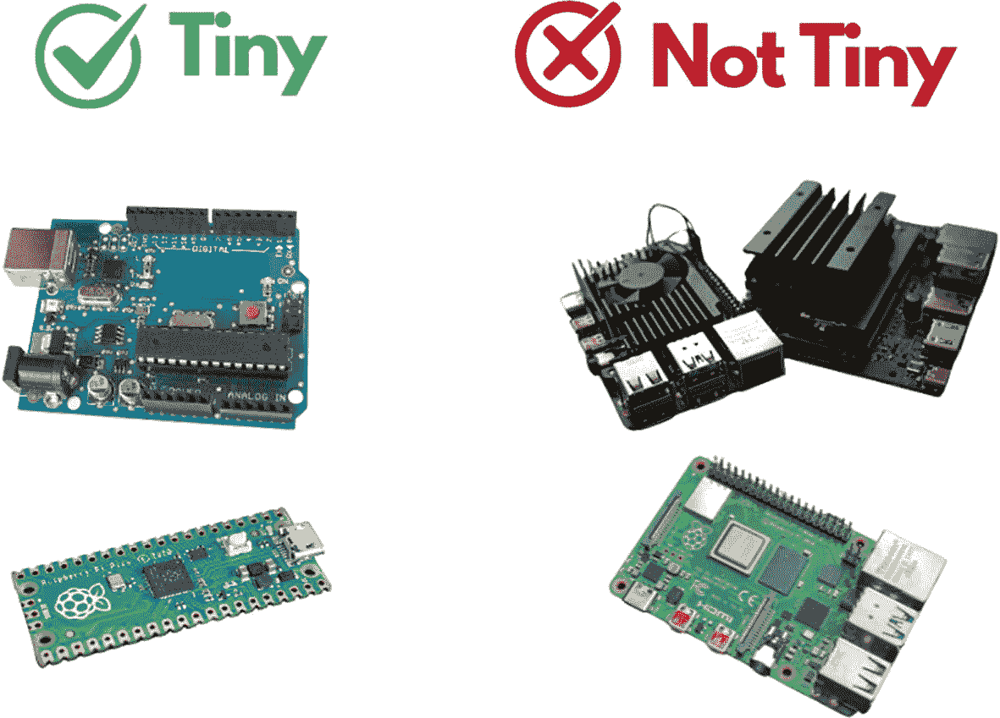

图 1-2 “微型”与“非微型”硬件示例

因此，让我们为本书语境下什么算作“微型”建立一组软边界。

> **注意**
> 本书认为有效的 TinyML 硬件微控制器最多拥有 8 MB 程序存储器和 4 MB RAM。

表 1-1 列出了一些 TinyML 和 EdgeAI 设备及其硬件规格的示例。

表 1-1 TinyML 与 EdgeAI 设备的硬件规格

| 设备 | 硬件规格 | TinyML 还是 EdgeAI？ |
| --- | --- | --- |
| `Arduino Nano` 和 `Nicla` 系列 | `ARM Cortex M` CPU 64-480 MHz<br>256 KB — 1 MB RAM | TinyML |
| `ESP32S3` | `Xtensa` 双核 CPU 240 MHz<br>512 KB RAM + 外部 1 MB RAM（可选） | TinyML |
| `Teensy 4.1` | `ARM Cortex M7` CPU 912 MHz<br>1MB RAM | TinyML |
| `Raspberry Pi 5` | `Broadcom BCM2712` 四核 CPU 2.4 GHz<br>最高 16 GB RAM | EdgeAI |
| `NVIDIA Jetson Nano` | `ARM Cortex A57` CPU 921 MHz<br>4 GB RAM | Edge AI |

这是否意味着你将无法在更强大的目标设备上运行本书中列出的代码？不，并非如此。在大多数情况下，你可以在任何支持 C++ 的硬件上运行生成的代码。然而，本书的主要重点是展示那些将微型机器学习与传统机器学习区分开来的优化和权衡。如果你的硬件支持更强大的模型和算法，你需要有令人信服的理由去选择能力较弱的模型。

### 为什么要在微控制器上运行机器学习？

如今，大多数机器学习应用都设计在强大的硬件上运行，通常是在拥有（几乎）无限资源的云计算环境中。那么，为什么要在资源受限的微型微控制器（MCU）上运行机器学习呢？在什么情况下，微控制器会优于台式电脑或云计算？

#### 带宽

连接性是我们数字生活的一个基本方面。我们时刻保持连接，大部分数据通过网络传输。然而，对于嵌入式硬件来说，情况并非总是如此。许多微控制器缺乏无线电功能，仅依靠其内部组件来执行任务。如果它们想要执行机器学习，就必须在本地进行。

即使它们能够连接到更强大的设备，这也不意味着它们可以传输所有收集到的数据。传输数据在金钱和功耗方面都可能代价高昂。网络连接通常是嵌入式硬件中最耗电的组件，而你的设备可能依靠有限的能源预算（例如电池）运行。在本地执行机器学习推理，并仅将结果传输到远程位置（例如用于监控目的）更为实用。

### 延迟

传输数据同样会产生时间成本。嵌入式硬件通常需要实时处理（例如自动驾驶汽车或工业控制系统）。如果你的设备依赖远程服务器获取指令，可能会因网络延迟而失效，并引发监管灾难（例如车祸或机械故障）。

本地机器学习可能比将数据传输到远程服务器并等待响应更慢。然而，它的表现是可预测的。推理完成所需的时间通常在每次运行中保持一致。你可以对此时间进行基准测试，并将其纳入系统开发中。然而，网络时间是不可靠的，并且常常根据你无法控制的网络状况而波动。

### 隐私

并非所有数据都是敏感的，用户可能不介意通过互联网传输数据以供处理。然而，敏感数据不应离开采集它的设备。例如，音频和视频数据可能被视为隐私，许多人对自己的数据暴露给第三方公司并容易遭受泄露或入侵感到不安。

在某些行业，如安全、医疗或儿童保育领域，必须遵守严格的隐私法规。在这些情况下，将数据保留在本地并在采集数据的同一设备上进行分析是更可取的选择，甚至是强制性的要求。

### 普适计算

物联网（IoT）的兴起导致我们周围智能电子设备数量的激增。我们被成千上万带有微控制器的物品所包围，例如灯泡、烤箱、摄像头和恒温器。由于尺寸和功耗的限制，这些物品无法配备大型或高功耗的主板。它们必须价格低廉，以尽可能降低最终售价。它们必须是自包含的，因为它们部署在不可预测的环境中。TinyML 使得每个物品都能在其运行模式中实现智能，从简单的环境理解（例如，检测房间何时为空）到更复杂的任务，如语音识别。

### 低功耗

微控制器的特点是低功耗。为了更直观地理解，以下是常见机器学习硬件的典型功耗水平。

*   微控制器：0.1–0.5 W
*   树莓派：2–5 W
*   Jetson Nano：5–10 W
*   带 GPU 的台式电脑：10–50 W

如果你的部署场景功耗预算很低（例如，你处于离网状态，依赖电池或太阳能），你无法持续供应数瓦的功率。你被迫选择功耗最低的解决方案。这个解决方案通常由微控制器代表，它们通常提供超低功耗模式，可将功耗进一步降低到微瓦级别，从而大大延长电池寿命。如果你的项目需要轻量级、间歇性的机器学习，按固定间隔运行或仅在有新数据时运行，你可以避免让一个过大的硬件大部分时间处于空闲状态而浪费电力。

### 微型机器学习能做什么？

尽管体积小巧，但在资源受限设备上的机器学习仍然可以取得令人印象深刻的结果。不要草率地认为“微型”就是“无用”的同义词。许多行业和垂直领域已经受到 TinyML 的影响，并且它已被证明在广泛的现实世界应用中能够可靠且令人满意地工作。

#### 人类活动识别

近年来，智能手表使这一应用场景变得流行。得益于内置的加速度计，它们可以检测你正在进行的活动（跑步、步行、游泳等）。它们还针对老年人辅助领域进行了优化，可以检测老人跌倒并相应地提醒护理人员。这类设备必须遵守大量限制（功耗低以节省电池并防止过热，并且完全在本地运行，因为无法保证网络连接），然而它运行得如此之好，以至于已成为运动和健身人士的主流设备。第 4 章和第 5 章将使用不同的工具和技术来处理时间序列分类任务。

#### 关键词唤醒

“Hey Alexa”和“Hey Google”这些短语近年来已变得家喻户晓。响应我们语音命令的设备进入了我们的家庭和智能手机。为了提供高水平的语音识别准确率，这些设备需要互联网连接才能在云端执行单词识别。话虽如此，如果这些设备将所有内容都流式传输到远程服务器，将会引发严重的隐私问题。因此，它们在本地寻找神奇的激活词，只有当这些词被找到时，它们才开始流式传输。第 6 章利用 Edge Impulse 平台训练一个模型，使其完全在本地识别神奇词汇`Hey Arduino`。

#### 图像分类与目标检测

图像识别是神经网络和深度学习在与人类相比展现出令人印象深刻成果的领域。这些模型已用于各种工业环境，例如工业工厂中用于识别和分拣产品的计算机视觉引导机械，或自动驾驶机器人和汽车。

考虑到图像可能包含的众多主体，计算机视觉模型往往具有很高的复杂度。尽管如此，近年来已经提出了一些强大而轻量级的架构，适用于 TinyML 环境。第 7 章利用 Edge Impulse 平台执行目标检测（图像中存在哪些物体？它们位于何处？）。如果说几年前这些模型在普通微控制器硬件上运行需要几秒钟，那么如今你可以在 10 美元的硬件上以高达每秒 20 帧的惊人速度执行目标检测。

#### 预测性维护

TinyML 在工业环境中的一个关键应用是监控设备，例如泵、电机和压缩机。可以部署由 TinyML 驱动的传感器来监控设备性能，以检测磨损的早期迹象并预测何时需要维护。这使得工业操作员能够在计划停机期间安排维护，降低意外设备故障的风险，并最大限度地减少对生产的影响。

### 微型机器学习不能做什么？

并非所有的机器学习任务都适合微型计算机。该领域的许多最新进展往往难以在消费级桌面硬件上运行，更不用说微型机器了。

#### 大型语言模型

2022 年 11 月，ChatGPT 通过展示其理解人类指令并以类似人类的风格回应的能力，彻底改变了人工智能世界。自那时起，大型语言模型（LLM）获得了极大的关注，其发展也加速了。这些模型的特点是规模巨大，通常拥有数十亿（甚至数万亿）个参数，并需要执行数十亿次数学运算。不幸的是，此类模型在现在以及未来数年内都不太可能适配到 2 MB 的 RAM 中。

#### 图像生成模型

与语言模型类似，图像生成模型，如 Stable Diffusion，以其巨大的资源需求而闻名。这些模型旨在具有数十 GB RAM 的图形处理单元（GPU）上运行。即使是更简单的模型，在普通笔记本电脑上运行也可能需要数秒或数分钟，这使得在不久的将来在微控制器上运行它们变得不切实际。

#### 点云与激光雷达

在 Arduino 项目中，你可能会想为搭载激光雷达传感器的自动驾驶车辆编写程序，就像许多自动吸尘器所做的那样。尽管这个应用领域看似适合嵌入式硬件，但从激光雷达点云重建 2D/3D 场景是一项数学密集型操作，需要强大的处理单元。虽然 CPU 不必非常庞大，但你仍然需要一个中等大小的——比如树莓派。

现在，让我们聚焦于机器学习的基本概念。这至关重要，因为本书后续章节将深入探讨这些概念。

接下来的部分可能看起来像是一系列定义，你或许会想跳过它。但请不要这样做。这些条目并非简单的定义，而是对关键概念的简明解释，这些概念对于理解后续章节至关重要。这些概念以清晰易懂的方式呈现，即使你是新手，也能轻松掌握。

## 机器学习术语表

在进入后续章节的实践代码示例之前，你必须熟悉一些作为机器学习基石的术语和概念。没有这些预备知识，你将无法理解后续章节的理论与实践。因此，请花些时间尽可能透彻地消化以下段落。

请记住，大多数 TinyML 都出现在传统机器学习工作流程之后：你首先开发一个模型，然后对其进行优化，使其能在嵌入式硬件上运行。如果你不理解机器学习的基础知识，就无法进行微型机器学习。

> 注意
> 以下段落并非旨在与数学导向教科书中的科学定义完全吻合。它们旨在用通俗易懂的语言传达要点。

### 监督学习 vs. 无监督学习

让我们回顾一下我在本章开头介绍的机器学习定义。

> 机器学习是使计算机能够无需显式编程即可学习的研究领域。

计算机如何在不被编程的情况下完成任务？在机器学习中，计算机从提供给它的数据中学习。数据可以有多种形式，例如传感器数据、图像、音频或原始数字。机器学习方法的基本假设是，这些数据包含可能明显或不明显的模式。然而，任何软件要想学到有用的东西，这些模式必须存在。

如果数据被组织到现有类别中，或者已知给定输入对应的预期输出，这就是监督学习。在监督学习中，你向模型提供带标签的数据，并告诉它：“当输入看起来像这样时，输出应该是那样。” 在训练阶段之后，你的目标是让生成的模型能在新的、未见过的数据上产生正确的输出。每个模型都有其独特的学习这种关系的方式，每种算法也有不同的建模能力。没有哪个模型能对所有项目都表现最佳，因此你需要尝试几种模型，才能找到最适合当前任务的那一个。

另一方面，无监督学习不涉及输出。你只有输入数据，并想知道其中是否包含自然存在的模式。这些模式可能根本不存在，也可能模糊不清。你在无监督学习中的目标有两个：首先，确定是否存在任何模式；其次，评估该模式与数据的拟合程度。无监督学习的例子包括聚类（将相似数据分组在一起）、降维（在不丢失太多信息的情况下压缩数据）和关联规则挖掘（识别事件之间的模式）。

图 1-3 有助于阐明区别。

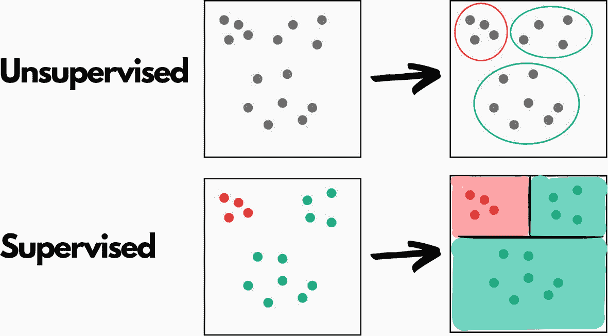

图 1-3 监督学习 vs. 无监督学习

> 注意
> 本书仅涵盖监督学习。它最适用于实际项目，并且更适合微型机器学习应用。

### 真实值

在监督学习中，真实值是你的输入数据的正确输出。模型用它来学习当给定某个输入时，结果应该是什么样子。在模型学习其参数后，会将真实值与预测值进行比较，以评估学习性能。

## 回归 vs. 分类

*回归*是监督学习的一种形式，其任务是从输入预测一个连续变量。例如，你可能使用回归从湿度读数推断表观空气温度，或根据患者的年龄、体重和血液分析预测糖尿病的进展。

在回归中，输入和输出可以有多种组合，包括一个输入和一个输出、多个输入和一个输出，或多个输入和多个输出。虽然输出变量必须是连续的，但对输入变量没有限制，它们可以是全部连续的、全部分类的（离散的），或两者的混合。

*分类*是监督学习的一部分，用于识别输入属于哪个或哪些类别。这个任务有几个重要的规范。

*   一个输入可以不属于任何类别，也可以属于一个或多个类别。

*   类别列表是完全已知的，这意味着模型无法检测到它从未见过的类别。

如果所有输入样本恰好属于一个类别，则该任务是*单标签分类*。如果样本可以属于一个或多个类别，则称为*多标签分类*。为简化开发，我们假设样本至少属于一个类别。如果不属于，你可以丢弃该样本，或创建一个“未知”类别来包含所有没有标签的样本。

分类的一个例子是判断一张图像描绘的是狗还是猫，或者一个音频样本是否包含“Hey Google”这句话（使用“包含”和“不包含”标签）。

请参见图 1-4 以直观了解区别。

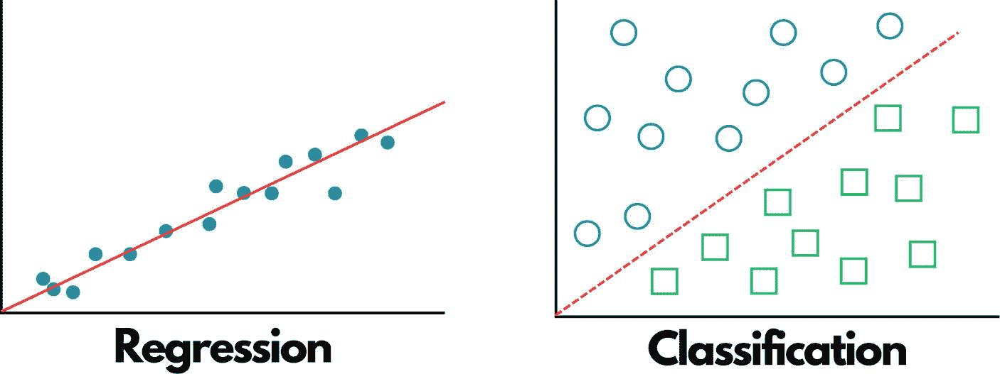

该图比较了机器学习中的回归和分类。左侧，回归图显示一条红色拟合线穿过蓝色数据点，表示连续关系。右侧，分类图显示一条红色虚线分隔蓝色圆圈和绿色方块，表示不同的类别。每个图下方分别标注了“回归”和“分类”字样。

图 1-4

回归 vs. 分类

> **注意**
> 本书侧重于回归和单标签分类。

### 二分类与多分类

*二分类*是一种只有两个类别的分类问题。这两个类别可以代表任何事物，例如猫与狗、垃圾邮件与*正常邮件*（非垃圾邮件），或健康与患病。在二分类中，你为每个类别分配一个数值 0 或 1。通常的惯例是将 1 分配给正类，将 0 分配给负类。但是，当类别没有自然的正类或负类解释时（例如狗与猫），这种分配是任意的。

*多分类*则是一种包含两个以上类别的分类问题。类别数量没有理论上的限制，一些分类问题（如图像识别）可能涉及数千个类别。然而，类别越多，分类问题可能变得越复杂。

一些分类模型被设计用于处理多个类别，而另一些则仅适用于两个类别。不过，仅支持二分类的模型可以通过以下两种策略之一扩展以处理多个类别：*一对多*或*一对一*。

### 一对多

*一对多*策略涉及为每个类别训练一个独立的二分类器（见图 1-5）。每个分类器都经过训练，用于区分目标类别和所有其他类别。最终预测通过选择置信度得分最高的类别来做出。

例如，在一个三类别问题（A、B、C）中，一对多策略将涉及训练三个二分类器。

*   分类器 1：A 与（B 或 C）

*   分类器 2：B 与（A 或 C）

*   分类器 3：C 与（A 或 B）

此策略仅适用于能够为其预测生成得分或概率的二分类器（并非所有模型都具备此能力）。对于每个待分类的新输入样本，所有分类器都会做出预测，并选择得分最高的正类预测。如果没有分类器做出正类预测，或者得分低于置信度阈值，则该样本应标记为*未知*或*无法分类*。

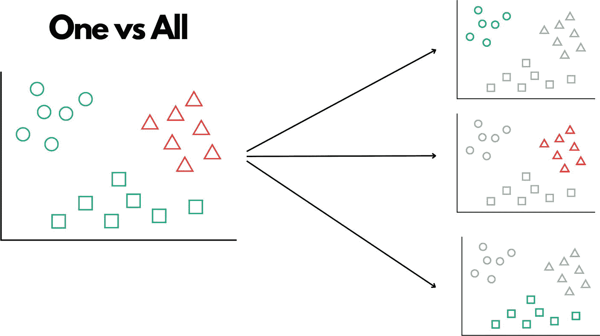

图示说明了“一对多”分类策略。左侧散点图显示了三个组：蓝色圆圈、红色三角形和绿色方块。箭头指向右侧的三个独立图表，每个图表突出显示一个组（彩色），而其他组则显示为灰色。顶部图表强调蓝色圆圈，中间图表突出红色三角形，底部图表聚焦于绿色方块。

图 1-5

一对多多分类策略

> **注意**
> 需要注意的是，如果你有许多类别且每个类别都有大量样本，那么每个分类器都可能在类别不平衡的数据集上训练（属于一个类别的样本很少，而属于另一个类别的样本很多），这可能导致结果不佳。

### 一对一

*一对一*策略涉及为每对类别训练一个独立的二分类器。在一个三类别问题（A、B、C）中，一对一策略将涉及训练三个二分类器。

*   分类器 1：A 与 B

*   分类器 2：A 与 C

*   分类器 3：B 与 C

分类器的数量根据以下公式随类别数量呈二次方增长。

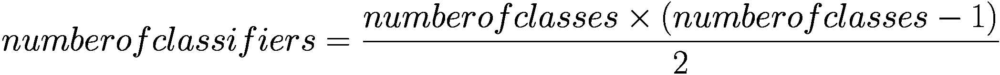

例如，对于一个有 10 个标签的分类任务，你将需要 45 个分类器。一对一策略不要求分类器为其预测生成得分。如果输出是离散的 0 或 1，则获胜类别是获得最多投票的类别（见图 1-6）。如果分类器可以生成置信度得分，你可以对得分或投票进行求和。

与一对多策略一样，可能会出现没有类别获得多数投票的情况，此时该样本应标记为*未知*或*无法分类*。

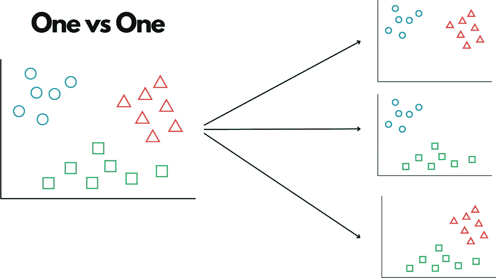

该图展示了“一对一”分类策略。左侧散点图显示了三组形状：蓝色圆圈、红色三角形和绿色方块。箭头指向右侧的三个较小图表，每个图表比较两个组：蓝色圆圈与红色三角形、蓝色圆圈与绿色方块、以及红色三角形与绿色方块。这展示了机器学习中的成对分类。

图 1-6

一对一多分类策略

## 评估指标

为了评估模型的性能，你需要一个指标。在监督式机器学习中，指标是一个数值，用于衡量模型输出与预期输出的匹配程度。对于分类问题，指标告诉你模型在总预测数中正确分类的数量。对于回归问题，它衡量预测值与期望值之间的差异。

### 二分类任务的评估指标

在二分类问题中，结果仅限于 0 和 1。一个简单且广泛使用的指标是*准确率*，其定义为正确预测的数量除以总预测数量。准确率越高，表示性能越好。然而，准确率可能具有误导性，因为它无法提供模型在每个类别上的性能信息。

为了说明准确率作为指标的谬误，我们来看一个例子。假设你训练了一个垃圾邮件检测器，用于将电子邮件分类为垃圾邮件或非垃圾邮件（也称为“正常邮件”）。你的数据集中有 900 封正常邮件和 100 封垃圾邮件。该模型达到了 90%的准确率。这能算是一个令人满意的结果吗？实际上，不能，因为 90%正是你始终将邮件分类为正常邮件所能达到的准确率（这意味着分类器根本没有学到任何东西！）。

为了解决这一局限性，通常使用另外两个指标：*精确率*和*召回率*。要理解它们代表什么，我们首先列举二分类问题中所有可能的结果。

*   真正例 (`TP`)：真实结果为 1，分类器正确预测为 1。

*   真负例 (`TN`)：真实结果为 0，分类器正确预测为 0。

*   假正例 (`FP`)：真实结果为 0，分类器错误地预测为 1。

*   假负例 (`FN`)：真实结果为 1，分类器错误地预测为 0。

*精确率*衡量的是分类器在预测为 1 时，有多少次是正确的。*召回率*衡量的是分类器预测为 1 的次数占所有实际为 1 的样本总数的比例。

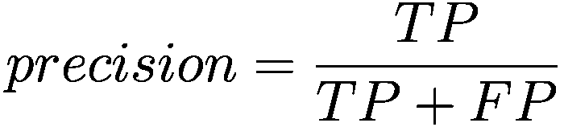

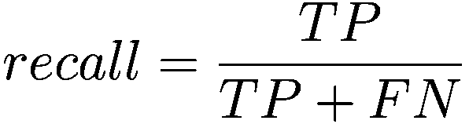

图 1-7 用图表解释了相同的概念。

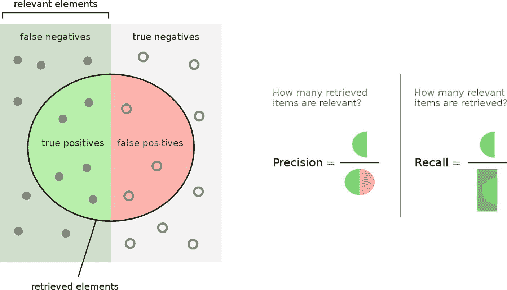

一个维恩图，说明了数据检索中精确率和召回率的概念。该图分为两个主要部分：相关元素和检索到的元素。左侧部分以绿色显示假负例和真正例，而右侧部分以红色显示真负例和假正例。真正例和假正例位于一个标有“检索到的元素”的圆圈内。精确率定义为真正例与真正例和假正例之和的比率，用饼图表示。召回率定义为真正例与真正例和假负例之和的比率，用条形图表示。

图 1-7

精确率与召回率

让我们回到那个总是将邮件分类为正常邮件的垃圾邮件检测器示例。将“正常邮件”赋值为 0，“垃圾邮件”赋值为 1。我们来计算这些指标。

```
真正例  = 0         正确预测为垃圾邮件的数量？
真负例  = 900       正确预测为正常邮件的数量？
假正例  = 0         错误预测为垃圾邮件的数量？
假负例  = 100       错误预测为正常邮件的数量？
精确率 = TP / (TP + FP) = 0 / 900 = 0%
召回率 = TP / (TP + FN) = 0 / 100 = 0%
```

现在我们对我们分类器的性能有了完全不同的看法。我们的分类器在学习如何识别垃圾邮件方面显然做得非常糟糕，即使整体准确率看起来很高。

为什么在准确率如此之高的情况下，分类效果却可能如此之低呢？这是因为数据集是*不平衡的*：一个类别（正常邮件）的实例数量远大于另一个类别（垃圾邮件）。在这种情况下，许多算法由于其学习实现细节（它们优化的是准确率，而不是精确率和召回率）而偏向于多数类。

如果你更喜欢用一个单一的指标来描述你的分类器，并且这个指标不会像准确率那样欺骗你，你可以参考 *F1 分数*，它将精确率和召回率结合成一个单一的数字。

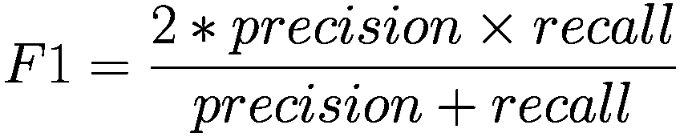

高的 F1 分数意味着精确率和召回率都很高；低的 F1 分数则需要进一步调查，因为它可能是由低精确率或低召回率（或两者兼有！）导致的。

## 多分类任务的评估指标

在多分类问题中，你可以对每个类别使用相同的二分类指标（准确率、精确率、召回率），应用一对多的二值化方案。然而，一个信息量更大的指标是混淆矩阵（见图 1-8）。

混淆矩阵是一个表格，显示了每个类别的正确和错误预测数量。该表的行数和列数等于类别数，其中每个单元格代表真实类别为行标签且预测类别为列标签的样本数量。

图 1-8 展示了一个针对鸢尾花数据集 [1] 的混淆矩阵示例，该数据集试图根据花萼和花瓣的尺寸来分配正确的鸢尾花种类（`setosa`、`virginica` 和 `versicolor`）。

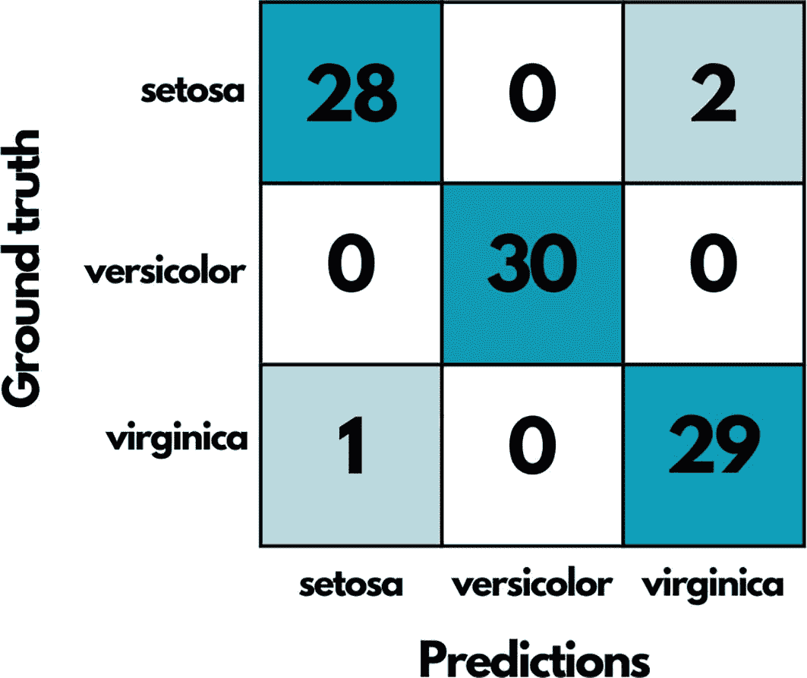

一个用于预测鸢尾花种类的分类模型的混淆矩阵。行代表实际类别：`setosa`、`versicolor`、`virginica`。列代表预测类别。矩阵显示：28 个 `setosa` 被正确预测，2 个被错误分类为 `virginica`；30 个 `versicolor` 被正确预测；29 个 `virginica` 被正确预测，1 个被错误分类为 `setosa`。

图 1-8

鸢尾花数据集的混淆矩阵示例

矩阵的对角线单元格代表正确预测的数量，而非对角线单元格代表错误。混淆矩阵提供了关于模型性能的宝贵见解，例如：

*   模型的整体准确率（对角线之和除以总样本数）

*   每个类别的精确率和召回率

*   被错误分类的样本数量

在图 1-8 中，你可以如下解读非对角线上的数值：

*   数字 1 代表真实类别为 `versicolor` 但被分类为 `setosa` 的样本。

*   数字 2 代表真实类别为 `setosa` 但被分类为 `virginica` 的样本。

这个矩阵可以让你一目了然地获取大量信息：

*   分类器表现相当不错（75 个样本中有 72 个正确分类）。与正确分类相比，错误很少。

*   `Versicolor` 的精确率（当分类器预测为 `versicolor` 时，它总是真正的 `versicolor`）和召回率（所有 `versicolor` 样本都被正确识别）均为 100%。

*   `Setosa` 的精确率为 96%（28/29，分类器错了一次）。

*   `Virginica` 的召回率为 96%（30 个样本中有 29 个被正确识别）。

这是一个相当不错的混淆矩阵。（鸢尾花数据集是一个玩具数据集，非常容易分类。）在你的实际项目中，你可能会遇到更糟糕的情况，如图 1-9 所示。

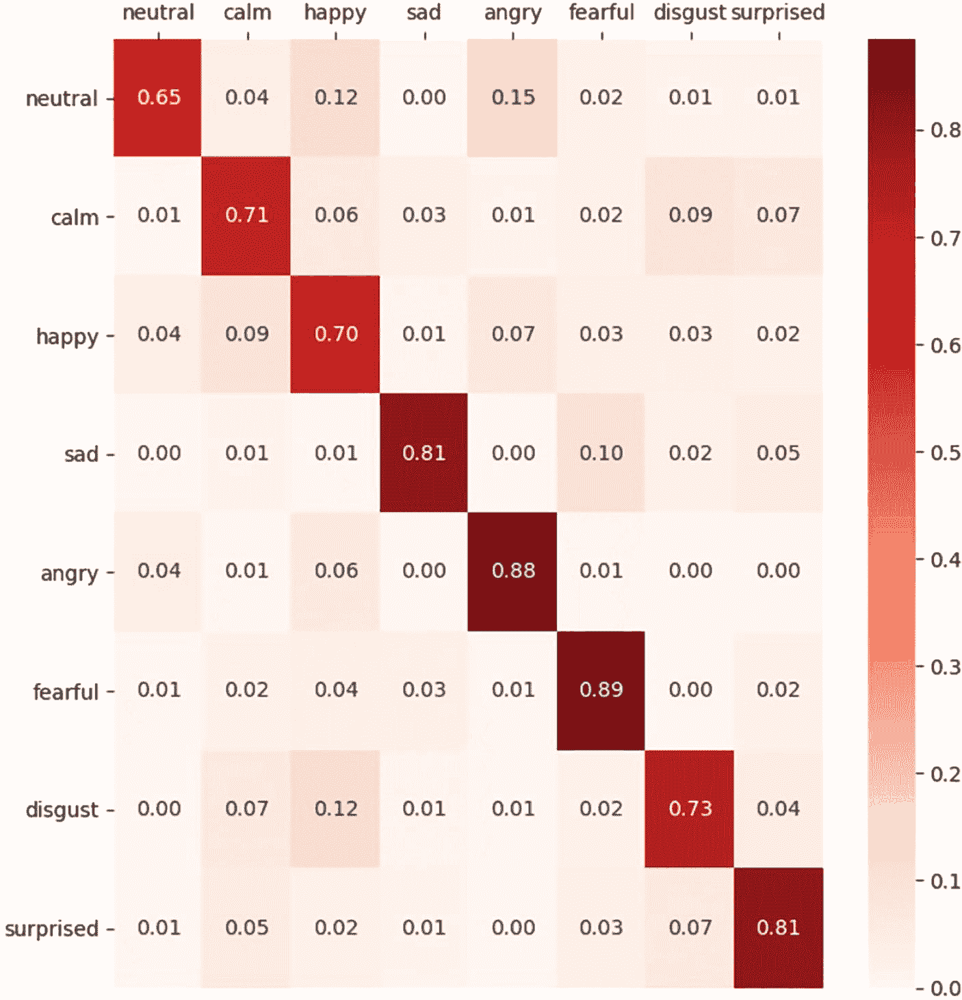

一个显示情绪分类混淆矩阵的热力图，类别包括：中性、平静、快乐、悲伤、愤怒、恐惧、厌恶和惊讶。对角线显示较高的值，表示正确的预测，显著值包括愤怒的 0.88 以及悲伤和惊讶的 0.81。颜色渐变从浅红色到深红色，代表从 0 到 0.9 的值。

图 1-9

较差的混淆矩阵 1

在这个例子中，整体准确率在 70%–80%范围内，你可以看到错误均匀地分布在所有类别中。在这种情况下，你需要通过参数调整（如果可能的话）来增加当前模型的建模能力，或者寻找一个更强大的模型。

## 回归指标

*回归*是指根据一组输入预测一个连续变量。在这种情况下，你通常不追求预期值与预测值之间的完美匹配。相反，你希望预测值落在实际值可接受的误差范围内。有两个主要的误差指标常被用作回归指标。

### 均方根误差

*均方根误差*（`RMSE`）是误差平方的平均值的平方根。

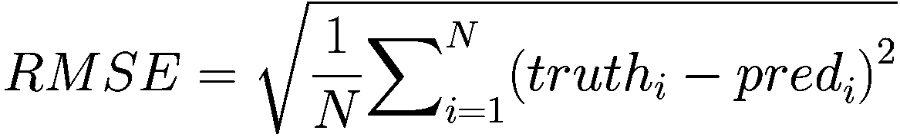

`truth[i]` 是预期值，`pred[i]` 是预测值。

在 `RMSE` 中使用平方运算会赋予较大误差和异常值更高的权重，并且结果始终为正。对结果取平方根有两个作用：通过提供更窄的范围使不同 `RMSE` 值更易于比较，并使 `RMSE` 与输出变量具有相同的单位，例如在预测人身高的回归任务中以厘米为单位。

注意

一个好的回归模型具有较低的 `RMSE`。

### 平均绝对误差

*平均绝对误差*（`MAE`）是误差绝对值的平均值。它与 `MSE` 的不同之处在于，平方运算不会放大误差的幅度，因此其贡献是线性的而非二次的。我们仍然应用一些*正向化*（绝对值）处理，以避免符号相反的误差产生零值或非常低的误差指标。

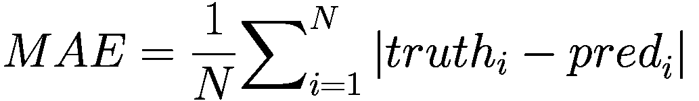

注意

一个好的回归模型具有较低的 `MAE`。

你应该选择哪一个？这取决于你的项目，在你对机器学习整体熟悉之前，我建议你在开发过程中同时监控这两个指标。

### 决定系数

*决定系数*（`R²`）是一个介于 0（最差情况）和 1（最佳情况）之间的数值，用于表示输入特征对输出的解释程度。如果该值较高（大于 0.9），则我们的特征几乎包含了做出良好预测所需的所有信息。如果该值较低，我们可能缺少与输出相关的重要特征。在现实场景中，良好的 `R²` 值预计在 0.8–0.95 范围内。较低的值可能表明你需要寻找更好的属性作为预测变量。较高的值可能意味着问题过于简单，或者输出信息泄露到了输入中。

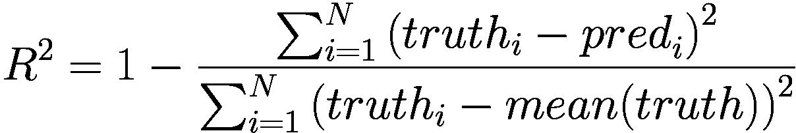

在最佳情况下，`ŷ[i]`（预测值）与 `y[i]`（预期输出）完全匹配，因此分数为 0，`R²` 为 1。

## 过拟合与欠拟合

机器学习模型的复杂度各不相同，即使是同一个模型，也可以配置为更具描述性或更少描述性。你可能会认为模型描述性越强，结果越好。然而，情况并非总是如此。

*过拟合*是指模型过于紧密地学习训练数据的情况。在这种场景下，模型开始记忆数据，而不是学习如何泛化。多种因素可能导致这种情况。

*   数据集较小和/或噪声较多

*   数据集包含许多无信息量的属性

*   模型的描述能力超过了数据所需

例如，假设你想创建一个预测房价的模型。你选择了面积、房间数量以及是否有游泳池等输入属性。然而，你还包含了诸如墙壁颜色、电视尺寸以及当前房主身高等属性。对于一个将价格归因于身高超过 180 厘米的房主的模型，你会有多大信任度？

为了解决过拟合问题，你可以尝试以下解决方案。

*   选择更简单的模型或约束模型（如果可能）。

*   减少数据属性的数量。

*   收集更多数据。

*   减少数据中的噪声（修正错误并移除异常值）。

*欠拟合*与过拟合相反。它发生在模型无法学习底层数据模式并表现出较差性能时。这可能是由于模型过于简单或数据缺少重要特征所致。

例如，你可能使用线性模型来学习二次关系，或者仅根据建造年份来预测房价。为了解决欠拟合问题，你可以尝试以下解决方案。

*   选择更复杂的模型或解除其约束（如果可能）。

*   增加数据属性的数量。

*   收集更多数据。

*   减少数据中的噪声（修正错误并移除异常值）。

图 1-10 直观地展示了分类和回归任务中的过拟合与欠拟合问题。

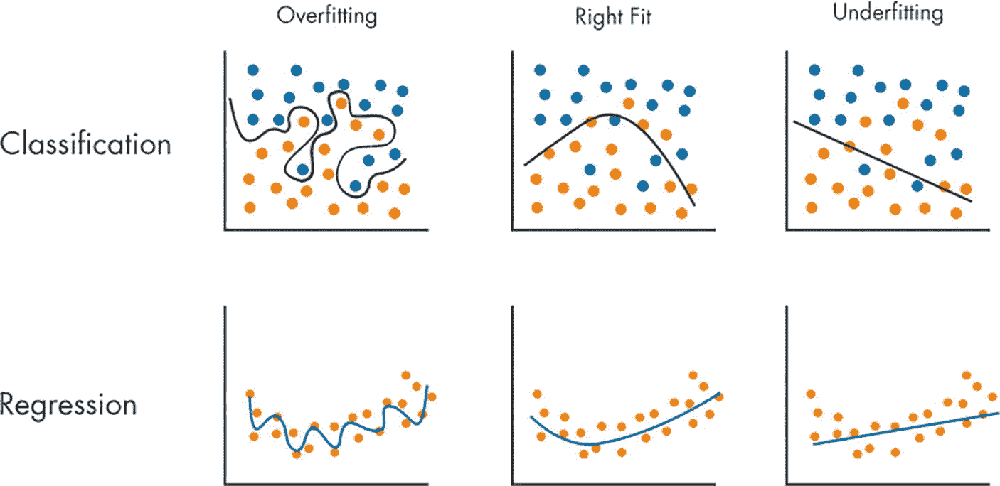

该图展示了分类和回归中的过拟合、适度拟合和欠拟合概念。顶行显示分类：过拟合具有复杂边界，适度拟合具有平滑曲线，欠拟合为一条直线。底行描绘回归：过拟合为波浪线，适度拟合为平缓曲线，欠拟合为一条直线。蓝色和橙色点代表数据点。

图 1-10

回归和分类中的欠拟合与过拟合

## 训练集 vs. 验证集 vs. 测试集

在开发机器学习项目时，使用公平客观的评估流程来评价不同特征、模型和模型参数配置的效果至关重要。

我们可能犯的最肤浅的错误之一，就是在指标看起来不错时停止迭代，结果后来才发现模型过拟合了。为了避免模型死记硬背输入而非从中学习的过拟合现象，我们通常将数据分为三部分：训练集、验证集和测试集。

*训练数据*作为输入提供给算法以创建模型。由于这是“数据最密集”的过程，训练集通常包含 50%–70% 的样本。模型从这些数据中学习，并调整其参数以最小化误差。

模型从不使用*验证数据*进行学习。相反，它会选择能在这组未见数据上产生最高指标（例如准确率）的模型参数。由于模型在训练期间未见过这些数据，它必须从训练样本中进行泛化才能获得令人满意的结果。通常，10%–20% 的数据用作验证集。如果无需调整模型参数，则验证集并非必需。

为了评估（训练后的）实际模型性能，我们使用`测试集`，它是原始数据的另一部分，分类器在训练或验证期间从未见过。在这部分数据上报告的指标，就是我们期望在现实世界中看到的值。通常，10%–30% 的数据用作测试集。

你可能会问，为什么验证集和测试集都是必需的。如果我们只使用测试集进行评估，就会选择在该特定集上指标最高（准确率、F1 分数、MAE、RMSE 等）的模型。这个结果会有偏差，基于全新的、从未见过的数据，该模型的表现可能会（而且很可能）更差。我们会对模型的预测能力过于自信。

让我们通过一个例子来更好地说明这些概念。想象你是一名老师，想测试学生的知识掌握情况。你给他们一次小测验，看看他们对课程内容的掌握程度。

训练集就像教科书和课堂笔记。你使用这些数据来教学生（你的机器学习模型）概念。他们从这些数据中学习，并尝试泛化公式或关键概念。

验证集就像一次练习测验。你使用这些数据来了解学生的学习情况，但你仍然可以纠正他们的错误并调整教学方法。这有助于他们微调对课程内容（模型参数）的理解，以获得更好的结果。

测试集就像期末考试。你使用这些数据在真实场景中评估学生的知识水平，不提供任何反馈或纠正。这让你能无偏地估计学生（模型）在现实世界中的表现。

总结一下，这就是为什么你需要验证集和测试集。

*   **防止过拟合**：如果只使用训练集，模型可能会过于专门化于训练数据，而无法很好地泛化到新的、未见过的数据。验证集通过展示模型在未见数据上的表现来帮助防止过拟合。

*   **优化参数**：验证集帮助你调整模型的参数。你可以尝试不同的设置，在验证集上评估模型，并选择最佳的一个。

*   **消除偏差**：测试集提供了对模型性能的无偏评估。由于你没有使用这些数据来训练或优化模型，它能让你对模型在现实场景中的表现有一个现实的估计。

### 特征工程

特征工程将原始数据转换为更适合机器学习模型的有效输入集。原始数据可能包含噪声、冗余或无用信息，这些值会对模型的学习过程产生负面影响。通过将数据转换为更适合模型的格式，你可以显著提高预测的准确性。一些常见的特征工程步骤包括以下内容。

*   将音频信号转换为其频率分量

*   从时间序列数据中提取统计矩（如均值、方差和标准差）或频谱值（如能量和熵）

*   将输入数据缩放到固定范围（例如 [0, 1] 或 [–1, 1]）有助于防止某些特征主导模型的预测。

每种数据类型通常都有一个标准的特征工程流程，你可以在不同项目中重复使用。其中一些流程将在后续章节中详细探讨。

需要注意的一个关键点是数据的维度。你可能会认为拥有更多数据总是能让分类器更容易学习如何刻画每个类别。然而，情况并非总是如此。在某些场景下，数据过多实际上会损害学习过程并导致糟糕的结果。（这有一个专门的名称：`维度灾难`。）

此外，你必须考虑到，更多的输入数据通常会导致模型更大、更慢。在 TinyML 的背景下，你希望拥有尽可能精简的模型，以便在将分类器部署到电路板时节省宝贵的资源。在处理高维数据的项目中，应用`降维`算法可能是有意义的，该算法将不同的特征组合成更少的特征集；或者应用`特征选择`，即丢弃对分类结果贡献不大的特征的过程。一个特征对于分类/回归任务可能（几乎）无用，原因有二。

*   它与另一个特征高度相关，因此冗余且不必要。

*   它无法将每个类别/输出与其他类别/输出区分开来，因此无关紧要。

特征选择后，你的分类准确率可能会略有下降，具体取决于特定的数据集。你的任务是为你的特定部署找到准确率与资源约束之间的最佳权衡。一般来说，你能丢弃的特征越多越好。

### 数据类型

机器学习可以处理多种类型的数据。某些类型的数据可以`原样`输入到机器学习模型（或至少其中一组模型）中，而其他类型则需要重要的特征工程步骤来帮助模型理解它们。本节涵盖了你将在本书后面遇到的数据类型。它并未涵盖所有领域，但很可能涵盖了最常见的几种。它们按分析复杂度和/或信息密度递增的顺序列出。

#### 表格数据

表格数据是指一种结构化的数据，按行和列组织，类似于电子表格或表格。想象一个包含行和列的表格，其中每一行代表一个单独的观测值或样本，每一列代表一个特征或变量。例如，表示一个班级学生考试成绩的电子表格就是表格数据的一个典型例子。每一行代表一个学生，每一列代表他们在某次考试中的成绩。

以下是表格数据的一些关键特征。

*   **结构化数据**：表格数据是高度结构化的，这意味着每一行和每一列都有特定的含义和格式。

*   **行代表样本**：表格中的每一行代表一个单独的样本或观测值，例如一个学生、一个客户、一笔交易或一个产品。

*   **列代表特征**：表格中的每一列代表一个特征或变量，例如考试成绩、年龄、收入、产品类别或购买金额。

*   **同质数据**：每一列中的数据都具有相同的数据类型，例如数值型、类别型或文本型。

*   **固定模式**：表格的结构，包括列的数量及其数据类型，是固定且明确定义的。

*   **行独立性**：每一行（样本）都独立于其他行。你可以自由地重新排列行的顺序，而不会影响每行所包含的信息。

在物联网和物理计算中，数据通常来自传感器。如果你单独、一次一个地考虑传感器的读数，那么这些数据可以被视为表格数据。例如，假设你想使用一个多气体气味传感器来检测不同类型的酒精饮料[2]。这个传感器可能每秒输出多种气体（一氧化碳、二氧化氮、乙醇等）的浓度。你不需要随时间监控这些值：你只考虑读取传感器时的浓度。这就是表格数据。在你的嵌入式项目中可能遇到的更多表格数据示例如下。

*   大气测量值（温度、湿度、气压）

*   颜色和光强度

*   距离、速度、倾斜角度

在此步骤中，特征工程作用于单个样本。它只考虑那些要么是独立的（相对于当前样本），要么是全局的（相对于整个样本总体）的变换。

第 2 章重点介绍表格数据分类，而第 3 章讨论回归。

#### 时间序列数据

时间序列数据指的是时间成为所收集数据的一个额外维度的情况。在此背景下，你有两个信息来源。

*   在给定时间点的测量值

*   值随时间的变化方式

你仍然可以将时间序列数据存储在表格格式中，但行的顺序至关重要。如果你以随机顺序重新排列行，就会丢失数据中大量的内在模式。时间序列数据可能没有固定或均匀的采样频率，并且不同的传感器可能有不同的频率（从每秒几个样本到几百个）。

以下是时间序列数据与表格数据之间的一些关键区别。

*   **时间**：它与测量值同等重要。单个样本包含的信息非常少；形成模式的是值如何随时间演变。

*   **仅限数值**：虽然表格数据可能是数值型和类别型数据的组合，但时间序列数据始终是数值型的。

鉴于数据以值流的形式输入，而我们的硬件内存有限，因此必须对数据进行`窗口化`处理。窗口化是指每次只考虑一块数据（最近的数据），并在新数据到来时丢弃旧数据的过程。图 1-11 描述了随时间变化的窗口化过程。

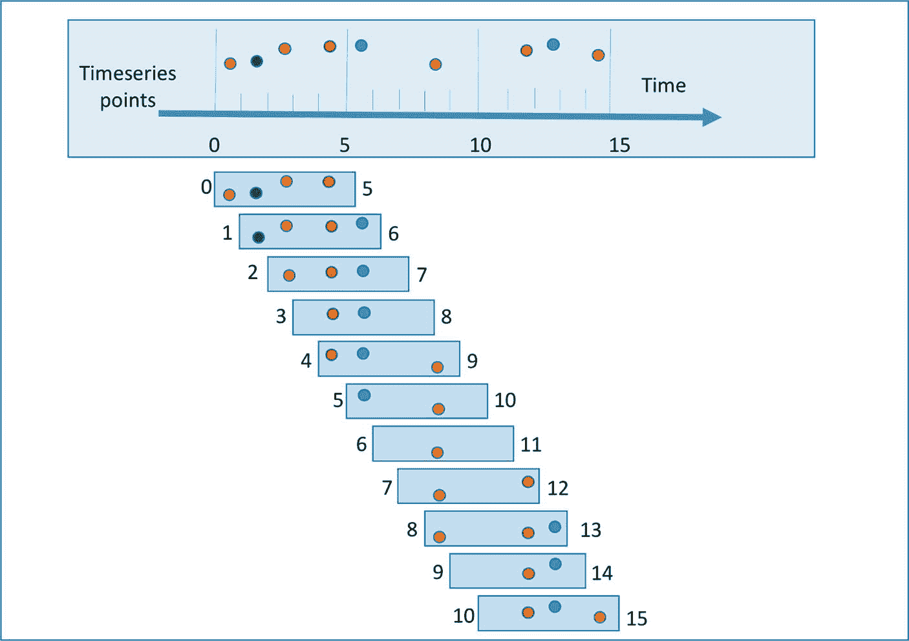

图表展示了一个时间序列，其数据点随时间绘制，标记为 0 到 15。顶部部分显示了一个由彩色点组成的线性序列，代表数据点。下方，一系列重叠的矩形展示了这些点的子集，每个矩形都标有从 0 到 15 的范围，演示了滑动窗口方法。这些矩形每次移动一个位置，突出了数据分析随时间推移的进展。

图 1-11

滑动窗口

以下是时间序列数据的一些典型来源。

*   加速度计和陀螺仪，用于检测运动或振动模式

*   电流和电压，用于分类设备运行模式（例如，空闲、轻载或重载）

*   大气传感器（温度、湿度、气压），用于预测下一个小时是否会下雪

*   大脑和肌肉电信号（EEG 和 ECG），用于远程控制设备

时间序列的特征工程通常包括从时域窗口中提取统计值，例如以下内容。

*   最小值/最大值/平均值

*   方差/偏度/峰度

*   高于/低于均值的值的计数

*   过零点

*   频域（傅里叶变换）

这些步骤不仅是降低数据维度（这本身可能就是一个问题）所必需的，也是为了对输入进行`去噪`并提高其信息含量。请记住，时间序列中的每个样本本身包含的信息很少：将许多样本打包在一起并不会线性地累加信息。

第 4 章使用 Edge Impulse 低代码平台和频域特征来处理时间序列分类。第 5 章讨论使用纯 Python 和时域描述符进行时间序列分类。

#### 音频

音频是一种特殊的时间序列数据。在嵌入式世界中，它以相当标准的采样频率（8、16 或 20 kHz）和幅度（表示为有符号 16 位整数，范围从 –32768 到 +32767）工作。在这些高频率下，在时域中提取特征变得困难，即使可以，它们也可能不是最合适的解决方案。

我们使用一种称为`梅尔频谱图`的频域特征的自定义版本来处理音频分类。这种变换将音频数据从时域映射到时频域。在这个新域中，你可以计算特定的特征，这些特征将成为分类模型的输入。考虑到所需的计算量和（近乎）实时的执行约束，已经开发出优化的算法来及时执行傅里叶变换，并且许多硬件供应商甚至为此引入了硬件加速。

第 6 章使用 Edge Impulse 低代码平台实现口语单词分类。

#### 图像与空间数据

图像是一种特殊的空间数据，在 XYZ 空间中具有内在的排列方式。它们是由像素组成的网格，按行和列排列，每个像素的值与其位置同等重要。每个像素都与其相邻像素严格相关：如果沿着行或列随机重新排列像素，原始图像将被完全破坏（这与重新排列时间序列的效果相同）。然而，空间数据并不仅限于相机图像。在嵌入式环境中，还存在一些常见的其他例子。

### 热成像相机
这种传感器感知与物体温度严格相关的红外光。根据传感器的不同，分辨率可以是 8×8、32×24 或 160×120。在这种情况下，每个像素的值代表估计的温度。

### 飞行时间阵列
飞行时间是一种通过测量光线从物体反弹并返回光源所需时间来检测距离的技术。借助专用硬件（称为 `SPAD` 阵列），您可以一次性测量 3D 空间中多个点的距离。分辨率仍然有限，最常见的传感器可实现 4×4 或 8×8 的输出。

无论像素代表什么（光强度、温度或距离），空间数据都可以利用专门为图像开发的一类算法。只要您的数据*看起来像*图像（值被限定在特定范围内，例如 0–1 或 0–255），无论像素代表什么，这些算法都应该能正常工作。

显而易见，“视觉”相机的分辨率远高于上述替代方案（某些微控制器可达 5 MP）。因此，图像携带的信息比 8×8 `SPAD` 阵列的输出多得多。处理如此大量的数据可能需要大量的时间和资源。考虑到我们对嵌入式硬件的定义（2 MB 闪存和 2 MB RAM），图像分析必须限制在低分辨率图像上（96×96 是精度与资源消耗之间的良好折衷）。此外，只有一部分可用模型能够满足我们的硬件限制。在桌面硬件上常用的高级深度学习模型（例如 `YOLO` 架构[3]）在其默认的完整形式下并不适用。

第 7 章解释了目标检测过程：如何识别图像中感兴趣的目标。

作为本书的结尾，第 8 章通过动手实践、面向代码的方式介绍了 `TensorFlow` 框架[4]，探讨了嵌入式设备的人工神经网络领域。您将学习四种常见的网络拓扑结构，以及如何在 `Python`（用于训练）和 `Arduino`（用于推理）中使用它们。

## 总结

本章介绍了机器学习的一般核心思想，以及使 TinyML 成为一个独特、独立细分领域的区别点。您了解了 TinyML 的应用行业、用例以及它目前仍无法实现的功能。最后，您了解了机器学习的技术术语和概念，以便在本书后续内容中不会迷失方向，并熟悉了您将处理的数据类型。

下一章将从分类表格数据开始，这是最简单的数据类型，因为其行之间相互独立。