# 2. 表格数据分类

*表格数据*是指结构化和组织成行和列的数据，类似于电子表格。表格数据分类的任务是接收单一行中列的数据输入，并判断该行属于哪个类别。

行的顺序并不重要，因为每一行都是独立的，与其他行隔离。表格数据的特征工程可以一次考虑单一行（行级特征工程），也可以同时考虑所有行（数据集级特征工程）。

本章复现了 Arduino 博客[1]中的水果分类项目，该项目基于水果的颜色分量进行检测（见图 2-1）。然而，我们不会使用 TensorFlow 或神经网络。本章、第 3 章和第 5 章旨在使用*传统*机器学习，而不是深度学习（TensorFlow 等）。生成的模型几乎可以在任何微控制器上运行，甚至是 8 位微控制器（例如 ATMega 或 Attiny 系列），仅需 10–20 KB 的 RAM（取决于模型大小）。


一个人手持一个微芯片靠近白色桌子上一个红苹果。电脑屏幕显示文字：“根据 RGB 分量对水果进行分类。我认为这是苹果”重复三次。背景中有一个装有铅笔的罐子。

图 2-1

第 2 章项目结果演示

让我们按照以下步骤完成项目。

1.  使用微控制器和外部传感器捕获数据。
2.  使用 Python 加载和检查数据。
3.  使用 Python 执行特征工程。
4.  使用 Python 训练分类模型。
5.  将模型转换为 C++并部署回微控制器。

每一步都会逐步介绍完成任务所需（或能简化任务）的理论和工具。不要跳过任何步骤；否则，您最终将无法获得正确的结果。相同的工作流程也适用于第 3 章和第 5 章。

## 所需硬件

由于我们要根据颜色对不同水果进行分类，因此需要一个颜色传感器。以下任一设置均可正常工作。

*   **Arduino Nano BLE Sense**，内置 APDS9960 传感器（见图 2-2）

    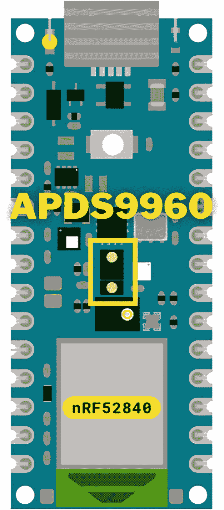

    微控制器板示意图，APDS9960 传感器以黄色高亮显示。该板包含各种电子元件和连接器。底部附近的一个芯片上可见文字“nRF52840”。

    图 2-2

    Arduino Nano BLE Sense

*   **任何带有外部 TCS3200 传感器的微控制器**（见图 2-3）。该传感器有四个控制引脚（S0/S1 用于频率缩放，S2/S3 用于颜色选择），需要连接到数字输出引脚，以及一个用于检测信号的输出引脚（使用`pulseIn`函数读取）。

    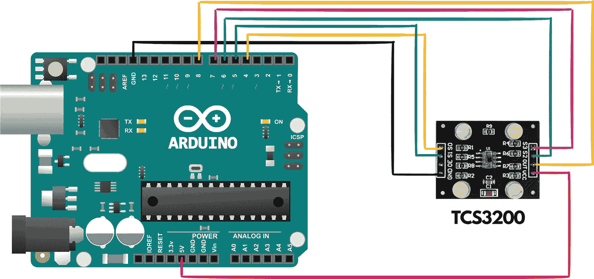

    图示显示了 Arduino 板与 TCS3200 颜色传感器之间的接线连接。Arduino 板在左侧，带有标记的引脚。彩色电线将 Arduino 上的特定引脚连接到右侧 TCS3200 传感器上的相应引脚。连接包括电源、地线和信号线，说明了如何将传感器与 Arduino 集成用于颜色检测项目。

    图 2-3

    TCS3200 颜色传感器接线图

如果您没有不同颜色的水果（例如香蕉、苹果、橙子），可以用任何有色物体代替。*确保每个物体具有清晰、独特的颜色（避免使用香蕉和柠檬）。*

## 所需软件

本项目（以及本书所有项目）的唯一严格要求是，您必须在 PC 上安装 Python 3.10 或更高版本以及 Arduino IDE（支持 Arduino 的 Platform IO 也可以）。

不过，我建议您执行一些可选步骤，以确保在本书后续内容中获得流畅的编程体验。


### 创建 Python 虚拟环境

我们将使用 Python 配合一些第三方包来执行机器学习任务。为了隔离代码和依赖项，我们需要创建一个 Python 虚拟环境。

在 Python 语境中，虚拟环境是一个隔离的、针对特定项目的 Python 解释器安装，以及该项目所需的所有附加库。由于你的电脑上可能在不同时间创建了许多 Python 项目，如果全局安装包（由于依赖项更新），可能会产生版本兼容性问题。为每个项目创建虚拟环境可以通过为不同项目使用不同版本来防止这些冲突。

虚拟环境只需创建一次。然后，要使用它，需要*激活*它。每次关闭终端时，环境会自动*停用*，下次想使用时必须重新激活。

要为本书创建虚拟环境，请在终端中进入一个专用文件夹，然后运行以下命令。

```
# 创建一个新的虚拟环境（仅运行一次）
$ python -m venv 
```

要激活环境（在根文件夹内），请根据你的设置运行以下命令之一。

```
# Windows 命令提示符
$ \Scripts\activate.bat
# Windows PowerShell
$ \Scripts\activate.ps1
# Linux/OS X
$ source /bin/activate
```

如果你希望虚拟环境命名为 *tinyml*，则上述命令对应如下。

```
$ python -m venv tinyml
# Windows 命令提示符
$ tinyml\Scripts\activate.bat
# Windows PowerShell
$ tinyml\Scripts\activate.ps1
# Linux/OS X
$ source tinyml/bin/activate
```

激活虚拟环境后，你就可以开始安装所需的包了。我为本书创建了一个配套包，名为 `tinyml4all`。要安装它，请在虚拟环境中执行以下命令。

```
(tinyml)$ python -m pip install tinyml4all
```

提示

如果 Python 命令无法识别，请尝试将其替换为 python3。

在运行本书中的 Python 代码示例时，请确保先激活你的虚拟环境；否则，你会遇到很多错误（大多数情况下是缺少依赖项）。

### tinyml4all Arduino 库

为了协助你在微控制器上运行任务，我创建了一个名为 `tinyml4all` 的配套 Arduino 库，你可以通过 Arduino 库管理器进行安装。虽然这完全是可选的，但我强烈建议你安装它。这样，你就可以直接运行本书中提供的草图，无需任何修改。图 2-4 显示了 Arduino 库管理器窗口中的正确库。

提示

要打开库管理器，请打开 Arduino IDE，然后导航到 项目 ➤ 加载库 ➤ 管理库。

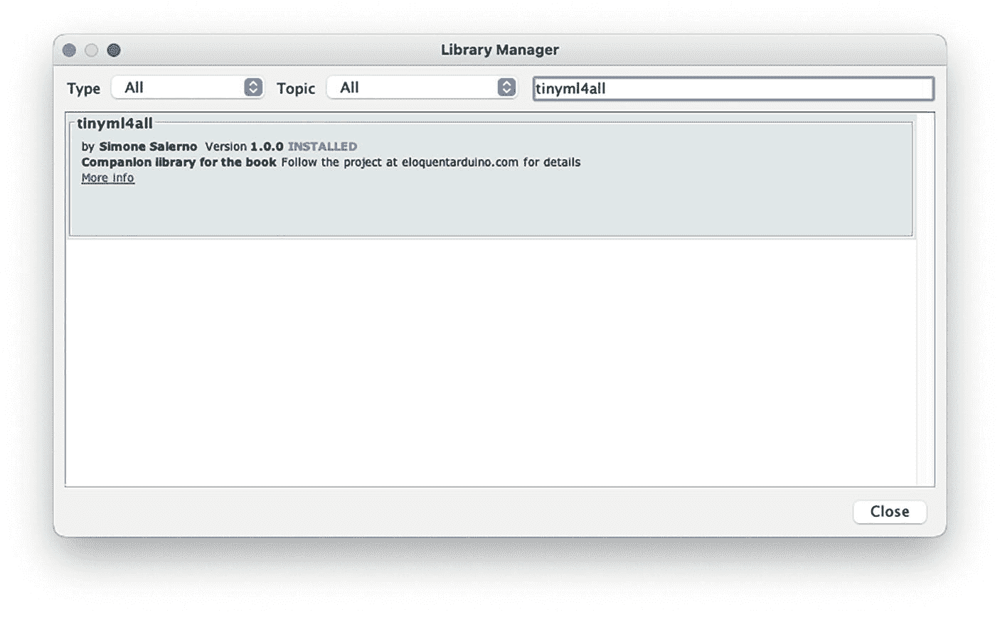

该图片显示了一个软件应用的库管理器窗口。搜索栏中包含术语 "tinyml4all"。下方列出了由 Simone Salerno 编写的名为 "tinyml4all" 的库，版本 1.0.0 标记为已安装。描述中提到它是某本书的配套库，并附有指向 eloquentarduino.com 的链接以获取更多详细信息。还有一个 "更多信息" 链接。窗口提供了类型和主题的筛选选项，均设置为 "全部"，右下角有一个 "关闭" 按钮。

图 2-4

从库管理器安装 tinyml4all Arduino 库

## 采集数据

任何机器学习项目的第一步都是收集数据。有时，你可能已经拥有数据（过去收集的或从互联网下载的）。其他时候，你需要从你的开发板和传感器中收集新数据。

收集高质量的数据是至关重要的一步。机器学习行业有句俗语：“垃圾进，垃圾出。”如果你的输入数据充满噪声、缺失且质量低下，那么模型的输出也会反映这种质量。因此，请尽一切努力收集尽可能最好的数据。通常，收集数据既耗时又昂贵。根据你的项目需求，你必须评估你为高质量输入数据赋予多少价值。不注意这一步可能会使所有后续处理失效，并阻碍获得成功的结果。

在为 Arduino 项目收集数据时，数据几乎肯定来自传感器。你需要保存这些数据并将其传输到你的电脑上。以下各节列举了一些方法。你的选择取决于你的开发板功能（它是否有 SD 卡插槽或 BLE/Wi-Fi 连接？）以及你将捕获的数据量（是快速会话，还是收集几分钟或几小时？）。如果你有其他偏好的方法，也可以使用它们。重要的是，你的电脑上有一个（或多个）包含所收集数据的文件。

在本项目的背景下，我们的数据是每个水果反射光的红、绿、蓝（RGB）分量。为了获得高质量的采集，请确保环境照明良好。你只需将颜色传感器指向水果，距离建议为 15–30 厘米（见图 2-5）。

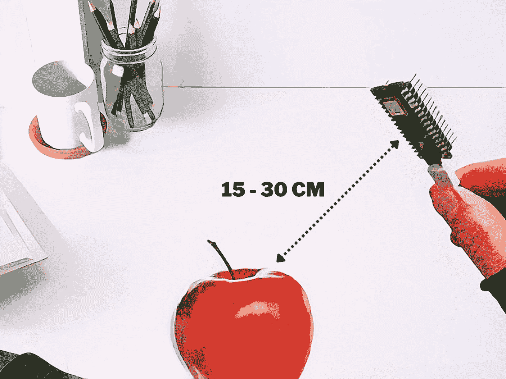

一只手拿着一个微芯片，放在白色桌面上的一个红苹果上方。一条带有文字 "15 - 30 CM" 的虚线表示芯片与苹果之间的距离。背景中有一个装有铅笔的罐子和一个白色杯子。

图 2-5

RGB 采集的示例设置


### 1\. 从串口监视器手动复制数据

听起来可能有些笨拙，但从微控制器获取数据最直接、最简单的方法，就是将其打印到串口监视器上，然后手动复制粘贴到电脑的文件中。对于快速原型项目，这无疑是上手最快的方式。

当然，在打印之前，你需要正确格式化数据，否则后续在 Python 中处理起来会很麻烦。如果你安装了 `tinyml4all` Arduino 库，这会相当简单。最适合 Python 导入和处理的格式是逗号分隔值（CSV）编码。这是一种基于文本的格式，将数据存储在行和列中。每行数据占据一行，每列之间用逗号分隔。

在本项目中，每行数据以一秒为间隔，存储来自颜色传感器的红色、绿色和蓝色光分量。根据你使用的颜色传感器类型（内置 APDS9960 的 Arduino Nano BLE Sense 或外置 TCS3200），实例化传感器的代码会略有不同。除此之外，其余代码在两种情况下完全相同。如果使用 Arduino Nano BLE Sense 板，请创建一个新的 Arduino 项目，并从代码清单 2-1 复制粘贴代码。

```
/**
* 代码清单 2-1
* 根据用户提示，以 CSV 格式收集 RGB 数据。
*
* 所需硬件：Arduino Nano BLE Sense。
*/
#include 
#include 
using tinyml4all::promptString;
using tinyml4all::promptInt;
using tinyml4all::printCSV;
tinyml4all::APDS9960 sensor;
void setup() {
Serial.begin(115200);
while (!Serial);
Serial.println("以 CSV 格式收集 RGB 值");
// 初始化传感器（如果失败将抛出错误）
sensor.begin();
}
void loop() {
// 从用户获取水果名称和样本数量
String fruit   = promptString("这是什么水果？");
int numSamples = promptInt("要采集多少个样本？");
for (int i = 0; i < numSamples; i++) {
// 读取传感器值并以 CSV 格式打印
sensor.readColor();
printCSV(sensor.r, sensor.g, sensor.b, fruit);
delay(1000);
}
}
代码清单 2-1
通过用户提示从 APDS9960 传感器采集颜色读数
```

注意

如果你使用的是外置 TCS3200 传感器，请参考本书的代码仓库。

将程序上传到你的开发板，并打开串口监视器。选择一个水果，将开发板指向距离它 15–30 厘米的位置，在提示时输入水果名称；然后输入样本数量 50。CSV 行会每隔一秒出现一次（见图 2-6）。

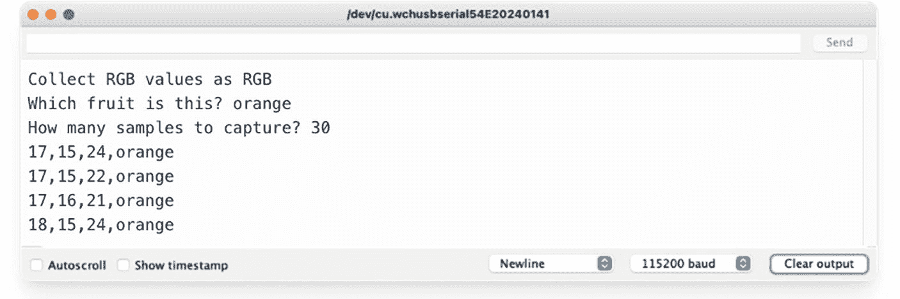

一个终端窗口显示用于收集 RGB 值的脚本。它将水果识别为“orange”，并指定采集 30 个样本。输出显示多个与标签“orange”关联的 RGB 值，例如 17,15,24 和 18,15,24。界面包含“自动滚动”、“显示时间戳”等选项，以及“换行符”和“115200 波特率”的设置。

图 2-6

水果数据收集的串口输出

为了收集高质量且鲁棒的数据，在采集过程中可以稍微移动传感器——靠近一些，再远离一些，然后向左，再向右（同时保持指向水果的方向）——以在数据中创造一些变化（见图 2-7）。对你将要识别的每种水果重复相同的过程。建议每种水果收集 30-50 个样本。

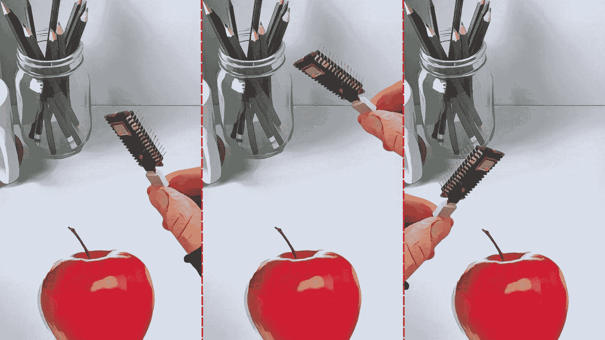

一张三联图显示一只手握着一块电脑芯片，放在一个笔筒前。左图显示芯片靠近笔筒，中图显示芯片更近，右图显示芯片在一个红苹果上方。背景是浅色表面。

图 2-7

从不同角度收集 RGB 值

完成后，将串口监视器中的内容复制到 Python 项目文件夹中一个名为 `fruits.csv` 的文件里。

为了使其成为一个*规范的* CSV 文件，你需要删除所有不包含数据的行（“这是什么水果？”和“要采集多少个样本？”），并添加一行包含列名的标题，说明每列代表什么。在本项目中，前三个值代表光的红色、绿色和蓝色分量，第四个值是水果名称，因此我们在文件开头添加一行内容 `r, g, b, fruit`。

```
# fruits.csv 文件摘录
r,g,b,fruit
17,12,9,banana
17,13,8,banana
16,13,9,banana
18,10,10,banana
38,23,18,orange
40,22,18,orange
49,25,19,orange
65,31,22,orange
54,25,18,orange
```


### 2\. 通过 Python 读取串口输出

当数据量较小时，手动从串口监视器复制粘贴数据尚可接受。但如果数据生成速率高、属性众多，或需要长时间采集，使用 Python 脚本自动读取微控制器的串口输出并保存到文件，会比手动操作更实用。

清单 2-2 中的 Arduino 代码已更新，可在无需人工干预的情况下持续读取并打印数值到串口输出。提示功能由 Python 端处理。

```
/**
* 清单 2-2
* 以 CSV 格式采集 RGB 数据，无需用户提示。
*
* 所需硬件：Arduino Nano BLE Sense。
*/
#include 
#include 
using tinyml4all::promptString;
using tinyml4all::promptInt;
using tinyml4all::printCSV;
tinyml4all::APDS9960 sensor;
void setup() {
Serial.begin(115200);
while (!Serial);
Serial.println("以 CSV 格式采集水果颜色");
// 初始化传感器（若失败将抛出错误）
sensor.begin();
}
void loop() {
// 读取传感器数值并以 CSV 格式打印
// 无需用户干预
sensor.readColor();
printCSV(sensor.r, sensor.g, sensor.b);
delay(1000);
}
清单 2-2
无需用户提示即可从 APDS9960 传感器采集颜色读数
```

在项目文件夹内创建一个名为 `capture_colors.py` 的新 Python 脚本，内容来自清单 2-3。该脚本会要求你输入水果名称和要采集的样本数量，随后通过串口自动开始采集。完成后，将水果名称留空即可退出。

注意

务必用你自己的值替换脚本中高亮显示的值！

```
from tinyml4all.tabular import capture_serial
while True:
# 提示用户输入水果名称和样本数量
fruit = input("这是什么水果？ ")
num_samples = input("要采集多少个样本？ ")
# 如果水果名称或样本数量为空则退出
if not fruit or not num_samples:
break
# 开始采集
# 将连接到串口并读取数据
capture_serial(
# 开发板串口
# * 为通配符匹配
# 在 Windows 上，这看起来像 COM1 或类似名称
port="/dev/cu.usb*",  #
# 必须与 Arduino 草图匹配
baudrate=115200,
# 输出文件存储路径
save_to="fruits.csv",
# 要保存的列列表
headings="r, g, b, fruit",,
# 开发板仅发送 r, g, b
# 因此我们手动附加水果名称
append_values=[fruit],
num_samples=int(num_samples)
)
清单 2-3
在 Python 中从串口采集数据
```

要运行代码，请在脚本所在文件夹中打开终端并执行以下命令。（**记得先激活虚拟环境！**）

```
(tinyml)$ python capture_colors.py
这是什么水果？ banana
要采集多少个样本？ 30
已连接到串口
100%|██████████| 30/30 [00:30<00:00,  1.01s/it]
已断开串口连接
```

对每个要分类的水果重复此过程。完成后，打开 `fruits.csv` 文件，你会看到类似以下内容。

```
# fruits.csv 文件摘录
r,g,b,fruit
38,23,18,banana
40,22,18,banana
49,25,19,banana
65,31,22,banana
54,25,18,banana
```

提示

如果读取串口时出现错误，请确保你输入了正确的端口名称，并且没有同时打开 Arduino IDE 的串口监视器！如果已打开，请关闭它并重新运行 Python 脚本。

### 3\. 保存到 SD 卡

如果你不希望开发板与电脑之间有连线，或者开发板不易触及，可以将数据存储到 SD 卡上。并非所有开发板都配备 SD 卡槽，购买新开发板时请考虑这一点。否则，你可以通过 SPI 引脚连接外部 SD 卡读卡器。清单 2-4 是一个将 Arduino Nano BLE Sense 的 RGB 读数存储到外部 SD 卡读卡器的草图。许多 SD 卡读卡器需要连接到开发板的默认 SPI 引脚（请查阅开发板数据手册）以及一个额外的引脚（称为 CS），该引脚可连接到您选择的任意引脚。该值必须在清单 2-4 中进行配置才能正常工作。

注意

用你自己的值替换粗体显示的值！

```
/**
* 清单 2-4
* 以 CSV 格式采集 RGB 数据并存储到 SD 卡。
*
* 所需硬件：Arduino Nano BLE Sense。
* 所需硬件：SPI SD 卡读卡器
*/
#include 
#include 
#include 
#include 
tinyml4all::APDS9960 sensor;
tinyml4all::SDCard card;
// 替换为正确的引脚！
// 请查阅 SD 卡读卡器模块数据手册以找到此值
const uint8_t CS_PIN = 4;
void setup() {
Serial.begin(115200);
while (!Serial);
Serial.println("以 CSV 格式采集水果颜色并存储到 SD 卡");
// 初始化传感器和 SD 卡
// 然后打开文件进行写入
// 如果出错将抛出异常
sensor.begin();
card.begin(CS_PIN);
card.writing("fruits.csv");
}
void loop() {
// 读取传感器数值并以 CSV 格式打印
sensor.readColor();
card.println(sensor.r, sensor.g, sensor.b);
delay(1000);
}
清单 2-4
将颜色读数保存到 SD 卡
```

现在，你可以使用充电宝（图 2-8）或电池为开发板供电，无需连线即可采集数据。由于无法与开发板交互，我们只采集一个包含 RGB 分量的单一文件，不包含水果名称。为每种水果采集几秒钟数据，然后以某种方式标记该水果会话的结束（例如，将手放在传感器前，使其所有分量读数都非常低），再切换到下一种水果。


一个整洁的工作空间，白色桌面上有键盘、杯垫上的马克杯和一罐铅笔。右侧，一个带有电子元件的面包板通过白色电缆连接到外部硬盘。

图 2-8

外部 SD 卡读卡器设置

提示

如果从开发板上电到将传感器对准水果之间存在延迟，请删除前几行数据。最后几行也做同样处理。

完成后，将文件从 SD 卡移动到项目文件夹。你必须为每一行数据分配正确的水果名称。一种方法是在 Excel 中打开文件，手动添加一个 `fruit` 列（使用拖拽选项批量编辑单元格），并删除无关的行（所有分量值都很低的行）。

另一种方法是为每种水果创建一个文件：将属于同一种水果的所有行复制粘贴到各自的 CSV 文件中。（建议你创建一个专用文件夹来存放它们。）

注意

记得为每个文件添加表头！

最终，你的文件夹结构应类似于以下内容。

```
|- 你的项目
|- capture_colors.py
|- fruits
|- apple.csv
|- banana.csv
|- orange.csv
```

无论你选择哪种方法，在完成每种水果的数据处理流程后，你应该会得到一个单一的 `fruits.csv` 文件（包含 R、G、B 和 fruit 列），或者一组独立的 CSV 文件（每种水果一个，包含 R、G、B 列）。


## 加载与检查数据

我们小型机器学习工作流程的下一步是加载并检查数据。切勿低估可视化检查的价值，因为你是判断数据是否为垃圾的第一道哨兵。在对数据一无所知的情况下盲目运行机器学习算法，轻则性能不佳，重则徒劳无功。

下一节列出了在 Python 脚本中加载数据的一些方法，涵盖了数据按两种可能布局组织的情况。

*   每个类别一个 CSV 文件，存储在同一文件夹中
*   一个包含所有数据和标签的文件

在 `tinyml4all` 包中，每种数据类型都有一个专门的类负责加载和操作：对于表格数据，该类名为 `Table`。

注意

无论文件如何存储，每个 CSV 文件的第一行都必须是列标题！

### 每个类别一个文件

在此场景中，文件仅包含观测值（RGB 光值），但不包含标签。标签隐式编码在文件名中。使用清单 2-5 加载以此格式组织的数据。

|   | r | g | b |
| --- | --- | --- | --- |
| **count** | 150 | 150 | 150 |
| **mean** | 33.3 | 19.9 | 16.9 |
| **std** | 12.24 | 5.6 | 3.86 |
| **min** | 12 | 8 | 8 |
| **25%** | 22 | 16.25 | 15 |
| **50%** | 33 | 19 | 17 |
| **75%** | 42.5 | 23 | 19 |
| **max** | 65 | 59 | 46 |

```
# 打印表格的若干统计指标
print(table.describe())
```

|   | r | g | b | __target_name__ |
| --- | --- | --- | --- | --- |
| **0** | 38 | 23 | 18 | orange |
| **1** | 40 | 22 | 18 | orange |
| **2** | 49 | 25 | 19 | orange |
| **3** | 65 | 31 | 22 | orange |
| **4** | 54 | 25 | 18 | orange |

```
from tinyml4all.tabular.classification import Table
table = Table.read_csv_folder("fruits")
# 打印表格的前几行
print(table.head())
清单 2-5
从文件夹加载所有 CSV 文件
```

上表对应一个包含三个文件的数据集，每个文件有 50 行（因此 count = 150）。这是数据分布的快速摘要。

提示

如果遇到 FileNotFound 错误或类似问题，请确保文件夹路径正确且包含有效的 CSV 文件。

### 所有类别一个文件

如果数据打包在单个文件中，请参考清单 2-6。

在这种情况下，你必须手动指定哪一列包含真实标签。

|   | r | g | b |
| --- | --- | --- | --- |
| **count** | 150 | 150 | 150 |
| **mean** | 33.3 | 19.9 | 16.9 |
| **std** | 12.24 | 5.6 | 3.86 |
| **min** | 12 | 8 | 8 |
| **25%** | 22 | 16.25 | 15 |
| **50%** | 33 | 19 | 17 |
| **75%** | 42.5 | 23 | 19 |
| **max** | 65 | 59 | 46 |

```
from tinyml4all.tabular.classification import Table
table = Table.read_csv("fruits.csv")
# 指定包含标签的列
table.set_targets(column="fruit")
清单 2-6
加载单个 CSV 文件
```

结果与之前相同。

### 操作表格

如果你曾使用过 `pandas` Python 包 [2]，你会注意到 `table` 对象看起来像一个 `DataFrame`。你的直觉没错，因为 `Table` 类模仿了该 API，同时为机器学习添加了新功能。对于从未使用过 `pandas` 的用户，以下是在 `Table` 实例上可以执行的最常见操作列表。

#### 选择单列

通常，你的数据包含多列（在我们的项目中为 `r, g, b`）。如果你想从表格中访问单列，可以使用方括号表示法（参见清单 2-7）。

```
red = table["r"]
# red 是一个 pandas.Series 对象
red
0      38
1      40
2      49
3      65
4      54
清单 2-7
从表格中提取单列
```

#### 选择列子集

与选择单列类似，你也可以同时选择多列来创建一个子集表格（参见清单 2-8）。

```
table2 = table[["r", "g"]]
r   g
0  38  23
1  40  22
2  49  25
3  65  31
4  54  25
清单 2-8
使用列子集创建新表格
```

#### 选择行子集

除了选择列子集，你也可以根据索引选择行子集（参见清单 2-9）。

```
# 获取单行
row = table[0]
{'r': 38, 'g': 23, 'b': 18, '__target__': 'orange'}
# 获取第 10 到 30 行
table2 = table[10:30]
r   g   b
0  40  22  18
1  49  25  19
2  65  31  22
3  54  25  18
...
19  45 23  15
清单 2-9
使用行子集创建新表格
```

#### 访问底层 DataFrame

如果你熟悉 `pandas` 并希望直接访问 `table` 对象内部封装的 `DataFrame`，可以通过访问其 `df` 属性来实现（参见清单 2-10）。

```
df = table.df
清单 2-10
访问底层 DataFrame 对象
```

注意

返回的 DataFrame 是只读的！修改它不会改变 table 实例。

#### 应用标签

你的数据集必须始终有标签才能进行分类。如果你将每个类别的数据保存在不同的文件中，标签会编码在文件名中。如果你有一个包含所有类别观测值的单个文件，则应有一列指定每行的标签。如果没有这一列，你*必须*手动添加标签。

没有脚本能自动为你完成此操作。你必须手动执行此任务。加速此过程的唯一方法（而不是逐行输入正确标签）是如果你的行已按标签排序。如果你知道从 `a` 到 `b` 的行共享同一标签，可以参考清单 2-11 批量编辑标签。

```
# 在第 0 到 29 行上设置 "orange" 标签
table.set_targets(label="orange", rows=(0, 29))
# 在第 30 到 59 行上设置 "banana" 标签
table.set_targets(label="banana", rows=(30, 59))
清单 2-11
基于行索引设置表格标签
```

### 绘制数据

为了可视化检查数据，你可以绘制图表。这有助于你快速概览数据。别忘了，在这个早期步骤中，你的任务是发现低质量输入的迹象（缺失值、异常值或明显错误的数据）。

可视化检查数据是一项至关重要的实践，绝不应被低估。务必记住，机器学习并非黑魔法；它只能区分数据集中真实存在的模式。如果在绘制数据时你无法凭肉眼区分不同类别之间的差异，那么机器学习模型很可能也难以做到——无论模型多么复杂。表格数据有两种主要的绘图类型。

*   **降维数据的散点图**：除非你的数据恰好有两个特征（这非常罕见），否则此类图会将数据的 `n` 列压缩为两个分量，并在二维散点图上绘制。
*   **配对图**：它生成一个“二元”散点图矩阵，其中每个图仅考虑 `n` 个特征中的两个。


#### 二维散点图

你的数据由多个列组成，通常超过两列。如何在二维图上绘制这么多维度呢？一个显而易见的解决方案是任意选择其中两列进行绘制，忽略其他列。当然，这会丢弃原始数据中确实存在的许多信息，所以我们希望有更好的解决方案。而确实存在这样的方案。

从高维空间到低维空间的转换称为*降维*。根据不同的使用场景，存在许多不同的算法来执行此任务，每种算法各有优缺点。

`tinyml4all` 库实现了一种名为 T-分布随机邻域嵌入（t-SNE）[3] 的算法，该算法非常适合可视化目的。你甚至无需为此操心，因为它会为你透明地处理（参见清单 2-12 和图 2-9）。

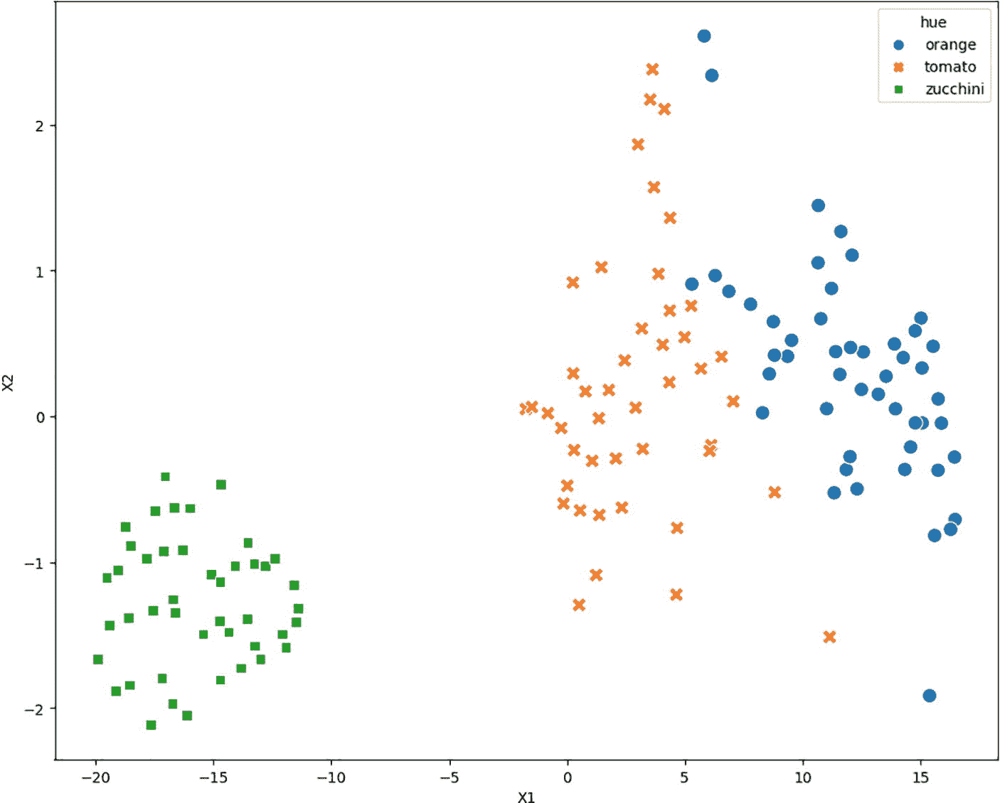

散点图显示了三个数据点簇，分别标记为 hue、orange、tomato 和 zucchini。x 轴标记为 X1，y 轴标记为 X2。蓝色圆圈代表 hue，在右侧形成一个簇。橙色叉号代表 tomato，在中心形成一个簇。绿色方块代表 zucchini，在左侧形成一个簇。

图 2-9
表格数据集的散点图

```
table.scatter()
清单 2-12
绘制整个表格的二维散点图
```

你可以看到不同水果的数据点聚类效果相当好。这是一个好迹象，表明我们的数据是可分离的，并且易于分类。

#### 配对图矩阵

配对图是一个散点图矩阵。配对图并非将所有维度压缩到两个，而是——顾名思义——选取特征对，仅绘制该对（参见图 2-10）。通过枚举每一对，配对图提供了数据的详细视图。自然而然地，随着散点图的数量随列数呈二次方增长，这种可视化在处理大型数据集时可能会变慢，并且难以适应屏幕。

尽管如此，从这种可视化中获得的价值是值得花费时间的。清单 2-13 展示了如何为表格数据集绘制配对图。

```
table.pairplot()
清单 2-13
绘制表格的配对图
```

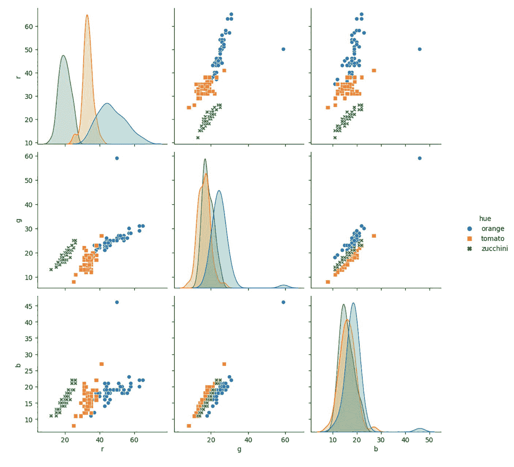

散点图矩阵显示了三个类别（orange、tomato 和 zucchini）的变量 r、g 和 b 之间的关系。每个类别由不同的标记表示：蓝色圆圈代表 orange，橙色方块代表 tomato，绿色叉号代表 zucchini。对角线图显示了每个变量的分布曲线。该图突出了类别之间的聚类和分布模式。

图 2-10
表格数据的配对图

表 2-1 总结了这两种图之间的差异。

表 2-1
散点图与配对图对比

|   | 优点 | 缺点 |
| --- | --- | --- |
| **散点图** | 提供整个数据集的快速概览；速度快 | 过程中可能会丢失大量信息，尤其是在高维数据中 |
| **配对图** | 覆盖所有特征；更容易发现类别边界 | 对于高维或大型数据集可能速度较慢 |

清单 2-14 总结了到目前为止你在表格数据加载和可视化方面所学到的内容。

```
from tinyml4all.tabular.classification import Table
# 从文件加载表格
table = Table.read_csv("fruits.csv")
# 从文件夹加载表格
table = Table.read_csv_folder("fruits")
# 从列设置标签
table.set_targets(column="fruit")
# 在行的子集上设置标签
table.set_targets(label="apple", rows=(0, 30))
# 选择单个列
red = table["r"]
# 选择列的子集
rg = table[["r", "g"]]
# 选择单行
row = table[0]
# 选择行的子集
first_10 = table[0:10]
# 绘制散点图
table.scatter()
# 绘制配对图
table.pairplot()
清单 2-14
表格数据操作总结
```

## 特征工程

表格数据的显著特征是每个样本完全独立于其他样本，因此可以单独且孤立地处理（与时间序列/音频数据中每个样本与其相邻样本在*时间上*相关，或图像中每个像素与其他像素在*空间上*相关的情况相比）。

然而，表格数据可以在同一个样本内对不同尺度的值进行分组。考虑一个收集温度、湿度和气压的气象站设备：温度范围可能从 –30°C 到 +50°C，相对湿度始终在 0–100 范围内（因为是百分比），而气压在海平面附近约为 100,000 帕斯卡。

对于某些分类器来说，尺度的差异可能无关紧要，但对于许多算法来说，所有值都处于同一数量级是强制性的。某些模型甚至可能要求值位于特定范围内（例如，[–1, +1] 或 [0, +1]）。

除了这种*特征缩放*操作之外，表格数据的特征工程步骤致力于转换输入数据，以便机器学习模型能够更好地捕捉底层模式。有许多可用的转换方法。本章涵盖了最常见的方法。你不会在单个项目中同时使用所有这些方法。你必须每次都运用自己的判断力，以理解哪种方法最适合你当前的数据集。

`tinyml4all` Python 包为此任务实现了几个不同的算子。为了使这篇介绍尽可能简洁易懂，我们现在只处理与本项目相关的算子。有关更多算子以及此处介绍的算子的更深入解释，请参阅附录 A。


## 特征缩放

特征缩放，有时也称为归一化，是一种将每个特征的值域映射到新值域的变换。你可能需要执行此操作，因为机器学习算法要求（或在相同尺度下的数据上表现更好），或者为了更容易比较不同尺度的特征（如气象站的例子）。

根据缩放因子的应用方式，不同形式的特征缩放可分为两类。

*   **基于实例的缩放**仅使用当前样本的数据来实现映射。

*   **基于总体的缩放**首先扫描整个数据集以计算一组统计量（例如，最小值、最大值、均值、标准差），然后使用这些统计量来缩放每个观测值。

最广泛使用的特征缩放策略可能是*最小-最大归一化*。顾名思义，这种归一化首先计算表格数据集中每一列的最小值和最大值。然后，根据以下最小-最大归一化公式，将每个样本的值映射到 [0, 1] 区间。

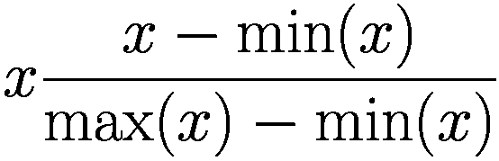

清单 2-15 展示了如何使用 `tinyml4all` 包对表格数据集应用最小-最大归一化。

|   | r | g | b |
| --- | --- | --- | --- |
| **count** | 150 | 150 | 150 |
| **mean** | 0.4019 | 0.2333 | 0.2344 |
| **std** | 0.231 | 0.1098 | 0.1016 |
| **min** | 0 | 0 | 0 |
| **25%** | 0.1887 | 0.1618 | 0.1842 |
| **50%** | 0.3962 | 0.2157 | 0.2368 |
| **75%** | 0.5755 | 0.2941 | 0.2895 |
| **max** | 1 | 1 | 1 |

```
from tinyml4all.tabular.features import Scale
minmax = Scale(method="minmax")
table 2 = minmax(table)
Listing 2-15
Apply Min-Max Normalization to Table
```

检查输出，你可以看到每一列现在都落在 [0, 1] 区间内（最小值和最大值行），无论它们原始的值域如何。

最小-最大归一化的缺点之一是它对*异常值敏感*。考虑以下值列表，其中 1000 是异常值。

```
0, 20, 21, 22, 23, 24, 25, 1000
```

经过最小-最大归一化后，列表变为

```
0, 0.02, 0.021, 0.022, 0.023, 0.024, 0.025, 1
```

即使大部分数据在值 20 附近浮动，异常值的存在也会导致感兴趣范围的“压缩”。如果没有异常值，归一化后的序列将会是：

```
0, 0.8, 0.84, 0.88, 0.92, 0.96, 1
```

它的扩散因子要高得多。因此，在应用最小-最大归一化之前，请注意异常值。

注意

最小-最大归一化对异常值敏感！

### 如何识别异常值

如何识别异常值？这就像查看表格摘要一样简单。观察每一列的值从最小值到最大值的变化情况。如果每两行之间的差值大致相同，那么你的数据是均匀分布的。但如果最小值与 25% 分位数或 75% 分位数与最大值之间的差值远大于平均值，那么你的列很可能包含异常值。

```
column_with_outliers
count            106.000000
mean              -0.249395
std                1.782681
min               -8.000000
25%               -0.972149  # 25% - min = 7 ← 异常值迹象
50%               -0.364116  # 50% - 25% = 0.6
75%                0.637160  # 75% - 50% = 1
max                7.000000  # max – 75% = 6.4 ← 异常值迹象
```

关于在存在异常值时应用的最佳特征缩放方法，请参考附录 A 中的*鲁棒缩放*。

| ‪ | ‪ | ‪ | ‪ |
| --- | --- | --- | --- |
| ‪ | ‪ | ‪ | ‪ |
| ‪ | ‪ | ‪ | ‪ |
| ‪ | ‪ | ‪ | ‪ |
| ‪ | ‪ | ‪ | ‪ |
| ‪ | ‪ | ‪ | ‪ |
| ‪ | ‪ | ‪ | ‪ |
| ‪ | ‪ | ‪ | ‪ |
| ‪ | ‪ | ‪ | ‪ |

| ‪ | ‪ | ‪ | ‪ |
| --- | --- | --- | --- |
| ‪ | ‪ | ‪ | ‪ |
| ‪ | ‪ | ‪ | ‪ |
| ‪ | ‪ | ‪ | ‪ |
| ‪ | ‪ | ‪ | ‪ |
| ‪ | ‪ | ‪ | ‪ |
| ‪ | ‪ | ‪ | ‪ |
| ‪ | ‪ | ‪ | ‪ |
| ‪ | ‪ | ‪ | ‪ |

| ‪ | ‪ | ‪ | ‪ |
| --- | --- | --- | --- |
| ‪ | ‪ | ‪ | ‪ |
| ‪ | ‪ | ‪ | ‪ |
| ‪ | ‪ | ‪ | ‪ |
| ‪ | ‪ | ‪ | ‪ |
| ‪ | ‪ | ‪ | ‪ |
| ‪ | ‪ | ‪ | ‪ |
| ‪ | ‪ | ‪ | ‪ |
| ‪ | ‪ | ‪ | ‪ |

| ‪ | ‪ | ‪ | ‪ |
| --- | --- | --- | --- |
| ‪ | ‪ | ‪ | ‪ |
| ‪ | ‪ | ‪ | ‪ |
| ‪ | ‪ | ‪ | ‪ |
| ‪ | ‪ | ‪ | ‪ |
| ‪ | ‪ | ‪ | ‪ |
| ‪ | ‪ | ‪ | ‪ |
| ‪ | ‪ | ‪ | ‪ |
| ‪ | ‪ | ‪ | ‪ |

| ‪ | ‪ | ‪ | ‪ |
| --- | --- | --- | --- |
| ‪ | ‪ | ‪ | ‪ |
| ‪ | ‪ | ‪ | ‪ |
| ‪ | ‪ | ‪ | ‪ |
| ‪ | ‪ | ‪ | ‪ |
| ‪ | ‪ | ‪ | ‪ |
| ‪ | ‪ | ‪ | ‪ |
| ‪ | ‪ | ‪ | ‪ |
| ‪ | ‪ | ‪ | ‪ |

图 2-11 用图表总结了迄今为止列举的特征缩放方法（加上附录 A 中的方法）的结果。

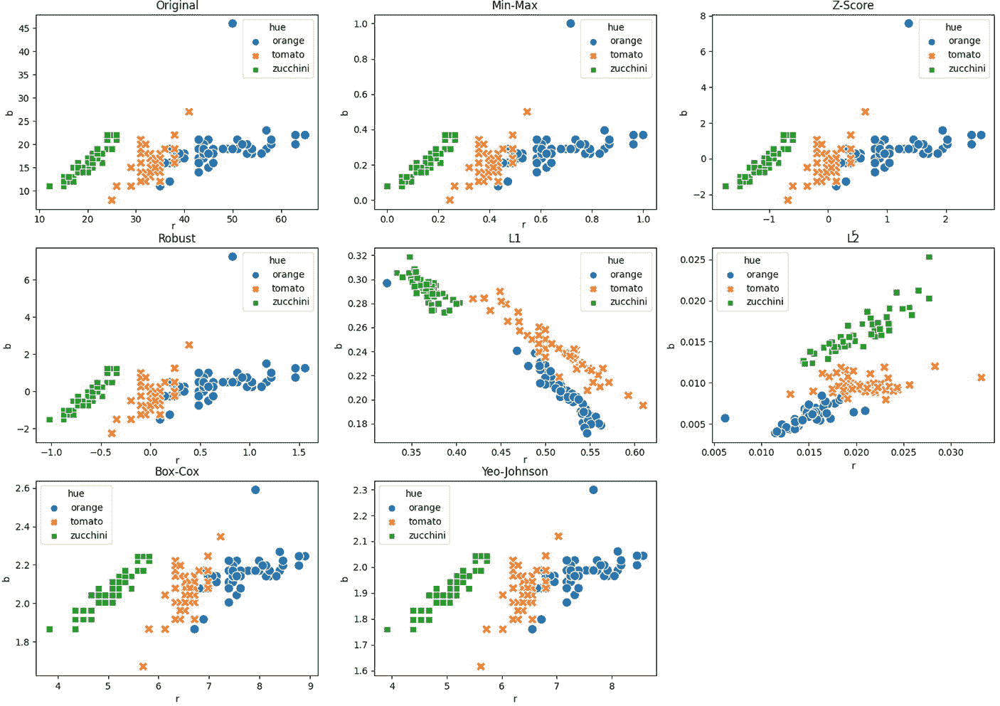

一个散点图网格，展示了三个类别（橙色、番茄和西葫芦）的数据变换。每个图代表一种不同的缩放方法：原始、最小-最大、Z-分数、鲁棒、L1、L2、Box-Cox 和 Yeo-Johnson。数据点按颜色编码：蓝色代表橙色，橙色代表番茄，绿色代表西葫芦。这些变换影响了数据的分布和尺度，坐标轴已相应标注。

图 2-11

特征缩放方法比较

有趣的是，最小-最大、Z-分数和鲁棒缩放不会改变数据的分布（因为它们是基于总体的线性方法）。

| ‪ | ‪ | ‪ | ‪ | ‪ | ‪ | ‪ |
| --- | --- | --- | --- | --- | --- | --- |
| ‪ | ‪ | ‪ | ‪ | ‪ | ‪ | ‪ |
| ‪ | ‪ | ‪ | ‪ | ‪ | ‪ | ‪ |
| ‪ | ‪ | ‪ | ‪ | ‪ | ‪ | ‪ |
| ‪ | ‪ | ‪ | ‪ | ‪ | ‪ | ‪ |
| ‪ | ‪ | ‪ | ‪ | ‪ | ‪ | ‪ |

| ‪ | ‪ | ‪ | ‪ |
| --- | --- | --- | --- |
| ‪ | ‪ | ‪ | ‪ |
| ‪ | ‪ | ‪ | ‪ |
| ‪ | ‪ | ‪ | ‪ |
| ‪ | ‪ | ‪ | ‪ |
| ‪ | ‪ | ‪ | ‪ |

## 特征选择

第 1 章介绍了特征选择的概念。让我们回顾一下它的目标。

*   防止维度灾难

*   丢弃高度相关（冗余）的特征

*   丢弃不能表征类别（无关）的特征

*   用最少的特征达到尽可能高的指标（例如，准确率、F1 分数、RMSE）

执行特征选择的最佳方法是从所有特征开始，然后迭代地一次移除一列。如果分类指标几乎保持不变，那么该特征就不太重要。重复此过程，直到无法保持指标不变，这将产生可能的最佳结果。

如果你有少量特征和一个小型数据集，这条路径可能是可行的。但这个过程通常可能耗时过长，你可能对更快、更近似的替代方案感兴趣。

由于本项目只涉及三个输入变量，特征选择在这里用处不大。由于它在后续章节中会派上用场，让我们快速列举一下可用的选项。


### 序列特征选择

这是一种穷举方法。它会尝试所有列的组合，最终达到最优结果。根据你想要保留的特征比例，可以逐个剔除特征，或者从一个空列表开始逐个添加特征（选择最能提升指标的那个），哪种方式更快就采用哪种。这由 `direction` 参数指定。使用这种特定方法，你可以手动选择要保留的结果特征数量，或者依赖自动选择机制为你找到最佳数量（参见代码清单 2-16）。

```
from tinyml4all.tabular.features import Select
# direction = forward 将从 0 个特征增长到 n 个特征
# direction = backward 将从 N 个特征缩减到 n 个特征
select = Select(sequential="auto", direction="forward")
table2 = select(table)
print(table2.head())
r
0  38
1  40
2  49
3  65
4  54
代码清单 2-16
应用序列特征选择
```

使用自动选择机制后发现，仅 Red 列就足以获得良好的分类结果。

### 基于分数的特征选择

一种更快的、无需分类器的特征剔除方法基于单变量统计检验。这些检验会为每一列生成一个分数；该分数代表该特征对于分类任务*看起来*有多重要。我使用了“*看起来*”这个术语，因为你无法确定该变量如何影响你之后将要使用的特定分类器，因此你依赖一种统计方法。在这种情况下，你必须手动选择要保留的列数。没有自动设置（参见代码清单 2-17）。

```
# 1 是要选择的列数
select = Select(univariate=1)
table2 = select(table)
print(table2.head())
r
0  38
1  40
2  49
3  65
4  54
代码清单 2-17
应用单变量特征选择
```

同样，单变量检验也选择了 Red 列。然而，并非每个数据集都如此。

### 递归特征消除 (RFE)

RFE 可以被看作是序列特征选择的一个更快版本。同样，它需要一个分类器来决定递归地剔除哪些特征。该分类器必须满足一个要求：它必须能生成特征重要性分数（并非所有分类器都能做到）。这个分数用于选择对分类结果贡献最小的列。这个过程会递归重复，直到达到所需的特征数量（代码清单 2-18）。

```
# 1 是要选择的列数
select = Select(rfe=1)
table2 = select(table)
print(table2.head())
r
0  38
1  40
2  49
3  65
4  54
代码清单 2-18
应用递归特征消除
```

表 2-2 列出了一些指导原则，你可以参考这些原则来决定在你的特定项目中使用上述哪种方法。

表 2-2

选择最佳特征选择方法的指导原则

|   | 优点 | 缺点 |
| --- | --- | --- |
| **单变量** | 快速；推荐在开发早期阶段使用 | 不能保证得到最优选择 |
| **递归** | 比序列方法快；可能收敛到最优解；在中等规模数据集上优于单变量方法 | 在大型数据集上，使用某些分类器时可能会变慢 |
| **序列** | 可能收敛到最优解 | 在大型数据集上，使用某些分类器时可能会变慢 |

注意

你也可以使用 `Select(include=["r", "b"])` 手动选择要保留的列，或使用 `Select(exclude=["g"])` 手动选择要剔除的列。

回到我们的水果分类项目：让我们考虑哪些特征工程方法看起来最合适。

*   只有三个特征，因此特征选择价值不大。
*   所有特征都是连续的，离散化意义不大。（我们可以选择应用分箱，但在这种情况下价值不大）。
*   特征缩放对某些分类器有益（并且没有任何异常值）。

基于这些要点，我们现在只实现最小-最大归一化（参见代码清单 2-19）。

```
from tinyml4all.tabular.classification import Table, Chain
from tinyml4all.tabular.features import Scale
table = Table.read_csv("fruits.csv")
# 使用 Chain 来容纳更多步骤的情况
optimal_chain = Chain(Scale(method="minmax"))
table2 = optimal_chain(table)
代码清单 2-19
为我们的水果数据集应用特征工程
```

## 分类模型

我们微型机器学习工作流程的下一步围绕分类模型展开。这一步训练一个算法来识别每种水果的独特特征。

如果你在特征工程步骤中做得很好，这部分应该会顺利进行。你应该能直接获得可接受的结果，你的重点是优化（即调优）你选择的模型参数，以将准确率/F1 分数最大化。某些模型可能需要比其他模型付出更多努力才能展现出良好结果。接下来，让我们讨论 `tinyml4all` 包中可用的分类器，重点介绍在你掌握每种分类器的优缺点并做出明智选择之前应该使用的那些。

以下是每种分类器的主要区别特征。

*   **对特征缩放的鲁棒性/不变性**：某些分类器（例如决策树）无论输入尺度如何都能对数据进行分类（因此可以跳过归一化）。其他分类器（例如逻辑回归）在特征共享相同尺度时效果更好。
*   **线性/非线性**：某些分类器仅适用于线性可分数据（例如线性 SVM），而其他分类器允许多项式或径向边界（例如带高斯核的 SVM）。还有一些是基于规则的（例如决策树）。
*   **内存需求**：由于我们的最终目标是将训练好的模型部署到资源受限的设备上，你应该始终记住，我们希望模型尽可能小且运行尽可能快。基于决策树的分类器运行非常快，并且几乎不需要 RAM（它们被编译成 *if-then-else* 块）。相比之下，其他分类器执行矩阵乘法来计算结果，这意味着它们必须在内存中存储一些权重。因此，它们的内存需求随输入特征数量线性增长（甚至更多）。

`tinyml4all` 包中的所有分类器共享相同的接口，因此你可以在不更改其余代码的情况下将一个分类器替换为另一个。

### 决策树

决策树（见图 2-12）可能是最直观的分类器。顾名思义，它创建了一个树形数据结构，逐步对数据集特征进行分割以做出决策。

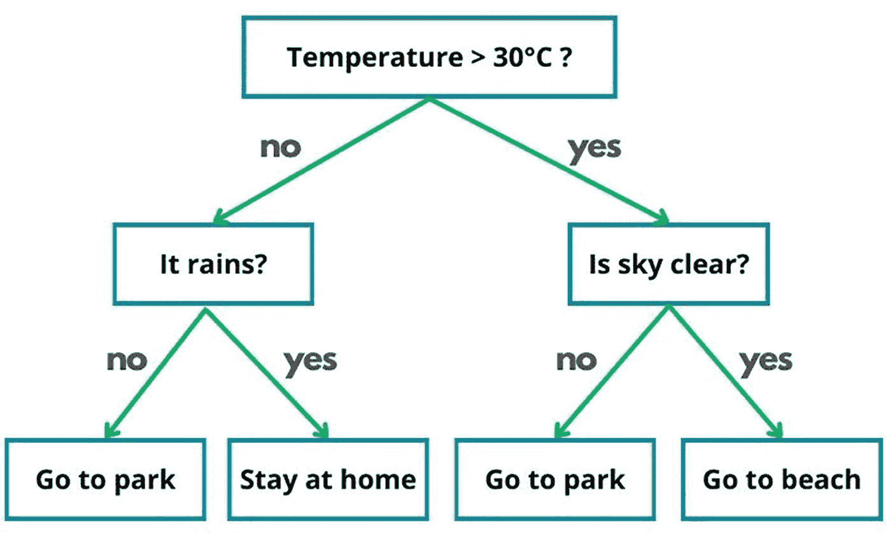

一个基于天气条件进行户外活动的决策树示意图。第一个决策点询问温度是否高于 30°C。如果否，则检查是否下雨；如果是，则建议待在家里，否则去公园。如果温度高于 30°C，则检查天空是否晴朗；如果是，则建议去海滩，否则去公园。

图 2-12

决策树分类器示例

在每一步，算法都必须选择在哪个特征和哪个值上进行分割。这个选择是如何做出的？它是基于信息增益原则进行的（你可以在 [4] 找到对这个概念的简单介绍）。通俗地说，分割发生在不同类别之间分离程度最大的地方：一个类别在分割后变得越聚集，信息含量增加得越多。


#### 优点

决策树因其具备一些理想特性而被广泛应用于许多任务中。

*   **易于理解和解释**：你可以直观地查看一棵树，并清楚理解它为何做出某个分类。

*   **所需数据准备工作少**：你无需进行归一化处理，它开箱即可处理非数值（类别型）数据。你可能只需要评估一下分箱处理是否能提升结果。

*   **内在的特征选择**：不重要的特征会被自动忽略，因为它们不会产生任何显著的信息增益。

*   **推理速度极快**：一旦部署到微控制器上，决策树就会转化为一系列简单的 `if-then-else` 语句，*无需*任何数学计算。

#### 缺点

当然，决策树并非适用于所有项目，因为它仍然存在以下缺点。

*   **容易过拟合**：学习到的模型可能过于复杂，从而过度拟合训练数据。通过参数调整（例如，限制树的深度）可以轻松缓解这个问题。

*   **不稳定性**：数据中的微小变化可能导致生成完全不同的树。

*   **无法保证最优性**：由于实际实现中会采用一些启发式方法来加速学习过程（否则耗时过长），因此最终得到的树可能并非最优解。

*   **难以学习某些概念**：这是因为决策树不易表达这些概念，例如 XOR（异或）、奇偶校验或多路复用问题。

*   **对不平衡数据集存在偏差**：如果某个类别占主导地位，决策树学习器会生成有偏见的树。建议在使用决策树进行拟合之前先平衡数据集。

### 随机森林

简单来说，*随机森林* [5] 是决策树的集成。随机森林不是训练单个决策树，而是训练许多不同的树，每棵树都在训练集的不同子样本上进行训练：这大大降低了过拟合的风险，并通常能提升集成的整体准确性。

除了在观测样本层面选择训练数据子集外，随机森林还应用了一种称为*特征袋装*的技术，该技术仅向每棵树提供特征的随机子集。这进一步防止了过拟合。因此，给定一个包含 `n` 个观测样本、每个样本有 `m` 个属性的输入数据集，每棵树接收到的输入是包含 `n`′ 个观测样本、每个样本有 `m`′ 个属性的数据，其中 `n`′`< n` 且 `m`′`< m`。

在推理时，每棵树预测自己的输出类别；获得最多投票的类别胜出，并被选为集成预测结果。

#### 优点

*   与决策树的优点相同

*   开箱即用，准确率很高：随机森林是最直接易用的分类器之一，因为它在几乎无需或只需很少调整的情况下就能表现良好。为树的数量设置一个合理的默认值（10–20 棵）就足够了。你始终可以调整内部决策树的参数（如最大深度、分裂逻辑等）以获得顶尖的准确率。

#### 缺点

*   与决策树的缺点相同

*   黑盒模型——与决策树相比，随机森林失去了可解释性，因为由于组合了众多树，你无法再理解它为何预测出某个特定输出。

提示

鉴于其开箱即用的良好准确率以及对许多特征工程预处理步骤不敏感，我建议你将随机森林作为默认分类器。

### 极限梯度提升

极限梯度提升（XGBoost）[6] 自 2014 年推出以来广受欢迎，因为它赢得了许多在线机器学习竞赛。首先，它是一种*梯度提升*技术：与随机森林类似，它结合了多个决策树。与随机森林（*并行*训练树，且每棵树相互独立）不同，梯度提升*串行*训练树。每棵树都基于前一棵树的结果进行训练：在每次迭代中，算法都试图减少损失函数（即模型在训练数据上的表现有多差）。

如何做到？通过从先前模型的错误中学习。XGBoost 的核心思想是级联地建模残差错误，以便最终纠正它们。“极限”一词在极限梯度提升中强调了多项软件优化，这些优化极大地提升了训练时间和预测准确率。

#### 优点

*   与随机森林的优点相同

*   对过拟合非常鲁棒

#### 缺点

*   与随机森林的缺点相同

*   比随机森林慢

### 逻辑回归

尽管名称如此，逻辑回归被用作一种二分类算法。其名称借用于线性回归，线性回归产生的线性模型形式如下面的线性回归输出公式所示。

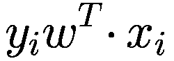

*x*[*i*] 是输入样本，*w* 是权重向量。这意味着输入样本中的每个值都乘以一个权重，然后累加结果。这会生成一个连续输出（如同回归一样）。

为了从回归过渡到分类，逻辑回归将逻辑函数应用于输出，使其值域变为 [0, 1]：在二分类情况下，该值表示当前样本属于正类的概率。图 2-13 展示了逻辑函数的图像。

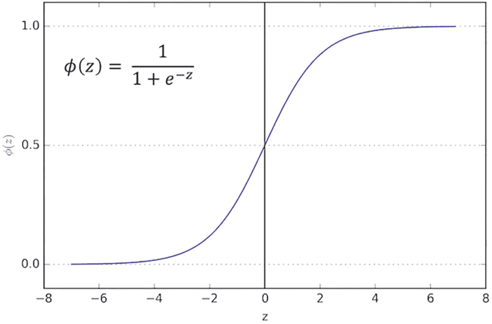

Sigmoid 函数 φ(z) = 1 / (1 + e^(-z)) 的图形，显示出一条 S 形曲线。曲线在 z 为负值时接近 0，在 z = 0 附近急剧上升，并在 z 为正值时趋近于 1。x 轴范围从 -8 到 8，y 轴范围从 0 到 1。

图 2-13

Logit 函数

逻辑回归训练阶段的目标是最小化分类误差，或者反过来说，最大化似然。

以下公式计算第 *i* 个样本属于正类的概率。

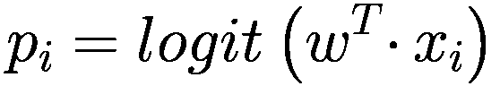

整个数据集的似然通过以下公式计算。

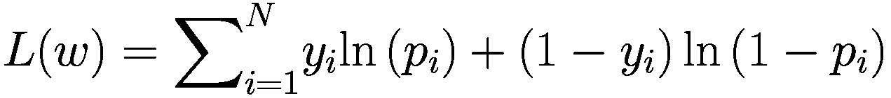

*y*[*i*] 是样本的真实标签（由于是二分类器，值为 0 或 1）。你可以通过以下直觉来理解该公式：

*   如果 *y*[*i*] 为 1 且 *p*[*i*] > 0.5，则似然增加（正确分类）。
*   如果 *y*[*i*] 为 0 且 *p*[*i*] < 0.5，则似然增加（正确分类）。
*   如果 *y*[*i*] 为 1 且 *p*[*i*] < 0.5，则似然减少（错误分类）。
*   如果 *y*[*i*] 为 0 且 *p*[*i*] > 0.5，则似然减少（错误分类）。

训练结束时，权重向量 *w* 使得全局似然达到最大值，或者说，我们得到了最高数量的正确分类。多分类情况遵循非常相似的模式，但其证明超出了本书的范围。

#### 优点

*   推理时间快（与特征数量呈线性关系）
*   预测类别归属的概率
*   权重系数可以指示某个特征对于类别归属的“重要性”

#### 缺点

*   对噪声和异常值敏感
*   权重的数量随输入数量线性增长
*   线性模型，因此最好对输入数据进行变换以提高准确率（应用幂、对数、平方根运算）
*   对相关输入敏感
*   可能无法收敛到 *w* 的最优值


### 支持向量机

支持向量机（SVM）是一种二分类算法，通过“一对一”投票机制可适用于多分类问题（参见第 1 章）。

SVM 的核心思想是在两个类别之间找到一个具有尽可能大间隔的分离边界，以提供稳健的分类。图 2-14 给出了直观的视觉呈现。

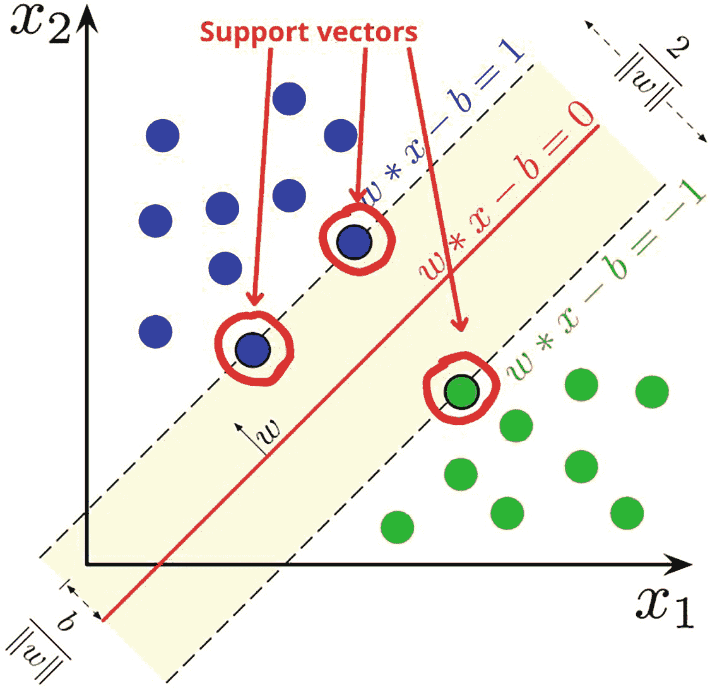

一张说明支持向量机（SVM）分类的示意图。图中显示了两组数据点（蓝色和绿色），它们被一条标记为 \(w \cdot x - b = 0\) 的红色决策边界线分隔。间隔区域由两条虚线标出，分别标记为 \(w \cdot x - b = 1\) 和 \(w \cdot x - b = -1\)。三个数据点（两个蓝色，一个绿色）被圈出并标记为支持向量。坐标轴标记为 \(x_1\) 和 \(x_2\)。间隔宽度表示为 \(\frac{2}{||w||}\)，从原点到决策边界的距离为 \(\frac{b}{||w||}\)。

图 2-14

SVM 分离间隔

该间隔仅由训练集中少数有意义的点计算得出：即*支持向量*。这些点是最难分类的，因为它们位于两个类别的边界上。

然而，在现实世界的数据中，通常很难找到两个类别之间的清晰分界线——很多时候这种分界线甚至根本不存在！为了解决这个问题，SVM 的主要思路是将原始数据投影到更高维度的空间中。例如，如果原始数据是一维的，可以将其投影到二维空间（见图 2-15）。

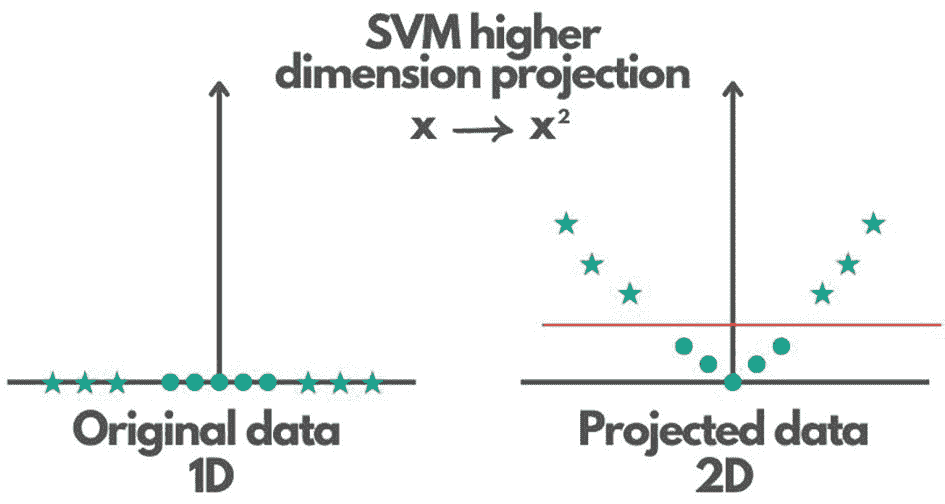

说明 SVM 高维投影的示意图。左侧的“原始数据 1D”显示了一组绿色星形和蓝色圆点沿水平轴线性排列。右侧的“投影数据 2D”展示了相同的数据被转换为抛物线形状，绿色星形和蓝色圆点被一条红线分隔。该变换标记为 \(x \rightarrow x²\)。

图 2-15

SVM 向高维空间的投影

其原理是，在这个新的高维空间中，两个类别更容易被清晰地分开。不同的函数可以实现这种投影，其中涉及的数学运算使用了*核技巧*，但这超出了本入门章节的讨论范围。

#### 优点

*   对高维数据有效
*   仅使用支持向量进行推理
*   对异常值具有鲁棒性

#### 缺点

*   训练时间随训练样本数量增加而扩展性不佳
*   在存在大量重叠类别时表现不佳
*   需要调整多个参数才能获得良好性能
*   仅适用于数值输入
*   黑盒模型
*   当有 `n` 个特征和 `k` 个支持向量时，需要存储在 RAM 中的权重数量为 `n * k`（`k` 的值越大，表示类别越难分离，每个类别至少有一个支持向量——通常更多）

表 2-3 总结了不同分类器类型的优缺点。

表 2-3

分类器对比

|   | 优点 | 缺点 |
| --- | --- | --- |
| **决策树** | 训练和执行速度快；对特征尺度不敏感；部署后内存效率高 | 在不平衡数据集中容易过拟合和产生偏差；可能表现出次优的准确率 |
| **随机森林** | 与决策树优点相同；开箱即用准确率更高 | 不可解释 |
| **XGBoost** | 与随机森林优点相同；可额外提升几个百分点的准确率 | 训练速度比随机森林慢 |
| **逻辑回归** | 推理时间和内存与特征数量呈线性关系 | 推理时间和内存与特征数量呈线性关系；线性模型；对异常值敏感 |
| **SVM** | 对高维数据有效；对异常值具有鲁棒性 | 在大数据集上训练缓慢；需要调整参数才能良好工作；推理时间和内存与特征数量呈超线性关系 |

既然已经列举了可用的分类器，接下来看看如何将它们应用于水果项目（见代码清单 2-20）。分类器在 API 上与特征工程步骤并无不同。

|   | r | g | b | 真实标签 | __ 预测标签 __ |
| --- | --- | --- | --- | --- | --- |
| **0** | 38 | 23 | 18 | orange | orange |
| **1** | 40 | 22 | 18 | orange | orange |
| **2** | 49 | 25 | 19 | orange | orange |
| **3** | 65 | 31 | 22 | orange | orange |
| **4** | 54 | 25 | 18 | orange | orange |

```
from tinyml4all.tabular.classification.models import DecisionTree, RandomForest, LogisticRegression, SVM
# 打印给定分类器可设置参数的描述
print(help(RandomForest))
# 训练分类器并进行预测
rf = RandomForest(n_estimators=20)
table2 = rf(table)
# table.full() 打印数据 + 真实标签 + 预测标签
print(table2.full())
代码清单 2-20
训练分类器并进行预测
```

为了快速检查分类器的整体表现，而无需逐行比较，你可以使用代码清单 2-21 中的代码生成一份分类报告。

```
print(table2.classification_report())
precision    recall  f1-score   support
orange       1.00      0.90      0.95        50
tomato       0.89      1.00      0.94        50
zucchini       1.00      0.98      0.99        50
accuracy                           0.96       150
macro avg       0.96      0.96      0.96       150
weighted avg       0.96      0.96      0.96       150
+-------------------+--------+-------+----------+
| 真实 vs. 预测      | orange | tomato | zucchini |
+-------------------+--------+-------+----------+
|       orange       |   45   |   5    |    0      |
|       tomato       |   0    |   50   |    0      |
|      zucchini      |   0    |   1    |    49     |
+-------------------+--------+--------+----------+
代码清单 2-21
生成分类报告
```

该报告包含每个类别的详细指标列表（精确率、召回率、F1 分数）、总体准确率以及混淆矩阵。你可以利用这些信息来判断分类器的性能，并比较不同分类器的结果。


## 分类链

到目前为止，你已经了解了如何在 Python 中独立处理每个组件来执行特征工程和分类。但这些步骤并非孤立存在：你必须始终按相同顺序执行它们，才能获得可重复的结果。如果需要，你可以手动完成这些操作，但为了让这一过程更易于管理，并能够将工作流导出到 C++，你需要创建一个*链*。

链的核心是一系列按顺序对数据执行的操作。每个操作产生的输出会作为输入传递给下一个操作，直到生成最终结果。`Chain` 类可以处理迄今为止描述的任何特征缩放、特征选择和分类操作。清单 2-22 展示了如何为水果数据集实例化一个完整的分类链。

|     | r     | g     | b     | truth  | prediction |
| --- | ----- | ----- | ----- | ------ | ---------- |
| **0** | 0,491 | 0,294 | 0,263 | orange | orange     |
| **1** | 0,528 | 0,275 | 0,263 | orange | orange     |
| **2** | 0,698 | 0,333 | 0,289 | orange | orange     |
| **3** | 1     | 0,451 | 0,368 | orange | orange     |
| **4** | 0,792 | 0,333 | 0,263 | orange | orange     |

```
from tinyml4all.tabular.classification import Table, Chain
from tinyml4all.tabular.classification.models import RandomForest
from tinyml4all.tabular.features import Scale
table = Table.read_csv("fruits.csv")
chain = Chain(
Scale("minmax"),
RandomForest()
)
classified = chain(table)
清单 2-22
为表格对象创建分类流水线
```

当你第一次在表格上调用链时，它会遍历每个步骤并对其进行拟合（以学习其内部参数）。在初始训练阶段之后，你可以将其应用于任何其他表格：此时，链会记住其参数。它仅对新表格应用相应的转换（参见清单 2-23）。

```
table1 = Table.read_csv("dataset_1.csv")
table2 = Table.read_csv("dataset_2.csv")
chain = Chain(
Scale("minmax"),
RandomForest()
)
# 在 table1 上训练链
chain(table1)
# 将链应用于 table2
# 这将使用在 table1 上学到的参数
# 例如，使用 table1 的最小值/最大值
table2_classified = chain(table2)
清单 2-23
将分类流水线应用于新数据集
```

## 部署到 Arduino

至此，机器学习工作流已完成。我们在强大的台式电脑上实现了特征工程和分类；分类器达到的准确率符合我们的预期。

这就是*微型*部分发挥作用的地方。最后一步是将我们的流水线转换为 C++，以便将代码导入到我们的嵌入式项目中。

清单 2-24 展示了如何执行此操作，并将结果保存到与 Python 脚本相同文件夹中名为 `FruitChain.h` 的文件中。

```
chain.convert_to("c++", class_name="FruitChain", save_to="FruitChain.h")
清单 2-24
将流水线从 Python 转换为 C++
```

生成的代码是一个独立的类，你可以将其导入到任何 C++ 项目（Arduino、PlatformIO、ESP-IDF 等）中。你实际上不需要深入了解其内部工作原理：只需一行代码即可调用它。这段代码在几乎所有支持 C++ 的微控制器（8 位或 32 位，带或不带浮点单元，来自 ARM、Atmel 或 Espressif）上都能同样良好地运行。

### 如何在 Arduino 草图中使用

我们现在拥有了完成水果分类项目所需的所有工具。配置和读取颜色传感器的代码与清单 2-2 相同。清单 2-25 添加了分类水果并将结果打印到串行监视器的逻辑。

```
/**
* 清单 2-25
* 根据 RGB 颜色分量预测水果。
*
* 所需硬件：Arduino Nano BLE Sense。
*/
#include 
#include 
// 将 Python 生成的文件放入 Arduino
// 草图文件夹中！
#include "./FruitChain.h"
tinyml4all::APDS9960 sensor;
tinyml4all::FruitChain chain;
void setup() {
Serial.begin(115200);
while (!Serial);
Serial.println("水果分类示例");
sensor.begin();
}
void loop() {
sensor.readColor();
// chain(input) 成功时返回 true
// 失败时返回 false
if (!chain(sensor.r, sensor.g, sensor.b))
return;
// 预测的人类可读标签位于
// chain.output.classification.label
// 数字输出（0, 1, 2, ...）位于
// chain.output.classification.idx
Serial.print("我认为这是 ");
Serial.println(chain.output.classification.label);
delay(1000);
}
清单 2-25
基于颜色对水果进行分类的 Arduino 草图
```

上传草图并打开串行监视器。你会看到开发板每秒进行一次分类。将不同的水果放在传感器前，观察结果相应更新（参见图 2-16）。


一只手拿着一个微芯片，靠近白色表面上的一个红苹果。一个电脑窗口显示文本："根据 RGB 分量对水果进行分类"，后面跟着重复三次的"我认为这是苹果"。背景中有一个装有铅笔的罐子。

图 2-16

根据 RGB 分量对水果进行实时分类

恭喜，你完成了第一个 TinyML 项目！

### 警告

我想提请你注意一个你可能忽略的细节。将你的颜色传感器对准水果以外的物体——比如墙壁或你的桌子。分类器会预测什么？

你可能会惊讶地发现，分类器仍然预测为其中一种水果。你可能期望分类器会检测到它没有指向任何水果并做出相应响应。遗憾的是，它并非如此工作。回想一下，在分类任务中，类别列表是完全已知的，这意味着模型无法检测到它从未见过的类别。

我们仅在水果类别上训练了模型。它没有"墙壁"或"桌子"的概念，因此它永远不会预测这些。如果我们想教会分类器识别它没有在看任何水果，我们还必须展示这些情况的数据。

注意

分类器只能识别它们在训练期间见过的情况。如果你有"无感兴趣对象"（例如，没有水果）的情况，你需要为其收集数据。

## 总结

本章包含了大量新信息。你学习了如何手动或借助自动化工具从微控制器收集数据；然后你了解了可用的特征工程方法，这些方法使你收集的原始数据更易于后续分类，以及构成机器学习领域的众多模型中的（一部分）。最后一步，你能够将执行端到端分类流水线所需的工具从 Python 转换为高性能的 C++，以便它们可以导入到任何嵌入式项目中。

下一章也侧重于表格数据。鉴于本章涵盖了分类，下一章将深入探讨回归。


