# 3. 表格数据回归

表格数据回归与表格数据分类所需的许多步骤相同（即数据采集和特征工程）。两者的区别在于数据绘图和算法选择部分。本章通过一个项目来重点展示回归任务所需的工作流程，但会快速掠过第 2 章已涵盖的主题。本章的主要焦点是展示回归的特殊性。

引导我们完成本章的项目是一个根据 RGB 颜色分量推断出的*接近度测量仪*。第 2 章已经证明，颜色分量可用于对有色物体进行分类。然而，颜色分量取决于环境光（光照越强，数值越高）。你可以利用这一现象来*估算*传感器与平坦表面之间的距离：你越靠近表面，电路板和你自己的身体投射在其上的阴影就越多，从而降低检测到的强度。任务是建立颜色强度与距离之间的关系模型（见图 3-1）。

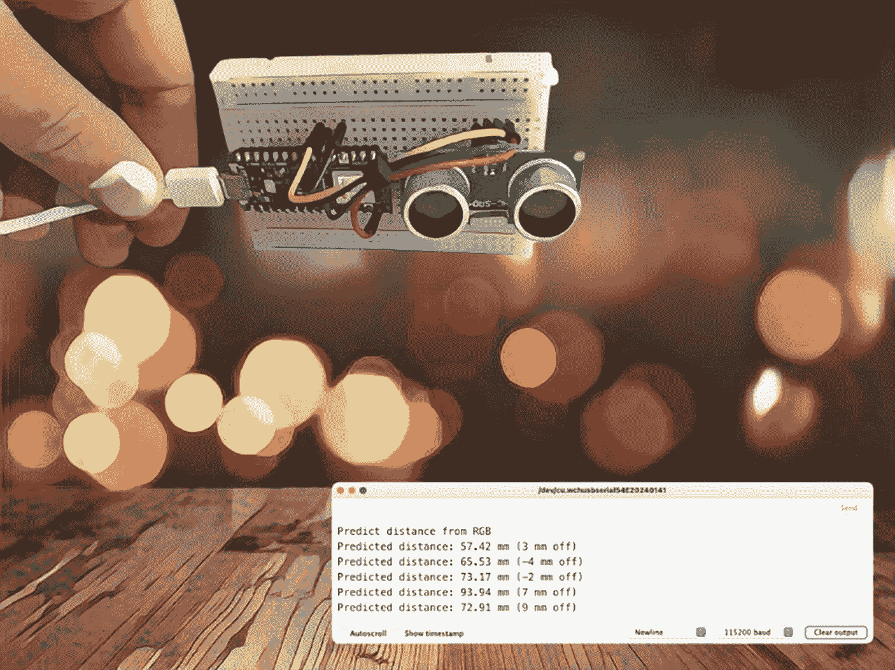

一只手握着一块小型电子面包板，上面连接着一个传感器和彩色导线。背景中有模糊的灯光。下方，一个电脑屏幕显示着带有微小误差的预测距离："57.42 mm (偏差 3 mm)"，"65.53 mm (偏差 4 mm)"，"73.17 mm (偏差 2 mm)"，"93.94 mm (偏差 7 mm)"，"72.91 mm (偏差 9 mm)"。

图 3-1

根据 RGB 分量进行距离预测的结果

完成该项目所需的步骤与第 2 章中概述的步骤相同。

1.  收集数据（本例中为 RGB + 距离）。

2.  加载并检查数据，以发现异常值和不良数据，并理解输入与输出之间的关系（如果存在的话！）。

3.  执行特征工程以提高建模效果。

4.  为回归任务训练机器学习模型并评估其性能。

5.  将整个回归流程转换为 C++，并将代码部署到我们的电路板上。

由于许多方面与你处理表格数据时所见到的相同，本章将重点介绍从分类转变为回归时发生变化的部分。

## 所需硬件

与第 2 章一样，你需要一个颜色传感器来重复使用已有的硬件。除此之外，你还需要一个距离传感器。由于这个玩具项目不需要达到毫米级精度，任何距离传感器（超声波、飞行时间、红外等）都能胜任。

Arduino Nano BLE Sense 板内置了一个接近传感器（与检测颜色的传感器相同，都是 APDS），但我发现它在近距离（<5 厘米）下工作不佳，因此我更倾向于连接一个外部超声波传感器（见图 3-2）。

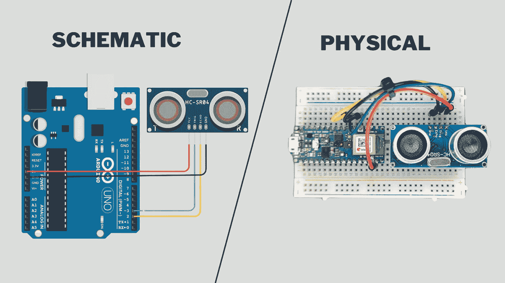

该图像分为两个部分，分别标注为"原理图"和"实物图"。左侧显示了一个 Arduino Uno 连接到 HC-SR04 超声波传感器的原理图，用彩色线条表示接线连接。右侧显示了面包板上的实物设置，包含一个 Arduino Nano 和同一个超声波传感器，用彩色杜邦线连接。

图 3-2

超声波电路图

超声波距离传感器使用*声波*来测量到物体的距离。它遵循*飞行时间*原理，测量超声波脉冲传播到物体并返回所需的时间。当 `TRIG` 引脚被置为高电平时，传感器通过其发射器以 40 kHz 的频率发射超声波；发射的声波在空气中传播，并遇到路径上的物体后反射。传感器的接收器检测到反射波，并在 `ECHO` 引脚上向 Arduino 输出一个高电平信号。从触发到回波所测量的时间，通过空气中的声速（大约每秒 343 米），与物体的距离成正比。

## 采集数据

让我们利用第 2 章中的 Python 采集脚本来捕获数据。Arduino 程序与颜色采集程序类似，只是增加了距离读取功能。根据你使用的距离传感器，代码可能会略有不同。代码清单 3-1 假设你已经将超声波距离传感器（`HC-SR04`）连接到引脚 4 和 5。

注意

请将 `TRIG` 和 `ECHO` 引脚替换为你自己的引脚！

```
Nano
/**
* 代码清单 3-1
* 以 CSV 格式收集 RGB + 距离数据（无人值守）。
*
* 所需硬件：Arduino Nano BLE Sense。
* 所需硬件：超声波距离传感器（HC-SR04）
*/
#include 
#include 
#define ECHO 2
#define TRIG 3
using tinyml4all::printCSV;
tinyml4all::APDS9960 sensor;
tinyml4all::Ultrasonic ultrasonic(ECHO, TRIG);
void setup() {
Serial.begin(115200);
while (!Serial);
Serial.println("Collect RGB + distance as CSV");
// 初始化颜色和距离传感器
sensor.begin();
ultrasonic.begin();
}
void loop() {
// 读取 R, G, B
sensor.readColor();
// 读取距离（毫米）
uint16_t distance = ultrasonic.millimiters();
// 以 CSV 格式打印数据
printCSV(sensor.r, sensor.g, sensor.b, distance);
delay(1000);
}
代码清单 3-1
以 CSV 格式收集 RGB + 距离数据
```

将程序刷写到你的电路板上，并通过打开串口监视器确认其工作正常（见图 3-3）。

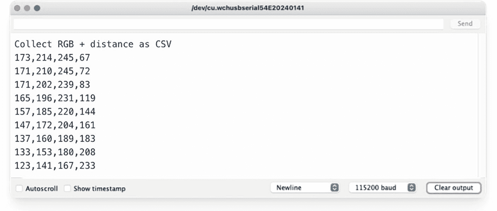

一个终端窗口显示了一系列 RGB 颜色值与距离测量值配对的数据，格式为 CSV。标题为"Collect RGB + distance as CSV"。数据包含多行，每行有四个逗号分隔的数字，分别代表红色、绿色、蓝色值和距离度量。界面包括自动滚动、显示时间戳、换行设置、波特率选择以及清除输出按钮等选项。

图 3-3

RGB 距离采集串口输出

代码清单 3-2 中显示的 Python 脚本是第 2 章中代码清单 2-3 的副本，此处为了方便而列出。唯一的修改是，我们现在持续从电路板轮询数据，而无需询问水果名称和样本数量。

```
from tinyml4all.tabular import capture_serial
capture_serial(
# * 是匹配任何内容的通配符
# 在 Windows 上，这看起来像 COM1 或类似
port="/dev/cu.usb*",
baudrate=115200,
# 数据将保存到的文件
save_to="rgb-distance.csv",
# 列名
headings=""r,g,b,distance"",,
num_samples=100
)
代码清单 3-2
在 Python 中从串口捕获数据
```

要运行代码，请在脚本所在文件夹内打开终端并运行。

```
(tinyml)$ python capture_rgb_distance.py
Press [Enter] when you're ready to start:
Task will start in 3...2...1...START!
100%|██████████| 100/100 [00:100<00:00,  1s/it]
Collected 100 lines of data
```

在此阶段，从一个明亮的平坦表面 2 到 3 厘米处开始，缓慢地将电路板/传感器移远（考虑到它每秒读取一次数据，所以请小步移动）。

当过程完成时，请确保你有一个包含 100 行数据的`rgb-distance.csv`文件，然后继续下一步。

## 加载与检查数据

捕获的数据仍为表格形式，因此你可以复用第 2 章中的所有代码片段来操作 `table` 实例。本例中，所有数据均存储在一个文件中，因此加载数据的相关代码如代码清单 3-3 所示。

|   | r | g | b | __target__ |

| --- | --- | --- | --- | --- |

| **count** | 100 | 100 | 100 | 100 |

| **mean** | 133.9 | 164.66 | 189.44 | 244.64 |

| **std** | 28.664 | 38.523 | 40.609 | 132.33 |

| **min** | 80 | 94 | 110 | 49 |

| **25%** | 108 | 128.75 | 153 | 141.5 |

| **50%** | 143.5 | 178 | 204 | 219.5 |

| **75%** | 160 | 201.25 | 226.75 | 354 |

| **max** | 168 | 210 | 232 | 480 |

```
# 注意，这次模块名为 regression
# 而非 classification！
from tinyml4all.tabular.regression import Table
table = Table.read_csv("rgb-distance.csv")
table.set_targets(column="distance")
print(table.describe())
代码清单 3-3
加载单个 CSV 文件
```

用于回归任务的表格加载代码与分类任务相同，负责的类仍然叫 `Table`。但请注意导入语句：它从 `tinyml4all.tabular.classification` 变为了 `tinyml4all.tabular.regression`！`set_targets` 函数的形式也没有改变。但其底层逻辑大不相同：对于分类任务，目标是 `标签`，而现在它们代表连续值——并且在表格摘要报告中，它们会像其他列一样被处理。

数据加载完成后，你可以对其进行绘图。

## 绘制回归数据

在回归的语境下，彩色散点图和配对图（如上一章所见）是没有意义的。它们旨在基于类别归属来可视化数据聚类。然而，回归没有类别这种东西；取而代之的是连续输出。

在输入变量较多的情况下，绘制回归数据比绘制分类数据要困难一些，但你仍然可以从中提取出相当多的信息。

### 单一输入

如果你的问题只有一个输入变量，那就很简单了。你可以使用代码清单 3-4 中的代码，在笛卡尔平面上绘制输入变量与输出变量的关系图。输出结果如图 3-4 所示。

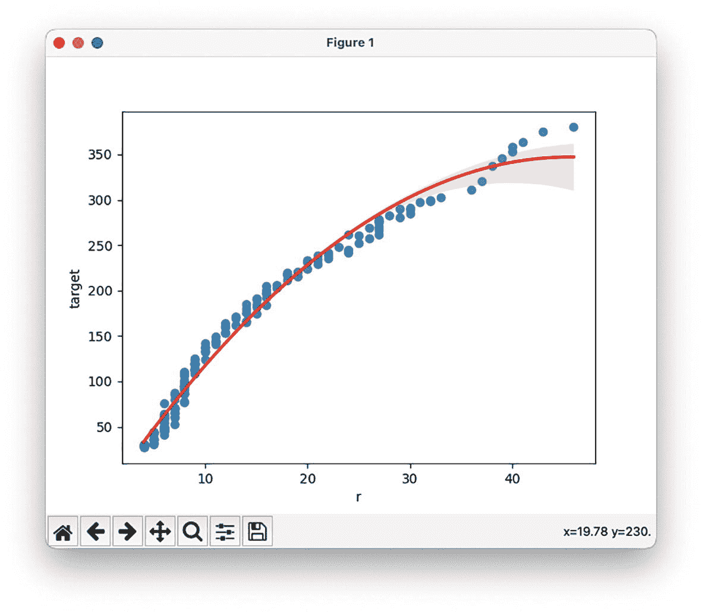

一张散点图，数据点以蓝色显示，展示了 x 轴变量 "r" 与 y 轴变量 "target" 之间的正相关关系。一条红色线条代表拟合曲线，并带有阴影置信区间。该图呈现上升趋势，数据点紧密跟随曲线。坐标轴分别标注为 "r" 和 "target"，并在 x=19.78, y=230 处高亮显示了一个坐标点。

图 3-4

单列的回归散点图

```
# 仅绘制单个列
table.scatter(column="r")
```

代码清单 3-4
绘制一个输入的散点图

你在中间看到的红线是线性回归的输出结果。这条线是如何定义的将在后面演示；目前，只需将其视为一条与输入数据最佳匹配的直线即可。

### 多输入，多散点图

如果你的数据有多个输入，一个简单的扩展方法是将目标变量与所有输入变量分别绘图（见代码清单 3-5 和图 3-5）。

注意

虽然 `可能` 可以应用降维技术将列压缩为两个甚至一个变量（就像你在分类任务中所做的那样），但结果可能会令人失望。最终得到的变量很可能与输出变量之间不存在任何直接的线性关系，因此你的图表会产生误导。

```
# 你可以将图表水平或垂直堆叠
# 默认为垂直堆叠
table.scatter(orientation="vertical")
```

代码清单 3-5
绘制多个输入的散点图

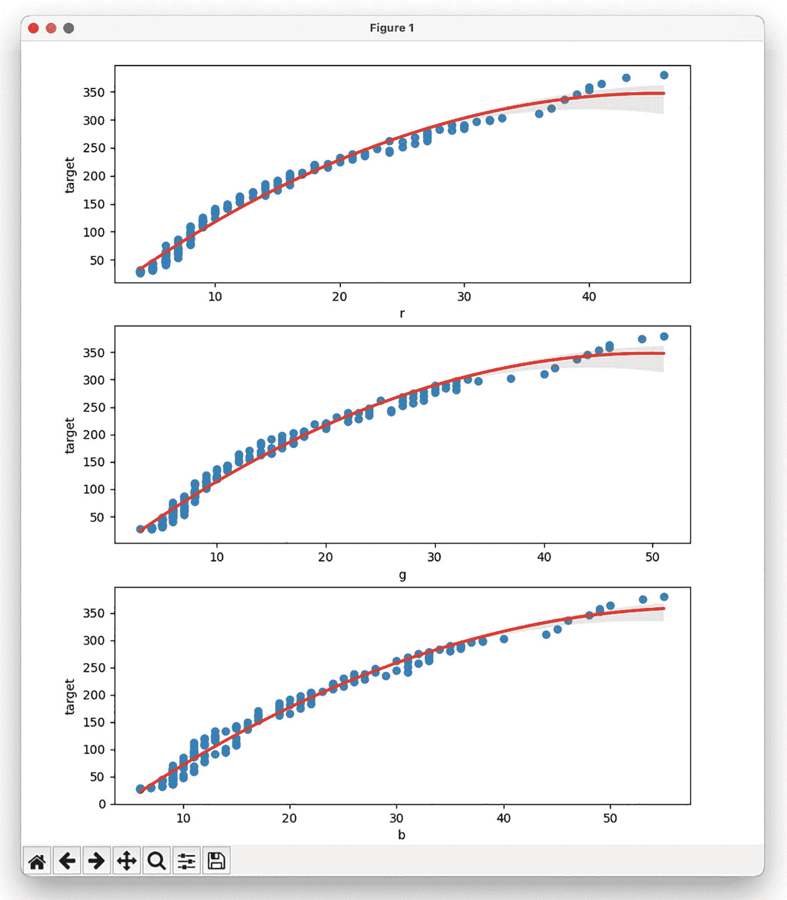

该图显示了三个垂直堆叠的折线图，每个图都描绘了一个带有红色趋势线和阴影置信区间的散点图。x 轴分别标注为 "r"、"g" 和 "b"，代表不同的变量。y 轴标注为 "target"，范围从 50 到 350。每个图都显示了变量与目标之间的正相关关系，数据点聚集在趋势线周围。

图 3-5

表格所有列的回归散点图

通过观察这些图表，你可以看到颜色分量与距离之间存在强相关性，因为所有点都离红线不远，并且它们似乎遵循单调递增的分布（右侧的值大于左侧的值）。如果这些点看起来更稀疏、更分散，那可能是一个信号——表明输入和输出之间可能找不到关系——至少在没有先进行特征工程的情况下是这样。

## 特征工程

许多回归模型在输入与输出之间存在线性关系时表现良好。然而，并非所有数据 `本身` 都呈现这种关系。可能的情况是，线性关系仍然存在，但存在于输入的单调函数映射或输入的组合之上。

### 单调函数映射

什么是 `单调函数映射`？

它本质上是一个应用于输入、且能保持其顺序的数学函数（即，如果 `x1 < x2`，那么 `f(x1) < f(x2)`）。这个函数可以像幂运算、对数运算或指数运算一样简单。让我们来看一个简单的公式。

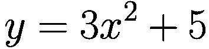

尽管看起来简单，但线性回归无法对此函数建模。许多用于回归的特征工程算子的作用，就是应用一个或多个映射，使得新特征与输出呈线性相关。

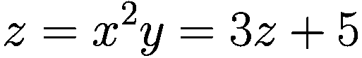

此时，大多数可用的回归模型都能以较高的准确度预测输出。在大多数情况下，一系列常见的映射都是适用的。

*   2 次幂、3 次幂、平方根、倒数

*   指数和对数

*   Box-Cox 和 Yeo-Johnson

Box-Cox 和 Yeo-Johnson 在附录 A 中讨论，请参考该附录以获取更多信息。清单 3-6 展示了如何将幂变换和指数/对数变换应用于表格数据集。你可以选择仅应用所有可用映射的一个子集，并且仅将其应用于列的一个子集。可用的映射如下（见图 3-6）。

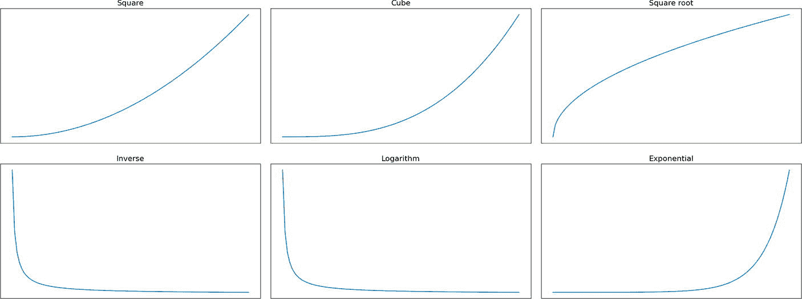

该图像展示了六个图表，说明了不同的数学函数。顶行包括：“平方”显示抛物线曲线，“立方”显示更陡峭的曲线，“平方根”显示逐渐上升的曲线。底行包括：“倒数”显示双曲线下降，“对数”显示缓慢上升的曲线，“指数”显示快速上升的曲线。每个图表代表了这些函数的一般形状。

图 3-6

单调函数映射图

*   `square`（2 次幂）

*   `cube`（3 次幂）

*   `sqrt`（平方根）

*   `inverse`（1/x）

*   `exp`（指数 – e^x）

*   `log`（自然对数）

|   | r | g | b | ... | sqrt(g) | inverse(g) | log(g) |
| --- | --- | --- | --- | --- | --- | --- | --- |
| **count** | 100 | 100 | 100 | ... | 100 | 100 | 100 |
| **mean** | 14,36 | 15,18 | 19,037 | ... | 3,664 | 0,105 | 2,572 |
| **std** | 9,963 | 11,167 | 11,442 | ... | 1,328 | 0,065 | 0,643 |
| **min** | 4 | 3 | 6 | ... | 1,732 | 0,02 | 1,386 |
| **25%** | 7 | 6 | 10 | ... | 2,449 | 0,045 | 1,946 |
| **50%** | 10 | 11 | 15 | ... | 3,317 | 0,091 | 2,485 |
| **75%** | 20 | 22 | 26 | ... | 4,69 | 0,167 | 3,135 |
| **max** | 46 | 51 | 55 | ... | 7,141 | 0,333 | 3,951 |

```
from tinyml4all.tabular.features import Monotonic
# apply the square and cube mapping to all columns
square_and_cube = Monotonic(functions="square, cube")
# apply all the mappings only to the "r" column
only_r = Monotonic(columns="r")
# apply all mappings to all columns
monotonic = Monotonic()
# run the transform on the table
table2 = monotonic(table)
print(table2.describe())
```

清单 3-6
应用单调函数变换

应该使用哪些映射？这完全取决于你的数据，这正是绘图派上用场的地方。通过观察每个回归图，你应该能够将数据点分布的 `形状` 与某个可用函数关联起来。如果是这样，你可以高度聚焦，只对需要它的列应用严格必要的变换。否则，如果你找不到任何好的匹配，就留空，以便尝试所有映射——也许稍后可以添加一个特征选择步骤。

注意

指数算子可能会非常迅速地增长到难以处理的数值！我强烈建议你在此之前始终应用特征缩放。

### 多项式输入组合

有时，当你的特征被放在一起考虑而不是孤立考虑时，它们可能携带重要信息。

例如，假设你想在医疗行业创建一个模型，并且你处理的是患者数据。众所周知，身高和体重单独来看可能不足以判断一个人是否处于良好状态，但结合起来，它们能更好地描述一个人的状况。

多项式特征变换通过将每对列相乘来生成新特征。它还会生成 `平方` 列（将一列与其自身相乘）。清单 3-7 展示了如何使用它。

|   | h | w | h_x_h | w_x_w | h_x_w |
| --- | --- | --- | --- | --- | --- |
| **0** | 74 | 242 | 5453 | 58512 | 17863 |
| **1** | 69 | 162 | 4731 | 26345 | 11164 |
| **2** | 74 | 213 | 5492 | 45259 | 15766 |
| **3** | 72 | 220 | 5145 | 48419 | 15784 |

# 回归模型

与分类一样，回归也有许多可用的模型可供选择。它们在描述能力和复杂性上有所不同：在熟悉它们之前，我建议你针对特定项目尝试所有模型，并选择表现最好的一个。本节介绍以下模型。

*   普通最小二乘法或线性回归
*   岭回归
*   套索回归
*   决策树
*   随机森林

## 普通最小二乘法

也称为*线性回归*，回归中最常用的模型是普通最小二乘法（OLS）。它假设样本（记为 *X*）与真实值（记为 *Y*）之间存在线性关系。这种线性关系可以用以下公式以矩阵形式表示。

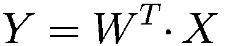

`W ^T` 是我们旨在寻找的未知权重矩阵。由于我们通常无法找到该方程的精确解，因此该方法旨在最小化真实值与模型预测值之间的平方误差之和。

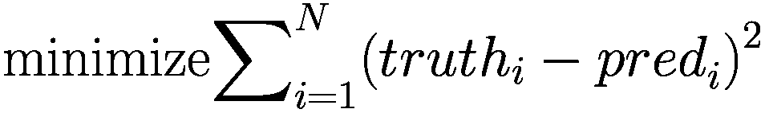

这个迭代过程应在给定迭代次数后收敛到最优解。清单 3-7 是一个如何使用此方法以及本章涵盖的其他方法的示例。

```
from tinyml4all.tabular.regression import Table
from tinyml4all.tabular.features import Multiply
# assume the people.csv files contains width (w), height (h)
# and BMI of a group of people
table = Table.read_csv("people.csv")
table.set_targets(column="bmi")
# if you omit the columns parameter,
# all columns will be considered
mult = Multiply(columns=["w", "h"])
table2 = mult(table)
```

清单 3-7 应用多项式特征扩展

**提示**：由于乘法可能导致非常大的值，或者如果两列处于完全不同的范围时产生偏斜，建议你先应用特征归一化。

## 岭回归与套索回归

普通最小二乘法的一个问题是它对权重的幅度没有限制。例如，对于我们的 RGB 距离项目，可能会得出类似以下的关系式。

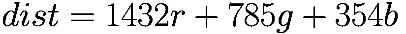

这是一个*可能*存在的合理关系。但在现实场景中，大多数情况下我们可以预期系数的幅度要小得多（取决于输入的尺度），而这些奇怪的数字往往是*过拟合*的迹象。岭回归[1] 试图最小化预测误差，同时也尽可能保持权重较低，从而降低过拟合的风险。

套索回归[2] 方法在精神上与岭回归相似，它也试图*正则化*权重参数。岭回归的目标是让权重值尽可能低，而套索回归的目标则是让尽可能多的权重值变为零，从而创建一个*稀疏*解（其中只有少数值非零）。这种特性在存在许多（无关）输入的情况下非常有用。

代码示例请参考列表 3-7。

## 决策树与随机森林

并非所有的回归关系都是线性的（无论是基于原始输入还是其变换版本）。如果你的数据表现出更复杂的关系，前面提到的模型可能效果不佳。一种选择是通过特征工程引入非线性特征。另一种选择是使用高度非线性的模型，如决策树（以及由此扩展的随机森林）。

这些模型在分类场景中的工作方式相同：它们对输入特征生成一系列的分割。每个分割最终输出一个（连续的）数值，而不是一个类别标签（见图 3-7）。

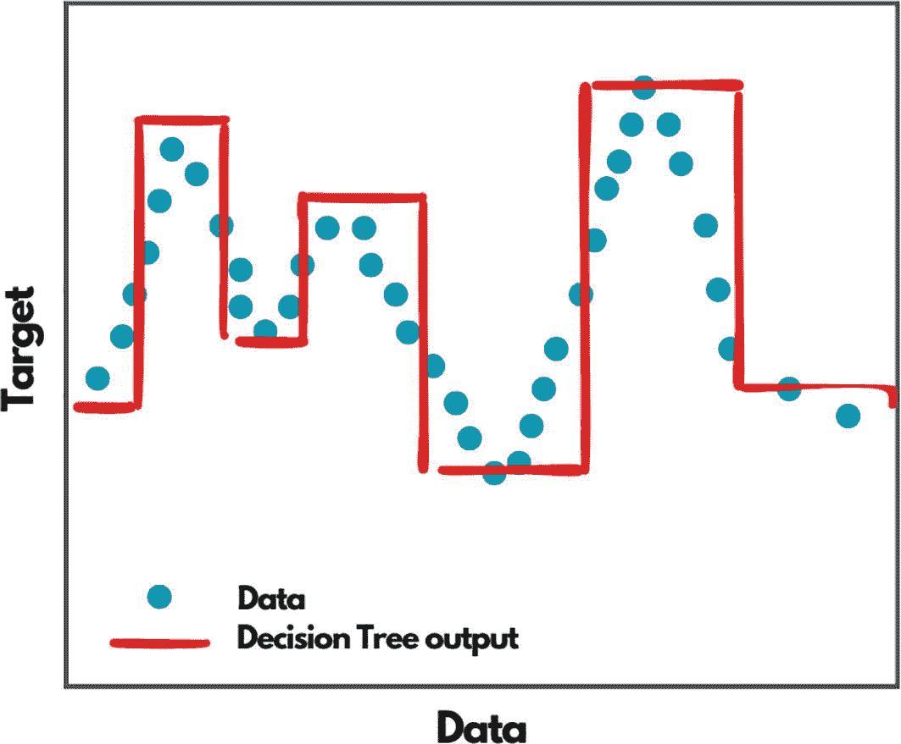

图 3-7 用于回归的决策树

表 3-1 总结了迄今为止列举的模型的特征。

表 3-1 回归模型总结

|   | 优点 | 缺点 |
| --- | --- | --- |
| **普通最小二乘法 (OLS)** | 对线性数据效果好；训练速度快；内存与特征数量呈线性关系 | 可能过拟合；对非线性数据效果不佳 |
| **岭回归** | 比 OLS 更不易过拟合 | 对非线性数据效果不佳 |
| **套索回归** | 比 OLS 更不易过拟合 | 对非线性数据效果不佳 |
| **决策树/随机森林** | 对高度非线性数据效果好 | 可能需要调整参数以避免过拟合。不推荐用于非常线性的数据 |

你可以参考列表 3-8 来使用这些回归器中的任何一个。

```
from tinyml4all.tabular.regression.models import Linear, Ridge, Lasso, DecisionTree, RandomForest
linear = Linear()
ridge = Ridge()
lasso = Lasso()
tree = DecisionTree()
rf = RandomForest()
# 应用上述任意模型
table2 = linear(table)
# 获取指标
print(table2.regression_report())
+-------+-------+------+------+
|  MAE   |  RMSE | MAPE  | R²  |
+-------+-------+------+------+
| 32.33  | 38.17 | 43%   | 0.80 |
+-------+-------+------+------+
```

列表 3-8 将回归模型应用于表格

# 回归链

在你尝试了迄今为止列举的不同处理算子，并检查了散点图和报告之后，你终于可以组装一个完整的回归链，以产生尽可能最佳的输出（列表 3-9）。

对于本项目中的 RGB 距离数据集，以下由稳健特征缩放、单调函数映射和线性回归组成的链表现相当不错。

```
from tinyml4all.tabular.regression import Table, Chain
from tinyml4all.tabular.regression.models import Linear
from tinyml4all.tabular.features import Scale, Monotonic, Select
table = Table.read_csv("rgb-distance.csv")
table.set_targets(column="distance")
chain = Chain(
    Scale("robust"),
    Monotonic(),
    # 可选，可能会略微降低精度
    #Select(sequential="auto", estimator=Linear()),
    Linear()
)
predictions = chain(table)
print(predictions.regression_report())
+-------+-------+------+------+
|  MAE   |  RMSE | MAPE  | R²   |
+-------+-------+------+------+
| 6.29   |  8.19  | 4%   | 1.00  |
+-------+-------+------+------+
```

列表 3-9 RGB 距离数据集的完整回归链

由于我们的距离以毫米为单位，结果突出显示我们模型的平均绝对误差为 6 毫米。对于我们这个基于环境光与距离之间相当朴素的相关性的简单项目来说，这是一个合理的误差。

如果你不满意，你必须修改你的链组成。由于特征缩放几乎在所有情况下都能改善结果，你应该专注于特征工程部分——也许添加一个多项式组合步骤？模型的选择取决于输入和输出之间的关系是否是线性的。或者基于树的模型会表现更好？

# 部署

当你对回归结果满意后，就该将其移植到 C++了。回归链与分类链没有区别，如列表 3-10 所示。生成的代码是一个独立的类，你可以将其导入任何 C++项目（不一定是基于 Arduino 的项目）。在进入下一节之前，请将生成的文件复制到你的 Arduino 项目文件夹中！

```
chain.convert_to("c++", class_name="DistanceChain", save_to="DistanceChain.h")
```

列表 3-10 将回归链转换为 C++

## 如何在 Arduino Sketch 中使用部署

### 部署与测试

与第 2 章类似，部署草图与采集草图几乎相同：它只增加了少量代码来对输入运行回归。该链接收三个输入：红色、绿色和蓝色光分量。然后，它生成一个单一的连续输出，即估计距离（以毫米为单位）。代码清单 3-11 假设你仍然连接着距离传感器，以便你可以将预测值与`实际`距离进行比较。在评估系统的现场性能后，你可以移除距离传感器。（否则，当你已有测量值时，使用估计值将毫无意义！）

```
Nano
/**
* 代码清单 3-11
* 根据 RGB 预测距离
*
* 所需硬件：Arduino Nano BLE Sense。
* 可选硬件：超声波距离传感器 (HC-SR04)
*/
#include 
#include 
// 这是代码清单 3-10 中生成的文件
#include "./DistanceChain.h"
// 如果引脚不同，请替换为你自己的引脚
#define ECHO 2
#define TRIG 3
using tinyml4all::printCSV;
tinyml4all::APDS9960 sensor;
tinyml4all::Ultrasonic ultrasonic(ECHO, TRIG);
tinyml4all::DistanceChain chain;
void setup() {
Serial.begin(115200);
while (!Serial);
Serial.println("根据 RGB 预测距离");
// 初始化传感器
// 如果出现问题，将抛出错误
sensor.begin();
ultrasonic.begin();
}
void loop() {
// 读取 R、G、B
sensor.readColor();
// 将数据馈送到回归链
// 应始终返回 true
if (!chain(sensor.r, sensor.g, sensor.b))
return;
// 链输出位于 output.regression.value 中
Serial.print("预测距离：");
Serial.print(chain.output.regression.value);
Serial.print(" mm");
// 如果距离传感器可用，
// 打印测量值与预测值之间的误差
uint16_t distance = ultrasonic.millimiters();
int16_t error = chain.output.regression.value - distance;
Serial.print(" (");
Serial.print(error);
Serial.print(" mm 偏差)");
Serial.println();
delay(1000);
}
代码清单 3-11
基于 RGB 分量预测距离的 Arduino 草图
```

如你所见，回归链 API 仍然只包含一个方法：`chain(inputs)`。它在后台运行所有链式步骤，并将结果存储在 `output.regression.value` 中，在本例中这是一个连续数值。图 3-8 显示了代码清单 3-11 的日志，误差范围从 –4 到 9 毫米。

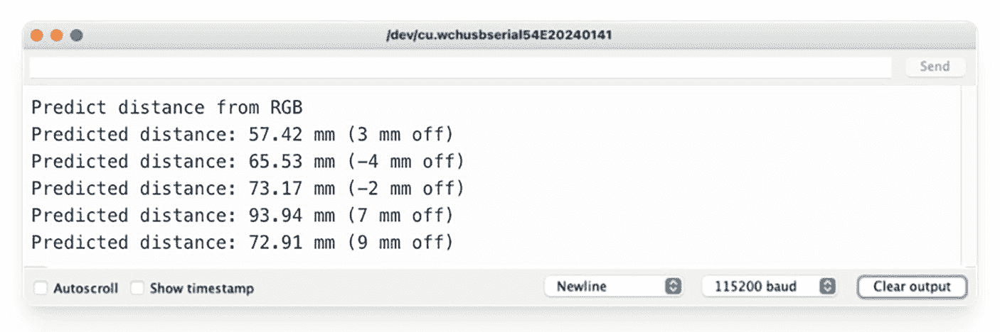

一个计算机终端窗口显示根据 RGB 数据预测的距离。预测结果包括：57.42 毫米（偏差 3 毫米）、65.53 毫米（偏差 -4 毫米）、73.17 毫米（偏差 -2 毫米）、93.94 毫米（偏差 7 毫米）和 72.91 毫米（偏差 9 毫米）。界面显示了自动滚动、时间戳以及换行和波特率（115200）设置的选项。

图 3-8

串口监视器上的预测输出

现在，自己尝试一下。将开发板靠近你用于采集训练数据的明亮平坦表面，看看预测距离是否与测量距离匹配。

注意

表面和光照条件必须与采集训练数据时相似，这一点非常重要；否则，结果可能会有很大偏差，甚至完全错误！

## 总结

本章介绍了一些新概念。表格回归的大部分开发周期与分类相同。这就是我们只关注其不同之处的原因：可视化和模型。

散点图用于可视化回归数据。为了对回归数据进行建模，有一些专门针对此任务的新算法，但也有我们已用于分类的算法（决策树和随机森林）的变体。

在 Python 中完成工作后，使用 Arduino 框架在微控制器上的部署与第 2 章保持一致。只需调用一次 `chain(inputs)`，即可在后台运行所有必要的计算，并生成我们感兴趣的输出。

现在我们已经完成了表格数据的处理，是时候转向一种新的数据类型了：时间序列。