# 4. 使用 Edge Impulse 进行时间序列分类

时间序列数据是指时间与测量值同等重要的数据。重新排列样本的顺序将完全颠覆底层的数据模式。时间序列分类的任务是接收一个*批次*（窗口）的输入，并判断整个批次属于哪个类别。

你仍然可以选择在行级别应用一些转换（归一化、分箱），但在时间序列的背景下，特征工程侧重于从每个数据窗口中提取描述性统计信息。

本章介绍如何使用无代码工具 Edge Impulse [1] 进行时间序列分类。我们将要构建的项目是一个*连续运动*分类器：它根据加速度计数据检测我们正在执行的手势（在几个可用手势中）（见图 4-1）。它是许多需要对恒定且重复的数据流进行分类的类似用例的原型。

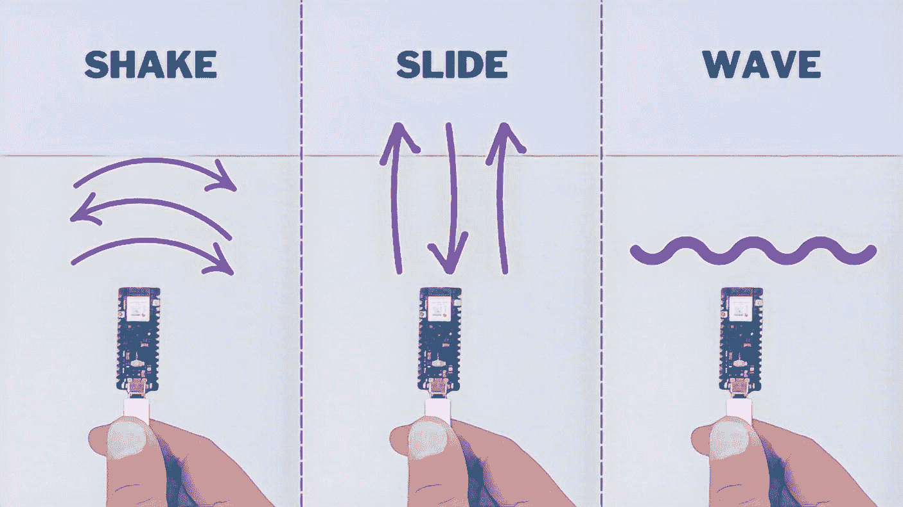

三个面板展示了手持小型电子设备的不同手部动作。左侧面板标有“摇晃”，箭头表示摇晃动作。中间面板标有“滑动”，箭头表示上下滑动动作。右侧面板标有“挥手”，波浪线表示挥手动作。每个面板都显示一只手握着设备。

图 4-1

连续手势示例

*   逐小时温度变化（多天）
*   肌肉的 EMG（肌电图）信号
*   工业环境中的电机转速

以下列表突出了主要步骤。

1.  使用微控制器采集数据。
2.  使用 Python 在 PC 上加载和检查数据。
3.  在 Edge Impulse 上创建一个新项目。
4.  上传 CSV 数据并指定其布局。
5.  分割训练集和测试集。
6.  执行特征提取。
7.  定义并训练神经网络架构。
8.  在测试集上评估模型性能。
9.  将模型导出为 Arduino 库格式。
10. 将 Edge Impulse 模型部署回微控制器。

使用无代码工具可以让你快速轻松地迭代各种模型配置，而无需过多担心技术细节。本章重点介绍时间序列相关概念（窗口、重叠、时域和频域特征）并完成工作。第 5 章将更深入地探讨实现细节和优化，以实现更轻量、更快速的部署。

## 所需硬件

你需要加速度计和陀螺仪的数据来开展工作。一些开发板内置了惯性测量单元，或者你也可以为当前使用的开发板外接一个。常见的模块包括 `MPU92650`、`MPU6886` 和 `LSM6DS3`。本书的代码示例使用的是内置 `LSM9DS1` 的 `Arduino Nano BLE Sense`。

*惯性测量单元*（IMU）是一种用于测量运动、方向和速度的传感器模块。它结合了来自多个传感器（加速度计、陀螺仪和磁力计）的数据，以全面理解三维空间中的运动和定位。

IMU 通过以下传感器检测运动和方向的变化。

*   **加速度计**：测量线性加速度（例如，沿 *x*、*y* 和 *z* 轴的运动）。它有助于确定倾斜角度和运动速度，但无法区分重力加速度和实际运动。
*   **陀螺仪**：测量角速度（即绕每个轴的旋转速度）。它有助于跟踪方向变化，但随着时间的推移容易产生漂移。
*   **磁力计**：测量地球磁场以确定绝对航向（类似于指南针）。它有助于校正陀螺仪漂移，但可能受到局部磁场干扰的影响。

通过专用算法融合这些传感器的读数，你可以估算物体在空间中的姿态和航向状态。IMU 传感器通常有三种不同的封装形式。

*   3 轴：仅包含加速度计
*   6 轴：包含加速度计和陀螺仪
*   9 轴：包含加速度计、陀螺仪和磁力计

磁力计常常被忽视，但如果你能负担得起 9 轴模块，仍然应该考虑它，因为它有助于减轻陀螺仪的漂移误差。当与磁铁配合使用时，它也是一个有用的传感器（参见第 5 章的项目）。

## 所需软件

你需要在本地计算机上安装第 2 章中详述的软件，因此，如果你不是按顺序阅读本书，请参考该章节。

除此之外，你还需要在 Edge Impulse 网站上创建一个免费账户。请访问 `https://studio.edgeimpulse.com/signup` 并完成所需步骤。图 4-2 描述了 Edge Impulse 平台的开发工作流程。

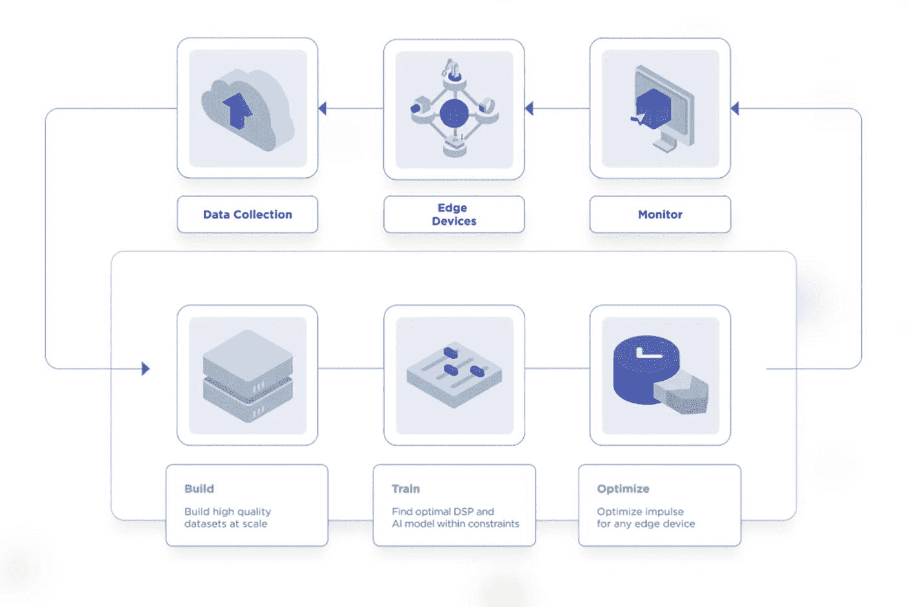

一个流程图，展示了两行相互连接的步骤。顶行包括带有云图标的“数据收集”、带有网络图标的“边缘设备”和带有屏幕图标的“监控”，由箭头连接。底行显示带有服务器图标的“构建”、带有电路板图标的“训练”和带有时钟图标的“优化”。每个步骤由箭头链接，表示一个连续的循环。每个步骤下方的描述性文字解释了操作：构建数据集、训练模型和优化脉冲。

图 4-2

Edge Impulse 开发工作流程

## 捕获数据

如第 2 章所示，你有多种方法从开发板收集数据并将其传输到电脑。

*   从串口监视器复制粘贴
*   使用 Python 从串口读取
*   将数据存储在 SD 卡上

本章利用方法 2，并使用 Python 来很好地格式化我们的时间序列数据。从串口复制粘贴虽然更直接，但存在一些缺点。

*   我们将要收集大量数据（约 100 个样本/秒），并且存在串口监视器溢出的风险，从而丢弃旧样本。
*   由于我们的开发板没有内置实时时钟，我们需要手动创建时间戳（我们只能通过调用 `millis()` 获得*相对*时间）。

`tinyml4all` Python 库很好地解决了这些问题。

让我们从 Arduino Nano BLE Sense 的草图开始。如果你使用的是不同的开发板，请将 IMU 读取逻辑替换为相应的代码（参见代码清单 4-1）。

```
/**
* 代码清单 4-1：读取加速度计 + 陀螺仪数据
*
* 所需硬件：Arduino Nano BLE Sense。
*/
#include 
#include 
using tinyml4all::printCSV;
tinyml4all::LSM9DS1 imu;
void setup() {
Serial.begin(115200);
while (!Serial);
Serial.println("以 CSV 格式收集加速度+陀螺仪数据");
// 初始化 IMU 传感器（失败时会抛出错误）
imu.begin();
}
void loop() {
// 读取加速度计和陀螺仪
imu.readAcceleration();
imu.readGyroscope();
printCSV(millis(), imu.ax, imu.ay, imu.az, imu.gx, imu.gy, imu.gz);
// 无手动延迟，默认采样率约为 100 Hz
}
```

代码清单 4-1
收集 IMU（加速度 + 陀螺仪）数据草图

将草图刷写到开发板后，通过打开串口监视器确认其工作正常（见图 4-3），然后你需要运行读取数据的 Python 脚本。代码清单 4-2 类似于第 2 章的代码清单 2-3，此处为了方便而列出。唯一的修改在于列的名称。

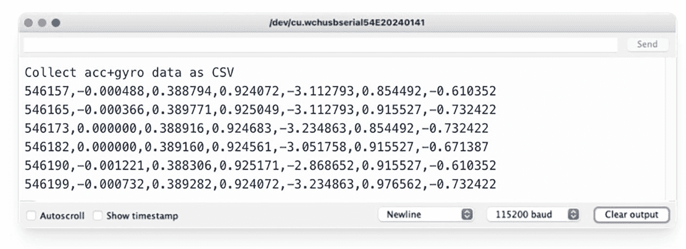

一个终端窗口，显示正在作为 CSV 文件收集的加速度计和陀螺仪数据。数据包括多行代表传感器读数的数值。界面显示“自动滚动”、“显示时间戳”等选项，以及“换行符”和“波特率”设置为 115200 的设置。窗口标题指示设备路径。

图 4-3

IMU 数据收集的串口输出

```
from tinyml4all.time import capture_serial
while True:
gesture = input("这是哪个手势？ ")
duration = input("要捕获多少秒？ ")
if not gesture or not duration:
break
capture_serial(
# * 是通配符
port="/dev/cu.usb*",
# 与 Arduino 草图匹配
baudrate=115200,
duration=f"{duration} 秒",
save_to=f"motion/{gesture}.csv",
# 必须与 Arduino 草图中的顺序匹配！
headings="millis, ax, ay, az, gx, gy, gz"
)
```

代码清单 4-2
在 Python 中从串口捕获数据

要运行代码，请在脚本所在文件夹内打开终端，激活 Python 虚拟环境并输入。

```
(tinyml)$ python capture_motion.py
文件夹 motion 不存在：现在创建？[y|n] y
这是哪个手势？ wave
要捕获多少秒？ 30
串口已连接
准备好后按 [Enter] 开始：
任务将在 3...2...1...开始！
100%|██████████| 30/30 [00:30<00:00,  1.00s/it]
已收集 3689 行数据
```

倒计时结束后，以连续模式执行你想要的手势。连续手势的良好示例包括挥动开发板、画圈移动、摇晃以及来回滑动。为你想要分类的每个手势重复收集过程，每次相应地更改文件名；每个手势收集 20-30 秒是一个不错的起点。

提示

第一次开始时，使用有限数量的手势（3-4 个），这样无需过多调整就更容易获得良好结果。成功后，如果需要，以后可以添加更多手势。

注意

请记住记录一个`空闲`类别，即你不执行任何运动；否则，分类器会尝试在已知手势中找到最佳匹配。

完成手势记录后，你的项目中应该有一个包含不同文件的文件夹。

```
|- your-project-root
|- capture_motion.py
|- motion
|- idle.csv
|- shake.csv
|- slide.csv
|- wave.csv
```

## 加载与检查数据

加载时间序列数据与加载表格数据基本相同，正如你在第 2 章和第 3 章中所见。主要区别在于我们没有使用`Table`类，而是改用`TimeSeries`类（参见代码清单 4-3）。除此之外，其余部分保持一致。

|   | timestamp | ax | ay | ... | gy | gz |
|---|---|---|---|---|---|---|
| **0** | 12:04:36.782244 | -0,018 | -0,021 | ... | 0,977 | -0,427 |
| **1** | 12:04:36.790244 | -0,019 | -0,021 | ... | 0,977 | -0,488 |
| **2** | 12:04:36.799244 | -0,02 | -0,021 | ... | 0,732 | -0,488 |
| **3** | 12:04:36.807244 | -0,02 | -0,021 | ... | 0,671 | -0,427 |
| **4** | 12:04:36.815244 | -0,02 | -0,024 | ... | 0,916 | -0,61 |

```python
from tinyml4all.time.continuous.classification import TimeSeries
ts = TimeSeries.read_csv_folder("motion")
ts.label_from_sources(padding="1s")
print(ts.head())
```
代码清单 4-3
从文件夹加载所有 CSV 文件

加载多个文件时，务必确保它们的时间戳**不重叠！**

## 绘制时间序列数据

在时间序列数据的上下文中，散点图没有意义。由于时间是一个基础维度，最直观的图表是以时间为 *x* 轴、其他测量值为 *y* 轴的折线图。代码清单 4-4 使用不同颜色的线条区分不同测量值，并通过背景色区分不同类别，如图 4-4 所示。

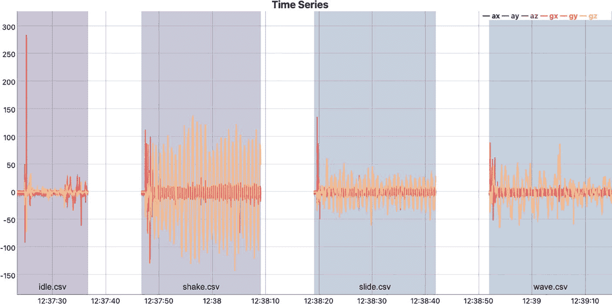

一张标题为“时间序列”的图表，展示了来自四个 CSV 文件（idle、shake、slide、wave）的数据。x 轴表示时间，范围从 12:37:30 到 12:39:10，y 轴显示从 -100 到 300 的值。图表包含六条彩色线条，分别代表不同变量：ax、ay、az、gx、gy 和 gz。idle 阶段显示低活动性，shake 阶段波动剧烈，slide 阶段活动性适中，wave 阶段波动从低到中等。

图 4-4

时间序列折线图

```python
# 所有参数均为可选
ts.line(
    title="连续手势",
    normalize=True,
    line_palette="magma",
    bg_palette="viridis"
)
```
代码清单 4-4
绘制折线图

你可以通过拖拽鼠标在特定区域进行缩放，双击可重置缩放。

## 特征工程

时间序列特征工程聚焦于数据的*窗口*。窗口简单来说就是一组按时间戳关联的读数。

窗口是一种 FIFO（先进先出）数据结构：当新样本到达时，它会被*排队*到窗口末尾。当窗口达到最大长度时，最早的样本会被丢弃，为新样本腾出空间（见图 4-5）。

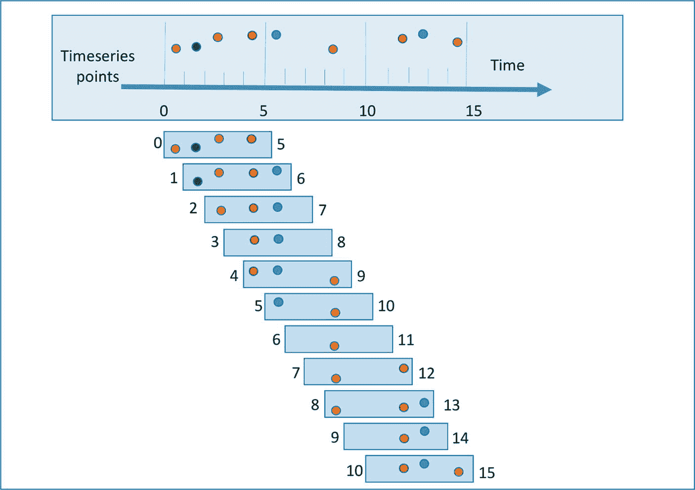

图示说明了一个带有重叠滑动窗口的时间序列。顶部部分显示了时间序列点随时间（范围 0 到 15）的分布。下方，重叠的蓝色矩形代表滑动窗口，每个窗口包含时间序列点的一个子集。窗口每次移动一个点，从 0-5 开始，到 10-15 结束，展示了数据如何被分段用于分析。每个窗口内的彩色点代表该段内的数据点。

图 4-5

滚动窗口逻辑

图 4-5 描述了一般情况：每个窗口具有相同的*时长*，但包含的样本数量可能不同（由于信号频率不恒定）。然而在我们的场景中，机器学习模型期望固定数量的输入，因此有两种选择。

*   忽略那些未包含正确样本数量的窗口。

*   考虑具有相同*长度*而非相同时长的窗口。

选项 1 存在若干问题（例如，如果数据以不规则间隔生成，我们可能永远——或几乎永远——无法获得包含正确样本数量的窗口）。选项 2 易于实现，并能保证在新样本到达时生成预测（其缺点是假设采样频率恒定——但实际情况可能并非如此）。为简化实现，从现在起，我们假设所有数据窗口共享相同的样本数量。这个数量就是窗口的*长度*。

让我们举一个实际例子。假设你有一个包含十个值的数组。

```
2, 3, 6, 4, 3, 4, 7, 8, 5, 4
```

我们可以将这些数据切分成包含五个元素的窗口，步长（窗口向右滑动的距离）为 2。结果得到如下所示的窗口。

```
窗口 1（索引 1 到 5）：2, 3, 6, 4, 3
窗口 2（索引 3 到 7）：6, 4, 3, 4, 7
窗口 3（索引 5 到 9）：3, 4, 7, 8, 5
```

给定一个数据窗口，我们可以在两个域中生成特征。

*   **时间域**：将数据“原样”分析为一个数字序列，可以计算其统计矩（最小值、最大值、平均值、标准差等）和形状描述符（峰值数量、高于或低于均值或零的数值计数等）。

*   **频率域**：应用一种变换（傅里叶变换 [2]），将原始数字序列映射到一个新域。在这个新域中，数字表示给定频率对原始信号的重要程度。

还有第三种选择：完全不生成特征。或者更确切地说，让神经网络自行找出特征。你将在第 8 章中看到具体应用。

每个域都有其优缺点。

### 时域特征

如果你将窗口数据中的每个测量值视为一个数值序列，就可以借用经典统计学中的许多指标来描述该序列。所有这些指标的总体目标是描述序列的*形状*（见图 4-6）。均值、标准差、偏度和峰度等指标通常足以捕捉时间序列的内在特征，并有助于区分不同类别。

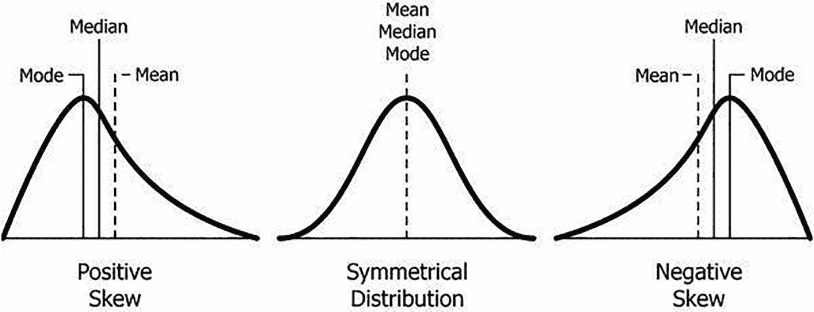

该图展示了三个钟形曲线图，分别代表不同类型的数据分布。左侧第一个图表示正偏态，众数位于左侧，中位数紧随其后，均值在最右侧。中间的图显示对称分布，均值、中位数和众数在中心对齐。右侧的图表示负偏态，均值位于左侧，中位数紧随其后，众数在最右侧。

图 4-6

偏态曲线示例

时域特征的优势之一在于它们对数据模式几乎不做任何假设。无论序列多么嘈杂或不规则，你都能获得有意义的指标；它甚至能很好地处理缺失数据。第二个优势是这些指标计算起来简单快速：不涉及复杂数学运算，任何嵌入式 CPU 都能在微秒级完成此任务。

另一方面，这种简单性有时也可能成为局限，这些指标的描述能力可能不足以捕捉底层数据模式，尤其是在处理重复性、周期性的时间序列时。

### 频域特征

频域特征不关注序列中的原始数值，而是通过变换将时间值映射到频率域。这一操作由傅里叶变换完成。其背后的理论和数学原理可能有些复杂，超出了本书的讨论范围。在微型机器学习中，对我们重要的是，这一操作所需的计算量远大于经典统计特征。它提取的特征旨在描述构成时间序列的主要频率，而非其形态（见图 4-7）。

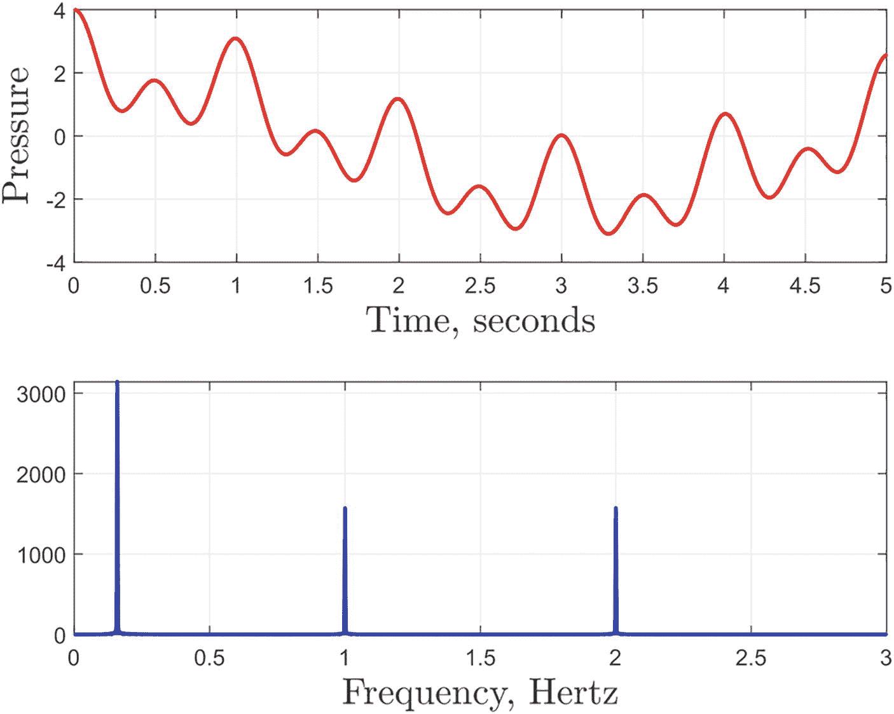

该图像包含两个图表。顶部图表显示一条红色波形，代表压力随时间的变化，在 5 秒内于-4 到 4 单位之间振荡。底部图表显示蓝色频谱，在约 0.5、1 和 2 赫兹处有显著峰值，幅度高达 3000 单位。顶部图表的 x 轴标签为“时间，秒”，y 轴标签为“压力”。底部图表的 x 轴标签为“频率，赫兹”。

图 4-7

时间序列的频率内容

那么，为什么你会倾向于使用频域（或将其与时域结合）呢？

答案是，在处理重复性和周期性模式时，频域特征展现出更强的描述能力。它们通常*密集*得多（产生更多系数），并能可靠地区分不同类别。如果你正在对连续运动进行建模（如本章所述），傅里叶变换是一个绝佳选择。

## 用于连续运动的 Edge Impulse

本节将逐步介绍用于连续运动分类的 Edge Impulse 平台。如第 6 章和第 7 章所述，Edge Impulse 也能处理音频数据和图像。熟悉这个工具可以加快你在许多不同项目中的工作流程，所以请花些时间探索它，不要局限于本章的严格要求。

Edge Impulse 是一个*低代码*工具：它允许你通过其图形界面生成模型，而无需编写任何代码。你只需要编写代码，将生成的模型集成到你的 Arduino 程序中。对于不想深入研究特征提取和分类复杂细节的初学者来说，这是一个极好的工具。它还提供了内置的快速数据标注工具，因此你无需为此任务使用第三方软件。

前往 [`https://studio.edgeimpulse.com/studio/profile/projects`](https://studio.edgeimpulse.com/studio/profile/projects) 并创建一个新项目。将其命名为 `continuous motion`。

> **注意**
> 你可以为项目选择任何你喜欢的名称。（但请保持在 20 个字符以内，因为过长的名称可能会在后续使用 Arduino IDE 时引起问题）。请记住，你需要稍后修改一些代码以反映名称的更改！

### Edge Impulse 工作流程

在使用 Edge Impulse 平台时，你的工作流程非常线性。项目主页上的侧边菜单以（几乎）你必须遵循的确切顺序高亮显示了所有可用步骤（见图 4-8）。

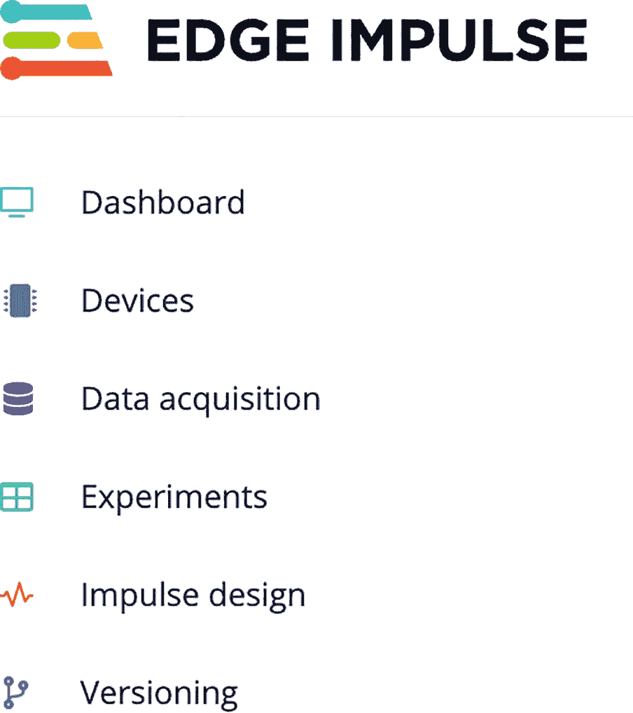

该图像顶部显示 Edge Impulse 标志，下方是一个带有图标和文字的垂直菜单。菜单项包括：仪表盘、设备、数据采集、实验、脉冲设计和版本管理。每个项目都有对应的图标，例如仪表盘对应电脑显示器，设备对应微芯片。

图 4-8 Edge Impulse 项目菜单

*   **仪表盘**：项目概览，包含指向后续步骤、教程和项目管理操作（例如，删除项目）的快速链接。
*   **设备**：你可以使用串口（通过 EI CLI）、WebUSB 或 Wi-Fi（例如，你的智能手机）连接一个受支持的设备，并直接从此页面捕获数据，而无需像我们之前那样先创建 CSV 文件。我通常不使用此功能，因为我更喜欢以我偏好的格式处理文件，但它在快速测试时可能会派上用场。
*   **数据采集**：在这里，你可以管理你的数据集。它会跟踪你上传的文件，处理训练/测试集划分，并提供数据预览（对于图像来说非常方便！）。你可以使用上下文菜单执行许多操作（删除、标注、移动样本）。
*   **脉冲设计**：这是整个平台的*核心*。一个*脉冲*相当于第 2 章和第 3 章中看到的处理链。它将特征工程过程和分类（或回归）模型组合在一起。它的任务是接收你的输入数据，并执行所需的计算以获得预期的输出。它由嵌套的步骤组成。
    *   **创建脉冲**：一个配置界面，你可以在其中指定要使用的任务类型和特征（分类与回归，频谱特征与原始数据）。
    *   **特征提取**：此菜单项的名称会根据你在上一界面中的选择而变化。对于时间序列分类，此项很可能是*频谱特征*。但无论具体项目是什么，此页面都允许配置特征提取步骤的具体参数。
    *   **分类器**：在这里，你定义神经网络拓扑结构（可以从头开始，也可以使用支持的参考架构之一），并运行训练。当过程完成时，你会得到一个漂亮的混淆矩阵来检查结果。
    *   **实时分类**：如果你之前连接了受支持的设备，现在可以对来自设备的实时数据运行预测，而无需烧录任何固件。在这种情况下，预测是在云端进行的，因此你可以预览模型在真实世界数据上的准确性。
    *   **模型测试**：回想一下，*数据采集*步骤处理了训练/测试集的划分。在此页面上，你可以在测试数据集上运行模型，并查看其表现。
    *   **部署**：完成在线配置、调优和测试后，就该将训练好的模型导出为 C++ 代码，以便集成到你的项目中。此页面为许多受支持的开发板和桌面操作系统提供了多种导出选项。
    *   **版本管理**：你经常会使用不同的数据集、不同的模型和不同的配置进行实验。你可能希望跟踪所有这些实验，以避免丢失日后可能需要的重要设置。版本管理允许创建项目当前状态的*快照*。然后，你可以放心地进行编辑，因为你知道以后可以恢复到之前的状态，就像什么都没发生过一样。
*   **实验**：这是一个更高级的功能，允许你在相同数据上配置和训练多个脉冲，并比较它们的结果以选择最佳方案。默认情况下，它只列出当前（唯一）脉冲的结果，但当你创建新的脉冲时，它们会以清晰的表格形式列出，便于快速比较。

本书中的项目并未使用该平台的所有功能。以下描述了我们工作流程的步骤。

1.  配置数据格式（这仅在本章中是必要的，因为 CSV 文件中的数据可以以不同的布局排列。图像和音频文件则不言自明）。
2.  上传数据并划分为训练/测试集。
3.  定义脉冲结构和参数。
4.  执行特征提取。
5.  训练模型。
6.  部署为 Arduino 库。

### CSV 布局配置向导

Edge Impulse 常用于音频和图像分类。音频和图像文件不言自明，每个文件都清晰地表明了其含义（以及信息的编码方式）。相比之下，CSV 数据可以按多种不同的布局排列，每一行可能包含多种数据类型。因此，您需要先指示 Edge Impulse 如何解释您将要上传的文件，它才能正确地摄取这些数据。

您可以使用 CSV 向导来执行此操作，这是一个引导式配置工具，会逐步要求您定义数据的布局。

> **提示**
> 有关 CSV 向导配置的视频演示，请参考在线资料。

导航至 **数据采集** ➤ **CSV 向导** 选项卡，并上传您之前捕获的其中一个文件（见图 4-9）。

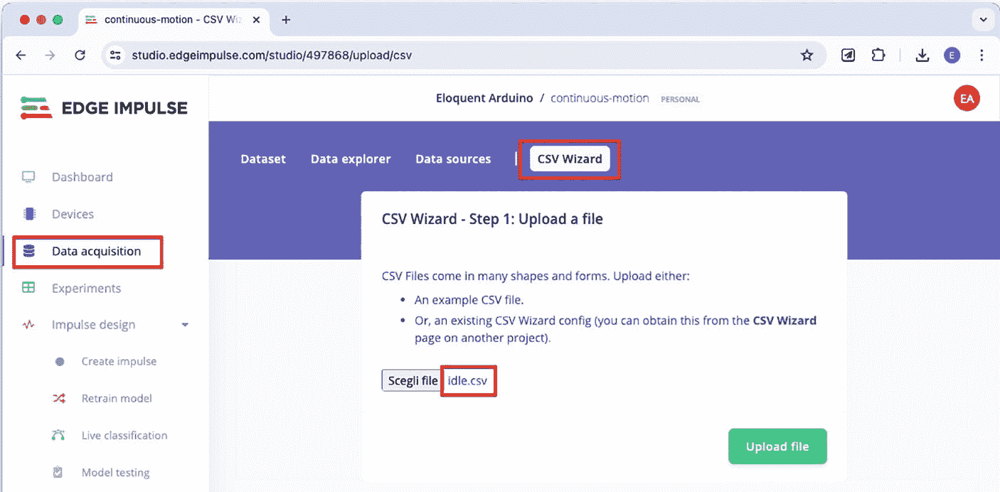

该图像显示了 Edge Impulse 平台界面，特别是用于上传文件的“CSV 向导”部分。高亮区域包括左侧菜单中的“数据采集”和顶部导航中的“CSV 向导”。主要内容区域显示“CSV 向导 - 步骤 1：上传文件”，并附有上传示例 CSV 文件或现有 CSV 向导配置的说明。一个名为“idle.csv”的文件已被选中上传，并可见一个绿色的“上传文件”按钮。

图 4-9 Edge Impulse CSV 向导介绍

确认数据看起来正确，然后进入步骤 3（见图 4-10）。在此，您必须选择以下选项。

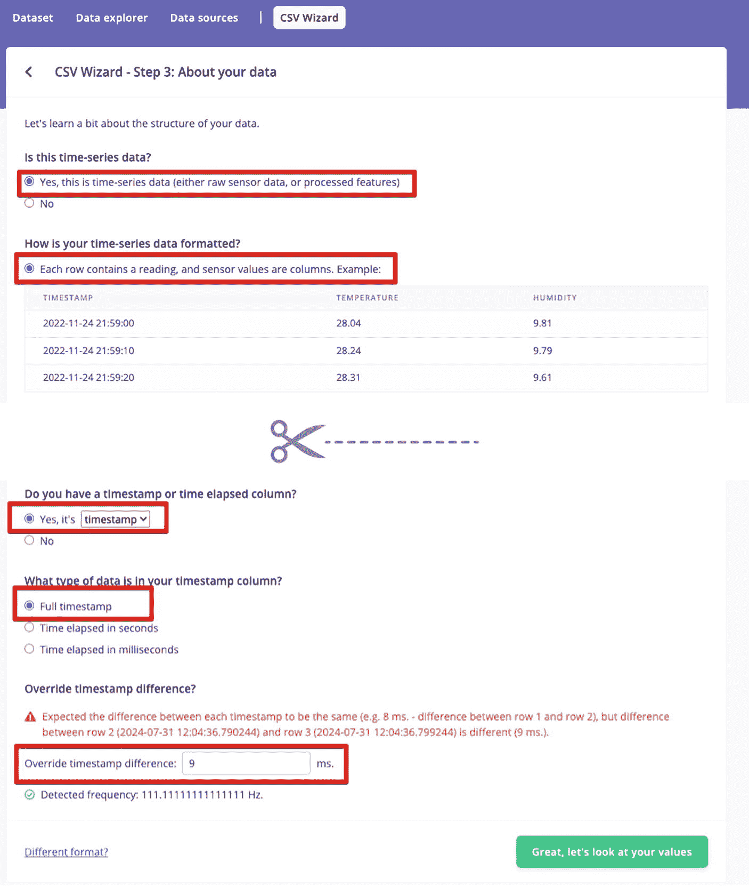

该图像显示了用于配置时间序列数据的 CSV 向导界面。它确认数据为时间序列，格式为每行包含一个读数，传感器值作为列。一个示例表格显示了带有相应温度和湿度读数的时间戳。界面询问是否存在时间戳列，并已选择“是，它是时间戳”。时间戳数据类型设置为“完整时间戳”。一条警告信息指示预期时间戳差异存在不一致，建议覆盖为 9 毫秒。一个标有“太好了，让我们看看您的数值”的按钮可见。

图 4-10 Edge Impulse CSV 向导

*   **这是时间序列数据吗？** 是的，这是时间序列数据（无论是原始传感器数据还是处理后的特征）。
*   **您的时间序列数据是如何格式化的？** 每行包含一个读数，传感器值作为列。
*   **您有包含时间戳或已用时间的列吗？** 是的，它是时间戳。
*   **您的时间戳列是什么数据类型？** 完整时间戳。
*   **覆盖时间戳差异？** ***<您的采样频率>***。** 如果它警告您差异不一致，请选择正确的值。例如，在我们的项目中，采样率为 120 Hz，因此时间间隔为 8.3 毫秒。您可以四舍五入为 9 或 8，这没有区别。

接下来的两个步骤简短且容易（见图 4-11）。

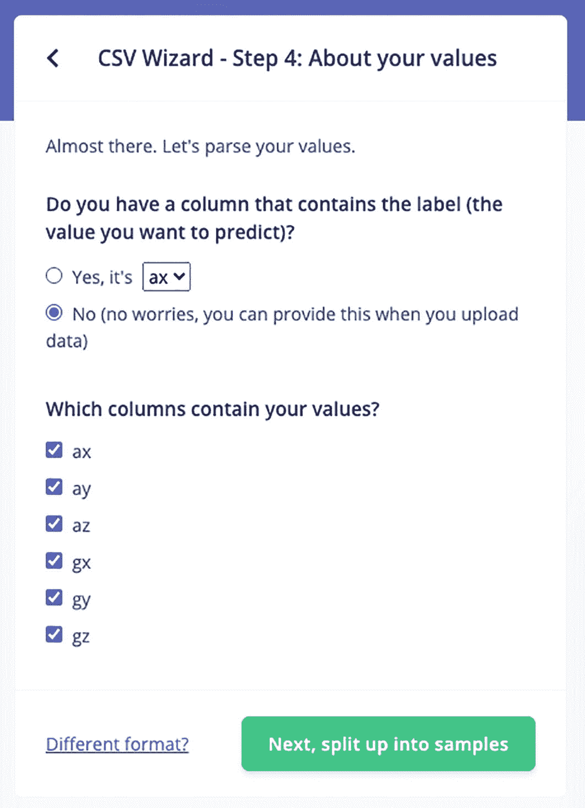

CSV 向导界面，步骤 4，标题为“关于您的数值”。它询问是否存在包含要预测标签的列，选项有“是的，它是”后跟一个下拉菜单，以及“否”，当前已选择“否”。下方询问哪些列包含数值，并提供了“ax”、“ay”、“az”、“gx”、“gy”和“gz”的复选框，所有选项均已勾选。底部有一个标有“下一步，拆分为样本”的按钮。还有一个标有“不同格式？”的链接。

图 4-11 Edge Impulse CSV 向导配置（续）

*   **您是否有包含标签（您想要预测的值）的列？** 没有。
*   **哪些列包含您的数值？** 全部勾选。
*   **您希望样本持续多长时间？** 无限制。

现在数据布局已定义，您可以轻松地导入任意数量的文件。

### 上传文件

从菜单返回 **数据采集**，点击 **添加数据** 按钮。选择 **上传数据**，然后选择您在上一步中捕获的文件。保留默认选项的勾选状态（见图 4-12）。

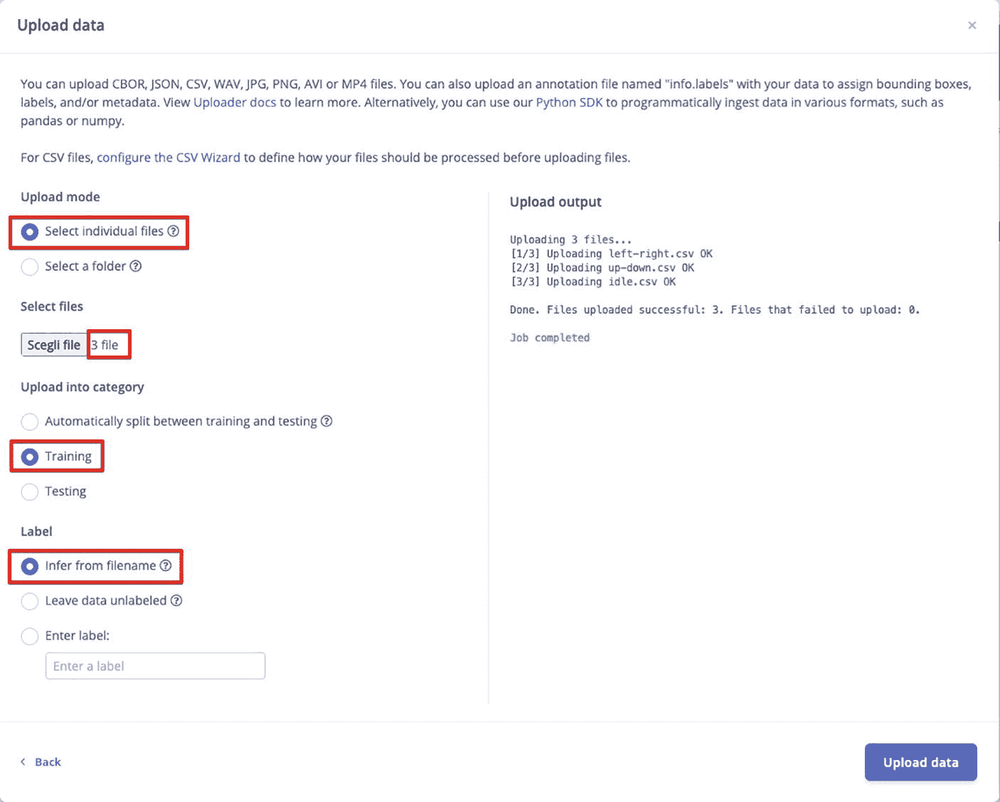

该图像显示了一个数据上传界面，包含上传文件的选项。左侧部分允许用户选择单个文件，已选择了三个文件。这些文件被归类为训练数据，标签从文件名推断。右侧部分显示上传输出，确认三个 CSV 文件成功上传：“left-right.csv”、“up-down.csv”和“idle.csv”。一条消息指示“作业完成”，没有上传失败。右下角有一个“上传数据”按钮。

图 4-12 Edge Impulse 数据上传表单

*   选择单个文件
*   训练
*   从文件名推断

我们将所有文件作为训练数据上传，因为 Edge Impulse 对 CSV 文件执行训练/测试分割时，会应用自动分割，这无法保持数据正确的时序顺序，也无法配置。手动分割让您能更好地控制此过程，例如决定分割百分比。

### 训练/测试分割

您的数据集面板中应该有几个条目，每个文件对应一个。逐行浏览，点击右侧的三个点。这将打开一个包含操作列表的上下文菜单。点击`分割样本`以打开分割图形界面。删除所有自动创建的分段，仅定义两个分段：一个用于训练，一个用于测试。第一个（用于训练的）应该更大，以便模型有更多数据可以学习。图 4-13 显示了一个示例。

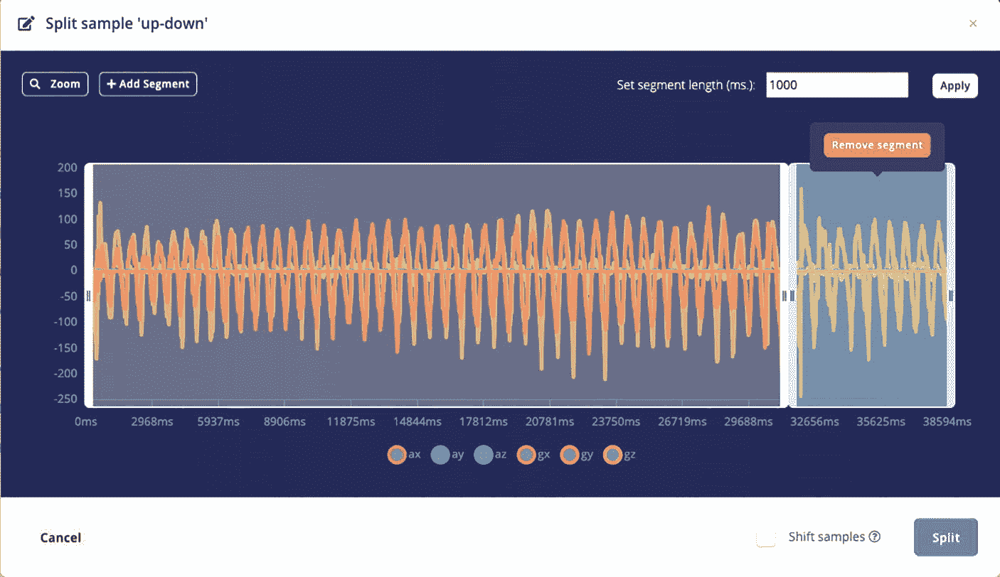

一个标题为“分割样本‘up-down’”的波形图，显示了从 0 毫秒到 38594 毫秒时间线上振荡的数据。该图显示了多条彩色线条，代表标记为 `ax`、`ay`、`az`、`gx`、`gy` 和 `gz` 的不同数据点。右侧高亮显示了一个分段，并提供了缩放、添加或删除分段的选项。分段长度设置为 1000 毫秒。底部有“取消”和“分割”按钮，以及一个移动样本的选项。

图 4-13

Edge Impulse 训练/测试分割

返回数据采集页面，您应该会在样本列表中看到一个新行。命名遵循 `<类别标签>.s1` 和 `<类别标签>.s2` 的模式（例如 `idle.s1` 和 `idle.s2`）。`s1` 是用于训练的样本；`s2` 是用于测试的样本。点击 `s2` 样本右侧的三个点，选择`移动到测试集`。然后，对您上传的所有样本重复相同的过程（见图 4-14）。


该图像在渐变的蓝紫色背景上显示了两个数据面板。左侧面板显示“已收集数据”，时间为“1 分 50 秒”，并有一个橙色、粉色和黄色的环形图。右侧面板显示“训练/测试分割”，比例为“73% / 27%”，并有一个青绿色和绿色的环形图，旁边有一个小的问号图标。

图 4-14

Edge Impulse 数据集统计信息

## 脉冲设计

这里开始实际的分类任务。每种数据类型都有其专属的特征工程模块，你可以通过图形用户界面（GUI）进行可视化配置（见图 4-15）。

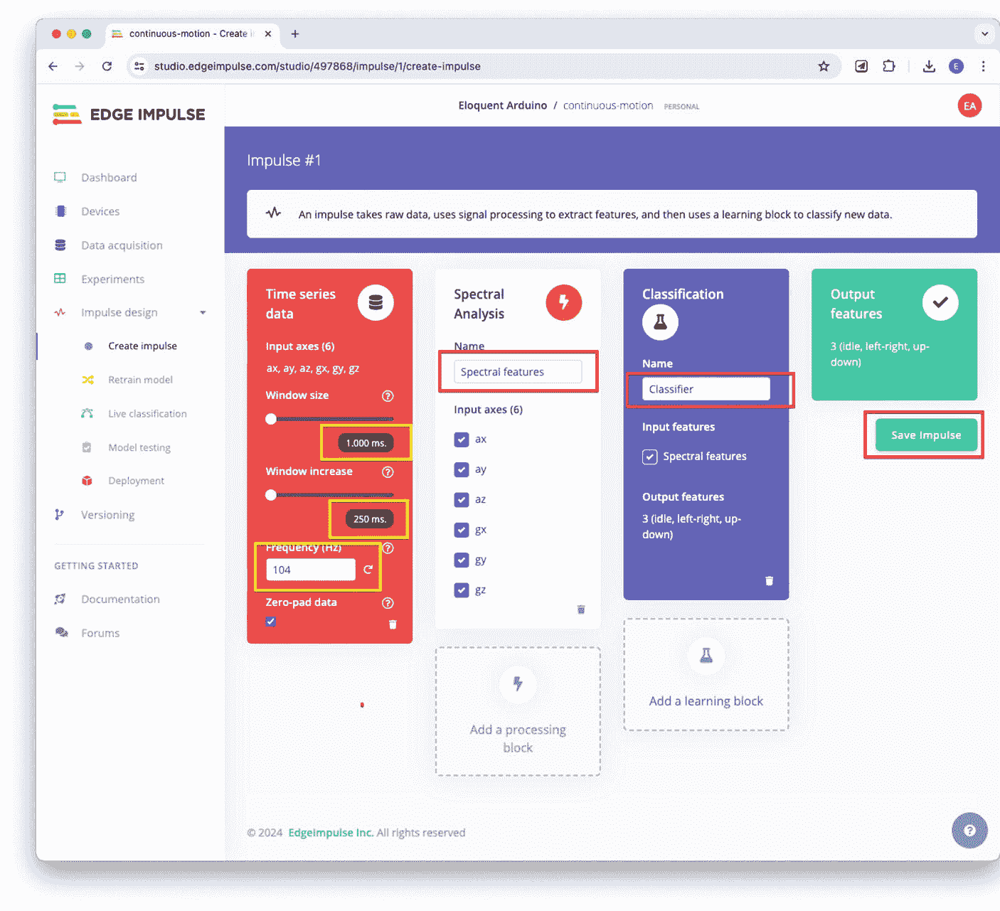

该图展示了用于创建脉冲的 Edge Impulse 平台界面。它包括时间序列数据、频谱分析、分类和输出特征等部分。时间序列数据部分有标记为 `ax`、`ay`、`az`、`gx`、`gy`、`gz` 的输入轴，窗口大小为 1000 毫秒，窗口增加量为 250 毫秒。频率设置为 104 Hz。频谱分析部分名为“频谱特征”，并已选定输入轴。分类部分名为“分类器”，输入特征为频谱特征。输出特征部分指示了三个特征：静止、左右和上下。界面上突出显示了“保存脉冲”按钮。

图 4-15

脉冲设计

### 时间序列数据模块

在我们的时间序列分类案例中，需要配置两个参数。

*   `窗口大小`：每个数据窗口的持续时间。必须以毫秒为单位配置，因为 Edge Impulse 平台假定你的数据具有固定的采样率（从上传的数据中推断得出）。

*   `窗口增加量`：本章前面部分称之为*偏移*，表示当窗口填满时，窗口应向右滑动多少（同样以毫秒为单位）。

在连续运动中，你应该将窗口持续时间设置为至少能捕获你想要识别的动作的几个重复周期。就本项目而言，1 到 2 秒之间的值效果不错。

### 频谱分析模块

作为预处理模块，选择`频谱分析`并勾选所有输入轴。在底层，该模块会提取时域特征（如均方根值、偏度和峰度）和频域特征（不同频率下的频谱功率）的混合体。

点击相应按钮保存脉冲后，左侧菜单中会出现一个`频谱特征`条目，你可以在其中配置该模块的许多参数。要正确调整这些参数，需要深入理解 FFT 和其他频域算法的工作原理——这超出了本书的范围——因此目前使用默认设置即可（见图 4-16）。如果你后来觉得模型性能不佳，想进一步研究此页面，最直观的可调参数是 `FFT 长度`；增加该值会为 FFT 生成考虑更多数据点，*可能*会提高整体准确率。

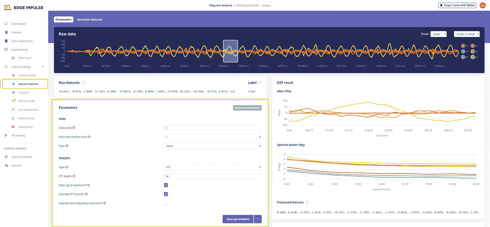

Edge Impulse 平台显示频谱特征分析的截图。顶部区域显示原始数据随时间变化的波形图。下方是“参数”部分，包含滤波和分析设置选项，如缩放比例、输入抽取比和 `FFT 长度`。右侧显示 DSP 结果，包含两个图表：“滤波后”显示样本数据随时间变化，“频谱功率（对数）”显示频率数据。左侧边栏包含仪表盘、设备和频谱特征等导航选项。

图 4-16

Edge Impulse 特征提取配置

接下来，点击`保存参数`进入生成特征页面。点击`生成特征`按钮并等待处理完成（此步骤是强制性的；否则后续将无法训练模型）。处理完成后，会显示一个散点图，展示聚类后的数据（类似于第 2 章中为表格数据绘制的散点图）。图 4-16 显示了每个类别不同颜色的聚类簇。

### 学习模块

最后一个需要配置的模块是*学习*模块。目前它的选项相当有限，甚至通过显示推荐的*分类*模块来引导我们，因此选择它并点击`保存脉冲`按钮。

在左侧菜单的`频谱特征`下方会出现一个*分类器*条目。点击它以打开模型训练配置页面。默认提出的拓扑结构是一个包含两个*密集*层、每层神经元数量较少的神经网络。在我的数据集上，将所有选项保留为默认值即可达到接近 100% 的分类准确率，这表明提取的特征质量非常高，以至于即使是一个没有任何特殊定制的简单模型也能正确分类（见图 4-17）。

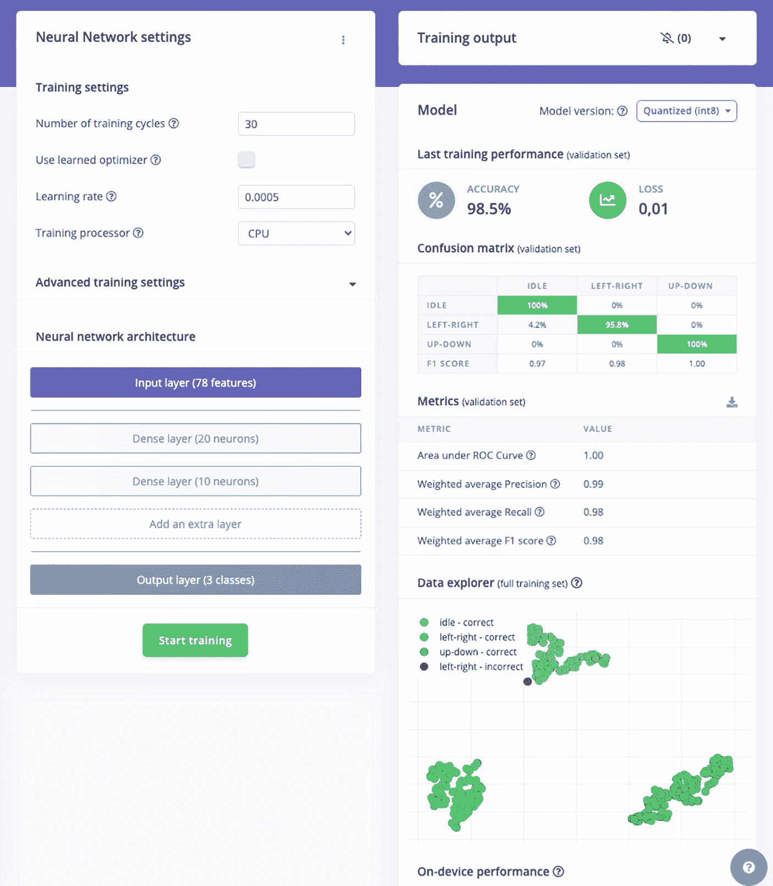

该图显示了一个神经网络训练界面。左侧的“神经网络设置”面板显示了训练设置，例如 30 个训练周期、0.0005 的学习率以及 CPU 作为处理器。神经网络架构包括一个包含 78 个特征的输入层、两个分别有 20 和 10 个神经元的密集层，以及一个包含 3 个类别的输出层。界面上可见“开始训练”按钮。右侧的“训练输出”面板显示了模型性能，准确率为 98.5%，损失为 0.01。混淆矩阵显示“静止”、“左右”和“上下”类别具有高准确率。指标包括 ROC 曲线下面积 1.00，以及精确率、召回率和 F1 分数的加权平均值。数据探索器使用颜色编码的点来可视化正确和错误的分类。

图 4-17

Edge Impulse 分类

在此页面上工作时，你可能会频繁使用几个重要参数，以下是它们的作用。

*   `训练周期数`：它决定了模型应该学习多长时间。一个合理的默认值是 50。如果准确率较低但看起来在上升（稍后会介绍如何检查），你可以尝试增加此值。

*   `学习率`：它控制模型在每个周期更新权重的幅度。我常用的值是 0.005：较低的值可能会带来更高的准确率，但需要更多的训练周期。请注意，这与默认设置的 0.0005 不同（少了一个零）！

### 如何检测准确率是否随时间提升？

点击`保存并训练`后，模型开始学习。右侧会出现一个`训练输出`区块，训练过程中日志会在此显示。日志内容如下所示。

```
Training model...
Training on 157 inputs, validating on 40 inputs
Using batch size: 32
Epoch 1/30
5/5 - 1s - loss: 1.2153 - accuracy: 0.6624 - val_loss: 0.8915 - val_accuracy: 0.6750 - 831ms/epoch - 166ms/step
Epoch 2/30
5/5 - 0s - loss: 0.7945 - accuracy: 0.6433 - val_loss: 0.4627 - val_accuracy: 0.6750 - 34ms/epoch - 7ms/step
Epoch 3/30
5/5 - 0s - loss: 0.4370 - accuracy: 0.7134 - val_loss: 0.2049 - val_accuracy: 0.9500 - 62ms/epoch – 12ms/step
Epoch 4/30
5/5 - 0s - loss: 0.2389 - accuracy: 0.9045 - val_loss: 0.1047 - val_accuracy: 1.0000 - 29ms/epoch - 6ms/step
Epoch 5/30
5/5 - 0s - loss: 0.1518 - accuracy: 0.9554 - val_loss: 0.0726 - val_accuracy: 1.0000 - 61ms/epoch - 12ms/step
```

如你所见，每一行都报告了每个周期（epoch）在验证集上的准确率和损失值。你已经知道准确率是什么，但损失值呢？它是一个函数，通过衡量模型预测值与实际目标值之间的差异，来量化神经网络表现的好坏。如果损失值下降，说明模型对数据的学习表征更好。在训练阶段，网络的目标是**最小化**这个值，而不是提高准确率。高模型准确率是低损失值的直接结果——因为模型已经学到了良好的数据表征，能够产生与真实情况匹配的良好预测。

在示例中，验证损失值每一步都在下降：这是模型正在学习的迹象。（由于我们刚开始训练，这是预期中的情况。）如果你查看最后几个周期的日志，会发现损失值几乎保持不变。

# 训练与评估

## 训练过程

```
Epoch 57/60
5/5 - 0s - loss: 0.0092 - accuracy: 1.0000 - val_loss: 0.0022 - val_accuracy: 1.0000 - 61ms/epoch - 12ms/step
Epoch 58/60
5/5 - 0s - loss: 0.0090 - accuracy: 1.0000 - val_loss: 0.0022 - val_accuracy: 1.0000 - 29ms/epoch - 6ms/step
Epoch 59/60
5/5 - 0s - loss: 0.0088 - accuracy: 1.0000 - val_loss: 0.0021 - val_accuracy: 1.0000 - 61ms/epoch - 12ms/step
Epoch 60/60
5/5 - 0s - loss: 0.0087 - accuracy: 1.0000 - val_loss: 0.0021 - val_accuracy: 1.0000 - 28ms/epoch – 6ms/step
```

这表明我们训练的周期过多，正在浪费时间，因为模型已经达到了一个`平台期`。更严重的是，对于某些数据集，模型可能开始过拟合，导致准确率下降！

> **注意**
> 训练模型时，请密切关注验证损失值，以发现过度训练和过拟合的迹象！

第 8 章将深入探讨不同的神经网络架构，但让我们先简要了解一下什么是全连接神经网络（FCNN），以及 Edge Impulse 中的`密集`层代表什么。

## 全连接神经网络

人工神经网络是一种受人类大脑结构和功能启发的数据结构。神经网络是一个由相互连接的节点或`神经元`组成的复杂系统，用于处理和传输信息。每个神经元接收一个或多个输入，对这些输入执行计算，然后将输出发送给其他神经元。这个过程使网络能够学习并表征数据中的复杂模式。神经元（基本组件）被组织成`层`，一层接一层地堆叠。全连接神经网络的特点是，第 `n` 层的每个神经元都与第 `n` + 1 层的每个神经元相连（见图 4-18）。

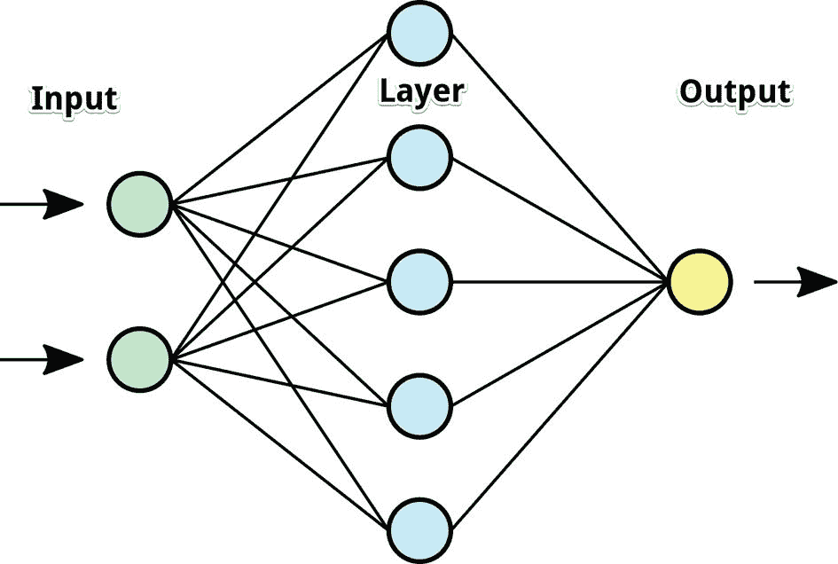

图 4-18 全连接神经网络

### 感知器的结构

神经元，也称为`感知器`，是全连接神经网络的基本构建块。它由四个主要部分组成。

*   **输入**：神经元从前一层（如果是第一层，则来自输入样本）接收一个或多个输入值。
*   **权重**：每个输入都关联一个权重，该权重决定了该输入在计算中的重要性。
*   **偏置**（可选）：每个神经元可以引入一个固定偏移量来调整其输出值。
*   **激活函数**：当使用线性权重时，该函数引入非线性，使我们能够学习更复杂的关系。

神经元的输出使用以下公式计算。


### 什么是密集层？

密集层是由其中神经元数量定义的一组感知器。考虑到全连接，你必须记住，密集层的权重数量随其输入和神经元的数量线性增长。一个具有 20 个输入和 30 个神经元的密集层存储了 600 个权重。

现在你已经了解了什么是密集层，以及神经元数量如何影响网络规模，可以随意尝试不同的层组合，直到在规模（越小越好）和准确率（越高越好）之间找到最佳平衡点。

## 模型测试

如果训练页面上的混淆矩阵符合你的预期，请转到模型测试页面（从左侧菜单进入），以评估模型在训练或验证期间从未见过的样本上的准确率。点击`全部分类`按钮并等待结果。在最佳情况下，所有行都是绿色的（表示完美预测）。像我们这样的现实场景，结果可能看起来比训练时更差。这完全正常且符合预期。

请记住，你在验证数据上获得的准确率是对模型泛化到新数据真实能力的高估，因此此页面对于决定你是否对模型满意至关重要。完全有可能训练页面上 100% 的准确率在测试集上变成 80% 或更低。这可能是过拟合的迹象，你需要采取措施来应对（例如，调整频谱特征步骤或网络架构）。

在我的案例中，测试集上的准确率仍然是 100%，因此我继续进行部署。

## 模型部署

至此，训练流程已完成，你可以将模型从云端迁移到你的设备上。点击左侧菜单中的`部署`，并将脉冲导出为 Arduino 库（见图 4-19）。

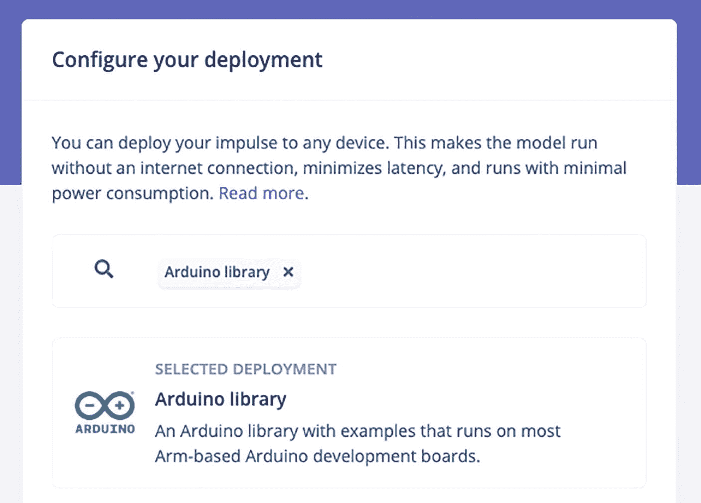

图 4-19 Edge Impulse 导出

这将下载一个 ZIP 文件。将压缩包内的内容解压到你的 Arduino IDE 库文件夹中。该库的名称为 `<项目名称 _inferencing>`（在我的例子中是 `continuous-motion_inferencing`）。

> **注意**
> 如果你想重命名该库，请记得同时重命名文件夹 *和* src 文件夹内的 .h 文件。

现在，Edge Impulse 模型已是一个库，是时候修改最初仅用于捕获数据的初始草图，以集成分类部分了。创建一个名为 `Continuous_Motion_Classification.ino` 的新草图，并粘贴代码清单 4-5 中所示的代码。

> **注意**
> 代码清单 4-5 假设你的库名为 `continuous-motion_inferencing`。如果你生成的库名称不同，请将其替换为正确的名称。

```
/**
* 代码清单 4-5：在 IMU 数据上运行 Edge Impulse 模型
*
* 所需硬件：Arduino Nano BLE Sense
*/
// 下一行 *必须* 与 EI Studio 中脉冲设计页面的窗口增量值匹配
#define EI_CLASSIFIER_SLICES_PER_MODEL_WINDOW (1000 / 250)
#include 
#include 
#include 
using tinyml4all::printCSV;
tinyml4all::LSM9DS1 imu;
tinyml4all::Impulse impulse;
void setup() {
Serial.begin(115200);
while (!Serial);
Serial.println("使用 Edge Impulse 进行运动分类");
imu.begin();
// 初始化 EI 模型（失败时会抛出错误）
impulse.begin();
}
void loop() {
// 读取加速度计和陀螺仪数据
imu.readAcceleration();
imu.readGyroscope();
// 将数据加入队列
impulse.queue(
imu.ax, imu.ay, imu.az,
imu.gx, imu.gy, imu.gz
);
// 当数据窗口填满时，运行预测
// 否则返回
if (!impulse.isReady())
return;
Serial.print("正在运行预测... ");
// 运行推理
if (!impulse.run()) {
Serial.println(impulse.error());
return;
}
// 打印结果
Serial.print("预测的运动是 ");
Serial.print(impulse.label());
Serial.print("，置信度为 ");
Serial.println(impulse.confidence());
}
代码清单 4-5
在加速度计数据上运行脉冲
```

编译并上传该草图，然后打开串口监视器查看实时预测流（见图 4-20）。

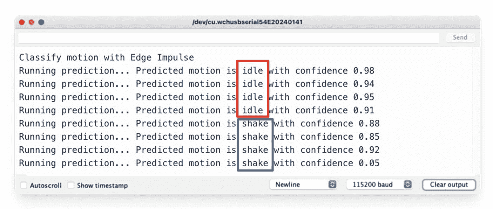

图 4-20 推理串行输出

> **注意**
> 编译时间可能较长。在我的 Intel MacBook Pro 上，需要三到四分钟！

恭喜！你已经完成了第一个 Edge Impulse 项目。

希望这是一个流畅的过程，你可以在未来的项目中轻松复制。如果你感到迷茫，请回到本章，将其作为参考和分步指南。

> **注意**
> 生成的模型在我的 Arduino Nano BLE Sense 上运行大约需要 90 毫秒。该值将作为下一章的基准，下一章仅实现时域特征，以比较它们在执行时间上的差异。

请访问在线资料库，观看实时分类的视频演示。

## Edge Impulse 的不足之处

Edge Impulse 是一个很棒的平台。我经常使用它，并且对其生成的模型质量感到惊叹。尽管如此，仍有一些不足之处让我感到困扰（不是平台本身的问题，而是 Arduino IDE 方面的问题）。

## 令人痛苦的漫长编译时间

Edge Impulse 底层使用了 TensorFlow。这意味着每次编译项目时，TensorFlow 也需要被编译。编译需要时间，因为它本身拥有庞大的代码库。非常长的时间。当你在开发阶段需要频繁修改代码时，这会很快变得令人厌烦。即使在第一次编译之后，当 Arduino IDE 创建了一些缓存工件来加速过程时，编译你的草图可能仍需要大约一分钟。

## 缓存失效问题

假设你训练了一个模型，将其部署到开发板上，发现其性能不佳。然后，你返回 Edge Impulse，用不同的配置训练一个新模型以提高其准确性。你下载新的 ZIP 库，替换旧的，然后再次编译你的草图。

猜猜结果如何？你仍然在使用旧模型！尽管这有悖常理，但事实确实如此。这是因为 Arduino IDE 会构建缓存以加速编译过程。这个缓存会一直存在，直到你重启 IDE。由于缓存实现的机制，IDE 无法检测到库中的文件已更改（因为它们都具有相同的名称），因此它会继续重用缓存的版本。要强制使用新版本，你必须完全重启 IDE。这意味着你必须等待。

*   启动 IDE 所需的时间
*   首次编译 TensorFlow 所需的时间（3–4 分钟）

我不知道你怎么样，但这种等待严重影响了我的工作效率。

尽管如此，我仍然认为 Edge Impulse 模型是你的 TinyML 项目的一个绝佳选择。

## 总结

时间序列是处理 TinyML 项目时常见的数据类型。它涵盖了所有数据随时间变化的项目（加速度计、温度、EMG），而能够对这些数据进行分类则开辟了广泛的可能性。

本章介绍了 Edge Impulse 平台，这是一个低代码工具，使你能够直观地创建准备部署的高级机器学习模型。在底层，它使用了频域特征（傅里叶变换）和 TensorFlow，从而实现了顶尖的准确性。得益于 `tinyml4all` Arduino 库，只需几行代码即可将这些模型集成到你的 Arduino 项目中。

下一章将演示如何使用时域特征和“经典”机器学习模型对时间序列数据进行分类。这将产生一个更轻量级的分类流程，其功能足以获得令人满意的结果。