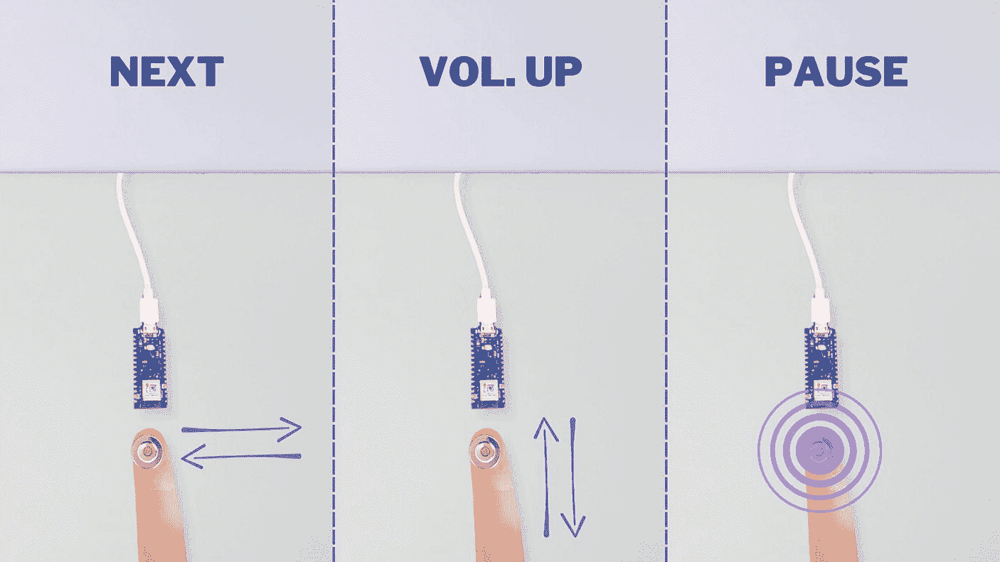
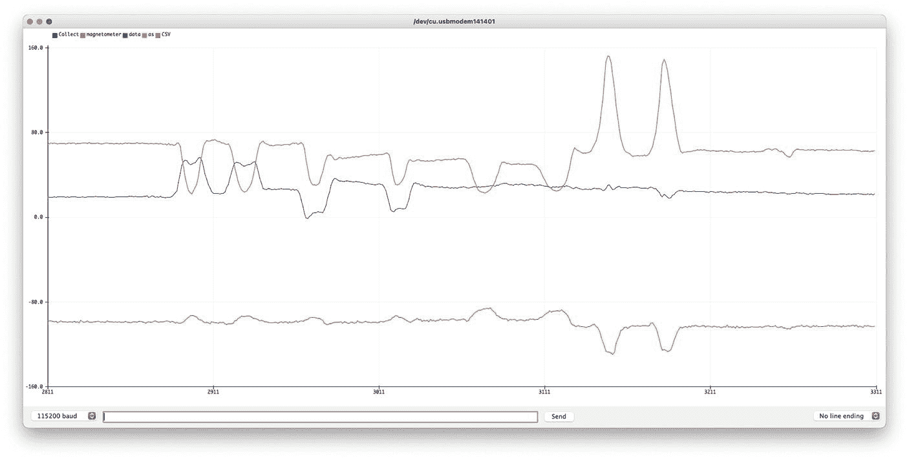
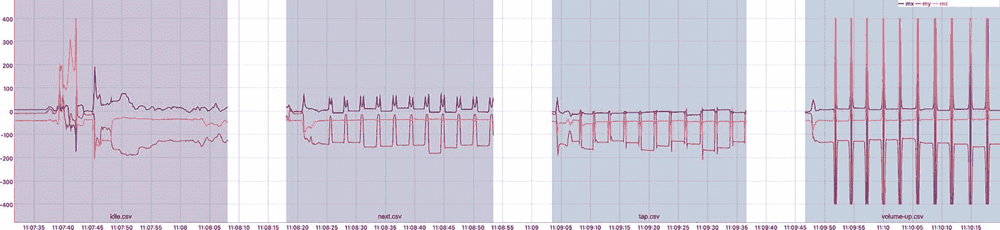
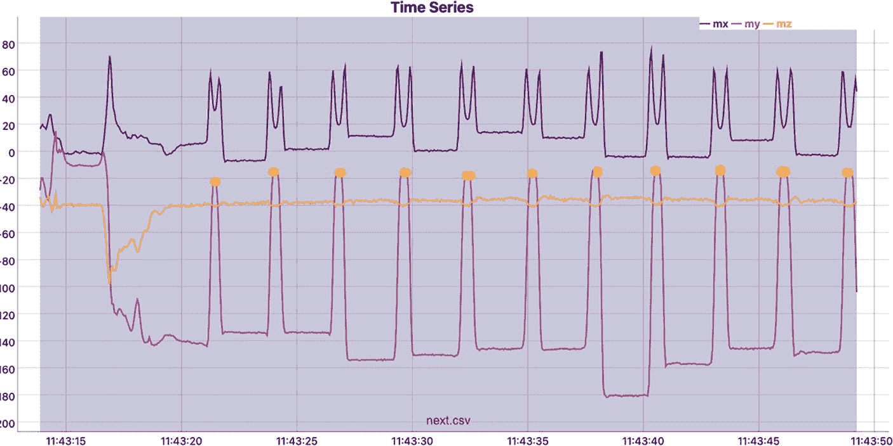
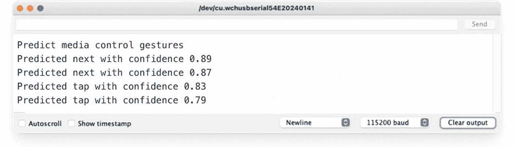

# 5. 使用 Python 进行时间序列分类

第 4 章介绍了时间序列分类问题。通过利用 Edge Impulse 这样的低代码工具，我们无需深入傅里叶变换和功率谱特征提取的细节，就成功部署了一个分类模型。此外，用作分类器的神经网络对我们来说就像一个黑盒，我们只需完成配置层数和层宽度的强制性任务（你甚至可以配置 Python 代码来定义和训练模型，但这属于“专家”模式，超出了这本入门书的范围）。

本章将采用更*偏向代码*的方式，探索如何使用时域特征构建一个优秀的时间序列分类流程，并介绍新的特征工程算子。最后一步，我们将选定的流程导出为纯 C++ 代码（如第 2 章和第 3 章所示），以便嵌入到任何 Arduino 项目中。

本章的项目是为我们的 PC 制作一个媒体控制板。

以下是您期望从媒体控制设备获得的常见操作。

*   **提高/降低音量**：沿着触控板假想的垂直轴向上（提高）或向下（降低）滑动手指。

*   **下一首/上一首**：沿着触控板假想的水平轴向左（下一首）或向右（上一首）滑动手指。

*   **播放/暂停**：轻触触控板中央。

让我们借助一个小磁铁，在平坦表面（例如桌面）上执行这些手势（见图 5-1）。



图示展示了一个设备的三个触控感应区域。第一个区域标有“下一首”，显示一个表示滑动手势的水平箭头。第二个区域标有“音量+”，显示一个表示向上滑动手势的垂直箭头。第三个区域标有“暂停”，显示表示点击手势的同心圆。每个区域都连接着一块电路板。

图 5-1

手势示例

## 硬件需求

你可以像第 4 章那样，在本项目中使用加速度计和陀螺仪数据，但让我们尝试改变一下所处理数据的性质。这次，我们改用 Arduino Nano BLE Sense 内置的磁力计。第 4 章提到的许多惯性测量单元（IMU）传感器都内置了这种传感器，因此你不需要外部硬件。一个贴在指尖的小磁铁就能以可测量的方式干扰地球磁场；这种扰动（在 *x*、*y* 和 *z* 轴上）就成为了我们的输入数据。

对于本项目，你需要以下物品。

*   一个带有磁力计的 IMU（例如 Arduino Nano BLE Sense 上的那个）或一个外部磁力计传感器

*   一个小磁铁

*   一个用作触控板的平坦表面

提示

请参考在线资料库，查看本设置的视频演示。

## 捕获数据

本节与第 4 章的类似部分有很多共同点，因为我们仍然在随时间收集传感器数值。然而，第 4 章侧重于*连续运动*，而本项目处理的是*片段式运动*——即只执行一两次、而非连续进行的手势和动作。*不要低估这个差异*，因为正如你稍后将看到的，它意义重大。

以下是从我们的开发板上收集数据的步骤。

1.  读取 IMU（特别是磁力计数据）。

2.  将 CSV 编码的数据打印到串口监视器。

3.  在 Python 中将数据收集为 CSV 文件。

代码清单 5-1 包含了 Arduino 草图。

```
/**
* 代码清单 5-1：读取磁力计数据
*
* 所需硬件：Arduino Nano BLE Sense。
*/
#include 
#include 
using tinyml4all::printCSV;
tinyml4all::LSM9DS1 imu;
void setup() {
Serial.begin(115200);
while (!Serial);
Serial.println("以 CSV 格式收集磁力计数据");
// 初始化 IMU 传感器（失败时会抛出错误）
imu.begin();
}
void loop() {
// 读取磁力计
imu.readMagneticField();
printCSV(millis(), imu.mx, imu.my, imu.mz);
// 无手动延迟，默认采样率约为 80 Hz
}
代码清单 5-1
收集磁力计数据草图
```

你可以通过打开串口绘图仪并将磁铁靠近开发板来调试输出。你会看到绘图线根据磁铁的位置而弯曲（见图 5-2）。



一张折线图显示了随时间变化的三组数据，分别标为红色的“Collect”、蓝色的“Magnetometer”和绿色的“CSV”。红线显示出显著的波动，有两个突出的峰值；蓝线有中等程度的变化；绿线相对稳定，有轻微下降。x 轴代表时间，y 轴显示范围从 -100.0 到 100.0。界面包括一个设置为“115200 波特率”的下拉菜单和一个“发送”按钮。

图 5-2

存在磁铁时磁力计的串口绘图

为了舒适地轻松执行这些操作，请使用胶带将磁铁固定在食指指尖。

确认草图正常工作后，创建一个新的 Python 脚本。代码清单 5-2 几乎是代码清单 4-2 的复制品，但调整了列的名称。

```
from tinyml4all.time import capture_serial
while True:
# 提示用户输入手势标签和采样时长
gesture = input("这是哪种媒体控制手势？ ")
duration = input("需要捕获多少秒？ ")
# 当标签或时长为空时退出
if not gesture or not duration:
break
capture_serial(
# * 是通配符，可匹配任何内容
# 在 Windows 上，它看起来像 COM1 或类似名称
port="/dev/cu.usb*",
baudrate=115200,
# 目标文件
save_to=f"media-control/{gesture}.csv",
duration=f"{duration} 秒",
# 列的名称
headings="millis, mx, my, mz"
)
代码清单 5-2
在 Python 中从串口捕获数据
```

要运行代码，请在脚本所在文件夹中打开终端，激活虚拟环境，然后输入。

```
(tinyml)$ python capture_magnetometer.py
准备好后按 [Enter] 键开始：
这是哪种媒体控制手势？ volume-up
需要捕获多少秒？> 60
任务将在 3...2...1...开始！
已连接到串口
100%|██████████| 60/60 [00:60<00:00,  1.00s/it]
已收集 1085 行数据
```

注意

始终记得记录一个*空闲*类别！开始记录并保持不动，或者稍微移动一点。

图 5-3 展示了一些记录的手势。除了第一个（*空闲*类别），你应该能在每个子图中看到每个手势重复几次。



一张折线图显示了四个部分，分别标有“idle.csv”、“next.csv”、“tap.csv”和“volumeup.csv”，每个部分都有阴影背景。图表显示了紫色、橙色和粉色三条线，代表不同的数据集。x 轴显示从 11:08:35 到 11:09:55 的时间戳，而 y 轴范围从 -400 到 400。紫色线显示出显著的波动，尤其是在“volumeup.csv”部分，表明活动增加。橙色和粉色线变化较小。右上角的图例将颜色标识为“acc”、“gyro”和“mag”。

图 5-3

媒体控制手势的时间序列图


## 数据标注

虽然这一步在第 4 章中是“自动”完成的，但现在必须手动完成。如果你的数据量很大，这可能会很繁琐，但请记住，数据集准备（收集和标注）通常很耗时。不过，输入数据的质量越高，分类结果的质量也就越高。

`tinyml4all` Python 包附带了一个简单的内置时间序列标注工具，可在浏览器中运行。要启动它，我们首先需要加载时间序列数据（列表 5-3）。

```
# 注意，包已从连续型
# 变为事件型！
from tinyml4all.time.episodic.classification import TimeSeries
ts = TimeSeries.read_csv_folder("media-control")
# 运行标注图形界面
ts.label_gui()
列表 5-3
加载并标注时间序列数据
```

一个新的浏览器窗口会打开，显示时间序列的图表以及如何标记感兴趣事件的说明。简而言之，你只需在事件的中间点击一下；就会出现一个标记来确认。对每个事件、每个媒体控制手势重复此过程（见图 5-4）。



一张时间序列图，显示了在 11:43:15 到 11:43:50 时间段内标记为 mx、my 和 mz 的三条数据线。mx 线为紫色，有尖锐的波峰和波谷，表示数值波动。my 线为橙色，趋势相对稳定，变化较小。mz 线为红色，有规律的尖峰，每个峰值处用黄点标记。背景为浅紫色阴影，底部可见文件名 "next.csv"。

图 5-4

时间序列标注事件

完成标注工作后，复制“输出”选项卡（页面底部）中的内容，粘贴到一个名为 `labels.json` 的新文件中（或点击下载图标），并将其移动到 `media-control` 文件夹内。按照此约定，下次加载数据时，`TimeSeries.read_csv_folder` 函数会自动拾取这些标签。

注意

你可能会在数据文件夹中发现一个或多个 PKL 文件。它们由 `tinyml4all` 库自动创建，包含时间序列数据的紧凑表示。不要删除它们，因为它们可以在你多次运行代码时加快加载速度。

通过运行列表 5-4 中所示的 Python 代码来确认这一点。

```
from tinyml4all.time.episodic.classification import TimeSeries
ts = TimeSeries.read_csv_folder("media-control")
print(ts.events)
事件 [音量增大 (时长=800ms, 数量=24), 音量减小
(时长=800ms, 数量=22), 下一首 (时长=800ms, 数量=22), 返回
(时长=800ms, 数量=23),) 轻触 (时长=500ms, 数量=24)]
列表 5-4
加载带有标签和事件的时间序列数据
```

## 特征工程

本章将手动进行时间序列特征工程。在这种情况下，什么才是好的特征？通常，我们希望处理输入数据，以便链末端的分类器能够轻松地对其进行分类。

我们经常处理多维数据（由多次测量组成）：加速度计、陀螺仪和磁力计各由三个通道组成；EMG（肌电图）数据通常由三个或八个通道组成；光传感器输出 R、G、B 值。让我们单独考虑每个测量值/维度；特征沿着每个维度提取，并且不同维度的值从不混合。因此，本章其余部分将重点分析单个时间序列。对于多维输入数据，我们对每个维度重复相同的分析，并最终将每个维度的特征连接起来，形成一个单一的特征向量。

注意

一些表格数据的特征工程方法也可能适用于时间序列数据。例如，归一化仍然是一项建议执行的操作。而离散化和幂变换（参见附录 A）在这种新背景下则意义不大。

### 统计矩

统计矩是表征函数形状的值。如果你具备一些统计学知识，应该对它们很熟悉。

*   **均值**：数据集的平均值。通过将所有值相加并除以数据点的数量来计算。均值代表数据的集中趋势。

*   **标准差**：衡量数据相对于均值的离散程度。通过计算每个数据点与均值之差的平方的平均值，再取平方根得到。标准差越大，表示数据的变异性越大。

*   **偏度**：衡量数据分布不对称性的指标。正偏度表示分布的尾部向右延伸更多，而负偏度表示向左延伸更多。偏度为零表示对称分布。

*   **峰度**：衡量数据分布*尾部密度*的指标。它描述了与正态分布相比，尾部的厚重程度。高峰度表示存在更多极端异常值（许多样本远离均值），而低峰度则表示异常值较少。正态分布的峰度为 3。

这组指标还包括序列的*最小值*和*最大值*。

### 自相关

自相关衡量时间序列在不同时间点与自身的相似程度。它告诉我们时间序列中的当前值与其过去值的相关程度。在自相关中，*滞后*指的是当前观测值与过去观测值之间的时间差。例如，`lag=1` 表示将每个数据点与其紧邻的前一个数据点进行比较，`lag=2` 表示将其与两个时间步前的点进行比较，依此类推。

自相关可以是正的（数值随时间趋向于同向移动）或负的（数值趋向于交替方向）。自相关的强度范围从 –1 到 1，其中 1 表示完全正相关，–1 表示完全负相关，0 表示不相关。它是一个很好的特征描述符，因为它能捕捉短期模式，无论数据的尺度如何（因为它基于差值）。

### 形状指标

最后，其他描述符对于准确分类也可能变得有用。

*   **峰值数量**：序列中有多少个峰值（最小值或最大值）？这个数字越高，序列越不平坦。

*   **高于/低于均值的计数**：有多少样本的值大于/小于均值？

所有这些描述符都可以从单个时间序列中提取。如果时间序列覆盖了数百个样本的持续时间，这些值可能无法捕捉其完整的潜在模式。因此，让我们使用*窗口化*方案，将长的输入片段分解成更短的、重叠的块。


### 窗口化

窗口化是时间序列分类的核心操作。该过程将一长串数值重新排列成多个固定长度的子列表，然后针对每个窗口计算时域特征。这一过程生成的**特征向量**更密集（能以更精细的粒度捕捉模式），有助于提升分类准确率。定义窗口时，实际上需要配置两个参数。

*   **长度**：一个窗口包含的样本数量
*   **步长**：窗口填满后，丢弃多少个样本以容纳新样本

步长参数可视为*速率限制*：步长越短，分类频率越高。这能更快响应数据变化，若对输出应用移动平均（避免误分类），效果尤佳。反之，大步长意味着更少的 CPU 计算量，可腾出时间处理其他任务（如有需要）。

为了获得*更密集*的特征，还可以将数据先切分为中等窗口（例如两秒），再对每个窗口进行二次切分（例如 400 毫秒子窗口）。处理复杂输入数据时，这种方法应能提升分类准确率。在本项目中，磁力计采样频率为每秒 80 个样本，事件持续时间不足一秒。二次切分不会产生显著差异，但为演示起见，代码清单 5-5 使用了 200 毫秒的子窗口。若设置了子窗口时长，该值即成为窗口步长；否则需手动指定该值。

### 一对多

根据具体项目，可能所有类别共享相同时长（最简单的情况），也可能时长不同（鲜有人提及但现实中常见的情况）。为适配所有项目，`tinyml4all`包将所有片段式时间序列分类任务视为*一对多*问题——即使所有标签长度相同。

回顾第 1 章，一对多意味着训练多个分类器，每个类别对应一个。每个分类器的目标是学习区分目标类别与其他类别（例如本例中的“音量增大”与“非音量增大”）。这会在后台引入大量复杂性，但为了妥善处理不同用例，这是必须的。

## 片段式时间序列分类链

现在所有组件已就绪，是时候组装一个操作链了：对时间序列输入数据进行预处理、重排为窗口、提取特征并分类。

这次，`Chain`类采用了更结构化的格式，模拟所需的不同部分。

*   `pre`（预处理）：无论输入数据标签如何都应用的步骤列表（例如缩放、归一化、分箱）。此为可选。
*   `chunk`：定义子窗口时长。此为可选。
*   `features`：负责从每个窗口（或子窗口）提取特征的步骤（或步骤列表）。`tinyml4all`库内置了一些特征提取方法（如本章前述），但也可根据需要自行实现。此为必选。
*   `ovr`：在数据的二值视图（目标类别 vs. 非目标类别）上执行特征提取后运行的步骤列表。此处放置分类器及任何其他合适的步骤（例如特征选择）。此为必选。

代码清单 5-5 使用以下配置实例化了一个链。

*   最小-最大归一化
*   200 毫秒子窗口
*   时域特征提取
*   特征选择
*   随机森林分类器

```
from tinyml4all.time.episodic.classification import TimeSeries, Chain
from tinyml4all.time.episodic.features import Window
from tinyml4all.time.features import Scale, Moments, Autocorrelation, Peaks, CountAboveMean, Select
from tinyml4all.time.models import RandomForest
ts = TimeSeries.read_csv_folder("media-control")
chain = Chain(
pre=[Scale("minmax")],
window=Window(chunk="250ms", features=[Moments(), Autocorrelation(), Peaks(), CountAboveMean()],
ovr=[
Select(sequential="auto"),
RandomForest()
]
)
tables = chain(ts)
# 一对多分类生成 N 个二值表
# 类别为 "" 和 "非"
for table in tables:
print(table.classification_report())
precision    recall  f1-score   support
非音量增大       1.00      1.00      1.00       230
音量增大       1.00      1.00      1.00        26
accuracy                           1.00       256
macro avg       1.00      1.00      1.00       256
weighted avg       1.00      1.00      1.00       156
+-------------------+---------------+-----------+
| 真实值 vs 预测值   | 非音量增大     | 音量增大   |
+-------------------+---------------+-----------+
|   非音量增大       |      230      |     0      |
|     音量增大       |       0       |    26      |
+-------------------+---------------+-----------+
代码清单 5-5
片段式时间序列分类流水线
```

等等，似乎有些不对劲！我们处理的是时间序列，为什么`chain`调用返回的是表格？因为我们从每个数据窗口中提取了一组特征，用少量指标描述了整个数据块。时间仅用于根据时间戳将样本分组到窗口中。特征提取后，时间维度便不再具有实际意义。

注意

使用“传统”机器学习模型时，始终需要将数据重构为表格形式，因为这是这些模型设计处理的数据格式。第 8 章将说明，可以创建直接处理时序数据的神经网络架构。


## 部署到 Arduino

至此，训练工作流程已完成。我们在强大的台式电脑上实现了特征工程和分类；分类器达到的准确率符合我们的预期。现在轮到*微小*的部分登场了。最后一步是将我们的链最终转换为 C++，以便将代码导入嵌入式项目。清单 5-6 展示了如何生成此类代码。

```
chain.convert_to("c++", class_name="MediaControlChain", save_to="MediaControlChain.h")
清单 5-6
将时间序列分类流水线从 Python 转换为 C++
```

将生成的文件复制到项目文件夹内，以便在草图中运行分类。然后，上传清单 5-7 中的代码。此草图利用了 Arduino Nano BLE Sense 的 USB HID 功能，使开发板能够充当连接到电脑的键盘，模拟按键操作。如果你使用的是不支持此协议的其他开发板，则必须设计不同的执行逻辑（例如，通过串口发送命令，并编写一个在电脑上运行的脚本进行解码，或通过 BLE 发送）。

```
/**
* 清单 5-7：使用时域特征预测媒体控制手势
*
* 所需硬件：Arduino Nano BLE Sense
*/
#include 
#include 
#include 
#include 
// 这是之前生成的文件
#include "./MediaControlChain.h"
tinyml4all::LSM9DS1 imu;
tinyml4all::MediaControlChain chain;
USBKeyboard keyboard;
void setup() {
Serial.begin(115200);
while (!Serial);
Serial.println("预测媒体控制手势");
// 初始化 IMU 传感器
imu.begin();
}
void loop() {
// 读取磁力计
imu.readMagneticField();
// 尝试运行预测
// 如果窗口未满，将返回 false
if (!chain(imu.mx, imu.my, imu.mz))
return;
// 此处链运行成功
// chain.output.classification.idx 保存最可能的类别索引
// chain.output.classification.label 保存最可能的类别标签
// 忽略空闲类别
if (chain.output.classification.label == "idle")
return;
// 打印推断出的手势
Serial.print("预测到 ");
Serial.print(chain.output.classification.label);
Serial.print("，置信度为 ");
Serial.println(chain.output.classification.confidence);
// 根据标签触发按键
if (chain.label == "tap")
keyboard.media_control(KEY_PLAY_PAUSE);
else if (chain.label == "next")
keyboard.media_control(KEY_NEXT_TRACK);
// 以此类推...
// 可用按键列表，请访问
// https://github.com/arduino/ArduinoCore-mbed/blob/main/libraries/USBHID/src/USBKeyboard.h
}
清单 5-7
使用手势控制媒体的 Arduino 草图
```

打开串口监视器，开始执行媒体控制手势。你应该会看到类似于图 5-5 所示的输出。



一个终端窗口显示了对媒体控制手势的预测及其相关置信度。预测结果包括置信度分数为 0.89 和 0.87 的“next”，以及分数为 0.83 和 0.79 的“tap”。界面包含自动滚动、显示时间戳和设置波特率的选项。

图 5-5

媒体控制手势预测输出

预测时间约为 4 毫秒。与 Edge Impulse 模型的 90 毫秒相比，你可以体会到这种方法快了多少（缺点是通常准确率较低）。

提示

请参阅在线资料库，获取该项目实际运行的演示视频。

## 总结

本章通过利用一种以代码为中心的工作流程来处理时间序列分类任务，该流程采用了手动事件标记和时域特征。与基于傅里叶变换的低代码方法相比，这需要我们进行更多配置，但结果更轻量且速度更快。

准确率在很大程度上取决于你为训练收集的数据以及你想要分类的事件类型。连续运动因其持续时间长且模式重复而更容易检测。偶发的一次性事件则需要更精细、响应更快的模型，以便近乎实时地快速捕捉变化。这里介绍的链试图实现这样的结果。

下一章将介绍一种新的数据类型：音频。虽然从*技术*上讲，它仍然是一种时间序列（气压随时间的变化），但在实践中，音频因其高频率（通常为 8 或 16 kHz）以及人耳/大脑超越纯粹时间分析的特定解读方式，需要一个量身定制的处理框架。

