# 6. 使用 Edge Impulse 进行音频唤醒词检测

在 TinyML 和音频处理领域，音频唤醒词检测（即*关键词识别*，KWS）已成为实现设备免提交互的关键。从智能音箱到手机，KWS 系统持续监听特定的唤醒词或命令。然而，在资源受限的设备上实现这些系统面临着独特的挑战，尤其是在高效处理原始音频数据方面。

到目前为止，你处理的是代表传感器值的数值数据。这些值可以很好地组织成表格格式，无论是否带有时间戳（时间序列）。音频则是一种完全不同的数据类型。即使从技术角度来看，音频仍然是一种时间序列，但其内在含义远不止单纯的波形。人脑可以从音频信号中关联出比常规时间序列多得多的信息，并且我们能够从中检测出声音和词语。

本章致力于使用 Edge Impulse 低代码平台进行音频分类。你将简要了解如何使用数字微控制器捕获音频，哪些特征构成了语音分析的最先进描述符，以及如何从你的开发板检测特定词语。作为本章的参考项目，我们将构建一个广泛使用的语音助手设备（Alexa、Siri、Google Home）的克隆版，这些设备仅限于其激活机制。你可以用“Hey Arduino”语音命令唤醒你的 Arduino 开发板，而不是“OK Google”（见图 6-1）。

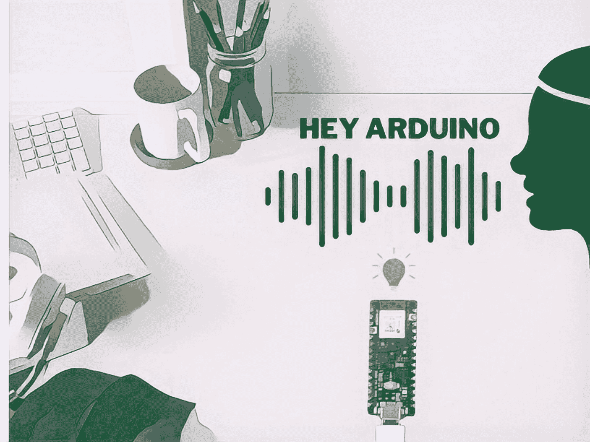

一张桌子上放着键盘、笔记本和一罐笔。文字显示“HEY ARDUINO”，旁边有声波图形。右侧是一个说话的人形剪影。下方是一个 Arduino 开发板，上面有一个灯泡图标，表示语音激活。

## 硬件要求

你需要一个麦克风来从 Arduino 开发板捕获音频。少数开发板内置了麦克风，包括：

*   Arduino Nano BLE Sense、Arduino RP2040 Connect 和 Nicla Vision（PDM 接口）
*   Seeed Studio Wio Terminal 和 LILYGO TTGO 系列（I2S 接口）

如果你没有这些开发板，可以购买一个外部麦克风并根据其要求进行连接。通常，用于 Arduino 开发板的麦克风有两种类型：

*   **PDM（脉冲密度调制）**：音频波形编码在数字脉冲的密度中，需要专门的软件进行解码。它通常只处理单声道音频，每样本 16 位。
*   **I2S（集成电路内置音频总线）**：音频输出已经编码，因此无需进一步处理。Arduino 生态系统中的 I2S 麦克风通常可以处理立体声音频，每样本 32 位。

在订购前，请确保你购买的麦克风与你的开发板兼容！

本章其余部分的代码清单假设你使用的是 Arduino Nano BLE Sense。你可以在本书的代码仓库中找到针对不同设备的更多示例。

## 软件需求

根据你使用的麦克风类型，需要安装相应的 Arduino 库。我提到的 Arduino 板卡自带了 Arduino 核心的官方 `PDM.h` 库。其他厂商的板卡可能附带类似的库。使用 I2S 麦克风时，通常需要利用内置的 `I2S.h` 库。

`tinyml4all` Arduino 库为大多数常见配置提供了一些实用适配器，以消除不同型号之间的差异，但无法保证 100% 覆盖。

在 Python 方面，你只需要 `tinyml4all` 包（你应该已经安装好了）。

## 捕获数据

为了构建“Hey Arduino”唤醒词检测的数据集，我们需要对着板卡大声说出这些词至少 30 次并进行录制。这些样本构成了我们的*正*数据集。正如第 1 章所强调的，分类任务需要预先知道所有类别。但我们这里只有一个类别，对吧？

并非如此。

事实证明，当处理只有单个*感兴趣类别*的问题时，你可以将其重新构建为一个二分类任务。这两个类别分别是感兴趣类别（“Hey Arduino”）和*非*感兴趣/未知类别（除“Hey Arduino”之外的所有声音）。

这个设定很重要，你需要意识到这一点。在训练过程中，你的分类器应该接触到所有可能的输入范围，才能变得可靠。如果你只让它看到有限的案例（例如，“Hey Arduino”和静音），你怎么能期望它对一个未知的声音（例如，“谢谢”）做出正确响应呢？

网上许多教程在这一点上都有所欠缺：它们只告诉你录制唤醒词和静音。如果你遵循那条路，模型很可能会对唤醒词以及几乎所有其他声音都做出响应，因为其他声音比静音更接近唤醒词。如果你不想花大量时间自己收集数据，一个可靠的方法是下载一个“野外声音”数据集，其中包含预先录制好的不同声音的音频样本（环境音、合成音或人声；例如，交通堵塞、洗碗机、铃声、动物吼叫声），稍后会重点介绍这一点。

> **提示**
> 由于这是一个生成式 AI 触手可及的时代，我还会向你展示如何利用文本转语音合成来生成人工训练数据，使你的模型能够更好地泛化到与你不同的声音。

考虑到这一点，在收集了 30 个正样本之后，让我们收集至少相同数量的*负*样本。它们可以是静音、噪音、Spotify 上的歌曲，或者是我们说出的不同于唤醒词的内容。最重要的是，这些样本应尽可能覆盖板卡在部署后、准备等待指定单词被说出时可能接收到的输入范围。

> **注意**
> 即使不是严格必要，我们也会建立一个包含三个类别的分类任务：*唤醒词、未知*（口语词汇）和*噪音*（环境声音）。这应该有助于模型更好地将相似的样本聚类到它们特定的类别中，而不是将所有内容合并到同一个标签下。

### 音频数据格式

音频数据的传输速度非常快。例如，Arduino Nano BLE Sense 内置麦克风的采样频率为 16 kHz。这意味着每秒必须读取、存储和传输 16,000 个值！由于生成的值是 16 位有符号整数（范围从 –32768 到 32767），从板卡传输到 PC 最紧凑的方式是二进制格式。如果我们采用 ASCII 编码（将它们写成纯数字）和 CSV 格式，每个值最终可能使用多达六个字符（五个数字，一个逗号）：这将浪费大量空间。

这意味着数据捕获的复制粘贴方法被排除了。由于 Arduino Nano BLE Sense 没有 Wi-Fi 硬件或内置 SD 卡读卡器，我们也将忽略它们。（如果你愿意，仍然可以连接外部 SD 卡读卡器。）

剩下的唯一方法是使用 `tinyml4all` Python 库进行数据摄取。这次，我们不会为每个类别创建一个包含所有数据的单一文件。我们希望为每个音频样本创建一个单独的文件，以便手动检查其质量，并在桌面文件系统中轻松处理。

Edge Impulse 在浏览器中也内置了数据捕获机制。它对于从智能手机捕获数据特别方便，但要使用你的微控制器，你必须安装 Arduino CLI（命令行界面），并且除非你的浏览器支持 WebUSB 标准，否则你必须安装他们自己的 CLI。我们不会走这条路，但你可以浏览他们的文档以了解更多信息。

### Arduino 草图

本节内容因你的板卡和麦克风而异。代码清单 6-1 适用于带有内置 PDM 麦克风的 Arduino Nano BLE Sense。你可以在本书的代码仓库中找到其他变体的更多示例。

该草图无需修改即可直接运行。你可能感兴趣更改的唯一参数是音量。它接受从 0（最小）到 100（最大）的值。音量越高，录制时你声音的强度就越大。

> **注意**
> 在高音量（70 及以上）时，你会开始听到失真，所以不要过度。

```cpp
/**
* 代码清单 6-1：从 PDM 麦克风收集音频数据。
*
* 所需硬件：Arduino Nano BLE Sense
* 所需硬件：或任何带有 PDM 麦克风的板卡
*            （例如，Nano RP2040 Connect）
*/
#include <PDM.h>
#include <tinyml4all.h>

tinyml4all::PDMicrophone mic;

void setup() {
  // 提高串口速度
  Serial.begin(115200 * 2);
  while (!Serial);
  Serial.println("收集音频数据");

  // 参考板卡数据手册了解麦克风频率
  // （例如，Nano RP2040 Connect 频率为 21kHz）
  mic.frequency("16 khz");

  // 音量范围从 0 到 100
  mic.volume(30);

  // 配置麦克风
  mic.begin();
}

void loop() {
  // 等待数据可用
  mic.await();

  // 通过串口发送
  mic.print();
}
```

烧录草图后，通过打开串口监视器确认板卡正在通过串口传输音频数据。输出看起来会像乱码，因为它是二进制数据，而不是文本（见图 6-2）。重要的是有内容被打印出来。现在，是时候运行 Python 收集器脚本了。

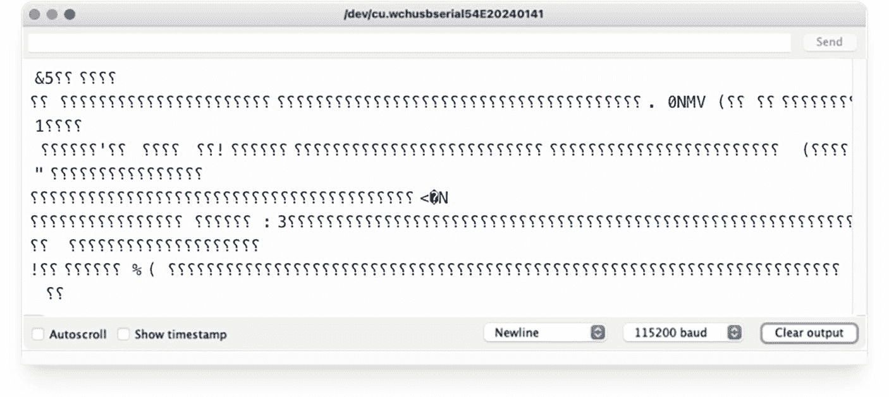

一个显示乱码文本输出的终端窗口，这可能是由于编码或波特率设置不正确造成的。窗口包含自动滚动、显示时间戳和设置波特率（当前为 115200）的选项。界面有用于发送输入和清除输出的按钮。

### Python 代码

在运行 Python 脚本（清单 6-2）之前，你必须配置几个参数。

*   你想要捕获的样本数量（不是秒数！）
*   开发板连接到了哪个端口
*   音频文件的存储位置

*   唤醒词的持续时间
*   捕获音频的频率

**注意**

请仔细检查 Python 中的频率是否与你的麦克风匹配。例如，Arduino Nano BLE Sense 的采样频率为 16 kHz，而 Arduino Nano Rp2040 Connect 的频率为 21 kHz。

请仔细检查 Python 中的波特率是否与 Arduino 代码中的一致！

```python
from tinyml4all.audio import capture_serial

if __name__ == '__main__':
    capture_serial(
        # * 是通配符匹配
        port="dev/cu.usb*",
        baudrate=115200 * 2,
        num_samples=30,
        word_duration="2 seconds",
        save_to="wakeword",
        mic_frequency="16 khz"
    )
```

清单 6-2 在 Python 中从串口捕获唤醒词

程序会提示你按 `[Enter]` 键确认开始捕获每个样本。确认后，请大声说出你的唤醒词。日志消息会告知你捕获的状态。

捕获非唤醒词的代码是相同的（见清单 6-3）。只需将文件保存到不同的文件夹即可。

```python
from tinyml4all.audio import capture_serial

if __name__ == '__main__':
    capture_serial(
        port="dev/cu.usb*",
        baudrate=115200 * 2,
        num_samples=30,
        word_duration="2 s",
        save_to="unknown",
        mic_frequency="16 khz"
    )
```

清单 6-3 在 Python 中从串口捕获非唤醒词

运行这两个脚本。你应该会得到两个文件夹，每个文件夹内包含 30 个音频文件。音频捕获过程可能并非完美无缺，因此请手动聆听每个样本以确认其质量良好。如果不好，请删除该文件并重新运行脚本。

## 第三方数据集

自行收集数据通常需要大量的时间和精力。即使你收集了少量数据，模型也可能存在泛化能力不佳的风险。以我们的关键词识别项目为例，假设你将想要识别的唤醒词重复了 100 次。这看起来是训练模型的合理数据量，对吧？是的，但前提是你能够容忍模型只识别你的声音！

*泛化能力*是指模型识别除你之外其他人说出相同唤醒词的能力。这正是商用家庭助手的工作方式，因为它们面向大众市场。如果你想达到类似的泛化水平，就需要在数据量和多样性上投入更多。

一个快速简便的捷径是在线搜索现有的数据集。数据科学行业在数据共享方面很有帮助，因此网上可能已经存在与你当前项目相关的数据集，例如 Mozilla 的 Common Voice（[`https://commonvoice.mozilla.org/en`](https://commonvoice.mozilla.org/en)）。这能极大地加快你的数据收集过程，并让你为数据增加高度的多样性。

Edge Impulse 为关键词识别问题提供了一个数据集 [1]。它包含了数百个 *Yes*、*No*、*Unknown*（既不是 *yes* 也不是 *no* 的任何词）和 *Noise*（环境声音）类别的样本。我们对 *Yes* 和 *No* 文件不感兴趣，因为我们有自己的唤醒词，但我们会借用另外两个类别的文件。因此，请导航到数据集页面，下载 ZIP 文件并将其解压到你的电脑上。

## 合成唤醒词生成

人工智能在过去几年中已变得无处不在。随着大型语言模型的开发，生成式人工智能行业在科学领域正经历着高速增长。事实证明，我们也可以将生成模型用于我们的 TinyML 项目。

借助当今主流的文本转语音合成工具，我们可以在几秒钟内快速生成大量音调、发音和音高的变体。我已经公开了一个数据集，其中包含数十个“Hey Arduino”唤醒词的样本，你可以从本书的代码仓库中下载。

接下来，让我们讨论如何生成这样的数据集。

### Azure 文本转语音

许多平台都提供文本转语音（TTS）工具。大多数是付费服务，但最大的平台——如 Microsoft Azure 和 Amazon Web Services——都提供免费套餐。`tinyml4all` Python 包提供了一个基于 Azure TTS 服务的实现，因此你需要在他们的网站上注册并创建一个免费的云实例 [2]。

完成后，你需要从 Azure 仪表板获取两条信息（见图 6-3）。

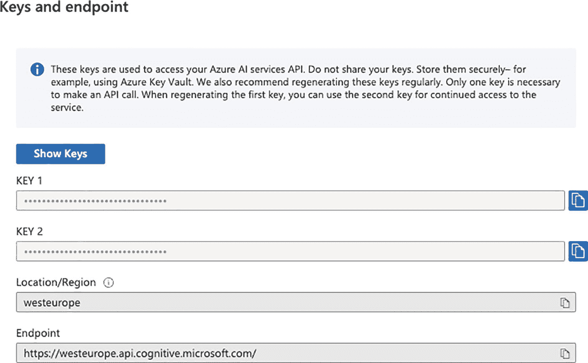

该图片显示了一个标题为“密钥和终结点”的部分，用于访问 Azure AI 服务 API。它包括一个标有“显示密钥”的蓝色按钮，以及两个字段“密钥 1”和“密钥 2”，出于安全考虑，两者均被隐藏。下方是设置为“westeurope”的“位置/区域”字段，以及显示为“https://westeurope.api.cognitive.microsoft.com/”的“终结点”字段。一条注释建议安全地存储密钥并定期重新生成。

*   `api_key`：一个用于标识你的字母数字字符串（*key1* 或 *key2* 均可）。
*   `region`：你的云实例所部署的数据中心。

现在，你可以在几秒钟内生成两个不同的数据集：*唤醒词* 和 *未知词*。

数据集生成过程分为以下几个步骤。

1.  对于输入语言，下载可用的合成语音列表。语音数量可能从英语的 56 种到小众语言的 2 种（男声和女声）不等。使用不同的语音可以使模型对不同人的音调和口音具有鲁棒性。
2.  生成 {语音、音高、语速、音量} 的组合元组，以进一步提高多样性。
3.  使用每种组合从文本合成语音。

对于英语，这可以迅速为给定的文本生成 500 多个样本！

#### 如何生成唤醒词数据集

在这种情况下，我们在文本选择上受到限制。当然，我们只能生成我们想要识别的确切关键词。创建一个新的 Python 脚本，激活你的虚拟环境，并运行清单 6-4 中的代码。脚本运行完成后，你将在指定的文件夹中找到 30 个音频文件（完成时间应少于一分钟）。

**注意**

请将粗体值替换为你自己的！

```python
from tinyml4all.audio import synthesize_speech

synthesize_speech(
    api_key="",
    region="",
    language="en-US",
    save_to="synthetic/wakeword",
    text="Hey Arduino",
    # 必须与清单 6-2 中的持续时间匹配
    duration="2 s",
    freq="16 khz",
    num_samples=30,
    # 音高百分比变化
    # 负值表示降低音高
    pitches=[0, -15, 15],
    # 语速百分比变化
    # 负值表示减慢
    rates=[0, -10]
)
```

清单 6-4 生成合成唤醒词

**注意**

`duration` 和 `freq` 必须与你使用 Arduino 开发板捕获真实数据时使用的值一致！

#### 如何生成未知数据集

在*未知*词汇方面，自由度更高。文本转语音只能合成口语词汇，无法生成环境音，因此我们随机选择一组与唤醒词时长相近的词汇。你可以随意输入尽可能多的变体，以便数据集能覆盖更多真实场景。清单 6-5 中的代码与清单 6-4 几乎相同；唯一变化的参数是 `save_to` 文件夹和 `text`。

```python
from tinyml4all.audio import synthesize_speech

synthesize_speech(
    api_key="",
    region="",
    language="en-US",
    save_to="synthetic/unknown",
    text=["Hello world", "Thank you", "Good morning"],
    # 必须与清单 6-2 中的时长匹配
    duration="2 s",
    freq="16 khz",
    num_samples=50,
    # 音高百分比变化
    # 负值表示降低音高
    pitches=[0, -15, 15],
    # 语速百分比变化
    # 负值表示减慢语速
    rates=[0, -10]
)
```

清单 6-5 生成合成未知词汇

你可以根据需求生成任意数量的合成数据。我建议至少生成 50 个样本。

**注意**

音频标签是根据文件最内层文件夹名称推断的。因此，请确保录制样本和合成样本共享相同的文件夹名称（*wakeword* 和 *unknown*）！

## 加载并检查数据

批量可视化检查音频数据不如表格数据和时间序列数据直观。尽管单个音频样本可以像时间序列数据一样绘制（尽管只有一个维度——强度），但连续绘制多个样本存在几个缺点：图表会变得非常长（每秒 16000 个样本 × 30 个样本 × 每个样本 2 秒，接近 100 万个数据点！），而且你无法轻松比较不相邻的样本。

请记住，评估样本质量的最佳方法是逐个聆听，但你可以尝试通过将样本沿时间轴对齐并叠加绘制，来直观检查唤醒词的相似程度。这样，每个样本应呈现共同模式，异常值也更容易发现。为了便于识别（可能的）异常值，我们生成一个交互式图表（见图 6-4），该图表会在你的网页浏览器中打开，并高亮显示鼠标悬停处的样本（见清单 6-6）。

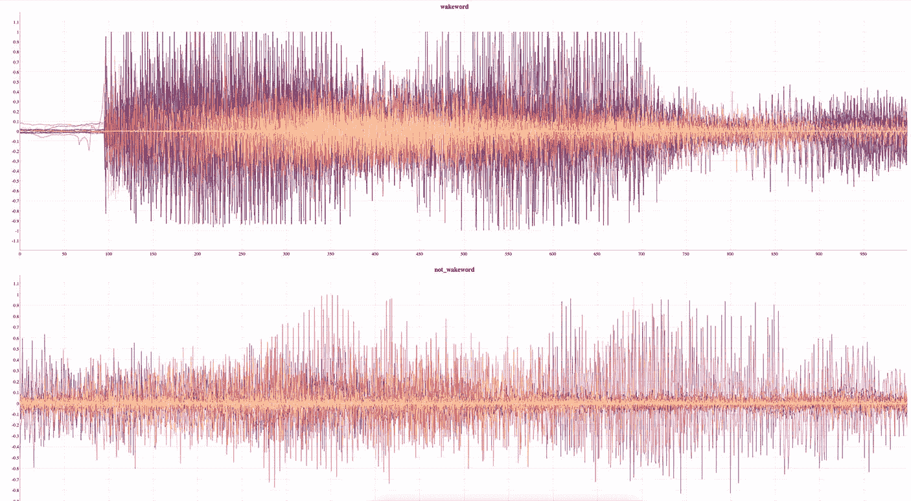

该图像显示了两张比较音频波形的折线图。上方图表标记为“wakeword”，显示了一条密集且波动幅度大的波形，表明有显著的音频活动。下方图表标记为“not_wakeword”，显示了一条密度较低、幅度较小的波形，表明音频活动较少。两张图表均使用从紫色到橙色的渐变来表示强度。x 轴代表时间，y 轴代表振幅。

图 6-4 音频样本重叠图

```
from tinyml4all.audio import Album
album = Album.read_wav_folders(
    "wakeword",
    "unknown",
    "synthetic/wakeword",  "synthetic/unknown"
)
# 绘制样本（重叠）
album.overlap_plot(
    palette="magma",
    samples_per_class=50,
    points_per_sample=1_000)
```

清单 6-6 从文件夹绘制音频文件（重叠）

如果你仍想将每个样本单独绘制在单个图表中并依次排列，请参考清单 6-7。结果如图 6-5 所示。

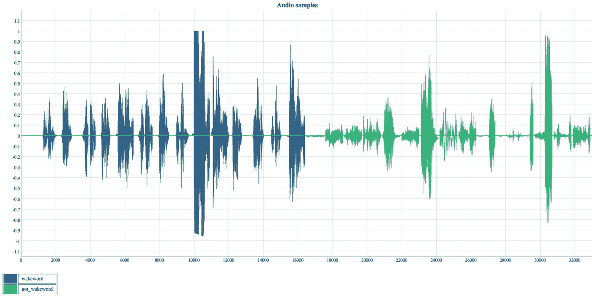

一张标题为“音频样本”的波形图显示了两个音频数据段。第一段标记为“wakeword”，以蓝色显示，振幅峰值较高，表示声音较大。第二段标记为“not_wakeword”，以绿色显示，振幅峰值较低，表示声音较安静。x 轴代表时间（以样本数计），范围从 0 到 32000；y 轴代表振幅水平，范围从 -1 到 1。左下角的图例通过颜色区分两个音频段。

图 6-5 音频样本顺序图

```
album.sequential_plot(
    palette="viridis",
    samples_per_class=10,
    points_per_sample=1_000)
```

清单 6-7 从文件夹绘制音频文件（顺序）

在图 6-4 中，两个类别的所有音频样本都沿同一时间轴对齐绘制。尽管每个样本的强度绝对值可能略有不同，但可以清晰地看到重复出现的模式。偶尔可能会有轻微的对齐偏差，但这完全在预期之内。将鼠标光标移到图表上即可高亮显示单个样本。

在图 6-5 中，唤醒词以蓝色显示，未知词以绿色显示。样本之间相互间隔，以提高可读性。你应该能看到唤醒词具有相似的形状（即使录制样本和合成样本之间存在差异）。未知样本则彼此不同。（前几个样本是静音，因此强度较低。）

我们的数据看起来不错，没有明显的样本损坏迹象。如果你的数据集并非如此，请删除损坏或明显错误的文件，并重新收集一些好的样本。

### Edge Impulse 数据采集

收集到足够数量的高质量数据后，请访问 [`https://edgeimpulse.com`](https://edgeimpulse.com) 并创建一个名为 `keyword_spotting` 的新项目。与第 4 章类似，你需要上传文件。这次没有预先配置的向导，你可以直接进入上传表单。分三次上传数据：首先上传唤醒词样本，然后上传未知词样本，最后上传噪声样本（来自之前下载的 Edge Impulse 合成数据集）。每次上传时，请务必执行以下操作。

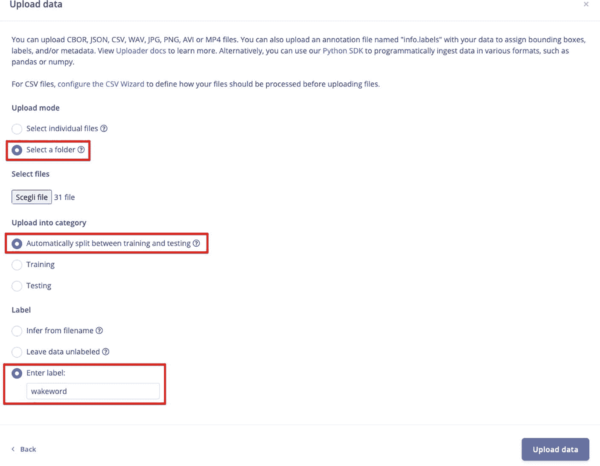

该图像显示了一个数据上传界面，包含文件上传选项。已选择“选择文件夹”进行文件选择，并勾选了“自动分割训练集和测试集”进行分类。标签字段已填写为“wakeword”。底部有一个标有“上传数据”的按钮。

图 6-6 Edge Impulse 数据上传表单

1.  手动输入正确的标签。
2.  勾选**自动分割训练集和测试集**复选框（见图 6-6）。

> **注意**
> 请上传你自己的数据以及合成/下载的数据！

## 特征工程

在本书的这个阶段，你应该知道特征工程是机器学习流程中的关键步骤。音频数据也不例外。除了通常的好处（更好的模型学习）之外，这种数据类型还有额外的好处。

*   **降维与计算效率**：原始音频数据包含大量信息，其中许多与关键词检测无关。特征提取有助于降低这种维度，专注于信号最重要的方面，从而创建更紧凑、计算效率更高的表示。
*   **降噪**：通过提取特定特征，我们通常可以将感兴趣的信号与背景噪声分离，从而提高关键词识别系统的鲁棒性。

必须考虑几个因素，因为人类对声音的感知是非线性的。关键词识别的标准特征描述符称为梅尔频率倒谱系数（MFCCs），但在理解它们是什么以及如何计算之前，你需要先了解什么是梅尔频谱图。

### 梅尔频谱图

梅尔频谱图是一种考虑人类如何感知不同频率的声音可视化表示。它广泛应用于音频分析和语音识别任务。要理解梅尔频谱图，让我们分解其组成部分及其创建过程。

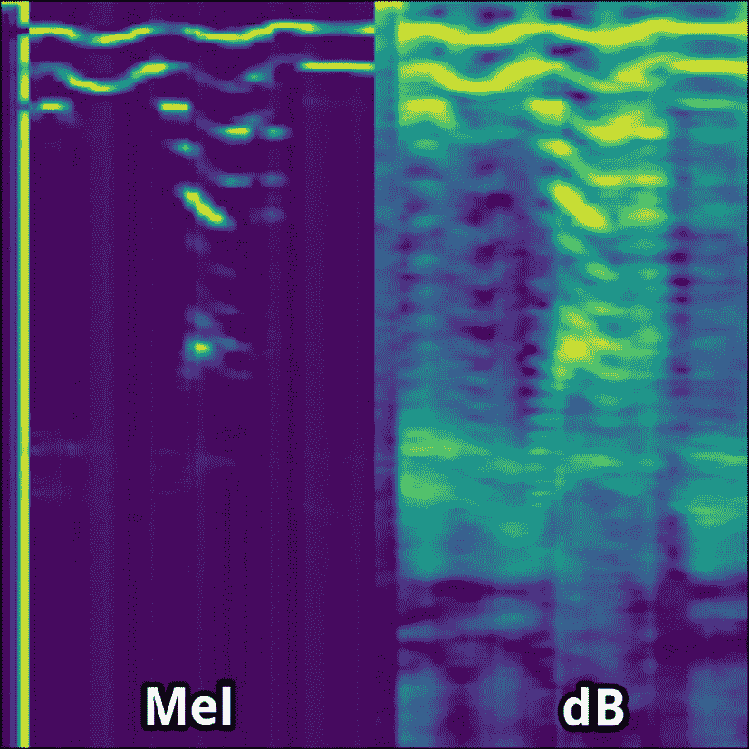

一张对比图展示了两种频谱图。左侧标注为"Mel"的梅尔频谱图显示紫色和绿色强度不等的水平带状区域。右侧标注为"dB"的分贝频谱图呈现相似模式但颜色对比不同。两种频谱图均展示了声音频率随时间的变化。

图 6-7 对数压缩前（左）与后（右）的梅尔频谱图

*   **短时傅里叶变换（STFT）**：创建梅尔频谱图的第一步是对音频信号执行 STFT。STFT 是一种分析信号频率内容随时间变化的技术。它通过将信号分割成短时重叠片段（通常每个片段 20-40 毫秒），并对每个片段应用傅里叶变换来实现。傅里叶变换将时域信号转换为频域信号，显示存在的频率及其各自的振幅。
*   **频谱图**：STFT 的结果是频谱图，一种二维信号表示。横轴代表时间，纵轴代表频率，每个点的强度代表该频率在特定时间点的振幅或能量。为了更直观地理解，你可以将这个矩阵可视化为图像（见图 6-7，左图）。
*   **梅尔刻度**：人耳以非线性方式感知音高。我们对低频变化的敏感度高于高频变化。梅尔刻度是一种旨在模仿人类感知的音高感知刻度。它在 1000 Hz 以下近似线性，在 1000 Hz 以上呈对数分布。
*   **梅尔滤波器组**：为了将频谱图转换为梅尔频谱图，我们应用一系列称为梅尔滤波器组的三角滤波器。这些滤波器根据梅尔刻度分布，在低频范围内有更多滤波器，在高频范围内则较少。每个滤波器计算特定频率范围内的平均能量，并按滤波器的三角形形状进行加权。
*   **对数压缩（dB）**：应用梅尔滤波器组后，我们对得到的能量取对数。这一步至关重要，因为人类对响度的感知近似对数关系。它有助于压缩频谱图的动态范围，使较安静的声音更可见，并减少响亮声音的主导地位（见图 6-7，右图）。

相对于原始 STFT 矩阵，梅尔频谱图的纵轴代表梅尔频带而非线性频率，颜色或强度代表每个时间点每个梅尔频带中对数压缩后的能量。

为什么梅尔频谱图对音频关键词识别如此有效？

*   **感知对齐**：梅尔刻度与人类听觉感知高度一致，聚焦于对语音识别最重要的频率范围。
*   **时频表示**：梅尔频谱图同时捕获时间和频谱信息，这对识别语音模式至关重要。
*   **鲁棒性**：梅尔频谱图对音高和说话者特征的微小变化相对鲁棒。

### 梅尔频率倒谱系数

梅尔频谱图本身已是一个很好的特征描述符。它是一个可以直接输入卷积神经网络（CNN）并取得良好效果的矩阵。MFCC 是一个从该矩阵中生成子集（类似于特征选择）的过程。但如果梅尔频谱图已经是有效选项，为什么还要增加另一个步骤？这真的值得吗？

是的，通常值得。MFCC 提取实现了两个重要目标。

*   **有效的降维**：降维在第 2 章中介绍过。然而，MFCC 是以一种不同的、特定于音频的方式计算的。它们仅使用离散余弦变换（DCT）从原始梅尔频谱图中选择 12 到 20 个特征，该变换能生成高度去相关的输出。
*   **噪声鲁棒性提升**：通过丢弃较高频率分量，MFCC 表现出更好的噪声抑制能力。

这个过程的结果是一个 MFCC 值矩阵，其中每列代表一个时间帧，每行对应一个倒谱系数。行数等于保留的系数数量（12–20），列数取决于音频时长和分析中使用的帧率（例如，1 秒音频被分割成 40 毫秒的非重叠窗口 = 25 个时间切片）。

## 使用 Edge Impulse 进行音频分类

作为一个低代码工具，Edge Impulse 隐藏了 MFCC 的所有实现细节。在"创建脉冲"页面上，请进行以下选择。

*   **窗口大小**：应与音频样本匹配（2000 毫秒）。
*   **窗口增量**：应足够大以允许推理运行，但不宜过大以免错过关键词。同时，它应为 1000 的整数除数，以便与 `tinyml4all` Arduino 库对齐。一个好的默认值是 250 毫秒。
*   **处理模块**：音频（MFCC）。
*   **学习模块**：分类。

接下来，转到侧边菜单上的 MFCC 页面，配置特征提取器（见图 6-8）。你可以调整一些选项，但在做出任何更改之前，你应该清楚自己在做什么。在我们的案例中，默认设置效果良好，因此我们不会修改此页面。如果你后来发现模型性能不佳，可以随时返回此处。以下是一些可调选项。

*   **系数数量**：可以增加此值以增加保留的特征数量。
*   **帧长和步长**：可以增加帧长并使步长成为其除数，以创建重叠窗口。
*   **FFT 长度**：较大的值会计算更多系数。由于 FFT 是一项计算成本较高的操作，我建议你尽可能保持此值较低。

保存参数并在下一个选项卡中生成特征；当过程完成时，特征探索器可以让你了解特征聚类的情况。

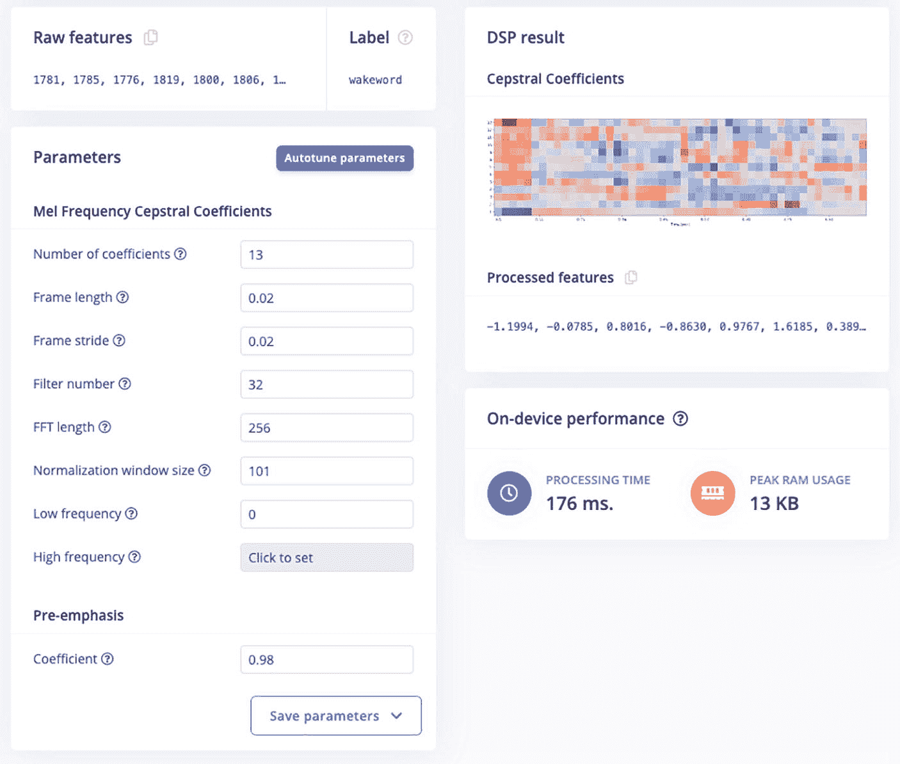

图 6-8 Edge Impulse MFCC 配置

### 卷积神经网络

我们现在处于分类阶段。第 4 章使用了由两层神经元组成的全连接神经网络。既然我们的特征是一个向量列表，那么那种拓扑结构可能并非最佳解决方案。对于图像分类任务，另一种拓扑结构通常能达到最先进的精度：卷积神经网络（CNN）。

第 8 章将深入探讨 CNN。现阶段，你只需要知道卷积可以在不同的维度深度上发生：1D 和 2D 是最常见的。1D 卷积适用于序列数据（例如，原始时间序列），而 2D 卷积适用于矩阵（例如，图像）。

卷积是一种高效的算子，它每次只考虑数据的小区域（称为*补丁*），而不是像全连接网络那样单独处理每个值。一个补丁可以是 1D 情况下的一个短序列，也可以是 2D 情况下的一个小矩阵（例如，图像分类任务中常见的值是 3×3 或 5×5）。卷积*滤波器*（也称为*核*，一个与补丁大小相同的系数矩阵）在输入数据的每个区域上滑动，并执行两者之间的点积（即，其系数与补丁值逐元素相乘后的总和），以产生单个输出值（见图 6-9）。

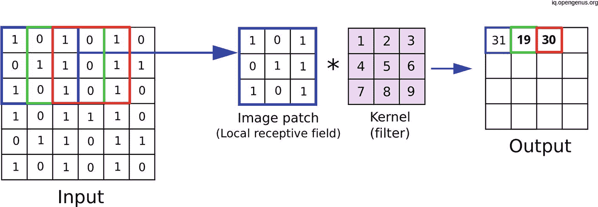

图 6-9 2D 卷积过程

核系数用随机值初始化；然后学习过程包括更新它们的值，以使分类结果达到最高精度。

从内存角度来看，卷积相比全连接有了巨大的改进，因为需要存储的权重数量与输入大小无关。例如，同一个 3×3 卷积滤波器既适用于 96×96 的图像，也适用于 512×512 的图像；它只需要滑动更多次。

MFCC 通常被表示为图像，但从技术上讲，它们并非图像（它们不描绘现实世界的实体，并且向量之间并非真正的“空间”相关）。这就是为什么 Edge Impulse 允许你为音频分类选择你偏好的架构。对于这种类型的输入数据，1D 卷积是最自然的选择，但你仍然可以将 MFCC 矩阵视为图像并使用 2D 卷积。由于 1D 卷积比 2D 更轻量级，并且通常表现出更好的精度，因此默认选择它（见图 6-10）。

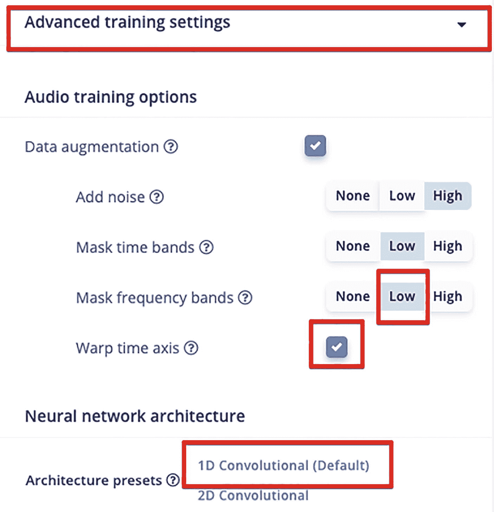

图 6-10 Edge Impulse 训练配置

你还可以调整几个训练参数以加快训练速度。

*   **训练周期数**：这决定了模型应该学习多长时间。样本较少时，50 是一个不错的默认值。
*   **学习率**：它控制模型在每个周期更新其权重的程度。我常用的值是 0.005（较低的值可能会带来更高的精度，但可能需要更多的训练周期）。

由于我们的数据集有限，我们可以将模型训练少至 30-50 个周期，同时仍能达到非常好的精度，如图 6-11 所示。在刚开始并快速迭代模型时，请保持较低的周期数，并监控日志中显示的指标是否随时间改善。如果模型精度从第 30 个周期开始就保持不变（这在简单数据集上经常发生），那么等待 100 个周期的训练就是浪费时间。

如果你的训练过程和我的一样，你可能会担心*噪声*和*未知*类别的“低”精度（约 85%）。但请记住，本项目只对唤醒词类别感兴趣。如果模型将未知类别的样本与噪声类别的样本混淆，这对我们来说不是问题！

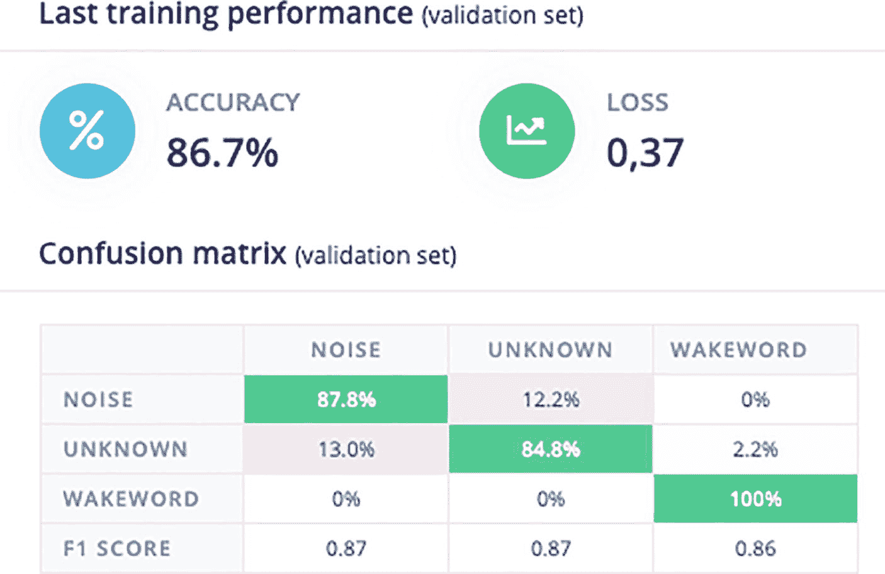

图 6-11 Edge Impulse 混淆矩阵

## 测试

如果训练页面上的混淆矩阵符合你的预期，请转到模型测试页面（从左侧菜单），以评估模型在训练或验证期间从未见过的音频上的精度。点击**全部分类**按钮并等待结果。在最佳情况下，所有行都是绿色的（表示完美预测）。在像我们这样使用合成数据的现实场景中，你可能会得到看起来比训练时更差的结果（见图 6-12）。这完全正常且在意料之中。

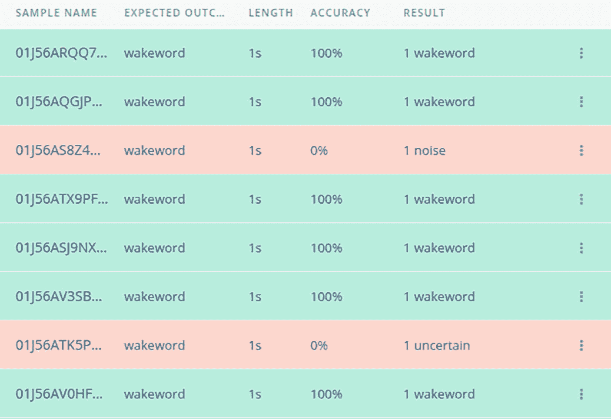

图 6-12 Edge Impulse 唤醒词检测测试结果

虽然大多数唤醒词被正确识别，但存在一些错误（带有*噪声*标签的行），甚至还有几个*不确定*的分类。这些分类是指检测到唤醒词，但置信度被认为过低而不可靠。你可以通过点击**全部分类**按钮右侧的齿轮图标并选择**设置置信度阈值**来配置“可接受的”置信度。我通常设置为至少 0.6。

花些时间手动检查一些错误（点击行右侧的三个点并选择**显示分类**），以理解模型失败的原因，以及被错误分类的样本中是否存在重复模式。如果你觉得模型在精度方面不符合你的期望，请返回训练页面并调整上一节中介绍的参数（模型架构、训练周期数、学习率）。重复此过程，直到获得更好的结果。

提示：如果你无论如何努力调整训练过程仍然无法获得好的结果，原因可能是数据集不佳。花时间收集更多数据，或者将一些分类失败的样本移动到训练集中（点击红色行右侧的三个点并选择**移动到训练集**），然后重新训练模型。

## 部署

以 Arduino 库格式下载模型（参考第 4 章），并将 ZIP 文件解压到你的 Arduino 库文件夹中。如果你将项目命名为`keyword_spotting`，则该库的名称为`keyword_spotting_inferencing`。

### 连续分类

短时傅里叶变换（STFT）作用于小窗口数据（通常为 20–40 毫秒），其结果用于生成梅尔频谱图。当新数据块到达时，最旧的数据块会被丢弃以腾出空间。为每个数据块重新计算傅里叶变换会浪费时间和资源，因为其结果不会改变。

Edge Impulse 内置了一种机制来处理这种*连续*数据流，你可以利用它实现接近实时的分类速度。要充分利用此技术，请将清单 6-8 中的 `EI_CLASSIFIER_SLICES_PER_MODEL_WINDOW` 设置为与你在脉冲设计页面中设置的相同值。

# 总结

## 清单 6-8

```
/**
* 清单 6-8：使用 Edge Impulse 进行音频唤醒词检测
*
* 所需硬件：Arduino Nano BLE Sense
*/
// 下一行 *必须* 与 EI Studio 脉冲设计页面中的窗口增量值匹配
#define EI_CLASSIFIER_SLICES_PER_MODEL_WINDOW (1000 / 250)
#include 
// 替换为从 Edge Impulse Studio 下载的库的正确名称
#include 
#include 
tinyml4all::PDMicrophone mic;
tinyml4all::Impulse impulse;
void setup() {
Serial.begin(115200);
while (!Serial);
Serial.println("使用 Edge Impulse 进行关键词识别");
// 使音量与数据采集时使用的音量匹配！
mic.frequency("16 khz");
mic.volume(30);
mic.begin();
// 初始化 Edge Impulse 库
impulse.begin();
// 测试期间，可以通过将此值设置为 true 来启用详细输出
impulse.verbose(false);
}
void loop() {
// 等待音频数据准备就绪
mic.await();
// 将数据送入脉冲队列
if (!impulse.queue(mic)) {
Serial.println(impulse.error());
return;
}
// 跳过非唤醒词
if (impulse.label() != "wakeword")
return;
Serial.print("检测到唤醒词，置信度：");
Serial.println(impulse.confidence());
// 在此处自定义你自己的逻辑
}
```

清单 6-8 使用 Edge Impulse 进行关键词识别的 Arduino 草图

编译草图（需要几分钟），然后上传。打开串口监视器并大声重复唤醒词。你应该会看到检测成功（见图 6-13）。

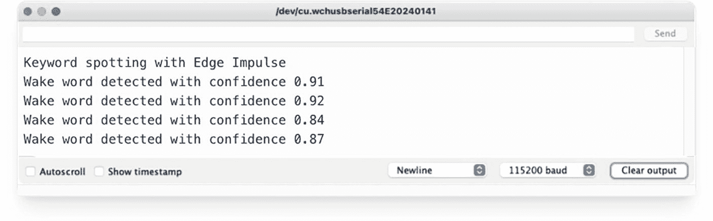

## 图 6-13

一个计算机终端窗口显示了使用 Edge Impulse 进行关键词识别的结果。它展示了多次检测到唤醒词的实例，置信度分别为：0.91、0.92、0.84 和 0.87。界面包含自动滚动、显示时间戳、换行、波特率设置为 115200 以及清除输出按钮等选项。

唤醒词检测输出

推理速度相当不错。单次推理仅需 77 毫秒。并且由于 PDM 麦克风在后台任务中捕获数据，因此没有等待队列，在执行推理时也不会丢失数据块。

一旦这个唤醒词检测项目运行起来，你可以收集更多词语进行分类。也许你可以实现一个本地音乐播放器助手，通过语音检测“播放”、“暂停”和“下一首”来控制你的音响——或者用“白天”和“夜晚”来控制你家的灯光。可能性是无限的。

## 提示

尽量保持你的唤醒词简短（一到两秒），否则处理时间可能会太长！

本章介绍了一种新的数据类型：音频。这是一种非常密集的数据类型（每秒数千个样本），但得益于 `tinyml4all` 库，我们能够快速收集训练数据。我们还能够利用生成式 AI 在几秒钟内创建合成数据集。

Edge Impulse 低代码平台使得使用高级算法（快速傅里叶变换、梅尔频谱图和 MFCC）提取复杂特征，并使用卷积神经网络对其进行分类变得轻而易举。

部署过程与第 4 章非常相似。通过复用梅尔频谱图中的先前计算结果，我们得以实现惊人的推理速度：每秒 13 次分类（每次分类 77 毫秒）。

下一章将使用 ESP32 摄像头进行实时目标检测，探讨图像处理。