# 7. 使用 Edge Impulse 进行目标检测

你已经接触到了本书中的最后一种数据类型：图像。图像在我们的日常生活中如此普遍，以至于我们低估了它们的复杂性和信息密度。我们的大脑经过数千年的进化，即使在恶劣的环境条件（弱光、遮挡、模糊等）下也能提取这些信息。训练一个计算机程序来复制同样水平的精度是一项高要求的任务，在许多应用场景中仍不如人类。

尽管如此，该领域已经取得了巨大进步，如今我们拥有许多工具来执行目标检测，即识别图像中感兴趣的目标。这与纯分类不同：对图像进行分类意味着为*整个*图像分配一个标签。而目标检测则是对图像的*区域*进行分类，允许同一张图像中存在多个感兴趣的目标。甚至可以是多个不同类别的目标！

为了降低在资源受限设备上进行目标检测这一难题的门槛，我们再次利用 Edge Impulse 平台。到现在，你应该已经意识到这个平台是多么多功能强大，以及它如何简化了开发过程。本章将训练一个模型来识别一个单一的感兴趣目标——一个玩具企鹅（见图 7-1）。熟悉此方法后，你可以扩展项目以识别许多不同的目标，几乎无需修改。

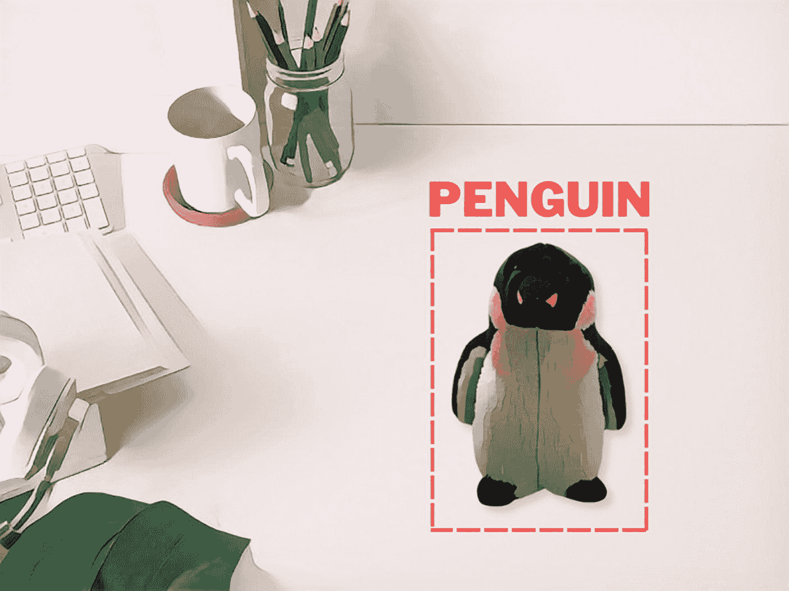

一张桌子上放有键盘、马克杯和一罐铅笔。右侧，一个毛绒企鹅玩具被红色虚线框出，并标有粗体红色文字“PENGUIN”。

图 7-1 目标检测目标

## 硬件要求

你需要一块支持摄像头的开发板。有几款开发板自带摄像头。

*   **基于 Arduino 的**：Nicla Vision、Portenta H7 + 视觉扩展板
*   **基于 ESP32 的**：AiThinker、XIAO Sense、TTGO 系列、M5Stack 系列、ESP-EYE

否则，你可以尝试更基础的 OV7670 摄像头，它可以与许多开发板（例如 Arduino Nano BLE Sense 或 Raspberry Pi Zero）配合使用。但我不建议你走这条路，因为其质量低且接线困难。

注意：在寻找 ESP32 摄像头时，请注意至少有两种芯片变体。ESP32 是“第一代”芯片，价格和规格较低。ESP32-S3 是“下一代”芯片：价格稍高，但性能提升巨大。如果可能，请选择 S3 变体！

## 软件要求

`tinyml4all` Arduino 库为基于 ESP32 和 Arduino 的摄像头提供了实用适配器，因此代码保持不变。如果你打算使用 OV7670 型号，则需要编写自己的代码来从中捕获帧。

在 Python 方面，你只需要 `tinyml4all` 包（你应该已经安装过了）。

## 采集数据

要构建目标检测数据集，你需要采集一些图像。多少张图像才能构成一个优质数据集？通常来说，数量越多越好。但根据我的经验，每个目标只需 50 张图像就能取得不错的效果。

注意：你需要手动标注采集到的每一张图像，因此请从少量开始，仅在必要时再增加数量！

你在网上找到的许多教程建议使用来自谷歌/互联网的图像来训练模型。另一些教程则建议使用智能手机采集数据。尽管由于模型的泛化特性，这种方法可能效果不错，但我强烈建议你使用与运行推理（即微控制器本身）相同的硬件来采集自己的数据。这样能更好地模拟你的部署场景，通常也能获得更高的准确率。

提示：嵌入式摄像头传感器通常画质较差，且易受环境因素（如光照不足）影响，而智能手机则会自动修正大部分此类问题。在智能手机图像上训练的模型，在嵌入式传感器图像上可能表现不佳。

### 用于采集图像的 Arduino 程序

让我们通过串口发送采集到的帧。如果你愿意，也可以使用 SD 卡（大部分代码无需改动，只需将数据写入文件即可）。代码清单 7-1 已在 ESP32-S3 摄像头上测试通过：如果你使用不同型号，请查阅本书代码仓库。

提示：如果使用 ESP32 或 ESP32S3，请从 Arduino IDE 的“工具”菜单中启用外部 PSRAM 选项。

```
/**
* 代码清单 7-1：从摄像头采集图像
*
* 所需硬件：ESP32 摄像头
*/
#include 
tinyml4all::Camera camera;
void setup() {
// 提高串口速度以实现快速数据传输
Serial.begin(115200 * 2);
while (!Serial);
Serial.println("采集图像");
// 从列表中选择型号
camera.promptModel();
// 下次使用时，可以直接通过名称设置
// camera.setModel("aithinker");
// 配置摄像头为采集模式
camera.collecting();
// 初始化摄像头（失败时会抛出错误）
camera.begin();
}
void loop() {
// 抓取新帧
if (!camera.grab()) {
Serial.println("无法抓取新帧");
return;
}
// 将帧数据打印到串口（供 Python 读取）
camera.print();
delay(1000);
}
```

代码清单 7-1 通过串口发送图像

提示：为提高传输速度，串口速率已调高。由于存在一秒的延迟，速度提升并不明显（仅节省几毫秒），但在以更高频率采集图像时会派上用场。

烧录程序后，打开串口监视器确认开发板正在通过串口传输图像数据。输出看起来会像乱码，因为这是二进制数据而非文本。重要的是有内容被打印出来。现在，可以运行 Python 采集脚本了。

提示：如果初始化摄像头时出现奇怪的错误信息或开发板重启，请仔细检查是否从提示菜单中选择了正确的型号。

### 用于读取图像的 Python 代码

在 Python 端，代码与之前章节使用的类似。像往常一样，你需要配置串口、要采集的样本数量以及目标文件夹（代码清单 7-2）。程序会显示摄像头预览，以便你在需要时调整摄像头位置（见图 7-2）。

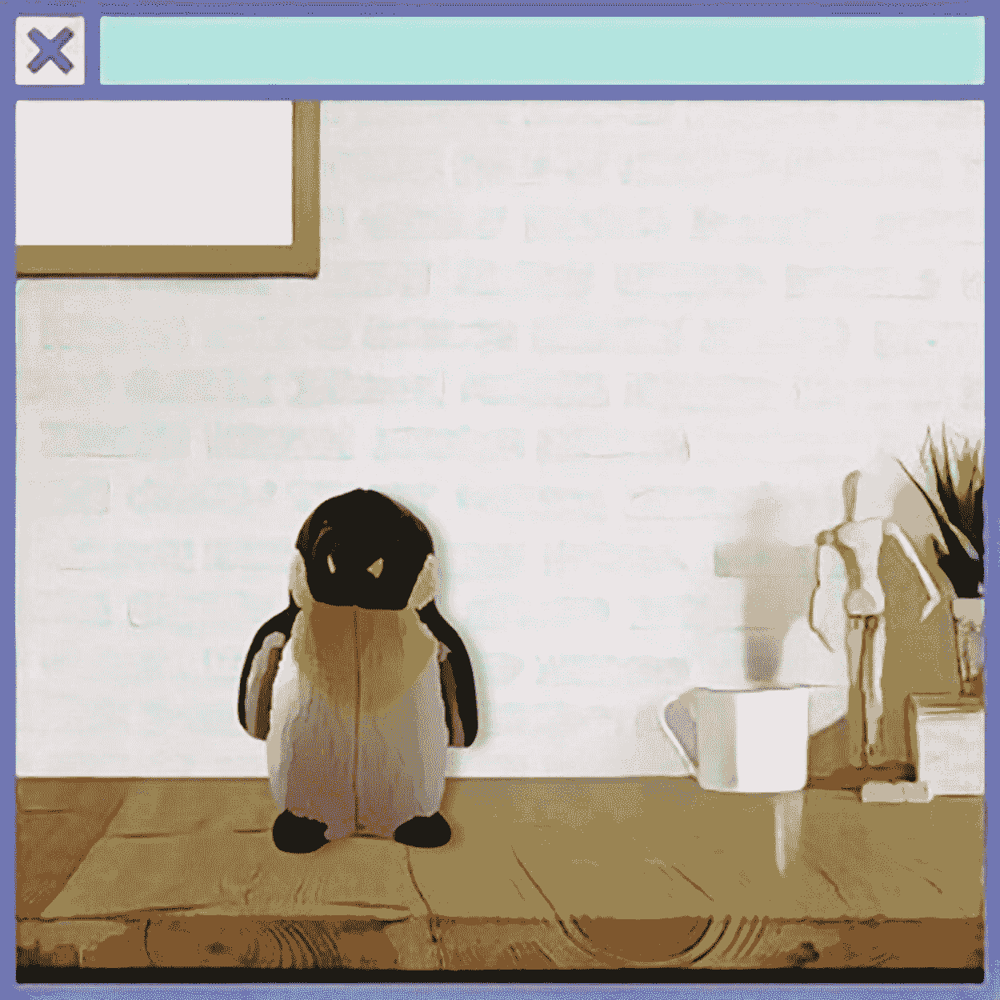

一幅数字插图：木制表面上的企鹅玩具，背景是白色砖墙。右侧有一个木制艺术家人体模型，旁边是一个白色马克杯和一株小绿植。场景仿佛通过电脑窗口观看，左上角有蓝色标题栏和红色“X”按钮。

图 7-2 图像采集预览窗口

```
from tinyml4all.image import capture_serial
while True:
# 提示用户输入目标名称和图像数量
object = input("这是什么目标？ ")
num_samples = input("要采集多少张图像？ ")
# 如果目标名称或数量为空则退出
if not object or not num_samples:
break
capture_serial(
# * 是通配符，可匹配任意内容
# 在 Windows 上会显示为 COM1 或类似名称
port="/dev/cu.usb*",
# 必须与 Arduino 程序中的设置一致
baudrate=115200 * 2,
save_to=f"objects/{object}",
num_samples=int(num_samples)
)
```

这是什么目标？ penguin
要采集多少张图像？ 30
已连接到串口
100%|██████████| 30/30 [00:33<00:00,  1.35 秒/张]
已断开串口连接

代码清单 7-2 通过串口采集图像

将目标放置在正确位置，最好位于画面中央且光照良好，然后完成采集过程。接下来，打开目标文件夹，使用操作系统文件管理器仔细检查图像是否清晰。

你至少需要运行两次采集会话。

*   采集你感兴趣的目标
*   采集背景数据（无目标）

*背景*数据的作用与第 6 章介绍的*未知*类别相同；它向模型提示目标*不*像什么。请随意采集周围环境的图像，包括椅子、电脑显示器、墙壁和窗户。图像变化越丰富，效果越好。

## Edge Impulse 数据采集

收集到足够数量的优质数据后，请前往 [`https://edgeimpulse.com`](https://edgeimpulse.com) 并创建一个名为 `object-detection` 的新项目。如你在第 6 章所见，必须上传文件才能开始（见图 7-3）。该过程与我们的音频项目完全相同。

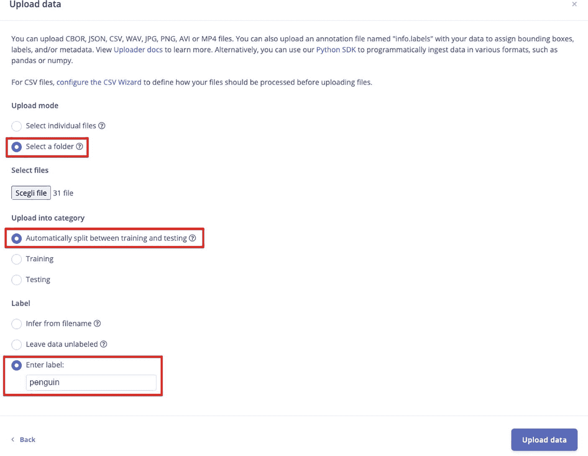

数据上传界面的截图。选项包括选择文件夹上传文件，已选择 31 个文件。文件可自动分割为训练集和测试集，或手动分配到训练或测试类别。标签字段已填写"penguin"。底部有一个"上传数据"按钮。

图 7-3 Edge Impulse 数据上传表单

1.  选择单个文件或整个文件夹。
2.  手动输入正确的标签。
3.  勾选`自动分割为训练集和测试集`复选框。

但先别这么做！在上传你收集的所有图像之前，请先阅读下一段！

你可能会在上传表单处想一次性上传所有文件。这是个糟糕的做法。这是一个目标检测项目，但你尚未在 Edge Impulse 中定义感兴趣的目标是什么。**首先，上传你感兴趣目标的图像**（在我的例子中是企鹅玩具）。上传完成后，系统会提示你是否为目标检测项目（见图 7-4）。点击`是`。

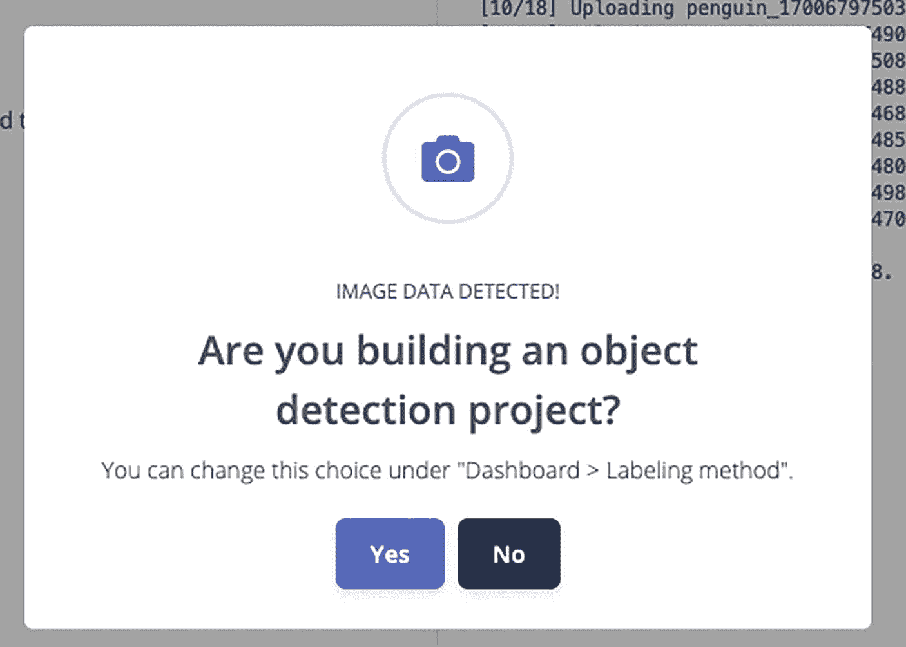

一个弹出窗口，顶部有相机图标，消息为"检测到图像数据！您是否正在构建目标检测项目？"消息下方有一条注释："您可以在'仪表盘 > 标注方法'下更改此选择。"底部有两个按钮，分别标有"是"和"否"。

图 7-4

Edge Impulse 标注方法选择

不要继续上传更多图像，关闭表单并点击顶部菜单中的`标注队列`（见图 7-5）。


界面显示导航标签"数据集"、"数据源"和"标注队列"，其中"标注队列"以红色高亮显示，并指示有 18 个项目。

图 7-5

Edge Impulse 标注队列菜单项

一个新窗口打开，你可以在中央看到你的图像，并显示消息："使用鼠标在对象周围拖出一个框以添加标签。然后点击`保存标签`以进入下一项。"这就是你要对所有图像执行的操作：在每个感兴趣的目标周围画一个框，并为其分配正确的标签。如果保持选中`在帧之间跟踪对象`，过程会更快，因为通常你只需对自动定位的边界框进行微调（见图 7-6）。

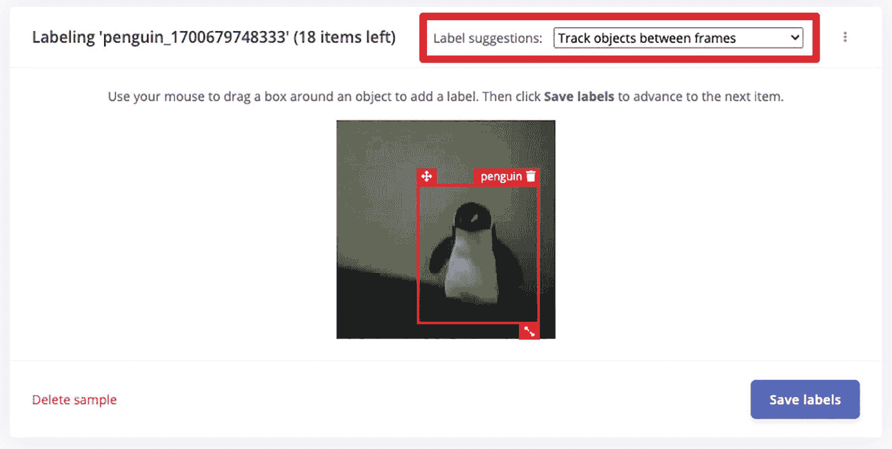

标注界面的图像，显示一张企鹅玩具的照片。企鹅被一个粉色框标出，标签为"penguin"。图像上方有一个下拉菜单，选项为"在帧之间跟踪对象"。图像下方可见"删除样本"和"保存标签"按钮。

图 7-6

Edge Impulse 边界框绘制工具

提示

如果你一次性上传所有图像，标注队列会混合不同的对象，你将浪费大量时间绘制边界框！

如果你有更多对象，请逐个上传并分别进行标注。完成感兴趣目标的图像后，再上传*背景*图像。然后再次打开标注队列，不绘制任何内容直接点击`保存标签`。由于这是背景，无需高亮任何内容。

## 特征工程

图像分类和目标检测的特征工程是不存在的。或者更准确地说，它已内置于模型中。如第 6 章所述，对于图像而言，参考神经网络架构是*卷积*神经网络。即使很难"看清"卷积神经网络中间层究竟发生了什么，但一种直观的定性解释是：随着输入在网络中向前传播，这些滤波器（每层都有许多滤波器）会学习识别越来越复杂的模式和特征。第一层通常学习边缘和角点等基本特征，而更深层则学习识别基本形状和纹理（见图 7-7）。

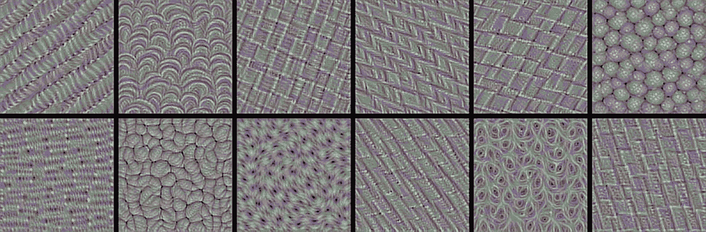

一个由十二个抽象图案组成的网格，每个图案都具有精细、多彩的设计。图案包括波浪线、锯齿形、圆形图案和网格状结构，主色调为紫色、绿色和红色。每个部分都展现出独特的纹理和排列，形成视觉上复杂且充满活力的拼贴画。

图 7-7

二维卷积神经网络内部层的激活图

卷积神经网络的关键在于其建模能力如此高效，以至于它能自行找出如何最好地检测不同类别中的重复模式。几十年前还是手动完成的任务，如今已完全自动化。

### 脉冲设计

由于针对此类数据的处理和分类模块是固定的（见图 7-8），因此这里你能做的操作不多。但你仍然需要做出两个重要决定。

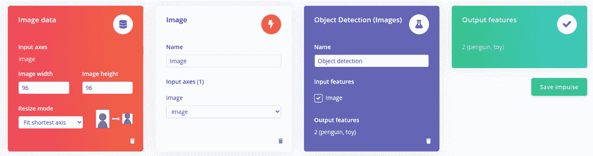

该图像显示了一个用于配置图像数据和目标检测设置的用户界面。第一个面板“图像数据”显示了标记为“图像”的输入轴，宽度和高度设置为 96，并有一个调整大小模式选项。第二个面板“图像”包含一个用于命名图像和选择输入轴的字段。第三个面板“目标检测（图像）”允许命名目标检测过程、选择输入特征，并将输出特征列为“2（企鹅，玩具）”。最后一个面板“输出特征”确认了输出特征，并包含一个“保存脉冲”按钮。

图 7-8

用于目标检测的 Edge Impulse 设计页面

*   `图像尺寸`：你的摄像头可以以不同分辨率捕捉帧。一个相当常见的分辨率是 320×240 像素。尽管与我们日常接触的照片（几百万像素）相比，这个分辨率看起来很小，但它已经处于图像分析光谱的高端范围。大多数“移动端”神经网络（旨在运行在低端 CPU 上，比如几年前的智能手机或树莓派）处理的是 192×192 或更小的图像。你的开发板甚至可能无法处理那个尺寸！

为了避免内存不足错误，我建议从 RGB 模式下的 80×80 或灰度模式下的 96×96 尺寸开始。如果模型性能不佳并且你有足够的资源来运行更大的模型，你随时可以稍后回来提高分辨率。我不建议你尝试任何高于 128×128 的尺寸。

*   `颜色深度`（在图像页面上）：大多数摄像头可以以 RGB 或灰度模式捕捉图像。即使你捕捉的帧是 RGB 格式，你也可以强制模型以灰度模式处理它们。为什么要这样做？当然是由于内存限制的原因。直观上，你可以预期 RGB 模型在存储中间结果时需要的内存是灰度模型的三倍，执行时间也是其三倍。除非你的开发板有大量 RAM，否则这可能是难以承受的，并会阻止你的模型正常工作。

在模型配置步骤中，Edge Impulse 提供了两种适合微控制器的替代架构。（它们为树莓派/Jetson Nano/PC 目标提供了更多选项）。

*   FOMO MobileNetV2 `0.1`

*   FOMO MobileNetV2 `0.35`

注意

FOMO 代表“更快目标，更多目标”（Faster Objects, More Objects），是 Edge Impulse 团队为其定制的、优化的目标检测实现所起的品牌名称。

首先，这两种模型都源自 `MobileNetV2[1]`，这是一种为移动设备（如我们的智能手机）设计的轻量级高效卷积神经网络架构。然而，智能手机的性能仍然比微控制器高出几个数量级（拥有千兆字节的 RAM，CPU 频率在千兆赫兹范围内），因此该网络对于本书定义的“微型”来说仍然过于庞大。

这就是其名称后面的小数发挥作用的地方。它被称为宽度乘数，用于控制网络中的滤波器数量。正如第 6 章简要介绍的，卷积层由许多滤波器（或卷积核）组成。宽度乘数从原始数量开始，对这些滤波器的数量进行缩减。宽度乘数为 `0.1` 意味着只使用原始滤波器数量的 10%；`0.35` 意味着大约使用三分之一的数量。

巨大的成就在于，网络总权重的减少与该乘数成*二次方*比例。由于卷积层中的权重数量取决于输入通道数、输出通道数和卷积核大小，因此将滤波器数量缩放 `α` 倍（`0.1` 或 `0.35`）会因以下原因二次方地减少权重数量。

*   输出通道数减少了 `α` 倍。

*   后续层的输入通道数也减少了 `α` 倍。

*   卷积核大小保持不变。

因此，`0.35` 变体仅保留了原始 `MobileNetV2` 权重大约 12%，而 `0.1` 变体则将大小缩减到*仅为原始大小的 1%！* 当然，你可以预期较大的版本会显示出更好的准确性。

选择哪一个取决于几个因素。

*   `内存限制`：资源有限的开发板无法处理较大的版本，这迫使你做出选择。如果你使用 RGB 图像，请记住问题只会变得更糟。

*   `时间限制`：如果你正在构建一个近实时项目（例如，自主机器人）并且需要尽可能高的响应速度，那么你更关心的是运行速度快而不是准确性高。另一方面，如果你可以承受花费高达 500 毫秒来分析单个帧并且有足够的内存，那么 `0.35` 版本更可靠。

对于我的项目，我选择了 `0.1` 变体。如果你的数据集只有高质量的图像，即使使用这个较小的模型，你也可以期待获得高准确性。你可以在目标检测页面（左侧菜单）上通过点击`选择不同的模型`来选择不同的模型，如图 7-9 所示。

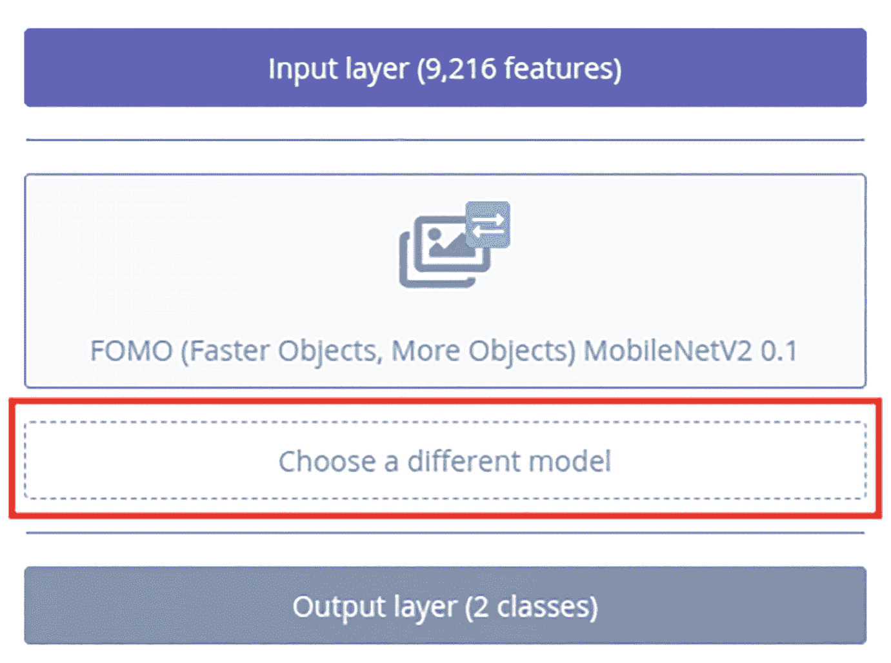

一个具有三层的神经网络架构图。顶层标记为“输入层”，包含 9,216 个特征。中间层显示了一个模型选择选项，当前设置为“FOMO (Faster Objects, More Objects) MobileNetV2 0.1”，并有一个标红的“选择不同的模型”选项。底层标记为“输出层”，包含 2 个类别。

图 7-9

选择 FOMO 模型

运行训练，然后转到模型测试页面。

## 测试

如果训练页面上的混淆矩阵符合你的预期，请转到模型测试页面（从左侧菜单）来评估模型在训练或验证期间从未见过的图像上的准确性。点击`全部分类`按钮并等待结果。在最佳情况下，所有行都是绿色的（表示预测正确；见图 7-10）。

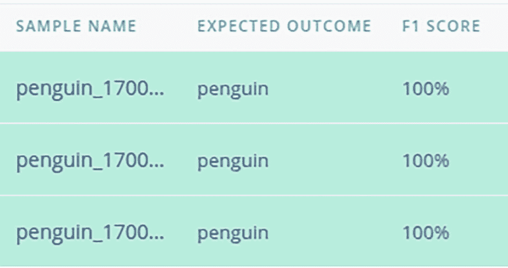

一个显示三行数据的表格，列标题为“样本名称”、“预期结果”和“F1 分数”。每行显示样本名称为“penguin_1700...”，预期结果为“penguin”，F1 分数为“100%”，表明每个样本的分类准确率完美。背景为浅绿色。

图 7-10

Edge Impulse 模型在测试集上的结果

在更复杂的数据集上，更有可能出现一些对象被错误分类——或者根本未被检测到！你应该非常关注这些结果（远比训练页面上的结果重要），因为它们是最可靠的指标，表明模型在部署到从未见过的新图像上时的表现。

花时间手动检查一些错误（点击行右侧的三个点，然后选择`显示分类`）。如果你觉得模型在准确性方面不符合你的期望，请返回训练页面并调整前一章介绍的参数（模型架构、训练周期数、学习率）。重复此过程，直到获得更好的结果。

警告

如果你无论如何努力调整训练过程都无法获得良好的结果，原因可能是数据集不佳。收集更多图像并仔细检查你绘制的边界框是否正确。

## 部署

# 将物体检测模型部署到 Arduino 程序中

要将物体检测模型部署到 Arduino 程序中，请以 Arduino 库格式下载模型（如果不知道如何操作，请参见第 4 章），并将压缩包解压到您的 Arduino 库文件夹中。如果您将项目命名为 `object-detection`，则该库的名称为 `object-detection_inferencing`。

创建一个新的 Arduino 项目，并粘贴代码清单 7-3 中的代码。

```
/**
* 代码清单 7-3：使用 Edge Impulse 进行物体检测。
*
* 所需硬件：ESP32 摄像头
*
* 注意：使用 ESP32 开发板时，别忘了
* 从“工具”菜单中启用 PSRAM！
*/
#include 
#include 
tinyml4all::Camera camera;
tinyml4all::Impulse impulse;
void setup() {
Serial.begin(115200);
while (!Serial);
Serial.println("运行 Edge Impulse 物体检测");
// 从列表中选择模型
camera.promptModel();
// 下次，您可以直接通过名称设置
// camera.setModel("wroom-s3");
// 为推理模式配置摄像头
camera.inferencing();
// 初始化摄像头
camera.begin();
// 初始化 Edge Impulse 模型
impulse.begin();
}
void loop() {
// 获取新帧
if (!camera.grab()) {
Serial.println("无法获取新帧");
return;
}
// 运行 impulse
if (!impulse.run(camera)) {
Serial.println(impulse.error());
return;
}
// 如果没有检测到物体，则返回
if (impulse.count() == 0)
return;
// 打印检测到的物体数量
Serial.print("发现 ");
Serial.print(impulse.count());
Serial.println(" 个物体");
// 打印物体及其坐标
for (int i = 0; i  ");
Serial.print(object.label);
Serial.print(" 位于坐标 ");
// cx, cy 是物体中心的坐标
Serial.print(object.cx);
Serial.print(", ");
Serial.print(object.cy);
Serial.print(" (置信度 ");
Serial.print(object.confidence);
Serial.println(")");
}
}
代码清单 7-3
使用 Edge Impulse 进行物体检测的 Arduino 程序
```

编译该程序——首次编译需要几分钟时间——然后上传。打开串口监视器，将您感兴趣的物体放在摄像头前。当您将感兴趣的物体放在摄像头前时，您应该会看到检测成功（见图 7-11）。

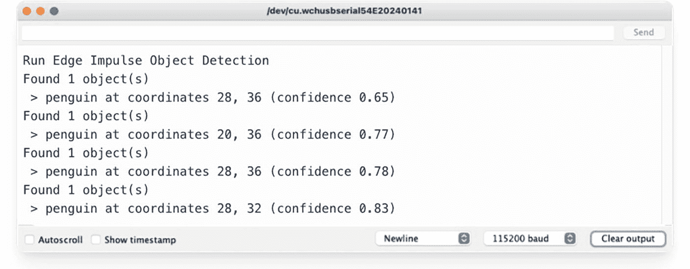

一个终端窗口显示了使用 Edge Impulse 进行物体检测过程的结果。它以不同的置信度识别出位于不同坐标的企鹅：在 (28, 36) 处置信度为 0.65，在 (20, 36) 处置信度为 0.77，在 (28, 36) 处置信度为 0.78，在 (28, 32) 处置信度为 0.83。该界面包括自动滚动、显示时间戳和设置波特率的选项。

图 7-11

推理串口输出

为了让您了解此项目的执行时间，请考虑：一个 ESP32（非 S3）在 64×64 RGB 帧上运行 MobileNetV2 0.1 模型大约需要 280 毫秒。ESP32 S3 大约需要 35 毫秒。Arduino Nicla Vision 更快，只需 20 毫秒！

准确率远未达到 100%，但考虑到传感器质量较差和模型分辨率较低，这是意料之中的。在实现生产固件时，您必须考虑到模型可能会遗漏某些帧或检测到实际上并不存在的物体。

### 可视化调试

在串口监视器上打印检测结果是确认模型工作的最快方法。但是否也可以*直观地*检查结果呢？您能否获得摄像头所见画面以及感兴趣物体所在位置的漂亮预览？是的，当然可以。

以下 Arduino 程序结合了代码清单 7-1 和代码清单 7-3。让我们通过串口连接打印帧*和*预测结果（见代码清单 7-4），以便稍后通过 Python 脚本进行分析和显示。

```
/**
* 代码清单 7-4：调试物体检测结果
*
* 所需硬件：ESP32 摄像头
*
* 注意：使用 ESP32 开发板时，别忘了
* 从“工具”菜单中启用 PSRAM！
*/
#include 
#include 
tinyml4all::Camera camera;
tinyml4all::Impulse impulse;
void setup() {
// 提高串口速度以加快图像传输
Serial.begin(115200 * 2);
while (!Serial);
Serial.println("调试物体检测结果");
// 直接通过名称设置
camera.setModel("wroom-s3");
// 为推理模式配置摄像头
camera.inferencing();
// 初始化摄像头
camera.begin();
// 初始化 Edge Impulse 模型
impulse.begin();
}
void loop() {
// 获取新帧
if (!camera.grab()) {
Serial.println("无法获取新帧");
return;
}
// 打印帧
camera.print();
// 运行 impulse
if (!impulse.run(camera)) {
Serial.println(impulse.error.msg);
return;
}
if (impulse.count() == 0)
return;
Serial.print("发现 ");
Serial.print(impulse.count());
Serial.println(" 个物体");
// 打印物体及其坐标
for (int i = 0; i  ");
Serial.print(object.label);
Serial.print(" 位于坐标 ");
// cx, cy 是物体中心的坐标
Serial.print(object.cx);
Serial.print(", ");
Serial.print(object.cy);
Serial.print(" (置信度 ");
Serial.print(object.confidence);
Serial.println(")");
}
}
代码清单 7-4
用于调试物体检测结果的 Arduino 程序
```

接下来，创建一个新的 Python 脚本（见代码清单 7-5）。该脚本类似于代码清单 7-2，但这次不会提示您输入物体名称，因为它仅用于可视化目的。

```
from tinyml4all.image import debug_serial
debug_serial(
# * 是匹配任何内容的通配符
port="/dev/cu.usb*",
# 必须与 Arduino 程序匹配
baudrate=115200 * 2
)
代码清单 7-5
显示物体检测结果
```

运行该脚本，应会出现一个新窗口，其中包含摄像头流的预览（见图 7-12），并且在感兴趣的物体上（如果有）会有一个红点。

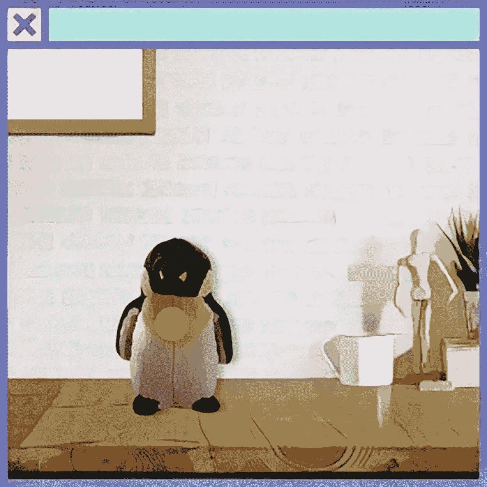

一张数字插图，显示一个企鹅玩具，胸前有一个红色圆圈，站在木质表面上。背景是一面白色砖墙、一株小盆栽、一个白色杯子和一个木质人体模型。场景看起来像是通过电脑窗口观看，左上角有一个蓝色标题栏和一个红色关闭按钮。

图 7-12

物体检测结果调试窗口

恭喜！您完成了第一个物体检测项目，也是本书的最后一个动手实践项目。花点时间庆祝您的成就吧。

## 总结

这最后一章“对初学者友好”的章节，利用低代码的 Edge Impulse 平台，在我们配备摄像头的开发板上实现了最先进的实时物体检测。工作流程是线性且直观的：捕获我们感兴趣物体的图像，通过围绕物体绘制边界框的简单 GUI 进行标注，训练神经网络来完成繁重的工作，然后将网络部署回我们的微控制器。

得益于 `tinyml4all` 库，在开发板上的每个操作都只需几行代码，因此您可以完全控制您的固件。您可以在检测到物体时集成自定义逻辑（例如，激活继电器、打开 LED），我们甚至可以获取物体的（粗略）位置，用于更高级的应用（例如，云台舵机、自动驾驶机器人）。

最后一章将向前迈出一大步，深入探讨人工神经网络的方方面面：它们如何工作，如何从头开始创建和训练一个神经网络，以及最后如何将其部署回我们的 Arduino 微控制器，而无需依赖外部平台。