# 8. 从零开始学 TensorFlow

到目前为止，我们要么通过手动特征工程和分类器/回归器模型来实现“传统”机器学习，要么利用低代码的 Edge Impulse 平台来释放神经网络的威力，而无需深入代码的细枝末节。但本书旨在将你培养成一名熟练的 TinyML 实践者，如果没有一章关于如何通过编写代码来使用神经网络的实践内容，那将是不完整的。

有多个 Python 框架实现了神经网络，其中使用最广泛且唯一能与 Arduino 环境良好集成的框架是 TensorFlow [1]。TensorFlow 是由谷歌管理的一个项目，为许多运行最先进深度学习算法的产品提供支持。本章重点介绍四种可以移植到我们嵌入式硬件上的架构：用于表格数据分类的多层感知器、用于时间序列分类的循环神经网络和一维卷积神经网络，以及用于图像分类的二维卷积神经网络。

让我们利用已收集的项目数据（或使用玩具数据集或合成数据），专注于使用 Python 和 `tinyml4all` 包来定义、训练和部署神经网络。

## 所需硬件

本章重点教你如何训练和部署神经网络架构。

因此，唯一的硬件要求是一块能够运行 TensorFlow 模型的开发板。出于兼容性便利的考虑，本章中的 Arduino 代码在以下开发板上都能同样良好地运行。

*   ARM Cortex-M 开发板（Arduino Nano 和 Nicla 系列，Raspberry Pi Zero）
*   ESP32（S3 和非 S3 版本）

如果你使用不同的芯片组，请参考开发板供应商提供的具体文档。

注意

TensorFlow 模型需要大量 RAM 才能运行，因此请选择至少具有 256 KB RAM 的开发板（512 KB 更佳）。

## 所需软件

在 Python 方面，除了 `tinyml4all` 库之外，你还需要 TensorFlow 库。该库默认不包含在内，因为它体积庞大（>100 MB），并且并非所有人都觉得它有用。

要安装它，请打开终端，激活你的虚拟环境，然后输入以下命令。

```
(tinyml) $ python -m pip install "tinyml4all[tensorflow]"
```

这会安装一个特定版本的 TensorFlow（2.15.1），因为较新的版本无法与本章描述的所有模型兼容。如果你已经安装了更新的版本，则必须降级。

提示

如果你不想（或无法）在你的 PC 上安装 TensorFlow，你可以在 Google Colab（[`https://colab.research.google.com`](https://colab.research.google.com)）中运行以下 Python 脚本，这是一个来自谷歌的云计算环境。免费版甚至提供了一个 GPU，为你提供强大的算力。

在第一个单元格中运行以下行来设置所有依赖项。

`! python -m pip install "tinyml4all[tensorflow]"`

在 Arduino 方面，你必须安装一个额外的库。同样，TensorFlow 是一个大型依赖项，在不需要时可能会减慢编译速度，因此它不包含在 `tinyml4all` Arduino 库中。

从 Arduino IDE 打开库管理器，搜索 `tensorflow-runtime-universal`*，* 并安装它（参见图 8-1）。

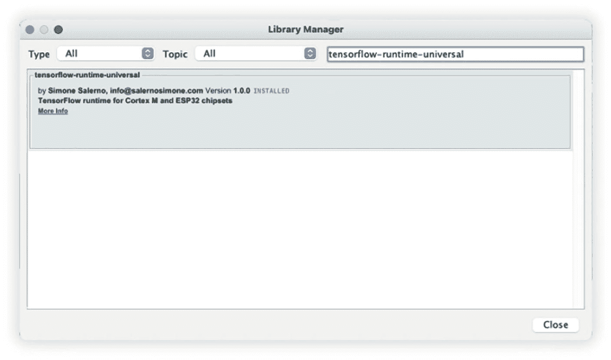

该图像显示了一个库管理器界面，其中包含“tensorflow-runtime-universal”的搜索结果。结果包括详细信息，例如作者 Simone Salerno、联系信息、版本 1.0.0 和状态“已安装”。它提到了与 Cortex M 和 ESP32 芯片组的兼容性。有一个“更多信息”链接以及按类型和主题筛选的选项。

图 8-1

安装 tensorflow-runtime-universal Arduino 库

## 神经网络结构

神经网络有多种形态。由于本书并非关于深度学习，因此只关注最简单的架构，称为*顺序模型*，其中网络被定义为一连串的*层*。简单来说，层就是*神经元*的集合。

神经元是网络的基本原子组件。神经元有多种类型，每种都封装了不同的计算逻辑。通过利用（可能不同类型的）神经元的集合，整个网络可以对复杂的输入/输出关系进行建模（参见图 8-2）。

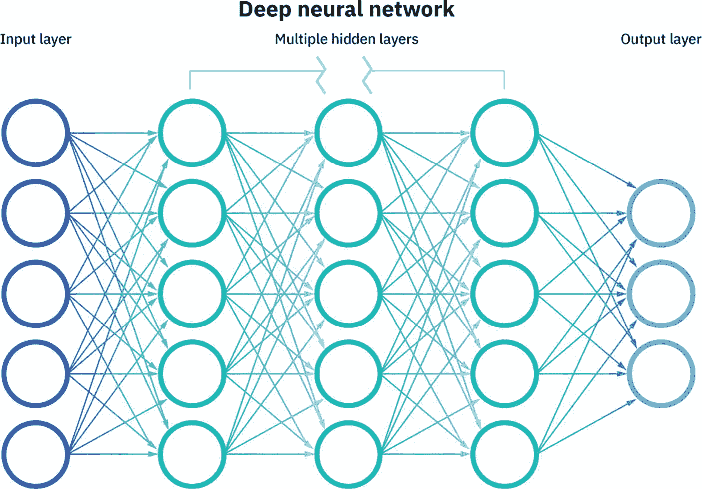

深度神经网络示意图，显示了一个输入层、多个隐藏层和一个输出层。左侧的输入层由五个节点组成，每个节点都连接到第一个隐藏层中的节点。有三个隐藏层，每个隐藏层有五个节点，与相邻层中的节点相互连接。右侧的输出层也有五个节点，接收来自最后一个隐藏层的连接。箭头指示节点之间的数据流向。

图 8-2

神经网络拓扑示例

每种网络架构都由三个基本部分组成，这些部分始终存在。

*   **输入层**：网络的第一层由其输入表示。这些值来自*外部世界*，实际上不受网络控制。输入值可以是表格数据、音频、时间序列、图像、视频等。输入的特征在于其*形状*（它有多少个维度）。
*   **输出层**：这是网络的最后一层，包含我们感兴趣的结果。对于分类任务，该层通常包含输入样本属于每个可能类别的概率。对于回归任务，该层包含预测值。因此，输出层的形状在某种程度上也不受我们控制，不能随意配置。
*   **隐藏层**：这些是位于输入层和输出层之间的所有层。根据网络拓扑，它们可以包含少量或大量层（甚至数十或数百层），所有层类型相同或来自不同类型，具有不同的大小和复杂度。**这是你可以控制的部分。** 这部分的作用是让网络学习输入和输出之间的关系。更多的层可以学习更复杂的关系，但代价是需要更多的内存/计算资源。

注意

在使用 TinyML 时，你需要尽可能精简隐藏层，以满足硬件约束。

### 前向传播

给定一个输入样本，通过网络各层产生结果的过程称为*推理*或*前向传播*（这有助于想象网络从左到右水平展开）。数据流是顺序发生的：第一个隐藏层处理输入值。其输出成为第二个隐藏层的输入，依此类推，直到我们到达输出层的末端（*非顺序*架构可能有不同的执行路径）。


### 反向传播

现在你已经知道如何产生输出，你需要一种方法来训练网络以生成*准确*的输出。这通过*反向传播*（也称为*反向传播算法*）来实现。反向传播的直观逻辑如下。

1.  网络中的每个神经元都以半随机值初始化，因此它们对数据一无所知，处于空白状态。

2.  给定一个输入，你计算其对应的输出。由于网络从未见过这些数据，这个输出很可能是错误的。

3.  然后你计算误差（例如，对于回归问题，当前输出减去期望输出），并回到每一层，说：“在当前状态下，你产生了这个误差。尝试更新你的状态，使误差减小。” 这个更新过程因神经元类型而异。

4.  通过对每个输入样本重复此过程，情况应该会改善。然而，每个输入只展示一次可能不足以让网络正常工作（尤其是当存在许多神经元，其相互作用可能产生级联效应时）。因此，这个过程会重复多次（称为*轮次*）。通常，网络越大，达到良好效果所需的轮次就越多。

这是对神经网络工作原理的非常宽泛的描述。每种特定类型的神经元都有不同的前向和反向（更新）逻辑。让我们探索最常见的神经元和架构。

## 多层感知机

顾名思义，多层感知机（MLP）——也称为*全连接网络*——由许多层*感知机*组成。感知机是一种受人类脑细胞启发的（简化）数学表示（见图 8-3）。

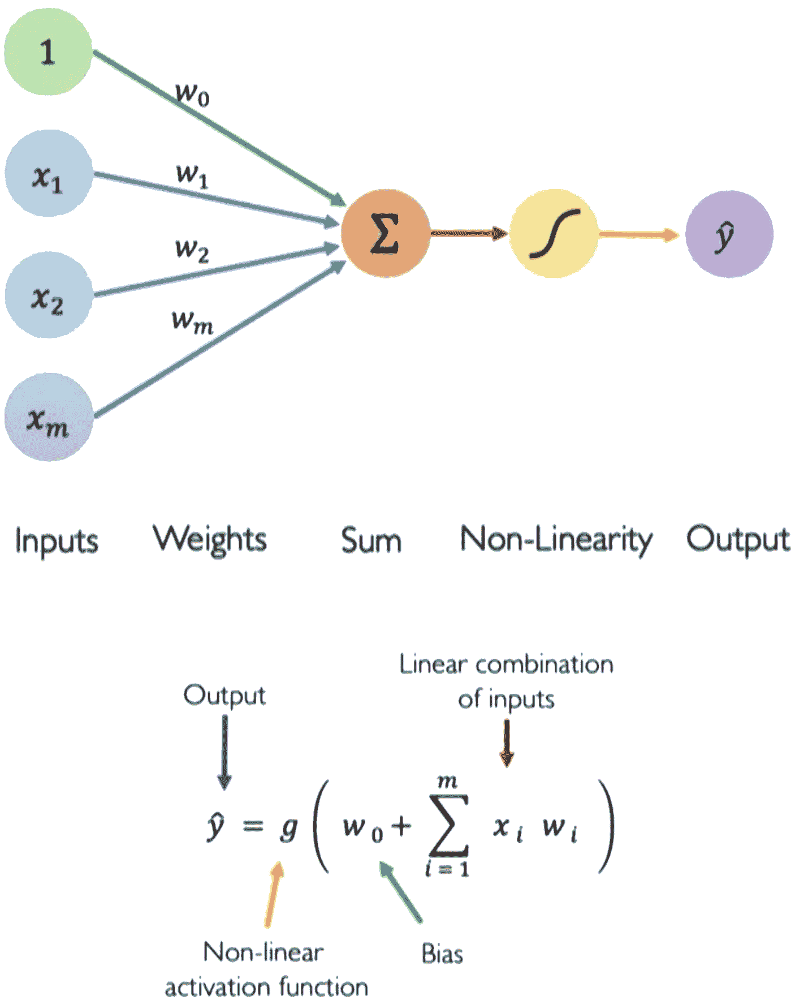

图示说明了一个神经网络模型。输入 \(1, x_1, x_2, \ldots, x_m\) 通过权重 \(w_0, w_1, w_2, \ldots, w_m\) 连接到求和节点 \(\Sigma\)。求和结果通过一个非线性激活函数，产生输出 \(\hat{y}\)。下方显示了公式 \(\hat{y} = g\left(w_0 + \sum_{i=1}^{m} x_i w_i\right)\)，表示输入、偏置和非线性激活函数的线性组合。标签包括：输入、权重、求和、非线性和输出。

图 8-3

感知机神经元示意图

简单来说，脑细胞（也称为*神经元*）通过不同强度的连接（*突触*）接收来自其他神经元的信号并进行处理。如果结果超过某个阈值，它们就会产生输出信号（*动作电位*）。1957 年，心理学家弗兰克·罗森布拉特 [2] 直觉地想到以简化形式将这种机制复制到电子设备中。今天，感知机的基本原理保持不变。

*   感知机接收来自*外部世界*（例如传感器）或其他神经元的 *n* 个输入。
*   每个输入都有一个关联的*权重*。感知机内部的处理包括权重与输入的点积，再加上一个偏移量（称为*偏置*）。
*   为了模拟动作电位的激发，点积的结果会经过一个*激活函数*，该函数向模型引入非线性。

感知机最重要的元素可能是激活函数。没有它，整个模型无论有多少神经元都将是线性的。通过在每个神经元处引入非线性，模型能够学习更复杂的关系。最常见的激活函数是*修正线性单元*（ReLU），它将所有负值截断为 0，如下公式所述。

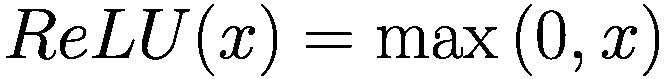

MLP 的*多层*部分是通过将感知机组一层接一层地堆叠在一个非常规整的拓扑结构中实现的，其中一层的每个神经元都与下一层的每个神经元相连（因此是全连接的，如图 8-4 所示）。

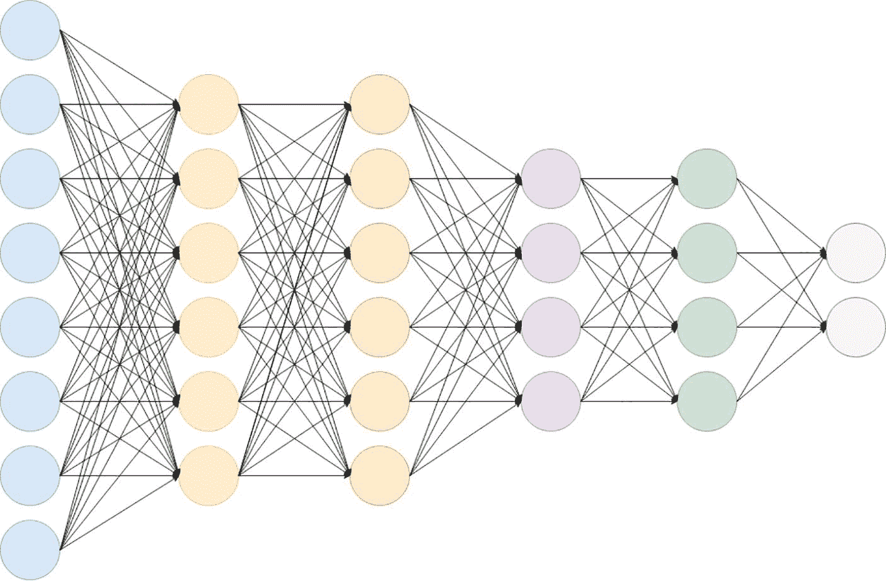

具有五层的神经网络示意图。第一层有六个蓝色节点，代表输入层。第二层和第三层各有五个黄色节点，表示隐藏层。第四层有四个紫色节点，第五层有三个绿色节点，代表输出层。每个节点都与相邻层的节点相互连接，说明了数据在网络中的流动。

图 8-4

全连接拓扑

现在，让我们快速举例探讨层数和神经元数量如何影响总权重数。假设我们有一个网络，有十个输入、三个输出，以及三个隐藏层，分别有 8、16 和 24 个神经元。你可以轻松计算出构成该网络的总权重数。

*   第一个隐藏层接收 10 个输入，因此每个感知机有 10 个权重 + 1 个偏置。有 8 个感知机，所以有 8 * 11 = 88 个权重。
*   第二个隐藏层接收 8 个输入，因此有 16 * (8 + 1) = 144 个权重。
*   第三个隐藏层接收 16 个输入，因此有 24 * (16 + 1) = 408 个权重。
*   输出层接收 24 个输入，有三个神经元，因此有 3 * (24 + 1) = 75 个权重。

总权重数 = 88 + 144 + 408 + 75 = 715`。

如你所见，随着层数和每层内神经元数量的增加，权重数会迅速增长并累积。你很容易就能找到隐藏层有 64 或 128 个神经元的网络，每个隐藏层会产生数千个权重。在你的台式电脑上运行时这可能不是问题，但*它很容易占满微控制器上的可用 RAM*。在为你的项目尝试全连接拓扑时，请务必记住这一点！

作为一个伴随的缺点，同样明显的是，*权重越多*，CPU 必须执行的计算就越多，因此在你的慢速嵌入式硬件上*产生结果所需的时间就越长*。


### 如何训练多层感知机

既然你已经了解了 MLP 的构成，现在是时候在 Python 中创建并训练一个了。由于全连接网络在处理表格数据时表现良好，我们使用一个名为鸢尾花（Iris）[3]的玩具数据集，该数据集通过鸢尾花的萼片和花瓣的宽度与长度来对其种类进行分类（见图 8-5）。


三张鸢尾花图片并排展示。第一张图片标注为“杂色鸢尾”，其部分被标注为“花瓣”和“萼片”。第二张图片标注为“山鸢尾”，第三张标注为“维吉尼亚鸢尾”。每朵花都是紫色的，具有不同的形状和特征，背景为绿色。

图 8-5

鸢尾花数据集样本

这是一个非常容易分类的玩具数据集。使用随机森林分类器，无需预处理即可达到 95%或更高的准确率。代码清单 8-1 介绍了`MLP`类，并解释了如何添加层、训练网络以及获取分类报告。图 8-6 展示了网络的损失和准确率。

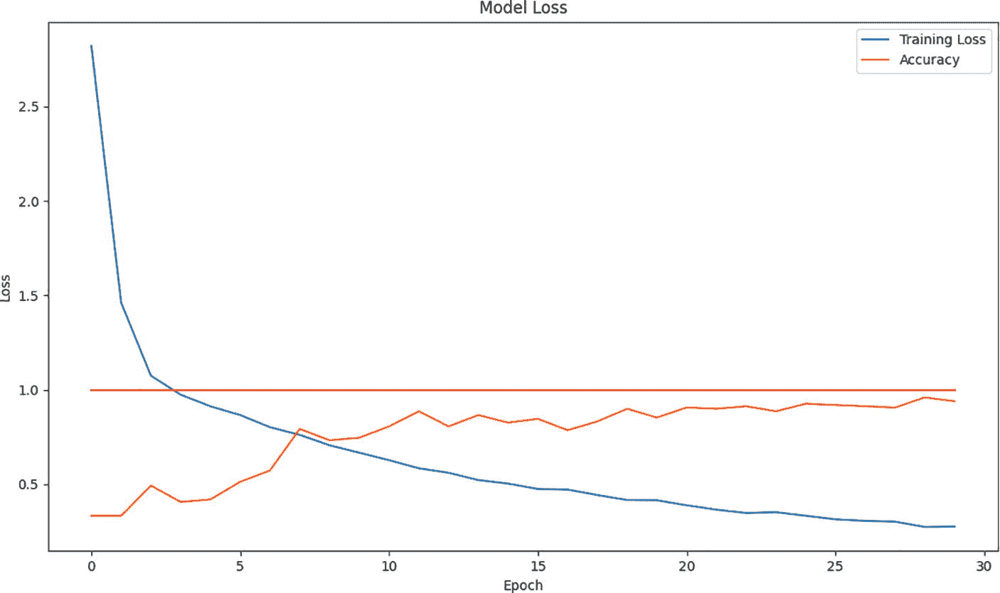

一张标题为“模型损失”的折线图，展示了 30 个训练周期内的训练损失和准确率。蓝色线条代表训练损失，先急剧下降，后逐渐趋于平缓。橙色线条代表准确率，保持相对稳定，略有波动。一条红色水平线标记了损失轴上值为 1 的常数。x 轴标注为“训练周期”，y 轴标注为“损失”。

图 8-6

MLP 损失与准确率图

```
from tinyml4all.tensorflow import MLP
from tinyml4all.tensorflow.layers import Perceptron
from tinyml4all.datasets import Iris
# Iris 是 tinyml4all.tabular.classification.Table 的一个实例
print(Iris)
# 为鸢尾花数据集实例化一个新网络
mlp = MLP()
# 8, 16, 24 是每层感知器的数量
mlp.add(Perceptron(8))
mlp.add(Perceptron(16))
mlp.add(Perceptron(24))
# 显示网络架构
# X 是输入数据
# Y 是标签
# task 可以是 "classification" 或 "regression"
print(mlp.compile(X=Iris.numeric, Y=Iris.targets.values, task="classification"))
Model: "sequential"
_______________________________________________________________
Layer (type)                Output Shape              Param #
===============================================================
dense (Dense)               (None, 8)                 40
dense_1 (Dense)             (None, 16)                144
dense_2 (Dense)             (None, 24)                408
dense_3 (Dense)             (None, 3)                 75
===============================================================
Total params: 667 (2.61 KB)
Trainable params: 667 (2.61 KB)
Non-trainable params: 0 (0.00 Byte)
_______________________________________________________________
# 训练神经网络并显示准确率图
mlp.fit(X=Iris.numeric, Y=Iris.targets.values, epochs=50, plot=True)
# 打印训练集/验证集上的准确率
mlp.classification_report()
precision    recall  f1-score   support
setosa       1.00      1.00      1.00        50
versicolor       1.00      0.92      0.96        50
virginica       0.93      1.00      0.96        50
accuracy                           0.97       150
macro avg       0.98      0.97      0.97       150
weighted avg       0.98      0.97      0.97       150
+-------------------+--------+------------+-----------+
| True vs Predicted  | setosa  | versicolor  | virginica  |
+-------------------+--------+------------+-----------+
|       setosa       |   50   |     0      |     0      |
|     versicolor     |   0    |     46     |     4      |
|     virginica      |   0    |     0      |     50     |
+-------------------+--------+------------+-----------+
代码清单 8-1
在鸢尾花玩具数据集上训练 MLP
```

提示

如果你之前使用过 TensorFlow，可能会觉得代码中的类名令人失望。选择这些名称是为了与本书中的文本保持一致，但它们只是内置层的别名。`Perceptron`与`dense`一一对应，`MLP`与`sequential`一一对应。

我想让你注意一件事：我们添加了三个感知器层（分别有 8、16 和 24 个神经元），但网络转储显示多了一个包含三个神经元的密集层。这是为什么？本章展示的所有架构（MLP、RNN、CNN1D 和 CNN2D）在构建最终模型之前都会对层进行一些操作。在这种情况下，`MLP`类注入了一个最终层，其神经元数量与类别数量相同（三个，分别对应*山鸢尾*、*维吉尼亚鸢尾*和*杂色鸢尾*），并使用了*softmax*激活函数[4]，该函数生成类别归属概率。

网络的输出并非你可能期望的单个值（指示预测类别），而是一个取值范围从 0 到 1 的向量（概率），每个类别对应一个值。如果你需要单个输出，可以选择概率最高的类别。这种方案允许更细粒度的输出处理，因为如果置信度低于给定阈值，你可以引入一个*不确定*的元类别（就像 Edge Impulse 在其模型测试页面中所做的那样）。

提示

如果你之前使用过 TensorFlow，可能已经注意到你无需定义损失函数或评估指标：这些都由`task=`"`classification`"自动处理。如果你想完全控制`compile()`的参数，你仍然可以提供它们，并且它们会优先于默认值。

#### 内置验证

为了有效训练神经网络，你需要一个验证集。因此，当你调用`fit()`时，会自动在训练集和验证集之间进行划分。默认情况下，80%用于训练，20%用于验证。

如果你愿意，可以手动更改验证比例。

```
# 使用 30%的数据作为验证集
mlp.fit(X=Iris.numeric, Y=Iris.targets.values, validation_data=0.3, epochs=50, plot=True)
```

即使不推荐，你也可以完全禁用验证。

```
mlp.fit(X=Iris.numeric, Y=Iris.targets.values, validation_data=0, epochs=50, plot=True)
```

测试集不会自动创建。你可以使用`test_data`参数强制生成测试集划分。

```
# 使用 20%的数据作为测试集
mlp.fit(X=Iris.numeric, Y=Iris.targets.values, test_data=0.2, epochs=50, plot=True)
```

或者，如果你有外部定义的测试数据集（例如，从另一个 CSV 文件加载），你可以使用它来代替。

```
# 设置外部测试数据集
test_dataset = Table.read_csv("test_dataset.csv")
X_train = Iris.numeric
Y_train = Iris.targets.values
X_test = test_dataset.numeric
Y_test = test_dataset.targets.values
mlp.fit(X_train, Y_train, test_data=(X_test, Y_test), epochs=50, plot=True)
```

注意

如果在拟合时定义了测试集，评估指标和图表将使用测试集而非验证集。


### 如何部署多层感知机

要将 MLP 转换为兼容 Arduino 的 C++代码，只需运行以下命令。

```
mlp.convert_to("c++", save_to="IrisMLP.h")
```

生成的代码封装了在微控制器上运行 TensorFlow 所需的所有复杂部分，并提供了一个极其简单的 API（参见清单 8-2）。示例的输出如图 8-7 所示。

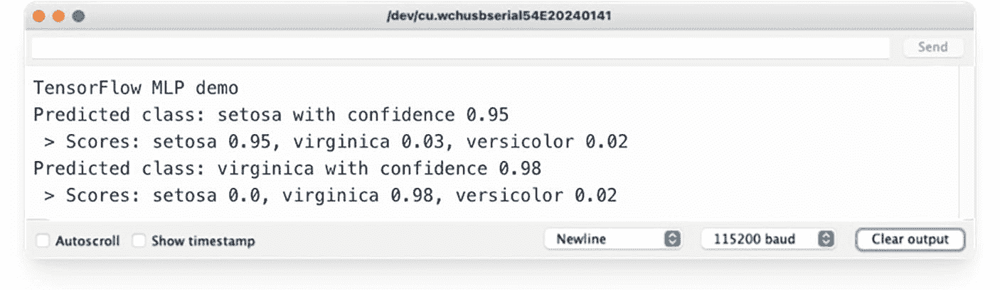

一个显示 TensorFlow MLP 演示输出的终端窗口。第一个预测显示类别“setosa”，置信度为 0.95，setosa、virginica 和 versicolor 的得分分别为 0.95、0.03 和 0.02。第二个预测显示类别“virginica”，置信度为 0.98，setosa、virginica 和 versicolor 的得分分别为 0.0、0.98 和 0.02。可见“自动滚动”和“显示时间戳”选项，以及“换行”和“清除输出”控件。

图 8-7

MLP 输出示例

```
#include "./IrisMLP.h"
// ARENA 是为模型预留的内存量。
// 更大的模型需要更多内存，但没有
// 计算最优值的公式，
// 这是一个试错过程
#define ARENA 20000
tinyml4all::MLP mlp;
float setosa[] = {5.1, 3.5, 1.4, 0.2};
float virginica[] = {7.6, 3.0, 6.6, 2.1};
float versicolor[] = {6.8, 2.8, 4.8, 1.4};
void setup() {
Serial.begin(115200);
while (!Serial);
Serial.println("TensorFlow MLP 演示");
// 初始化网络
mlp.begin();
}
void loop() {
// 在给定样本上运行网络
if (!mlp.predict(setosa)) {
Serial.println(mlp.error());
return;
}
// mlp.label 保存预测类别的名称
// mlp.idx 保存预测类别的数字 ID
// mlp.value 保存数值输出（仅用于回归任务）
// mlp.confidence 是预测的概率
//             （范围从 0 到 1）
// mlp.confidences 是一个数组，包含所有类别的置信度
//          （分类任务中每个类别一个）
// mlp.outputsAsString 返回每个类别的得分，范围
//                 从 0 到 1（仅用于分类）
Serial.print("预测类别 ");
Serial.print(mlp.label);
Serial.print(" 置信度 ");
Serial.println(mlp.confidence);
Serial.print(" > 得分: ");
Serial.println(mlp.outputsAsString());
delay(1000);
}
清单 8-2
在 Arduino 上运行 MLP
```

注意

感知机是一种无处不在的算子。在几乎所有的网络拓扑结构中，它都作为专用算子（如 LSTM、卷积）与输出层之间的粘合剂出现，通常位于最终层。你会在本章讨论的所有其他类型的网络中找到它。

## 深度学习

第 4 章和第 5 章将时间序列分类视为一个两步过程：（1）从时间序列中提取有意义的特征（使用傅里叶变换或时域描述符），以及（2）使用*表格型*分类器（Edge Impulse 上的全连接网络，Python 中的随机森林）对这些特征进行分类。

近年来，随着深度学习技术的普及和易用性提升，另一种方法变得广泛流行：将特征提取嵌入到执行分类的同一个神经网络中。从这个意义上说，存在一个重要的范式转变。以前，我们手动定义*我们认为*可能构成良好特征向量的内容。现在，我们委托机器学习/深度学习模型，通过输入数据集上的训练过程来构建最佳特征。根据数据集和网络类型的不同，这种方法可以比我们手动工作获得更好的准确性。

### 深度学习在 TinyML 环境中的劣势

当然，凡事有利有弊：为了具有如此强的表达能力，网络的规模和复杂性必须增长。在第 4 章中训练的全连接网络仅由两层组成，每层只有几个神经元（因为繁重的工作集中在频谱分析步骤）。这种简单的拓扑结构旨在处理经过大量处理的输入数据，它绝不可能在原始加速度计样本上良好运行。在资源极度受限的 TinyML 环境中，我们的开发板能否运行一个独立完成所有工作（特征提取+分类）的网络并非必然，因此，根据我们的具体用例仔细评估采用哪种方法，是我们的职责。

话虽如此，为了能够在嵌入式硬件上运行越来越大的模型，已经采用了许多优化措施，因此我们通常可以选择。此外，深度学习使得在我们廉价、节能的硬件上运行复杂的任务成为可能，而仅使用手动特征是不可能实现这些任务的。

接下来，让我们考察两种属于深度学习范畴的网络：循环神经网络和卷积神经网络。

## 循环神经网络与长短期记忆网络

循环神经网络（RNN）具有最适合处理序列数据的特定拓扑结构。它们已成功应用于语言翻译、语音合成、视频分析，以及对我们最重要的时间序列分类。

它们与“常规”网络（例如全连接网络）的不同之处在于，隐藏神经元具有*记忆*。这意味着当新输入到达时，神经元会利用其内部状态来计算输出，然后根据输入和输出更新该状态（*除了*全连接网络和卷积网络传统的权重之外！）。

长短期记忆（LSTM）单元是 RNN 中使用最广泛的神经元类型，因为它们性能卓越。它们被引入是为了解决学习步骤中的技术问题，这些问题曾阻止网络在长时间输入上取得令人满意的结果（梯度消失和梯度爆炸）。在不深入实现细节的情况下，以下是这些神经元工作原理的快速概述。

1.  每个 LSTM 单元都有一个内部状态（类似于感知机中的权重）和一个*记忆状态*（另一组权重）。

2.  当接收到新输入时，它通过结合输入向量和内部状态来计算一个*遗忘向量*。接近 0 的值表示记忆状态中对应的元素应该被遗忘；接近 1 的值表示该元素应该被保留。

3.  它还计算一个*候选向量*，该向量指示如何基于新输入更新记忆状态。新的记忆状态被计算为旧状态、遗忘向量和候选向量的加权和。

4.  最终，记忆状态和输入被用来更新内部状态，内部状态在通过激活函数后产生输出。

图 8-8 是 LSTM 单元内部状态的示意图。

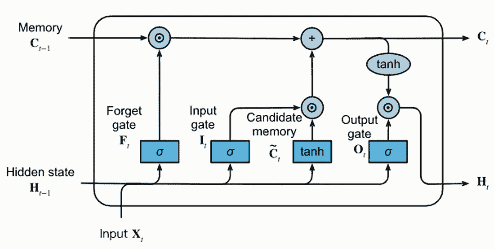

长短期记忆（LSTM）单元架构图。它展示了信息通过各种门控的流动：遗忘门（F_t）、输入门（I_t）和输出门（O_t），每个门控都有一个 sigma（σ）激活函数。候选记忆（C̃_t）使用 tanh 激活函数。单元状态（C_t）和隐藏状态（H_t）通过这些门控进行更新。输入包括先前的记忆（C_{t-1}）、隐藏状态（H_{t-1}）和当前输入（X_t）。该图说明了这些组件如何交互以处理序列数据。

图 8-8

LSTM 内部结构


### 如何训练循环 LSTM 神经网络

幸运的是，这一过程对最终用户完全透明，并在后台自动处理。使用 LSTM 单元创建 RNN 网络可通过清单 8-3 实现。让我们在第 4 章收集的连续运动数据集上训练该网络。验证集上的准确率趋势如图 8-9 所示。

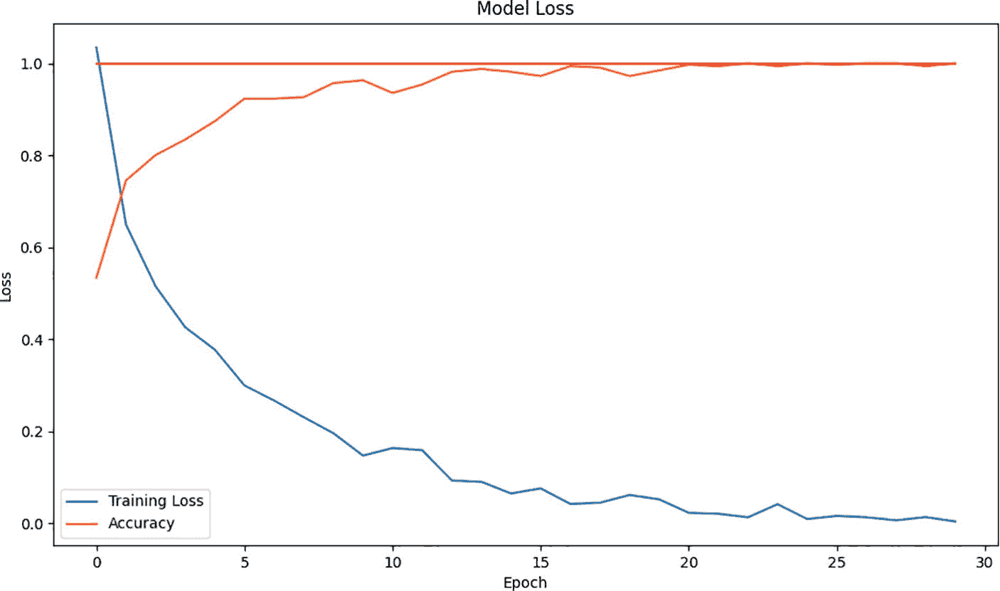

折线图标题为“模型损失”，展示了 30 个训练周期内的训练损失和准确率。蓝色线条代表训练损失，起始值较高后稳步下降，表明模型性能提升。橙色线条代表准确率，始终稳定在接近 1.0 的高位，表明整个训练周期中准确率保持稳定。

图 8-9
LSTM 训练损失与准确率

```
from tinyml4all.tensorflow import RNN
from tinyml4all.tensorflow.layers import LSTM, Perceptron
from tinyml4all.time.continuous.classification import TimeSeries
ts = TimeSeries.read_csv_folder("Chapter4/motion")
ts.label_from_source()
# 将 TimeSeries 转换为神经网络的 X 和 Y 训练数据
X, Y = ts.as_windows(duration="1s", shift="250ms")
rnn = RNN()
# 两个 LSTM 层（各 12 个神经元）+ 一个全连接层
rnn.add(LSTM(12))
rnn.add(LSTM(12))
rnn.add(Perceptron(32))
# 显示网络架构
print(rnn.compile(X, Y, task="classification"))
Model: "sequential"
____________________________________________________________
Layer (type)                Output Shape             Param#
============================================================
lstm (LSTM)                 (None, 125, 8)            480
lstm_1 (LSTM)               (None, 125, 16)           1600
flatten (Flatten)           (None, 2000)              0
dense (Dense)               (None, 32)                64032
dense_1 (Dense)             (None, 4)                 132
============================================================
Total params: 66244 (258.77 KB)
Trainable params: 66244 (258.77 KB)
Non-trainable params: 0 (0.00 Byte)
____________________________________________________________
# 训练神经网络并显示准确率图
rnn.fit(X, Y, epochs=50, plot=True)
# 打印验证集上的准确率
print(rnn.classification_report())
precision    recall  f1-score   support
idle       1.00      1.00      1.00        52
shake       1.00      1.00      1.00        91
slide       1.00      0.86      0.92        92
wave       0.88      1.00      0.93        91
accuracy                           0.96       326
macro avg       0.97      0.96      0.96       326
weighted avg       0.97      0.96      0.96       326
+-------------------+------+-------+-------+------+
| 真实值 vs 预测值   | idle | shake | slide | wave  |
+-------------------+------+-------+-------+------+
|        idle       |  52  |   0   |   0    |  0    |
|       shake       |  0   |   91  |   0    |  0    |
|       slide       |  0   |   0   |   79   |  13   |
|        wave       |  0   |   0   |   0    |  91   |
+-------------------+------+-------+-------+------+
# 导出为兼容 Arduino 的 C++代码
rnn.convert_to("c++", class_name="LSTM", save_to="MotionLSTM.h")
清单 8-3
训练一个 LSTM 循环神经网络
```

### 如何部署 RNN

在 Arduino 上运行 RNN 与运行 MLP 相同，无需修改任何代码。不同之处在于输入向量的创建方式。时间序列通常通过将新读取的样本加入队列并丢弃旧样本来随时间构建。你可以手动处理，但生成的代码可以直接为你处理。

清单 8-4 展示了如何运行导出的 RNN，对 Arduino Nano BLE Sense 内置 IMU 的加速度计数据进行分类。

```
/**
* 清单 8-4：使用 LSTM 模型对连续运动进行分类
*
* 所需硬件：Arduino Nano BLE Sense
*/
#include "./MotionLSTM.h"
#include 
#include 
// ARENA 是为模型预留的内存量
// 更大的模型需要更多内存，但没有计算最优值的公式
// 这是一个试错过程
#define ARENA 20000
tinyml4all::LSTM lstm;
tinyml4all::LSM9DS1 imu;
void setup() {
Serial.begin(115200);
while (!Serial);
Serial.println("TensorFlow LSTM 演示");
imu.begin();
lstm.begin();
}
void loop() {
// 读取加速度计和陀螺仪数据
imu.readAcceleration();
imu.readGyroscope();
// 将读数追加到内部 RNN 队列
lstm.append(imu.ax, imu.ay, imu.az, imu.gx, imu.gy, imu.gz);
// 等待队列填满
if (!lstm.isReady())
return;
// 运行分类
if (!lstm.predict()) {
Serial.println(lstm.error());
return;
}
// lstm.label 保存预测类别的名称
// lstm.idx 保存预测类别的数字 ID
// lstm.value 保存数值输出（仅用于回归任务）
// lstm.confidence 是预测的概率值（0 到 1 之间）
// lstm.confidences 是所有类别的置信度数组
// （分类任务中每个类别对应一个值）
// lstm.outputsAsString 返回每个类别的得分，范围 0 到 1（仅分类任务）
Serial.print("预测类别 ");
Serial.print(lstm.label);
Serial.print(" 置信度 ");
Serial.println(lstm.confidence);
Serial.print(" > 得分: ");
Serial.println(lstm.outputsAsString());
delay(1000);
}
清单 8-4
在加速度计数据上运行 LSTM 网络
```

如果你想自行处理输入数组，可以调用 `lstm.predict(inputs)` 替代，其中 *inputs* 是按 `A`[`t=1`]`, B`[`t=1`]`, C`[`t=1`]`, A`[`t=2`]`, B`[`t=2`]`, C`[`t=2`], … 顺序排列的输入值数组，其中 `A`、`B` 和 `C` 是传感器读数，`t` 是时间步长。


## 一维卷积神经网络

循环神经网络并非唯一能良好处理序列数据的架构。一维卷积神经网络（1D CNN）是（通常）更快、更轻量的替代方案。这类网络不像 LSTM 单元那样具备记忆能力，因此可能不擅长对输入数据中的长期关系进行建模。不过，这通常并非必要，因为最强的关联往往存在于邻近元素之间。

*一维卷积*是一种数学运算，它接收一个输入序列（一组数字）和一个较小的数字集合（权重），称为*滤波器*或*卷积核*，然后将它们组合以生成一个新的序列。图 8-10 展示了这一过程。

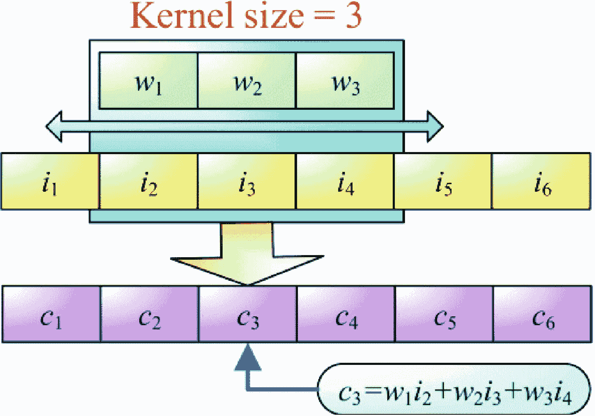

图示：卷积核大小为 3 的卷积操作。包含权重 \(w_1\)、\(w_2\) 和 \(w_3\) 的卷积核在输入序列 \(i_1\) 到 \(i_6\) 上滑动。该操作产生输出序列 \(c_1\) 到 \(c_6\)。高亮示例显示 \(c_3\) 的计算方式为 \(c_3 = w_1i_2 + w_2i_3 + w_3i_4\)。

图 8-10

一维卷积

参照图 8-10 所描绘的场景，我们首先考虑输入数组的前三个元素（黄色部分）。每个元素与对应的卷积核元素（绿色部分）相乘，然后将结果求和（紫色单元格）。此操作称为*点积*。

随后，卷积核向右滑动一位，重复相同的操作，这次处理输入中第 2 到第 4 个元素。此过程循环进行，直到卷积核应用于输入的最后三个元素。

最终结果是一个新的序列，它是输入序列的加权聚合。要构建一个一维 CNN，许多这样的卷积核被封装在一个 Conv1D 层中，并且许多这样的层被依次堆叠。在最后一个 Conv1D 层和输出层之间，一个或多个全连接层将提取的特征进行组合（见图 8-11）。学习过程包括寻找最优的卷积核权重，以最大化分类准确率（对于分类任务）或最小化误差（对于回归任务）。

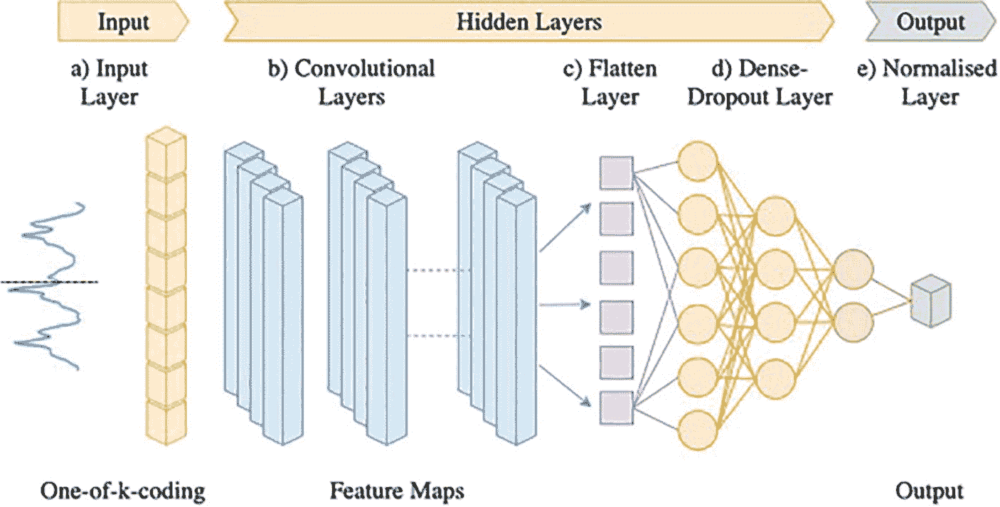

神经网络架构图，带有标注部分。流程从使用“独热编码”的“输入”开始，接着是“隐藏层”，包含“a) 输入层”、“b) 卷积层”（生成“特征图”）、“c) 展平层”和“d) 密集-丢弃层”。最后通过“e) 归一化层”得到“输出”。箭头指示数据在各层之间的流动。

图 8-11

Conv1D 网络拓扑

### 如何在连续运动数据上训练一维 CNN

本节以连续运动数据作为时间序列分类的代表性示例。同样的流程适用于任何可以通过 `TimeSeries.read_csv` 或 `TimeSeries.read_csv_folder` 加载的数据。代码见清单 8-5，准确率图见图 8-12。

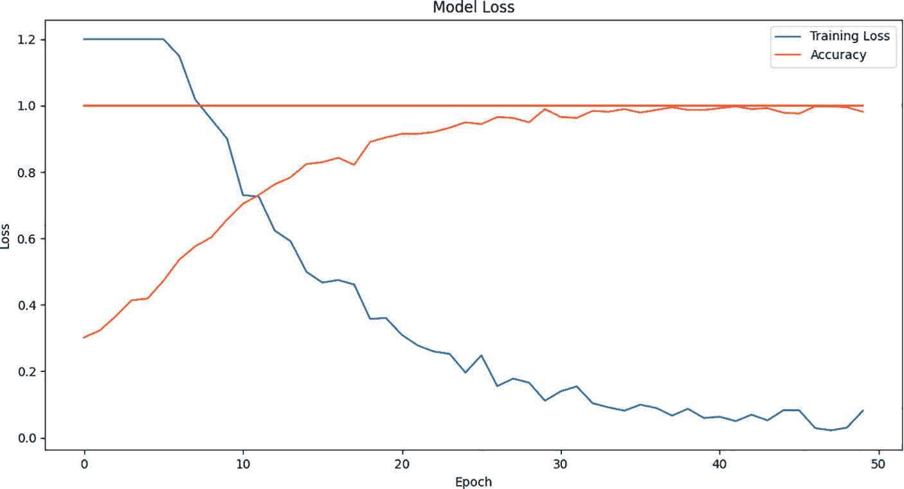

标题为“模型损失”的折线图显示了 50 个训练周期内的训练损失和准确率。蓝色线代表训练损失，从 1.2 以上开始，稳步下降至接近 0。橙色线代表准确率，从接近 0 开始，上升并稳定在 1.0 左右。该图表明，随着训练进行，损失下降，准确率提高。

图 8-12

CNN1D 损失与准确率

```
from tinyml4all.tensorflow import CNN1D
from tinyml4all.tensorflow.layers import Conv1D, Perceptron
from tinyml4all.time.continuous.classification import TimeSeries
ts = TimeSeries.read_csv_folder("Chapter4/motion")
ts.label_from_source()
X, Y = ts.as_windows(duration="1s", shift="250ms")
cnn = CNN1D()
# 关于步幅的含义，请参考“二维卷积网络”一节
cnn.add(Conv1D(8, kernel_size=3, strides=2))
cnn.add(Conv1D(16, kernel_size=3, strides=2))
cnn.add(Conv1D(24, kernel_size=3, strides=2))
cnn.add(Perceptron(32))
# 显示网络架构
print(cnn.compile(X, Y, task="classification"))
Model: "sequential"
_______________________________________________________________
Layer (type)                Output Shape              Param #
===============================================================
conv1d (Conv1D)             (None, 109, 8)            152
conv1d_1 (Conv1D)           (None, 54, 16)            400
conv1d_2 (Conv1D)           (None, 26, 24)            1176
flatten (Flatten)           (None, 624)               0
dense (Dense)               (None, 32)                20000
dense_1 (Dense)             (None, 4)                 132
===============================================================
Total params: 21860 (85.39 KB)
Trainable params: 21860 (85.39 KB)
Non-trainable params: 0 (0.00 Byte)
_______________________________________________________________
# 训练神经网络并显示准确率图
cnn.fit(X, Y, epochs=50, plot=True)
# 打印验证集上的准确率
print(cnn.classification_report())
precision    recall  f1-score   support
idle       0.97      0.98      0.98        60
shake       0.98      0.97      0.98       104
slide       1.00      1.00      1.00       106
wave       0.97      0.97      0.97       105
accuracy                           0.98       375
macro avg       0.98      0.98      0.98       375
weighted avg       0.98      0.98      0.98       375
+-------------------+------+-------+-------+------+
| 真实值 vs 预测值   | idle  | shake  | slide  | wave |
+-------------------+------+-------+-------+------+
|        idle        |  59  |   0   |   0   |  1    |
|       shake        |  1   |  101  |   0   |  2    |
|       slide        |  0   |   0   |  106  |  0    |
|        wave        |  1   |   2   |   0   | 102   |
+-------------------+------+-------+-------+------+
cnn.convert_to("c++", save_to="CNN1D.h")
清单 8-5
在连续运动数据上训练 Conv1D 网络
```

### 如何部署一维 CNN

事实证明，在你的 Arduino 草图中运行一维 CNN 与运行 LSTM 网络是相同的。由于它们都处理时间序列，之前适用于 LSTM 的一切仍然成立。并且由于生成的 API 是相同的，你无需更改任何内容——只需将 `tinyml4all::LSTM` 重命名为 `tinyml4all::CNN1D` 即可。


## 二维卷积神经网络

二维卷积神经网络（2D CNN）处理的是二维数据。二维数据通常指图像。或者，为了拓宽 CNN 的应用范围：*类图像*数据。所谓*类图像*数据，是指排列在二维空间中、且数值限定在特定范围内的数据。

*   **MFCC 特征**：从第 6 章的 Edge Impulse 中提取的特征。像素代表的是随时间变化的频率贡献，而非空间上的光线强度。

*   **脑电图/肌电图/加速度计数据**：任何随时间收集的*n*维数据都可以重塑为二维窗口（形状为特征数量乘以时间步长）。

*   **温度/距离图**：热成像摄像头（例如 MLX90640）和网格飞行时间传感器（例如 VL53L5CX）会生成二维输出，其中每个元素代表温度或距离，而非光线。

如果我们抽象化像素的概念，使其涵盖所有类型的数据——而不仅仅是光线——那么所有这些数据都可以渲染成图像，从而成为二维 CNN 的合适输入。

Conv2D 算子背后的直觉是，二维数据在*空间上*是相关的，每个像素与其相邻像素共享一种关系（称为*局部感受野*）。很多时候，这个感受野是一个 3×3 或 5×5 的网格。这种关系被编码在 Conv2D 算子的权重（称为*卷积核*）中，并从输入数据集中学习得到。网络可以通过堆叠多个卷积核来学习许多不同的模式（例如，边缘、角点、纹理）。与全连接网络相比，权重的数量大幅减少，更重要的是，这种减少与输入/输出的数量无关。一个形状为 3×3 的 Conv2D 算子始终只存储九个权重，无论它应用于 96×96 还是 512×512 的图像。

### 下采样与步长

Conv2D 层通常放在 CNN 的开头。它们的工作是从图像中提取特征，后续的感知器再聚合这些特征以产生网络的输出。正如相关段落所述，感知器的权重数量随输入数量线性增长。由于图像是非常“密集”的数据类型，通常由数千个像素组成，这在内存、计算时间和精度方面都带来了问题。

让我们考虑一张 128×128 的图像和一个包含 16 个卷积核的 Conv2D 层。这将产生 128 × 128 × 16 = 262,144 个输出。如果在其后堆叠一个包含 32 个神经元的全连接层，我们最终会得到约 800 万个权重。然后我们还需要一个输出层，对吧？如果有十个类别，我们还需要 8000 万个权重！希望你能看出这很快就会变成一个难以处理的问题。为了应对这种情况，每个 CNN 都包含一种*降尺度*策略：图像在网络中越深入，其尺寸就越小。在许多实际架构中，最后一个 Conv2D 层的输出已从 128×128 缩小到 16×16。这种降尺度还带来了其他一些好处。

*   **允许在更深层使用更多卷积核。** 随着层数的深入，提取的特征也越复杂。如果第一层可以提取边缘和角点，那么最后一层通常学会识别形状和简单物体。在更深层拥有更多卷积核意味着可以学习许多不同的形状，这些形状应与预期输出高度相关。

*   **减轻过拟合。** 减少输入数量是防止过拟合的有效方法。

*   **提供平移不变性/噪声抑制。** 通过聚合局部特征，数据中的微小变化被平滑掉，整体特征提取对像素噪声或物体的微小平移不那么敏感。

在 CNN 中实现下采样有两种方法：池化和步长。

#### 池化

池化层紧跟在 Conv2D 层之后堆叠，用于对其输出进行下采样。它的工作是将 Conv2D 输出的小区域（通常是 2×2）聚合成单个值：此操作有效地将输出图像尺寸减半。最常用的聚合算子是*最大值*，但也可以计算每个块的平均值（见图 8-13）。

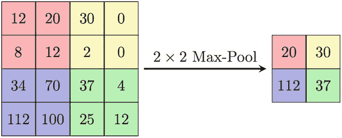

一个示意图，展示了在 4x4 数字网格上进行的 2x2 最大池化操作。原始网格包含的值：第一行 12, 20, 30, 0；第二行 8, 12, 2, 0；第三行 34, 70, 37, 4；第四行 112, 100, 25, 12。应用最大池化后，得到的 2x2 网格显示了每个 2x2 区域的最大值：第一行 20, 30；第二行 112, 37。一个标有“2 x 2 最大池化”的箭头从原始网格指向结果网格。

图 8-13

最大池化算子

在分类任务中，最大池化是首选，因为它能突出最显著的特征，在检测清晰锐利特征（如边缘）至关重要的任务中，通常能带来更好的性能。

#### 步长

第二种降尺度方法是增加 Conv2D 算子本身的*步长*。步长表示卷积核在图像上移动的幅度。默认情况下为 1，但这并非强制。例如，你可以将步长设置为等于卷积核大小，此时卷积发生在不重叠的块上（不要这样做，这只是一个例子！）。

将步长设置为 2 可以有效地将输出图像尺寸减半（见图 8-14）。

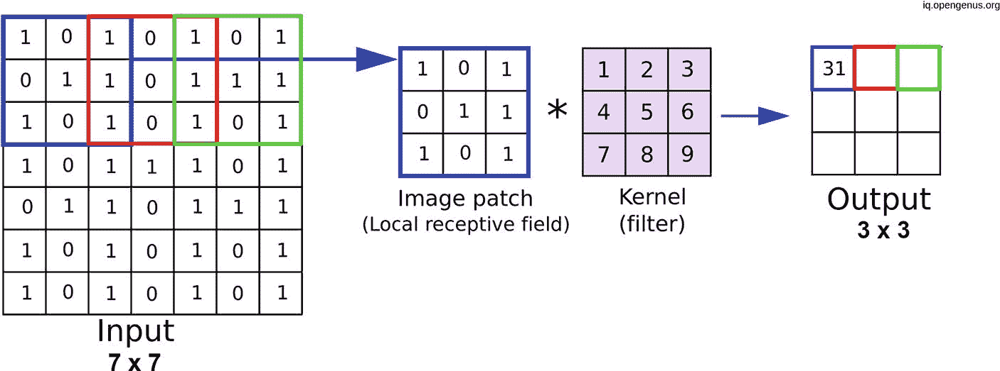

示意图展示了图像处理中的卷积操作。一个 7x7 的输入网格包含二进制值，其中高亮显示了一个 3x3 的图像块。该块与一个值为 1 到 9 的 3x3 卷积核滤波器相乘。结果是一个 3x3 的输出网格，第一个值计算为 31。该过程演示了如何使用局部感受野和卷积核将输入数据转换为输出。

图 8-14

步长的工作原理

表 8-1 总结了最大池化和步长为 2 之间的区别。

表 8-1

池化与步长对比

| 标准 | 最大池化 | 步长为 2 的卷积 |
| --- | --- | --- |
| **主要优势** | 保留最强特征（最大值）通常性能优于步长 | 训练期间卷积核权重“感知”下采样过程 |
| **信息保留** | 激进地减少数据（可能丢失信息） | 保留更多细微信息（更平滑） |
| **噪声鲁棒性** | 对噪声更鲁棒（聚焦于最大值） | 可能对噪声或细微偏移更敏感 |
| **计算成本** | 需要步长`=`1 的卷积，因此计算量更大 | 计算量仅为步长=1 时的 1/4 |
| **理想用例** | 强调锐利、突出的特征 | 逐步下采样，同时保留更多信息 |

在 TinyML 的背景下，我们必须精打细算每一次计算和内存分配，步长相比池化具有以下优势。

*   它沿两个轴所需的计算量减半，使其比全卷积快四倍。

*   它直接生成半尺寸图像，因此存储中间结果所需的内存更少。


### 如何训练二维卷积神经网络

让我们训练一个二维卷积神经网络，用于对包含猫狗图像的玩具数据集进行分类（列表 8-6）。该数据集包含在 *tinyml4all* 包中，共有 100 张图像（每个类别 50 张）。图像尺寸为 128×128，采用 RGB 模式。图 8-15 展示了数据集中的一些随机图像。


一张由八张猫狗图像组成的拼贴画。第一行：一只棕白相间狗的特写，一只在田野里的长毛狗，一只坐在沙发上的虎斑猫，以及一只裹着彩色毯子的虎斑猫。第二行：一只在花园中奔跑的狗，一只在草地上奔跑的金毛猎犬，一只坐在灰色背景前的虎斑猫，以及一只在沙发上慵懒躺着的虎斑猫。每只动物都以写实风格呈现。

图 8-15

猫狗示例

注意

这是图像分类，而非目标检测！模型无法定位图像中狗或猫的具体位置。它只能判断图像中呈现的是狗还是猫。

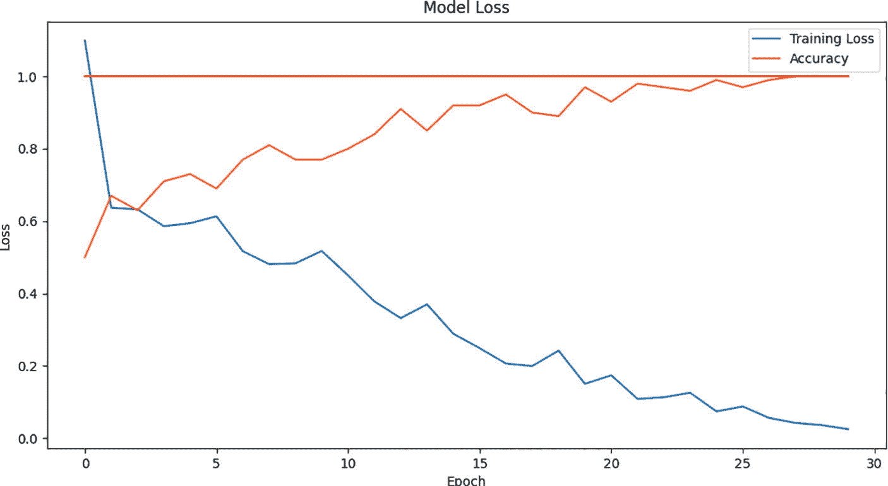

折线图标题为“模型损失”，展示了 30 个训练周期内的训练损失和准确率。蓝色线条代表训练损失，起始值较高并稳步下降，表明模型性能在提升。橙色线条代表准确率，始终接近 1.0，表明在整个训练周期中准确率保持稳定。

图 8-16

二维卷积神经网络的损失与准确率

```
from tinyml4all.tensorflow import CNN2D
from tinyml4all.tensorflow.layers import Conv2D, MaxPooling2D, Perceptron
from tinyml4all.datasets import Pets
cnn = CNN2D(input_shape=(48, 48))
# 卷积层 + 最大池化层示例
# 8 是卷积核的数量
cnn.add(Conv2D(8, kernel_size=3))
cnn.add(MaxPooling2D())
# 带步长的卷积层示例
cnn.add(Conv2D(16, kernel_size=3, strides=2))
# 步长与最大池化
# （结果尺寸变为原来的 1/4）
cnn.add(Conv2D(24, kernel_size=3, strides=2))
cnn.add(MaxPooling2D())
# 输出层前的全连接层
cnn.add(Perceptron(32))
# 显示网络架构
print(nn.compile(Pets.X, Pets.Y))
Model: "sequential"
_______________________________________________________________
Layer (type)                Output Shape              Param #
===============================================================
conv2d (Conv2D)             (None, 94, 94, 8)         224
max_pool2d (MaxPooling2D)   (None, 47, 47, 8)         0
conv2d_1 (Conv2D)           (None, 23, 23, 16)        1168
conv2d_2 (Conv2D)           (None, 11, 11, 24)        3480
max_pool2d_1 (MaxPooling2D  (None, 5, 5, 24)          0
flatten (Flatten)           (None, 600)               0
dense (Dense)               (None, 32)                19232
dense_1 (Dense)             (None, 2)                 66
===============================================================
Total params: 24170 (94.41 KB)
Trainable params: 24170 (94.41 KB)
Non-trainable params: 0 (0.00 Byte)
_______________________________________________________________
# 训练神经网络并显示准确率图
cnn.fit(Pets.X, Pets.Y, epochs=50, plot=True)
# 打印验证集上的准确率
print(cnn.classification_report())
precision    recall  f1-score   support
dog       0.67      0.73      0.70        11
cat       0.62      0.56      0.59         9
accuracy                           0.65        20
macro avg       0.65      0.64      0.64        20
weighted avg       0.65      0.65      0.65        20
+-------------------+-----+-----+
| 真实值 vs 预测值   | 狗  | 猫  |
+-------------------+-----+-----+
|        狗         |  8  |  3  |
|        猫         |  4  |  5  |
+-------------------+-----+-----+
cnn.convert_to("c++", class_name="CNN2D", save_to="PetsCNN2D.h")
列表 8-6
训练用于图像分类的二维卷积神经网络
```

#### 如何部署二维卷积神经网络

要运行二维卷积神经网络，你需要一个二维输入。这可以是一张图像、随时间变化的传感器数值，或多点传感器读数。不过，在这种情况下，最重要的是 TensorFlow 运行时*期望一维输入数据*，即使它代表的是二维实体。因此，你必须首先*展平*你的输入，并以*数组*而非矩阵的形式提供。以下是常见数据类型展平技术的示例。

*   **图像**：灰度图像的预期输入格式是*行优先*（第一行的像素，第二行的像素，依此类推）。对于 RGB 图像，格式为 R[1], G[1], B[1], R[2], G[2], B[2]，以此类推。灰度情况适用于所有其他类似图像的输入。

*   **随时间变化的传感器**：预期输入格式是*时间优先*（传感器 A[t=1], 传感器 B[t=1], 传感器 A[t=2], 传感器 B[t=2]）。

基于这些假设，列表 8-7 在一张 48×48 的灰度图像上运行了一个二维卷积神经网络，该图像存储为展平的 `uint8_t` 数组（类似于你从 ESP32 或 Nicla Vision 摄像头获取的数据）。

```
#include "./PetsCNN2D.h"
// ARENA 是为模型预留的内存量
// 更大的模型需要更多内存，但没有
// 计算最优值的公式
// 这是一个试错过程
#define ARENA 20000
tinyml4all::CNN2D cnn;
uint8_t dog[48*48] = {…};
uint8_t cat[48*48] = {…};
void setup() {
Serial.begin(115200);
while (!Serial);
Serial.println("TensorFlow 二维卷积神经网络演示");
cnn.begin();
}
void loop() {
// 对狗图像进行分类
if (!cnn.predict(dog)) {
Serial.println(nn.error());
return;
}
// .label 保存预测类别的名称
// .output 保存数值输出（用于回归）
//         或类别 ID（用于分类）
// .outputs 是一个包含所有输出的数组
//          （对于分类，每个类别一个输出）
// .runtime_ms 保存预测的持续时间
// outputsAsString 返回每个类别的得分，范围
//                 从 0 到 1（仅限分类）
Serial.print("期望是狗，预测为 ");
Serial.print(cnn.label);
Serial.print("，置信度为 ");
Serial.println(cnn.confidence);
Serial.print(" > 得分: ");
Serial.println(cnn.outputsAsString());
// 对猫图像进行分类
if (!cnn.predict(cat)) {
Serial.println(cnn.error());
return;
}
Serial.print("期望是猫，预测为 ");
Serial.print(cnn.label);
Serial.print("，置信度为 ");
Serial.println(cnn.confidence);
Serial.print(" > 得分: ");
Serial.println(nn.outputsAsString());
delay(1000);
}
列表 8-7
在 Arduino 上运行二维卷积神经网络
```

## 总结

本章是对微控制器 TensorFlow 这一高级主题的实践性介绍。该框架允许你释放神经网络的全部潜力，但正如人们所说，“能力越大，责任越大。”调整一个既能达到令人满意的准确率，又能尽可能精简以便在嵌入式硬件上高效部署的网络拓扑结构，可能是一项艰巨的任务。

神经网络有多种形状和规模，在此我尝试展示最常见的配置，以及那些肯定能在兼容 Arduino 的硬件上运行的配置：用于表格数据的全连接网络、用于时间序列的 LSTM 和一维卷积神经网络、用于图像（及类似数据）的二维卷积神经网络。由于 TinyML 是一个不断发展的领域，在不久的将来，应该会有更多替代方案可供你添加到工具集中。

即使需要练习，一旦你积累了经验并开始掌握神经网络的技巧，你将能够在你的开发板上运行令人惊讶的具有挑战性的任务，而无需连接外部 PC 或云服务。这将极大地提升你的生产力，并重新定义小型设备所能实现的可能。


索引 A 激活函数 APDS9960 传感器 Arduino Arduino 草图 CLI（命令行界面） FruitChain.h 库，tinyml4all Python 到 C++ 警告 Arduino Nano BLE Sense 板 内置 IMU Arduino 草图 回归 人工智能 (AI) 音频 音频二进制串行输出 使用 Edge Impulse 进行音频分类 音频数据 使用 Edge Impulse 进行音频唤醒词检测 二分类任务 麦克风 适用于 Arduino 板的麦克风 Python 脚本 tinyml4all Arduino 库 Azure 仪表板凭据 Azure 文本转语音 (TTS) B 反向传播（反向传播） 偏置 二值化 二分类 二分类器 分箱（桶化） Box-Cox 变换 C 捕获数据 回归 表格数据 分类 收集数据 质量 RGB 组件 保存到 SD 卡 串行监视器并手动复制粘贴数据 来自 Python 的串行输出 时间序列分类 连续手势 从串行 IMU 复制/粘贴 加载并检查数据 绘制时间序列数据 Python 串行 Python 串行监视器 分类链 分类模型 优点和缺点 决策树 线性/非线性 逻辑回归 内存需求 随机森林 鲁棒性/对特征缩放的不变性 SVM tinyml4all XGBoost 分类，表格数据 Arduino Arduino Nano BLE Sense 捕获数据 分类链 分类模型 特征工程 特征缩放 特征选择 加载并检查数据 软件 Python 虚拟环境 tinyml4all Arduino 库 TCS3200 颜色传感器 工作流程 CNN 参见卷积神经网络 (CNN) 决定系数 逗号分隔值 (CSV) 编码 计算机视觉模型 混淆矩阵 连续运动分类器 数据，1D CNN Conv2D 算子 卷积 卷积神经网络 (CNN) CS CSV 向导 D 数据采集 数据集生成过程 数据类型 音频 图像和空间数据 表格数据 时间序列数据 决策树 深度学习 缺点 特征提取 优化 流行度和可访问性 密集层 部署 降维 降采样策略 E EdgeAI Edge Impulse 准确性 音频分类 音频数据和图像 边界框绘制工具 分类 混淆矩阵 CSV 向导 数据采集 数据集统计 设计 开发工作流程 特征提取 配置 GUI 标签方法选择 标签队列 菜单项 学习模块 低代码平台 低代码工具 频谱分析模块 合成数据集 时间序列数据模块 训练配置 训练/测试分割 上传文件 唤醒词检测 测试 工作流程 嵌入式摄像头传感器 情节性运动 欧几里得范数 指数算子 极端梯度提升 (XGBoost) F FCNN 参见全连接神经网络 (FCNN) 特征装袋 特征离散化 特征工程 用于图像分类和目标检测 回归 单调函数映射 多项式特征扩展 特征缩放 特征选择 分类指标 RFE 基于分数的选择 顺序特征选择 FOMO 模型 频域特征 FruitChain.h 全连接神经网络 (FCNN) 特征 密集层 神经元 感知器 G 泛化 GPU 参见图形处理单元 (GPU) 梯度提升 图形处理单元 (GPU) 真实值 H 人类活动识别 I, J 图像生成模型 图像识别 图像和空间数据 脉冲设计 IMU 参见惯性测量单元 (IMU) IMU 传感器 惯性测量单元 (IMU) 推理/前向传播 推理时间 基于实例的特征缩放策略 基于实例的缩放 集成电路内置音频总线 (I2S) 物联网 (IoT) IoT 参见物联网 (IoT) I2S 参见集成电路内置音频总线 (I2S) K 核 核技巧 关键词识别 (KWS) KWS 参见关键词识别 (KWS) L 大型语言模型 (LLM) 学习模块 激光雷达点云 LLM 参见大型语言模型 (LLM) L-最大范数 加载并检查数据 回归 表格数据 分类 操作表格 所有类别一个文件 每个类别一个文件 在 Python 中绘制数据 脚本 tinyml4all 包 可视化检查 局部感受野 对数压缩 (dB) 逻辑函数 逻辑回归 L1 和 L2 范数 长短期记忆网络 (LSTM) LSTM 参见长短期记忆网络 (LSTM) M 机器学习 (ML) 优势 定义 特征工程 真实值 推理 指标 微控制器 (MCU) 过拟合 回归 *vs.* 分类 监督 *vs.* 无监督 测试集 Tiny 参见微型机器学习 *vs*. 传统编程 训练数据 训练集 数据类型 欠拟合 验证集 MAE 参见平均绝对误差 (MAE) 磁力计数据 进行预测 曼哈顿范数 操作表格 应用标签 DataFrame 单列 列子集 行子集 矩阵，配对图 最大池化算子 MCU 参见微控制器 (MCU) 平均绝对误差 (MAE) 梅尔滤波器组 梅尔频谱图 内存约束 指标 二分类 准确率 精确率 召回率 不平衡 多分类 回归 微控制器 (MCU) 带宽 延迟 低功耗 个人电脑/云计算 隐私 普适计算 最小-最大归一化 ML 参见机器学习 (ML) MLP 参见多层感知器 (MLP) MobileNetV2 模型 准确率 多分类 混淆矩阵 鸢尾花数据集 非对角线值 多层感知器 (MLP) N 神经网络 结构 拓扑 噪声 鲁棒性改进 归一化 NVIDIA Jetson Nano O 使用 Edge Impulse 进行目标检测 基于 Arduino Arduino 草图 部署 基于 ESP32 ESP32-S3 摄像头 泛化属性 模型测试页面 Python 端 tinyml4all Arduino 库 宽度乘数 OLS 参见普通最小二乘法 (OLS) 1D CNN 参见一维卷积神经网络 (1D CNN) 一维卷积神经网络 (1D CNN) 独热编码 普通最小二乘法 (OLS) 异常值 过拟合 P, Q 配对图矩阵 PDM 参见脉冲密度调制 (PDM) 感知器 感知对齐 物理计算 绘制数据 低质量输入 配对图矩阵 2D 散点图 类型 绘制时间序列数据 绘制回归数据 多个输入，多个散点 一个输入 池化层 基于总体的缩放 接近度计 脉冲密度调制 (PDM) Python 串行 来自虚拟环境的输出 R 随机森林 树莓派 树莓派 Zero 速率限制 原因 最大池化 修正线性单元 (ReLU) 循环神经网络 (RNN) 在 Arduino 上 拓扑结构，序列数据 递归特征消除 (RFE) 回归 Arduino Nano BLE Sense 捕获数据 链 链到 C++ 特性 决定系数 颜色传感器 距离预测 距离传感器 特征工程 加载并检查数据 MAE 单调函数映射 OLS 绘制回归数据 随机森林 超声波传感器 回归 *vs*. 分类 气温 二分类 输入和输出 多分类 多标签分类 单标签分类 一对多策略 一对一策略 ReLU 参见修正线性单元 (ReLU) RFE 参见递归特征消除 (RFE) RGB 组件 RMSE 参见均方根误差 (RMSE) RNN 参见循环神经网络 (RNN) 鲁棒归一化 鲁棒缩放 均方根误差 (RMSE) 在加速度计数据上运行 LSTM 网络 在 Arduino 上运行 MLP S 基于分数的选择 SD 卡 传感器值 顺序特征选择 音频样本的顺序图 移位参数 短时傅里叶变换 (STFT) 单时间序列 频谱分析模块 频谱特征 频谱图 STFT 参见短时傅里叶变换 (STFT) 步长 监督 *vs.* 无监督机器学习 支持向量机 (SVM) 支持向量 SVM 参见支持向量机 (SVM) 合成未知词 合成唤醒词生成 T 表格数据 特性 列表示特征 特征/变量 固定模式 同质数据 回归 参见回归 行隔离 行表示样本 结构化数据 t-分布随机邻域嵌入 (t-SNE) 温度/距离图 TensorFlow 模型 Arduino IDE，搜索 部署比率 硬件要求 针对微控制器 tensorflow-runtime-universal Arduino 库 验证比率 文本转语音 第三方数据集 时间约束 时域特征 时频表示 飞行时间原理 时间序列分类 捕获数据 连续运动分类器 部署 Arduino 库 缓存失效 编译时间 推理 串行输出 在加速度计数据上运行脉冲 Edge Impulse 参见 Edge Impulse 特征工程 IMU 磁力计 无代码工具 Python 到 C++ 捕获数据 数据标注 部署到 Arduino 情节性时间序列 分类链 特征工程 手势 IMU 传感器 磁力计 媒体控制设备 下一首/上一首 播放/暂停 增大/减小音量 统计 测试 时间序列数据 时间序列数据模块 时间序列特征工程 优点和缺点 FIFO（先进先出）数据结构 频率 频域特征 机器学习模型 Python 自相关 多维数据 一对多 形状指标 统计矩 窗口化 时间分析数据 时域特征 窗口逻辑 数据窗口 TinyML 定义 EdgeAI 使能因素 联邦学习 硬件 人类活动识别 图像分类和目标检测 图像生成模型 关键词识别 激光雷达点云 LLM 设备端学习 优化 预测性维护 质量要求 树莓派 Zero 可靠且令人满意 资源密集型硬件 TensorFlow tinyml4all tinyml4all Arduino 库 tinyml4all.tabular.classification 二维卷积神经网络 (2D CNN) 2D 散点图 U 普适计算 超声波传感器 上传数据 V 验证损失 虚拟环境，Python 可视化调试 语音助手设备 W 唤醒词数据集 唤醒词检测 输出 X XGBoost 参见极端梯度提升 (XGBoost) Y Yeo-Johnson 变换 Z Z-score 归一化
